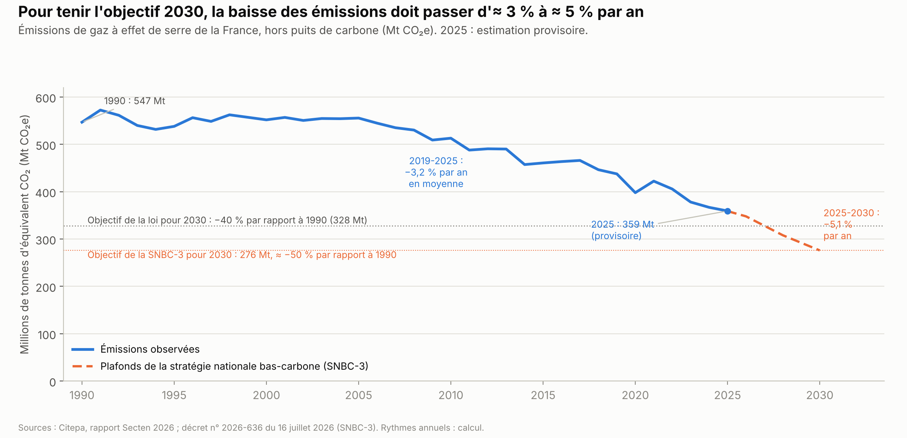
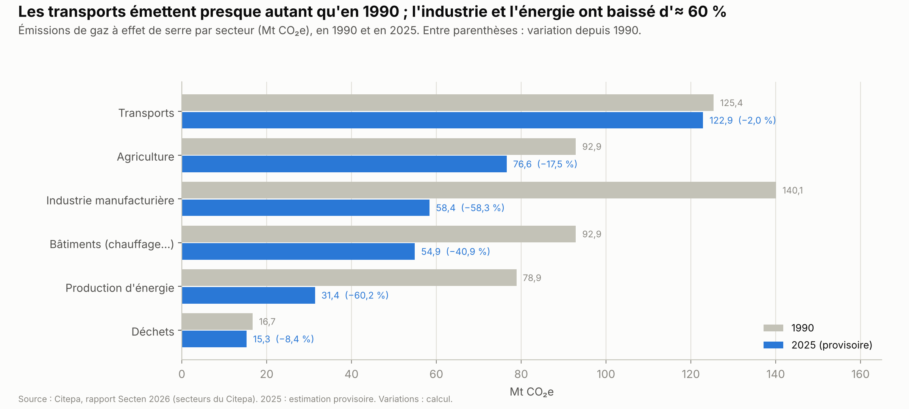
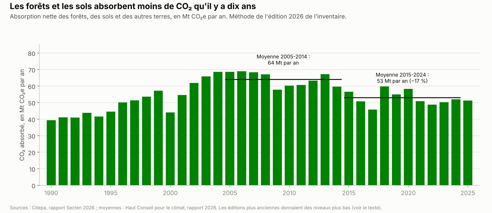
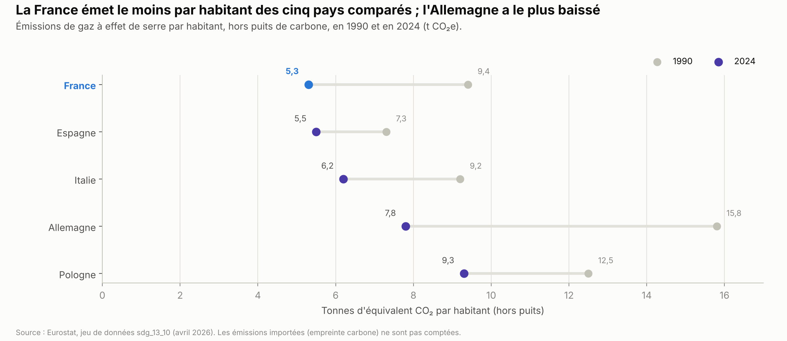
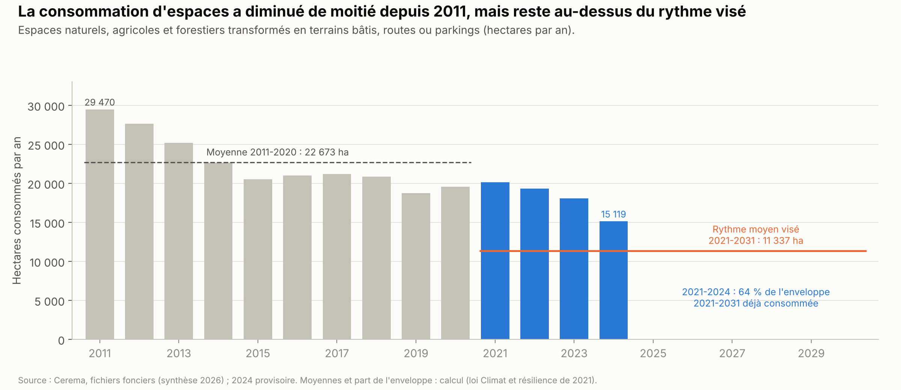
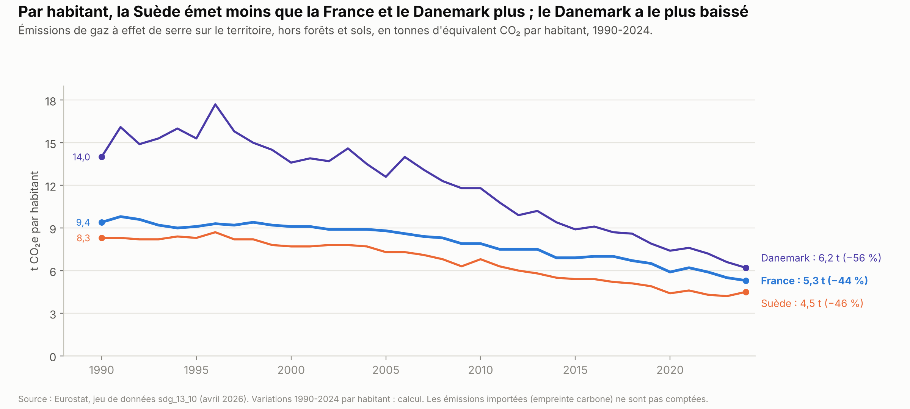

# Climat et environnement

*Version de travail du 7 octobre 2026. Les chiffres seront mis à jour à la date d'arrêt des données de l'édition 1.*

Ce chapitre présente les émissions de gaz à effet de serre de la France, ses objectifs et les effets du réchauffement. Il traite aussi l'eau, les pesticides, la biodiversité, les sols et la pollution de l'air. Il compare la France à la Suède et au Danemark. Il présente ensuite les propositions des partis et ce qu'on sait des mesures déjà essayées.

**Voir aussi :**
- [Énergie](../energie/energie_france_europe_allemagne.md), pour l'électricité, les carburants et les mesures d'électrification : zones à faibles émissions, fin des voitures thermiques neuves en 2035, marché carbone pour le chauffage et les carburants (ETS2), aides à la rénovation ;
- [Logement](../logement/logement.md), pour les logements mal isolés et l'effet du « zéro artificialisation nette » sur la construction ;
- [Défense et Europe](../defense-europe/defense_europe.md), section 1.9, pour l'accord commercial entre l'Union européenne et le Mercosur ;
- [Finances publiques](../finances-publiques/finances_publiques.md), pour le budget de l'État ;
- [Présidentielle 2027 : ce que proposent les partis](../partis/programmes_partis_2027.md), pour les programmes complets.

> **Repères.**
> - **Gaz à effet de serre.** Le dioxyde de carbone (CO₂), le méthane, le protoxyde d'azote et les gaz fluorés retiennent la chaleur dans l'atmosphère. On les additionne en **millions de tonnes d'équivalent CO₂ (Mt CO₂e)** : chaque gaz est converti selon son effet sur le réchauffement.
> - **Émissions brutes et nettes.** Les forêts et les sols absorbent une partie du CO₂ : c'est le **puits de carbone**. Les émissions nettes sont les émissions brutes moins ce puits. Sauf mention contraire, ce chapitre donne les émissions brutes.
> - **Émissions territoriales et empreinte.** Les émissions territoriales sont celles qui ont lieu en France. L'**empreinte carbone** compte celles de la consommation des Français, importations comprises.
> - **Les principaux acteurs.**
>   - Le Citepa (Centre interprofessionnel technique d'études de la pollution atmosphérique) établit l'inventaire officiel des émissions.
>   - Le Haut Conseil pour le climat (HCC), organisme indépendant, évalue chaque année la politique climatique.
>   - La stratégie nationale bas-carbone (SNBC), fixée par décret, répartit l'effort par secteur et fixe des « budgets carbone » : des plafonds d'émissions sur cinq ans.

---

## L'essentiel

1. **La France a émis ≈ 359 Mt CO₂e en 2025, 34 % de moins qu'en 1990** (Citepa, estimation provisoire). La baisse a été de 6,8 % en 2023, 3,0 % en 2024 et 2,1 % en 2025.
2. **Pour l'objectif de 2030, il faudrait baisser d'≈ 5 % par an.** La stratégie nationale bas-carbone vise 276 Mt en 2030, soit ≈ −50 % par rapport à 1990. Selon le Haut Conseil pour le climat, le rythme « doit s'accélérer et au moins doubler ».
3. **Les transports émettent 34 % du total, presque autant qu'en 1990.** L'agriculture en émet 21 %, surtout du méthane de l'élevage. L'industrie et la production d'énergie ont baissé d'≈ 60 % depuis 1990.
4. **Les forêts absorbent moins de CO₂ qu'il y a dix ans**, à cause des sécheresses et des maladies. L'empreinte carbone, importations comprises, atteint 8,2 t par habitant en 2024, contre 5,3 t sur le territoire.
5. **La France s'est réchauffée de 2,2 °C depuis le début du XXe siècle** (Haut Conseil pour le climat). Plus de 5 700 décès sont attribuables à la chaleur à l'été 2025. Le pays prépare son adaptation à +4 °C en 2100.
6. **Pesticides : le diagnostic dépend de l'indicateur.** Selon le ministère, le risque calculé (indicateur de risque harmonisé, HRI1) a baissé de 47 % depuis 2011-2013 ; le nombre de doses utilisées a augmenté de 3 %. Une loi de 2026 permet des dérogations pour deux insecticides interdits en France, dont l'acétamipride, un néonicotinoïde.
7. **La consommation d'espaces naturels a diminué de moitié depuis 2011**, à 15 119 hectares en 2024. Mais 64 % de ce que la loi permet pour 2021-2031 a été utilisé en quatre ans *(calcul)*.

**Les grandes options en débat.**
- **Réduire les émissions** : par un prix du carbone, des normes ou des investissements publics ; et qui paie.
- **Adaptation** : en faire la priorité, ou la mener avec la baisse des émissions.
- **Agriculture et eau** : réduire les pesticides et partager les prélèvements, ou alléger les règles et stocker l'eau l'hiver.
- **Sols** : garder, assouplir ou supprimer le « zéro artificialisation nette ».
- **Europe** : poursuivre le Pacte vert européen, ou le suspendre.

---

## 1. La situation

### 1.1 Les émissions de la France : niveau et rythme

**Le niveau.** Selon l'inventaire du Citepa (édition 2026), la France a émis :
- 367,0 Mt CO₂e en 2024, en baisse de 3,0 % sur un an[^citepa-secten-2026] ;
- 359,4 Mt CO₂e en 2025, en baisse de 2,1 % : c'est une estimation provisoire, qui sera révisée en 2027[^citepa-secten-2026] ;
- soit 5,2 t par habitant en 2025, et 34 % de moins qu'en 1990 (546,9 Mt)[^citepa-secten-2026][^citepa-secten-2026-donnees].

Avec le puits de carbone, les émissions nettes atteignent 308 Mt en 2025[^mte-fiche-secten-2026]. Au premier trimestre 2026, les émissions étaient en baisse de 4,8 % sur un an, avec un hiver doux (Citepa, 8 juillet 2026)[^citepa-barometre-t1-2026]. C'est une estimation provisoire : une première version donnait −5,2 %[^citepa-secten-2026].

**Une baisse récente.** Les émissions sont restées stables de 1990 à 2005, autour de 530 à 570 Mt par an. Elles baissent depuis : de 1,7 % par an en moyenne entre 2005 et 2019, puis de 3,2 % par an entre 2019 et 2025 *(calcul)*[^citepa-secten-2026-donnees]. Cette dernière période inclut le confinement de 2020 et le retour des réacteurs nucléaires après 2022. Selon le Haut Conseil pour le climat (rapport 2025), 4,8 des 6,9 Mt de baisse alors estimés pour 2024 venaient d'effets passagers : hiver doux, retour des réacteurs nucléaires[^hcc-2025]. La baisse de 2024 a depuis été révisée, de −1,8 % à −3,0 %[^hcc-2025][^citepa-secten-2026].

**Le rythme nécessaire.** La stratégie nationale bas-carbone (SNBC-3), adoptée par décret le 16 juillet 2026, fixe un plafond indicatif de 276 Mt pour 2030. Le décret fixe des plafonds annuels qui baissent jusqu'en 2038[^decret-snbc3].
- Passer de 359 Mt en 2025 à 276 Mt en 2030 demande une baisse de 5,1 % par an *(calcul)*[^citepa-secten-2026][^decret-snbc3]. Le ministère de la Transition écologique, qui retient 274 Mt, calcule 5,3 % par an[^mte-fiche-secten-2026].
- Selon le Haut Conseil pour le climat (rapport de juillet 2026), le rythme « doit s'accélérer et au moins doubler », à « plus de 4 % par an » en 2026-2028[^hcc-2026].
- Les plafonds de 2024 et 2025 sont respectés. Mais, selon le Haut Conseil, c'est parce que la trajectoire de la SNBC-3 « a été alignée sur le ralentissement observé »[^hcc-2026].

**Quelle part du monde ?**
- La France émet ≈ 0,75 % des gaz à effet de serre mondiaux en 2023, selon Science Feedback, un site de vérification des faits scientifiques[^sciencefeedback-bardella]. Pour le seul CO₂ d'origine fossile, sa part est de 0,68 % en 2024 (Global Carbon Project, cité par Our World in Data)[^owid-co2-france].
- Sa part de la population mondiale est d'≈ 0,8 % *(calcul)* : 69,1 millions d'habitants au 1er janvier 2026 (Insee)[^insee-demographie-2025], sur ≈ 8,3 milliards (Nations unies)[^onu-wpp-2024].
- Depuis 1751, la France a émis 2,2 % du CO₂ d'origine fossile mondial (Global Carbon Project)[^owid-co2-france].

### 1.2 D'où viennent les émissions

- **Les transports** sont le premier secteur émetteur (34 % en 2025). Leurs émissions sont proches de celles de 1990 (−2 % *(calcul)*)[^citepa-secten-2026-donnees]. Les mesures sur les voitures et les carburants sont traitées dans le chapitre [Énergie](../energie/energie_france_europe_allemagne.md).
- **L'agriculture** émet 21 % du total[^citepa-secten-2026-donnees]. Elle produit 71 % du méthane et 81 % du protoxyde d'azote émis en France (Citepa)[^citepa-synthese-2026]. Selon le service statistique du ministère (SDES), 60 % de ses émissions viennent de l'élevage : digestion des ruminants, fumier et lisier. Les cultures en émettent 27 %, surtout par les engrais azotés, et les engins, machines et chaudières 13 %[^sdes-climat-agriculture]. Elles ont baissé de 17,5 % depuis 1990 *(calcul)*[^citepa-secten-2026-donnees]. Selon le Citepa, le méthane baisse avec la diminution du nombre de bovins[^citepa-synthese-2026].
- **L'industrie** (16 %) et **la production d'énergie** (9 %) ont le plus baissé depuis 1990 : −58 % et −60 % *(calcul)*[^citepa-secten-2026-donnees].
- **Les bâtiments** (15 %) émettent surtout par le chauffage. Leurs émissions ont baissé de 41 % depuis 1990 *(calcul)*[^citepa-secten-2026-donnees].
- **Les déchets** représentent 4 % du total[^citepa-secten-2026-donnees].

### 1.3 Le puits de carbone des forêts et des sols

Les forêts et les sols absorbent une partie du CO₂ émis. En 2024, ce puits a retiré 52 Mt CO₂e de l'atmosphère, soit ≈ 14 % des émissions (Citepa)[^citepa-secten-2026].

- **Il absorbe moins qu'il y a dix ans.** Selon le Haut Conseil pour le climat, il est passé de 64 Mt par an en moyenne en 2005-2014 à 53 Mt en 2015-2024, soit −17 %[^hcc-2026].
- **Les mesures en forêt vont dans le même sens.** Selon l'Institut national de l'information géographique et forestière (IGN, 2025), le carbone stocké chaque année par les arbres vivants est passé de 63 Mt CO₂ (2005-2013) à 39 Mt (2015-2023). La mortalité des arbres a plus que doublé (+125 %)[^ign-ifn-2025].
- **Les causes** : sécheresses et canicules répétées depuis 2015, maladies et insectes (scolytes sur l'épicéa, chalarose du frêne), croissance plus lente, récoltes de bois en hausse (IGN ; Citepa)[^ign-ifn-2025][^citepa-secten-2026].
- **Des chiffres révisés.** Le puits de 2022 valait 18,5 Mt dans l'édition 2024 de l'inventaire[^citepa-secten-2024], et 48,8 Mt dans l'édition 2026[^citepa-secten-2026-donnees]. Ce n'est pas une remontée réelle : le Citepa a changé de méthode. Il compte désormais le bois mort et la forêt guyanaise, et corrige les défrichements[^citepa-secten-2026]. Il faut donc toujours dater l'édition d'un chiffre.
- **La SNBC-3 prévoit un puits plus faible** : 46 Mt par an en 2024-2028, puis 33 Mt en 2029-2033[^decret-snbc3]. Pour atteindre la neutralité carbone en 2050, un puits plus faible oblige à baisser davantage les émissions brutes.

### 1.4 L'empreinte carbone : les émissions de notre consommation

L'empreinte carbone compte les émissions liées à ce que consomment les Français, où qu'elles aient lieu. Elle exclut les émissions des produits exportés.
- Elle atteint 563 Mt CO₂e en 2024, soit 8,2 t par habitant, selon l'Institut national de la statistique et des études économiques (Insee, estimation provisoire)[^insee-ip-2077]. C'est plus que les émissions sur le territoire la même année : 5,3 t par habitant (Eurostat)[^eurostat-sdg1310]. Elle a baissé de 3,4 % en un an et de 20 % depuis 1990[^insee-ip-2077][^sdes-empreinte-2024].
- La moitié vient des importations (284 Mt), contre 40 % en 1990. Le reste vient de la production en France (32 %) et des émissions directes des ménages, voitures et chauffage (18 %)[^insee-ip-2077].
- Selon le Haut Conseil pour le climat, entre 2015 et 2024, les émissions importées ont baissé de 6 %, les émissions territoriales de 22 %[^hcc-2026].

### 1.5 Les objectifs : France et Union européenne

**En France.**
- **La loi** (code de l'énergie, loi énergie-climat de 2019) vise −40 % en 2030 par rapport à 1990 et la neutralité carbone en 2050 : des émissions nettes nulles[^ce-grande-synthe-2025][^decret-snbc3].
- **La SNBC-3** (décret n° 2026-636 du 16 juillet 2026) va plus loin : ≈ −50 % en 2030, soit 276 Mt. Ses budgets carbone sont de 342 Mt par an en moyenne en 2024-2028, 262 Mt en 2029-2033 et 194 Mt en 2034-2038[^decret-snbc3]. Elle prévoit de sortir du charbon en 2030, du pétrole en 2045 et du gaz en 2050, selon l'Agence France-Presse *(source secondaire)*[^afp-snbc3].
- **La loi de programmation énergie-climat**, prévue par le code de l'énergie avant juillet 2023[^hcc-2025], n'a pas été trouvée au 7 octobre 2026 *(à vérifier)*. Le Haut Conseil pour le climat demande une « loi de programmation de la transition écologique » en début de législature[^hcc-2026].

**Dans l'Union européenne.**
- **2030** : −55 % d'émissions nettes par rapport à 1990 (loi européenne sur le climat, 2021)[^ce-loi-climat].
- **2040** : −90 % d'émissions nettes (règlement (UE) 2026/667, en vigueur depuis le 7 avril 2026)[^reg-ue-2026-667]. À partir de 2036, des crédits carbone achetés hors de l'UE pourront compter, jusqu'à 5 % des émissions de 1990[^conseil-ue-2040]. La Commission évaluera tous les deux ans s'il faut réviser l'objectif[^pe-2040]. Le même texte reporte à 2028 le marché carbone pour le chauffage et les carburants (chapitre Énergie)[^icap-2040].
- **La part de la France** : hors centrales et grande industrie, qui relèvent du marché carbone européen, la France doit baisser ses émissions de 47,5 % entre 2005 et 2030 (règlement (UE) 2023/857). L'Allemagne doit les baisser de 50 %, l'Italie de 43,7 %, l'Espagne de 37,7 %[^reg-ue-2023-857].

**Comparaison européenne.**

- La France a les émissions par habitant les plus basses des cinq pays comparés, en partie grâce à une électricité nucléaire et renouvelable (chapitre Énergie). La Suède émet moins par habitant (section 1.12)[^eurostat-sdg1310].
- Entre 1990 et 2024, ses émissions totales ont baissé de 33 %, contre 48 % en Allemagne, 30 % en Italie, 28 % en Pologne et 6 % en Espagne *(calcul sur les données d'Eurostat)*. L'Allemagne partait de plus haut : 15,8 t par habitant en 1990, contre 9,4 t en France (Eurostat)[^eurostat-sdg1310].

**Les juges.**
- **Affaire Grande-Synthe.** Saisi par la commune, le Conseil d'État avait ordonné en 2021 puis en 2023 à l'État de prendre des mesures supplémentaires. Le 24 octobre 2025, il a jugé ces décisions « entièrement exécutées »[^ce-grande-synthe-2025]. Il a vérifié l'objectif de −40 % en 2030, pas les objectifs européens adoptés depuis[^gossement-grande-synthe]. Il a constaté que les émissions de 2019 à 2025 restaient sous les plafonds, par exemple 406 Mt par an en moyenne en 2019-2023, pour 425 autorisés. Selon la projection qu'il a retenue, les mesures adoptées fin 2023 mèneraient à −39,5 % en 2030, proche de l'objectif[^ce-grande-synthe-2025].
- **Affaire du siècle.** En 2021, le tribunal administratif de Paris a ordonné à l'État de réparer le dépassement de son premier budget carbone (15 Mt). En décembre 2023, il a jugé la réparation « tardive » mais « complète »[^ta-paris-affaire-siecle]. L'appel des associations est devant la cour administrative d'appel de Paris[^greenlaw-affaire-siecle] ; aucune décision n'a été trouvée au 7 octobre 2026.

### 1.6 Les effets du réchauffement et l'adaptation

**Le réchauffement observé.** En France hexagonale, la température moyenne de 2016-2025 dépasse de 2,2 °C celle de 1900-1930, selon le Haut Conseil pour le climat. Le réchauffement mondial dû aux activités humaines atteint 1,4 °C en 2025[^hcc-2026].

**La chaleur tue.** Santé publique France compte plus de 5 700 décès attribuables à la chaleur à l'été 2025, soit plus de 3 % des décès de l'été ; près des trois quarts avaient 75 ans ou plus[^spf-ete-2025]. Pour l'été 2026, son bilan provisoire compte ≈ 7 800 décès en excès pendant les canicules *(calcul sur ses bulletins)*[^spf-bulletin-2026-09-16][^spf-canicule-aout-2026]. Les deux chiffres ne mesurent pas la même chose. Le premier porte sur tout l'été et sur les décès dus à la chaleur ; le second sur les jours de canicule et sur tous les décès au-delà de la normale.

**Le coût des catastrophes.**
- Les événements naturels ont coûté 5,2 Md€ aux assureurs en 2025, dont 2,2 Md€ pour la grêle et près de 1 Md€ pour la sécheresse, selon France Assureurs, la fédération des assureurs[^france-assureurs-2026]. Le coût était d'≈ 10 Md€ en 2022 *(source secondaire)*[^maireinfo-catastrophes-2023]. La fédération prévoit 143 Md€ de sinistres dus aux événements naturels sur 2020-2050, contre 73 Md€ sur 1989-2019[^france-assureurs-risques].
- Le régime public des catastrophes naturelles (« CatNat ») a payé 65,5 Md€ de 1982 à 2025, dont 41 % pour la sécheresse (Caisse centrale de réassurance, CCR)[^ccr-catnat-2025]. Ce sont surtout des maisons fissurées : quand un sol argileux sèche puis se réhydrate, il se rétracte puis gonfle.
- Pour financer le régime, la part de l'assurance habitation qui lui revient est passée de 12 % à 20 % le 1er janvier 2025 (CCR)[^ccr-catnat-2025].

**L'adaptation.** La France se prépare à un réchauffement de +2 °C en 2030, +2,7 °C en 2050 et +4 °C en 2100 par rapport à l'ère préindustrielle. C'est la « trajectoire de réchauffement de référence pour l'adaptation » (TRACC)[^climateadapt-pnacc3][^sdes-climat-consequences]. Le troisième plan national d'adaptation, publié le 10 mars 2025, compte 52 mesures[^climateadapt-pnacc3]. Quatorze personnes touchées par des catastrophes, soutenues par des associations, l'attaquent devant le Conseil d'État depuis juin 2025 ; elles estiment qu'il manque de financements et d'obligations[^requete-pnacc-2025][^sabin-pnacc]. Selon le Haut Conseil pour le climat (2026), « la France n'est pas prête à faire face aux impacts du changement climatique »[^hcc-2026-page].

### 1.7 Le coût de la transition et son financement

- **Les investissements pour le climat** ont atteint 102 Md€ en 2024, en baisse de 5 %. Ce chiffre vient de l'Institut de l'économie pour le climat (I4CE), un centre de recherche fondé par la Caisse des dépôts et l'Agence française de développement. Selon I4CE, ils doivent augmenter de 87 Md€ entre 2024 et 2030 pour atteindre les objectifs[^i4ce-panorama-2025].
- **Selon I4CE**, les dépenses publiques devraient augmenter en 2030 de 52 Md€ par an si l'État agit surtout par des aides, de 18 Md€ s'il combine aides, normes et prix du carbone[^i4ce-panorama-2025].
- **Selon le rapport Pisani-Ferry–Mahfouz** (France Stratégie, 2023), la transition demande « plus de deux points de PIB » d'investissements supplémentaires en 2030. Selon le rapport, elle pourrait alourdir la dette publique d'≈ 10 points de PIB en 2030 et 25 points en 2040[^pisani-mahfouz-2023].
- **Le Fonds vert** aide les collectivités à investir pour le climat. Selon I4CE, il est passé de 2,5 Md€ votés pour 2024, ramenés à 2 Md€ par décret, à 837 M€ votés pour 2026, ≈ 650 M€ après gel[^i4ce-fonds-vert-2026]. Le projet de budget pour 2027 annonce ≈ 1 Md€[^i4ce-budget-2027].
- **Le prix du carbone.** Les taxes sur les énergies fossiles comprennent une « composante carbone », gelée à 44,6 € par tonne de CO₂ depuis 2018[^cde-taxe-carbone]. Les tarifs de 2026 de l'accise sur les carburants n'ont pas été relevés, hors intégration des anciennes majorations régionales[^cnr-accise-2026]. Pour les centrales et l'industrie, le quota du marché carbone européen valait 73 € par tonne en moyenne aux enchères en 2025 (International Carbon Action Partnership, ICAP)[^icap-eu-ets].

### 1.8 L'eau

**Les nappes.** Au 1er septembre 2026, 61 % des points de mesure des nappes souterraines étaient sous leur niveau normal, contre 44 % un an plus tôt (Bureau de recherches géologiques et minières, BRGM)[^brgm-nappes-2026-09]. Selon le BRGM, la situation est « nettement moins préoccupante qu'en 2022 », sauf dans le Massif central, le Jura, les Vosges et le nord de l'Alsace[^brgm-nappes-2026-09].

**Qui utilise l'eau ?** Il faut distinguer l'eau prélevée et l'eau consommée, celle qui ne retourne pas au milieu naturel.

| Usage | Part de l'eau prélevée (2023) | Part de l'eau consommée (moyenne 2010-2019) |
|---|---|---|
| Refroidissement des centrales électriques | 45 % | 12 % |
| Canaux de navigation | 20 % | — |
| Eau potable | 18 % | 26 % |
| Agriculture (irrigation) | 10 % | 58 % |
| Industrie | 7 % | 4 % |

*Source : SDES[^sdes-prelevements-2023][^sdes-eau-2022] (France métropolitaine ; 28,9 milliards de m³ prélevés en 2023). Plus de 95 % de l'eau de refroidissement retourne aux rivières ; l'eau d'irrigation y retourne peu.*

**Le Plan eau** (mars 2023) vise −10 % de prélèvements d'ici 2030. Selon le bilan du ministère (avril 2026), ils ont baissé de 6,9 % entre 2018-2020 et 2023 ; 77 % des 53 mesures sont mises en œuvre. Le ministère précise que les sécheresses de 2022-2023 peuvent fausser la comparaison[^mte-plan-eau-2026].

**Les « méga-bassines ».** Ce sont de grandes réserves bâchées, remplies l'hiver en pompant dans les nappes ou les rivières, pour irriguer l'été.
- Leurs défenseurs y voient un moyen de reporter les prélèvements de l'été vers l'hiver. Leurs opposants contestent les volumes, le bénéfice réservé à une partie des agriculteurs et l'effet sur les nappes.
- Dans les Deux-Sèvres, 4 des 16 réserves prévues étaient construites en octobre 2025 *(source secondaire)*[^pleinchamp-bassines-2025]. Le 18 décembre 2024, la cour administrative d'appel de Bordeaux a jugé illégales 4 des 16 réserves prévues, dont celle de Sainte-Soline (arrêts n° 21BX02981 et 23BX01579). Il leur manquait une dérogation pour une espèce protégée, l'outarde canepetière, un oiseau de plaine ; leur exploitation est suspendue jusqu'à une éventuelle dérogation *(source secondaire)*[^bdt-bassines-2024]. En juillet 2024, le tribunal administratif de Poitiers a réduit de 22 % les prélèvements autorisés dans le Marais poitevin[^bdt-marais-poitevin-2024] ; la cour administrative d'appel de Bordeaux l'a confirmé en septembre 2025 *(source secondaire)*[^pleinchamp-bassines-2025].
- La loi d'urgence agricole d'août 2026 fixe l'objectif de doubler le stockage d'eau agricole d'ici 2035. Le Conseil constitutionnel l'a jugé conforme (décision du 14 août 2026)[^cc-2026-914].

**La qualité de l'eau potable.**
- En 2024, 71,5 % de la population a reçu une eau toujours conforme aux limites pour les pesticides, contre 96 % en 2015 et 74 % en 2023. Cela représente 19,2 millions de personnes qui ont reçu au moins une fois une eau non conforme (Direction générale de la santé, citée par l'Assemblée nationale)[^an-rapport-2427].
- Depuis 2020, les contrôles recherchent de nouveaux produits de dégradation des pesticides, « probablement présents dans les eaux depuis de nombreuses années » (Assemblée nationale, 2026)[^an-rapport-2427]. Une partie de la baisse vient donc de ces nouvelles recherches ; cette part n'est pas chiffrée.
- 14 300 captages d'eau potable ont été fermés entre 1980 et 2024, dont plus d'un tiers pour pollution aux pesticides et aux nitrates (Assemblée nationale, 2026)[^an-rapport-2427].
- **Les « polluants éternels » (PFAS)** sont des composés chimiques très persistants. Depuis le 1er janvier 2026, la loi du 27 février 2025 interdit leur usage dans les cosmétiques, les farts de ski, les vêtements et les chaussures, sauf les vêtements de protection[^leap-loi-pfas][^weblex-pfas]. Une redevance sur leurs rejets industriels s'applique depuis le 1er septembre 2026[^bdt-redevance-pfas]. L'Agence nationale de sécurité sanitaire (Anses) a trouvé l'un d'eux, l'acide trifluoroacétique, dans 92 % de ses prélèvements d'eau[^anses-pfas-2025].

### 1.9 Les pesticides

**Les ventes** ont atteint ≈ 70 100 tonnes de substances actives en 2024, en hausse de 8 % sur un an (SDES, juillet 2026)[^sdes-phyto-2024]. La hausse vient surtout des fongicides (+22 %), après un printemps et un été pluvieux selon la presse *(source secondaire)*[^pleinchamp-phyto-2024]. Les substances dites CMR (cancérogènes, mutagènes ou toxiques pour la reproduction) ont baissé de 14 %[^sdes-phyto-2024].

**Quel indicateur ?** Les plans Ecophyto visent depuis 2008 une baisse de 50 % des pesticides[^bdt-cour-comptes-ecophyto-2020]. Le résultat dépend de l'indicateur retenu :

| Indicateur | Ce qu'il mesure | Évolution entre 2011-2013 et 2024 |
|---|---|---|
| HRI1 (indicateur de risque harmonisé européen) | Les quantités vendues, pondérées par la dangerosité de chaque substance | −47 % (moyenne de l'UE : −59 %) |
| NODU (nombre de doses unités) | Les surfaces traitées chaque année à pleine dose | +3,1 % |

*Source : ministère de l'Agriculture (septembre 2026), cité par la presse* *(source secondaire)*[^jamag-ecophyto-2026][^agra-hri-nodu-2026][^pleinchamp-hri1-2024].

- Depuis 2024, la stratégie Ecophyto 2030 retient le HRI1[^linfodurable-ecophyto-2024]. Cinq associations environnementales, dont Générations futures et WWF France, jugent la baisse « en trompe-l'œil »[^linfodurable-ecophyto-ong-2026]. Selon elles, le HRI1 ne tient pas compte des doses par hectare, et il baisse nettement dès qu'une des substances classées les plus à risque est retirée[^esp-ecophyto-2026]. Le gouvernement présente le HRI1 comme l'indicateur européen harmonisé *(source secondaire)*[^linfodurable-ecophyto-ong-2026].
- Les évaluations des plans Ecophyto, par la Cour des comptes (2020) et par une commission d'enquête de l'Assemblée nationale (2023), sont présentées en section 4.

**Les néonicotinoïdes.** Ces insecticides agissent sur le système nerveux des insectes, dont les abeilles.
- La France les interdit depuis le 1er septembre 2018. Des dérogations pour la betterave, accordées en 2021 et 2022, ont été annulées en 2023 après un arrêt de la Cour de justice de l'Union européenne[^ce-neonics-2023].
- En 2025, la loi « Duplomb », du nom d'un sénateur LR, voulait réautoriser l'acétamipride, un néonicotinoïde autorisé dans l'UE[^publicsenat-acetamipride]. Une pétition contre la loi a recueilli 2 131 368 signatures sur le site de l'Assemblée nationale[^an-petition-i3014]. Le Conseil constitutionnel a censuré cette disposition le 7 août 2025, faute d'encadrement suffisant[^cc-2025-891].
- La loi d'urgence agricole du 18 août 2026 permet de nouveau des dérogations pour l'acétamipride et la flupyradifurone, un autre insecticide[^senat-urgence-agricole]. L'Anses peut les accorder pour un an, renouvelable deux fois, s'il n'existe pas d'alternative suffisante[^afp-linfodurable-derogations]. Le Conseil constitutionnel l'a validée le 14 août 2026, avec des réserves[^cc-2026-914]. Aucune dérogation n'avait été rendue publique au 7 octobre 2026.

**Le glyphosate**, un herbicide, est autorisé dans l'UE jusqu'au 15 décembre 2033[^pleinchamp-glyphosate-2033]. Ses ventes ont augmenté de 22 % en 2024 en France *(source secondaire)*[^pleinchamp-phyto-2024].

**L'agriculture biologique** couvre 10 % de la surface agricole en 2025 (2,69 millions d'hectares), en baisse de 1,1 % sur un an après −2 % en 2024 (Agence Bio). Le marché des produits bio atteint 12,6 Md€ en 2025[^agencebio-2025].

### 1.10 La biodiversité et les sols

**Les espèces.**
- L'indice d'abondance des oiseaux communs qui vivent dans un milieu précis (champs, villes, forêts) a baissé de 37 % entre 1989 et 2024. Celui des espèces qui vivent partout a progressé de 6 % (SDES, 2026, d'après le Muséum national d'histoire naturelle)[^sdes-biodiversite-2026]. Les oiseaux des champs reculent le plus vite[^sdes-oiseaux-2024].
- Les chauves-souris communes ont diminué de 43 % entre 2006 et 2021. 18 % des espèces évaluées sont éteintes ou menacées en France (SDES, 2026)[^sdes-biodiversite-2026].

**Les sols : la consommation d'espaces naturels.**

- En 2024, 15 119 hectares d'espaces naturels, agricoles et forestiers ont été transformés en terrains bâtis, routes ou parkings. C'est le niveau le plus bas depuis 2011, selon le Centre d'études et d'expertise sur les risques, l'environnement, la mobilité et l'aménagement (Cerema). 65 % de ces surfaces ont servi au logement[^cerema-enaf-2026][^cerema-synthese-2026].
- **Le « zéro artificialisation nette » (ZAN)**, fixé par la loi Climat et résilience de 2021, demande de diviser par deux cette consommation entre 2021 et 2031, par rapport à 2011-2021. En 2050, toute surface bâtie devra être compensée par une surface rendue à la nature[^senat-loi-zan-2023].
- Selon le Cerema, la baisse récente coïncide avec le recul de la construction depuis 2020. La part due à la loi n'est pas mesurée[^cerema-determinants-2026].
- Sur 2021-2031, la loi permet de consommer la moitié des 226 734 hectares consommés entre le 1er janvier 2011 et le 1er janvier 2021, soit 113 367 hectares. Les quatre années 2021 à 2024 en ont utilisé 72 658, soit 64 % *(calcul sur les données du Cerema)*[^cerema-synthese-2026].
- Une loi de 2023 a assoupli le ZAN : chaque commune peut consommer au moins un hectare[^senat-loi-zan-2023]. En mars 2025, le Sénat a voté un nouvel assouplissement, la proposition de loi « TRACE », pour « trajectoire de réduction de l'artificialisation concertée avec les élus locaux » (260 voix contre 17). Elle reporte l'étape intermédiaire à 2034[^maireinfo-trace-2025]. Transmise à l'Assemblée nationale le 19 mars 2025, elle n'y avait pas été examinée au 7 octobre 2026 (dossier législatif du Sénat)[^senat-trace-dossier].

**Les espaces protégés.** La stratégie nationale vise 30 % du territoire terrestre et maritime en aires protégées d'ici 2030, dont 10 % en « protection forte ». Au 1er janvier 2025, 33,5 % du territoire, outre-mer compris, est couvert par une aire protégée (SDES)[^sdes-aires-protegees-2025]. Les protections réglementaires les plus strictes (cœurs de parcs nationaux, réserves naturelles) couvrent 0,95 % de l'Hexagone au 1er janvier 2025 (SDES)[^sdes-biodiversite-2026]. Le taux officiel de protection forte, calculé selon une définition plus large, n'a pas été trouvé. Le règlement européen sur la restauration de la nature (2024) demande de restaurer au moins 20 % des terres et des mers de l'UE d'ici 2030[^reg-ue-2024-1991].

### 1.11 La pollution de l'air

- Selon Santé publique France, ≈ 40 000 décès par an sont attribuables aux particules fines, sur la période 2016-2019. C'est 7 % de la mortalité et près de 8 mois d'espérance de vie perdus. L'estimation précédente donnait ≈ 48 000 décès en 2007-2008, soit 9 % de la mortalité[^spf-air-2021]. Selon Santé publique France, la baisse vient à la fois de modèles d'exposition différents et d'un air de meilleure qualité *(source secondaire)*[^afp-linfodurable-air-2021] ; la part de chacun n'est pas connue.
- Les concentrations de la plupart des polluants baissent depuis 2000 (SDES). En 2024, les normes étaient encore dépassées dans 2 agglomérations pour le dioxyde d'azote, 3 pour les particules de moins de 10 micromètres (PM10) et 17 pour la valeur cible de l'ozone[^sdes-air-2024].
- Le Conseil d'État a condamné l'État à payer 40 M€ entre 2021 et 2023 pour ne pas avoir respecté ces limites[^ce-air-2021][^ce-air-2022][^ce-air-2023]. En avril 2025, il a jugé ses décisions exécutées[^ce-air-2025].
- Une directive européenne de 2024 divise par deux ou plus les limites à respecter en 2030 : 10 µg/m³ pour les particules fines (contre 25) et 20 µg/m³ pour le dioxyde d'azote (contre 40)[^dir-ue-2024-2881].
- Les zones à faibles émissions, qui limitent l'accès des véhicules polluants à certaines villes, sont traitées dans le chapitre [Énergie](../energie/energie_france_europe_allemagne.md).

### 1.12 Pour comparaison : la Suède et le Danemark

En France, la Suède est souvent citée pour sa taxe carbone et le Danemark pour sa taxe sur l'élevage, surtout dans la presse ; aucune déclaration datée d'un candidat de 2027 sur ces deux pays n'a été trouvée. Leurs données montrent des avancées, des difficultés récentes et des conditions propres à chaque pays.

| Indicateur | France | Suède | Danemark |
|---|---|---|---|
| Émissions sur le territoire, hors forêts et sols (2024) | 367 Mt ; −33 % depuis 1990 | 47,5 Mt ; −33 % | 36,8 Mt ; −49 % |
| Absorption par les forêts et les sols (2024) | 52 Mt | 54 Mt | ≈ 0 |
| Empreinte carbone par habitant, même méthode (2023) | 8,1 t | 6,9 t | 9,5 t |
| Électricité bas-carbone dans la production (2025) | 95 % | 99 % | Non trouvé ; l'éolien est la première source de l'électricité consommée |
| Voitures 100 % électriques dans les ventes neuves (2025) | 20 % | 36,5 % | 68,5 % |
| Prix du carbone hors marché européen (2026, sauf mention) | 44,6 €/t | ≈ 138 €/t | Industrie : ≈ 100 €/t en 2030 |
| Objectif pour 2030, par rapport à 1990 | −40 % (loi) ; ≈ −50 % (SNBC-3) ; émissions brutes | −63 % hors marché carbone européen | −70 % ; émissions nettes |
| Neutralité carbone | 2050 | 2045 | 2045 |

*Sources : Eurostat pour les émissions[^eurostat-sdg1310], le puits de la Suède et du Danemark[^eurostat-utcatf-se-dk] et l'empreinte[^eurostat-empreinte-2023] ; Citepa pour le puits de la France[^citepa-secten-2026]. Électricité : Réseau de transport d'électricité (RTE)[^rte-bilan-2025], Ember[^ember-suede] et, pour le Danemark, Electricity Maps *(source secondaire)*[^electricitymaps-dk-2025]. Voitures : association des constructeurs européens (ACEA)[^acea-2025], citée par un site spécialisé *(source secondaire)*[^bestsellingcars-2025]. Prix du carbone : gouvernement suédois[^gov-se-taxe-carbone] et ministère danois des Finances[^fm-dk-2022]. Objectifs : conseils climat suédois[^klimatpolitiska-2026] et danois[^klimaraadet-2026]. Variations depuis 1990 : calcul. Les objectifs ne portent pas sur le même périmètre et ne se comparent pas directement. L'empreinte de la France est ici celle d'Eurostat ; l'Insee donne 8,2 t pour 2024 (section 1.4)[^insee-ip-2077].*

**Ce qui distingue ces deux pays.**
- **Le chauffage, en Suède.** Les émissions des chaudières des logements et des locaux ont baissé de 94 % depuis 1990. Selon l'agence suédoise de l'environnement (Naturvårdsverket), le fioul a été largement remplacé par des réseaux de chaleur alimentés à la biomasse, par des pompes à chaleur et par le chauffage électrique. Elle cite aussi des prix du pétrole élevés et les taxes sur l'énergie et sur le carbone[^naturvardsverket-chauffage].
- **Le chauffage, au Danemark.** Environ deux bâtiments sur trois sont raccordés à un réseau de chaleur (agence danoise de l'énergie, 2021). La réglementation de la construction de 2018 interdit les chaudières au fioul dans les constructions neuves[^dk-ens-2021].
- **Les voitures, au Danemark.** L'achat d'une voiture neuve y est taxé selon son prix. Les voitures électriques paient une part réduite de cette taxe : 40 % de la taxe normale jusqu'en 2025, une part qui augmente ensuite jusqu'en 2035 (ministre danois des Impôts, réponse au Parlement, mars 2025) *(à vérifier)*[^ft-dk-2025].
- **Le prix du carbone, en Suède.** La taxe existe depuis 1991. Les industries soumises au marché carbone européen en sont exonérées[^gov-se-taxe-carbone].
- **L'élevage, au Danemark.** Une taxe sur les émissions de l'élevage doit s'appliquer à partir de 2030 (section 4). Selon le Conseil danois du climat, les projections officielles sous-estiment les émissions agricoles (février 2026)[^klimaraadet-2026]. La part exacte de l'agriculture dans les émissions danoises n'a pas été lue de façon fiable (section 6).

**Les bilans récents.**
- **Suède.** Les émissions ont augmenté de 7 % en 2024, après la baisse de l'obligation d'incorporer des biocarburants dans les carburants, puis baissé de 3 % en 2025, selon une première estimation (Naturvårdsverket)[^naturvardsverket-stats][^naturvardsverket-2026-06]. Selon le Conseil suédois de politique climatique, un organisme indépendant, « avec la politique actuelle, la Suède ne semble pas atteindre les objectifs climatiques nationaux de 2030 » (mars 2026, traduction). Il juge que les instruments climatiques des transports ont été « affaiblis » (traduction)[^klimatpolitiska-2026]. La justification du gouvernement suédois, qui a défendu ces baisses, n'a pas été lue (section 6).
- **Danemark.** En février 2026, le Conseil danois du climat estimait que les mesures prévues ne rendaient plus plausible l'objectif de −70 % en 2030[^klimaraadet-2026]. En mai 2026, la projection officielle du ministère danois du Climat, préparée par l'agence de l'énergie, donnait une baisse d'environ 70 %, avec une marge de 0,4 Mt[^kefm-kf26].

**Les limites de la comparaison.**
- **L'électricité.** La Suède produit 41 % de son électricité par l'hydraulique et 27 % par le nucléaire (fédération suédoise des entreprises de l'énergie, 2025)[^energiforetagen-2025]. L'électricité française est bas-carbone à 95 %, surtout grâce au nucléaire (RTE ; chapitre Énergie)[^rte-bilan-2025]. Les deux pays ont donc une électricité peu émettrice, mais pas pour les mêmes raisons.
- **Les forêts.** En Suède, elles absorbent plus que les émissions du pays. Ce puits avait baissé d'environ un tiers entre 2010 et 2020, puis il est remonté (Eurostat)[^eurostat-utcatf-se-dk]. Selon Naturvårdsverket, la hausse de 2024 tient à une croissance des arbres stabilisée et à des coupes de bois au plus bas depuis dix ans[^naturvardsverket-2025-12]. Les réseaux de chaleur suédois brûlent de la biomasse et des déchets (fédération suédoise des entreprises de l'énergie)[^energiforetagen-2025]. Le CO₂ du bois brûlé est compté dans le secteur des forêts, et non dans celui de l'énergie : les émissions hors forêts ne montrent donc pas tout l'effet de ce bois *(lecture des règles des inventaires, à vérifier)*.
- **L'année de départ.** Les émissions danoises variaient fortement d'une année à l'autre dans les années 1990 : de 72 Mt en 1990 à 93 Mt en 1996 (Eurostat)[^eurostat-sdg1310]. Le pourcentage de baisse dépend donc de l'année choisie.
- **La taille.** La Suède compte ≈ 10,6 millions d'habitants et le Danemark ≈ 5,9 millions, contre 69,1 millions pour la France *(calcul sur les données d'Eurostat et de l'Insee)*[^eurostat-sdg1310][^insee-demographie-2025].

---

## 2. Ce qui fait débat

### Question 1. Comment accélérer la baisse des émissions : par le prix, par des normes ou par l'investissement public ?

Trois outils existent. Ils se combinent, mais les partis ne leur donnent pas le même poids.

**Faire payer le carbone** (taxe ou marché de quotas).
- *Pour* : il fait baisser les émissions là où il s'applique. Selon une étude de 2019, les émissions des transports suédois ont baissé de près de 11 % après la taxe carbone et la TVA sur les carburants, surtout du fait de la taxe[^andersson-2019]. Dans les entreprises couvertes par le marché carbone européen, la baisse propre au marché atteint 10 à 16 % selon les études (section 4)[^dechezlepretre-2022][^colmer-2025].
- *Contre* : la taxe devait passer de 44,6 à 86,2 € la tonne entre 2019 et 2022. Selon le Conseil d'analyse économique (2019), cette hausse aurait pesé près de 1 % du revenu des 10 % de ménages les plus modestes, avant tout reversement, et 0,3 % pour les 10 % les plus aisés[^cae-note-50]. Le mouvement des « gilets jaunes » a conduit au gel de la taxe fin 2018[^cpo-2019]. Le Canada a supprimé sa taxe carbone pour les particuliers en 2025[^bnn-carbon-2025].
- *Ce qui est débattu* : l'usage des recettes. Selon une enquête de 2019, 70 % des ménages auraient gagné à une taxe reversée à parts égales, mais 14 % le pensaient (Douenne et Fabre, 2022)[^douenne-fabre-2022].

**Fixer des normes et des interdictions** : fin des voitures thermiques neuves en 2035, interdiction de louer les logements mal isolés, limites sur les pesticides.
- *Pour* : elles donnent un cap aux entreprises et aux ménages. Le 4 février 2026, l'Assemblée nationale a adopté une résolution qui défend les politiques du Pacte vert européen, dont la fin des voitures thermiques neuves en 2035[^an-resolution-2040].
- *Contre* : elles sont vécues comme des contraintes. Bruno Retailleau (LR) oppose « l'écologie de l'adaptation » à « cette écologie de la régression, qui interdit tout et appauvrit chacun » (9 août 2026)[^lr-tribune-retailleau]. Édouard Philippe (Horizons) promet « pas de nouvelle norme et de nouvel impôt » pendant le quinquennat[^philippe-prospere].

**Investir et aider** : rénovation, transports, aides à l'achat.
- *Pour* : selon I4CE, les investissements pour le climat doivent augmenter de 87 Md€ entre 2024 et 2030 (section 1.7)[^i4ce-panorama-2025]. LFI proposait en 2022 un plan d'investissement de 200 Md€, sans durée précisée[^shiftproject-melenchon-2022]. Le PS prévoit 10 Md€ pour le climat dans ses priorités budgétaires de septembre 2026[^ps-7-priorites].
- *Contre* : le coût pour la dette publique (rapport Pisani-Ferry–Mahfouz, 2023)[^pisani-mahfouz-2023] et les effets d'aubaine. Selon l'Institut des politiques publiques (2026), 80 % des acheteurs de voitures électriques l'auraient choisie sans le bonus[^ipp-bonus-malus-2026].

**L'échelle européenne.** L'Union européenne a adopté l'objectif de −90 % en 2040[^reg-ue-2026-667]. Jordan Bardella (RN) demandait en janvier 2025 la « suspension immédiate » du Pacte vert européen, « l'un des plus grands plans de décroissance qu'ait connu notre continent »[^rn-green-deal-2025]. Place publique soutient −90 % en 2040 pour la France comme pour l'UE[^pp-chantiers].

### Question 2. Réduire les émissions ou s'adapter d'abord ?

**Les arguments pour donner la priorité à l'adaptation.**
- La France émet ≈ 0,75 % des gaz à effet de serre mondiaux (2023, selon Science Feedback)[^sciencefeedback-bardella]. Le RN écrit que « la France représente à peine 1 % des émissions mondiales » (dossier « Plan clim' », juillet 2026)[^rn-plan-clim].
- Le réchauffement est déjà là : +2,2 °C en France, plus de 5 700 décès dus à la chaleur à l'été 2025[^hcc-2026][^spf-ete-2025]. Les événements naturels ont coûté 5,2 Md€ aux assureurs en 2025 (France Assureurs)[^france-assureurs-2026] ; selon la presse, 5 à 6,5 Md€ par an en 2023-2024 et ≈ 10 Md€ en 2022 *(source secondaire)*[^maireinfo-catastrophes-2023][^bdt-catastrophes-2024].
- Horizons parle de « sécurité climatique », avec un fonds de 2 Md€ par an[^afp-linfodurable-philippe-0917], et LR d'« écologie de l'adaptation »[^lr-tribune-retailleau]. Le RN propose un « Plan clim' » de 20 Md€ sur dix ans pour climatiser les bâtiments[^rn-plan-clim].

**Les arguments pour mener les deux de front.**
- La part de la France dans les émissions mondiales (≈ 0,75 %) est proche de sa part de la population mondiale (≈ 0,8 %) *(calcul)*[^sciencefeedback-bardella][^insee-demographie-2025][^onu-wpp-2024]. Son empreinte carbone, importations comprises, est plus élevée que ses émissions territoriales (section 1.4). Depuis 1751, elle a émis 2,2 % du CO₂ d'origine fossile mondial, ≈ 2,6 fois sa part actuelle de la population *(calcul)*[^owid-co2-france].
- La France est tenue par le droit européen : −47,5 % d'ici 2030 hors grande industrie, −90 % pour l'UE en 2040[^reg-ue-2023-857][^reg-ue-2026-667].
- Le Haut Conseil pour le climat (2026) demande les deux : doubler le rythme de baisse des émissions et préparer le pays, qui « n'est pas prêt »[^hcc-2026][^hcc-2026-page]. La trajectoire française de référence prévoit +4 °C en 2100, pour un réchauffement mondial de +3 °C[^hcc-2026].
- Monique Barbut, ministre de la Transition écologique, écrit en juillet 2026 : « L'actualité de la canicule nous rappelle le besoin d'accélérer notre adaptation, mais n'occulte pas pour autant la nécessité de mener des efforts tout aussi soutenus en matière de décarbonation. »[^afp-snbc3]
- Les Écologistes et le PS proposent à la fois des fonds d'adaptation et une baisse plus rapide des émissions[^ecologistes-programme][^ps-7-priorites].

**Un débat dans le débat : la climatisation.** Le RN veut climatiser les écoles, les hôpitaux et les maisons de retraite[^rn-plan-clim]. Horizons propose de « climatiser massivement les lieux accueillant des personnes fragiles »[^philippe-conquerante]. Pour Jean-Luc Mélenchon (LFI), « climatiser partout, ça veut dire augmenter les dégâts » (19 juin 2026). Manuel Bompard (LFI) s'oppose à « la généralisation totale de la climatisation » (21 juin 2026)[^lcp-climatisation-2026]. Pour Marine Tondelier (Les Écologistes), elle ne doit être « ni un tabou, ni une réponse à tout ». Elle ajoute : « si vous climatisez des logements qui ne sont pas isolés, vous n'allez pas très loin » (LCI, 21 juin 2026)[^lcp-climatisation-2026]. Pour Mathieu Lefèvre, ministre délégué chargé de la Transition écologique[^info-gouv-composition], « la climatisation ne doit pas être taboue alors qu'on a une énergie décarbonée grâce au nucléaire » (RMC, 22 juin 2026)[^lcp-climatisation-2026].

### Question 3. Agriculture et eau : réduire les pesticides ou alléger les règles ?

**Les arguments pour alléger les règles.**
- Les agriculteurs français subiraient des règles plus strictes que leurs voisins. « En Italie, en Espagne et en Allemagne cette molécule est autorisée », dit Laurent Duplomb (LR) à propos de l'acétamipride (12 février 2026)[^sudradio-duplomb-2026].
- Le principal syndicat agricole, la Fédération nationale des syndicats d'exploitants agricoles (FNSEA), défend la règle « pas d'interdiction sans solution », reprise par le gouvernement en 2024 *(source secondaire)*[^linfodurable-ecophyto-2024].
- LR veut « aligner nos règles sur l'Europe, pas au-delà »[^lr-propositions]. Le RN demande « une pause réglementaire immédiate »[^rn-lettre-agriculteurs].

**Les arguments pour réduire les pesticides.**
- La qualité de l'eau : 19,2 millions de personnes ont reçu au moins une fois en 2024 une eau non conforme pour les pesticides (section 1.8)[^an-rapport-2427].
- La biodiversité : les oiseaux des champs reculent plus vite que les autres (section 1.10)[^sdes-oiseaux-2024]. En août 2025, le Conseil constitutionnel a relevé les effets des néonicotinoïdes sur les insectes pollinisateurs et les oiseaux *(source secondaire)*[^cc-2025-891].
- Les alternatives et les risques : selon l'Anses, des solutions existaient pour 96 % des usages des néonicotinoïdes. En 2024, l'Autorité européenne de sécurité des aliments relevait des « incertitudes majeures » sur sa toxicité pour le système nerveux *(sources secondaires)*[^publicsenat-acetamipride].
- LFI et Place publique veulent interdire le glyphosate, comme le prévoyait le contrat du Nouveau Front populaire de 2024, signé par le PS[^nfp-programme][^pp-chantiers]. Les Écologistes veulent sortir des pesticides de synthèse d'ici 2050[^ecologistes-programme].

**L'eau : stocker ou partager.** Horizons, LR et la loi d'urgence agricole de 2026 veulent stocker davantage d'eau l'hiver[^pleinchamp-philippe-eau][^lr-tribune-retailleau][^cc-2026-914]. LFI et Les Écologistes demandent un moratoire sur les méga-bassines[^nfp-programme][^ecologistes-programme] ; Place publique veut les « refuser »[^pp-chantiers]. Les juges ont réduit les volumes autorisés dans le Marais poitevin et jugé illégales 4 réserves des Deux-Sèvres (section 1.8)[^bdt-marais-poitevin-2024][^bdt-bassines-2024].

### Question 4. Les sols : garder, assouplir ou supprimer le « zéro artificialisation nette » ?

**Les arguments pour l'assouplir ou le supprimer.**
- Des élus locaux jugent qu'il bloque les projets. Le Sénat a voté en 2025 un assouplissement, par 260 voix contre 17[^maireinfo-trace-2025]. Cinq sénateurs, dont Jean-Baptiste Blanc (LR), demandaient son inscription à l'Assemblée en octobre 2025[^batiweb-zan-2025].
- Marine Le Pen (RN) veut supprimer le ZAN, une « norme idéologique » selon elle (Agence France-Presse, 13 septembre 2026)[^sudradio-le-pen-logement]. LR veut l'abroger par une « loi d'urgence » (28 mai 2026) *(source secondaire)*[^europe1-retailleau-logement]. Gabriel Attal (Renaissance) veut le simplifier (28 septembre 2026) *(paraphrase, source secondaire)*[^afp-linfodurable-batimat].
- Selon la sénatrice Sophie Primas (LR), corapporteure d'un rapport sur le financement du ZAN (juin 2026), « tout cela va dans le sens d'une augmentation des coûts du logement et de la construction »[^senat-rapport-813-zan]. Les inspections des finances et de l'environnement estiment son coût entre 0 et 3,4 Md€ par an d'ici 2031[^senat-rapport-813-zan].

**Les arguments pour le garder.**
- Ses défenseurs mettent en avant la protection des terres agricoles et des milieux naturels.
- La consommation d'espaces reste au-dessus du rythme visé : 64 % de ce que la loi permet pour 2021-2031 a été utilisé en quatre ans *(calcul)*[^cerema-synthese-2026].
- Le Haut Conseil pour le climat (2026) range « l'érosion » du ZAN parmi les reculs de la politique environnementale[^hcc-2026]. Sandrine Le Feur (Renaissance) a qualifié le texte du Sénat de « détricotage inadmissible » *(source secondaire)*[^maireinfo-trace-2025].

**Ce qu'on ne sait pas.** Aucune étude ne mesure l'effet du ZAN sur le prix des logements. La baisse de la consommation d'espaces coïncide avec le recul de la construction depuis 2020 (Cerema ; chapitre [Logement](../logement/logement.md))[^cerema-determinants-2026].

---

## 3. Ce que proposent les partis

*Les partis sont présentés dans l'ordre où leurs groupes siègent à l'Assemblée nationale, de gauche à droite ; Reconquête, qui n'a pas de groupe, vient en dernier. Les positions sont celles connues au 7 octobre 2026. Le programme de LFI sera publié le 6 novembre 2026. Raphaël Glucksmann a été désigné candidat du PS et de Place publique le 11 octobre 2026, avec 66,17 % des voix au premier tour de la primaire *(source secondaire)*[^publicsenat-primaire-resultats]. Les positions sur le nucléaire, les renouvelables, les voitures et la rénovation sont dans le chapitre [Énergie](../energie/energie_france_europe_allemagne.md), section 3.*

### Vue d'ensemble

| Parti | Objectif climat | Fiscalité écologique | Agriculture et eau | Sols et biodiversité | Adaptation |
|---|---|---|---|---|---|
| **LFI** | −65 % en 2030 (programme de 2022) ; « règle verte » | Impôt sur la fortune climatique ; interdire les jets privés | Interdire le glyphosate ; moratoire sur les méga-bassines | Protéger strictement 10 % des terres et des mers | Plan national d'adaptation (2024) |
| **Les Écologistes** | Neutralité en 2050 ; nouvelle stratégie bas-carbone | Taxer davantage l'avion ; jets privés interdits | Sortir des pesticides de synthèse d'ici 2050 ; moratoire sur les bassines | Renforcer le ZAN ; journée sans chasse | 7 Md€ par an d'ici 2032 |
| **PS-Place publique** | −90 % en 2040 (Place publique) ; neutralité en 2050 | Taxer le kérosène, les jets et les yachts | Interdire le glyphosate ; refuser les méga-bassines | Défendre le ZAN | Fonds de sécurité climatique de 5 Md€ (PS) |
| **Renaissance** | Baisser les émissions de 5 % par an | Compte épargne carbone (voir Énergie) | Pas de position trouvée | Simplifier le ZAN | Pas de mesure chiffrée trouvée |
| **Horizons** | Pas d'objectif chiffré ; captage du carbone | Ni nouvel impôt ni nouvelle norme | L'eau, « première priorité » agricole | Planter des arbres en ville | Fonds de 2 Md€ par an |
| **LR** | Pas d'objectif chiffré trouvé | « Aucun nouvel impôt » | Dérogations pour l'acétamipride ; stocker l'eau | Abroger le ZAN par une « loi d'urgence » | « Écologie de l'adaptation » |
| **RN** | Suspendre le Pacte vert européen (2025) | Pas de taxe nouvelle trouvée | « Pause réglementaire » ; clauses miroirs | Supprimer le ZAN | « Plan clim' » : 20 Md€ sur 10 ans |
| **Reconquête** | Rien de publié pour 2027 | Rien de publié pour 2027 | Rien de publié pour 2027 | Rien de publié pour 2027 | Rien de publié pour 2027 |

**Ce qui rapproche et ce qui sépare.**
- **Les objectifs** : LFI (−65 % en 2030, programme de 2022), Place publique (−90 % en 2040) et Renaissance (−5 % par an) chiffrent un objectif. Les Écologistes visent la neutralité en 2050 et une nouvelle stratégie bas-carbone, sans objectif chiffré pour 2030 ou 2040. Horizons, LR et le RN n'en chiffrent pas ; le RN demande de suspendre le Pacte vert européen.
- **L'agriculture** : la loi d'urgence agricole de 2026, qui permet des dérogations pour deux insecticides interdits en France, a été adoptée à l'Assemblée le 21 juillet 2026, par 296 voix contre 224. Elle a été votée par le RN et par environ deux tiers des députés du camp gouvernemental, selon l'Agence France-Presse[^medias24-afp-urgence-agricole]. Ces dérogations avaient été ajoutées par le Sénat, à l'initiative de la droite et des centristes ; le sénateur LR Laurent Duplomb y a « raccroché son texte »[^betteravier-acetamipride-2026]. LFI, Les Écologistes et le PS ont voté contre et saisi le Conseil constitutionnel[^nosparlementaires-saisine].
- **L'adaptation** : les partis qui ont publié des propositions d'adaptation prévoient des moyens, sous des formes différentes. Ce sont un plan national (LFI), fonds publics (Les Écologistes, PS, Horizons), climatisation de bâtiments publics ou accueillant des personnes fragiles (Horizons, RN), stockage de l'eau (Horizons, LR).

### Le tableau standard

*Partis dans l'ordre de l'hémicycle, comme ci-dessus. Levier : ce qu'il faut pour appliquer la mesure (liste dans le mode d'emploi) ; le premier cité est le plus décisif. Les coûts et obstacles sont attribués à leur source. Quand une proposition est connue par la presse et non par un programme, la case le signale.*

| Parti | Propositions | Levier | Obstacles et coût |
|---|---|---|---|
| **LFI** | Baisser les émissions de 65 % en 2030 par rapport à 1990 (programme de 2022 ; le nouveau programme paraîtra le 6 novembre 2026)[^shiftproject-melenchon-2022] ; inscrire la « règle verte » dans la Constitution : ne pas prélever sur la nature plus qu'elle ne peut reconstituer[^nfp-programme] ; plan d'investissement de 200 Md€[^shiftproject-melenchon-2022] | Décret (SNBC) ; Constitution ; Budget | −65 % demanderait ≈ −12 % par an de 2025 à 2030 *(calcul sur les émissions brutes)*, contre −2,1 % en 2025[^citepa-secten-2026]. La règle verte suppose une révision de la Constitution. Durée et financement du plan non précisés. |
| | Rétablir un impôt sur la fortune avec un « volet climatique » ; interdire les jets privés, sauf évacuations sanitaires, vols militaires et sécurité nationale (proposition de loi de 2022)[^lcp-jets-2022] ; supprimer les vols intérieurs quand le train fait moins de 4 heures[^shiftproject-melenchon-2022] | Budget ; Loi ; UE | Impôt sur la fortune : 15 Md€ annoncés par le Nouveau Front populaire en 2024[^montaigne-nfp-micro], 3,5 Md€ par an selon l'Institut Montaigne (libéral)[^montaigne-nfp]. Le droit européen permet de limiter des vols pour des raisons environnementales graves, par une mesure proportionnée, pour trois ans au plus, notifiée à la Commission (règlement (CE) n° 1008/2008, article 20) *(lecture du texte)*[^reg-ce-1008-2008]. La France l'a fait en 2023 pour des liaisons intérieures *(à vérifier)*. L'interdiction des jets privés n'a pas été analysée. |
| | Interdire le glyphosate et les néonicotinoïdes ; moratoire sur les méga-bassines ; eau gérée en régie publique ; protéger strictement 10 % des terres et des mers[^nfp-programme] | UE ; Loi ; Décret ; Collectivités | Le glyphosate est autorisé dans l'UE jusqu'en 2033[^pleinchamp-glyphosate-2033] ; un État ne peut pas l'interdire en bloc, mais il peut refuser ou retirer les autorisations des produits qui en contiennent, en le justifiant produit par produit (règlement (CE) n° 1107/2009) *(lecture du texte, à vérifier)*[^reg-ce-1107-2009]. La gestion de l'eau relève des communes. Non chiffré. |
| **Les Écologistes** | Loi de programmation énergie-climat ; nouvelle stratégie bas-carbone (« SNBC-4 ») pour revenir sur la trajectoire de l'accord de Paris ; neutralité carbone en 2050[^ecologistes-programme] | Loi ; Décret (SNBC) | Le programme de juillet 2026 ne chiffre pas d'objectif d'émissions pour 2030 ou 2040. |
| | Sortir des pesticides de synthèse et des engrais azotés d'ici 2050 ; interdire immédiatement les pesticides cancérogènes ; refuser tout retour des néonicotinoïdes ; moratoire sur les méga-bassines ; 21 % des surfaces en bio en 2030[^ecologistes-programme] | UE ; Décret ; Loi | Les autorisations de substances relèvent surtout de l'UE. Revenir sur les dérogations de 2026 demande une loi. Non chiffré. |
| | Plan d'adaptation doté de 7 Md€ par an d'ici 2032 ; « caisse nationale de sécurité climatique » ; remplacer la garantie CatNat par une « cotisation climatique obligatoire » ; renforcer le ZAN ; 60 000 km de haies en plus d'ici 2030 ; un jour sans chasse par semaine[^ecologistes-programme] | Budget ; Loi ; Décret | Financement des 7 Md€ non précisé. Pas d'évaluation indépendante. |
| | Taxer davantage les billets d'avion ; interdire l'atterrissage des jets privés ; interdire les vols intra-européens quand le train fait moins de 4 h 30[^ecologistes-programme] | Budget ; UE (règlement 1008/2008) ; Traité (convention de Chicago) | Le droit européen permet de limiter des vols pour des raisons environnementales graves, par une mesure proportionnée, pour trois ans au plus, notifiée à la Commission (règlement (CE) n° 1008/2008, article 20) *(lecture du texte)*[^reg-ce-1008-2008]. La Commission peut suspendre la mesure, et un autre État membre peut la contester pour des vols vers son territoire *(lecture du texte, à vérifier)*[^reg-ce-1008-2008]. Non chiffré. |
| **PS-Place publique** | −90 % d'émissions en 2040 pour la France et l'UE, et grande loi Climat (Place publique)[^pp-chantiers] ; « règle d'or verte » : aucun budget ni aucune aide sans objectifs de climat et de biodiversité (Olivier Faure)[^afp-gazette-faure-2026] ; « 100 jours de la révolution écologique » (Raphaël Glucksmann) *(source secondaire)*[^lcp-100-jours-2026] | Loi ; Loi (organique, pour les lois de finances) | Pour la France seule, −90 % d'émissions nettes en 2040 demanderait ≈ −11 % par an de 2025 à 2040 *(calcul : de 308 Mt nets à ≈ 51 Mt)*[^mte-fiche-secten-2026][^citepa-secten-2026-donnees] ; la SNBC-3 vise 167 Mt d'émissions brutes en 2038[^decret-snbc3]. Le contenu des « 100 jours » n'est pas publié au 7 octobre 2026. Raphaël Glucksmann a été désigné candidat le 11 octobre 2026, devant Olivier Faure, auteur de la « règle d'or verte » *(source secondaire)*[^publicsenat-primaire-resultats]. |
| | 10 Md€ pour le climat, dont un fonds de sécurité climatique de 5 Md€ et un Fonds vert quadruplé (1,5 Md€), financés par une taxe sur les géants du numérique (PS, septembre 2026)[^ps-7-priorites] | Budget | Pas d'évaluation indépendante. Le taux et le rendement propre de la taxe numérique ne sont pas précisés ; son assiette serait « les données internet transitant vers les usagers »[^ps-7-priorites]. |
| | Taxer le kérosène et les « plus gros pollueurs individuels » (jets, yachts) ; interdire le glyphosate et les néonicotinoïdes ; refuser les méga-bassines ; défendre le ZAN ; « garantie universelle d'assurance climatique » (Place publique)[^pp-chantiers] | Budget ; UE ; Loi | La directive européenne sur la taxation de l'énergie exonère le kérosène des vols commerciaux ; un État peut le taxer sur ses vols intérieurs, et sur les vols vers un autre État membre par accord avec lui (directive 2003/96/CE, article 14) *(lecture du texte, à vérifier)*[^dir-2003-96]. Glyphosate : même encadrement européen que pour LFI. Non chiffré. |
| **Renaissance** | « Tripler » le rythme de baisse des émissions : « passer de 1,8 % à 5 % par an » d'ici 2030[^attal-dette-ecologique] ; loi de programmation écologique sur cinq ans *(source secondaire)*[^afp-linfodurable-attal-2025] ; compte épargne carbone (chapitre Énergie)[^ch-energie] ; simplifier le ZAN (Gabriel Attal, salon Batimat, 28 septembre 2026) *(paraphrase, source secondaire)*[^afp-linfodurable-batimat] | Décret (SNBC) ; Loi ; Budget | Ce rythme est proche de celui que demande la SNBC-3 (section 5). Mesures et coût non précisés. Le contenu de la simplification du ZAN n'est pas détaillé. |
| **Horizons** | « Sécurité climatique » : fonds d'adaptation de 2 Md€ par an, qui regrouperait le fonds Barnier (prévention des risques) et le Fonds vert ; avions bombardiers d'eau produits en France ; horaires d'école et de travail adaptés à la chaleur[^afp-linfodurable-philippe-0917] ; climatiser les lieux qui accueillent des personnes fragiles[^philippe-conquerante] | Budget ; Loi ; Collectivités | Financement non précisé. Le site de campagne promet aussi de « doubler le montant du Fonds vert en le recentrant sur l'adaptation »[^philippe-conquerante] ; le lien entre les deux promesses n'est pas précisé. |
| | Concentrer l'action sur « ce qui réduit vraiment les émissions » ; investir dans le captage du carbone ; prix du carbone aux frontières de l'UE[^philippe-conquerante] ; l'eau, « première priorité » agricole : stockage, réutilisation de 10 % des eaux usées[^pleinchamp-philippe-eau] ; ni nouvelle norme ni nouvel impôt[^philippe-prospere] | Budget ; UE ; Loi | Le mécanisme européen d'ajustement carbone aux frontières s'applique depuis janvier 2026[^ce-cbam]. Une partie des normes vient de directives européennes à transposer. Non chiffré. |
| **LR** | « Écologie de l'adaptation » ; supprimer le principe de précaution[^lr-tribune-retailleau] | Constitution | Le principe de précaution figure à l'article 5 de la Charte de l'environnement, de valeur constitutionnelle : le supprimer demande une révision de la Constitution *(lecture du texte)*[^charte-environnement]. La voie n'est pas précisée : le « pacte constitutionnel » que LR veut soumettre à référendum en 2027 ne mentionne pas ce principe[^lr-retailleau-figaro]. |
| | Dérogations pour l'acétamipride et la flupyradifurone, portées par le sénateur Laurent Duplomb et votées en 2026[^betteravier-acetamipride-2026] ; « aligner nos règles sur l'Europe, pas au-delà »[^lr-propositions] ; stocker l'eau l'hiver pour irriguer l'été[^lr-tribune-retailleau] | Loi (votée) ; Décret | Le Conseil constitutionnel a encadré les dérogations : absence d'alternative suffisante, avis de l'Anses (14 août 2026)[^cc-2026-914]. Les réserves d'eau sont autorisées par les préfets et souvent contestées devant les juges. |
| | « Choc normatif » par ordonnances : « une cinquantaine de normes supprimées ou strictement recentrées » *(source secondaire)*[^contrepoints-retailleau] ; « faire confiance aux maires » en urbanisme[^lr-propositions] ; abroger le « zéro artificialisation nette » par une « loi d'urgence » (programme logement du 28 mai 2026) *(source secondaire)*[^europe1-retailleau-logement] ; des sénateurs LR soutenaient en 2025 un assouplissement[^batiweb-zan-2025] | Loi (habilitation à légiférer par ordonnances) ; Loi | Les normes visées ne sont pas listées ; une partie transpose des directives européennes. Le ZAN est fixé par la loi Climat et résilience de 2021 : l'abroger demande une loi (section 1.10)[^senat-loi-zan-2023]. |
| **RN** | « Suspension immédiate » du Pacte vert européen (Jordan Bardella, janvier 2025)[^rn-green-deal-2025] | UE | Il faudrait une majorité au Conseil et au Parlement européen. Le Parti populaire européen (centre droit) a refusé[^euronews-ppe-2025] ; l'objectif de 2040 a été adopté depuis[^reg-ue-2026-667]. |
| | « Plan clim' » : climatiser les crèches, écoles, hôpitaux et maisons de retraite (10 Md€ sur 5 ans), puis les autres bâtiments publics (10 Md€) ; prêts à taux zéro pour climatiser une pièce dans 10 millions de foyers ; fin de la réglementation thermique des constructions neuves (RE2020) et du diagnostic de performance énergétique[^rn-plan-clim] | Budget ; Décret ; Loi | Intérêts des prêts : ≈ 600 M€ selon le RN, financés par l'emprunt, la TVA et la croissance[^rn-plan-clim][^lcp-plan-clim-2026]. Public Sénat juge « peu crédible » un financement par création monétaire de la Banque centrale européenne, évoqué pour ce plan *(source secondaire)*[^publicsenat-plan-clim-2026]. La RE2020 est fixée par décret ; mais la directive européenne sur la performance énergétique des bâtiments (directive (UE) 2024/1275) impose des exigences minimales pour les bâtiments neufs et un certificat de performance énergétique, que le diagnostic de performance énergétique (DPE) transpose *(lecture du texte, à vérifier)*[^ce-epbd]. |
| | Supprimer le ZAN (Marine Le Pen, 13 septembre 2026)[^sudradio-le-pen-logement] ; « pause réglementaire » pour l'agriculture ; moratoire sur les accords de libre-échange ; clauses miroirs sur les importations[^rn-lettre-agriculteurs] | Loi ; UE | La politique commerciale relève de l'UE : un moratoire national n'est pas possible (article 3 du traité sur le fonctionnement de l'UE) *(lecture du texte)*[^tfue-3]. La France peut voter contre un accord au Conseil, ou refuser de ratifier un accord qui touche aussi des compétences nationales. Une partie des règles agricoles vient du droit européen, qu'une pause nationale ne suspend pas *(lecture du texte, à vérifier)*. Mercosur : chapitre Défense et Europe. |
| **Reconquête** | Pas de programme 2027 publié sur ces sujets. En 2022 : 14 réacteurs nucléaires (EPR2) et arrêt de l'éolien (chapitre Énergie)[^ch-energie] | — | — |

**Autres.** Le Parti communiste français (PCF) a signé en 2024 le contrat du Nouveau Front populaire : impôt sur la fortune avec un volet climatique, interdiction du glyphosate, moratoire sur les méga-bassines[^nfp-programme]. Sa position pour 2027 n'a pas été trouvée.

**Le gouvernement en place** (Sébastien Lecornu), pour contexte. Il a adopté la SNBC-3 par décret en juillet 2026[^decret-snbc3]. Sur la loi d'urgence agricole, la ministre de l'Agriculture, Annie Genevard, a soutenu le texte ; la ministre de la Transition écologique, Monique Barbut, s'est opposée au retour de l'acétamipride *(source secondaire)*[^medias24-afp-urgence-agricole]. Sur le ZAN, la ministre Françoise Gatel n'inscrira pas le texte du Sénat sans accord préalable entre les deux chambres (24 juin 2026)[^senat-question-trace-2026]. Le Fonds vert est passé à ≈ 650 M€ en 2026[^i4ce-fonds-vert-2026].

### Comment ils le mettraient en place : ce qui reste sans réponse

**LFI.**
- *Sans réponse* :
  - les objectifs du programme du 6 novembre 2026 ;
  - la durée et le financement du plan de 200 Md€, et le fonctionnement du « volet climatique » de l'impôt sur la fortune ;
  - la voie juridique pour interdire le glyphosate, autorisé dans l'UE jusqu'en 2033.
- *Critiques* :
  - Édouard Philippe (Horizons) parle d'« une mystification » de « la gauche radicale », pour qui il faudrait « casser le capitalisme » pour sauver le climat (Agence France-Presse, 18 septembre 2026)[^afp-linfodurable-philippe-0918].
  - Selon l'Institut Montaigne (libéral, 2024), un impôt sur la fortune rapporterait ≈ 3,5 Md€ par an[^montaigne-nfp], contre 15 Md€ annoncés par le Nouveau Front populaire[^montaigne-nfp-micro].
  - Aucune critique venue de LR, du RN ou de Reconquête n'a été trouvée.
- *Réponses* : en 2022, le député Thomas Portes (LFI) jugeait qu'on ne peut pas appeler à la sobriété « et dans le même temps » exonérer « une minorité qui crame la planète » (12 septembre 2022)[^lcp-jets-2022].

**Les Écologistes.**
- *Sans réponse* : un objectif d'émissions pour 2030 et 2040 ; le financement des 7 Md€ par an pour l'adaptation ; le calendrier de la sortie des pesticides de synthèse avant 2050.
- *Critiques* : aucune critique nommée du programme de juillet 2026 n'a été trouvée. Bruno Retailleau (LR) critique « l'écologie de la régression, qui interdit tout »[^lr-tribune-retailleau] et Édouard Philippe une « décroissance continue, triste et désespérante »[^afp-linfodurable-philippe-0918], sans nommer le parti.
- *Réponses* : contre la loi d'urgence agricole, le député Benoît Biteau cite « 2,2 millions de signatures sur la pétition contre la loi Duplomb » (21 juillet 2026 ; section 5)[^lcp-urgence-agricole-compromis].

**PS-Place publique.**
- *Sans réponse* : le contenu des « 100 jours de la révolution écologique » ; la reprise par le candidat de la « règle d'or verte » d'Olivier Faure ; le financement de la « garantie universelle d'assurance climatique ». La voie juridique pour interdire le glyphosate, autorisé dans l'UE jusqu'en 2033, n'est pas précisée.
- *Critiques* : aucune critique nommée n'a été trouvée, quelle que soit l'orientation. Désaccord interne : Yannick Jadot, qui piloterait les « 100 jours », s'oppose aux nouveaux réacteurs nucléaires (EPR) que soutient Raphaël Glucksmann *(source secondaire)*[^lcp-100-jours-2026][^parlons-politique-glucksmann-2026].
- *Réponses* : « Dès notre victoire, nous engagerons les 100 jours de la révolution écologique » (Raphaël Glucksmann, 25 août 2026, *source secondaire*)[^lcp-100-jours-2026].

**Renaissance.**
- *Sans réponse* : les mesures pour baisser les émissions de 5 % par an, et leur coût ; le contenu de la simplification du ZAN ; la position sur l'objectif européen de 2040 et les méga-bassines.
- *Critiques* : aucune critique nommée de ses propositions n'a été trouvée. Celles du Haut Conseil pour le climat visent la politique du gouvernement (section 1.1).
- *Positions récentes* : en juillet 2026, des députés Renaissance, dont Élisabeth Borne, voulaient supprimer la disposition sur l'acétamipride. Gabriel Attal a reproché au gouvernement d'avoir changé d'avis sur la possibilité pour l'Assemblée de trancher : « on apprend finalement que ce n'est pas le cas » (Agence France-Presse, 21 juillet 2026). Selon l'agence, environ deux tiers des députés du camp gouvernemental ont ensuite voté la loi[^medias24-afp-urgence-agricole]. Sur le ZAN, des amendements du groupe Ensemble pour la République ont élargi les exemptions en mai 2025, dans le projet de loi de simplification[^bdt-zan-simplification-2025]. La députée Sandrine Le Feur s'opposait au contraire au texte du Sénat[^maireinfo-trace-2025].

**Horizons.**
- *Sans réponse* : un objectif d'émissions ; le financement du fonds de 2 Md€ et son lien avec le Fonds vert ; la position sur le ZAN, les méga-bassines et l'acétamipride.
- *Critiques* : aucune critique nommée de ses propositions n'a été trouvée.
- *Réponses* : Édouard Philippe se place entre le « déni » qu'il prête au RN et le « dogme » qu'il prête à LFI (Agence France-Presse, 17 septembre 2026)[^afp-linfodurable-philippe-0917].

**LR.**
- *Sans réponse* : un objectif d'émissions ; la position sur l'objectif européen de 2040 ; la liste des normes à supprimer ; ce qui limiterait la consommation d'espaces sans le ZAN.
- *Critiques* :
  - À gauche, sur la loi d'urgence agricole (21 juillet 2026) : Aurélie Trouvé (LFI) accuse les sénateurs d'avoir « pris en otage cette loi agricole » pour faire revenir des pesticides. Pour Mélanie Thomin (PS) : « Quel manque de courage ! »[^lcp-urgence-agricole-compromis]
  - Au centre : la ministre Monique Barbut s'oppose au retour de l'acétamipride *(source secondaire)*[^medias24-afp-urgence-agricole] ; sur le ZAN, Sandrine Le Feur (Renaissance) juge le texte du Sénat inadmissible *(source secondaire)*[^maireinfo-trace-2025].
- *Réponses* : Laurent Duplomb : « En Italie, en Espagne et en Allemagne cette molécule est autorisée » (12 février 2026)[^sudradio-duplomb-2026]. Julien Dive (Droite républicaine) : « on nous explique que l'Anses serait placée sous la tutelle du politique. C'est faux » (21 juillet 2026)[^lcp-urgence-agricole-compromis].

**RN.**
- *Sans réponse* : un objectif d'émissions ; le financement du « Plan clim' » autrement que par l'emprunt ou une création monétaire ; ce qui limiterait la consommation d'espaces sans le ZAN ; la position sur le glyphosate et les méga-bassines.
- *Critiques* :
  - Au centre droit européen : à la demande de suspendre le Pacte vert, Peter Liese, du Parti populaire européen, répond « À Bardella, je dirais simplement non » (28 janvier 2025, traduction)[^euronews-ppe-2025].
  - Au centre : Édouard Philippe parle du « déni » du RN sur le climat (titre de l'Agence France-Presse, 17 septembre 2026)[^afp-linfodurable-philippe-0917].
  - À gauche : pour Manuel Bompard (LFI), mettre la climatisation partout « aggraverait le problème qu'on prétend résoudre » (21 juin 2026)[^lcp-climatisation-2026].
  - Vérification des faits : Science Feedback juge inexact le chiffre de 0,2 % des émissions mondiales avancé par Jordan Bardella (section 5)[^sciencefeedback-bardella].
- *Réponses* : « A un moment la climatisation est l'unique solution », dit le député Thomas Ménagé, qui rappelle que le plan prévoit aussi isolation et végétalisation (30 juin 2026)[^publicsenat-plan-clim-2026]. Jordan Bardella présentait en 2025 la suspension du Pacte vert comme une réponse à la politique de Donald Trump[^linfodurable-bardella-2025].

**Reconquête.** Aucune proposition sur le climat, l'agriculture ou la biodiversité n'est publiée pour 2027. Les déclarations d'Éric Zemmour de 2021 sont testées en section 5.

---

## 4. Ce que disent les évaluations

*Effets mesurés après coup, sauf mention contraire : une modélisation est signalée comme telle. Les évaluations des zones à faibles émissions, de MaPrimeRénov' et du leasing social sont dans le chapitre [Énergie](../energie/energie_france_europe_allemagne.md), section 4.*

**La composante carbone française (2014-2018).** Ajoutée aux taxes sur les énergies fossiles en 2014, elle a atteint 44,6 € par tonne de CO₂ en 2018 et rapporté 6,4 Md€ en 2017[^cde-composante-carbone-2019][^cae-note-50]. La loi de 2015 visait 100 € la tonne en 2030. La hausse prévue pour 2019 a été annulée en décembre 2018, pendant le mouvement des « gilets jaunes »[^cde-composante-carbone-2019].
- *Effet sur les émissions* : la seule mesure après coup trouvée « ne permet pas de conclure de façon robuste », faute de recul (Gloriant, 2018)[^gloriant-2018]. Dans l'industrie, une simulation de l'Organisation de coopération et de développement économiques (OCDE) estime à −5 % en cinq ans la baisse due à la taxe, sans perte nette d'emplois (Dussaux, 2020 ; modélisation)[^dussaux-2020].
- *Qui paie* : la hausse prévue de 2019 à 2022 (de 44,6 à 86,2 € la tonne) aurait pesé près de 1 % du revenu des 10 % de ménages les plus modestes, avant tout reversement. C'est 0,3 % pour les 10 % les plus aisés. À revenu égal, un ménage rural aurait perdu ≈ 130 € de plus par unité de consommation qu'un ménage de l'agglomération parisienne. Ces chiffres sont ceux du Conseil d'analyse économique (CAE, 2019)[^cae-note-50].
- *Ce que croient les ménages* : selon une enquête de 2019, 70 % des ménages auraient gagné à une taxe dont les recettes sont reversées à parts égales. Mais 14 % le pensaient, et 70 % rejetaient la mesure (Douenne et Fabre, 2022)[^douenne-fabre-2022].
- *Recommandations* : le CAE (2019) propose de reverser toutes les nouvelles recettes payées par les ménages, en tenant compte du revenu et du lieu de vie[^cae-note-50]. Le Conseil des prélèvements obligatoires (2019) propose de réduire les exonérations et de faire de la taxe un impôt « autonome et visible » *(source secondaire)*[^cde-composante-carbone-2019].

**Les taxes carbone à l'étranger.**
- *Suède (depuis 1991)* : 1 520 couronnes (≈ 138 €) par tonne en 2026 pour le gaz et le charbon[^gov-se-taxe-carbone]. Les émissions des transports ont baissé de près de 11 % après la taxe carbone et la TVA sur les carburants, surtout du fait de la taxe (Andersson, 2019)[^andersson-2019]. L'obligation d'incorporer des biocarburants, créée en 2018, aurait évité ≈ 14 Mt de CO₂e jusqu'à fin 2023, pour ≈ 1 574 couronnes par tonne évitée (Oberhammer et Larsson, 2026)[^oberhammer-larsson-2026]. Le CO₂ des biocarburants est compté comme nul dans les transports. Depuis 2024, la Suède a réduit cette obligation et certaines taxes sur les carburants[^oberhammer-larsson-2026]. Ses émissions ont augmenté de 7 % en 2024, surtout à cause du gazole selon l'agence suédoise de l'environnement, puis baissé de 3 % en 2025 (estimation provisoire)[^naturvardsverket-2025-12][^naturvardsverket-2026-06]. Après la suppression du bonus suédois à l'achat en 2022, la location de voitures électriques par les ménages aux revenus plus modestes a baissé (Zetterholm et al., 2026)[^zetterholm-2026]. La Suède est aussi présentée en section 1.12.
- *Colombie-Britannique (Canada, 2008-2025)* : les recettes de la taxe étaient rendues aux contribuables. Une revue des études conclut à une baisse de 5 à 15 % des émissions par rapport à un scénario sans taxe (Murray et Rivers, 2015)[^murray-rivers-2015]. Une étude plus récente trouve une baisse dans les transports, mais pas de baisse significative du total (Pretis, 2022)[^pretis-2022]. Le Canada et la province ont supprimé leur taxe carbone pour les particuliers le 1er avril 2025, après une campagne de l'opposition conservatrice ; celle de l'industrie est maintenue *(source secondaire)*[^bnn-carbon-2025].
- *Suisse (depuis 2008)* : taxe de 120 francs suisses par tonne sur les combustibles. Deux tiers des recettes sont rendus à la population, à parts égales (61,80 francs par personne en 2025, déduits de l'assurance maladie), et aux entreprises. Un tiers finance la rénovation des bâtiments[^ofev-redistribution]. Selon des études commandées par l'administration, la taxe a réduit de 4,3 à 9,6 % les émissions concernées en 2015 (modélisation)[^ofev-evaluation-2018]. En juin 2021, les électeurs ont rejeté à 51,6 % une loi qui l'aurait portée jusqu'à 210 francs *(source secondaire)*[^swissinfo-2021].

**Le marché carbone européen (depuis 2005).** Les centrales électriques et l'industrie lourde doivent rendre un quota pour chaque tonne émise. Une partie des quotas est distribuée gratuitement, le reste est acheté, dans la limite d'un plafond qui baisse.
- *Évolution* : les émissions couvertes ont baissé de moitié entre 2005 et 2025, toutes causes confondues. En 2025, elles ont baissé de 1,3 % : −0,4 % pour l'électricité, −2,5 % pour l'industrie (Commission européenne, avril 2026)[^ce-ets-2026]. Pour 2023, la Commission attribue la baisse surtout à l'essor des renouvelables[^ce-ets-2024].
- *Effet propre du marché* : trois études l'isolent, sans mesurer la même chose.
  - 3,8 % des émissions totales de l'UE évitées entre 2008 et 2016 (Bayer et Aklin, 2020)[^bayer-aklin-2020].
  - −10 % dans les installations couvertes entre 2005 et 2012 (Dechezleprêtre et al., 2022)[^dechezlepretre-2022].
  - −14 à −16 % dans les entreprises industrielles couvertes, « sans contraction détectable de l'activité » (Colmer et al., 2025, traduction)[^colmer-2025].
- *Délocalisations* : une revue des études ne trouve pas de « fuites de carbone » significatives, c'est-à-dire de production déplacée hors de l'UE (Verde, 2020)[^verde-2020]. Mais les données portent surtout sur 2005-2012, quand beaucoup de quotas étaient gratuits.
- *Ajustement aux frontières* : depuis janvier 2026, les importateurs de ciment, d'engrais, d'acier, d'aluminium, d'électricité et d'hydrogène doivent payer le carbone émis pour produire ces biens (Commission européenne)[^ce-cbam]. Les certificats seront vendus à partir de février 2027 *(source secondaire)*[^reedsmith-cbam]. Aucun effet n'est encore mesuré.

**Le bonus-malus automobile (depuis 2008).** Un bonus aide l'achat des voitures neuves peu émettrices ; un malus taxe les plus émettrices, et un malus au poids s'y ajoute depuis 2022.
- *Premières évaluations* : le bonus a déplacé les achats vers des voitures moins émettrices, mais il a augmenté les ventes, au point d'accroître les émissions totales (D'Haultfœuille, Givord et Boutin, 2014)[^dhaultfoeuille-2014]. Une autre étude, fondée sur un modèle, estime la baisse des émissions moyennes à 1,6 % (Durrmeyer, 2022 ; modélisation)[^durrmeyer-2022].
- *Évaluation de 2026* : selon l'Institut des politiques publiques (IPP), le bonus a coûté 560 M€ nets en 2022 et le malus a rapporté 76 M€. Environ 80 % des acheteurs de voitures électriques l'auraient choisie sans bonus. Selon son modèle, le bonus évite 164 000 t de CO₂ sur la durée de vie des voitures, le malus 63 000 t[^ipp-bonus-malus-2026].
- *Résultat d'ensemble* : les voitures neuves vendues en 2025 émettent 88,6 g de CO₂ par kilomètre en laboratoire, contre 93,6 en 2024 (SDES)[^sdes-immatriculations-2025]. Selon la Cour des comptes européenne (2024), les émissions réelles des voitures thermiques ont peu baissé en douze ans : stables pour le diesel, −4,6 % pour l'essence *(source secondaire)*[^envirotec-cce-2024].
- Le malus au poids n'a pas d'évaluation propre.

**Les plans Ecophyto (depuis 2008) et les néonicotinoïdes.**
- *Résultat* : selon la Cour des comptes (2020), les effets des plans « demeurent très en deçà des objectifs fixés » *(source secondaire)*[^bdt-cour-comptes-ecophyto-2020]. Selon la commission d'enquête de l'Assemblée nationale (2023), les indicateurs étaient « au même niveau qu'en 2009 »[^bdt-commission-enquete-2023]. Les fermes du réseau de démonstration (DEPHY) ont réduit leur usage de pesticides de 26 %. Le programme qui devait étendre leurs pratiques à 30 000 fermes atteint 10 % de son objectif, selon le rapporteur, Dominique Potier (PS)[^potier-synthese-2023].
- *Coût* : ≈ 400 M€ de fonds publics en 2018 (Cour des comptes)[^bdt-cour-comptes-ecophyto-2020]. Selon la commission d'enquête, la pollution des captages coûte 500 M€ à 1 Md€ par an en traitement de l'eau potable[^potier-synthese-2023][^bdt-commission-enquete-2023].
- *Indicateur* : depuis 2024, l'objectif est suivi avec le HRI1, qui baisse ; le NODU, suivi jusque-là, augmente (section 1.9).
- *Néonicotinoïdes* : aucune évaluation de l'effet de l'interdiction de 2018 sur les pollinisateurs n'a été trouvée. Une étude publiée en 2019 trouvait encore de l'imidaclopride dans 43 % des échantillons de nectar de colza en 2014-2018, après les premières restrictions européennes de 2013. Elle était menée par le Centre national de la recherche scientifique (CNRS), l'Institut national de la recherche agronomique (INRA) et l'Institut de l'abeille[^inrae-colza-2019].

**La Convention citoyenne pour le climat (2019-2020) et la loi Climat et résilience (2021).** 150 citoyens tirés au sort ont adopté 149 propositions[^reporterre-ccc].
- *Reprise des propositions* : le décompte dépend du critère. 10 % ont été reprises intégralement selon Reporterre, un média consacré à l'écologie[^reporterre-ccc]. Le gouvernement comptait « 75 mesures mises en œuvre et 71 en voie de l'être » en février 2021 *(source secondaire)*. Les membres de la Convention ont noté 3,3 sur 10 la prise en compte de leurs propositions *(source secondaire)*[^natura-sciences-ccc-2021].
- *Effet attendu de la loi* : selon le Haut Conseil pour le climat (février 2021), ses mesures « vont dans le bon sens », mais une « proportion élevée » a une portée réduite par son périmètre ou ses délais. Faute de « transparence méthodologique », il n'a pas chiffré leur effet *(source secondaire)*[^bdt-avis-hcc-2021][^reporterre-hcc-2021]. Une étude du cabinet Boston Consulting Group, commandée par le ministère, jugeait les mesures « globalement à la hauteur » de l'objectif de 2030, alors de −40 %, « sous réserve de leur exécution intégrale et volontariste ». Dans ce scénario, les émissions de 2030 baissaient de 38 % par rapport à 1990[^bcg-2021].
- *Depuis* : plusieurs mesures ont été assouplies, dont le « zéro artificialisation nette ».

**Le « zéro artificialisation nette » (depuis 2021).** Sur les quatre années 2021 à 2024, la consommation annuelle moyenne d'espaces a baissé d'≈ 20 % par rapport à 2011-2021 *(calcul sur les données du Cerema)*[^cerema-synthese-2026], pour un objectif de −50 %. Le Cerema relie la baisse au recul de la construction depuis 2020, sans isoler l'effet de la loi[^cerema-determinants-2026]. Aucune étude ne mesure l'effet du ZAN sur le prix des logements. Les inspections des finances et de l'environnement estiment son coût entre 0 et 3,4 Md€ par an d'ici 2031 ; des sénateurs jugent cette fourchette peu précise[^senat-rapport-813-zan].

**Le Plan eau (2023).** Le seul bilan trouvé est celui du ministère (section 1.8) : −6,9 % de prélèvements entre 2018-2020 et 2023[^mte-plan-eau-2026]. Aucune évaluation indépendante n'a été trouvée.

**Le Fonds vert (depuis 2023).** Il aide les collectivités à financer des projets pour le climat (section 1.7). Aucune évaluation indépendante de ses effets n'a été trouvée.

**Le Royaume-Uni : des budgets carbone fixés par la loi (depuis 2008).** Une loi de 2008 fixe des plafonds d'émissions sur cinq ans. Elle crée un comité indépendant, le Climate Change Committee (CCC), qui rend chaque année un rapport au Parlement[^wiki-climate-change-act].
- *Résultat* : selon le CCC, les émissions de 2024 sont inférieures de 50,4 % à celles de 1990, et les trois premiers budgets (2008-2022) ont été respectés[^ccc-2025]. L'électricité a fourni plus de la moitié de la baisse entre 2008 et 2021[^ccc-2026] ; les émissions du charbon y ont baissé de 99 % depuis 2008[^ccc-2025]. La dernière centrale à charbon a fermé en septembre 2024 *(source secondaire)*[^ccc-2026].
- *Pour 2030* : selon le CCC (juin 2026), des plans « crédibles » couvrent 44 % des réductions nécessaires, et 17 % ne sont couvertes par aucune politique[^ccc-2026].
- *Limite* : le comité suit la trajectoire, sans isoler l'effet propre de la loi.

**Le Danemark : une taxe sur les émissions de l'élevage (à partir de 2030).** Un accord de juin 2024 entre l'État, les agriculteurs, l'industrie et des associations prévoit cette taxe. Il prévoit aussi 250 000 hectares de nouvelles forêts et un fonds de 43 milliards de couronnes (≈ 5,8 Md€ *(calcul)*)[^mgtp-trepart]. L'accord fixe la taxe à 300 couronnes par tonne en 2030 et 750 en 2035, avec un abattement de 60 % (ministère danois des Impôts)[^skm-trepart]. Le taux payé sera donc de 120 couronnes (≈ 16 €) par tonne en 2030, puis 300 (≈ 40 €) en 2035 *(calcul)*. Selon une modélisation du Conseil danois du climat (2023), antérieure à l'accord, une taxe de 750 couronnes (≈ 100 €) par tonne dès 2030 réduirait les émissions agricoles de 2030 d'≈ 45 % par rapport à 1990. La part des exploitations au revenu négatif passerait d'≈ 25 % à 45 %[^klimaraadet-2023]. Aucun effet ne sera mesurable avant 2030.

**Ce qui revient dans plusieurs évaluations.** Chaque constat est attribué aux études qui l'établissent.
- Un prix du carbone fait baisser les émissions là où il s'applique : transports suédois (Andersson, 2019)[^andersson-2019], entreprises couvertes par le marché européen (Dechezleprêtre et al., 2022 ; Colmer et al., 2025)[^dechezlepretre-2022][^colmer-2025], industrie française (Dussaux, 2020, par simulation)[^dussaux-2020]. D'autres études ne trouvent pas d'effet significatif sur le total des émissions : Pretis (2022) en Colombie-Britannique[^pretis-2022], Gloriant (2018) en France, faute de recul[^gloriant-2018].
- Les pertes d'activité et les délocalisations redoutées n'apparaissent pas dans les études sur le marché européen, qui portent surtout sur ses premières années (Verde, 2020 ; Dechezleprêtre et al., 2022 ; Colmer et al., 2025)[^verde-2020][^dechezlepretre-2022][^colmer-2025].
- L'acceptation dépend de l'usage des recettes et de ce que les ménages en savent (Douenne et Fabre, 2022)[^douenne-fabre-2022]. Des taxes carbone ont été gelées, rejetées ou supprimées en France (2018), en Suisse (2021) et au Canada (2025)[^cpo-2019][^swissinfo-2021][^bnn-carbon-2025].
- Une aide peut financer des achats qui auraient eu lieu sans elle (IPP, 2026, pour le bonus)[^ipp-bonus-malus-2026].
- Le choix de l'indicateur change le diagnostic : pesticides (HRI1 ou NODU, selon le ministère et des associations)[^jamag-ecophyto-2026][^linfodurable-ecophyto-ong-2026], voitures (laboratoire ou route, selon la Cour des comptes européenne)[^envirotec-cce-2024].

---

## 5. Pour débattre : affirmations vérifiées

*Chaque affirmation est attribuée à un exemple daté. Quand aucun auteur n'a été identifié, elle est notée « idée répandue ».*

| Affirmation (qui, quand) | Verdict | Ce que disent les données |
|---|---|---|
| « Au kilomètre, un jet émet jusqu'à 20 fois plus de gaz à effet de serre qu'un avion de ligne classique » (exposé d'un amendement du groupe LFI au budget 2026, 21 octobre 2025)[^an-amendement-1177] | **À nuancer** | Selon l'organisation non gouvernementale environnementale Transport & Environment (2021), un jet privé émet 5 à 14 fois plus de CO₂ par passager qu'un avion de ligne, et 50 fois plus que le train[^te-jets-2021]. L'écart va dans le sens de l'affirmation, mais le maximum de 20 dépasse cette fourchette. L'amendement ne cite pas de source et compare « au kilomètre », sans préciser « par passager ». |
| « Ni la Convention citoyenne pour le Climat, ni la création d'un Secrétariat Général à la Planification Ecologique n'ont changé la trajectoire » (Les Écologistes, programme de juillet 2026)[^ecologistes-programme] | **À nuancer** | La baisse des émissions s'est accélérée : −1,7 % par an en moyenne de 2005 à 2019, −3,2 % de 2019 à 2025 *(calcul)*[^citepa-secten-2026-donnees]. La trajectoire a donc changé. Mais cette période inclut le confinement de 2020 et le retour des réacteurs nucléaires, et aucune étude n'isole le rôle de ces deux institutions. La baisse a ralenti en 2025 (−2,1 %) et reste sous le rythme visé pour 2030 (section 1.1)[^citepa-secten-2026]. |
| « 2,2 millions de signatures sur la pétition contre la loi Duplomb » (Benoît Biteau, Les Écologistes, Assemblée nationale, 21 juillet 2026)[^lcp-urgence-agricole-compromis] | **Plutôt vrai** | La pétition du site de l'Assemblée nationale a recueilli 2 131 368 signatures, soit ≈ 2,1 millions[^an-petition-i3014]. L'écart est d'≈ 3 % *(calcul)*. |
| 80 % des aides agricoles vont à 20 % des exploitations (idée répandue ; attribuée à Raphaël Glucksmann, Place publique, lors d'un débat de Reporterre en mars 2024, par le site non officiel WikiGlucksmann ; citation d'origine non retrouvée)[^wikiglucksmann-ecologie] | **Plutôt vrai** pour l'UE ; **Non démontré** pour la France | Dans l'UE, environ 20 % des bénéficiaires reçoivent environ 80 % des paiements directs de la politique agricole commune (Commission européenne, paiements de 2022, analysés par l'économiste Alan Matthews)[^ce-aides-directes]. Selon lui, cette règle, énoncée en 1991, reste valable[^capreform-matthews-2025]. Les paiements directs sont une partie des aides agricoles, et un bénéficiaire n'est pas toujours une exploitation. Pour la France, la répartition n'a pas pu être lue de façon fiable (section 6). |
| Il faut « passer de 1,8 % à 5 % par an » de baisse des émissions d'ici 2030 (site de campagne de Gabriel Attal, Renaissance, consulté le 7 octobre 2026)[^attal-dette-ecologique] | **Plutôt vrai** | Passer de 359 Mt en 2025 à 276 Mt en 2030 demande −5,1 % par an *(calcul)*[^citepa-secten-2026][^decret-snbc3]. Le point de départ est daté : 1,8 % était la première estimation pour 2024, révisée depuis à −3,0 %[^hcc-2025][^citepa-secten-2026] ; la baisse de 2025 est de 2,1 %. Le rythme serait donc à multiplier par 1,7 à 2,4 *(calcul)*, plutôt que par trois. |
| « Deux milliards, c'est une somme importante. Mais rapportée aux 5 milliards d'euros que coûtent chaque année les catastrophes naturelles, c'est de l'argent bien investi » (Édouard Philippe, Horizons, 17 septembre 2026, selon l'Agence France-Presse)[^afp-linfodurable-philippe-0917] | **Non démontré** | Le coût annuel cité correspond aux dernières années : les événements naturels ont coûté 5,2 Md€ aux assureurs en 2025 (France Assureurs)[^france-assureurs-2026], et ≈ 10 Md€ en 2022 *(source secondaire)*[^maireinfo-catastrophes-2023]. Mais le candidat ne cite pas d'étude sur les dégâts que le fonds éviterait. Ce fonds regrouperait des crédits existants, dont le Fonds vert (≈ 650 M€ en 2026)[^afp-linfodurable-philippe-0917][^i4ce-fonds-vert-2026]. |
| « En Italie, en Espagne et en Allemagne cette molécule est autorisée » (Laurent Duplomb, LR, à propos de l'acétamipride, Sud Radio, 12 février 2026)[^sudradio-duplomb-2026] | **Plutôt vrai** | La substance est approuvée dans l'UE jusqu'en 2033 ; la France l'interdit depuis 2018 par une loi nationale *(source secondaire)*[^publicsenat-acetamipride]. Les autorisations de produits dans chacun des trois pays n'ont pas été vérifiées. |
| « De 2017 à 2023, notre pays a consacré 580 milliards d'euros à la transition » (Bruno Retailleau, LR, tribune du 9 août 2026)[^lr-tribune-retailleau] | **Non démontré** | La source n'est pas indiquée. Cela ferait ≈ 83 Md€ par an *(calcul)*, le même ordre de grandeur que les investissements pour le climat recensés par I4CE (102 Md€ en 2024)[^i4ce-panorama-2025]. Ce chiffre d'I4CE additionne les dépenses des ménages, des entreprises et des administrations ; on ne sait pas si celui de 580 Md€ a le même périmètre. |
| Le ZAN paralyse les communes et bloque les projets de logement (lettre de cinq sénateurs, dont Jean-Baptiste Blanc, LR, au Premier ministre, octobre 2025, *paraphrase de la presse*)[^batiweb-zan-2025] | **Non démontré** | Aucune étude ne mesure l'effet du ZAN sur la construction ou le prix des logements. La chute de la construction en 2022-2024 coïncide surtout avec la hausse des taux d'intérêt (chapitre [Logement](../logement/logement.md))[^ch-logement]. Depuis 2023, chaque commune peut consommer au moins un hectare[^senat-loi-zan-2023]. |
| « La France représente à peine 1 % des émissions mondiales de gaz à effet de serre et presque 2 % de l'empreinte carbone » (RN, dossier « Plan clim' », juillet 2026)[^rn-plan-clim] | **Vrai** pour le territoire ; **Plutôt faux** pour l'empreinte | Sur le territoire : 0,75 % des gaz à effet de serre mondiaux en 2023 selon Science Feedback, un site de vérification des faits scientifiques[^sciencefeedback-bardella] ; 0,68 % du CO₂ d'origine fossile en 2024 selon le Global Carbon Project[^owid-co2-france]. C'est proche de la part de la France dans la population mondiale (≈ 0,8 % *(calcul)*)[^insee-demographie-2025][^onu-wpp-2024]. Pour l'empreinte, Science Feedback donne 1,09 % du CO₂ mondial (2022)[^sciencefeedback-bardella] ; un calcul sur les données du Global Carbon Project donne ≈ 1,1 % *(calcul)*[^owid-co2-france]. Aucune source trouvée ne donne « presque 2 % ». |
| « Nous émettons 0,2 % des émissions de CO2 » (Jordan Bardella, RN, France Inter, 15 mars 2025, selon Science Feedback)[^sciencefeedback-bardella] | **Faux** | 0,72 % du CO₂ mondial est émis sur le territoire français (2023), soit ≈ 3,6 fois plus ; 1,09 % en comptant l'empreinte (2022) (Science Feedback)[^sciencefeedback-bardella]. |
| « Pour le climat, la France n'a qu'un rôle marginal dans cette histoire » (Éric Zemmour, futur candidat de Reconquête, Thinkerview, octobre 2021, selon Reporterre)[^reporterre-zemmour] | **À nuancer** | Ses émissions annuelles représentent ≈ 0,75 % du total mondial, proche de sa part de la population (≈ 0,8 %)[^sciencefeedback-bardella][^insee-demographie-2025][^onu-wpp-2024]. Mais depuis 1751, la France a émis 2,2 % du CO₂ d'origine fossile mondial, ≈ 2,6 fois sa part actuelle de la population *(calcul)*[^owid-co2-france]. En comptant les importations, un Français émet 8,2 t par an en 2024, contre 5,3 t sur le territoire (section 1.4)[^insee-ip-2077][^eurostat-sdg1310]. |
| Le risque lié aux pesticides a baissé de 47 % depuis 2011-2013 (ministère de l'Agriculture, septembre 2026, cité par la presse)[^jamag-ecophyto-2026] | **À nuancer** | C'est exact pour l'indicateur européen HRI1 (moyenne de l'UE : −59 %)[^jamag-ecophyto-2026]. Mais le nombre de doses utilisées (NODU) a augmenté de 3,1 % sur la même période[^agra-hri-nodu-2026]. Le HRI1 pondère les quantités vendues par leur dangerosité, sans tenir compte des doses par hectare (section 1.9)[^linfodurable-ecophyto-ong-2026]. |
| Les méga-bassines privatisent l'eau (idée répandue, sans auteur identifié) | **À nuancer** | L'eau est un « patrimoine commun de la nation » (code de l'environnement, article L210-1) *(lecture du texte)*. Les prélèvements qui remplissent les réserves sont autorisés par l'État, en volumes contrôlés par les juges : ceux du Marais poitevin ont été réduits de 22 % en 2024[^bdt-marais-poitevin-2024]. Mais l'eau stockée sert aux exploitations raccordées, regroupées dans une coopérative dans les Deux-Sèvres[^pleinchamp-bassines-2025]. La part de financement public n'a pas été vérifiée. |
| La forêt française absorbe de plus en plus de CO₂ (idée répandue, sans auteur identifié) | **Faux** | Depuis dix ans, c'est l'inverse. Le puits de carbone est passé de 64 Mt par an en 2005-2014 à 53 Mt en 2015-2024 (Haut Conseil pour le climat)[^hcc-2026]. Le carbone stocké chaque année par les arbres vivants est passé de 63 à 39 Mt (IGN)[^ign-ifn-2025]. Causes : sécheresses, maladies, récoltes en hausse (section 1.3). |
| La pollution de l'air ne cesse de s'aggraver (idée répandue, sans auteur identifié) | **Plutôt faux** | Les concentrations de la plupart des polluants baissent depuis 2000 (SDES)[^sdes-air-2024]. Santé publique France attribue ≈ 40 000 décès par an aux particules fines en 2016-2019, contre ≈ 48 000 dans l'estimation précédente (2007-2008)[^spf-air-2021]. Selon Santé publique France, la baisse vient à la fois de modèles d'exposition différents et d'un air de meilleure qualité *(source secondaire)*[^afp-linfodurable-air-2021]. Mais en 2024, les normes étaient encore dépassées dans 2 agglomérations pour le dioxyde d'azote, 3 pour les particules de moins de 10 micromètres (PM10) et 17 pour la valeur cible de l'ozone[^sdes-air-2024] ; l'UE divise par deux les limites d'ici 2030[^dir-ue-2024-2881]. |
| La France est la bonne élève du climat en Europe (idée répandue, sans auteur identifié) | **À nuancer** | Parmi les cinq grands pays comparés, c'est elle qui émet le moins par habitant, en partie grâce à son électricité nucléaire et renouvelable. La Suède émet moins qu'elle par habitant (section 1.12). Entre 1990 et 2024, ses émissions ont baissé de 33 %, plus qu'en Italie (30 %), en Pologne (28 %) et en Espagne (6 %), mais moins qu'en Allemagne (48 %) *(calcul sur les données d'Eurostat)*[^eurostat-sdg1310]. Selon le Haut Conseil pour le climat, elle doit au moins doubler son rythme de baisse (section 1.1)[^hcc-2026]. |
| La Suède a « divisé par deux » ses émissions (Public Sénat, 14 décembre 2018, en citant des responsables suédois ; idée répandue)[^publicsenat-suede-2018] | **Plutôt faux** | Sur son territoire, hors forêts, la Suède avait réduit ses émissions de 27 % entre 1990 et 2017, dernière année connue en 2018, et de 33 % en 2024 *(calcul sur les données d'Eurostat)*[^eurostat-sdg1310]. Par habitant, la baisse atteint 46 % en 2024, proche de la moitié. En comptant l'absorption par les forêts, ses émissions nettes sont négatives en 2024 *(calcul)*, mais ce puits a varié de 40 à 61 Mt par an depuis 2010[^eurostat-utcatf-se-dk]. |
| La Suède et le Danemark émettent moins que la France (idée répandue, sans auteur identifié) | **Vrai** pour la Suède ; **Faux** pour le Danemark | Vrai pour la Suède : 4,5 t par habitant sur le territoire, contre 5,3 t en France (2024), et 6,9 t contre 8,1 t pour l'empreinte carbone (2023). Faux pour le Danemark : 6,2 t sur le territoire et 9,5 t d'empreinte (Eurostat)[^eurostat-sdg1310][^eurostat-empreinte-2023]. Le Danemark a davantage baissé depuis 1990 (−49 %, contre −33 % en France), mais il partait de plus haut (section 1.12). |

*D'autres affirmations, sur l'électricité, les carburants et les zones à faibles émissions, sont testées dans le chapitre [Énergie](../energie/energie_france_europe_allemagne.md), section 5.*

---

## 6. Points incertains

*Une passe de vérification a eu lieu le 7 octobre 2026. Les points qu'elle a confirmés ou corrigés ne figurent plus dans cette liste.*

- **Positions des partis.**
  - LFI publiera son programme le 6 novembre 2026. L'objectif de −65 % en 2030 et le plan de 200 Md€ viennent du programme de 2022 ; l'édition 2025 n'est plus en ligne.
  - Raphaël Glucksmann a été désigné candidat du PS et de Place publique le 11 octobre 2026 ; le contenu des « 100 jours de la révolution écologique » n'est pas publié.
  - Positions non trouvées au 7 octobre 2026 : un objectif d'émissions chez Les Écologistes, Horizons, LR et le RN ; la position d'Horizons sur le ZAN. La position du RN sur le glyphosate et les méga-bassines et le programme 2027 de Reconquête n'ont pas été trouvés non plus. Celle de Renaissance sur le ZAN (« simplifier ») est connue par un résumé de la presse, sans détail.
  - Impôt sur la fortune : la page de synthèse de l'Institut Montaigne donne 3,5 Md€ par an. L'ancien chapitre Partis donnait 4,7 Md€ ; la page attribue ce montant au barème de l'impôt sur le revenu à 14 tranches.
  - Le lien entre le fonds d'adaptation de 2 Md€ d'Horizons et sa promesse de doubler le Fonds vert n'est pas expliqué par le candidat.
  - La lettre des cinq sénateurs sur le ZAN (2025) est connue par la presse. Le mot « déni » vient d'un titre de l'Agence France-Presse. Les mots de Jordan Bardella (15 mars 2025) sont connus par Science Feedback, et ceux d'Éric Zemmour (Thinkerview, octobre 2021) par Reporterre ; la date exacte de l'émission n'a pas été trouvée.
  - La citation d'origine de Raphaël Glucksmann sur la répartition des aides agricoles n'a pas été trouvée.
- **Droit.**
  - Plusieurs lectures des textes n'ont pas pu être relues en ligne, le site européen EUR-Lex étant inaccessible. Elles portent sur la taxation du kérosène (directive 2003/96/CE), l'interdiction nationale du glyphosate (règlement 1107/2009), la directive sur la performance énergétique des bâtiments et la portée d'une « pause réglementaire » nationale. L'article 3 du traité sur le fonctionnement de l'UE, l'article 5 de la Charte de l'environnement et l'article L210-1 du code de l'environnement sont cités d'après leur texte connu, sans relecture. L'article 20 du règlement 1008/2008 a été relu ; la mesure française de 2023 sur les vols intérieurs ne l'a pas été.
  - La règle de comptage du CO₂ de la biomasse dans les inventaires (section 1.12).
  - La loi de programmation énergie-climat n'a pas été trouvée. L'appel dans l'Affaire du siècle reste à suivre.
  - Le recours contre le plan d'adaptation, déposé le 25 juin 2025, était toujours en cours selon les dernières informations trouvées ; le budget de ce plan n'a pas été trouvé.
  - Danemark : la date du vote de la loi sur la taxe de l'élevage ; le statut légal de l'objectif de neutralité en 2045 ; le barème de la taxe à l'achat des voitures, connu par une réponse ministérielle lue en résumé.
- **Chiffres.**
  - Les émissions de 2025 et du premier trimestre 2026 sont provisoires ; celles de 2024 sont déjà passées de −1,8 % à −3,0 % entre deux éditions de l'inventaire. Le puits de carbone change selon l'édition.
  - L'empreinte carbone de 2024 est une estimation provisoire. Le bilan consolidé de l'été 2026 n'était pas publié par Santé publique France.
  - Le taux officiel de « protection forte » des espaces naturels n'a pas été trouvé.
  - Viennent de la presse : la hausse des ventes de glyphosate en 2024 et les indicateurs HRI1 et NODU de 2024, le site du ministère de l'Agriculture étant inaccessible. De même pour le coût des sinistres en 2022-2024, la décision de septembre 2025 sur le Marais poitevin et la date de vente des certificats de l'ajustement carbone aux frontières.
  - Eau potable : la part de la baisse de la conformité due à la recherche de nouveaux produits de dégradation des pesticides n'est pas chiffrée.
  - Émissions cumulées : le chiffre de 2,2 % porte sur le CO₂ d'origine fossile, sans la déforestation.
  - Suède et Danemark : la part des voitures électriques vient de l'association des constructeurs, citée par un site spécialisé ; le mix électrique danois vient d'une entreprise de données. L'empreinte d'Eurostat diffère des chiffres nationaux (7,6 t pour la Suède selon son agence de l'environnement)[^naturvardsverket-empreinte]. Pour 2024, Eurostat (avril 2026) donne 47,5 Mt pour la Suède[^eurostat-sdg1310], comme la première estimation suédoise de décembre 2025[^naturvardsverket-2025-12] ; l'agence suédoise de l'environnement a depuis révisé ce chiffre à 48,1 Mt (juin 2026)[^naturvardsverket-stats]. Le tableau de la section 1.12 garde le chiffre d'Eurostat, pour comparer les trois pays avec la même source.
  - La part de l'agriculture, des forêts et des sols dans les émissions danoises (≈ 31 %)[^kefm-kf26] vient d'une projection lue en résumé ; les notes de recherche donnent le même chiffre pour les transports. Elle n'est donc pas reprise.
  - La position du gouvernement suédois sur la baisse des taxes sur les carburants n'a pas été lue.
  - Aides agricoles : la répartition des paiements directs en France n'a pas pu être lue de façon fiable.
- **Évaluations.**
  - Quatre rapports publics ont été lus à travers la presse. Ce sont le référé de la Cour des comptes sur Ecophyto (2020) et l'avis du Haut Conseil pour le climat sur la loi Climat (2021). Ce sont aussi le rapport du Conseil des prélèvements obligatoires (2019) et celui de la Cour des comptes européenne sur les voitures (2024).
  - Aucune évaluation indépendante n'a été trouvée pour le Plan eau, le Fonds vert, le malus au poids, l'effet du ZAN sur le logement, l'interdiction des néonicotinoïdes, la fiscalité automobile danoise et les réseaux de chaleur.
  - Les expériences de l'Allemagne (loi de 2023 sur le chauffage) et des Pays-Bas (réduction de l'azote agricole) ne sont pas présentées : les seules sources trouvées étaient des encyclopédies en ligne.

---

## Sources

**Émissions, puits de carbone et empreinte**
- Citepa : [baromètre du premier trimestre 2026 (juillet 2026)](https://www.citepa.org/wp-content/uploads/2026/07/Note-barometre-T1-2026_v20260630-d-1.pdf) · [rapport Secten 2026](https://www.citepa.org/le-rapport-secten-edition-2026-est-en-ligne/) · [synthèse et messages clés](https://www.citepa.org/wp-content/uploads/2026/06/Synthese-et-messages-cles-Secten-2026.pdf) · [données Secten](https://www.citepa.org/donnees-air-climat/donnees-gaz-a-effet-de-serre/secten/) · [Secten 2024](https://www.citepa.org/wp-content/uploads/2024/12/Citepa_Secten-2024.pdf)
- Ministère de la Transition écologique : [fiche Secten 2026](https://www.ecologie.gouv.fr/sites/default/files/documents/Fiche_SECTEN_2026_V4_mini-site_SNBC_clean.pdf) · [fiche Secten 2025](https://www.ecologie.gouv.fr/sites/default/files/documents/Fiche_SECTEN_2025.pdf) · [SDES, émissions de l'agriculture](https://www.statistiques.developpement-durable.gouv.fr/edition-numerique/chiffres-cles-du-climat/fr/15-emissions-de-ges-liees-a)
- [IGN, Inventaire forestier national, résultats 2025](https://www.ign.fr/institut/espace-presse/decouvrez-les-resultats-2025-de-linventaire-forestier-national) · [Observatoire climat-énergie, puits de carbone](https://www.observatoire-climat-energie.fr/climat/utcatf/)
- Empreinte carbone : [Insee Première n° 2077 (octobre 2025)](https://www.insee.fr/fr/statistiques/8654458) · [SDES, empreinte 1990-2024](https://www.statistiques.developpement-durable.gouv.fr/lempreinte-carbone-de-la-france-de-1990-2024) · [SDES, page empreinte carbone (avril 2026)](https://www.statistiques.developpement-durable.gouv.fr/empreinte-carbone-2)

**Objectifs et Haut Conseil pour le climat**
- SNBC-3 : [décret n° 2026-636 du 16 juillet 2026 (texte reproduit par l'Ineris)](https://aida.ineris.fr/node/46163) · [Banque des Territoires](https://www.banquedesterritoires.fr/la-troisieme-strategie-nationale-bas-carbone-au-journal-officiel) · [Landot avocats](https://blog.landot-avocats.net/2026/07/18/definition-des-budgets-carbone-nationaux-et-revision-de-la-strategie-nationale-bas-carbone/) · [AFP, 18 juillet 2026](https://www.connaissancedesenergies.org/afp/climat-la-france-publie-sa-strategie-pour-la-neutralite-carbone-en-2050-260718) *(source secondaire)*
- Union européenne : [règlement (UE) 2026/667, objectif 2040](https://eur-lex.europa.eu/eli/reg/2026/667/oj) · [loi européenne sur le climat](https://climate.ec.europa.eu/areas-action/european-climate-law_en) · [Conseil, 5 mars 2026](https://www.consilium.europa.eu/en/press/press-releases/2026/03/05/2040-climate-target-council-gives-final-green-light/) · [Parlement européen, vote sur 2040](https://www.europarl.europa.eu/news/en/press-room/20260205IPR33620/eu-climate-law-a-2040-emissions-reduction-target-of-90-for-the-eu) · [règlement (UE) 2023/857, répartition de l'effort](https://eur-lex.europa.eu/eli/reg/2023/857/oj) · [ICAP, objectif 2040 et report de l'ETS2](https://icapcarbonaction.com/en/news/eu-officially-adopts-2040-climate-target-postpones-ets-2-one-year)
- Haut Conseil pour le climat : [rapport annuel 2026](https://www.hautconseilclimat.fr/wp-content/uploads/2026/07/RANC-2026-5_WEB.pdf) · [rapport annuel 2025](https://www.hautconseilclimat.fr/wp-content/uploads/2025/07/HCC_RA_2025-VDEF0207_web.pdf) · [AFP sur le rapport 2026](https://www.connaissancedesenergies.org/afp/climat-la-france-nest-pas-prete-il-faut-changer-dechelle-juge-le-haut-conseil-pour-le-climat-260709) *(source secondaire)*

**Part de la France dans le monde et comparaison européenne**
- [Insee, Bilan démographique 2025 (janvier 2026)](https://www.insee.fr/fr/statistiques/8719824) · [Nations unies, World Population Prospects 2024, repris par PopulationPyramid](https://www.populationpyramid.net/world/2026/) *(source secondaire)* · [Our World in Data, CO₂ de la France (Global Carbon Project)](https://ourworldindata.org/profile/co2/france) · [Science Feedback (mars 2025)](https://science.feedback.org/fr/review/jordan-bardella-minimise-la-responsabilite-de-la-france-dans-les-emissions-mondiales-de-co2/)
- Eurostat, émissions par habitant hors puits (série `sdg_13_10`) : [France](https://ec.europa.eu/eurostat/api/dissemination/statistics/1.0/data/sdg_13_10?format=JSON&lang=fr&geo=FR&src_crf=TOTX4_MEMO) · [tous pays, 2024](https://ec.europa.eu/eurostat/api/dissemination/statistics/1.0/data/sdg_13_10?format=JSON&lang=fr&unit=T_HAB&src_crf=TOTX4_MEMO&time=2024)

**Suède et Danemark**
- Eurostat : émissions par habitant, [Suède](https://ec.europa.eu/eurostat/api/dissemination/statistics/1.0/data/sdg_13_10?format=JSON&src_crf=TOTX4_MEMO&geo=SE&lang=en) et [Danemark](https://ec.europa.eu/eurostat/api/dissemination/statistics/1.0/data/sdg_13_10?format=JSON&src_crf=TOTX4_MEMO&geo=DK&lang=en) · terres et forêts, [Suède](https://ec.europa.eu/eurostat/api/dissemination/statistics/1.0/data/env_air_gge?format=JSON&lang=en&geo=SE&airpol=GHG&unit=MIO_T&src_crf=CRF4&sinceTimePeriod=2010) et [Danemark](https://ec.europa.eu/eurostat/api/dissemination/statistics/1.0/data/env_air_gge?format=JSON&lang=en&geo=DK&airpol=GHG&unit=MIO_T&src_crf=CRF4&sinceTimePeriod=2015) · [empreinte carbone par habitant 2023 (février 2026)](https://ec.europa.eu/eurostat/web/products-eurostat-news/w/ddn-20260219-1) · [empreinte, Danemark](https://ec.europa.eu/eurostat/api/dissemination/statistics/1.0/data/cli_gge_foot?format=JSON&lang=en&geo=DK&time=2023) · [empreinte, France](https://ec.europa.eu/eurostat/api/dissemination/statistics/1.0/data/cli_gge_foot?format=JSON&lang=en&time=2023&geo=FR)
- Suède : [Naturvårdsverket, émissions et absorptions (juin 2026)](https://www.naturvardsverket.se/data-och-statistik/klimat/sveriges-utslapp-och-upptag-av-vaxthusgaser/) · [Naturvårdsverket, émissions 2024 et puits (décembre 2025)](https://www.naturvardsverket.se/om-oss/aktuellt/nyheter-och-pressmeddelanden/2025/december/svart-att-na-klimatmalen-men-en-ljusning-for-upptaget-av-vaxthusgaser-i-skog-och-mark/) · [Naturvårdsverket, émissions 2025 (juin 2026)](https://www.naturvardsverket.se/om-oss/aktuellt/nyheter-och-pressmeddelanden/2026/juni/sveriges-klimatutslapp-minskade-2025-men-avstanden-till-klimatmalen-okar/) · [Naturvårdsverket, chauffage des logements et des locaux](https://www.naturvardsverket.se/data-och-statistik/klimat/vaxthusgaser-utslapp-fran-egen-uppvarmning-av-bostader-och-lokaler/) · [Naturvårdsverket, empreinte](https://www.naturvardsverket.se/amnesomraden/klimatomstallningen/omraden/klimatet-och-konsumtionen) · [Conseil de politique climatique, rapport 2026](https://www.klimatpolitiskaradet.se/wp-content/uploads/2026/03/klimatpolitiskaradetsrapport2026.pdf) · [gouvernement suédois, taxe carbone](https://www.government.se/government-policy/taxes-and-tariffs/swedens-carbon-tax/) · [Energiföretagen, l'année énergétique 2025](https://www.energiforetagen.se/499df6/globalassets/energiforetagen/statistik/energiaret/2025/energiaret_2025.pdf) · [Ember, Suède](https://ember-energy.org/countries-and-regions/sweden/) · [Zetterholm et al. (2026), suppression du bonus](https://research.chalmers.se/en/publication/549593) · [Oberhammer et Larsson (2026)](https://freepolicybriefs.org/wp-content/uploads/2026/09/20260907.pdf)
- Danemark : [Conseil du climat, rapport de statut 2026](https://klimaraadet.dk/da/rapport/statusrapport-2026) · [ministère du Climat, projection 2026 (KF26)](https://www.kefm.dk/Media/639189372477417134/Klimastatus%20og%20-fremskrivning%202026%20-%20Del%201.pdf) · [ministère des Impôts, taxes de l'accord tripartite vert](https://skm.dk/media/lpeia2kz/faktaark_-skatteinitiaitver-i-aftale-om-groen-trepart.pdf) · [ministère des Finances, réforme fiscale verte (2022)](https://fm.dk/media/26071/faktaark-om-groen-skattereform-a.pdf) · [réponse du ministre des Impôts sur la taxe à l'achat des voitures (mars 2025)](https://www.ft.dk/samling/20241/almdel/sau/spm/245/svar/2123381/2994137.pdf) · [agence danoise de l'énergie, réseaux de chaleur (2021)](https://committees.parliament.uk/writtenevidence/35735/html/) · [Electricity Maps, Danemark 2025](https://www.electricitymaps.com/grid-in-review-2025/denmark) *(source secondaire)*
- Voitures électriques : [ACEA, immatriculations 2025](https://www.acea.auto/pc-registrations/new-car-registrations-1-8-in-2025-battery-electric-17-4-market-share/) · [Best-Selling-Cars, ventes par pays (données ACEA)](https://www.best-selling-cars.com/europe/2025-full-year-europe-bev-electric-car-sales-per-european-country/) *(source secondaire)*
- [Public Sénat, la taxe carbone suédoise (décembre 2018)](https://www.publicsenat.fr/actualites/societe/en-suede-la-taxe-carbone-est-trois-fois-plus-elevee-qu-en-france-et-ca-ne-pose-pas) *(source secondaire)*

**Justice**
- [Conseil d'État, Grande-Synthe, 24 octobre 2025, n° 467982](https://www.conseil-etat.fr/fr/arianeweb/CE/decision/2025-10-24/467982) · [cabinet Gossement, analyse](https://www.gossement-avocats.com/blog/climat-letat-est-sur-la-bonne-trajectoire-pour-respecter-des-objectifs-obsoletes-conseil-detat-24-octobre-2025-commune-de-grande-synthe-n467982/)
- [Tribunal administratif de Paris, Affaire du siècle, 22 décembre 2023](https://paris.tribunal-administratif.fr/decisions-de-justice/dernieres-decisions/l-affaire-du-siecle-le-tribunal-estime-que-la-reparation-du-prejudice-ecologique-bien-que-tardive-est-suffisante-et-ne-prononce-de-mesures) · [Green Law avocats](https://www.green-law-avocat.fr/prejudice-ecologique-affaire-du-siecle-suite-et-suites/) · [requête du 25 juin 2025 contre le plan d'adaptation](https://laffairedusiecle.net/wp-content/uploads/2026/07/2025-06-25_Req-Adaptation-ADS.pdf) · [Sabin Center, recours sur l'adaptation](https://www.climatecasechart.com/document/the-case-of-the-century-2025-greenpeace-france-notre-affaire-a-tous-et-oxfam-vs-france_5bff) *(sources secondaires)*

**Effets du réchauffement et adaptation**
- Santé publique France : [bilan de l'été 2025](https://invs.santepubliquefrance.fr/climat/fortes-chaleurs-canicule/bulletin-national/chaleur-et-sante-bilan-de-lete-2025) · [canicule du 27 juillet au 20 août 2026](https://www.santepubliquefrance.fr/climat/fortes-chaleurs-canicule/bulletin-national/canicule-et-sante-exces-de-mortalite-durant-lepisode-de-canicule-du-27-juillet-au-20-aout-2026) · [bulletin du 16 septembre 2026](https://www.santepubliquefrance.fr/sites/default/files/2026-09/bullnat_canicule_mortalite_20260916.pdf)
- [France Assureurs, communiqué du 25 mars 2026](https://www.franceassureurs.fr/wp-content/uploads/20260325_cp-conference-de-presse.pdf) · [Caisse centrale de réassurance, bilan CatNat 1982-2025](https://www.ccr.fr/wp-content/uploads/2026/06/20260622-rapport_Bilan_Cat_Nat_BD.pdf) · [France Assureurs, risques climatiques](https://www.franceassureurs.fr/risques-climatiques-et-assurance/) · [Maire-info, coût des catastrophes 2022-2023 (mars 2024)](https://www.maire-info.com/assurances/france-les-catastrophes-climatiques-ont-coute-65-milliards-deuros-en-2023-article-28457) · [Europe 1, coût des sinistres 2025 (mars 2026)](https://www.europe1.fr/environnement/le-cout-des-sinistres-climatiques-en-france-en-hausse-en-2025-a-52-milliards-deuros-917227) *(sources secondaires)* · [SDES, conséquences pour la France](https://www.statistiques.developpement-durable.gouv.fr/edition-numerique/chiffres-cles-du-climat/fr/5-consequences-pour-la-france) · [Climate-ADAPT, troisième plan d'adaptation](https://climate-adapt.eea.europa.eu/en/news-archive/french-third-national-adaptation-plan)

**Coût, financement et prix du carbone**
- I4CE : [Panorama des financements climat 2025](https://www.i4ce.org/publication/panorama-financements-climat-edition-2025/) · [Fonds vert et adaptation (juin 2026)](https://www.i4ce.org/adaptation-changement-climatique-attendre-fonds-vert/) · [recommandations pour le budget 2027](https://www.i4ce.org/budget-2027-recommandations-i4ce-climat/)
- [France Stratégie, rapport Pisani-Ferry–Mahfouz (2023)](https://www.strategie-plan.gouv.fr/files/files/Publications/Rapport/2023-incidences-economiques-rapport-pisani-5juin.pdf) · [ICAP, marché carbone européen](https://icapcarbonaction.com/en/ets/eu-emissions-trading-system-eu-ets) · [Comité national routier, accise sur le gazole (janvier 2026)](https://cnr.fr/download/file/publications/CNR%20-%20TRM%20-%20Actualite%CC%81%20accise%20-%20Janvier%202026.pdf) · [Connaissance des énergies, montant de la taxe carbone (septembre 2024)](https://www.connaissancedesenergies.org/questions-et-reponses-energies/quel-est-le-montant-de-la-taxe-carbone-en-france) *(source secondaire)* · [Conseil des prélèvements obligatoires, fiscalité environnementale (2019)](https://www.ccomptes.fr/fr/publications/la-fiscalite-environnementale-au-defi-de-lurgence-climatique)

**Eau**
- [BRGM, nappes au 1er septembre 2026](https://www.brgm.fr/fr/actualite/communique-presse/nappes-eau-souterraine-au-1er-septembre-2026) · SDES : [prélèvements par usage en 2023](https://www.statistiques.developpement-durable.gouv.fr/les-prelevements-deau-douce-par-usage-en-france-en-2023) · [l'eau en France, synthèse 2022](https://www.statistiques.developpement-durable.gouv.fr/leau-en-france-ressource-et-utilisation-synthese-des-connaissances-en-2022)
- [Ministère, Plan eau, bilan à trois ans (avril 2026)](https://www.ecologie.gouv.fr/sites/default/files/documents/09042026_PLAN%20EAU_3ans.pdf)
- Méga-bassines : [Banque des Territoires, arrêts du 18 décembre 2024](https://www.banquedesterritoires.fr/irrigation-quatre-bassines-dont-celle-de-sainte-soline-declarees-illegales) *(source secondaire)* · [Conseil constitutionnel, décision 2025-891 DC](https://www.conseil-constitutionnel.fr/decision/2025/2025891DC.htm) · [décision 2026-914 DC](https://www.conseil-constitutionnel.fr/decision/2026/2026914DC.htm) · [Banque des Territoires, Marais poitevin (juillet 2024)](https://www.banquedesterritoires.fr/megabassines-la-justice-reduit-dun-quart-les-prelevements-deau-dans-le-marais-poitevin) · [Pleinchamp, octobre 2025](https://www.pleinchamp.com/actualite/bassines-la-justice-confirme-la-reduction-des-prelevements-d-eau-dans-le-marais-poitevin) · [Contre-Attaque, décembre 2024](https://contre-attaque.net/2024/12/19/la-justice-declare-quatre-megabassines-illegales/) *(sources secondaires)*
- Eau potable et PFAS : [Assemblée nationale, rapport n° 2427 (février 2026)](https://www.assemblee-nationale.fr/dyn/17/rapports/cion-dvp/l17b2427_rapport-fond.pdf) · [Anses, campagne nationale sur les PFAS (décembre 2025)](https://www.anses.fr/fr/content/pfas-les-resultats-de-la-campagne-nationale-de-mesure-dans-leau-destinee-la-consommation) · [notice de la loi n° 2025-188](https://leap.unep.org/en/countries/fr/national-legislation/loi-ndeg-2025-188-du-27-fevrier-2025-visant-proteger-la) · [Banque des Territoires, redevance PFAS (juin 2026)](https://www.banquedesterritoires.fr/rejets-de-pfas-dans-leau-les-modalites-de-la-redevance-fixees-par-decret) · [Weblex](https://www.weblex.fr/weblex-actualite/polluants-eternels-de-nouvelles-mesures-pour-mettre-fin-aux-pfas) *(source secondaire)*

**Pesticides et agriculture**
- Ventes : [SDES, ventes de produits phytosanitaires en 2024 (juillet 2026)](https://www.statistiques.developpement-durable.gouv.fr/ventes-de-produits-phytosanitaires-en-2024-un-rebond-du-fait-dun-recours-accru-aux-fongicides) · [Pleinchamp, ventes 2024](https://www.pleinchamp.com/actualite/en-2024-les-ventes-de-produits-phytos-ont-augmente-de-8) *(source secondaire)*
- Indicateurs Ecophyto : [ministère de l'Agriculture](https://agriculture.gouv.fr/les-indicateurs-de-suivi-de-la-strategie-ecophyto-2030) · [Jamag, septembre 2026](https://www.jamag.fr/actualites/ecophyto-2030-baisse-affichee-de-47) · [Agra, septembre 2026](https://www.agra.fr/lives/pesticides-le-hri-1-et-le-nodu-en-hausse-en-2024-ministere) · [L'info durable, septembre 2026](https://www.linfodurable.fr/pesticides-le-gouvernement-note-une-baisse-les-ong-contestent-59041) *(sources secondaires)*
- Néonicotinoïdes : [Conseil d'État, communiqué de mai 2023](https://www.conseil-etat.fr/content/download/182700/document/Communiqu%C3%A9%20de%20presse%20-%20N%C3%A9onicotino%C3%AFdes%20-%20web.pdf) · [Sénat, la loi d'urgence agricole en clair](https://www.senat.fr/travaux-parlementaires/textes-legislatifs/la-loi-en-clair/urgence-agricole.html) · [pétition n° i-3014 de l'Assemblée nationale](https://petitions.assemblee-nationale.fr/initiatives/i-3014) · [Public Sénat, l'acétamipride](https://www.publicsenat.fr/actualites/economie/neonicotinoides-quest-ce-que-lacetamipride-pesticide-reintroduit-par-la-loi-duplomb) · [Pleinchamp, août 2026](https://www.pleinchamp.com/actualite/loi-d-urgence-agricole-le-conseil-constitutionnel-valide-la-quasi-totalite-du-texte) *(sources secondaires)*
- [Pleinchamp, glyphosate réapprouvé jusqu'en 2033](https://www.pleinchamp.com/actualite/le-glyphosate-officiellement-reapprouve-jusqu-au-15-decembre-2033) *(source secondaire)* · [Agence Bio, Observatoire 2025](https://www.agencebio.org/wp-content/uploads/2026/06/CP-Agence-BIO-Observatoire-2025-16-juin-2026.pdf)

**Biodiversité et sols**
- SDES : [aires protégées au 1er janvier 2025](https://www.statistiques.developpement-durable.gouv.fr/panorama-des-dispositifs-de-protection-des-espaces-naturels-terrestres-et-marins-en-france-au-1er) · [la biodiversité en France (2026)](https://www.statistiques.developpement-durable.gouv.fr/la-biodiversite-en-france-etat-des-connaissances-en-2025) · [oiseaux communs en 2024](https://www.statistiques.developpement-durable.gouv.fr/etat-de-la-population-des-oiseaux-communs-en-france-en-2024) · [règlement (UE) 2024/1991, restauration de la nature](https://eur-lex.europa.eu/eli/reg/2024/1991/oj)
- Consommation d'espaces : [Cerema, 2011-2025 (juillet 2026)](https://www.cerema.fr/fr/actualites/quelle-consommation-espace-naturels-agricoles-forestiers) · [Cerema, synthèse 2026](https://www.cerema.fr/fr/system/files?file=documents%2F2026%2F07%2Fweb_plaquette_synthese_cerema_enaf_2026_vdef-4_-1_0.pdf) · [Cerema, déterminants 2011-2025](https://artificialisation.developpement-durable.gouv.fr/sites/artificialisation/files/fichiers/2026/06/determinants_2011-2025.pdf) · [Sénat, question sur le texte TRACE (juin 2026)](https://www.senat.fr/questions/base/2026/qSEQ26060949G.html) · [Sénat, rapport Primas-Maurey sur le financement du ZAN (juin 2026)](https://www.senat.fr/rap/r25-813/r25-8131.pdf) · [Maire-info, mars 2025](https://www.maire-info.com/artificialisation-sols-multipliant-les-exemptions-les-senateurs-assouplissent-largement-zan-article-29519) *(source secondaire)*

**Pollution de l'air**
- [Agence France-Presse via L'info durable, avril 2021](https://www.linfodurable.fr/sante/40-000-deces-par-les-morts-liees-la-pollution-de-lair-en-legere-baisse-25137) *(source secondaire)* · [Santé publique France, estimations de 2021](https://www.santepubliquefrance.fr/presse/2021/pollution-de-l-air-ambiant-nouvelles-estimations-de-son-impact-sur-la-sante-des-francais) · [SDES, qualité de l'air en 2024](https://www.statistiques.developpement-durable.gouv.fr/bilan-de-la-qualite-de-lair-exterieur-en-france-en-2024) · [directive (UE) 2024/2881](https://eur-lex.europa.eu/eli/dir/2024/2881/oj)
- Conseil d'État : [4 août 2021](https://www.conseil-etat.fr/fr/arianeweb/CE/decision/2021-08-04/428409) · [17 octobre 2022](https://www.conseil-etat.fr/fr/arianeweb/CE/decision/2022-10-17/428409) · [24 novembre 2023](https://www.conseil-etat.fr/fr/arianeweb/CE/decision/2023-11-24/428409) · [25 avril 2025](https://www.conseil-etat.fr/fr/arianeweb/CE/decision/2025-04-25/428409)

**Partis et gouvernement**
- LFI : [contrat du Nouveau Front populaire (2024)](https://melenchon2027.fr/wp-content/uploads/2026/04/PROGRAMME-FRONT-POPULAIRE.pdf) · Institut Montaigne (libéral), [chiffrage du programme du Nouveau Front populaire (2024)](https://www.institutmontaigne.org/legislatives-2024/nouveau-front-populaire/synthese) et [micro-chiffrages (juin 2024)](https://institutmontaigne.org/ressources/documents/synthese-legislatives-2024-micro-chiffrages-institut-montaigne-nfp.pdf) · [L'Avenir en commun](https://melenchon2027.fr/programme2025/livre/) · [amendement n° 1177 au budget 2026](https://www.assemblee-nationale.fr/dyn/17/amendements/1906A/AN/1177.pdf) · [réponse de Jean-Luc Mélenchon au Shift Project (2022)](https://theshiftproject.org/app/uploads/2025/02/The-Shift-Project-Reponse-J-L.-Melenchon-2022.pdf) · [LCP, proposition de loi sur les jets privés (septembre 2022)](https://lcp.fr/actualites/jets-prives-une-proposition-de-loi-pour-interdire-leur-usage-en-france-137024)
- [Les Écologistes, « Pour une prospérité écologique » (juillet 2026)](https://lesecologistes.fr/document/3N4JsAEmq6vsx42IITGNZa/vdef-programme-1.pdf)
- PS et Place publique : [PS, « 7 priorités budgétaires » (septembre 2026)](https://parti-socialiste.fr/wp-content/uploads/2026/10/7-priorites-budgetaires_SYNTHESE-V3.pdf) · [Place publique, « Les chantiers »](https://place-publique.eu/document/3Ari5O0s5O1L4iK1uyUhI0/pp-acte-un.pdf) · [WikiGlucksmann, écologie](https://www.wikiglucksmann.fr/themes/glucksmann-ecologie.html) *(site non officiel)* · [LCP, les « 100 jours » (août 2026)](https://lcp.fr/actualites/presidentielle-2027-s-il-gagne-raphael-glucksmann-engagera-les-100-jours-de-la) · [AFP via La Gazette France, Olivier Faure (septembre 2026)](https://www.lagazettefrance.fr/article/olivier-faure-a-gauche-toute-pour-la-primaire) · [Parlons Politique, septembre 2026](https://www.parlons-politique.fr/elections/primaire-gauche-2026-glucksmann-mise-sur-lecologie-et-le-pouvoir-dachat-pour-convaincre-les-citoyens_27444/) · [Public Sénat, résultats de la primaire (octobre 2026)](https://www.publicsenat.fr/actualites/politique/primaire-de-la-gauche-raphael-glucksmann-plie-le-match-et-remporte-le-scrutin-des-le-premier-tour-avec-66) *(sources secondaires)*
- Renaissance : [site de Gabriel Attal, « Dette écologique »](https://attalpresident.fr/programme/dette-ecologique) · [AFP via L'info durable, juillet 2025](https://www.linfodurable.fr/politique/attal-propose-une-nouvelle-donne-ecologique-en-meme-temps-queconomique-52224) · [Banque des Territoires, ZAN et loi de simplification (mai 2025)](https://www.banquedesterritoires.fr/apres-un-recul-sur-le-zan-lassemblee-approuve-la-suppression-des-zones-faibles-emissions) · [AFP via L'info durable, salon Batimat (septembre 2026)](https://www.linfodurable.fr/attal-le-pen-et-melenchon-interpeles-sur-la-crise-du-logement-et-la-grande-souffrance-du-batiment) *(sources secondaires)*
- Horizons : [site d'Édouard Philippe](https://www.edouardphilippe.fr/priorites/pour-une-france-plus-conquerante) · [France Info, 17 septembre 2026](https://www.franceinfo.fr/elections/presidentielle/edouard-philippe-souhaite-doter-la-france-d-une-veritable-politique-de-securite-climatique_8197976.html) · [France 24 (AFP), 17 septembre 2026](https://www.france24.com/fr/info-en-continu/20260917-entre-le-d%C3%A9ni-du-rn-et-le-dogme-de-lfi-le-plan-d-%C3%A9douard-philippe-pour-une-politique-de-s%C3%A9curit%C3%A9-climatique) · [Agence France-Presse via L'info durable, 17 septembre 2026](https://www.linfodurable.fr/entre-le-deni-du-rn-et-le-dogme-de-lfi-le-plan-dedouard-philippe-pour-une-politique-de-securite) · [Agence France-Presse via L'info durable, 18 septembre 2026](https://www.linfodurable.fr/politique/presidentielle-la-vision-climatique-dedouard-philippe-59025) · [Pleinchamp, l'eau (septembre 2026)](https://www.pleinchamp.com/actualite/s-il-est-elu-president-edouard-philippe-fera-de-l-eau-sa-priorite-n-1-pour-l-agriculture) *(sources secondaires)*
- LR : [« Nos propositions »](https://republicains.fr/nos-propositions/) · [tribune de Bruno Retailleau (août 2026)](https://republicains.fr/actualites/2026/08/09/face-au-rechauffement-climatique-adapter-la-france-plutot-que-punir/) · [entretien de Bruno Retailleau au *Figaro* (septembre 2026)](https://republicains.fr/actualites/2026/09/02/en-france-la-seule-cour-supreme-cest-le-peuple-je-lui-donnerai-le-dernier-mot/) · [Contrepoints, calendrier des réformes (avril 2026)](https://contrepoints.org/flat-tax-aides-aux-entreprises-assurances-sociales-calendrier-des-reformes-bruno-retailleau-repond-a-nos-questions/) · [Europe 1, programme logement (mai 2026)](https://www.europe1.fr/immobilier/exclu-europe-1-immobilier-bruno-retailleau-veut-renverser-la-table-en-2027-939395) · [Sud Radio, Laurent Duplomb (février 2026)](https://www.sudradio.fr/economie/laurent-duplomb-reautorisation-acetamiprime-agriculture-pesticide-concurrence-europe) · [Batiweb, lettre de sénateurs sur le ZAN (octobre 2025)](https://www.batiweb.com/actualites/legislation/zan-des-senateurs-interpellent-sebastien-lecornu-47571) *(source secondaire)*
- RN : [communiqué sur le Pacte vert (janvier 2025)](https://rassemblementnational.fr/communiques/jordan-bardella-demande-la-suspension-immediate-du-green-deal) · [lettre aux agriculteurs](https://rassemblementnational.fr/storage/documents/VDEFLettreagriculteurs.pdf) · [dossier « Plan clim' » (juillet 2026)](https://back.deputes-rn.fr/wp-content/uploads/2026/07/GRN-DOSSIER-PLAN-CLIM.pdf) · [Public Sénat, « Plan clim' » (juin 2026)](https://www.publicsenat.fr/actualites/politique/plan-clim-le-rassemblement-national-detaille-son-projet-a-20-milliards-sur-dix-ans) · [Agence France-Presse via Sud Radio, Marine Le Pen et le logement (septembre 2026)](https://www.sudradio.fr/societe/le-pen-veut-mettre-la-priorite-nationale-au-centre-dun-grand-chantier-sur-le-logement) · [Euronews, réponse du Parti populaire européen (janvier 2025)](https://www.euronews.com/my-europe/2025/01/28/european-peoples-party-rejects-jordan-bardellas-proposal-to-temporarily-suspend-eu-green-d) *(sources secondaires)*
- Reconquête : [« Le programme pour la France »](https://leprogrammepourlafrance.fr/) · [Reporterre, déclarations d'Éric Zemmour sur le climat](https://reporterre.net/Climat-les-sept-mensonges-d-Eric-Zemmour) *(source secondaire, média consacré à l'écologie)*
- Débats et votes : [Agence France-Presse via Medias24, loi d'urgence agricole (juillet 2026)](https://medias24.com/agence-presse/lassemblee-adopte-la-loi-durgence-agricole-malgre-les-tensions-entre-le-gouvernement-et-ses-troupes/) · [Agence France-Presse via L'info durable, procédure de dérogation (juillet 2026)](https://www.linfodurable.fr/acetamipride-et-flupyradifurone-comment-deux-pesticides-interdits-vont-etre-reintroduits-58191) · [Sénat, dossier législatif de la proposition de loi TRACE](https://www.senat.fr/dossier-legislatif/ppl24-124.html) · [composition du gouvernement](https://www.info.gouv.fr/composition-du-gouvernement) · [LCP, la climatisation (juin 2026)](https://lcp.fr/actualites/face-aux-canicules-la-climatisation-devient-un-nouveau-champ-de-bataille-politique) · [LCP, « Plan clim' » (juin 2026)](https://lcp.fr/actualites/canicule-mesures-financement-ce-que-prevoit-le-plan-clim-du-rassemblement-national) · [LCP, loi d'urgence agricole (juillet 2026)](https://lcp.fr/actualites/urgence-agricole-l-assemblee-approuve-le-texte-de-compromis-malgre-un-article) · [Terre-net, juillet 2026](https://www.terre-net.fr/assemblee-nationale/article/901429/l-assemblee-adopte-la-loi-d-urgence-agricole-malgre-les-tensions) · [Echos Plus, juillet 2026](https://echosplus.com/2026/07/20/loi-durgence-agricole-lacetamipride-fracture-la-majorite-avant-le-vote/) · [NosParlementaires, saisine du Conseil constitutionnel](https://nosparlementaires.fr/actualites/acetamipride-loi-agricole-conseil-constitutionnel) *(sources secondaires)* · [Assemblée nationale, résolution sur l'objectif 2040 (février 2026)](https://www.assemblee-nationale.fr/dyn/17/textes/l17t0234_texte-adopte-seance.pdf)
- Vérification des faits : [Science Feedback, Jordan Bardella et les émissions mondiales (mars 2025)](https://science.feedback.org/fr/review/jordan-bardella-minimise-la-responsabilite-de-la-france-dans-les-emissions-mondiales-de-co2/) · [Transport & Environment, jets privés (mai 2021)](https://www.transportenvironment.org/discover/private-jets-can-the-super-rich-supercharge-zero-emission-aviation/) · [Alan Matthews, répartition des paiements directs de la PAC (juillet 2025)](https://capreform.eu/the-distribution-of-direct-payments-in-calendar-year-2022/) · [Commission européenne, répartition des aides directes](https://agriculture.ec.europa.eu/common-agricultural-policy/financing-cap/beneficiaries/direct-aid-breakdown_en)

**Évaluations**
- Taxe carbone française : [Gloriant (2018)](https://francoangeli.it/riviste/articolo/63285) · [Dussaux, OCDE (2020)](https://oecdecoscope.blog/2020/02/04/carbon-tax-emissions-reduction-and-employment-some-evidence-from-france/) · [CAE, note n° 50 (2019)](https://cae-eco.fr/static/pdf/cae-note050v2.pdf) · [Douenne et Fabre (2022)](https://ideas.repec.org/a/aea/aejpol/v14y2022i1p81-110.html) · [Connaissance des énergies, rappels sur la composante carbone (2019)](https://www.connaissancedesenergies.org/un-nouvel-appel-relancer-une-fiscalite-carbone-lassiette-elargie-190919) *(source secondaire)*
- Taxes carbone à l'étranger : [gouvernement suédois](https://government.se/carbontax) · [Andersson (2019)](https://www.aeaweb.org/doi/10.1257/pol.20170144) · [The Local, émissions suédoises 2024](https://www.thelocal.se/20251216/swedish-greenhouse-gas-emissions-rise-7-percent) *(source secondaire)* · [Murray et Rivers (2015)](https://scholars.duke.edu/publication/1104589) · [Pretis (2022)](https://www.inet.ox.ac.uk/publications/does-a-carbon-tax-reduce-co2-emissions-evidence-from-british-columbia) · [BNN Bloomberg, mars 2025](https://www.bnnbloomberg.ca/business/politics/2025/03/14/prime-minister-mark-carneys-government-terminates-consumer-carbon-price/) *(source secondaire)* · [OFEV, évaluation de la taxe CO₂](https://www.bafu.admin.ch/dam/fr/sd-web/OhnKjWv6AJ-t/Faktenblatt%20Evaluation%20CO2-Abgabe%20(Update%202018)_FR.pdf) · [OFEV, redistribution](https://www.bafu.admin.ch/fr/taxe-co2-particuliers) · [Swissinfo, votation du 13 juin 2021](https://www.swissinfo.ch/fre/résultats-votation-loi-co2-suisse-13-juin/46701666) *(source secondaire)*
- Marché carbone européen : [Commission européenne, avril 2026](https://climate.ec.europa.eu/news-other-reads/news/eu-emissions-trading-system-sustains-downward-trend-covered-emissions-2026-04-10_en) · [Commission européenne, ajustement carbone aux frontières](https://taxation-customs.ec.europa.eu/carbon-border-adjustment-mechanism_en) · [Commission européenne, avril 2025](https://climate.ec.europa.eu/news-other-reads/news/eu-emissions-trading-system-has-reduced-emissions-sectors-covered-50-2005-2025-04-04_en) · [Commission, avril 2024](https://climate.ec.europa.eu/news-other-reads/news/record-reduction-2023-ets-emissions-due-largely-boost-renewable-energy-2024-04-03_en) · [Bayer et Aklin (2020)](https://doi.org/10.1073/pnas.1918128117) · [Dechezleprêtre, Nachtigall et Venmans (2022)](https://doi.org/10.1016/j.jeem.2022.102758) · [Colmer, Martin, Muûls et Wagner (2025)](https://ideas.repec.org/a/oup/restud/v92y2025i3p1625-1660..html) · [Verde (2020)](https://ideas.repec.org/a/bla/jecsur/v34y2020i2p320-343.html) · [Reed Smith, ajustement aux frontières](https://www.reedsmith.com/our-insights/blogs/viewpoints/102lr9t/what-you-need-to-know-as-cbam-simplification-comes-into-effect/) *(source secondaire)*
- Bonus-malus : [D'Haultfœuille, Givord et Boutin (2014)](https://www.insee.fr/fr/statistiques/1380982) · [Durrmeyer (2022)](https://www.tse-fr.eu/articles/winners-and-losers-distributional-effects-french-feebate-automobile-market?lang=en) · [IPP, *Le bonus-malus écologique* (juin 2026)](https://www.ipp.eu/wp-content/uploads/2026/06/chapitre_Bonus_malus_eco.pdf) · [SDES, immatriculations 2025](https://www.statistiques.developpement-durable.gouv.fr/immatriculations-de-voitures-en-2025-le-marche-du-neuf-baisse-celui-de-loccasion-resiste) · [Envirotec, rapport de la Cour des comptes européenne (janvier 2024)](https://envirotecmagazine.com/2024/01/29/reducing-cars-emissions-easier-said-than-done-says-eu-audit-institution/) *(source secondaire)*
- Ecophyto : [Banque des Territoires, référé de la Cour des comptes (février 2020)](https://www.banquedesterritoires.fr/la-cour-des-comptes-epingle-le-gouvernement-sur-la-reduction-des-pesticides) *(source secondaire)* · [synthèse du rapport de la commission d'enquête (2023)](https://www.dominiquepotier.com/UserFiles/File/synthese-ce-pesticides.pdf) · [Banque des Territoires, décembre 2023](https://www.banquedesterritoires.fr/une-commission-denquete-de-lassemblee-etrille-limpuissance-publique-reduire-les-pesticides) *(source secondaire)* · [INRAE, nectar de colza (2019)](https://www.inrae.fr/en/news/neonicotinoids-despite-eu-moratorium-bees-still-risk)
- Convention citoyenne et loi Climat : [Reporterre, 10 % des propositions](https://reporterre.net/Convention-pour-le-climat-seules-10-des-propositions-ont-ete-reprises-par-le-gouvernement) · [Natura Sciences, vote des citoyens (février 2021)](https://www.natura-sciences.com/decider/convention-climat-jugement-gouvernement.html) · [Banque des Territoires, avis du HCC (février 2021)](https://www.banquedesterritoires.fr/projet-de-loi-climat-et-resilience-le-haut-conseil-invite-le-parlement-renforcer-les-mesures) *(sources secondaires)* · [Boston Consulting Group pour le ministère (janvier 2021)](https://www.ecologie.gouv.fr/sites/default/files/documents/Etude%20BCG%20-%20Evaluation%20climat%20des%20mesures%20du%20quinquennat.pdf)
- Royaume-Uni et Danemark : [Climate Change Committee, rapport 2025](https://www.theccc.org.uk/publication/progress-in-reducing-emissions-2025-report-to-parliament/) · [rapport 2026](https://www.theccc.org.uk/publication/progress-in-reducing-emissions-2026-report-to-parliament/) · [ministère danois, accord tripartite vert](https://mgtp.dk/groent-danmark/om-den-groenne-trepart) · [Conseil danois du climat (2023)](https://klimaraadet.dk/en/analysis/adaptation-danish-farm-sector-tax-greenhouse-gas-emissions)

*Notes de recherche détaillées, dans `edition/recherche/climat/` : `climat_situation.md`, `climat_environnement_situation.md`, `climat_partis.md`, `climat_evaluations.md` et `climat_suede_danemark.md` ; vérification du 7 octobre 2026 : `climat_verification_chiffres.md` et `climat_verification_partis_droit.md`.*

[^citepa-secten-2026]: Citepa, [« Le rapport Secten édition 2026 est en ligne »](https://www.citepa.org/le-rapport-secten-edition-2026-est-en-ligne/), 16 juin 2026, mis à jour le 23 juin 2026.
[^citepa-secten-2026-donnees]: Citepa, [données Secten, édition 2026 (émissions par secteur, 1990-2025)](https://www.citepa.org/donnees-air-climat/donnees-gaz-a-effet-de-serre/secten/), juin 2026.
[^mte-fiche-secten-2026]: Ministère de la Transition écologique, [fiche Secten 2026](https://www.ecologie.gouv.fr/sites/default/files/documents/Fiche_SECTEN_2026_V4_mini-site_SNBC_clean.pdf), juin 2026.
[^citepa-barometre-t1-2026]: Citepa, [baromètre des émissions du premier trimestre 2026](https://www.citepa.org/wp-content/uploads/2026/07/Note-barometre-T1-2026_v20260630-d-1.pdf), 8 juillet 2026 (note datée du 30 juin).
[^hcc-2025]: Haut Conseil pour le climat, [rapport annuel 2025, « Relancer l'action climatique face à l'aggravation des impacts et à l'affaiblissement du pilotage »](https://www.hautconseilclimat.fr/wp-content/uploads/2025/07/HCC_RA_2025-VDEF0207_web.pdf), 3 juillet 2025.
[^decret-snbc3]: Décret n° 2026-636 du 16 juillet 2026 relatif aux budgets carbone nationaux et à la stratégie nationale bas-carbone, [texte reproduit par l'Ineris (base AIDA)](https://aida.ineris.fr/node/46163), *Journal officiel* du 18 juillet 2026.
[^hcc-2026]: Haut Conseil pour le climat, [rapport annuel 2026, « Dangers climatiques : la France face à ses responsabilités »](https://www.hautconseilclimat.fr/wp-content/uploads/2026/07/RANC-2026-5_WEB.pdf), 9 juillet 2026.
[^sciencefeedback-bardella]: Science Feedback, [« Jordan Bardella minimise la responsabilité de la France dans les émissions mondiales de CO2 »](https://science.feedback.org/fr/review/jordan-bardella-minimise-la-responsabilite-de-la-france-dans-les-emissions-mondiales-de-co2/), 24 mars 2025.
[^owid-co2-france]: Our World in Data, [profil CO₂ de la France, d'après le Global Carbon Project](https://ourworldindata.org/profile/co2/france), mise à jour de 2025.
[^insee-demographie-2025]: Insee, [bilan démographique 2025](https://www.insee.fr/fr/statistiques/8719824).
[^onu-wpp-2024]: Nations unies, *World Population Prospects 2024*, [données reprises par PopulationPyramid](https://www.populationpyramid.net/world/2026/), consultées en octobre 2026 *(source secondaire)*.
[^citepa-synthese-2026]: Citepa, [« Synthèse et messages clés », Secten 2026](https://www.citepa.org/wp-content/uploads/2026/06/Synthese-et-messages-cles-Secten-2026.pdf), juin 2026.
[^sdes-climat-agriculture]: SDES, [*Chiffres clés du climat 2025*, émissions de gaz à effet de serre de l'agriculture](https://www.statistiques.developpement-durable.gouv.fr/edition-numerique/chiffres-cles-du-climat/fr/15-emissions-de-ges-liees-a), 2025.
[^ign-ifn-2025]: Institut national de l'information géographique et forestière (IGN), [résultats 2025 de l'Inventaire forestier national](https://www.ign.fr/institut/espace-presse/decouvrez-les-resultats-2025-de-linventaire-forestier-national), 14 octobre 2025.
[^citepa-secten-2024]: Citepa, [rapport Secten 2024](https://www.citepa.org/wp-content/uploads/2024/12/Citepa_Secten-2024.pdf), décembre 2024.
[^insee-ip-2077]: Insee, [*Insee Première* n° 2077, empreinte carbone de la France](https://www.insee.fr/fr/statistiques/8654458), 16 octobre 2025.
[^eurostat-sdg1310]: Eurostat, série sdg_13_10 (émissions de gaz à effet de serre hors puits), mise à jour du 22 avril 2026 : [France](https://ec.europa.eu/eurostat/api/dissemination/statistics/1.0/data/sdg_13_10?format=JSON&lang=fr&geo=FR&src_crf=TOTX4_MEMO), [Allemagne](https://ec.europa.eu/eurostat/api/dissemination/statistics/1.0/data/sdg_13_10?format=JSON&lang=fr&geo=DE&src_crf=TOTX4_MEMO), [Italie](https://ec.europa.eu/eurostat/api/dissemination/statistics/1.0/data/sdg_13_10?format=JSON&lang=fr&geo=IT&src_crf=TOTX4_MEMO), [Espagne](https://ec.europa.eu/eurostat/api/dissemination/statistics/1.0/data/sdg_13_10?format=JSON&lang=fr&geo=ES&src_crf=TOTX4_MEMO), [Pologne](https://ec.europa.eu/eurostat/api/dissemination/statistics/1.0/data/sdg_13_10?format=JSON&lang=fr&geo=PL&src_crf=TOTX4_MEMO), [Suède](https://ec.europa.eu/eurostat/api/dissemination/statistics/1.0/data/sdg_13_10?format=JSON&src_crf=TOTX4_MEMO&geo=SE&lang=en), [Danemark](https://ec.europa.eu/eurostat/api/dissemination/statistics/1.0/data/sdg_13_10?format=JSON&src_crf=TOTX4_MEMO&geo=DK&lang=en), [tous pays en 2024](https://ec.europa.eu/eurostat/api/dissemination/statistics/1.0/data/sdg_13_10?format=JSON&lang=fr&unit=T_HAB&src_crf=TOTX4_MEMO&time=2024).
[^sdes-empreinte-2024]: SDES, [« L'empreinte carbone de la France de 1990 à 2024 »](https://www.statistiques.developpement-durable.gouv.fr/lempreinte-carbone-de-la-france-de-1990-2024), 2025.
[^ce-grande-synthe-2025]: Conseil d'État, [décision n° 467982, Commune de Grande-Synthe](https://www.conseil-etat.fr/fr/arianeweb/CE/decision/2025-10-24/467982), 24 octobre 2025.
[^afp-snbc3]: Agence France-Presse, via Connaissance des énergies, [publication de la stratégie de la France pour la neutralité carbone en 2050](https://www.connaissancedesenergies.org/afp/climat-la-france-publie-sa-strategie-pour-la-neutralite-carbone-en-2050-260718), 18 juillet 2026 *(source secondaire)*.
[^ce-loi-climat]: Commission européenne, [page « Loi européenne sur le climat »](https://climate.ec.europa.eu/areas-action/european-climate-law_en), mise à jour le 20 avril 2026.
[^reg-ue-2026-667]: Union européenne, [règlement (UE) 2026/667 (objectif climatique pour 2040)](https://eur-lex.europa.eu/eli/reg/2026/667/oj), 11 mars 2026, en vigueur depuis le 7 avril 2026.
[^conseil-ue-2040]: Conseil de l'Union européenne, [communiqué sur l'adoption définitive de l'objectif climatique pour 2040](https://www.consilium.europa.eu/en/press/press-releases/2026/03/05/2040-climate-target-council-gives-final-green-light/), 5 mars 2026.
[^pe-2040]: Parlement européen, [communiqué sur le vote de l'objectif de −90 % d'émissions en 2040](https://www.europarl.europa.eu/news/en/press-room/20260205IPR33620/eu-climate-law-a-2040-emissions-reduction-target-of-90-for-the-eu), février 2026.
[^icap-2040]: International Carbon Action Partnership (ICAP), [adoption de l'objectif 2040 et report d'un an du marché carbone ETS2](https://icapcarbonaction.com/en/news/eu-officially-adopts-2040-climate-target-postpones-ets-2-one-year), 2026.
[^reg-ue-2023-857]: Union européenne, [règlement (UE) 2023/857 (répartition de l'effort)](https://eur-lex.europa.eu/eli/reg/2023/857/oj), 2023.
[^gossement-grande-synthe]: Cabinet Gossement avocats, [analyse de la décision du Conseil d'État du 24 octobre 2025 (Grande-Synthe)](https://www.gossement-avocats.com/blog/climat-letat-est-sur-la-bonne-trajectoire-pour-respecter-des-objectifs-obsoletes-conseil-detat-24-octobre-2025-commune-de-grande-synthe-n467982/), 2025 *(source secondaire)*.
[^ta-paris-affaire-siecle]: Tribunal administratif de Paris, [communiqué sur le jugement de l'Affaire du siècle](https://paris.tribunal-administratif.fr/decisions-de-justice/dernieres-decisions/l-affaire-du-siecle-le-tribunal-estime-que-la-reparation-du-prejudice-ecologique-bien-que-tardive-est-suffisante-et-ne-prononce-de-mesures), 22 décembre 2023.
[^greenlaw-affaire-siecle]: Green Law avocats, [suite de l'Affaire du siècle](https://www.green-law-avocat.fr/prejudice-ecologique-affaire-du-siecle-suite-et-suites/), 15 janvier 2025 *(source secondaire)*.
[^spf-ete-2025]: Santé publique France, [« Chaleur et santé : bilan de l'été 2025 »](https://invs.santepubliquefrance.fr/climat/fortes-chaleurs-canicule/bulletin-national/chaleur-et-sante-bilan-de-lete-2025), 26 février 2026.
[^spf-bulletin-2026-09-16]: Santé publique France, [bulletin national canicule et mortalité](https://www.santepubliquefrance.fr/sites/default/files/2026-09/bullnat_canicule_mortalite_20260916.pdf), 16 septembre 2026 (estimations non consolidées).
[^spf-canicule-aout-2026]: Santé publique France, [excès de mortalité durant l'épisode de canicule du 27 juillet au 20 août 2026](https://www.santepubliquefrance.fr/climat/fortes-chaleurs-canicule/bulletin-national/canicule-et-sante-exces-de-mortalite-durant-lepisode-de-canicule-du-27-juillet-au-20-aout-2026), septembre 2026.
[^france-assureurs-2026]: France Assureurs, [communiqué de la conférence de presse du 25 mars 2026](https://www.franceassureurs.fr/wp-content/uploads/20260325_cp-conference-de-presse.pdf), 25 mars 2026.
[^maireinfo-catastrophes-2023]: Maire-info, [coût des catastrophes climatiques en France en 2022 et 2023](https://www.maire-info.com/assurances/france-les-catastrophes-climatiques-ont-coute-65-milliards-deuros-en-2023-article-28457), 27 mars 2024, d'après France Assureurs *(source secondaire)*.
[^france-assureurs-risques]: France Assureurs, [« Risques climatiques et assurance »](https://www.franceassureurs.fr/risques-climatiques-et-assurance/), d'après son étude du 28 octobre 2021.
[^ccr-catnat-2025]: Caisse centrale de réassurance (CCR), [« Les catastrophes naturelles en France – Bilan 1982-2025 »](https://www.ccr.fr/wp-content/uploads/2026/06/20260622-rapport_Bilan_Cat_Nat_BD.pdf), juin 2026.
[^climateadapt-pnacc3]: Agence européenne pour l'environnement, Climate-ADAPT, [présentation du troisième plan national d'adaptation de la France](https://climate-adapt.eea.europa.eu/en/news-archive/french-third-national-adaptation-plan), 2025.
[^sdes-climat-consequences]: SDES, [*Chiffres clés du climat 2025*, « Conséquences pour la France »](https://www.statistiques.developpement-durable.gouv.fr/edition-numerique/chiffres-cles-du-climat/fr/5-consequences-pour-la-france), 2025.
[^requete-pnacc-2025]: L'Affaire du siècle, [requête au Conseil d'État contre le troisième plan national d'adaptation](https://laffairedusiecle.net/wp-content/uploads/2026/07/2025-06-25_Req-Adaptation-ADS.pdf), 25 juin 2025.
[^sabin-pnacc]: Sabin Center for Climate Change Law (université Columbia), [Climate Case Chart, recours de 2025 sur l'adaptation](https://www.climatecasechart.com/document/the-case-of-the-century-2025-greenpeace-france-notre-affaire-a-tous-et-oxfam-vs-france_5bff), consulté le 7 octobre 2026 *(source secondaire)*.
[^hcc-2026-page]: Haut Conseil pour le climat, [présentation du rapport annuel 2026](https://www.hautconseilclimat.fr/actualites/dangers-climatiques-la-france-face-a-ses-responsabilites-8eme-rapport-annuel-du-hcc/), 9 juillet 2026.
[^i4ce-panorama-2025]: Institut de l'économie pour le climat (I4CE), [*Panorama des financements climat*, édition 2025](https://www.i4ce.org/publication/panorama-financements-climat-edition-2025/), 10 juillet 2025.
[^pisani-mahfouz-2023]: France Stratégie, J. Pisani-Ferry et S. Mahfouz, [*Les incidences économiques de l'action pour le climat*, rapport](https://www.strategie-plan.gouv.fr/files/files/Publications/Rapport/2023-incidences-economiques-rapport-pisani-5juin.pdf), mai 2023.
[^i4ce-fonds-vert-2026]: I4CE, [analyse sur l'adaptation au changement climatique et le Fonds vert](https://www.i4ce.org/adaptation-changement-climatique-attendre-fonds-vert/), 26 juin 2026.
[^i4ce-budget-2027]: I4CE, [recommandations pour le budget 2027](https://www.i4ce.org/budget-2027-recommandations-i4ce-climat/), 4 septembre 2026.
[^cde-taxe-carbone]: Connaissance des énergies, [« Quel est le montant de la taxe carbone en France ? »](https://www.connaissancedesenergies.org/questions-et-reponses-energies/quel-est-le-montant-de-la-taxe-carbone-en-france), mis à jour le 6 septembre 2024 *(source secondaire)*.
[^cnr-accise-2026]: Comité national routier, [actualité sur l'accise sur le gazole](https://cnr.fr/download/file/publications/CNR%20-%20TRM%20-%20Actualite%CC%81%20accise%20-%20Janvier%202026.pdf), janvier 2026.
[^icap-eu-ets]: International Carbon Action Partnership (ICAP), [fiche sur le marché carbone européen (EU ETS)](https://icapcarbonaction.com/en/ets/eu-emissions-trading-system-eu-ets), 2026.
[^brgm-nappes-2026-09]: Bureau de recherches géologiques et minières (BRGM), [état des nappes d'eau souterraine au 1er septembre 2026](https://www.brgm.fr/fr/actualite/communique-presse/nappes-eau-souterraine-au-1er-septembre-2026), 8 septembre 2026.
[^sdes-prelevements-2023]: SDES, [« Les prélèvements d'eau douce par usage en France en 2023 »](https://www.statistiques.developpement-durable.gouv.fr/les-prelevements-deau-douce-par-usage-en-france-en-2023), 17 juillet 2026.
[^sdes-eau-2022]: SDES, [« L'eau en France : ressource et utilisation, synthèse des connaissances en 2022 »](https://www.statistiques.developpement-durable.gouv.fr/leau-en-france-ressource-et-utilisation-synthese-des-connaissances-en-2022), 30 mars 2023.
[^mte-plan-eau-2026]: Ministère de la Transition écologique, [bilan à trois ans du Plan eau](https://www.ecologie.gouv.fr/sites/default/files/documents/09042026_PLAN%20EAU_3ans.pdf), 9 avril 2026.
[^pleinchamp-bassines-2025]: Pleinchamp, [confirmation par la justice de la réduction des prélèvements d'eau dans le Marais poitevin](https://www.pleinchamp.com/actualite/bassines-la-justice-confirme-la-reduction-des-prelevements-d-eau-dans-le-marais-poitevin), 1er octobre 2025 *(source secondaire)*.
[^bdt-bassines-2024]: Banque des Territoires, [quatre bassines, dont celle de Sainte-Soline, déclarées illégales](https://www.banquedesterritoires.fr/irrigation-quatre-bassines-dont-celle-de-sainte-soline-declarees-illegales), 19 décembre 2024 *(source secondaire)*.
[^bdt-marais-poitevin-2024]: Banque des Territoires, [réduction par la justice des prélèvements d'eau dans le Marais poitevin](https://www.banquedesterritoires.fr/megabassines-la-justice-reduit-dun-quart-les-prelevements-deau-dans-le-marais-poitevin), juillet 2024 *(source secondaire)*.
[^cc-2026-914]: Conseil constitutionnel, [décision n° 2026-914 DC, loi d'urgence pour la protection et la souveraineté agricoles](https://www.conseil-constitutionnel.fr/decision/2026/2026914DC.htm), 14 août 2026.
[^an-rapport-2427]: Assemblée nationale, commission du développement durable, [rapport n° 2427](https://www.assemblee-nationale.fr/dyn/17/rapports/cion-dvp/l17b2427_rapport-fond.pdf), février 2026.
[^leap-loi-pfas]: Programme des Nations unies pour l'environnement, base LEAP (FAOLEX), [notice de la loi n° 2025-188 du 27 février 2025 visant à protéger la population des risques liés aux PFAS](https://leap.unep.org/en/countries/fr/national-legislation/loi-ndeg-2025-188-du-27-fevrier-2025-visant-proteger-la), consultée en octobre 2026.
[^weblex-pfas]: Weblex, [nouvelles mesures sur les « polluants éternels » (PFAS)](https://www.weblex.fr/weblex-actualite/polluants-eternels-de-nouvelles-mesures-pour-mettre-fin-aux-pfas), 2025 *(source secondaire)*.
[^bdt-redevance-pfas]: Banque des Territoires, [modalités de la redevance sur les rejets de PFAS dans l'eau](https://www.banquedesterritoires.fr/rejets-de-pfas-dans-leau-les-modalites-de-la-redevance-fixees-par-decret), 27 juin 2026 *(source secondaire)*.
[^anses-pfas-2025]: Agence nationale de sécurité sanitaire (Anses), [résultats de la campagne nationale de mesure des PFAS dans l'eau destinée à la consommation](https://www.anses.fr/fr/content/pfas-les-resultats-de-la-campagne-nationale-de-mesure-dans-leau-destinee-la-consommation), 3 décembre 2025.
[^sdes-phyto-2024]: SDES, [« Ventes de produits phytosanitaires en 2024 : un rebond du fait d'un recours accru aux fongicides »](https://www.statistiques.developpement-durable.gouv.fr/ventes-de-produits-phytosanitaires-en-2024-un-rebond-du-fait-dun-recours-accru-aux-fongicides), 24 juillet 2026.
[^pleinchamp-phyto-2024]: Pleinchamp, [ventes de produits phytosanitaires en 2024](https://www.pleinchamp.com/actualite/en-2024-les-ventes-de-produits-phytos-ont-augmente-de-8), 2026 (date non affichée) *(source secondaire)*.
[^bdt-cour-comptes-ecophyto-2020]: Banque des Territoires, [référé de la Cour des comptes sur la réduction des pesticides](https://www.banquedesterritoires.fr/la-cour-des-comptes-epingle-le-gouvernement-sur-la-reduction-des-pesticides), février 2020 *(source secondaire)*.
[^jamag-ecophyto-2026]: Jamag, M. Ben Diene, [indicateurs Ecophyto 2030 publiés par le ministère de l'Agriculture](https://www.jamag.fr/actualites/ecophyto-2030-baisse-affichee-de-47), 21 septembre 2026 *(source secondaire)*.
[^agra-hri-nodu-2026]: Agra, [mise à jour des indicateurs HRI1 et NODU par le ministère de l'Agriculture](https://www.agra.fr/lives/pesticides-le-hri-1-et-le-nodu-en-hausse-en-2024-ministere), septembre 2026 *(source secondaire)*.
[^pleinchamp-hri1-2024]: Pleinchamp, [l'indicateur HRI1 en 2024](https://www.pleinchamp.com/actualite/en-2024-l-indicateur-hri1-en-legere-hausse), septembre 2026 (date non affichée) *(source secondaire)*.
[^linfodurable-ecophyto-2024]: L'info durable, d'après l'AFP, [la nouvelle stratégie Ecophyto 2030](https://www.linfodurable.fr/ecophyto-la-marche-pour-reduire-de-50-les-pesticides-moins-haute-avec-la-nouvelle-strategie-45148), 3 mai 2024 *(source secondaire)*.
[^linfodurable-ecophyto-ong-2026]: L'info durable, [indicateurs des pesticides : le gouvernement note une baisse, les ONG contestent](https://www.linfodurable.fr/pesticides-le-gouvernement-note-une-baisse-les-ong-contestent-59041), 21 septembre 2026 *(source secondaire)*.
[^esp-ecophyto-2026]: Environnement Santé Politique, d'après Actu-Environnement, [« Ecophyto : une baisse de l'usage des pesticides en trompe-l'œil ? »](https://environnementsantepolitique.fr/2026/09/23/80339/), 23 septembre 2026 *(source secondaire)*.
[^ce-neonics-2023]: Conseil d'État, [communiqué de presse sur les néonicotinoïdes](https://www.conseil-etat.fr/content/download/182700/document/Communiqu%C3%A9%20de%20presse%20-%20N%C3%A9onicotino%C3%AFdes%20-%20web.pdf), 3 mai 2023.
[^publicsenat-acetamipride]: Public Sénat, [présentation de l'acétamipride, pesticide réintroduit par la loi Duplomb](https://www.publicsenat.fr/actualites/economie/neonicotinoides-quest-ce-que-lacetamipride-pesticide-reintroduit-par-la-loi-duplomb), 26 mai 2025 *(source secondaire)*.
[^an-petition-i3014]: Assemblée nationale, [pétition n° i-3014 contre la loi Duplomb](https://petitions.assemblee-nationale.fr/initiatives/i-3014), close le 2 décembre 2025.
[^cc-2025-891]: Conseil constitutionnel, [décision n° 2025-891 DC, loi visant à lever les contraintes à l'exercice du métier d'agriculteur](https://www.conseil-constitutionnel.fr/decision/2025/2025891DC.htm), 7 août 2025.
[^senat-urgence-agricole]: Sénat, [la loi d'urgence agricole, « la loi en clair »](https://www.senat.fr/travaux-parlementaires/textes-legislatifs/la-loi-en-clair/urgence-agricole.html), 2026.
[^afp-linfodurable-derogations]: L'info durable, d'après l'AFP, [procédure de réintroduction de l'acétamipride et de la flupyradifurone](https://www.linfodurable.fr/acetamipride-et-flupyradifurone-comment-deux-pesticides-interdits-vont-etre-reintroduits-58191), 21 juillet 2026 *(source secondaire)*.
[^pleinchamp-glyphosate-2033]: Pleinchamp, [le glyphosate réapprouvé jusqu'au 15 décembre 2033](https://www.pleinchamp.com/actualite/le-glyphosate-officiellement-reapprouve-jusqu-au-15-decembre-2033), date non relevée *(source secondaire)*.
[^agencebio-2025]: Agence Bio, [communiqué de l'Observatoire 2025](https://www.agencebio.org/wp-content/uploads/2026/06/CP-Agence-BIO-Observatoire-2025-16-juin-2026.pdf), 16 juin 2026.
[^sdes-biodiversite-2026]: SDES, [« La biodiversité en France : état des connaissances en 2025 »](https://www.statistiques.developpement-durable.gouv.fr/la-biodiversite-en-france-etat-des-connaissances-en-2025), 1er avril 2026.
[^sdes-oiseaux-2024]: SDES, [« État de la population des oiseaux communs en France en 2024 »](https://www.statistiques.developpement-durable.gouv.fr/etat-de-la-population-des-oiseaux-communs-en-france-en-2024), 23 mars 2026.
[^cerema-enaf-2026]: Cerema, [consommation d'espaces naturels, agricoles et forestiers de 2011 à 2025](https://www.cerema.fr/fr/actualites/quelle-consommation-espace-naturels-agricoles-forestiers), 1er juillet 2026.
[^cerema-synthese-2026]: Cerema, [plaquette de synthèse 2026 sur la consommation d'espaces naturels, agricoles et forestiers](https://www.cerema.fr/fr/system/files?file=documents%2F2026%2F07%2Fweb_plaquette_synthese_cerema_enaf_2026_vdef-4_-1_0.pdf), juillet 2026.
[^senat-loi-zan-2023]: Sénat, [loi n° 2023-630 du 20 juillet 2023 sur la mise en œuvre du « zéro artificialisation nette », « la loi en clair »](https://www.senat.fr/travaux-parlementaires/textes-legislatifs/la-loi-en-clair/proposition-de-loi-visant-a-faciliter-la-mise-en-oeuvre-des-objectifs-de-zero-artificialisation-nette-au-coeur-des-territoires.html), 2023.
[^cerema-determinants-2026]: Cerema, [analyse de la consommation d'espaces naturels, agricoles et forestiers, période 2011-2025](https://artificialisation.developpement-durable.gouv.fr/sites/artificialisation/files/fichiers/2026/06/determinants_2011-2025.pdf), mai 2026.
[^maireinfo-trace-2025]: Maire-info, [vote du Sénat sur l'assouplissement du ZAN](https://www.maire-info.com/artificialisation-sols-multipliant-les-exemptions-les-senateurs-assouplissent-largement-zan-article-29519), 19 mars 2025 *(source secondaire)*.
[^senat-trace-dossier]: Sénat, [dossier législatif de la proposition de loi TRACE (ppl24-124)](https://www.senat.fr/dossier-legislatif/ppl24-124.html), consulté le 7 octobre 2026.
[^sdes-aires-protegees-2025]: SDES, [« Panorama des dispositifs de protection des espaces naturels terrestres et marins en France au 1er janvier 2025 »](https://www.statistiques.developpement-durable.gouv.fr/panorama-des-dispositifs-de-protection-des-espaces-naturels-terrestres-et-marins-en-france-au-1er), 20 mai 2025.
[^reg-ue-2024-1991]: Union européenne, [règlement (UE) 2024/1991 relatif à la restauration de la nature](https://eur-lex.europa.eu/eli/reg/2024/1991/oj), 24 juin 2024.
[^spf-air-2021]: Santé publique France, [« Pollution de l'air ambiant : nouvelles estimations de son impact sur la santé des Français »](https://www.santepubliquefrance.fr/presse/2021/pollution-de-l-air-ambiant-nouvelles-estimations-de-son-impact-sur-la-sante-des-francais), 14 avril 2021.
[^afp-linfodurable-air-2021]: L'info durable, d'après l'AFP, [nouvelle estimation des décès liés à la pollution de l'air](https://www.linfodurable.fr/sante/40-000-deces-par-les-morts-liees-la-pollution-de-lair-en-legere-baisse-25137), 14 avril 2021 *(source secondaire)*.
[^sdes-air-2024]: SDES, [« Bilan de la qualité de l'air extérieur en France en 2024 »](https://www.statistiques.developpement-durable.gouv.fr/bilan-de-la-qualite-de-lair-exterieur-en-france-en-2024), 2025.
[^ce-air-2021]: Conseil d'État, [décision n° 428409, Les Amis de la Terre France et autres](https://www.conseil-etat.fr/fr/arianeweb/CE/decision/2021-08-04/428409), 4 août 2021.
[^ce-air-2022]: Conseil d'État, [décision n° 428409, Les Amis de la Terre France et autres](https://www.conseil-etat.fr/fr/arianeweb/CE/decision/2022-10-17/428409), 17 octobre 2022.
[^ce-air-2023]: Conseil d'État, [décision n° 428409, Les Amis de la Terre France et autres](https://www.conseil-etat.fr/fr/arianeweb/CE/decision/2023-11-24/428409), 24 novembre 2023.
[^ce-air-2025]: Conseil d'État, [décision n° 428409, Les Amis de la Terre France et autres](https://www.conseil-etat.fr/fr/arianeweb/CE/decision/2025-04-25/428409), 25 avril 2025.
[^dir-ue-2024-2881]: Union européenne, [directive (UE) 2024/2881 concernant la qualité de l'air ambiant](https://eur-lex.europa.eu/eli/dir/2024/2881/oj), 23 octobre 2024.
[^eurostat-utcatf-se-dk]: Eurostat, série env_air_gge (terres et forêts), mise à jour du 2 juin 2026 : [Suède](https://ec.europa.eu/eurostat/api/dissemination/statistics/1.0/data/env_air_gge?format=JSON&lang=en&geo=SE&airpol=GHG&unit=MIO_T&src_crf=CRF4&sinceTimePeriod=2010) et [Danemark](https://ec.europa.eu/eurostat/api/dissemination/statistics/1.0/data/env_air_gge?format=JSON&lang=en&geo=DK&airpol=GHG&unit=MIO_T&src_crf=CRF4&sinceTimePeriod=2015).
[^eurostat-empreinte-2023]: Eurostat, [actualité sur l'empreinte carbone par habitant en 2023](https://ec.europa.eu/eurostat/web/products-eurostat-news/w/ddn-20260219-1), 19 février 2026 ; série cli_gge_foot pour le [Danemark](https://ec.europa.eu/eurostat/api/dissemination/statistics/1.0/data/cli_gge_foot?format=JSON&lang=en&geo=DK&time=2023) et la [France](https://ec.europa.eu/eurostat/api/dissemination/statistics/1.0/data/cli_gge_foot?format=JSON&lang=en&time=2023&geo=FR).
[^rte-bilan-2025]: Réseau de transport d'électricité (RTE), [*Bilan électrique 2025*, rapport complet](https://assets.rte-france.com/prod/public/2026-03/Bilan-electrique-2025-rapport-complet_0.pdf), mars 2026.
[^ember-suede]: Ember, [données sur l'électricité de la Suède](https://ember-energy.org/countries-and-regions/sweden/), 14 avril 2026.
[^electricitymaps-dk-2025]: Electricity Maps (entreprise de données), [bilan 2025 de l'électricité au Danemark](https://www.electricitymaps.com/grid-in-review-2025/denmark), 2026 *(source secondaire)*.
[^acea-2025]: Association des constructeurs européens d'automobiles (ACEA), [immatriculations de voitures neuves en 2025](https://www.acea.auto/pc-registrations/new-car-registrations-1-8-in-2025-battery-electric-17-4-market-share/), 27 janvier 2026.
[^bestsellingcars-2025]: Best-Selling-Cars, [ventes de voitures électriques par pays européen en 2025, d'après l'ACEA](https://www.best-selling-cars.com/europe/2025-full-year-europe-bev-electric-car-sales-per-european-country/), 2026 *(source secondaire)*.
[^gov-se-taxe-carbone]: Gouvernement suédois, [« Sweden's carbon tax »](https://www.government.se/government-policy/taxes-and-tariffs/swedens-carbon-tax/), page consultée en octobre 2026 (taux de 2026).
[^fm-dk-2022]: Ministère danois des Finances, [fiche sur la réforme fiscale verte](https://fm.dk/media/26071/faktaark-om-groen-skattereform-a.pdf), juin 2022.
[^klimatpolitiska-2026]: Conseil suédois de politique climatique (Klimatpolitiska rådet), [rapport 2026](https://www.klimatpolitiskaradet.se/wp-content/uploads/2026/03/klimatpolitiskaradetsrapport2026.pdf), 19 mars 2026.
[^klimaraadet-2026]: Conseil danois du climat (Klimarådet), [rapport de statut 2026](https://klimaraadet.dk/da/rapport/statusrapport-2026), février 2026.
[^naturvardsverket-chauffage]: Naturvårdsverket (agence suédoise de l'environnement), [émissions du chauffage des logements et des locaux](https://www.naturvardsverket.se/data-och-statistik/klimat/vaxthusgaser-utslapp-fran-egen-uppvarmning-av-bostader-och-lokaler/), consulté en octobre 2026.
[^dk-ens-2021]: Agence danoise de l'énergie, [contribution écrite à une commission du Parlement britannique](https://committees.parliament.uk/writtenevidence/35735/html/), mai 2021.
[^ft-dk-2025]: Ministre danois des Impôts, [réponse à la question n° 245 de la commission des impôts du Folketing](https://www.ft.dk/samling/20241/almdel/sau/spm/245/svar/2123381/2994137.pdf), 24 mars 2025.
[^naturvardsverket-stats]: Naturvårdsverket, [émissions et absorptions de gaz à effet de serre de la Suède](https://www.naturvardsverket.se/data-och-statistik/klimat/sveriges-utslapp-och-upptag-av-vaxthusgaser/), mise à jour du 17 juin 2026.
[^naturvardsverket-2026-06]: Naturvårdsverket, [communiqué sur les émissions de 2025](https://www.naturvardsverket.se/om-oss/aktuellt/nyheter-och-pressmeddelanden/2026/juni/sveriges-klimatutslapp-minskade-2025-men-avstanden-till-klimatmalen-okar/), 17 juin 2026.
[^kefm-kf26]: Ministère danois du Climat, de l'Énergie et des Services publics, [*Klimastatus og -fremskrivning 2026*, partie 1](https://www.kefm.dk/Media/639189372477417134/Klimastatus%20og%20-fremskrivning%202026%20-%20Del%201.pdf), mai 2026.
[^energiforetagen-2025]: Energiföretagen (fédération suédoise des entreprises de l'énergie), [*Energiåret 2025*](https://www.energiforetagen.se/499df6/globalassets/energiforetagen/statistik/energiaret/2025/energiaret_2025.pdf), 11 mai 2026, mis à jour le 25 septembre 2026.
[^naturvardsverket-2025-12]: Naturvårdsverket, [communiqué sur les émissions de 2024 et l'absorption par les forêts et les sols](https://www.naturvardsverket.se/om-oss/aktuellt/nyheter-och-pressmeddelanden/2025/december/svart-att-na-klimatmalen-men-en-ljusning-for-upptaget-av-vaxthusgaser-i-skog-och-mark/), 16 décembre 2025.
[^andersson-2019]: J. J. Andersson, [« Carbon Taxes and CO2 Emissions: Sweden as a Case Study », *American Economic Journal: Economic Policy*, vol. 11 (4)](https://www.aeaweb.org/doi/10.1257/pol.20170144), 2019.
[^dechezlepretre-2022]: A. Dechezleprêtre, D. Nachtigall et F. Venmans, [effets du marché carbone européen sur les émissions et les performances des entreprises, *Journal of Environmental Economics and Management*](https://doi.org/10.1016/j.jeem.2022.102758), 2022.
[^colmer-2025]: J. Colmer, R. Martin, M. Muûls et U. J. Wagner, [effets du marché carbone européen sur les entreprises industrielles, *Review of Economic Studies*, vol. 92 (3)](https://ideas.repec.org/a/oup/restud/v92y2025i3p1625-1660..html), 2025.
[^cae-note-50]: Conseil d'analyse économique, D. Bureau, F. Henriet et K. Schubert, [« Pour le climat : une taxe juste, pas juste une taxe », note n° 50](https://cae-eco.fr/static/pdf/cae-note050v2.pdf), mars 2019.
[^cpo-2019]: Conseil des prélèvements obligatoires, [« La fiscalité environnementale au défi de l'urgence climatique »](https://www.ccomptes.fr/fr/publications/la-fiscalite-environnementale-au-defi-de-lurgence-climatique), septembre 2019.
[^bnn-carbon-2025]: BNN Bloomberg, [fin de la tarification du carbone pour les particuliers au Canada](https://www.bnnbloomberg.ca/business/politics/2025/03/14/prime-minister-mark-carneys-government-terminates-consumer-carbon-price/), 14 mars 2025 *(source secondaire)*.
[^douenne-fabre-2022]: T. Douenne et A. Fabre, [« Yellow Vests, Pessimistic Beliefs, and Carbon Tax Aversion », *American Economic Journal: Economic Policy*, vol. 14 (1)](https://ideas.repec.org/a/aea/aejpol/v14y2022i1p81-110.html), 2022.
[^an-resolution-2040]: Assemblée nationale, [résolution européenne sur l'ambition climatique, texte adopté n° 234](https://www.assemblee-nationale.fr/dyn/17/textes/l17t0234_texte-adopte-seance.pdf), 4 février 2026.
[^lr-tribune-retailleau]: Les Républicains, [tribune de Bruno Retailleau sur l'adaptation au réchauffement climatique](https://republicains.fr/actualites/2026/08/09/face-au-rechauffement-climatique-adapter-la-france-plutot-que-punir/), 9 août 2026 (parue dans *La Tribune Dimanche*).
[^philippe-prospere]: Édouard Philippe, site de campagne, [« Pour une France plus prospère »](https://www.edouardphilippe.fr/priorites/pour-une-france-plus-prospere), consulté le 9 octobre 2026.
[^shiftproject-melenchon-2022]: The Shift Project, [réponse de Jean-Luc Mélenchon au questionnaire du Shift Project](https://theshiftproject.org/app/uploads/2025/02/The-Shift-Project-Reponse-J-L.-Melenchon-2022.pdf), campagne de 2022.
[^ps-7-priorites]: Parti socialiste, [« Les 7 priorités budgétaires »](https://parti-socialiste.fr/wp-content/uploads/2026/10/7-priorites-budgetaires_SYNTHESE-V3.pdf), septembre 2026.
[^ipp-bonus-malus-2026]: Institut des politiques publiques, [« Le bonus-malus écologique : quelle efficacité, quelle équité ? », chapitre de *Perspectives budgétaires*](https://www.ipp.eu/wp-content/uploads/2026/06/chapitre_Bonus_malus_eco.pdf), juin 2026.
[^rn-green-deal-2025]: Rassemblement national, [communiqué de Jordan Bardella demandant la suspension immédiate du Green Deal](https://rassemblementnational.fr/communiques/jordan-bardella-demande-la-suspension-immediate-du-green-deal), 23 janvier 2025.
[^pp-chantiers]: Place publique, [« Notre vision pour la France », Acte I, partie « Les chantiers » (p. 28 à 36)](https://place-publique.eu/document/3Ari5O0s5O1L4iK1uyUhI0/pp-acte-un.pdf), 2025-2026.
[^rn-plan-clim]: Groupe Rassemblement national à l'Assemblée nationale, [dossier « Plan clim' »](https://back.deputes-rn.fr/wp-content/uploads/2026/07/GRN-DOSSIER-PLAN-CLIM.pdf), juillet 2026.
[^bdt-catastrophes-2024]: Banque des Territoires, [coût des événements climatiques en France en 2024](https://www.banquedesterritoires.fr/le-cout-des-evenements-climatiques-en-france-atteint-cinq-milliards-deuros-en-2024), 26 mars 2025 *(source secondaire)*.
[^afp-linfodurable-philippe-0917]: L'info durable, d'après l'AFP, [entre le « déni » du RN et le « dogme » de LFI, le plan d'Édouard Philippe pour une politique de sécurité climatique](https://www.linfodurable.fr/entre-le-deni-du-rn-et-le-dogme-de-lfi-le-plan-dedouard-philippe-pour-une-politique-de-securite), 17 septembre 2026 *(source secondaire)*.
[^ecologistes-programme]: Les Écologistes, [programme](https://lesecologistes.fr/document/3N4JsAEmq6vsx42IITGNZa/vdef-programme-1.pdf), juillet 2026.
[^philippe-conquerante]: Édouard Philippe, site de campagne, [« Pour une France plus conquérante »](https://www.edouardphilippe.fr/priorites/pour-une-france-plus-conquerante), consulté le 11 octobre 2026.
[^lcp-climatisation-2026]: LCP, [la climatisation, nouveau champ de bataille politique face aux canicules](https://lcp.fr/actualites/face-aux-canicules-la-climatisation-devient-un-nouveau-champ-de-bataille-politique), 22 juin 2026 *(source secondaire)*.
[^info-gouv-composition]: Gouvernement, [composition du gouvernement](https://www.info.gouv.fr/composition-du-gouvernement), consultée le 7 octobre 2026.
[^sudradio-duplomb-2026]: Sud Radio, [entretien avec Laurent Duplomb sur la réautorisation de l'acétamipride](https://www.sudradio.fr/economie/laurent-duplomb-reautorisation-acetamiprime-agriculture-pesticide-concurrence-europe), 12 février 2026 *(source secondaire)*.
[^lr-propositions]: Les Républicains, [« Nos propositions »](https://republicains.fr/nos-propositions/), page modifiée le 3 septembre 2026.
[^rn-lettre-agriculteurs]: Rassemblement national, [lettre de Jordan Bardella aux agriculteurs](https://rassemblementnational.fr/storage/documents/VDEFLettreagriculteurs.pdf), date non indiquée.
[^nfp-programme]: Nouveau Front populaire, [programme de 2024, republié par la campagne de J.-L. Mélenchon](https://melenchon2027.fr/wp-content/uploads/2026/04/PROGRAMME-FRONT-POPULAIRE.pdf), avril 2026.
[^pleinchamp-philippe-eau]: Pleinchamp, [l'eau, priorité d'Édouard Philippe pour l'agriculture](https://www.pleinchamp.com/actualite/s-il-est-elu-president-edouard-philippe-fera-de-l-eau-sa-priorite-n-1-pour-l-agriculture), 15 septembre 2026 *(source secondaire)*.
[^batiweb-zan-2025]: Batiweb, [lettre de sénateurs à Sébastien Lecornu sur le ZAN](https://www.batiweb.com/actualites/legislation/zan-des-senateurs-interpellent-sebastien-lecornu-47571), 21 octobre 2025 *(source secondaire)*.
[^sudradio-le-pen-logement]: Sud Radio, d'après l'AFP, [« Le Pen veut mettre la priorité nationale au centre d'un grand chantier sur le logement »](https://www.sudradio.fr/societe/le-pen-veut-mettre-la-priorite-nationale-au-centre-dun-grand-chantier-sur-le-logement), 13 septembre 2026 *(source secondaire)*.
[^senat-rapport-813-zan]: Sénat, S. Primas et H. Maurey, [rapport d'information n° 813 (2025-2026) sur le financement du « zéro artificialisation nette »](https://www.senat.fr/rap/r25-813/r25-8131.pdf), 30 juin 2026.
[^medias24-afp-urgence-agricole]: Medias24, d'après l'AFP, [adoption de la loi d'urgence agricole par l'Assemblée nationale](https://medias24.com/agence-presse/lassemblee-adopte-la-loi-durgence-agricole-malgre-les-tensions-entre-le-gouvernement-et-ses-troupes/), 21 juillet 2026 *(source secondaire)*.
[^betteravier-acetamipride-2026]: Le Betteravier français, [vote du Sénat pour la réintroduction de l'acétamipride](https://www.lebetteravier.fr/2026/06/30/le-senat-vote-pour-la-reintroduction-de-lacetamipride/), 30 juin 2026 *(source secondaire)*.
[^nosparlementaires-saisine]: NosParlementaires, [saisine du Conseil constitutionnel sur la loi d'urgence agricole](https://nosparlementaires.fr/actualites/acetamipride-loi-agricole-conseil-constitutionnel), 2026 *(source secondaire)*.
[^lcp-jets-2022]: LCP, [proposition de loi pour interdire l'usage des jets privés en France](https://lcp.fr/actualites/jets-prives-une-proposition-de-loi-pour-interdire-leur-usage-en-france-137024), 12 septembre 2022 *(source secondaire)*.
[^reg-ce-1008-2008]: Union européenne, [règlement (CE) n° 1008/2008 relatif aux services aériens, article 20](https://eur-lex.europa.eu/legal-content/FR/TXT/HTML/?uri=CELEX:32008R1008), 24 septembre 2008.
[^reg-ce-1107-2009]: Union européenne, [règlement (CE) n° 1107/2009 concernant la mise sur le marché des produits phytopharmaceutiques](https://eur-lex.europa.eu/legal-content/FR/TXT/HTML/?uri=CELEX:32009R1107), 21 octobre 2009.
[^afp-gazette-faure-2026]: La Gazette France, d'après l'AFP, [Olivier Faure et la primaire de la gauche](https://www.lagazettefrance.fr/article/olivier-faure-a-gauche-toute-pour-la-primaire), 17 septembre 2026 *(source secondaire)*.
[^lcp-100-jours-2026]: LCP, d'après l'AFP, [les « 100 jours de la révolution écologique » de Raphaël Glucksmann](https://lcp.fr/actualites/presidentielle-2027-s-il-gagne-raphael-glucksmann-engagera-les-100-jours-de-la), 25 août 2026 *(source secondaire)*.
[^dir-2003-96]: Union européenne, [directive 2003/96/CE restructurant le cadre de la taxation des produits énergétiques et de l'électricité, article 14](https://eur-lex.europa.eu/legal-content/FR/TXT/?uri=CELEX:32003L0096), 27 octobre 2003.
[^attal-dette-ecologique]: Gabriel Attal, site de campagne, [page « Dette écologique »](https://attalpresident.fr/programme/dette-ecologique), consultée le 7 octobre 2026.
[^afp-linfodurable-attal-2025]: L'info durable, d'après l'AFP, [la « nouvelle donne écologique » proposée par Gabriel Attal](https://www.linfodurable.fr/politique/attal-propose-une-nouvelle-donne-ecologique-en-meme-temps-queconomique-52224), 22 juillet 2025 *(source secondaire)*.
[^ch-energie]: Chapitre [Énergie](../energie/energie_france_europe_allemagne.md), qui donne les sources d'origine.
[^ce-cbam]: Commission européenne, [page sur le mécanisme d'ajustement carbone aux frontières](https://taxation-customs.ec.europa.eu/carbon-border-adjustment-mechanism_en), consultée le 7 octobre 2026.
[^charte-environnement]: Conseil constitutionnel, [Charte de l'environnement de 2004](https://www.conseil-constitutionnel.fr/le-bloc-de-constitutionnalite/charte-de-l-environnement-de-2004), article 5.
[^euronews-ppe-2025]: Euronews, [refus par le Parti populaire européen de suspendre le Pacte vert, comme le demandait Jordan Bardella](https://www.euronews.com/my-europe/2025/01/28/european-peoples-party-rejects-jordan-bardellas-proposal-to-temporarily-suspend-eu-green-d), 28 janvier 2025 *(source secondaire)*.
[^lcp-plan-clim-2026]: LCP, [mesures et financement du « Plan clim' » du Rassemblement national](https://lcp.fr/actualites/canicule-mesures-financement-ce-que-prevoit-le-plan-clim-du-rassemblement-national), 30 juin 2026 *(source secondaire)*.
[^publicsenat-plan-clim-2026]: Public Sénat, [le « Plan clim' » du Rassemblement national, un projet à 20 milliards sur dix ans](https://www.publicsenat.fr/actualites/politique/plan-clim-le-rassemblement-national-detaille-son-projet-a-20-milliards-sur-dix-ans), 30 juin 2026 *(source secondaire)*.
[^ce-epbd]: Commission européenne, [« Energy Performance of Buildings Directive »](https://energy.ec.europa.eu/topics/energy-efficiency/energy-performance-buildings-directive_en), consulté le 10 octobre 2026.
[^tfue-3]: Union européenne, [traité sur le fonctionnement de l'UE, article 3](https://eur-lex.europa.eu/legal-content/FR/TXT/HTML/?uri=CELEX:12016E003), version consolidée de 2016.
[^senat-question-trace-2026]: Sénat, [question de Jean-Baptiste Blanc et réponse de Françoise Gatel sur le texte TRACE](https://www.senat.fr/questions/base/2026/qSEQ26060949G.html), séance du 24 juin 2026.
[^afp-linfodurable-philippe-0918]: L'info durable, d'après l'AFP, [la vision climatique d'Édouard Philippe](https://www.linfodurable.fr/politique/presidentielle-la-vision-climatique-dedouard-philippe-59025), 18 septembre 2026 *(source secondaire)*.
[^lcp-urgence-agricole-compromis]: LCP, [adoption par l'Assemblée du texte de compromis sur la loi d'urgence agricole](https://lcp.fr/actualites/urgence-agricole-l-assemblee-approuve-le-texte-de-compromis-malgre-un-article), 21 juillet 2026 *(source secondaire)*.
[^parlons-politique-glucksmann-2026]: Parlons Politique, [Raphaël Glucksmann, l'écologie et la primaire](https://www.parlons-politique.fr/elections/primaire-gauche-2026-glucksmann-mise-sur-lecologie-et-le-pouvoir-dachat-pour-convaincre-les-citoyens_27444/), 19 septembre 2026 *(source secondaire)*.
[^bdt-zan-simplification-2025]: Banque des Territoires, [le ZAN et les zones à faibles émissions dans le projet de loi de simplification](https://www.banquedesterritoires.fr/apres-un-recul-sur-le-zan-lassemblee-approuve-la-suppression-des-zones-faibles-emissions), 28 mai 2025 *(source secondaire)*.
[^linfodurable-bardella-2025]: L'info durable, d'après l'AFP, [face à Donald Trump, Jordan Bardella appelle à suspendre le Pacte vert européen](https://www.linfodurable.fr/face-trump-bardella-appelle-la-suspension-du-pacte-vert-europeen-49044), 23 janvier 2025 *(source secondaire)*.
[^cde-composante-carbone-2019]: Connaissance des énergies, [rappels sur la composante carbone, d'après le rapport du Conseil des prélèvements obligatoires](https://www.connaissancedesenergies.org/un-nouvel-appel-relancer-une-fiscalite-carbone-lassiette-elargie-190919), septembre 2019 *(source secondaire)*.
[^gloriant-2018]: Gloriant, [évaluation chiffrée de la « taxe carbone » française, *Economics and Policy of Energy and the Environment*](https://francoangeli.it/riviste/articolo/63285), 2018.
[^dussaux-2020]: Dussaux (OCDE), [présentation de son étude sur la taxe carbone dans l'industrie manufacturière française, blog *Ecoscope*](https://oecdecoscope.blog/2020/02/04/carbon-tax-emissions-reduction-and-employment-some-evidence-from-france/), 4 février 2020.
[^oberhammer-larsson-2026]: Oberhammer et Larsson (SITE, École d'économie de Stockholm), [débat sur l'obligation suédoise d'incorporer des biocarburants, *FREE Policy Brief*](https://freepolicybriefs.org/wp-content/uploads/2026/09/20260907.pdf), septembre 2026.
[^zetterholm-2026]: Zetterholm, Lundberg, Bengtsson, Sprei et Fernqvist (université Chalmers), [suppression du bonus suédois et location de voitures électriques, *Transportation Research Part D*, vol. 151](https://research.chalmers.se/en/publication/549593), 2026.
[^murray-rivers-2015]: B. Murray et N. Rivers, [« British Columbia's revenue-neutral carbon tax », *Energy Policy*, vol. 86](https://scholars.duke.edu/publication/1104589), 2015.
[^pretis-2022]: F. Pretis, [« Does a Carbon Tax Reduce CO2 Emissions? Evidence from British Columbia », *Environmental and Resource Economics*](https://www.inet.ox.ac.uk/publications/does-a-carbon-tax-reduce-co2-emissions-evidence-from-british-columbia), 2022.
[^ofev-redistribution]: Office fédéral de l'environnement (OFEV, Suisse), [taxe CO₂ pour les particuliers et redistribution](https://www.bafu.admin.ch/fr/taxe-co2-particuliers), consulté en octobre 2026.
[^ofev-evaluation-2018]: Office fédéral de l'environnement (OFEV, Suisse), [fiche d'évaluation de la taxe CO₂ (mise à jour 2018)](https://www.bafu.admin.ch/dam/fr/sd-web/OhnKjWv6AJ-t/Faktenblatt%20Evaluation%20CO2-Abgabe%20(Update%202018)_FR.pdf), février 2018.
[^swissinfo-2021]: Swissinfo, [résultats de la votation sur la loi CO₂ du 13 juin 2021](https://www.swissinfo.ch/fre/résultats-votation-loi-co2-suisse-13-juin/46701666), 13 juin 2021 *(source secondaire)*.
[^ce-ets-2026]: Commission européenne, [communiqué sur les émissions couvertes par le marché carbone européen en 2025](https://climate.ec.europa.eu/news-other-reads/news/eu-emissions-trading-system-sustains-downward-trend-covered-emissions-2026-04-10_en), 10 avril 2026.
[^ce-ets-2024]: Commission européenne, [communiqué sur la baisse record des émissions du marché carbone en 2023](https://climate.ec.europa.eu/news-other-reads/news/record-reduction-2023-ets-emissions-due-largely-boost-renewable-energy-2024-04-03_en), 3 avril 2024.
[^bayer-aklin-2020]: P. Bayer et M. Aklin, [« The European Union Emissions Trading System reduced CO2 emissions despite low prices », *PNAS*, vol. 117 (16)](https://doi.org/10.1073/pnas.1918128117), 2020.
[^verde-2020]: S. F. Verde, [revue des études sur le marché carbone européen, *Journal of Economic Surveys*, vol. 34 (2)](https://ideas.repec.org/a/bla/jecsur/v34y2020i2p320-343.html), 2020.
[^reedsmith-cbam]: Reed Smith (cabinet d'avocats), [simplification du mécanisme d'ajustement carbone aux frontières](https://www.reedsmith.com/our-insights/blogs/viewpoints/102lr9t/what-you-need-to-know-as-cbam-simplification-comes-into-effect/), 2025 *(source secondaire)*.
[^dhaultfoeuille-2014]: X. D'Haultfœuille, P. Givord et X. Boutin, [document de travail de l'Insee sur l'effet environnemental du bonus-malus](https://www.insee.fr/fr/statistiques/1380982), publié dans l'*Economic Journal* en 2014.
[^durrmeyer-2022]: I. Durrmeyer, [« Winners and Losers: The Distributional Effects of the French Feebate on the Automobile Market », *Economic Journal*](https://www.tse-fr.eu/articles/winners-and-losers-distributional-effects-french-feebate-automobile-market?lang=en), 2022.
[^sdes-immatriculations-2025]: SDES, [« Immatriculations de voitures en 2025 : le marché du neuf baisse, celui de l'occasion résiste »](https://www.statistiques.developpement-durable.gouv.fr/immatriculations-de-voitures-en-2025-le-marche-du-neuf-baisse-celui-de-loccasion-resiste), 11 février 2026.
[^envirotec-cce-2024]: Envirotec, [rapport de la Cour des comptes européenne sur les émissions des voitures](https://envirotecmagazine.com/2024/01/29/reducing-cars-emissions-easier-said-than-done-says-eu-audit-institution/), 29 janvier 2024 *(source secondaire)*.
[^bdt-commission-enquete-2023]: Banque des Territoires, [conclusions de la commission d'enquête de l'Assemblée sur les pesticides](https://www.banquedesterritoires.fr/une-commission-denquete-de-lassemblee-etrille-limpuissance-publique-reduire-les-pesticides), 15 décembre 2023 *(source secondaire)*.
[^potier-synthese-2023]: D. Potier, rapporteur, [synthèse du rapport de la commission d'enquête de l'Assemblée nationale sur les plans de réduction des produits phytosanitaires](https://www.dominiquepotier.com/UserFiles/File/synthese-ce-pesticides.pdf), décembre 2023.
[^inrae-colza-2019]: INRAE, [étude sur les néonicotinoïdes dans le nectar de colza](https://www.inrae.fr/en/news/neonicotinoids-despite-eu-moratorium-bees-still-risk), 27 novembre 2019.
[^reporterre-ccc]: Reporterre (média écologiste), [« Convention pour le climat : seules 10 % des propositions ont été reprises par le gouvernement »](https://reporterre.net/Convention-pour-le-climat-seules-10-des-propositions-ont-ete-reprises-par-le-gouvernement), 2021 *(source secondaire)*.
[^natura-sciences-ccc-2021]: Natura Sciences, [jugement des membres de la Convention citoyenne pour le climat sur la reprise de leurs propositions](https://www.natura-sciences.com/decider/convention-climat-jugement-gouvernement.html), 1er mars 2021 *(source secondaire)*.
[^bdt-avis-hcc-2021]: Banque des Territoires, [avis du Haut Conseil pour le climat sur le projet de loi Climat et résilience](https://www.banquedesterritoires.fr/projet-de-loi-climat-et-resilience-le-haut-conseil-invite-le-parlement-renforcer-les-mesures), 23 février 2021 *(source secondaire)*.
[^reporterre-hcc-2021]: Reporterre (média écologiste), [avis du Haut Conseil pour le climat sur le projet de loi Climat](https://reporterre.net/loi-Climat-timide-Haut-Conseil), 23 février 2021 *(source secondaire)*.
[^bcg-2021]: Boston Consulting Group pour le ministère de la Transition écologique, [« Évaluation d'impact des mesures prises depuis 2017 sur la réduction des gaz à effet de serre en France à horizon 2030 »](https://www.ecologie.gouv.fr/sites/default/files/documents/Etude%20BCG%20-%20Evaluation%20climat%20des%20mesures%20du%20quinquennat.pdf), janvier 2021.
[^wiki-climate-change-act]: Wikipédia, [« Climate Change Act 2008 »](https://en.wikipedia.org/wiki/Climate_Change_Act_2008), consulté le 7 octobre 2026 *(source secondaire)*.
[^ccc-2025]: Climate Change Committee, [*Progress in reducing emissions, 2025 report to Parliament*](https://www.theccc.org.uk/publication/progress-in-reducing-emissions-2025-report-to-parliament/), 25 juin 2025.
[^ccc-2026]: Climate Change Committee, [*Progress in reducing emissions, 2026 report to Parliament*](https://www.theccc.org.uk/publication/progress-in-reducing-emissions-2026-report-to-parliament/), 24 juin 2026.
[^mgtp-trepart]: Ministère danois du tripartite vert, [présentation de l'accord tripartite vert](https://mgtp.dk/groent-danmark/om-den-groenne-trepart), consulté le 7 octobre 2026.
[^skm-trepart]: Ministère danois des Impôts, [fiche sur les mesures fiscales de l'accord tripartite vert](https://skm.dk/media/lpeia2kz/faktaark_-skatteinitiaitver-i-aftale-om-groen-trepart.pdf), 2024.
[^klimaraadet-2023]: Conseil danois du climat (Klimarådet), [analyse d'une taxe sur les émissions du secteur agricole danois](https://klimaraadet.dk/en/analysis/adaptation-danish-farm-sector-tax-greenhouse-gas-emissions), 27 avril 2023.
[^an-amendement-1177]: Assemblée nationale, [amendement n° I-1177 au projet de loi de finances pour 2026 (groupe LFI)](https://www.assemblee-nationale.fr/dyn/17/amendements/1906A/AN/1177.pdf), 21 octobre 2025.
[^te-jets-2021]: Transport & Environment (organisation non gouvernementale environnementale), [étude sur les jets privés](https://www.transportenvironment.org/discover/private-jets-can-the-super-rich-supercharge-zero-emission-aviation/), 27 mai 2021.
[^wikiglucksmann-ecologie]: WikiGlucksmann, [page « Écologie »](https://www.wikiglucksmann.fr/themes/glucksmann-ecologie.html), site non officiel, consulté le 7 octobre 2026 *(source secondaire)*.
[^ce-aides-directes]: Commission européenne, [répartition des aides directes aux agriculteurs](https://agriculture.ec.europa.eu/common-agricultural-policy/financing-cap/beneficiaries/direct-aid-breakdown_en), consulté le 7 octobre 2026.
[^capreform-matthews-2025]: A. Matthews, capreform.eu, [répartition des paiements directs de la PAC versés en 2022](https://capreform.eu/the-distribution-of-direct-payments-in-calendar-year-2022/), 21 juillet 2025.
[^ch-logement]: Chapitre [Logement](../logement/logement.md), qui donne les sources d'origine.
[^reporterre-zemmour]: Reporterre (média écologiste), [« Climat : les sept mensonges d'Éric Zemmour »](https://reporterre.net/Climat-les-sept-mensonges-d-Eric-Zemmour), fin 2021 (date non affichée) *(source secondaire)*.
[^publicsenat-suede-2018]: Public Sénat, [« En Suède la taxe carbone est trois fois plus élevée qu'en France, et ça ne pose pas de problème »](https://www.publicsenat.fr/actualites/societe/en-suede-la-taxe-carbone-est-trois-fois-plus-elevee-qu-en-france-et-ca-ne-pose-pas), 14 décembre 2018 *(source secondaire)*.
[^naturvardsverket-empreinte]: Naturvårdsverket, [empreinte carbone de la consommation suédoise](https://www.naturvardsverket.se/amnesomraden/klimatomstallningen/omraden/klimatet-och-konsumtionen), consulté en octobre 2026.
[^publicsenat-primaire-resultats]: Public Sénat, F. Vignal, [« Primaire de la gauche : Raphaël Glucksmann plie le match et remporte le scrutin dès le premier tour avec 66 % »](https://www.publicsenat.fr/actualites/politique/primaire-de-la-gauche-raphael-glucksmann-plie-le-match-et-remporte-le-scrutin-des-le-premier-tour-avec-66), 11 octobre 2026, mis à jour le même jour à 23 h 46 *(source secondaire)*.
[^montaigne-nfp-micro]: Institut Montaigne (libéral), [synthèse des micro-chiffrages du programme du Nouveau Front populaire](https://institutmontaigne.org/ressources/documents/synthese-legislatives-2024-micro-chiffrages-institut-montaigne-nfp.pdf), juin 2024.
[^montaigne-nfp]: Institut Montaigne (libéral), [synthèse du chiffrage du programme du Nouveau Front populaire, législatives 2024](https://www.institutmontaigne.org/legislatives-2024/nouveau-front-populaire/synthese), 2024.
[^afp-linfodurable-batimat]: L'info durable, d'après l'AFP, [« Attal, Le Pen et Mélenchon interpelés sur la crise du logement et la "grande souffrance" du bâtiment »](https://www.linfodurable.fr/attal-le-pen-et-melenchon-interpeles-sur-la-crise-du-logement-et-la-grande-souffrance-du-batiment), 28 septembre 2026 *(source secondaire)*.
[^lr-retailleau-figaro]: Les Républicains, [« En France, la seule cour suprême, c'est le peuple. Je lui donnerai le dernier mot », entretien de Bruno Retailleau au *Figaro*](https://republicains.fr/actualites/2026/09/02/en-france-la-seule-cour-supreme-cest-le-peuple-je-lui-donnerai-le-dernier-mot/), 2 septembre 2026.
[^contrepoints-retailleau]: Contrepoints (site libéral), [entretien de Bruno Retailleau avec l'IREF sur le calendrier de ses réformes](https://contrepoints.org/flat-tax-aides-aux-entreprises-assurances-sociales-calendrier-des-reformes-bruno-retailleau-repond-a-nos-questions/), 15 avril 2026 *(source secondaire)*.
[^europe1-retailleau-logement]: Europe 1, [« Immobilier : Bruno Retailleau veut renverser la table en 2027 »](https://www.europe1.fr/immobilier/exclu-europe-1-immobilier-bruno-retailleau-veut-renverser-la-table-en-2027-939395), 28 mai 2026 *(source secondaire)*.
