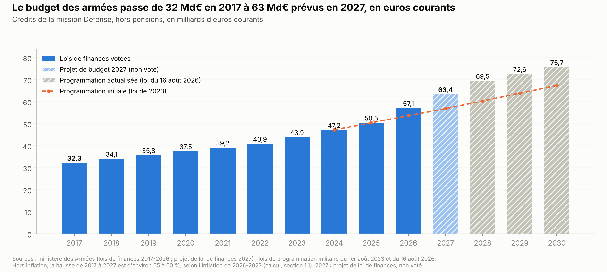
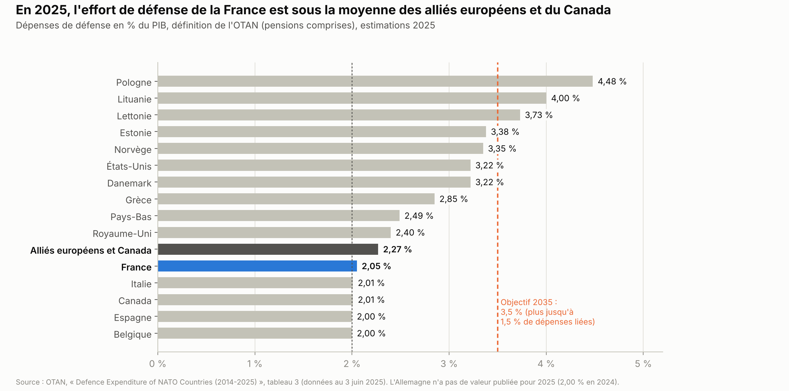
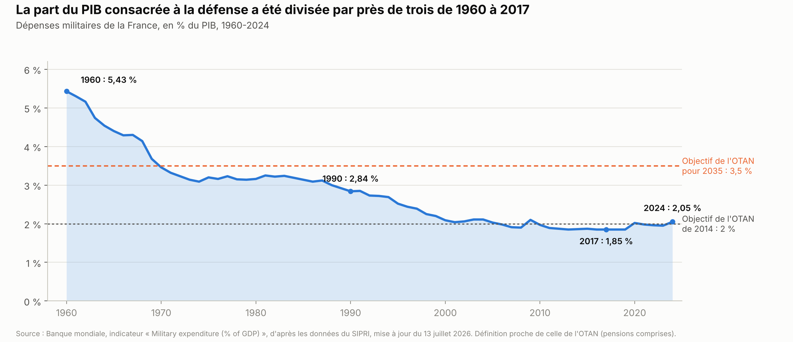
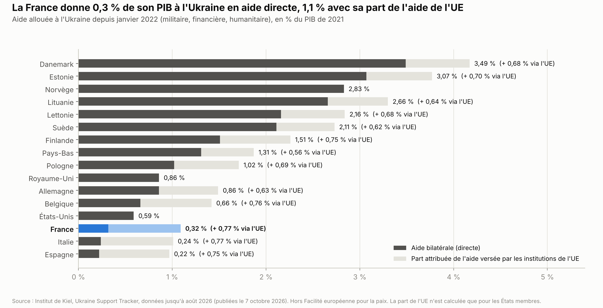
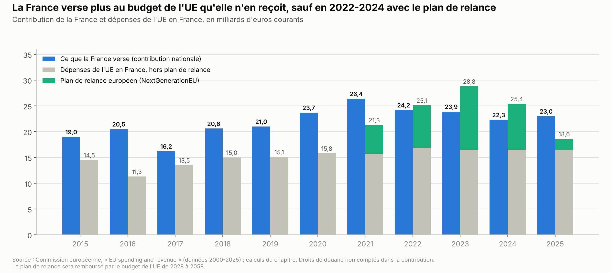

# Défense et Europe

*Version de travail du 11 octobre 2026. Les chiffres seront mis à jour à la date d'arrêt des données de l'édition 1.*

Ce chapitre réunit deux sujets liés. Le volet A porte sur la défense de la France : le budget des armées, l'Organisation du traité de l'Atlantique Nord (OTAN), la dissuasion nucléaire, l'aide à l'Ukraine et la défense européenne. Le volet B porte sur la place de la France dans l'Union européenne (UE) : la façon dont l'UE décide, son budget, le commerce et l'élargissement. Le chapitre expose ensuite les propositions des partis et ce qu'on sait des mesures déjà essayées.

**Voir aussi :**
- [Institutions](../institutions/institutions.md), sections 1.8 et 4.8, pour la primauté du droit européen et les conflits de trois États avec la Cour de justice de l'UE ;
- [Finances publiques](../finances-publiques/finances_publiques.md), pour le budget de l'État, le déficit et la place de la défense dans la dépense publique ;
- [Énergie](../energie/energie_france_europe_allemagne.md), section 1.4, pour ce que l'UE impose en matière d'électricité ;
- [Climat et environnement](../climat-environnement/climat_environnement.md), pour le marché du carbone et la taxe carbone aux frontières de l'UE ;
- [Immigration](../immigration/immigration.md), pour l'espace Schengen et l'asile ;
- [Sécurité et justice](../securite-justice/securite_justice.md), pour le terrorisme sur le territoire national ;
- [Présidentielle 2027 : ce que proposent les partis](../partis/programmes_partis_2027.md), pour les programmes complets.

> **Repères.**
> - **Deux mesures de l'effort de défense.** Le budget voté des armées ne compte pas les retraites des militaires. Les dépenses de défense au sens de l'OTAN les comptent ; on les rapporte au PIB.
> - **Loi de programmation militaire.** Elle fixe le budget des armées sur plusieurs années. Les crédits restent votés chaque année.
> - **Commandement intégré.** C'est l'état-major commun de l'OTAN. Un pays peut être membre de l'Alliance sans y participer.
> - **Les institutions de l'UE.** La Commission propose les lois. Le Conseil de l'UE (les ministres des 27) et le Parlement européen les votent. Le Conseil européen (les chefs d'État ou de gouvernement) fixe les orientations.
> - **Majorité qualifiée et unanimité.** La majorité qualifiée demande 15 États sur 27, représentant 65 % de la population. À l'unanimité, chaque État a un droit de veto.
> - **Contribution et solde net.** La contribution est ce que la France verse au budget de l'UE. Le solde net retranche ce que l'UE dépense en France.

---

## L'essentiel

1. **Le budget des armées a presque doublé en dix ans, en euros courants.** Il passe de 32,3 milliards d'euros (Md€) en 2017 à 57,1 Md€ en 2026, sans les pensions. Le projet de budget prévoit 63,4 Md€ en 2027. Hors inflation, la hausse est d'environ 55 à 60 %.
2. **La défense pèse 2 % du PIB, contre 2,8 % en 1990.** La France a accepté l'objectif de l'Alliance atlantique : 3,5 % du PIB en 2035, soit environ 38 à 43 Md€ de plus par an. La loi de programmation vise 2,5 % en 2030.
3. **Depuis 2022, l'aide directe de la France à l'Ukraine représente au total 0,3 % de son PIB.** Elle est le 10e donateur en valeur, mais le 22e sur 41 rapporté au PIB. Avec sa part de l'aide de l'UE, elle atteint 1,1 %. L'UE prête aussi 90 Md€ à l'Ukraine en 2026-2027.
4. **Les outils européens de réarmement reposent surtout sur l'emprunt.** L'UE prête 150 Md€ aux États pour acheter des armes, dont environ 15 Md€ à la France. En mars 2026, le président a invité des partenaires européens aux exercices de la dissuasion nucléaire, sans partager la décision de tir.
5. **La France verse plus au budget de l'UE qu'elle n'en reçoit.** L'écart est de 6,6 à 9,3 Md€ par an, selon l'année et la méthode de calcul. Sa contribution passe de 23,0 Md€ en 2025 à 30,9 Md€ prévus en 2027. Le budget 2028-2034 est en négociation.
6. **Certaines décisions de l'UE se prennent à l'unanimité, d'autres non.** Le budget de l'UE, l'entrée de nouveaux membres et la politique étrangère exigent l'accord de tous les États. Un accord limité au commerce se décide à la majorité qualifiée : la France ne peut pas le bloquer seule.
7. **L'accord avec le Mercosur s'applique depuis le 1er mai 2026, malgré le vote contre de la France.** Ses quotas agricoles représentent 1,3 à 1,5 % de la consommation européenne de bœuf, de volaille et de sucre. Le Parlement européen attend l'avis de la Cour de justice de l'UE pour le voter.

**Les grandes options en débat.**
- **Budget militaire** : 3,5 % du PIB (LR), une hausse sans cible chiffrée (Renaissance, Horizons, RN), une hausse votée avec des réserves sur le financement (PS), ou une nouvelle programmation (LFI, Les Écologistes).
- **Alliance atlantique (OTAN)** : y rester (Renaissance, Horizons, LR), quitter le commandement intégré après la guerre (RN), ou quitter l'Alliance par étapes (LFI) ; Les Écologistes veulent une défense européenne autonome des États-Unis.
- **Ukraine** : maintenir ou accroître l'aide militaire (Les Écologistes, PS-Place publique, Renaissance, Horizons), réduire l'aide financière (RN), ou la négociation d'abord (LFI).
- **Europe** : plus d'intégration (Les Écologistes, Place publique, Renaissance) ou primauté du droit national (LR, RN, Reconquête) ; LFI veut désobéir à certaines règles.
- **Contribution à l'UE** : la réduire de 9 Md€ par an (RN) ou la conditionner (LFI).
- **Commerce** : refuser le Mercosur (LFI, Les Écologistes, PS-Place publique, LR, RN), et plus largement les autres accords de libre-échange (LFI, Les Écologistes, RN).

---

## 1. La situation

### Volet A. La défense

### 1.1 Le budget des armées

*Le graphique de L'essentiel montre l'évolution du budget des armées de 2017 à 2030.*

**Trois mesures.**
- Le **budget voté des armées** est celui de la « mission Défense » dans la loi de finances. On le donne en général sans les pensions des militaires retraités. Il atteint 57,1 Md€ en 2026[^an-ta-325].
- Les **dépenses de défense au sens de l'Organisation du traité de l'Atlantique Nord (OTAN)** sont plus larges : elles comprennent notamment les pensions. Elles atteignent 61,8 Md€ en 2025, soit 2,05 % du produit intérieur brut (PIB)[^nato-2025]. C'est cette mesure qui sert pour les objectifs de l'OTAN (section 1.2).
- Une troisième mesure, celle d'Eurostat par fonction, donne 54,2 Md€ en 2024. Le chapitre [Finances publiques](../finances-publiques/finances_publiques.md) l'utilise pour comparer la défense aux autres dépenses publiques[^ch-finances-publiques].

**Une hausse continue depuis 2017.**
- En euros courants, le budget des armées passe de 32,3 Md€ en 2017 à 57,1 Md€ en 2026[^minarm-plf2023][^an-ta-325]. Le projet de budget pour 2027 prévoit 63,4 Md€, soit +6,5 Md€ (+11,4 %) selon le ministère des Armées[^minarm-plf2027]. Le compte rendu du Conseil des ministres annonce +6,4 Md€[^cm-2026-10-01].
- Le président de la République avait promis en juillet 2025 un budget de 64 Md€ en 2027, « le double de 2017 » *(source secondaire)*[^lcp-macron-2025]. Le 13 juillet 2026, il a jugé que « l'engagement a été tenu »[^minarm-macron-2026].
- Les prix à la consommation ont augmenté d'≈ 19 % de 2017 à 2025[^insee-ipc]. Hors inflation, le budget a donc augmenté d'≈ 31 % sur cette période. De 2017 à 2027, la hausse atteint ≈ 55 à 60 %, selon l'inflation de 2026 et 2027 *(calcul)*.
- Le budget 2027 n'est pas voté au 11 octobre 2026. Selon le gouvernement, le déficit public serait de 5,0 % du PIB en 2027, et de 4,8 % sans la hausse des crédits de la défense[^cm-2026-10-01].

**Les lois de programmation militaire.** Une loi de programmation fixe le budget des armées sur plusieurs années ; les crédits restent votés chaque année.
- La loi du 1er août 2023 prévoyait 400 Md€ de crédits sur 2024-2030, et 413 Md€ avec d'autres ressources[^senat-delegge-2025].
- La loi du 16 août 2026 l'a actualisée. Elle porte le total à 435,7 Md€, soit ≈ 36 Md€ de plus *(calcul)*. Elle prévoit 63,3 Md€ en 2027 et 75,7 Md€ en 2030[^an-ta-325]. Le projet de budget 2027 dépasse donc la loi de 0,1 Md€.
- Elle vise un effort de défense de « 2,5 % au minimum en 2030 », « avec l'objectif d'atteindre 3,5 % à l'horizon 2035 ». Elle ajoute un objectif de 1,5 % du PIB pour les dépenses de sécurité au sens large[^an-ta-325].
- **Le vote.** L'Assemblée nationale l'a adoptée définitivement le 1er juillet 2026, par 375 voix contre 113 et 2 abstentions[^an-scrutin-7905]. Ont voté pour : le RN, Ensemble pour la République (Renaissance), la Droite républicaine (LR), le MoDem, Horizons, le groupe Libertés, indépendants, outre-mer et territoires (LIOT), l'Union des droites pour la République (UDR, alliés d'Éric Ciotti) et 46 socialistes sur 47. Ont voté contre : LFI (62), les Écologistes (36), le groupe de la Gauche démocrate et républicaine (GDR, communistes et ultramarins, 14) et un socialiste[^an-scrutin-7905].
- **Le contrôle du Conseil constitutionnel.** Plus de soixante députés de gauche l'ont saisi le 6 juillet 2026. Le 6 août, il a jugé conformes toutes les dispositions contestées, qui portaient sur les drones, le renseignement et un nouvel « état d'alerte de sécurité nationale ». La loi a été promulguée le 16 août[^cc-2026-907].

**L'« état d'alerte de sécurité nationale ».** La loi crée ce régime d'exception (code de la défense, articles L. 2143-1 à L. 2143-8)[^an-ta-325].
- Le gouvernement le déclare par décret en Conseil des ministres, en cas de « menace grave et actuelle ».
- Il permet des dérogations à certaines règles nationales ou locales : consultations obligatoires, urbanisme, environnement, marchés publics de défense.
- Le Parlement est informé. Au-delà de deux mois, il faut une loi pour le prolonger[^an-ta-325].

**L'exécution.** Le ministère paie une part de ses factures l'année suivante : c'est le « report de charges ». Il atteint 8 Md€ fin 2024, soit 23,8 % des crédits hors dépenses de personnel, selon la Cour des comptes *(source secondaire)*[^fob-report-charges]. La section 4 détaille ce que l'on sait de l'exécution des lois de programmation.

### 1.2 La France dans l'OTAN

**L'Alliance.** L'OTAN réunit 32 pays d'Europe et d'Amérique du Nord. Son traité date de 1949[^nato-traite].
- L'article 5 prévoit qu'une attaque contre l'un des alliés « sera considérée comme une attaque dirigée contre toutes les parties ». Chaque allié assiste alors l'allié attaqué par « telle action qu'elle jugera nécessaire, y compris l'emploi de la force armée »[^nato-traite]. L'article n'impose donc pas une intervention militaire *(lecture du texte)*.
- L'article 13 permet de quitter l'Alliance, un an après l'avoir notifié aux États-Unis[^nato-traite].

**Le commandement intégré.** C'est l'état-major commun qui planifie et dirige les forces alliées.
- La France l'a quitté en 1966, sur décision du général de Gaulle, tout en restant membre de l'Alliance. Son retour a été annoncé au sommet de l'OTAN de Strasbourg-Kehl, en 2009[^an-avis-3620].
- En 2016, plusieurs centaines de militaires français servaient dans les états-majors de l'OTAN. Un général français dirigeait l'un des deux grands commandements, à Norfolk, aux États-Unis[^an-avis-3620].
- La dissuasion nucléaire française reste en dehors : la France ne participe pas à la planification nucléaire de l'OTAN[^an-cr-defense-43].

**Les dépenses des alliés.**

- En 2014, les alliés s'étaient fixé un objectif de 2 % du PIB. La France l'atteint en 2024, avec 2,03 %[^nato-2025].
- Au sommet de La Haye, en juin 2025, ils se sont engagés à consacrer 5 % de leur PIB à la défense et à la sécurité en 2035. Ce total comprend au moins 3,5 % de dépenses de défense, et jusqu'à 1,5 % de dépenses liées : infrastructures critiques, cybersécurité, résilience civile, industrie. La trajectoire sera réexaminée en 2029[^nato-lahaye].
- Selon des estimations de l'OTAN rapportées par Reuters, la France atteindrait 2,22 % en 2026. Cinq alliés dépasseraient 3,5 % : la Pologne, la Grèce et les trois pays baltes *(source secondaire)*[^reuters-nato-2026]. Les alliés européens et le Canada atteindraient 2,53 % en moyenne[^icds-2026].
- Au sommet d'Ankara, les 7 et 8 juillet 2026, les alliés ont confirmé « l'augmentation des dépenses militaires, conformément aux engagements pris lors du sommet de La Haye »[^minarm-ankara].

**Ce que coûterait 3,5 %.** Un point de PIB représente ≈ 30 Md€ (chiffre de référence n° 1)[^ch-finances-publiques]. Passer de 2,05 % (2025) ou de 2,22 % (2026, estimation) à 3,5 % coûterait ≈ 38 à 43 Md€ de plus par an, au PIB de 2025 *(calcul)*. Avec la croissance, le montant en euros sera plus élevé en 2035.

**L'effort sur longue période.**

- Selon les données de l'Institut international de recherche sur la paix de Stockholm (SIPRI), reprises par la Banque mondiale, la France consacrait 5,4 % de son PIB à la défense en 1960. Elle y consacrait 2,8 % en 1990, à la fin de la guerre froide, et 1,85 % de 2016 à 2019[^worldbank-milex].
- La baisse des années 1990 et 2000 est souvent appelée les « dividendes de la paix ». En 2024, la part remonte à 2,05 %[^worldbank-milex].

**Les États-Unis et l'Europe.** Selon la chaîne américaine National Broadcasting Company (NBC), ≈ 68 000 militaires américains sont stationnés en Europe en 2026. Washington a annoncé en mai 2026 le retrait de ≈ 5 000 soldats d'Allemagne. Une revue de la présence américaine en Europe doit être tranchée d'ici au 6 novembre 2026 *(source secondaire)*[^aljazeera-us-troops].

### 1.3 Les armées : effectifs, réserves, opérations

**Les effectifs.** Le ministère des Armées doit compter 268 400 emplois en équivalent temps plein en 2027, et 275 000 en 2030[^an-ta-325]. L'équivalent temps plein compte deux mi-temps comme un emploi. Le projet de budget 2027 crée 2 150 emplois[^minarm-plf2027].

**Les réserves.** Un réserviste est un civil qui sert quelques semaines par an. Le ministère comptait ≈ 40 000 réservistes opérationnels en avril 2024. Il veut doubler ce nombre d'ici 2030, pour atteindre un réserviste pour deux militaires d'active[^minarm-reserve-2024].

**Le service national.**
- Le service national universel (SNU), lancé en 2019, a été mis en extinction (section 4).
- En novembre 2025, le président a annoncé un service militaire volontaire de dix mois *(source secondaire)*[^publicsenat-snu-2026]. Il est ouvert aux Français de 18 à 25 ans. Les volontaires touchent « environ 800 € brut par mois » et servent en France, métropole ou outre-mer. Les premiers ont commencé en septembre 2026 : « environ 3 000 volontaires »[^servicepublic-sn].
- Le ministère attend 4 000 appelés en 2027[^minarm-plf2027]. L'objectif annoncé est de 10 000 jeunes par an en 2030 *(source secondaire)*[^europe1-sn].

**Les équipements.** Selon La Chaîne parlementaire (LCP), la loi d'actualisation ajoute 8,5 Md€ pour les munitions sur 2026-2030, et 1,6 Md€ pour la lutte contre les drones *(source secondaire)*[^lcp-lpm-contenu]. En 2027, les grands programmes d'armement hors dissuasion reçoivent 17,2 Md€[^minarm-plf2027].

**Les opérations extérieures et l'Afrique.**
- L'opération Barkhane, au Sahel, a pris fin en 2022. Après les coups d'État de 2020 à 2023, le Mali, le Burkina Faso et le Niger ont rompu avec la France *(source secondaire)*[^afp-senegal].
- La France a rendu sa base du Tchad en janvier 2025, celle de Côte d'Ivoire en février et ses deux dernières emprises au Sénégal le 17 juillet 2025. Au Gabon, sa base est devenue un camp partagé. Djibouti reste sa seule base permanente en Afrique, avec ≈ 1 500 militaires *(source secondaire)*[^afp-senegal].
- Le coût des opérations extérieures en 2025 et les effectifs de l'opération Sentinelle, sur le territoire national, n'ont pas été trouvés (section 6).

**Le renseignement extérieur et le terrorisme.** La Direction générale de la sécurité extérieure (DGSE) est le service de renseignement extérieur ; elle dépend du ministère des Armées.
- En 2026, elle dispose de 1,14 Md€, salaires compris. Elle compte 6 453 emplois en équivalent temps plein, contre 6 123 en 2025[^senat-avis-renseignement-2026].
- Selon la commission de la défense du Sénat, les foyers de la menace terroriste se déplacent, notamment vers l'Asie centrale et la zone afghano-pakistanaise[^senat-avis-renseignement-2026].
- Le terrorisme sur le territoire national est traité dans le chapitre [Sécurité et justice](../securite-justice/securite_justice.md).

**L'industrie et les exportations.**
- L'industrie de défense emploie « environ 240 000 » personnes en France[^minarm-exports-2026].
- En 2025, la France a reçu 21,2 Md€ de commandes d'armement de l'étranger. C'est la deuxième année de suite au-dessus de 20 Md€. L'Inde a commandé 26 Rafale pour sa marine[^minarm-exports-2026].
- De 2021 à 2025, la France est le 2e exportateur mondial d'armes, avec 9,8 % des livraisons, derrière les États-Unis (42 %)[^sipri-2026]. Ses premiers clients sont l'Inde, l'Égypte et la Grèce[^sipri-2026].

### 1.4 La dissuasion nucléaire

**Le coût.** La dissuasion reçoit 7,9 Md€ dans le projet de budget 2027[^minarm-plf2027].

**Le discours du 2 mars 2026.** À l'île Longue (Finistère), la base des sous-marins nucléaires, le président a pris trois décisions[^elysee-ile-longue].
- « J'ai ordonné d'augmenter le nombre de têtes nucléaires de notre arsenal. »
- « Nous ne communiquerons plus sur les chiffres de notre arsenal nucléaire. » En 2020, le président indiquait que la taille de l'arsenal était « inférieure à 300 armes nucléaires »[^elysee-ecole-guerre-2020].
- « Nous entrons sur le chemin de ce que j'appellerai la dissuasion avancée. » Les partenaires pourront « participer aux exercices de la dissuasion ». L'Allemagne sera « un partenaire clé ». La Pologne, les Pays-Bas, la Belgique, la Grèce, la Suède et le Danemark « s'y joindront »[^elysee-ile-longue].

**Ce qui ne change pas.** Le président a précisé : « il n'y aura aucun partage de la décision ultime, ni de sa planification, ni de sa mise en œuvre ». Les « intérêts vitaux » sont ceux dont l'atteinte pourrait justifier l'emploi de l'arme nucléaire. Leur définition reste « d'appréciation souveraine »[^elysee-ile-longue]. Les accords avec les pays partenaires ne sont pas publics.

### 1.5 L'Ukraine et la Russie

**La guerre.** La Russie a envahi l'Ukraine le 24 février 2022. À la mi-septembre 2026, aucun cessez-le-feu n'est en vigueur. La dernière réunion entre l'Ukraine, la Russie et les États-Unis s'est tenue à Genève en février 2026. Des émissaires américains sont allés à Moscou puis à Kyiv en septembre ; Kyiv préparait une reprise des pourparlers en octobre *(source secondaire)*[^reuters-talks]. Le point de blocage principal est la partie du Donbass, région de l'est de l'Ukraine, encore tenue par Kyiv[^reuters-talks].

**Ce que donnent les pays.** L'Institut de Kiel pour l'économie mondiale recense l'aide promise et livrée à l'Ukraine par 41 pays et par l'UE. Il compte l'aide **bilatérale**, c'est-à-dire donnée directement d'un pays à l'Ukraine[^kiel-release31].

- De janvier 2022 à juin 2026, dernier mois connu pour la France, son aide bilatérale atteint 7,9 Md€, en euros de 2021. L'aide militaire en représente 6,2 Md€[^kiel-release31].
- La France est le 10e donateur en valeur et le 8e pour l'aide militaire. Rapportée à son PIB, elle est 22e sur 41[^kiel-release31].
- Une part de l'aide passe par l'UE. Si on attribue à chaque pays une part de l'aide de l'UE selon sa contribution au budget européen, la France ajoute 19,3 Md€[^kiel-release31][^kiel-kpb217].
- Kiel ne compte pas la Facilité européenne pour la paix, un fonds des États de l'UE hors du budget européen, qui rembourse des livraisons d'armes[^kiel-kpb217]. La part de la France dans ce fonds n'a pas été trouvée : le total de Kiel sous-estime donc l'aide française.
- Les États-Unis ont donné 115 Md€ jusqu'en janvier 2025, puis plus aucune nouvelle aide. En 2025, la nouvelle aide militaire européenne est de 67 % au-dessus de sa moyenne 2022-2024. Les pays nordiques, 8 % du PIB des donateurs européens, en fournissent ≈ 33 %[^kiel-release31][^kiel-kpb203].
- Au 1er semestre 2026, les Européens ont acheté au moins 3 Md€ d'armes à des entreprises américaines pour l'Ukraine. Selon Kiel, l'Europe dépend encore des armes américaines, en particulier pour la défense antiaérienne[^kiel-2026-08].

**Le prêt européen de 90 Md€.**
- Les dirigeants européens l'ont décidé lors du Conseil européen des 18 et 19 décembre 2025, pour 2026 et 2027. Il est financé par un emprunt de l'UE. 60 Md€ vont à la défense de l'Ukraine, 30 Md€ à son budget[^eprs-ukraine-2026].
- Le Conseil l'a adopté le 23 février 2026, sans la République tchèque, la Hongrie et la Slovaquie, qui n'y participent pas. Le même jour, la Hongrie a bloqué une modification du budget pluriannuel de l'UE qui l'accompagnait[^eprs-ukraine-2026].
- Le remboursement du capital par l'Ukraine est subordonné aux réparations de guerre que la Russie lui verserait. L'UE se réserve le droit d'utiliser les avoirs russes immobilisés pour rembourser[^eprs-ukraine-2026].
- Les intérêts de l'emprunt seront payés par le budget de l'UE : ≈ 1 Md€ en 2027, puis ≈ 3 Md€ par an à partir de 2028, selon le service de recherche du Parlement européen[^eprs-ukraine-2026].
- Le premier versement, de 3,2 Md€, date du 25 juin 2026, sur 45 Md€ prévus pour 2026[^seae-ukraine-loan].

**Les avoirs russes.** Les réserves de la banque centrale russe détenues dans l'UE ont été immobilisées de façon permanente le 12 décembre 2025. Un « prêt de réparation » fondé sur ces avoirs, proposé par la Commission, n'a pas été adopté : la Belgique, où se trouve l'essentiel des avoirs, demandait un partage complet des risques[^eprs-ukraine-2026].

**La coalition des volontaires.** Ce groupe de pays, coprésidé par la France et le Royaume-Uni, prépare des garanties de sécurité pour l'Ukraine.
- La déclaration de Paris du 6 janvier 2026 prévoit une force multinationale, menée par les Européens. Elle serait déployée à la demande de l'Ukraine, « once a credible cessation of hostilities has taken place » (une fois les hostilités arrêtées de façon crédible) *(traduction)*. Son quartier général opérationnel est à Paris[^elysee-paris-2026].
- Le 24 août 2026, la coalition a de nouveau appelé à un cessez-le-feu « complet, immédiat et inconditionnel » *(traduction)*[^govuk-coalition-0824]. Le nombre de soldats promis par chaque pays n'est pas public.

**Les sanctions et le gaz russe.**
- L'UE a adopté son 21e paquet de sanctions contre la Russie le 23 juillet 2026. Il vise notamment 41 navires de plus de la « flotte fantôme », qui transporte le pétrole russe hors des règles : 673 au total *(calcul)*[^consilium-21e-paquet].
- Le 26 janvier 2026, l'UE a décidé d'interdire les importations de gaz russe : le gaz naturel liquéfié dès le début de 2027, le gaz par gazoduc à l'automne 2027. En 2025, le gaz russe représentait encore ≈ 13 % des importations de gaz de l'UE, pour plus de 15 Md€ par an[^consilium-gaz-russe].

### 1.6 La défense européenne

**Le plan « ReArm Europe » (mars 2025).** Il affiche « jusqu'à » 800 Md€ de dépenses de défense supplémentaires en quatre ans[^commission-defense]. Il comprend deux parties.
- **Des prêts de l'UE** : 150 Md€, par le programme « Action pour la sécurité de l'Europe » (SAFE), adopté le 27 mai 2025. Les États les rembourseront. Les achats doivent comporter au moins 65 % de composants venant de l'UE, de l'Ukraine ou de l'Espace économique européen (l'UE plus l'Islande, le Liechtenstein et la Norvège)[^commission-safe].
- **Une souplesse des règles budgétaires** : les États qui le demandent peuvent dépasser leurs limites de déficit pour la défense. Le reste des 800 Md€ (≈ 650 Md€) correspond à ces dépenses nationales possibles, financées par la dette de chaque État[^commission-defense].

**La France et SAFE.** Le 10 avril 2026, le Conseil a accordé à la France un prêt d'≈ 15,1 Md€ au plus, avec un préfinancement prévu d'≈ 2,3 Md€[^consilium-safe-france]. La Pologne a reçu un premier versement de 6,6 Md€ le 29 mai 2026[^commission-safe-pologne]. L'Allemagne n'a pas demandé de prêt[^commission-safe].

**La souplesse budgétaire.** Le Conseil l'a accordée à 15 États en juillet 2025, puis à l'Allemagne en octobre. La France ne figure pas parmi eux[^grip-clause][^pap-clause]. Elle est déjà sous surveillance de l'UE, car son déficit dépasse 3 % du PIB : c'est la « procédure pour déficit excessif »[^ch-finances-publiques]. La souplesse permet d'emprunter davantage ; elle n'apporte pas d'argent.

**Les programmes industriels.** Le Fonds européen de la défense dispose de 7,3 Md€ sur 2021-2027 pour la recherche et le développement en commun[^commission-fed]. Le programme pour l'industrie européenne de défense (EDIP), adopté en décembre 2025, ajoute 1,5 Md€ ; il exige aussi 65 % de composants européens *(source secondaire)*[^essentiel-eco-edip].

**Acheter européen ou américain.** De 2021 à 2025, les États-Unis ont fourni 58 % des armes importées par les pays européens de l'OTAN, selon le SIPRI[^sipri-2026].

### Volet B. L'Union européenne et la France

### 1.7 Comment l'UE décide

**Les institutions.**
- La **Commission européenne** propose les textes et veille à leur application.
- Le **Conseil de l'UE** réunit les ministres des 27 États. Avec le **Parlement européen**, élu au suffrage universel, il vote les lois européennes. La France y compte 81 députés sur 720[^consilium-pe-2024].
- Le **Conseil européen** réunit les chefs d'État ou de gouvernement. Il fixe les grandes orientations.

**Deux règles de vote au Conseil.**
- **La majorité qualifiée** est la règle générale. Un texte est adopté s'il réunit au moins 55 % des États (15 sur 27), représentant au moins 65 % de la population de l'UE (traité sur l'Union européenne, article 16)[^tue-16]. Pour bloquer, il faut au moins 4 États qui représentent plus de 35 % de la population. Une abstention compte comme un vote contre.
- La France représente ≈ 15 % de la population de l'UE *(calcul)*[^eurostat-pop-ue]. Elle ne peut donc pas bloquer seule un texte voté à la majorité qualifiée.
- **L'unanimité** s'applique à quelques domaines, où chaque État a un droit de veto. C'est le cas du budget pluriannuel et des recettes de l'UE (traité sur le fonctionnement de l'UE, articles 311 et 312)[^tfue-311-312]. C'est aussi le cas de la politique étrangère et de sécurité commune, de l'entrée de nouveaux membres (traité sur l'UE, article 49)[^tue-49] et de la révision des traités (article 48)[^tue-48].

**Le droit européen et le droit français.** Le droit de l'UE prime sur la loi française, et la Commission peut faire condamner un État qui ne l'applique pas. Ces règles, leurs limites et les précédents de la Pologne, de la Hongrie et de l'Allemagne sont décrits dans le chapitre [Institutions](../institutions/institutions.md), sections 1.8 et 4.8[^ch-institutions].

### 1.8 Le budget de l'UE et la contribution de la France

**Le budget pluriannuel.** Le « cadre financier pluriannuel » fixe les dépenses de l'UE pour sept ans. Celui de 2021-2027 s'achève ; celui de 2028-2034 est en négociation. Il est adopté à l'unanimité des États, après approbation du Parlement européen[^tfue-311-312].

**Ce que la France verse.** La France verse sa contribution par un « prélèvement sur recettes » : une somme retirée directement des recettes de l'État.
- La contribution est calculée surtout sur le revenu national brut, une mesure de la richesse proche du PIB, et sur une part de la TVA[^commission-spending-revenue]. Les droits de douane perçus aux frontières vont aussi à l'UE ; ils ne sont pas comptés ici.
- Elle atteint 23,0 Md€ en 2025[^senat-736]. La loi de finances pour 2026 prévoit 28,4 Md€, révisés à 28,1 Md€. Le projet de budget pour 2027 prévoit 30,9 Md€, soit +2,8 Md€[^plf-2027-an].
- Pourquoi cette hausse ? Les paiements de l'UE se concentrent à la fin de chaque période de sept ans. S'y ajoutent les intérêts de l'emprunt du plan de relance et le départ du Royaume-Uni, ancien gros contributeur[^senat-mizzon-plf2026].
- Cinq pays bénéficient d'un rabais, c'est-à-dire d'une réduction de leur contribution : l'Allemagne, les Pays-Bas, la Suède, l'Autriche et le Danemark[^jaune-ue-2025]. Les autres États le financent. La France en est le premier financeur : 1,5 Md€ en 2024, selon la Cour des comptes citée par le Sénat[^senat-736].

**Ce que la France reçoit.**

- En 2025, l'UE a dépensé 16,4 Md€ en France, hors plan de relance. La politique agricole commune en représente 9,4 Md€[^commission-spending-revenue].
- La France verse donc ≈ 6,6 Md€ de plus qu'elle ne reçoit, soit ≈ 95 € par habitant *(calcul)*[^commission-spending-revenue]. Selon ce calcul simple, elle est le 2e contributeur net de 2023 à 2025, derrière l'Allemagne. Pour 2023, ce calcul donne 7,4 Md€ ; le Sénat donnait 9,3 Md€, sans préciser sa méthode[^senat-plf2025]. Le solde net varie donc selon ce que l'on compte.
- **Le plan de relance européen** (NextGenerationEU) a été décidé en 2020, après la crise du Covid. Il est financé par un emprunt commun de l'UE. La France y dispose de 40,3 Md€ de subventions. Le 29 septembre 2026, la Commission a donné un avis préliminaire favorable au dernier versement, de 6,1 Md€. Une fois ce versement fait, la France aura reçu toutes ses subventions[^commission-rrf-france].
- Avec le plan de relance, la France a reçu plus qu'elle n'a versé de 2022 à 2024 *(calcul)*[^commission-spending-revenue]. Ces subventions seront remboursées par le budget de l'UE de 2028 à 2058[^senat-736].

**Le prochain budget (2028-2034).**
- La Commission a proposé le 16 juillet 2025 un budget de 1 763 Md€ aux prix de 2025, soit 1 985 Md€ en euros courants[^senat-mizzon-plf2026]. Elle regroupe la politique agricole et les fonds régionaux dans des plans nationaux. Elle crée un Fonds pour la compétitivité, avec ≈ 116 Md€ pour la défense, l'industrie de défense et l'espace, aux prix de 2025 *(source secondaire)*[^errin-negobox].
- Elle propose aussi de nouvelles « ressources propres », c'est-à-dire des recettes de l'UE. Elles viendraient du marché du carbone, de la taxe carbone aux frontières et de taxes sur les déchets électroniques, le tabac et les grandes entreprises[^commission-mff].
- Le remboursement de l'emprunt du plan de relance coûterait 168 Md€ sur la période[^senat-736]. Sans nouvelles ressources propres, il coûterait à la France ≈ 2,5 Md€ de plus par an à partir de 2028, selon la Cour des comptes citée par le Sénat[^senat-736].
- Selon le Sénat, la contribution française passerait de ≈ 26 Md€ par an en moyenne à ≈ 38 Md€ par an[^senat-mizzon-plf2026].
- Le 11 juin 2026, la présidence chypriote du Conseil a proposé 1 730 Md€, soit ≈ 2 % de moins que la Commission *(source secondaire)*[^errin-negobox]. Les dirigeants visent un accord avant la fin de 2026 ; ils en ont débattu en juin et doivent y revenir au Conseil européen du 15 octobre 2026[^consilium-mff-timeline].

### 1.9 Le commerce : le Mercosur et les autres accords

**Qui décide.** La politique commerciale relève de l'UE seule (traité sur le fonctionnement de l'UE, articles 3 et 207)[^tfue-207]. Le Conseil adopte un accord limité au commerce à la majorité qualifiée ; le Parlement européen doit l'approuver. Un accord qui touche aussi aux compétences des États, dit « mixte », doit en outre être ratifié par chaque pays[^eprs-mercosur].

**L'accord avec le Mercosur.** Le Mercosur (de l'espagnol *Mercado Común del Sur*, « marché commun du Sud ») réunit notamment l'Argentine, le Brésil, le Paraguay et l'Uruguay.

| Produit | Ce que l'UE ouvre au Mercosur | Part de la consommation de l'UE |
|---|---|---|
| Bœuf | 99 000 tonnes à droit réduit (7,5 %) | ≈ 1,3 % |
| Volaille | 180 000 tonnes | ≈ 1,4 % |
| Sucre | 190 000 tonnes | ≈ 1,5 % |
| Porc | 25 000 tonnes | — |

*Sources : Institut Jacques Delors (centre de recherche favorable à l'intégration européenne)[^institutdelors-mercosur] ; Commission européenne[^commission-mercosur].*

- En sens inverse, le Mercosur supprime ses droits de douane sur les vins (27 %), les spiritueux (jusqu'à 35 %) et les voitures (35 %, sur quinze ans). Il ouvre des quotas aux fromages européens[^institutdelors-mercosur]. 344 « indications géographiques » européennes sont protégées dès 2026 : ce sont des noms de produits liés à un lieu d'origine, comme le comté ou le champagne[^commission-mercosur-provisoire].
- La France a un excédent commercial de 4,5 Md€ avec le Mercosur[^institutdelors-mercosur].

**La procédure.**
- En septembre 2025, la Commission a séparé la partie commerciale, qui relève de l'UE seule, du reste de l'accord[^eprs-mercosur].
- Le 9 janvier 2026, le Conseil a autorisé la signature à la majorité qualifiée. La France a voté contre, avec la Pologne, l'Autriche, la Hongrie et l'Irlande[^clubjuristes-mercosur]. Ces cinq pays représentent ≈ 29 % de la population de l'UE *(calcul)*[^eurostat-pop-ue]. Il en fallait plus de 35 % pour bloquer. Avec la Belgique, qui se serait abstenue *(à vérifier)*, on atteint ≈ 31 %.
- Le 14 janvier, à l'Assemblée nationale, LFI et le RN ont déposé deux motions de censure. Une motion de censure votée par la majorité des députés renverse le gouvernement. Ces deux motions ont été rejetées : LFI a réuni 256 voix et le RN 142, sur 288 nécessaires *(source secondaire)*[^lcp-censure-mercosur].
- Le 21 janvier, le Parlement européen a demandé l'avis de la Cour de justice de l'UE sur la conformité de l'accord aux traités, par 334 voix contre 324 et 11 abstentions. Il votera l'accord après cet avis[^ep-mercosur-cjue], qui peut prendre plus d'un an[^eprs-mercosur].
- Une clause de sauvegarde protège les produits agricoles sensibles. Le Conseil l'a adoptée le 5 mars 2026 *(source secondaire)*[^reussir-sauvegarde].
  - Une enquête est ouverte si les importations d'un produit augmentent de plus de 5 % par rapport à la moyenne de trois ans, ou si son prix baisse de plus de 5 %.
  - Dans les deux cas, ce prix doit aussi être inférieur de 5 % aux prix européens[^reussir-sauvegarde].
  - Des mesures provisoires sont possibles en 21 jours[^oeil-sauvegarde].
- Depuis le 1er mai 2026, la partie commerciale s'applique à titre provisoire, sans attendre l'avis de la Cour ni le vote du Parlement européen[^commission-mercosur-provisoire]. Les données d'importations depuis cette date n'ont pas été trouvées (section 6).

**L'accord économique et commercial global avec le Canada (CETA).** Il s'applique à titre provisoire depuis le 21 septembre 2017. L'Assemblée nationale a voté le projet de loi de ratification en 2019 ; le Sénat l'a rejeté le 21 mars 2024. La France fait partie des dix pays qui ne l'ont pas ratifié[^tresor-ceta]. Le quota de bœuf canadien est de 45 840 tonnes. Les exportations françaises de biens vers le Canada sont passées de 3,2 Md€ en 2017 à 4,2 Md€ en 2023 ou en 2024, selon les sources (section 4)[^tresor-ceta][^meae-ceta].

**Les États-Unis.** À l'été 2025, l'UE et les États-Unis ont conclu un accord qui plafonne à 15 % les droits de douane américains sur la plupart des produits européens. L'acier et l'aluminium restent taxés à 50 %. En retour, l'UE supprime ses droits sur la plupart des produits industriels américains *(source secondaire)*[^bdo-turnberry]. Le 20 février 2026, la Cour suprême américaine a jugé que le président n'avait pas le pouvoir d'imposer une partie de ces droits[^bruegel-scotus]. Un droit de 10 % sur tous les pays les a remplacés, pour 150 jours, jusqu'au 24 juillet 2026. En juillet, l'UE se disait prête à accepter de nouveaux droits, s'ils restaient dans la limite de 15 % *(source secondaire)*[^euronews-douanes-2026]. L'état des droits en octobre 2026 n'a pas été vérifié (section 6).

### 1.10 L'élargissement

- Pour entrer dans l'UE, un pays doit obtenir l'accord unanime des États, l'approbation du Parlement européen, puis la ratification de chaque État[^tue-49]. En France, la ratification passe par un référendum. Elle peut aussi passer par le Congrès, qui réunit les députés et les sénateurs, si chaque assemblée le décide aux trois cinquièmes (Constitution, article 88-5)[^an-constitution].
- Neuf pays ont le statut de candidat : l'Ukraine, la Moldavie, la Géorgie, la Turquie et cinq pays des Balkans (Albanie, Bosnie-Herzégovine, Monténégro, Macédoine du Nord, Serbie). Le Kosovo est considéré comme un candidat potentiel *(source secondaire)*[^europeannewsroom-candidats]. Pour l'Ukraine, un premier groupe de chapitres de négociation a été ouvert en juin 2026, et un autre le 14 juillet. La Hongrie de Viktor Orbán bloquait ces étapes ; elles ont avancé après sa défaite aux élections législatives de 2026 *(source secondaire)*[^euronews-ukraine-cluster].
- Selon l'Institut du développement durable et des relations internationales (IDDRI), l'Ukraine pourrait recevoir 10 à 12 Md€ d'aides agricoles par an à règles inchangées *(source secondaire)*[^pleinchamp-iddri]. La France en reçoit ≈ 9,4 Md€ (section 1.8).

### 1.11 Ce qu'en pensent les Français

- **La confiance dans l'UE.** À l'automne 2025, 27 % des Français font confiance à l'UE, contre 48 % en moyenne dans l'UE[^commission-eb104]. Au printemps 2026, la part remonte à 38 %, contre 51 % *(source secondaire)*[^confrontations-eb105].
- **La défense.** À l'automne 2025, 74 % des Français soutiennent une politique de sécurité et de défense commune, et 60 % une hausse du budget de défense de l'UE ; 71 % approuvent les sanctions contre la Russie[^commission-eb104]. Dans l'ensemble de l'UE, 81 % soutiennent une défense commune au printemps 2026[^commission-eb105].
- **La menace.** En janvier 2026, 80 % des Français estiment que leur pays est menacé, contre 68 % en moyenne dans l'UE *(source secondaire)*[^confrontations-eb105].

---

## 2. Ce qui fait débat

### Question 1. Jusqu'où augmenter le budget des armées, et avec quel argent ?

**Le constat.** Le budget des armées passe de 57,1 Md€ en 2026 à 63,4 Md€ prévus en 2027 (section 1.1). La France consacre ≈ 2 % de son PIB à sa défense ; elle a accepté l'objectif de 3,5 % en 2035, qui coûterait ≈ 38 à 43 Md€ de plus par an (section 1.2). Le déficit public visé pour 2027 est de 5,0 % du PIB.

**Pour une hausse plus rapide.**
- Bruno Retailleau (LR) a déclaré au Sénat, le 2 juin 2026 : « Nous devons respecter le chiffre cible selon lequel il nous faut consacrer 3,5 % de la richesse produite à la défense ». Pour le financement : « Nous ferons des économies, nous recréerons de la richesse »[^senat-cr-20260602]. Le député LR Jean-Louis Thiériot juge que la loi d'actualisation « ne suffira pas » *(source secondaire)*[^lcp-lpm-adoption].
- Horizons veut une nouvelle loi de programmation « de la massification » et 250 000 réservistes (section 3)[^philippe-sure]. Le RN a voté la loi, sans fixer de cible chiffrée ; pour son député Julien Limongi, l'actualisation est « l'aveu des limites de la programmation initiale » (1er juillet 2026) *(source secondaire)*[^lcp-lpm-adoption].
- Argument : selon l'Institut de Kiel, une hausse des dépenses militaires peut soutenir la croissance si les armes sont produites en Europe et si la montée en charge est financée par l'emprunt (section 4)[^kiel-guns-growth].
- Limite : aucun de ces partis ne publie de financement chiffré. Le ministère des Armées paie déjà 8 Md€ de factures en retard d'une année sur l'autre (section 1.1) *(source secondaire)*[^fob-report-charges].

**Pour une hausse financée autrement, ou fixée selon d'autres priorités.**
- Le PS a voté la loi. La députée Anna Pic a dit : « Si l'argent magique n'existe pas pour nos hôpitaux, nos écoles » ; selon LCP, elle a ajouté qu'il n'existe pas non plus pour la défense *(source secondaire)*[^lcp-lpm-adoption]. Au Sénat, le socialiste Mickaël Vallet propose une « contribution exceptionnelle touchant, pourquoi pas, les plus hauts patrimoines »[^senat-cr-20260602].
- Les Écologistes ont voté contre. Leur député Damien Girard soutient « le principe d'un effort supplémentaire » mais regrette « la méthode choisie » *(source secondaire)*[^lcp-lpm-adoption]. Leur programme veut une nouvelle loi de programmation « prenant en compte nos moyens budgétaires »[^ecologistes-programme].
- LFI a voté contre. Son programme veut une loi de programmation pour « restaurer notre indépendance » et un « pôle public de l'armement »[^lfi-aec-2025].
- Argument : la défense progresse d'≈ 11 % en 2027, quand le budget de l'enseignement scolaire progresse d'≈ 1 % (section 5)[^ch-finances-publiques].
- Limite : financer la hausse par l'impôt réduirait son effet sur la croissance, selon l'Institut de Kiel (section 4)[^kiel-guns-growth]. Le PS et les Écologistes ne chiffrent pas le niveau de dépense visé.

### Question 2. L'OTAN, l'Europe ou l'autonomie : avec qui assurer la sécurité de la France ?

**Le constat.** La France est revenue dans le commandement intégré de l'OTAN en 2009 et garde sa dissuasion nucléaire hors de l'Alliance (section 1.2). Les États-Unis réduisent leur présence en Europe et n'engagent plus de nouvelle aide à l'Ukraine depuis janvier 2025 (sections 1.2 et 1.5).

**Pour rester dans l'OTAN et y peser.**
- Bruno Retailleau : « La cohérence, nous la devons également à nos partenaires de l'Otan »[^senat-cr-20260602]. Édouard Philippe (Horizons) voit dans l'entrée de l'Ukraine dans l'OTAN « la meilleure garantie de sécurité » *(source secondaire)*[^euronews-philippe-kyiv].
- Argument : en 2012, le rapport d'Hubert Védrine au président concluait qu'une nouvelle sortie du commandement intégré « n'est pas une option », selon l'Assemblée nationale[^an-avis-3620].
- Limite : l'influence gagnée par le retour de 2009 n'a pas été mesurée (section 4).

**Pour une défense européenne plus autonome.**
- Les Écologistes écrivent : « Nous ne pouvons pas nous priver de l'Alliance atlantique à court terme, mais elle n'est plus acquise dans sa forme historique ». Ils veulent « une véritable architecture de défense européenne autonome des États-Unis » et un « commandement militaire intégré européen »[^ecologistes-programme].
- Raphaël Glucksmann (Place publique) défend une « autonomie stratégique européenne » *(source secondaire)*[^publicsenat-primaire-debat]. Le président a invité des partenaires européens à participer aux exercices de la dissuasion française (section 1.4).
- Limite : de 2021 à 2025, 58 % des armes importées par les Européens de l'OTAN venaient des États-Unis (section 1.6)[^sipri-2026]. Un commandement européen demanderait l'accord des 27 : les décisions de défense de l'UE se prennent à l'unanimité (traité sur l'UE, article 42) *(lecture du texte)*[^tue-42].

**Pour quitter le commandement intégré, voire l'Alliance.**
- Le RN veut « sortir du commandement intégré de l'Otan pour retrouver des marges de manœuvre », mais pas « tant qu'il y aura la guerre aux portes de l'Europe » (Jordan Bardella, juin 2026) *(source secondaire)*[^bluewin-bardella]. Reconquête le proposait en 2022 *(source secondaire)*[^publicsenat-otan-2022].
- LFI veut « se retirer immédiatement du commandement intégré de l'OTAN puis, par étapes, de l'organisation elle-même »[^lfi-aec-2025].
- Argument : de 1966 à 2009, la France est restée membre de l'Alliance sans être dans le commandement intégré[^an-avis-3620].
- Limite : une sortie ne réduirait pas en soi les dépenses, puisque l'engagement de 3,5 % vaut pour tous les alliés[^nato-lahaye]. Quitter l'Alliance priverait la France de la garantie de l'article 5[^nato-traite]. Le rapport Védrine (2012) écartait une nouvelle sortie du commandement intégré (voir plus haut).

### Question 3. L'Ukraine : jusqu'où l'aider ?

**Le constat.** Depuis 2022, l'aide directe de la France représente 0,32 % de son PIB, et 1,09 % avec sa part de l'aide de l'UE (section 1.5)[^kiel-release31]. Aucun cessez-le-feu n'est en vigueur en septembre 2026.

**Pour une aide maintenue ou accrue.**
- Les Écologistes veulent fournir « du matériel militaire, y compris de capacités de frappe à longue portée ». Ils veulent consacrer « les 140 milliards d'avoirs gelés russes » aux réparations de guerre et au remboursement du prêt européen[^ecologistes-programme].
- Raphaël Glucksmann veut saisir les avoirs russes gelés : « Ce n'est pas une guerre contre l'Ukraine, c'est une guerre contre l'Europe » *(source secondaire)*[^publicsenat-primaire-debat]. Pour Gabriel Attal (Renaissance), « Couper le robinet à l'Ukraine », c'est « laisser Vladimir Poutine gagner » (septembre 2026) *(source secondaire)*[^sudradio-aliot]. Horizons veut une force européenne en Ukraine après le conflit *(source secondaire)*[^euronews-philippe-kyiv].
- Argument : en part du PIB, la France donne moins que l'Allemagne (0,86 %) et le Royaume-Uni (0,86 %)[^kiel-release31].
- Limite : la Belgique, où se trouve l'essentiel des avoirs russes, refuse d'en porter seule les risques (section 1.5)[^eprs-ukraine-2026].

**Pour réduire l'aide ou privilégier la négociation.**
- Le RN veut maintenir l'équipement des forces ukrainiennes mais réduire l'aide financière, selon Marine Le Pen (16 septembre 2026) *(source secondaire)*[^kyivindependent-le-pen]. Louis Aliot (RN) a déclaré à la télévision, en septembre 2026 : « On coupe le robinet » *(source secondaire)*[^sudradio-aliot].
- LFI veut « un cadre diplomatique permettant d'obtenir un cessez-le-feu, le retrait des troupes russes, et l'ouverture de négociations pour une paix durable »[^lfi-aec-2025]. Ségolène Royal, candidate à la primaire de la gauche, privilégie la médiation *(paraphrase, source secondaire)*[^publicsenat-primaire-debat].
- Argument : la France est en déficit, et le RN cherche des économies (section 3).
- Limite : l'aide directe de la France est de l'ordre de 1,8 Md€ par an depuis 2022, en euros de 2021 *(calcul)*[^kiel-release31]. La supprimer réduirait le déficit public de 2025 (152,5 Md€) d'≈ 1 % de son montant[^insee-2106]. L'aide versée par l'UE relève de décisions européennes.

### Question 4. Plus ou moins d'Europe ?

**Le constat.** La contribution de la France passe de 23,0 Md€ en 2025 à 30,9 Md€ prévus en 2027 (section 1.8). Le budget 2028-2034 se vote à l'unanimité. L'accord avec le Mercosur a été adopté à la majorité qualifiée, contre l'avis de la France (section 1.9).

**Pour plus d'intégration européenne.**
- Les Écologistes veulent « faire un saut fédéral européen », remplacer les droits de veto par la majorité qualifiée, porter le budget de l'UE à « 2 % du PIB européen en 2035 » et créer un emprunt commun[^ecologistes-programme]. Raphaël Glucksmann défend une « Europe fédérale » *(source secondaire)*[^lcp-primaire].
- Gabriel Attal (Renaissance) propose de « bâtir les États-Unis d'Europe » avec un noyau de huit à dix pays, un président élu et un « référendum européen ». Pour Valérie Hayer (Renaissance), « avec nos règles d'unanimité, on stagne » *(source secondaire)*[^publicsenat-attal-europe].
- Argument : la Commission, partie au débat, estime que le marché unique apporte à la France 3 à 7 % de richesse en plus[^commission-combien].
- Limite : chaque réforme des traités exige l'unanimité et la ratification des 27[^tue-48]. Les traités ne prévoient pas de président de l'UE élu par les citoyens : le Conseil européen élit son président, et le Parlement européen élit le président de la Commission sur proposition du Conseil européen *(lecture du texte)*[^tue-15-17].

**Pour plus de souveraineté nationale.**
- Le RN veut réduire la contribution à l'UE de 9 Md€ par an et faire primer le droit national par référendum *(source secondaire)*[^publicsenat-rn-plan][^sudradio-afp-rn-referendum]. LR veut une loi organique, une loi qui précise l'organisation des pouvoirs publics, capable de « revenir sur une jurisprudence européenne ». Bruno Retailleau refuse en revanche un « Frexit juridique », qu'il définit comme le fait de placer le droit de l'UE sous les lois françaises[^lr-retailleau-figaro]. Reconquête refuse le « gouvernement des juges et des institutions supranationales »[^zemmour-independance].
- LFI veut « conditionner la contribution française », utiliser le veto contre les accords de libre-échange et désobéir « aux règles européennes incompatibles » avec son programme[^lfi-aec-2025].
- Argument : la France verse de 6,6 à 9,3 Md€ de plus qu'elle ne reçoit, selon la méthode et l'année, et elle a été mise en minorité sur le Mercosur (sections 1.8 et 1.9).
- Limite : réduire ou conditionner la contribution suppose l'accord des 26 autres États. Pour la baisse voulue par le RN, « Il faudra le faire adopter par les 26 partenaires », et « ce n'est pas acquis », selon le ministre de l'Économie Roland Lescure *(source secondaire)*[^euronews-lescure-rn]. Ne pas appliquer le droit de l'UE expose à des amendes et à des retenues sur les fonds européens[^ch-institutions].

---

## 3. Ce que proposent les partis

*État au 11 octobre 2026. Les programmes sont incomplets. LFI publiera la nouvelle édition du sien le 6 novembre 2026 ; ses propositions viennent de l'édition de 2025. Le candidat de la gauche socialiste, Raphaël Glucksmann, a été désigné le 11 octobre 2026. Les Écologistes ont publié leur programme en juillet 2026. Ni le RN ni Reconquête n'ont publié de programme présidentiel complet. Pour plusieurs positions, les seules sources trouvées sont la presse ou un site qui compile les programmes (Votons 2027). Une année entre parenthèses signale une position antérieure à 2025. L'astérisque (\*) signale une position tirée d'un site qui compile les programmes : c'est une source secondaire, à vérifier.*

### Vue d'ensemble

| Parti | Budget militaire | OTAN | Ukraine | Budget et règles de l'UE | Commerce |
|---|---|---|---|---|---|
| **LFI** | Nouvelle programmation ; pôle public de l'armement | Sortir du commandement intégré, puis de l'Alliance | Cessez-le-feu négocié ; Organisation des Nations unies (ONU) | Contribution conditionnée ; « désobéir » à certaines règles | Veto contre tout nouvel accord de libre-échange |
| **Les Écologistes** | Nouvelle programmation « prenant en compte nos moyens » | Rester à court terme ; défense européenne autonome | Aide militaire, frappes à longue portée | Europe fédérale ; fin du veto ; budget de l'UE à 2 % du PIB | Ne pas ratifier le Mercosur ni le CETA |
| **PS-Place publique** | Hausse votée, avec des réserves sur le financement | Autonomie stratégique européenne (Glucksmann) | Aide ; avoirs russes saisis (Glucksmann) | Europe fédérale (Glucksmann) | Contre le Mercosur |
| **Renaissance** | Hausse votée (loi d'actualisation) | Rester | Soutien | « États-Unis d'Europe » à 8 ou 10 pays | Rien trouvé (le gouvernement a voté contre le Mercosur) |
| **Horizons** | Programmation « de la massification » ; 250 000 réservistes\* | Rester ; l'Ukraine dans l'OTAN | Adhésion à l'OTAN et à l'UE ; forces après la guerre | Marché unique achevé\* | Défense face à la concurrence chinoise\* |
| **LR** | 3,5 % du PIB | Rester | Rien trouvé | Loi organique contre certaines décisions des juges européens | Contre le Mercosur |
| **RN** | Hausse, sans cible chiffrée | Sortir du commandement intégré après la guerre | Équipement maintenu, aide financière réduite | Contribution réduite de 9 Md€ ; droit national d'abord | Moratoire sur les accords de libre-échange |
| **Reconquête** | Rien trouvé | Sortir du commandement intégré (2022) | Rien trouvé | Lois nationales au-dessus des traités (2022) | Rien trouvé |
| **Autres** | PCF : vote contre la loi | Dupont-Aignan : sortir du commandement intégré (2022) | — | UPR : sortir de l'UE | PCF : contre le CETA |
| **Gouvernement** (contexte) | 63,4 Md€ en 2027 ; 3,5 % en 2035 | Rester | Coalition des volontaires ; prêt de l'UE | Négocie le budget 2028-2034 | A voté contre le Mercosur |

**Ce qui rapproche et ce qui sépare.**
- **Le budget militaire.** LR vise 3,5 % du PIB. Renaissance, Horizons et le RN veulent une hausse, sans cible chiffrée trouvée. Le PS a voté la loi, avec des réserves sur son financement. LFI et les Écologistes ont voté contre et veulent une nouvelle programmation.
- **L'OTAN.** Renaissance, Horizons et LR veulent rester dans le commandement intégré. Le RN veut en sortir après la guerre ; LFI veut en sortir tout de suite, puis quitter l'Alliance. Les Écologistes veulent rester à court terme et bâtir une défense européenne autonome.
- **L'Ukraine.** Les Écologistes, la gauche socialiste, Renaissance et Horizons soutiennent l'aide militaire ; la position de LR n'a pas été trouvée. Le RN veut réduire l'aide financière. LFI met l'accent sur la négociation.
- **L'Europe.** Les Écologistes, Place publique et Renaissance veulent plus d'intégration, sous des formes différentes. LR, le RN et Reconquête veulent faire primer le droit national. LFI veut désobéir à certaines règles.
- **Le commerce.** Les cinq partis dont la position est connue (LFI, Les Écologistes, PS-Place publique, LR, RN) s'opposent à l'accord avec le Mercosur. LFI, Les Écologistes et le RN refusent aussi les autres accords de libre-échange en attente ou à venir. Horizons et Renaissance défendaient le CETA au Sénat en 2024.

### Le tableau standard : la défense

*Les partis suivent l'ordre dans lequel les groupes siégeaient à l'Assemblée (législature 2022-2024), de gauche à droite. Cet ordre n'est pas un classement. Le levier indique ce qu'il faut pour appliquer la mesure : un pouvoir propre du président, une loi, le budget, une révision de la Constitution, un référendum, un accord européen (« UE ») ou un traité international. Repères de coût : un point de PIB ≈ 30 Md€ ; passer à 3,5 % du PIB ≈ 38 à 43 Md€ de plus par an *(calcul, section 1.2)*.*

| Parti | Propositions | Levier | Obstacles et coût |
|---|---|---|---|
| **LFI** | « Se retirer immédiatement du commandement intégré de l'OTAN puis, par étapes, de l'organisation elle-même » ; une action internationale « non alignée »[^lfi-aec-2025] | Président ; Traité | Sortir du commandement intégré ne réduit pas en soi les dépenses (section 1.2). Quitter l'Alliance : préavis d'un an, et fin de la garantie de l'article 5[^nato-traite]. Calendrier et coût non précisés. |
| | Nouvelle loi de programmation « visant à restaurer notre indépendance » ; « pôle public de l'armement » ; « Commissariat à la dissuasion de demain » pour penser des « options alternatives au nucléaire »[^lfi-aec-2025] | Loi ; Budget | Niveau de dépense non précisé. Nationaliser des entreprises d'armement suppose une loi (Constitution, article 34)[^an-constitution] et une indemnisation *(à vérifier)*. |
| | Ukraine : « un cadre diplomatique permettant d'obtenir un cessez-le-feu, le retrait des troupes russes » et des négociations ; aucune intervention sans mandat de l'ONU[^lfi-aec-2025] | Président | La France n'a pas de levier propre sur les belligérants. Position de 2026 sur l'aide militaire non trouvée. |
| | « Conscription citoyenne de neuf mois » pour les moins de 25 ans, payée au SMIC revalorisé[^lfi-aec-2025] | Loi ; Budget | Non chiffrée. Pour comparaison, la Cour des comptes estimait le SNU généralisé à 3,5 à 5 Md€ par an (section 4) *(source secondaire)*[^weka-snu]. |
| **Les Écologistes** | Nouvelle loi de programmation « prenant en compte nos moyens » ; préparer l'armée à une guerre de haute intensité ; une division de réservistes ; opération Sentinelle supprimée ou revue[^ecologistes-programme] | Loi ; Budget | Niveau de dépense non précisé. Le parti a voté contre la loi d'actualisation de 2026[^an-scrutin-7905]. |
| | « Commandement militaire intégré européen » sous l'autorité du Conseil de l'UE ; défense européenne « autonome des États-Unis »[^ecologistes-programme] | UE ; Traité | Décision à l'unanimité des 27 (traité sur l'UE, article 42) *(lecture du texte)*[^tue-42]. |
| | Désarmement nucléaire multilatéral ; observateur au traité d'interdiction des armes nucléaires, « sans s'engager à un désarmement unilatéral » ; « envisager l'extension de la garantie de sécurité nucléaire française à d'autres pays européens », en gardant la décision d'emploi[^ecologistes-programme] | Président ; Traité | La doctrine relève du président. La « dissuasion avancée » de mars 2026 va dans le sens d'une extension (section 1.4). |
| | Ukraine : matériel militaire, « y compris de capacités de frappe à longue portée » ; contribution maintenue à la Facilité européenne pour la paix ; « 140 milliards d'avoirs gelés russes » pour les réparations ; arrêt immédiat des importations de gaz, d'uranium et d'engrais russes[^ecologistes-programme] | Président ; Budget ; UE | Avoirs : opposition de la Belgique (section 1.5)[^eprs-ukraine-2026]. Gaz : interdiction européenne déjà prévue en 2027[^consilium-gaz-russe]. Coût non chiffré. |
| **PS-Place publique** | Vote pour la loi d'actualisation (46 voix sur 47)[^an-scrutin-7905] ; au Sénat, financer l'effort par une « contribution exceptionnelle touchant […] les plus hauts patrimoines » (Mickaël Vallet)[^senat-cr-20260602] | Budget ; Loi | Rendement de la contribution non chiffré. Le Conseil constitutionnel interdit un impôt « confiscatoire » (chapitre Finances publiques)[^ch-finances-publiques]. |
| | Raphaël Glucksmann : construction d'une défense européenne *(source secondaire)*[^lcp-primaire] ; saisie des avoirs russes gelés ; « autonomie stratégique européenne » *(source secondaire)*[^publicsenat-primaire-debat] | UE | Les décisions de défense de l'UE se prennent à l'unanimité (traité sur l'UE, article 42) *(lecture du texte)*[^tue-42]. Avoirs : opposition de la Belgique (section 1.5)[^eprs-ukraine-2026]. Moyens et financement non précisés. |
| **Renaissance** | Le groupe Ensemble pour la République a voté la loi d'actualisation[^an-scrutin-7905]. Le site de campagne n'a pas de rubrique défense[^attal-programme]. Ukraine : « Couper le robinet », c'est « laisser Vladimir Poutine gagner » (Gabriel Attal, septembre 2026) *(source secondaire)*[^sudradio-aliot] | Budget ; Loi | Aucune cible propre à Gabriel Attal trouvée. Coût de 3,5 % : ≈ 43 Md€ par an, sans financement publié. |
| **Horizons** | Réservistes portés « de 45 000 à 250 000 » ; service militaire volontaire de 3 000 à 50 000 places par an\* *(source secondaire)*[^votons-philippe] ; « grand plan munitions » pour dépasser 100 000 obus par an et « atteindre l'échelle des 700 000 produits par l'Allemagne » ; nouvelle programmation « de la massification »[^philippe-sure] | Loi ; Budget | Le gouvernement vise 10 000 volontaires par an en 2030 (section 1.3). Coût et calendrier non publiés. |
| | Ukraine : adhésion à l'OTAN, « la meilleure garantie de sécurité », et à l'UE ; forces européennes après le conflit *(source secondaire)*[^euronews-philippe-kyiv] | Traité ; UE ; Président | L'adhésion à l'OTAN exige l'accord des 32 alliés (traité, article 10)[^nato-traite]. Le déploiement de la coalition suppose que les hostilités aient cessé de façon crédible[^elysee-paris-2026]. |
| **LR** | « Consacrer 3,5 % de la richesse produite à la défense », financé par des économies et la croissance (Bruno Retailleau, Sénat, 2 juin 2026)[^senat-cr-20260602] | Budget ; Loi | ≈ 43 Md€ de plus par an *(calcul)*. Année visée non précisée. Les économies prévues par LR ne sont pas affectées à la défense (chapitre Finances publiques)[^ch-finances-publiques]. |
| **RN** | Sortir du commandement intégré, pas de l'Alliance, et pas « tant qu'il y aura la guerre aux portes de l'Europe » (Jordan Bardella, juin 2026) *(source secondaire)*[^bluewin-bardella] | Président | Même obstacle que pour LFI : pas d'économie en soi. Date de sortie liée à la fin de la guerre. |
| | Hausse des dépenses militaires, sans cible chiffrée trouvée : vote pour la loi d'actualisation[^an-scrutin-7905] ; en 2024, « Sanctuariser la trajectoire budgétaire de la Loi de Programmation Militaire »[^rn-programme-2024] | Budget ; Loi | Le plan budgétaire du RN du 6 octobre 2026 ne chiffre pas la défense dans les articles lus *(source secondaire)*[^publicsenat-rn-plan]. |
| | Ukraine : équipement et formation maintenus, aide financière réduite, « grande conférence pour la paix » (Marine Le Pen, 16 septembre 2026) *(sources secondaires)*[^kyivindependent-le-pen][^parlonspolitique-le-pen-ukraine] ; « On coupe le robinet » (Louis Aliot, septembre 2026) *(source secondaire)*[^sudradio-aliot] | Président ; Budget | L'aide versée par l'UE (prêt de 90 Md€) relève de décisions européennes[^eprs-ukraine-2026]. Économie non chiffrée : l'aide directe représente ≈ 1,8 Md€ par an *(calcul)*[^kiel-release31]. |
| **Reconquête** | Quitter le commandement intégré de l'OTAN (2022) *(source secondaire)*[^publicsenat-otan-2022]. Aucun programme de 2027 trouvé | Président | Même obstacle que pour le RN. Position sur l'Ukraine non trouvée. |
| **Autres** | Fabien Roussel (PCF) : son groupe a voté contre la loi d'actualisation[^an-scrutin-7905]. Nicolas Dupont-Aignan (Debout la France) : quitter le commandement intégré (2022) ; Lutte ouvrière : non-alignement (2022) ; NPA : démanteler l'Alliance (2022) *(source secondaire)*[^publicsenat-otan-2022] | Président ; Traité | Positions de 2027 non trouvées. |
| **Gouvernement** (contexte) | Loi du 16 août 2026 : 435,7 Md€ sur 2024-2030 ; 3,5 % visés en 2035[^an-ta-325] ; 63,4 Md€ en 2027[^minarm-plf2027] ; « dissuasion avancée »[^elysee-ile-longue] ; prêt SAFE de ≈ 15,1 Md€[^consilium-safe-france] | Loi ; Budget ; Président | Le budget 2027 n'est pas voté, et le gouvernement n'a pas de majorité absolue à l'Assemblée. La trajectoire votée atteint 2,5 % en 2030, pas 3,5 %. |

### Le tableau standard : l'Europe et le commerce

| Parti | Propositions | Levier | Obstacles et coût |
|---|---|---|---|
| **LFI** | Désobéir « aux règles européennes incompatibles » avec son programme : travailleurs détachés, règles budgétaires, concurrence[^lfi-aec-2025] | Loi ; Président | Ne pas appliquer le droit de l'UE expose à des procédures, des amendes et des retenues sur les fonds européens : 320 M€ retenus sur la Pologne (chapitre Institutions)[^ch-institutions]. |
| | « Conditionner la contribution française au budget de l'Union européenne »[^lfi-aec-2025] | UE ; Budget | Les recettes et le budget pluriannuel de l'UE s'adoptent à l'unanimité (articles 311 et 312)[^tfue-311-312] : la France a un veto, mais il faut l'accord des 26 autres États pour changer les règles. Une retenue sans accord serait un manquement. Conditions non précisées. |
| | Veto contre tout nouvel accord de libre-échange (Mercosur « y compris révisé », Inde, Australie…) et contre tout élargissement « sans harmonisation sociale, fiscale et environnementale préalable »[^lfi-aec-2025] | Président ; UE | Pas de veto pour un accord limité au commerce, voté à la majorité qualifiée (section 1.9)[^eprs-mercosur]. Veto possible sur les accords mixtes et l'élargissement[^tue-49]. |
| **Les Écologistes** | « Faire un saut fédéral européen » ; remplacer les vetos par la majorité qualifiée (politique étrangère, fiscalité, protection sociale) ; renforcer le Parlement européen[^ecologistes-programme] | Traité | Révision des traités : unanimité et ratification par les 27[^tue-48]. |
| | Budget de l'UE à « 2 % du PIB européen en 2035 » et 5 % en 2050 ; nouvelles ressources propres ; « emprunt commun pour des investissements de long terme »[^ecologistes-programme] | UE ; Traité | Unanimité pour le budget et les recettes[^tfue-311-312]. Coût et part de la France non chiffrés. |
| | Adhésion « graduelle » de l'Ukraine, de la Moldavie, des Balkans occidentaux et de l'Islande[^ecologistes-programme] | UE | Unanimité, puis ratification de chaque État ; en France, référendum ou Congrès (section 1.10)[^tue-49][^an-constitution]. |
| | « Ne pas ratifier » le CETA, le Mercosur et les autres accords en attente ; « clauses miroirs » sur le climat et les droits humains[^ecologistes-programme] | Président ; UE | Même limite que LFI : le volet commercial du Mercosur s'applique déjà à titre provisoire[^commission-mercosur-provisoire]. |
| **PS-Place publique** | Raphaël Glucksmann : partisan d'une « Europe fédérale » *(source secondaire)*[^lcp-primaire] | Traité ; UE | Révision des traités : unanimité et ratifications[^tue-48]. Contenu et calendrier non précisés. |
| | Place publique : « s'opposer aux traités comme le Mercosur »[^pp-vision] ; au Sénat, les socialistes ont voté contre le CETA en 2024 *(source secondaire)*[^publicsenat-ceta] | UE ; Président | Même limite que LFI. |
| **Renaissance** | « Bâtir les États-Unis d'Europe » : un noyau de 8 ou 10 pays, une « économie unique », un président « élu au suffrage universel », « le premier référendum européen » ; la défense resterait nationale, selon l'entourage de Gabriel Attal *(source secondaire)*[^publicsenat-attal-europe] | Traité ; Référendum | Une coopération renforcée permet à au moins neuf États d'avancer ensemble, mais dans le cadre des traités et de leurs institutions[^tue-20] : elle ne crée pas de président élu *(lecture du texte)*. Il faudrait donc un nouveau traité entre les pays volontaires. Budget du noyau non précisé. |
| **Horizons** | Achever le marché unique et « construire une union européenne des marchés de capitaux » ; protéger le marché européen de la « concurrence déloyale chinoise » ; « Buy European Tech Act »\* *(source secondaire)*[^votons-philippe-europe] | UE | Majorité qualifiée au Conseil et vote du Parlement européen. Position sur le Mercosur et le budget de l'UE non trouvée. |
| **LR** | Une loi organique qui « puisse revenir sur une jurisprudence européenne » ; un « bouclier » contre les « interprétations abusives » ; révision de la Constitution puis référendum ; pas de « Frexit juridique »[^lr-retailleau-figaro][^publicsenat-retailleau-pacte] | Constitution ; Loi ; Référendum | Contraire à la primauté du droit de l'UE : procédures et sanctions possibles (chapitre Institutions)[^ch-institutions]. Révision par l'article 89 : accord du Sénat. |
| | Contre l'accord avec le Mercosur : « le traité Mercosur est injuste et dépassé » (Bruno Retailleau, décembre 2025) *(source secondaire)*[^europe1-retailleau-mercosur] ; au Sénat, « une grande majorité des LR » a voté contre le CETA en 2024 *(source secondaire)*[^publicsenat-ceta] | UE ; Président | Même limite que LFI. |
| **RN** | Contribution à l'UE réduite de 9 Md€ par an (plan du 6 octobre 2026) ; en juin 2026, Jordan Bardella parlait de la « réduire de moitié » *(sources secondaires)*[^publicsenat-rn-plan][^bluewin-bardella] | UE ; Budget | 9 Md€ ≈ 29 % de la contribution prévue en 2027 *(calcul)*. Il faut l'accord des 26 autres États pour le budget 2028-2034 ; la France a un veto[^tfue-311-312]. Une retenue sans accord serait un manquement. Les dépenses de l'UE en France (agriculture : 9,4 Md€) pourraient baisser aussi. |
| | Primauté du droit national, par un référendum sur l'immigration fondé sur l'article 11 *(source secondaire)*[^sudradio-afp-rn-referendum] ; refus de l'élargissement « aux Balkans, à la Turquie et à l'Ukraine » ; moratoire « sur la négociation de nouveaux accords de libre-échange par l'UE » (2024)[^rn-programme-europeennes-2024] ; pas de sortie de l'UE : « Ce n'est pas le retour du Frexit » (Jordan Bardella sur BFMTV, rapporté le 4 mai 2026) *(source secondaire)*[^dh-bardella-frexit] | Référendum ; Constitution ; Président | Réviser la Constitution par l'article 11 est contesté par la plupart des juristes (chapitre Institutions)[^ch-institutions]. Refuser un élargissement est possible seul. Un moratoire national n'a pas de base dans le droit commercial de l'UE *(lecture du texte)*[^tfue-207]. |
| **Reconquête** | « Instaurer la supériorité des nouvelles lois nationales sur tout texte international antérieur » (2022)[^reconquete-programme] ; refus du « gouvernement des juges et des institutions supranationales » (2022)[^zemmour-independance] | Constitution | La Constitution donne aux traités « une autorité supérieure à celle des lois » (article 55)[^an-constitution] : il faudrait la réviser. Le conflit avec le droit de l'UE demeurerait. |
| **Autres** | Nicolas Dupont-Aignan : un référendum sur l'UE ; François Asselineau (UPR) : sortir de l'UE, de l'euro et de l'OTAN (chapitre Institutions)[^ch-institutions] | Référendum ; Traité | Sortie de l'UE : article 50 du traité, négociation de deux ans au plus, sauf prolongation[^tue-50]. |
| **Gouvernement** (contexte) | Vote contre le Mercosur au Conseil (9 janvier 2026)[^clubjuristes-mercosur] ; négociation du budget 2028-2034[^consilium-mff-timeline] | UE ; Président | Mis en minorité sur le Mercosur. Position officielle sur le budget 2028-2034 non trouvée. |

### Comment ils le mettraient en place : ce qui reste sans réponse

*Aucun chiffrage indépendant des propositions de 2027 sur la défense et l'Europe n'a été trouvé. Les coûts ci-dessus sont des ordres de grandeur calculés pour ce chapitre.*

**LFI.**
- *Sans réponse* :
  - le programme de 2027, attendu le 6 novembre 2026 ;
  - le calendrier de la sortie de l'OTAN, et ce qui remplacerait la garantie de l'article 5 ;
  - le niveau du budget militaire et le coût de la conscription ;
  - les conditions posées à la contribution européenne, et la réponse aux sanctions prévues par les traités.
- *Critiques* : en 2012, le rapport Védrine jugeait qu'une nouvelle sortie du commandement intégré « n'est pas une option », selon l'Assemblée nationale[^an-avis-3620]. Aucune critique nommée datée de 2026 n'a été trouvée.
- *Réponses* : aucune trouvée.

**Les Écologistes.**
- *Sans réponse* :
  - le niveau de dépense militaire visé ;
  - le coût d'un budget de l'UE porté à 2 % du PIB européen, et la part de la France ;
  - la durée de l'étape « à court terme » dans l'OTAN.
- *Critiques* : aucune critique nommée n'a été trouvée.
- *Réponses* : sans objet.

**PS-Place publique.**
- *Sans réponse* : le budget militaire visé ; le contenu de l'« Europe fédérale » et la voie juridique pour y parvenir ; le financement de la défense européenne ; le programme du candidat, désigné le 11 octobre.
- *Critiques* : pendant la primaire, Ségolène Royal a reproché à Raphaël Glucksmann d'avoir dit « qu'il fallait aller jusqu'à Moscou » *(source secondaire)*[^publicsenat-primaire-debat]. Aucune critique venue d'une autre orientation n'a été trouvée.
- *Réponses* : Raphaël Glucksmann : « Vous avez confondu avec Napoléon, je pense » *(source secondaire)*[^publicsenat-primaire-debat].

**Renaissance.**
- *Sans réponse* :
  - le budget militaire visé et son financement ;
  - le budget du noyau européen, et ce qui se passe si l'Allemagne refuse ;
  - le lien entre ce noyau et les 27.
- *Critiques* : Public Sénat juge l'objectif « très difficile à atteindre », en rappelant l'échec du « pacte de croissance » de 2012 *(source secondaire)*[^publicsenat-attal-europe]. Aucune critique nommée d'un parti n'a été trouvée.
- *Réponses* : Gabriel Attal : « Il faudra convaincre, négocier » *(source secondaire)*[^publicsenat-attal-europe].

**Horizons.**
- *Sans réponse* : le coût et le calendrier des 250 000 réservistes, des 50 000 volontaires et du plan munitions ; la cible de dépense ; la position sur le Mercosur et le budget de l'UE.
- *Critiques* : aucune critique nommée n'a été trouvée.
- *Réponses* : sans objet.

**LR.**
- *Sans réponse* : l'année visée pour 3,5 % et son financement ; ce que ferait la France si la Cour de justice la condamnait après la loi organique.
- *Critiques* : pour le juriste Nicolas Hervieu, « La France pourrait être condamnée, quitter l'Union ou alors être suffisamment puissante » pour changer le droit de l'UE *(source secondaire)*[^publicsenat-retailleau-juristes]. Pour Mathieu Carpentier, la primauté du droit national pourrait poser « la question de la sortie de la France de l'Union européenne » *(source secondaire)*[^publicsenat-carpentier].
- *Réponses* : Bruno Retailleau : « Nous tombons dans le gouvernement des juges ! » ; « En France, la seule cour suprême, c'est le peuple »[^lr-retailleau-figaro].

**RN.**
- *Sans réponse* :
  - le budget militaire visé ;
  - la base de calcul de la baisse de la contribution, et ce que ferait le RN si les autres États refusent ;
  - l'effet sur les aides agricoles et régionales reçues par la France ;
  - le sort du prêt européen à l'Ukraine.
- *Critiques* :
  - Roland Lescure, ministre de l'Économie, sur la baisse de la contribution : « Il faudra le faire adopter par les 26 partenaires » ; « ce n'est pas acquis » ; « Vous rêvez en couleurs » *(source secondaire)*[^euronews-lescure-rn].
  - Sur l'OTAN : en 2012, le rapport Védrine jugeait qu'une nouvelle sortie du commandement intégré « n'est pas une option », selon l'Assemblée nationale[^an-avis-3620].
  - Sur l'Ukraine : « Couper le robinet à l'Ukraine, c'est servir la Russie » (Édouard Philippe) ; « C'est laisser Vladimir Poutine gagner » (Gabriel Attal) *(source secondaire)*[^sudradio-aliot].
- *Réponses* : Jean-Philippe Tanguy (RN) : « nous rêvons en couleurs, c'est la renaissance de la France avec Marine Le Pen » *(source secondaire)*[^euronews-lescure-rn]. Sur l'Ukraine, Jordan Bardella : « nous ne nous interdisons rien dans le futur » *(source secondaire)*[^sudradio-aliot].

**Reconquête.**
- *Sans réponse* : tout le programme de 2027 sur la défense et l'Europe.
- *Critiques* : sur l'OTAN, le rapport Védrine de 2012 (voir LFI et RN)[^an-avis-3620]. Aucune critique nommée de 2026 n'a été trouvée.
- *Réponses* : sans objet.

**Gouvernement.** Le gouvernement de Sébastien Lecornu a été nommé le 12 octobre 2025[^infogouv-gouvernement]. Catherine Vautrin est ministre des Armées[^minarm-ankara].
- Le 13 juillet 2026, le président a déclaré : « L'engagement a été tenu » (section 5)[^minarm-macron-2026].
- *Critiques* : à gauche, Anna Pic (PS) sur « l'argent magique » ; à droite, Jean-Louis Thiériot (LR) juge que la loi « ne suffira pas » (section 2) *(source secondaire)*[^lcp-lpm-adoption]. Sur le Mercosur, Mathilde Panot (LFI) parle d'un accord « que Macron n'a jamais bloqué en 8 ans » *(source secondaire)*[^lcp-mercosur-0109].
- *Réponses* : après la saisine de la Cour de justice, le ministre des Affaires étrangères Jean-Noël Barrot a déclaré : « La France assume de dire non quand il le faut » *(source secondaire)*[^publicsenat-mercosur-cjue].

---

## 4. Ce que disent les évaluations

*Chaque évaluation précise ce qu'elle mesure. Un effet **mesuré** compare la situation avec un groupe témoin ou une situation de référence. Un **constat** décrit une évolution, sans dire ce qui se serait passé sans la mesure. Une **simulation** estime un effet par un modèle, avant ou après coup. Une **synthèse** résume des études existantes. Un **audit** contrôle la gestion d'un dispositif. Une **estimation** donne un ordre de grandeur, sans méthode détaillée. Un **avis** est le jugement d'un expert, sans mesure. Plusieurs documents ont été lus à travers un compte rendu de presse ou un résumé : c'est signalé.*

**Les lois de programmation militaire : rarement exécutées comme prévu.**
- *Constat* (synthèse historique de la *Revue Défense nationale*, vers 2023) : les lois de programmation ont « rarement été respectées ». Celle de 1997-2002 a manqué ≈ 13 Md€ de crédits d'équipement. Sur 2003-2008, les surcoûts des opérations extérieures ont entraîné 2,1 Md€ d'annulations. Fin 2012, le report de charges atteignait 3,45 Md€[^rdn-lpm-histoire].
- *Constat* (même source, d'après la Cour des comptes, 2022) : la loi de 2019-2025 est la première depuis vingt ans à avoir été exécutée conformément à sa programmation, au moins jusqu'en 2022[^rdn-lpm-histoire].
- *Constat* (Sénat, rapport de Dominique de Legge, LR, mai 2025) : le report de charges a doublé en deux ans, de 3,9 Md€ fin 2022 à 8,0 Md€ fin 2024. Les engagements restant à payer atteignent ≈ 99 Md€. En 2024, 62,7 % des équipements prévus ont été livrés, pour un objectif de 85 %[^senat-delegge-2025].
- *Limites* : ces contrôles portent sur l'argent, pas sur les capacités obtenues. La note de la Cour des comptes sur l'exécution de 2025 n'a pas pu être lue (section 6).

**Le retour dans le commandement intégré de l'OTAN (2009).**
- *Constat* (Assemblée nationale, rapport de 2016) : « plusieurs centaines de militaires français » servent dans les états-majors de l'OTAN. La France obtient le commandement chargé de la transformation, à Norfolk. Elle est le troisième contributeur aux budgets communs de l'OTAN, avec « près de 220 millions d'euros » en 2015[^an-avis-3620].
- *Avis* (rapport d'Hubert Védrine au président, novembre 2012) : une nouvelle sortie « n'est pas une option », selon le résumé qu'en donne l'Assemblée[^an-avis-3620].
- *Limites* : aucune étude ne mesure l'influence gagnée ou perdue, ni le coût total du retour.

**Le service national universel (2019-2025).**
- *Constat* (Cour des comptes, septembre 2024, lu à travers une dépêche de l'Agence France-Presse) : un séjour coûte 2 900 € par jeune selon la Cour, contre 2 300 € selon le gouvernement. Le généraliser à une classe d'âge coûterait 3,5 à 5 Md€ par an, plus ≈ 6 Md€ d'investissements. La Cour juge ses objectifs « incertains » *(source secondaire)*[^weka-snu].
- *Constat* (Public Sénat, août 2026) : ≈ 40 000 jeunes ont fait le séjour en 2024, pour un objectif de 800 000 par an *(source secondaire)*[^publicsenat-snu-2026].
- *Limites* : aucun effet sur l'engagement ou la mixité sociale n'a été mesuré. Le service militaire volontaire qui le remplace n'a pas encore d'évaluation.

**Les effets économiques des dépenses militaires.**
- *Synthèse et simulation* (Ethan Ilzetzki, Institut de Kiel, février 2025) : les Européens pourraient passer d'un peu moins de 2 % à 3,5 % du PIB. Leur PIB augmenterait alors de 0,9 à 1,5 % par an, à condition de produire les armes en Europe. La hausse de croissance serait plus faible, voire négative, si elle était financée dès le départ par l'impôt. Une hausse d'un point de PIB des dépenses militaires augmenterait la productivité de long terme d'≈ 0,25 %[^kiel-guns-growth].
- *Synthèse* de l'Observatoire français des conjonctures économiques (OFCE), 2025 : selon les méthodes, un euro de dépense publique produit entre 0,3 et 2 euros d'activité. Sur données françaises, les dépenses d'équipement militaire stimulent l'investissement privé, alors que les autres dépenses militaires le réduisent[^ofce-defense-2025].
- *Limites* : la plupart des résultats viennent des États-Unis et de périodes de guerre. Aucun chiffre propre à la France n'a été trouvé.

**Le plan de relance en France.**
- *Simulation* (comité d'évaluation de France Relance, France Stratégie, janvier 2024) : le plan de 100 Md€, financé en partie par l'UE, aurait ajouté 1,4 point de PIB en 2022. Le comité juge pourtant que « la contribution spécifique de France Relance a été minoritaire » dans la reprise[^francestrategie-relance].
- *Effet mesuré* (Institut des politiques publiques, même rapport) : l'aide exceptionnelle à l'apprentissage a créé ≈ 80 000 emplois en 2020, pour ≈ 20 000 € par emploi[^francestrategie-relance].
- *Audit* (Cour des comptes européenne, 2025) : le dispositif européen suit l'avancement des réformes, pas leurs résultats ni leurs coûts ; sa performance d'ensemble ne peut pas être mesurée *(source secondaire)*[^eucrim-rrf].

**Les accords commerciaux.**
- *Constat* (ministère des Affaires étrangères, mars 2024) : de 2017 à 2023, sous le CETA, les exportations françaises de biens vers le Canada passent de 3,2 à 4,2 Md€. L'excédent agricole et alimentaire passe de 196 à 578 M€ ; les exportations de fromages augmentent de 60 %. Selon le ministère, le CETA « n'a pas eu d'impact sur nos filières sensibles »[^meae-ceta]. La direction du Trésor donne les mêmes montants d'exportations pour 2017 et 2024[^tresor-ceta].
- *Limites* : c'est un bilan avant et après, sans situation de référence, publié par un ministère partie prenante.
- *Simulation* (London School of Economics pour la Commission, 2020) : l'accord avec le Mercosur augmenterait le PIB de l'UE de 0,1 % en 2032. Les importations de bœuf venant du Mercosur augmenteraient de 30 à 64 %, et la production européenne de bœuf baisserait de 0,7 à 1,2 %[^lse-mercosur].
- *Simulation* (commission présidée par Stefan Ambec, rapport au Premier ministre, septembre 2020) : sur le texte de 2019, la déforestation liée aux exportations de viande accélérerait d'≈ 5 % par an pendant six ans *(source secondaire)*[^reporterre-ambec]. Les garanties ajoutées depuis n'ont pas été évaluées.

**Les sanctions contre la Russie.**
- *Simulation* (Lutz Kilian et deux coauteurs, Réserve fédérale de Dallas, 2024-2025) : fin 2022, l'UE a interdit les importations de pétrole russe par la mer, et les pays du Groupe des sept (G7) ont plafonné son prix.
  - L'embargo a imposé à la Russie une décote de 32 dollars par baril en mars 2023. Elle s'explique par le transport plus long vers l'Inde et par le pouvoir de négociation de l'Inde.
  - L'effet du plafonnement sur le prix russe à l'exportation est jugé « negligible » (négligeable) *(traduction)*. Il a toutefois obligé la Russie à payer une « flotte fantôme » de pétroliers.
  - Mi-2023, cette flotte transportait ≈ 37 % des exportations russes de pétrole[^dallasfed-kilian].
- *Limites* : l'étude s'arrête en 2024 et ne mesure ni l'effet sur l'économie russe ni le coût pour l'UE.

**Le marché unique et le Brexit.**
- *Effet mesuré* (Nicholas Bloom et quatre coauteurs, National Bureau of Economic Research, 2025) : le Brexit a réduit de 6 à 8 % le PIB par habitant du Royaume-Uni en 2025. L'investissement des entreprises est inférieur de 12 à 18 %[^nber-brexit-w34459].
- *Estimation* (Commission européenne, 2025) : le marché unique apporterait à la France « de 3 à 7% de richesse nationale supplémentaire »[^commission-combien]. La Commission est partie au débat.
- *Limites* : le Brexit est un cas unique. Le Royaume-Uni a aussi quitté l'union douanière ; ses résultats ne se transposent pas tels quels à la France.

---

## 5. Pour débattre : affirmations vérifiées

*Chaque affirmation est attribuée à un exemple daté. Quand aucun auteur n'a été identifié, elle est notée « idée répandue ». Le verdict porte sur l'affirmation, pas sur la personne. Quand la phrase est surtout un jugement, le verdict porte sur l'idée qu'elle sous-entend, indiquée entre crochets. Aucune affirmation datée d'Horizons ou de Reconquête sur ces sujets n'a pu être vérifiée ici ; des affirmations de ces partis sont vérifiées dans d'autres chapitres, comme Finances publiques et Retraites (Horizons) ou Institutions (Reconquête).*

| Affirmation (qui, quand) | Verdict | Ce que disent les données |
|---|---|---|
| « 64 milliards d'euros en 2027, c'est en dix ans un doublement du budget des armées » (Emmanuel Macron, président de la République, discours aux armées, 13 juillet 2026)[^minarm-macron-2026] | **Plutôt vrai** | Le projet de budget 2027 (63,4 Md€) vaut 1,96 fois le budget de 2017 (32,3 Md€), en euros courants[^minarm-plf2027][^minarm-plf2023]. Hors inflation, la hausse est d'≈ 55 à 60 % *(calcul)*[^insee-ipc]. |
| « L'engagement a été tenu » (Emmanuel Macron, même discours)[^minarm-macron-2026] | **À nuancer** | Le budget de 2027 n'est pas voté au 11 octobre 2026. Le projet prévoit 63,4 Md€, contre 64 Md€ promis en 2025 et 63,3 Md€ dans la loi de programmation[^minarm-plf2027][^an-ta-325]. |
| « Après tant d'années de paix, nous ne pouvons pas priver nos armées des crédits nécessaires à leur adaptation stratégique » (Anna Pic, PS, Assemblée nationale, 19 mai 2026) *(source secondaire)*[^lcp-lpm-1re] [les armées ont manqué de crédits pendant les années de paix] | **Plutôt vrai** | De 1990 à 2017, la part du PIB consacrée à la défense est passée de 2,84 % à 1,85 %[^worldbank-milex]. Au PIB de 2025, l'écart représente ≈ 30 Md€ par an *(calcul)*. Les lois de programmation ont rarement été exécutées comme prévu (section 4)[^rdn-lpm-histoire]. En euros, la baisse est moindre, parce que le PIB a augmenté. |
| « Cette loi de cohérence ne suffira pas » (Jean-Louis Thiériot, LR, Assemblée nationale, juillet 2026) *(source secondaire)*[^lcp-lpm-adoption] | **Plutôt vrai** | La loi vise au moins 2,5 % du PIB en 2030[^an-ta-325]. Pour atteindre 3,5 % en 2035, objectif accepté par la France, il faudra une nouvelle hausse après 2030[^nato-lahaye]. |
| « La France dépense déjà assez pour sa défense » (idée répandue) | **À nuancer** | La France atteint l'objectif de 2 % fixé en 2014, pas celui de 3,5 % pour 2035, qu'elle a accepté[^nato-2025][^nato-lahaye]. En 2025, elle est sous la moyenne des alliés européens et du Canada (2,27 %)[^nato-2025]. Le bon niveau dépend de la menace : c'est un choix politique. |
| La hausse du budget militaire se fait au détriment des hôpitaux et de l'école (idée répandue) | **À nuancer** | En 2027, le projet de budget augmente la défense d'≈ 11 %, l'enseignement scolaire d'≈ 1 %[^ch-finances-publiques] et les dépenses d'assurance maladie de 2 %[^ch-sante]. La défense progresse plus vite. Mais l'école et la santé ne baissent pas en euros, et aucun transfert direct de crédits n'est documenté. |
| La loi ouvre « de lâches dérogations au droit commun » (Damien Girard, Les Écologistes, Assemblée nationale, 1er juillet 2026) *(source secondaire)*[^lcp-lpm-adoption] | **Plutôt vrai** | L'« état d'alerte de sécurité nationale » permet de déroger aux consultations obligatoires et à des règles d'urbanisme, d'environnement et de marchés publics[^an-ta-325]. Les dérogations existent ; « lâches » est un jugement, qui ne se vérifie pas. Le Conseil constitutionnel a jugé ce régime conforme à la Constitution[^cc-2026-907]. |
| Le gouvernement pourrait « contourner le Parlement en cas de conflit » (Léa Balage El Mariky, Les Écologistes, Assemblée nationale, 19 mai 2026) *(source secondaire)*[^lcp-lpm-1re] | **À nuancer** | L'état d'alerte est déclaré par décret, sans vote ; le Parlement est informé, et une loi est nécessaire au-delà de deux mois[^an-ta-325]. Pour une intervention armée à l'étranger, la Constitution prévoit déjà une information du Parlement sous trois jours et son autorisation au-delà de quatre mois (article 35)[^an-constitution]. |
| Sortir du commandement intégré de l'OTAN « pour retrouver des marges de manœuvre » (Jordan Bardella, RN, entretien à *Politico*, 15 juin 2026) *(source secondaire)*[^bluewin-bardella] | **Non démontré** | La France décide seule de l'emploi de ses forces, et sa dissuasion reste hors de l'OTAN (sections 1.2 et 1.4)[^nato-traite][^elysee-ile-longue]. Le RN ne précise pas quelles marges seraient retrouvées. Aucune étude ne mesure ce que le retour de 2009 a coûté ou rapporté en autonomie (section 4). |
| « Les quinquennats Sarkozy, Hollande et Macron ont enfermé la France dans l'OTAN » (programme de LFI, 2025, p. 59)[^lfi-aec-2025] | **À nuancer** | La France est revenue dans le commandement intégré en 2009[^an-avis-3620]. Mais elle peut le quitter, comme en 1966, ou quitter l'Alliance avec un an de préavis[^nato-traite]. Sa dissuasion reste hors de la planification nucléaire de l'OTAN[^an-cr-defense-43]. « Enfermé » est une image. |
| La dissuasion avancée n'entre « ni dans une logique de partage, ni dans la logique d'intégration à la planification nucléaire de l'Otan » (Natalia Pouzyreff, Renaissance, commission de la défense, 1er avril 2026)[^an-cr-defense-43] | **Plutôt vrai** | Le président a exclu tout partage « de la décision ultime, ni de sa planification, ni de sa mise en œuvre »[^elysee-ile-longue]. Une chercheuse entendue par la commission juge l'absence de délégation « affirmée de manière explicite »[^an-cr-defense-43]. Les accords avec les partenaires ne sont pas publics. |
| « Avec la dissuasion avancée, Macron partage notre bombe » (idée répandue) | **Plutôt faux** | Selon le discours du 2 mars 2026, les partenaires peuvent participer aux exercices, mais pas à la décision, à la planification ni à la mise en œuvre[^elysee-ile-longue]. Seules les déclarations peuvent être vérifiées. |
| « On coupe le robinet » de l'aide à l'Ukraine, car « tout le monde est à l'os » (Louis Aliot, RN, à la télévision, septembre 2026) *(source secondaire)*[^sudradio-aliot] [supprimer l'aide réduirait nettement le déficit] | **Plutôt faux** | L'aide directe de la France représente ≈ 1,8 Md€ par an depuis 2022, en euros de 2021 *(calcul)*[^kiel-release31]. C'est ≈ 1 % du déficit public de 2025, de 152,5 Md€[^insee-2106]. Une grande partie de l'aide passe par l'UE, où la décision est collective[^kiel-release31]. |
| La France est l'un des premiers soutiens de l'Ukraine (idée répandue) | **À nuancer** | Elle est le 10e donateur en valeur et le 8e pour l'aide militaire, mais le 22e sur 41 rapportée au PIB (0,32 %)[^kiel-release31]. Avec sa part de l'aide de l'UE, elle atteint 1,09 % du PIB, contre 1,49 % pour l'Allemagne[^kiel-release31]. |
| « Les États-Unis ont cessé d'aider l'Ukraine » (idée répandue) | **Plutôt vrai** | Les États-Unis n'ont plus engagé de nouvelle aide depuis janvier 2025, après 115 Md€[^kiel-release31]. Leurs armes restent livrées, mais elles sont payées par des Européens : au moins 3 Md€ au 1er semestre 2026[^kiel-2026-08]. |
| Le prêt européen de 90 Md€ à l'Ukraine « ne coûtera rien aux Français » (idée répandue) | **Plutôt faux** | Les intérêts de l'emprunt, ≈ 1 Md€ en 2027 puis ≈ 3 Md€ par an, seront payés par le budget de l'UE, que la France finance en partie[^eprs-ukraine-2026]. Le remboursement du capital par l'Ukraine dépend de réparations russes ; l'UE pourrait aussi utiliser les avoirs russes[^eprs-ukraine-2026]. |
| « ReArm Europe », ce sont 800 milliards d'euros de l'Europe pour la défense (idée répandue) | **Plutôt faux** | La Commission parle de « jusqu'à » 800 Md€[^commission-defense]. L'UE prête 150 Md€, que les États rembourseront[^commission-safe]. Le reste correspond à des dépenses nationales financées par la dette de chaque État, s'il le choisit ; la France n'a pas demandé cette souplesse[^grip-clause]. |
| « L'argent européen de la défense finance des armes américaines » (idée répandue) | **Plutôt faux** | Les prêts SAFE exigent au moins 65 % de composants européens ; jusqu'à 35 % peuvent venir d'ailleurs, États-Unis compris[^commission-safe]. Le programme EDIP a la même règle *(source secondaire)*[^essentiel-eco-edip]. Les Européens achètent beaucoup d'armes américaines (58 % de leurs importations de 2021 à 2025), mais sur leurs budgets nationaux[^sipri-2026]. |
| « Au lieu de voter une contribution au budget de l'Union européenne à 12 ou 15 milliards (d'euros) », « elle sera réduite de moitié » (Jordan Bardella, RN, entretien à *Politico*, 15 juin 2026) *(source secondaire)*[^bluewin-bardella] | **À nuancer** | La contribution est de 23,0 Md€ en 2025 et de 28,4 Md€ votés pour 2026 ; 30,9 Md€ sont prévus en 2027[^senat-736][^plf-2027-an]. Le solde net passé va de 6,6 Md€ (2025, calcul du chapitre) à 9,3 Md€ (2023, Sénat)[^commission-spending-revenue][^senat-plf2025]. Si l'UE dépense en France autant qu'en 2025, il atteindrait ≈ 11,7 Md€ en 2026 et ≈ 14,5 Md€ en 2027 *(calcul)*. La baisse de moitié suppose l'accord des 26 autres États (section 1.7). |
| « L'Europe nous coûte 10 milliards par an » (idée répandue) | **À nuancer** | Hors plan de relance, la France verse de 5,8 à 7,4 Md€ par an de plus qu'elle ne reçoit en 2023-2025 *(calcul)*[^commission-spending-revenue] ; le Sénat donnait 9,3 Md€ pour 2023[^senat-plf2025]. Avec le plan de relance, elle a reçu plus qu'elle n'a versé en 2022-2024. Le solde ne mesure pas les gains du marché unique, difficiles à chiffrer (section 4). |
| « La contribution européenne va exploser » (idée répandue) | **Plutôt vrai** | Elle passe de 23,0 Md€ en 2025 à 30,9 Md€ prévus en 2027, soit +34 % *(calcul)*[^senat-736][^plf-2027-an]. Selon le Sénat, elle atteindrait ≈ 38 Md€ par an en moyenne en 2028-2034[^senat-mizzon-plf2026]. Le montant final dépend de la négociation. |
| « La majorité qualifiée est acquise pour nous imposer [l'accord avec le Mercosur] » (Marine Le Pen, RN, réseau X, 9 janvier 2026) *(source secondaire)*[^lcp-mercosur-0109] | **Vrai** | Le 9 janvier 2026, le Conseil a autorisé la signature à la majorité qualifiée, malgré le vote contre de la France[^clubjuristes-mercosur]. C'est une règle des traités, que la France a ratifiés[^tfue-207]. |
| « La France humiliée à Bruxelles par le Mercosur que Macron n'a jamais bloqué en 8 ans de pouvoir » (Mathilde Panot, LFI, réseau X, 9 janvier 2026) *(source secondaire)*[^lcp-mercosur-0109] | **À nuancer** | L'accord n'a pas été bloqué[^commission-mercosur-provisoire]. Mais la France a demandé des garanties dès 2019, s'y est dite « fermement » opposée en 2024 et a voté contre en 2026 *(source secondaire)*[^publicsenat-mercosur-2024][^reussir-mercosur]. Après la séparation du volet commercial, en 2025, elle ne pouvait plus le bloquer seule. |
| La France aurait pu bloquer seule la partie commerciale de l'accord avec le Mercosur, en janvier 2026 (idée répandue) | **Faux** | Ce volet se vote à la majorité qualifiée. Pour le bloquer, il fallait des États représentant plus de 35 % de la population. Les cinq opposants en réunissaient ≈ 29 %, et ≈ 31 % avec la Belgique *(calcul)*[^clubjuristes-mercosur][^eurostat-pop-ue]. La France garde un veto sur l'accord de partenariat, qui touche aussi aux compétences des États (section 1.9). |
| L'accord expose « des filières agricoles sensibles et essentielles à notre souveraineté alimentaire » (Emmanuel Macron, réseau X, 8 janvier 2026) *(source secondaire)*[^reussir-mercosur] | **Plutôt vrai** | Les quotas représentent 1,3 à 1,5 % de la consommation européenne de bœuf, de volaille et de sucre[^institutdelors-mercosur]. Selon une étude pour la Commission, les importations de bœuf du Mercosur augmenteraient de 30 à 64 %, et la production européenne baisserait de 0,7 à 1,2 % (section 4)[^lse-mercosur]. |
| « Le Mercosur va ruiner l'agriculture française » (idée répandue) | **Plutôt faux** | Les quotas représentent 1,3 à 1,5 % de la consommation européenne des produits concernés[^institutdelors-mercosur]. Le vin, les spiritueux et les fromages gagnent des débouchés[^institutdelors-mercosur]. Le risque est réel pour le bœuf, mais les études lues ne montrent pas une perte pour l'agriculture dans son ensemble. |
| L'accord avec le Mercosur nuit au climat et à la biodiversité (programme des Écologistes, juillet 2026, qui vise aussi d'autres accords)[^ecologistes-programme] | **Plutôt vrai** *(provisoire)* | La commission d'évaluation réunie par le gouvernement en 2020 prévoyait une accélération de la déforestation d'≈ 5 % par an pendant six ans (section 4) *(source secondaire, à vérifier)*[^reporterre-ambec]. Elle portait sur le texte de 2019 ; l'effet des garanties ajoutées depuis n'est pas évalué. Les autres accords visés n'ont pas été examinés. |
| Une loi organique pourrait « revenir sur une jurisprudence européenne », sans « Frexit juridique » (Bruno Retailleau, LR, *Le Figaro*, 2 septembre 2026)[^lr-retailleau-figaro] | **Plutôt faux** | Une loi qui écarterait une décision de la Cour de justice placerait la France en infraction, comme la Pologne, avec des amendes et des retenues sur les fonds (chapitre Institutions)[^ch-institutions]. En droit, ce ne serait pas une sortie de l'UE. Mais pour le juriste Nicolas Hervieu, la France « pourrait être condamnée, quitter l'Union » ou devoir changer le droit de l'UE *(source secondaire)*[^publicsenat-retailleau-juristes]. |
| L'élargissement à l'Ukraine pourrait « déstabiliser directement toutes les politiques » de l'UE, à commencer par l'agriculture selon l'article (François-Xavier Bellamy, LR, Public Sénat, 6 mars 2024) *(source secondaire)*[^publicsenat-bellamy] | **Plutôt vrai** | À règles inchangées, l'Ukraine recevrait 10 à 12 Md€ d'aides agricoles par an et deviendrait le premier bénéficiaire, devant la France (9,4 Md€) *(source secondaire)*[^pleinchamp-iddri][^commission-spending-revenue]. Mais l'adhésion n'a pas de date, et une période de transition est probable *(à vérifier)*. |
| « Les Français sont eurosceptiques » (idée répandue) | **À nuancer** | La confiance dans l'UE est plus faible en France : 38 % au printemps 2026, contre 51 % dans l'UE *(source secondaire)*[^confrontations-eb105]. Mais 74 % des Français soutiennent une défense commune[^commission-eb104], et aucun des grands partis ne propose de quitter l'UE (section 3). |

---

## 6. Points incertains

*La recherche de ce chapitre date du 11 octobre 2026 (notes dans `edition/recherche/defense-europe/`, vérification dans `verification.md`). Plusieurs sites ont refusé l'outil de lecture ou n'ont pu être lus : Cour des comptes, Haut Conseil des finances publiques, Légifrance (une page), une page de la présidence chypriote du Conseil. Les chiffres concernés ont été lus dans d'autres publications, ou sont signalés ci-dessous. Aucun blocage n'a été contourné. Les données de l'Institut de Kiel et de la Commission européenne ont été lues dans leurs fichiers publiés ; les calculs sont ceux du chapitre. Les principales citations ont été relues sur leur source le 11 octobre 2026 ; celles qui ne l'ont pas été sont signalées ci-dessous.*

- **Le budget des armées.**
  - Le projet de budget 2027 donne +6,5 Md€ (ministère des Armées) ou +6,4 Md€ (Conseil des ministres). La base de 2026 qui en découle (56,9 Md€) diffère des 57,1 Md€ de la loi de programmation : arrondi ou périmètre.
  - La base de 2017 vient de la série du ministère (32,3 Md€). Un blog spécialisé donne 33,2 Md€ ; avec cette base, la hausse serait un peu plus faible.
  - L'inflation des années 2026 et 2027 est une hypothèse (1 à 3 % par an). La hausse hors inflation de 2017 à 2027 (≈ 55 à 60 %) en dépend.
  - Les montants des munitions (8,5 Md€) et de la lutte contre les drones (1,6 Md€) sont connus par la presse ; la période du second n'est pas précisée. L'annexe de la loi n'a pas été lue.
  - La note de la Cour des comptes sur l'exécution 2025 n'a pas été lue ; le report de charges de fin 2024 vient d'un article de presse spécialisée.
- **L'OTAN.** L'estimation de 2,22 % pour 2026 vient de Reuters ; le document de l'OTAN n'a pas été trouvé. La série longue de la Banque mondiale reprend celle du SIPRI, dont la définition diffère un peu de celle de l'OTAN. La place des militaires français dans les états-majors de l'OTAN est connue par un rapport de 2016.
- **Les armées.**
  - Le nombre de réservistes en 2026 n'a pas été trouvé ; le chiffre de 45 000 avancé par Horizons n'a pas été vérifié.
  - Le coût des opérations extérieures en 2025 et les effectifs de l'opération Sentinelle n'ont pas été trouvés.
  - L'objectif de 10 000 volontaires en 2030 et les départs d'Afrique sont connus par la presse.
- **La dissuasion.** Les accords avec les pays partenaires ne sont pas publics.
- **L'Ukraine.**
  - Les montants de l'Institut de Kiel sont en euros de 2021 et comptent l'aide « allouée » ; ils diffèrent des chiffres publiés par les gouvernements.
  - La part de l'aide de l'UE attribuée à la France est un calcul de Kiel, pas un versement français. La part de la France dans la Facilité européenne pour la paix n'a pas été trouvée.
  - Les événements de la guerre et des négociations après la mi-septembre 2026 n'ont pas été vérifiés.
- **La défense européenne.** La liste des pays qui ont obtenu la souplesse budgétaire est connue par un institut de recherche et par la presse polonaise. Le programme EDIP est décrit par la presse.
- **Le budget de l'UE.**
  - Le solde net de ce chapitre est un calcul simple sur les données de la Commission. Il diffère du solde publié par le Sénat pour 2023 (9,3 Md€ contre 7,4 Md€), dont la méthode n'est pas précisée.
  - Le solde estimé pour 2026 et 2027 (≈ 11,7 et ≈ 14,5 Md€) suppose que les dépenses de l'UE en France restent au niveau de 2025.
  - Les chiffres de la proposition chypriote pour 2028-2034 viennent d'un réseau spécialisé ; la position officielle de la France n'a pas été trouvée.
- **Le commerce.**
  - L'abstention de la Belgique le 9 janvier 2026 n'a pas été confirmée : le document du Conseil qui a été lu ouvre la procédure de vote sans en donner le résultat.
  - Les importations de produits du Mercosur depuis le 1er mai 2026 et les enquêtes de sauvegarde ouvertes n'ont pas été trouvées.
  - L'étude d'évaluation de 2020 sur la déforestation est connue par la presse ; le verdict sur l'affirmation des Écologistes est donc provisoire.
  - Pour le CETA, le ministère des Affaires étrangères et la direction du Trésor donnent les mêmes montants d'exportations, l'un pour 2023, l'autre pour 2024.
  - L'état des droits de douane américains après juillet 2026 n'a pas été vérifié.
- **L'élargissement.** La liste des pays candidats vient d'une source de 2024. Une éventuelle période de transition pour l'agriculture ukrainienne et les étapes franchies par l'Ukraine depuis juillet 2026 sont à vérifier.
- **Les partis.**
  - LFI publie son programme le 6 novembre 2026 ; la gauche socialiste a désigné son candidat le 11 octobre ; les Écologistes désignent le leur en décembre.
  - Les positions de LR sur l'Ukraine, de Reconquête pour 2027 et d'Horizons sur le Mercosur n'ont pas été trouvées.
  - Quatre positions reprises de l'ancien chapitre Partis n'ont pas été retrouvées dans leurs sources le 12 octobre 2026. Elles ont été retirées : l'emprunt commun et la fin du veto (Raphaël Glucksmann) ; une « hausse continue » du budget militaire et l'utilisation des avoirs russes (Renaissance).
  - Les positions marquées d'un astérisque viennent d'un site qui compile les programmes (Votons 2027) et restent à vérifier sur les sites des partis.
  - La voie juridique d'une nationalisation des entreprises d'armement (LFI), et son indemnisation, restent à vérifier.
- **Les citations.** Plusieurs propos rapportés par la presse n'ont pas été relus dans leur source d'origine. C'est le cas de Jordan Bardella (*Politico*), Louis Aliot (télévision), Marine Le Pen et Mathilde Panot (réseau X), la Cour des comptes sur le SNU (dépêche de l'Agence France-Presse). Ils portent la mention *(source secondaire)*.
- **L'opinion.** Les chiffres français de l'Eurobaromètre du printemps 2026 viennent d'une analyse secondaire ; la fiche nationale n'a pas été lue.

---

## Sources

**Budget et programmation militaire**
- Assemblée nationale, [texte adopté n° 325, projet de loi actualisant la programmation militaire pour les années 2024 à 2030, texte définitif](https://www.assemblee-nationale.fr/dyn/17/textes/l17t0325_texte-adopte-provisoire), 1er juillet 2026 (devenu la loi n° 2026-791 du 16 août 2026) · Assemblée nationale, [scrutin public n° 7905 sur l'ensemble du projet de loi actualisant la programmation militaire](https://www.assemblee-nationale.fr/dyn/17/scrutins/7905), 1er juillet 2026 · Conseil constitutionnel, [décision n° 2026-907 DC, loi actualisant la programmation militaire pour les années 2024 à 2030](https://www.conseil-constitutionnel.fr/decision/2026/2026907DC.htm), 6 août 2026
- Ministère des Armées, [« Projet de loi de finances des Armées 2027 : LPM année 4 »](https://www.defense.gouv.fr/ministere/politique-defense/loi-programmation-militaire-2024-2030/projet-loi-finances-armees-2027-lpm-annee-4), 8 octobre 2026 · Ministère des Armées, [projet de loi de finances 2023, « LPM année 5 » (séries des lois de finances depuis 2017)](https://www.defense.gouv.fr/sites/default/files/ministere-armees/Projet%20de%20loi%20de%20finances%20-%202023%20-%20LPM%20ann%C3%A9e%205.pdf), 2022 · Gouvernement, [compte rendu du Conseil des ministres du 1er octobre 2026](https://www.info.gouv.fr/conseil-des-ministres/compte-rendu-du-conseil-des-ministres-du-01-10-2026), 1er octobre 2026
- Insee, [« L'essentiel sur… l'inflation »](https://www.insee.fr/fr/statistiques/4268033), 23 mars 2026 (inflation annuelle moyenne de 2017 à 2025) ; calculs du chapitre · LCP, [« Emmanuel Macron aux parlementaires : les censures de fin d'année décalent le budget des armées »](https://lcp.fr/actualites/emmanuel-macron-aux-parlementaires-les-censures-de-fin-d-annee-decalent-le-budget-des), juillet 2025 *(source secondaire)* · Ministère des Armées, [« Discours d'Emmanuel Macron aux armées : “L'engagement a été tenu” »](https://www.defense.gouv.fr/actualites/discours-demmanuel-macron-aux-armees-lengagement-ete-tenu), 13 juillet 2026
- Sénat, D. de Legge, [rapport d'information n° 615 (2024-2025), « L'exécution de la LPM 2024-2030 confrontée au terrain miné des déficits publics »](https://www.senat.fr/rap/r24-615/r24-615-syn.pdf), 14 mai 2025 · Forces Operations Blog, N. Gain, [« Les armées françaises face au mur toujours plus élevé du report de charges »](https://www.forcesoperations.com/les-armees-francaises-face-au-mur-toujours-plus-eleve-du-report-de-charges/), 6 mai 2025, d'après la Cour des comptes *(source secondaire)* · LCP, [« Armées : budget, priorités… tout comprendre sur l'actualisation de la programmation militaire »](https://lcp.fr/actualites/armees-budget-priorites-tout-comprendre-sur-l-actualisation-de-la-programmation), 4 mai 2026 *(source secondaire)*
- LCP, [« 36 milliards supplémentaires pour les armées : les députés ont approuvé l'actualisation de la programmation militaire »](https://lcp.fr/actualites/36-milliards-supplementaires-pour-les-armees-les-deputes-ont-approuve-l-actualisation-de), 19 mai 2026 *(source secondaire)* · LCP, [« Programmation militaire : l'Assemblée adopte définitivement l'effort budgétaire »](https://lcp.fr/actualites/programmation-militaire-l-assemblee-adopte-definitivement-l-effort-budgetaire), 1er juillet 2026 *(source secondaire)* · Sénat, [compte rendu de la séance du 2 juin 2026, projet de loi actualisant la programmation militaire](https://www.senat.fr/seances/s202606/s20260602/s20260602021.html), 2 juin 2026

**OTAN et dépenses des alliés**
- OTAN, [« Defence Expenditure of NATO Countries (2014-2025) »](https://www.nato.int/content/dam/nato/webready/documents/finance/def-exp-2025-en.pdf), données au 3 juin 2025 · OTAN, [traité de l'Atlantique Nord, texte officiel en français](https://www.nato.int/cps/fr/natohq/official_texts_17120.htm), Washington, 4 avril 1949 · OTAN, [déclaration du sommet de La Haye](https://www.nato.int/cps/en/natohq/official_texts_236705.htm), 25 juin 2025
- Reuters, repris par Internazionale, [« Five NATO members seen to spend over 3.5% of GDP on core defence this year, alliance estimates show »](https://www.internazionale.it/ultime-notizie-reuters/2026/07/07/five-nato-members-seen-to-spend-over-3-5-of-gdp-on-core-defence-this-year-alliance-estimates-show), 7 juillet 2026 *(source secondaire)* · International Centre for Defence and Security (Estonie), F. Gasper, [« Defence Spending: Who Is Doing What? July 2026 »](https://icds.ee/en/defence-spending-who-is-doing-what-july-2026/), 9 juillet 2026 · Ministère des Armées, [« Sommet de l'Otan 2026 : les Alliés réaffirment leur unité face à la menace russe »](https://www.defense.gouv.fr/actualites/sommet-lotan-2026-allies-reaffirment-leur-unite-face-menace-russe), 10 juillet 2026
- Banque mondiale, [indicateur « Military expenditure (% of GDP) », France, d'après les données du SIPRI](https://api.worldbank.org/v2/country/FRA/indicator/MS.MIL.XPND.GD.ZS?format=json&date=1960:2024&per_page=100), mise à jour du 13 juillet 2026 · Assemblée nationale, N. Nieson, [avis n° 3620 sur le projet de loi autorisant l'adhésion de la France au protocole sur le statut des quartiers généraux de l'OTAN](https://www.assemblee-nationale.fr/14/pdf/rapports/r3620.pdf), 30 mars 2016 · Assemblée nationale, commission de la défense, [compte rendu n° 43, audition sur la dissuasion nucléaire](https://www.assemblee-nationale.fr/dyn/opendata/CRCANR5L17S2026PO59046N043.html), 1er avril 2026
- Al Jazeera, [« Could US pull one-third of troops from Europe? What that would mean »](https://www.aljazeera.com/news/2026/9/19/could-us-pull-one-third-of-troops-from-europe-what-that-would-mean), 19 septembre 2026, d'après NBC News *(source secondaire)*

**Armées, industrie et dissuasion**
- Ministère des Armées, [« Une convention pour muscler la réserve opérationnelle »](https://www.defense.gouv.fr/actualites/convention-muscler-reserve-operationnelle), 16 avril 2024 · Service-public.fr, [« Service national », fiche F39529](https://www.service-public.gouv.fr/particuliers/vosdroits/F39529), modifiée le 15 septembre 2026 · Europe 1, [« Volontariat, 10 mois, 10 000 jeunes en 2030 : après l'abandon du SNU, quelle forme va prendre le nouveau service national »](https://www.europe1.fr/politique/volontariat-10-mois-10000-jeunes-en-2030-apres-labandon-du-snu-quelle-forme-va-prendre-le-nouveau-service-national-871997), 2025 *(source secondaire)*
- Public Sénat, R. David, [« Série d'été : Emmanuel Macron, 10 ans après, quel bilan ? Le service national universel, enterré avant d'avoir été généralisé »](https://www.publicsenat.fr/actualites/politique/serie-dete-emmanuel-macron-10-ans-apres-quel-bilan-le-service-national-universel-snu-enterre-avant-davoir-ete-generalise), 10 août 2026 *(source secondaire)* · AFP, repris par Ahram Online, [« French army leaves Senegal, ending military presence in west Africa »](https://english.ahram.org.eg/News/549755.aspx), 17 juillet 2025 *(source secondaire)* · Ministère des Armées, [*Rapport au Parlement 2026 sur les exportations d'armement de la France*](https://www.defense.gouv.fr/sites/default/files/ministere-armees/Rapport%20au%20Parlement%202026%20sur%20les%20exportations%20d%E2%80%99armement%20de%20la%20France%20%2812082026%29.pdf), août 2026
- SIPRI, [« Global arms flows jump nearly 10 per cent as European demand soars »](https://www.sipri.org/media/press-release/2026/global-arms-flows-jump-nearly-10-cent-european-demand-soars), 9 mars 2026 · Élysée, [« Déplacement sur la base opérationnelle de l'Île Longue », discours du président de la République](https://www.elysee.fr/emmanuel-macron/2026/03/02/deplacement-sur-la-base-operationnelle-de-lile-longue), 2 mars 2026 · Élysée, [discours du président de la République sur la stratégie de défense et de dissuasion devant l'École de guerre](https://www.elysee.fr/emmanuel-macron/2020/02/07/discours-du-president-emmanuel-macron-sur-la-strategie-de-defense-et-de-dissuasion-devant-les-stagiaires-de-la-27eme-promotion-de-lecole-de-guerre), 7 février 2020
- Sénat, commission des affaires étrangères, de la défense et des forces armées, P. Allizard et G. Jourda, [*L'essentiel* de l'avis n° 141 (2025-2026), tome V, « Renseignement et prospective de défense », sur le projet de loi de finances pour 2026](https://www.senat.fr/rap/a25-141-5/a25-141-5-syn.pdf), 26 novembre 2025

**Ukraine et Russie**
- Institut de Kiel, [*Ukraine Support Tracker*, explorateur de données, « Total Allocations to Ukraine, by Donor », version 31 (données jusqu'à août 2026)](https://ukrainesupporttrackerwebsite.github.io/ukraine-support-tracker/HTML/english/en_allocations_by_donor.html), 7 octobre 2026 ; calculs du chapitre · Institut de Kiel, C. Trebesch et T. Nishikawa, [« Europe Steps Up: Ukraine Support After Four Years of War », *Kiel Policy Brief* n° 203](https://www.kielinstitut.de/publications/europe-steps-up-ukraine-support-after-four-years-of-war-19486/), février 2026 · Institut de Kiel, F. Mellace et al., [« How much aid has Germany given to Ukraine? », *Kiel Policy Brief* n° 217](https://www.kielinstitut.de/publications/how-much-aid-has-germany-given-to-ukraine-20290/), octobre 2026
- Institut de Kiel, [« Ukraine Support Tracker: Europe leads on aid, US weapons remain key »](https://www.kielinstitut.de/media/news/ukraine-support-tracker-europe-leads-on-aid-us-weapons-remain-key/), 13 août 2026 · Parlement européen, service de recherche (EPRS), T. Peters et J. Przetacznik, [« EU support for Ukraine for 2026-2027 »](https://www.europarl.europa.eu/RegData/etudes/BRIE/2026/782649/EPRS_BRI%282026%29782649_EN.pdf), mars 2026 · Service européen pour l'action extérieure, [« Commission disburses the first €3.2 billion instalment to Ukraine under the €90 billion Ukraine Support Loan »](https://www.eeas.europa.eu/delegations/ukraine/commission-disburses-first-%E2%82%AC32-billion-instalment-ukraine-under-%E2%82%AC90-billion-ukraine-support-loan_en), 25 juin 2026
- Reuters, R. Popeski, [« Kyiv preparing for talks to resume in October, senior Ukrainian official says »](https://www.globalbankingandfinance.com/kyiv-preparing-talks-resume-october-senior-ukrainian/), 12 septembre 2026, reprise par Global Banking & Finance *(source secondaire)* · Élysée, [« Paris Declaration – Robust Security Guarantees for a Solid and Lasting Peace in Ukraine »](https://www.elysee.fr/en/emmanuel-macron/2026/01/06/robust-security-guarantees-for-a-solid-and-lasting-peace-in-ukraine), 6 janvier 2026 · Gouvernement du Royaume-Uni, [« Co-chair's statement of the Coalition of the Willing: 24 August 2026 »](https://www.gov.uk/government/news/co-chairs-statement-of-the-coalition-of-the-willing-24-august-2026), 24 août 2026
- Conseil de l'UE, [« 21st package of sanctions: EU hits Russian energy, financial services and crypto hard »](https://www.consilium.europa.eu/en/press/press-releases/2026/07/23/21st-package-of-sanctions-eu-hits-russian-energy-financial-services-and-crypto-hard/), 23 juillet 2026 · Conseil de l'UE, [« Russian gas imports: Council gives final green light to a stepwise ban »](https://www.consilium.europa.eu/en/press/press-releases/2026/01/26/russian-gas-imports-council-gives-final-greenlight-to-a-stepwise-ban/), 26 janvier 2026

**Défense européenne**
- Commission européenne, [« Future of European defence »](https://commission.europa.eu/topics/defence/future-european-defence_en), page consultée en octobre 2026 · Commission européenne, [« SAFE – Security Action for Europe »](https://defence-industry-space.ec.europa.eu/eu-defence-industry/safe-security-action-europe_en), page consultée le 11 octobre 2026 · Conseil de l'UE, [« SAFE: final green light for financial assistance to Czechia and France »](https://www.consilium.europa.eu/en/press/press-releases/2026/04/10/safe-final-green-light-for-financial-assistance-to-czechia-and-france/), 10 avril 2026
- Commission européenne, [« Poland receives first €6.6 billion payment under SAFE »](https://defence-industry-space.ec.europa.eu/poland-receives-first-eu66-billion-payment-under-safe-2026-05-29_en), 29 mai 2026 · GRIP (Groupe de recherche et d'information sur la paix et la sécurité, Bruxelles), M. Bol, [« Comment les dépenses de défense échappent aux règles européennes sur le déficit public »](https://www.grip.org/wp-content/uploads/2026/02/EC-2025-11-20-MB-PSC-defense.pdf), 20 novembre 2025 · PAP (agence de presse polonaise), [« EU clears Poland, 14 other states to hike defence spending »](https://www.pap.pl/en/news/eu-clears-poland-14-other-states-hike-defence-spending), juillet 2025 *(source secondaire)*
- Commission européenne, [« European Defence Fund »](https://defence-industry-space.ec.europa.eu/eu-defence-industry/european-defence-fund-edf-official-webpage-european-commission_en), page consultée en octobre 2026 · L'Essentiel de l'Éco, [« Défense : comment l'Europe finance Washington »](https://lessentieldeleco.fr/7023-defense-comment-leurope-finance-washington/), 18 mai 2026 *(source secondaire)*

**Institutions et budget de l'UE**
- Union européenne, [décision (UE) 2023/2061 du Conseil européen fixant la composition du Parlement européen](https://eur-lex.europa.eu/eli/dec/2023/2061/oj), 22 septembre 2023 · Union européenne, traité sur l'Union européenne, [article 15](https://eur-lex.europa.eu/legal-content/FR/TXT/HTML/?uri=CELEX:12016M015) et [article 17](https://eur-lex.europa.eu/legal-content/FR/TXT/HTML/?uri=CELEX:12016M017), version consolidée publiée le 7 juin 2016 · Union européenne, [traité sur l'Union européenne, article 16](https://eur-lex.europa.eu/legal-content/FR/TXT/HTML/?uri=CELEX:12016M016), version consolidée publiée le 7 juin 2016
- Union européenne, [traité sur l'Union européenne, article 20](https://eur-lex.europa.eu/legal-content/FR/TXT/HTML/?uri=CELEX:12016M020), version consolidée publiée le 7 juin 2016 · Union européenne, [traité sur l'Union européenne, article 42](https://eur-lex.europa.eu/legal-content/FR/TXT/HTML/?uri=CELEX:12016M042), version consolidée publiée le 7 juin 2016 · Union européenne, [traité sur l'Union européenne, article 48](https://eur-lex.europa.eu/legal-content/FR/TXT/HTML/?uri=CELEX:12016M048), version consolidée publiée le 7 juin 2016
- Union européenne, [traité sur l'Union européenne, article 49](https://eur-lex.europa.eu/legal-content/FR/TXT/HTML/?uri=CELEX:12016M049), version consolidée publiée le 7 juin 2016 · Union européenne, [traité sur l'Union européenne, article 50](https://eur-lex.europa.eu/legal-content/FR/TXT/HTML/?uri=CELEX:12016M050), version consolidée publiée le 7 juin 2016 · Union européenne, [traité sur le fonctionnement de l'UE, article 207](https://eur-lex.europa.eu/legal-content/FR/TXT/HTML/?uri=CELEX:12016E207), version consolidée de 2016
- Union européenne, traité sur le fonctionnement de l'UE, [article 311](https://eur-lex.europa.eu/legal-content/FR/TXT/HTML/?uri=CELEX:12016E311) et [article 312](https://eur-lex.europa.eu/legal-content/FR/TXT/HTML/?uri=CELEX:12016E312), version consolidée de 2016 · Assemblée nationale, [Constitution du 4 octobre 1958, texte en vigueur](https://www.assemblee-nationale.fr/dyn/17/divers/texte_reference/01_constitution.pdf), version postérieure au 8 mars 2024 · Eurostat, [population au 1er janvier, tableau tps00001](https://ec.europa.eu/eurostat/databrowser/view/tps00001/default/table), données 2025 ; calculs du chapitre
- Commission européenne, [« EU spending and revenue », données 2000-2025 (fichier `eu_budget_spending_and_revenue_2000-2025.xlsx`)](https://commission.europa.eu/strategy-and-policy/eu-budget/long-term-eu-budget/2021-2027/spending-and-revenue_en), consulté le 11 octobre 2026 ; calculs du chapitre · Sénat, J.-M. Mizzon et J.-F. Husson, [rapport n° 736 (2025-2026), tome II, annexe 33 « Affaires européennes », sur l'exécution du budget de 2025](https://www.senat.fr/rap/l25-736-233/l25-736-2331.pdf), 17 juin 2026 · Assemblée nationale, [projet de loi de finances pour 2027, n° 3210 (évaluation des recettes et article 55)](https://www.assemblee-nationale.fr/dyn/opendata/PRJLANR5L17B3210.html), 1er octobre 2026
- Sénat, commission des finances, J.-M. Mizzon, [*L'essentiel* sur la participation de la France au budget de l'UE, projet de loi de finances pour 2026](https://www.senat.fr/fileadmin/cru-1762483659/Commissions/Finances/2025-2026/PLF_2026/Essentiel/Mission_Affaires_europeennes_Essentiel_post-commission.pdf), 28 octobre 2025 · Sénat, commission des finances, [*L'essentiel* sur la participation de la France au budget de l'UE, projet de loi de finances pour 2025](https://senat.fr/fileadmin/Commissions/Finances/2024-2025/PLF_2025/Essentiel/Mission_Aff_europeennes_Essentiel_PLF_2025.pdf), novembre 2024 · Gouvernement, [annexe au projet de loi de finances pour 2025 « Relations financières avec l'Union européenne » (« jaune » budgétaire)](https://www2.assemblee-nationale.fr/static/17/Annexes-DL/PLF2025-Jaunes/13-Jaune%20relations_financieres_UE.pdf), octobre 2024, section 1.2
- Commission européenne, Représentation en France, [« La Commission donne son feu vert à la dernière demande de paiement de la France, d'un montant de 6,1 milliards d'euros, au titre de NextGenerationEU »](https://france.representation.ec.europa.eu/informations-et-evenements/informations/la-commission-donne-son-feu-vert-la-derniere-demande-de-paiement-de-la-france-dun-montant-de-61-2026-09-29_fr), 29 septembre 2026 · Commission européenne, Représentation en France, [« Combien nous coûte l'Europe ? »](https://france.representation.ec.europa.eu/informations/combien-nous-coute-leurope-2025-11-17_fr), 17 novembre 2025 · Commission européenne, [« EU budget 2028-2034 »](https://commission.europa.eu/strategy-and-policy/eu-budget/long-term-eu-budget/eu-budget-2028-2034_en), page consultée en octobre 2026
- ERRIN (réseau des régions européennes pour la recherche et l'innovation), [« The MFF Negotiating Box: a closer look »](https://errin.eu/news/mff-negotiating-box-closer-look), 17 juin 2026 *(source secondaire)* · Conseil de l'UE, [« Timeline – The EU's long-term budget 2028-2034 »](https://www.consilium.europa.eu/en/policies/the-eu-s-long-term-budget-2028-2034/timeline-eu-long-term-budget-2028-2034/), consulté le 11 octobre 2026 · Insee, [« Comptes de la Nation 2025 : les administrations publiques », *Insee Première* n° 2106](https://www.insee.fr/fr/statistiques/8997691), 29 mai 2026

**Commerce, élargissement et opinion**
- Parlement européen, service de recherche (EPRS), [« EU-Mercosur agreement – answering citizens' concerns »](https://epthinktank.eu/2026/02/22/eu-mercosur-agreement-answering-citizens-concerns/), 22 février 2026, mis à jour le 18 mai 2026 · Institut Jacques Delors, [infographie sur l'accord UE-Mercosur](https://institutdelors.eu/content/uploads/2025/09/Infographie_Mercosur_Fabry_A4_FR.pdf), septembre 2025 · Commission européenne, [« EU-Mercosur agreement »](https://policy.trade.ec.europa.eu/eu-trade-relationships-country-and-region/countries-and-regions/mercosur/eu-mercosur-agreement_en), page consultée en octobre 2026
- Commission européenne, [« EU-Mercosur interim trade agreement starts to provisionally apply »](https://policy.trade.ec.europa.eu/news/eu-mercosur-interim-trade-agreement-starts-provisionally-apply-2026-04-30_en), 30 avril 2026 · Le Club des juristes, C. Blumann, [« Signature de l'accord UE-Mercosur : un parcours semé d'embûches »](https://www.leclubdesjuristes.com/politique/signature-de-laccord-ue-mercosur-un-parcours-seme-dembuches-13730/), 16 janvier 2026 · LCP, [« Mercosur : les motions de censure défendues par LFI et le RN rejetées »](https://lcp.fr/actualites/a-revoir-mercosur-les-motions-de-censure-defendues-par-lfi-et-le-rn-rejetees-par-l), 14 janvier 2026 *(source secondaire)*
- Parlement européen, [« EU-Mercosur: MEPs request legal opinion on its compliance with EU treaties »](https://www.europarl.europa.eu/news/en/press-room/20260116IPR32450/ue-mercosur-meps-request-legal-opinion-on-its-compliance-with-eu-treaties), 21 janvier 2026 · Parlement européen, Observatoire législatif, [résumé de la position en première lecture sur la clause de sauvegarde bilatérale UE-Mercosur (procédure 2025/0322(COD))](https://oeil.europarl.europa.eu/oeil/fr/document-summary?id=1887233), 10 février 2026 · Réussir, [« Mercosur : les clauses de sauvegarde adoptées par le Conseil de l'UE »](https://www.reussir.fr/mercosur-les-clauses-de-sauvegarde-adoptees-par-le-conseil-de-lue), mars 2026 *(source secondaire)*
- Direction générale du Trésor, [« Accord économique et commercial global (AECG/CETA) - Canada »](https://www.tresor.economie.gouv.fr/Pays/CA/ceta), 11 novembre 2025 · Public Sénat, [« CETA : récit d'une folle journée qui a vu le Sénat rejeter l'accord de libre-échange entre la France et le Canada »](https://www.publicsenat.fr/actualites/politique/ceta-recit-dune-folle-journee-qui-a-vu-le-senat-rejeter-laccord-de-libre-echange-entre-la-france-et-le-canada), 21 mars 2024 *(source secondaire)* · BDO Irlande, C. Lynch, [« Turnberry agreement: EU tariff measures now in force »](https://www.bdo.ie/en-gb/insights/2026/bdo-customs-international-trade-updates/turnberry-agreement-eu-tariff-measures-now-in-force), 1er juillet 2026 *(source secondaire)*
- Bruegel (centre de recherche économique, Bruxelles, favorable à l'intégration européenne et au libre-échange), I. García Bercero, [« An EU strategy in the wake of the United States Supreme Court tariffs ruling »](https://www.bruegel.org/first-glance/eu-strategy-wake-united-states-supreme-court-tariffs-ruling), 23 février 2026 · Euronews, P. Corlin, [« L'UE prête à accepter de nouveaux droits de douane américains alors que la fin du régime actuel approche »](https://fr.euronews.com/my-europe/2026/07/22/lue-prete-a-accepter-de-nouveaux-droits-de-douane-americains-alors-que-la-fin-du-regime-ac), 22 juillet 2026 *(source secondaire)* · European Newsroom, [« The path to EU membership: where do the candidate countries stand? »](https://europeannewsroom.com/the-path-to-eu-membership-where-do-the-candidate-countries-stand/), 6 novembre 2024 *(source secondaire)*
- Euronews, [« Ukraine inches closer towards joining EU with opening of another cluster »](https://www.euronews.com/my-europe/2026/07/14/ukraine-inches-closer-towards-joining-eu-with-opening-of-another-cluster), 14 juillet 2026 *(source secondaire)* · Pleinchamp, d'après l'AFP, [« Agriculture : la PAC sera chamboulée par une adhésion de l'Ukraine à l'UE, selon l'Iddri »](https://www.pleinchamp.com/actualite/agriculture-la-pac-sera-chamboulee-par-une-adhesion-de-l-ukraine-a-l-ue-selon-l-iddri), 28 juin 2024 *(source secondaire)* · Commission européenne, Représentation en France, [« La dernière enquête Eurobaromètre confirme le rapport ambivalent des Français à l'égard de l'UE »](https://france.representation.ec.europa.eu/informations-et-evenements/informations/la-derniere-enquete-eurobarometre-confirme-le-rapport-ambivalent-des-francais-legard-de-lue-2025-12-15_fr), 15 décembre 2025
- Commission européenne, Représentation à Chypre, [« Eurobarometer shows great majority of Europeans see benefits from EU membership and the EU as a pillar of stability and security »](https://cyprus.representation.ec.europa.eu/news/eurobarometer-shows-great-majority-europeans-see-benefits-eu-membership-and-eu-pillar-stability-and-2026-05-08_en), 8 mai 2026 · Confrontations Europe, H. Uwamaliya, [« Analyse des dynamiques d'opinion à travers l'Eurobaromètre standard 105 (printemps 2026) »](https://confrontations.org/wp-content/uploads/2026/06/20260629-Analyse-des-dynamiques-dopinion-a-travers-leurobarometre-standard-105-Printemps-2026.pdf), 29 juin 2026 *(source secondaire)*

**Partis**
- La France insoumise, [*L'Avenir en commun*, édition mise à jour](https://melenchon2027.fr/wp-content/uploads/2025/02/A5-PROGRAMME-SITE.pdf), 2025 · Les Écologistes, [programme](https://lesecologistes.fr/document/3N4JsAEmq6vsx42IITGNZa/vdef-programme-1.pdf), juillet 2026 · Place publique, [« Notre vision pour la France », Acte I](https://place-publique.eu/document/3Ari5O0s5O1L4iK1uyUhI0/pp-acte-un.pdf), non daté (postérieur à octobre 2024)
- Public Sénat, [« Primaire de la gauche : échanges tendus sur les alliances avec LFI, Gaza, l'Ukraine… que retenir du premier débat entre les candidats ? »](https://www.publicsenat.fr/actualites/politique/primaire-de-la-gauche-echanges-tendus-sur-les-alliances-avec-lfi-gaza-ukraine-que-retenir-du-1er-debat-entre-les-candidats), 24 septembre 2026 *(source secondaire)* · LCP, [ce qui oppose les candidats de la primaire de la gauche](https://lcp.fr/actualites/primaire-de-gauche-ce-qui-oppose-glucksmann-faure-royal-guedj-et-maurel-442266), 23 septembre 2026 *(source secondaire)* · Public Sénat, [« Gabriel Attal veut construire les États-Unis d'Europe »](https://www.publicsenat.fr/actualites/politique/gabriel-attal-veut-construire-les-etats-unis-deurope-proposition-choc-pour-relancer-lideal-europeen), 17 septembre 2026 *(source secondaire)*
- Votons 2027, [programme d'Édouard Philippe](https://votons-2027.fr/candidats/philippe/programme), site qui compile les programmes, consulté le 11 octobre 2026 *(source secondaire)* · Votons 2027, [« Europe », Édouard Philippe](https://votons-2027.fr/candidats/philippe/programme/europe), site qui compile les programmes, consulté le 11 octobre 2026 *(source secondaire)* · Euronews, [« Édouard Philippe a rencontré Volodymyr Zelensky à Kyiv »](https://fr.euronews.com/my-europe/2026/05/26/edouard-philippe-a-rencontre-volodymyr-zelensky-a-kyiv), 26 mai 2026 *(source secondaire)*
- Édouard Philippe, site de campagne, [« Pour une France plus sûre »](https://www.edouardphilippe.fr/priorites/pour-une-france-plus-sure), consulté le 9 octobre 2026 · Gabriel Attal, site de campagne, [page « Programme »](https://attalpresident.fr/programme), consultée le 10 octobre 2026 · Rassemblement national, [programme des élections législatives](https://rassemblementnational.fr/documents/202406-programme.pdf), juin 2024, et [programme des élections européennes](https://rassemblementnational.fr/documents/202411-programme-europeennes.pdf), 2024 · The Kyiv Independent, [« France can provide defense aid to Ukraine but should scale back financial support, Le Pen says »](https://kyivindependent.com/france-can-provide-defense-aid-to-ukraine-but-should-scale-back-financial-support-le-pen-says/), 17 septembre 2026 *(source secondaire)* · Parlons Politique, [« Aide à l'Ukraine : pourquoi le choix budgétaire du RN pourrait changer les priorités de la France et de l'Europe »](https://www.parlons-politique.fr/international/aide-a-lukraine-pourquoi-le-choix-budgetaire-du-rn-pourrait-changer-les-priorites-de-la-france-et-de-leurope_27243/), 17 septembre 2026 *(source secondaire)* · La Dernière Heure, [Jordan Bardella et le Frexit](https://www.dhnet.be/actu/monde/2026/05/04/jordan-bardella-pourrait-prendre-une-mesure-qui-piquerait-leurope-sil-est-elu-president-cest-un-symbole-ZETF5PCMXZBMLP32AQTB7RUDJQ/), 4 mai 2026 *(source secondaire)* · Europe 1, [Bruno Retailleau sur le Mercosur](https://www.europe1.fr/node/875297), 16 décembre 2025 *(source secondaire)*
- Les Républicains, [« En France, la seule cour suprême, c'est le peuple. Je lui donnerai le dernier mot », entretien de Bruno Retailleau au *Figaro*](https://republicains.fr/actualites/2026/09/02/en-france-la-seule-cour-supreme-cest-le-peuple-je-lui-donnerai-le-dernier-mot/), 2 septembre 2026 · Public Sénat, [« Présidentielle 2027 : Bruno Retailleau veut renverser la table avec une profonde réforme constitutionnelle »](https://www.publicsenat.fr/actualites/politique/presidentielle-2027-bruno-retailleau-veut-renverser-la-table-avec-une-profonde-reforme-constitutionnelle), 3 septembre 2026 *(source secondaire)* · Public Sénat, [« Présidentielle 2027 : “Bruno Retailleau propose une révolution copernicienne” dans laquelle “la Constitution ne serait plus le bouclier” qui protège les institutions, relèvent les juristes »](https://www.publicsenat.fr/actualites/politique/presidentielle-2027-bruno-retailleau-propose-une-revolution-copernicienne-dans-laquelle-la-constitution-ne-serait-plus-le-bouclier-qui-prote), 3 septembre 2026 *(source secondaire)*
- Public Sénat, [« Référendum sur l'immigration, primauté du droit national : le projet de Bruno Retailleau est-il faisable ? »](https://www.publicsenat.fr/actualites/politique/referendum-sur-limmigration-primaute-du-droit-national-le-projet-de-bruno-retailleau-est-il-faisable), 13 février 2026 *(source secondaire)* · Blue News, d'après l'AFP, [« Jordan Bardella propose un remède choc »](https://www.bluewin.ch/fr/infos/monde/jordan-bardella-propose-un-remede-choc-li.3279785), 15 juin 2026, sur un entretien à *Politico* *(source secondaire)* · Public Sénat, [plan de 140 milliards d'euros d'économies d'ici 2032 présenté par M. Le Pen](https://www.publicsenat.fr/actualites/politique/140-milliards-deuros-deconomies-dici-2032-leffort-radical-propose-par-marine-le-pen-pour-redresser-les-f), 6 octobre 2026 *(source secondaire)*
- Sud Radio, d'après l'AFP, [« En révisant la Constitution par référendum, le RN au pouvoir ouvrirait une crise majeure »](https://www.sudradio.fr/societe/en-revisant-la-constitution-par-referendum-le-rn-au-pouvoir-ouvrirait-une-crise-majeure), 5 septembre 2026 *(source secondaire)* · Sud Radio, [« Le RN parle de “couper le robinet” à l'Ukraine, ses adversaires l'accusent de servir la Russie »](https://www.sudradio.fr/societe/le-rn-parle-de-couper-le-robinet-a-lukraine-ses-adversaires-laccusent-de-servir-la-russie), 4 septembre 2026 *(source secondaire)* · Euronews, [« France : le gouvernement tire à boulets rouges sur le contre-budget de Marine Le Pen »](https://fr.euronews.com/2026/10/07/france-le-gouvernement-tire-a-boulets-rouges-sur-le-contre-budget-de-marine-le-pen), 7 octobre 2026 *(source secondaire)*
- Reconquête, [programme](https://www.parti-reconquete.fr/programme), consulté le 9 octobre 2026 (programme de la campagne de 2022) · Éric Zemmour, site de campagne, [« Indépendance »](https://www.ericzemmour.fr/independance), campagne de 2022 · Public Sénat, [« Otan : les propositions des candidats à la présidentielle »](https://www.publicsenat.fr/actualites/politique/otan-les-propositions-des-candidats-a-la-presidentielle-200136), 25 mars 2022 *(source secondaire)*
- Gouvernement, [« Composition du gouvernement de Sébastien Lecornu »](https://www.info.gouv.fr/actualite/composition-du-gouvernement-du-sebastien-lecornu), 12 octobre 2025, modifiée le 30 octobre 2025

**Évaluations**
- C. David, [« Histoire des lois de programmation militaire (LPM) », *Revue Défense nationale*, cahier « Regards du CHEM »](https://www.defnat.com/e-RDN/vue-article-cahier.php?carticle=603&cidcahier=1320), vers 2023 · Weka, d'après l'AFP, [rapport de la Cour des comptes sur le service national universel](https://www.weka.fr/actualite/?p=184391), 16 septembre 2024 *(source secondaire)* · Institut de Kiel, E. Ilzetzki, [« Guns and Growth: The Economic Consequences of Defense Buildups », communiqué](https://www.kielinstitut.de/media/news/guns-and-growth-the-economic-consequences-of-surging-defense-spending), 14 février 2025
- OFCE, C. Briodeau et S. Daudignon, [« Dépenses de défense : que faut-il attendre des annonces françaises et européennes ? »](https://www.ofce.fr/blog2024/fr/2025/20250430_CBSD/post_defense.fr.pdf), 30 avril 2025 · France Stratégie, comité d'évaluation du plan France Relance, [rapport final, avis et synthèse](https://www.strategie.gouv.fr/sites/strategie.gouv.fr/files/atoms/files/fs-2024-rapport-france_relance_volume_i_avis-synthese.pdf), janvier 2024 · eucrim, [« ECA summarises its criticism of Recovery and Resilience Facility »](https://eucrim.eu/news/eca-summarises-its-criticism-of-recovery-and-resilience-facility/), 30 mai 2025, sur la revue n° 02/2025 de la Cour des comptes européenne *(source secondaire)*
- Ministère de l'Europe et des Affaires étrangères, [« CETA : bilan de l'application provisoire entre 2017 et 2023 pour la France »](https://www.diplomatie.gouv.fr/IMG/pdf/meae_ceta_infographie_v9_18.03.2024_cle0114c9.pdf), mars 2024 · LSE Consulting pour la Commission européenne, [étude d'impact sur le développement durable de l'accord UE-Mercosur, résumé en français](https://www.lse.ac.uk/business/consulting/assets/documents/SIA-in-Support-of-the-Association-Agreement-Negotiations-between-the-EU-and-Mercosur-Exec-Summary-FR.pdf), décembre 2020 · Reporterre (média écologiste), [« Le traité Mercosur aurait des conséquences désastreuses pour l'Amazonie »](https://reporterre.net/Le-traite-Mercosur-aurait-des-consequences-desastreuses-pour-l-Amazonie), 19 septembre 2020, sur le rapport de la commission présidée par S. Ambec *(source secondaire)*
- L. Kilian, D. Rapson et B. Schipper, [« The Impact of the 2022 Oil Embargo and Price Cap on Russian Oil Prices », Réserve fédérale de Dallas, document de travail 2401](https://www.dallasfed.org/~/media/documents/research/papers/2024/wp2401r1.pdf), révisé le 20 janvier 2025 · N. Bloom, P. Bunn, P. Mizen, P. Smietanka et G. Thwaites, [« The Economic Impact of Brexit », NBER, document de travail n° 34459](https://www.nber.org/system/files/working_papers/w34459/w34459.pdf), 2025

**Pour débattre**
- LCP, [« Mercosur : le RN et LFI veulent censurer le gouvernement malgré le vote contre de la France »](https://lcp.fr/actualites/mercosur-le-rn-et-lfi-veulent-censurer-le-gouvernement-malgre-le-vote-contre-de-la), 9 janvier 2026 *(source secondaire)* · Réussir, [« Mercosur : face à la colère agricole, la France choisit de voter contre »](https://www.reussir.fr/mercosur-face-la-colere-agricole-la-france-choisit-de-voter-contre), 8 janvier 2026 *(source secondaire)* · Public Sénat, [« Colère des agriculteurs : la France peut-elle bloquer l'accord UE-Mercosur ? »](https://www.publicsenat.fr/actualites/economie/colere-des-agriculteurs-la-france-peut-elle-bloquer-laccord-ue-mercosur), 31 janvier 2024 *(source secondaire)*
- Public Sénat, [« Traité Mercosur : le Parlement européen saisit la justice de l'Union européenne »](https://www.publicsenat.fr/actualites/international/traite-mercosur-le-parlement-europeen-saisit-la-justice-de-lunion-europeenne), 21 janvier 2026 *(source secondaire)* · Public Sénat, [« L'adhésion de l'Ukraine à l'Union européenne, une “fausse promesse” pour François-Xavier Bellamy »](https://www.publicsenat.fr/actualites/politique/ladhesion-de-lukraine-a-lunion-europeenne-une-fausse-promesse-pour-francois-xavier-bellamy), 6 mars 2024 *(source secondaire)*

**Autres chapitres du livre** : [Institutions](../institutions/institutions.md) · [Finances publiques](../finances-publiques/finances_publiques.md) · [Santé et assurance maladie](../sante/sante_assurance_maladie.md) · [Ce que proposent les partis](../partis/programmes_partis_2027.md)

[^an-ta-325]: Assemblée nationale, [texte adopté n° 325, projet de loi actualisant la programmation militaire pour les années 2024 à 2030, texte définitif](https://www.assemblee-nationale.fr/dyn/17/textes/l17t0325_texte-adopte-provisoire), 1er juillet 2026 (devenu la loi n° 2026-791 du 16 août 2026).
[^nato-2025]: OTAN, [« Defence Expenditure of NATO Countries (2014-2025) »](https://www.nato.int/content/dam/nato/webready/documents/finance/def-exp-2025-en.pdf), données au 3 juin 2025.
[^ch-finances-publiques]: Chapitre [Finances publiques](../finances-publiques/finances_publiques.md), qui donne les sources d'origine.
[^minarm-plf2023]: Ministère des Armées, [projet de loi de finances 2023, « LPM année 5 » (séries des lois de finances depuis 2017)](https://www.defense.gouv.fr/sites/default/files/ministere-armees/Projet%20de%20loi%20de%20finances%20-%202023%20-%20LPM%20ann%C3%A9e%205.pdf), 2022.
[^minarm-plf2027]: Ministère des Armées, [« Projet de loi de finances des Armées 2027 : LPM année 4 »](https://www.defense.gouv.fr/ministere/politique-defense/loi-programmation-militaire-2024-2030/projet-loi-finances-armees-2027-lpm-annee-4), 8 octobre 2026.
[^cm-2026-10-01]: Gouvernement, [compte rendu du Conseil des ministres du 1er octobre 2026](https://www.info.gouv.fr/conseil-des-ministres/compte-rendu-du-conseil-des-ministres-du-01-10-2026), 1er octobre 2026.
[^lcp-macron-2025]: LCP, [« Emmanuel Macron aux parlementaires : les censures de fin d'année décalent le budget des armées »](https://lcp.fr/actualites/emmanuel-macron-aux-parlementaires-les-censures-de-fin-d-annee-decalent-le-budget-des), juillet 2025 *(source secondaire)*.
[^minarm-macron-2026]: Ministère des Armées, [« Discours d'Emmanuel Macron aux armées : “L'engagement a été tenu” »](https://www.defense.gouv.fr/actualites/discours-demmanuel-macron-aux-armees-lengagement-ete-tenu), 13 juillet 2026.
[^insee-ipc]: Insee, [« L'essentiel sur… l'inflation »](https://www.insee.fr/fr/statistiques/4268033), 23 mars 2026 (inflation annuelle moyenne de 2017 à 2025) ; calculs du chapitre.
[^senat-delegge-2025]: Sénat, D. de Legge, [rapport d'information n° 615 (2024-2025), « L'exécution de la LPM 2024-2030 confrontée au terrain miné des déficits publics »](https://www.senat.fr/rap/r24-615/r24-615-syn.pdf), 14 mai 2025.
[^an-scrutin-7905]: Assemblée nationale, [scrutin public n° 7905 sur l'ensemble du projet de loi actualisant la programmation militaire](https://www.assemblee-nationale.fr/dyn/17/scrutins/7905), 1er juillet 2026.
[^cc-2026-907]: Conseil constitutionnel, [décision n° 2026-907 DC, loi actualisant la programmation militaire pour les années 2024 à 2030](https://www.conseil-constitutionnel.fr/decision/2026/2026907DC.htm), 6 août 2026.
[^fob-report-charges]: Forces Operations Blog, N. Gain, [« Les armées françaises face au mur toujours plus élevé du report de charges »](https://www.forcesoperations.com/les-armees-francaises-face-au-mur-toujours-plus-eleve-du-report-de-charges/), 6 mai 2025, d'après la Cour des comptes *(source secondaire)*.
[^nato-traite]: OTAN, [traité de l'Atlantique Nord, texte officiel en français](https://www.nato.int/cps/fr/natohq/official_texts_17120.htm), Washington, 4 avril 1949.
[^an-avis-3620]: Assemblée nationale, N. Nieson, [avis n° 3620 sur le projet de loi autorisant l'adhésion de la France au protocole sur le statut des quartiers généraux de l'OTAN](https://www.assemblee-nationale.fr/14/pdf/rapports/r3620.pdf), 30 mars 2016.
[^an-cr-defense-43]: Assemblée nationale, commission de la défense, [compte rendu n° 43, audition sur la dissuasion nucléaire](https://www.assemblee-nationale.fr/dyn/opendata/CRCANR5L17S2026PO59046N043.html), 1er avril 2026.
[^nato-lahaye]: OTAN, [déclaration du sommet de La Haye](https://www.nato.int/cps/en/natohq/official_texts_236705.htm), 25 juin 2025.
[^reuters-nato-2026]: Reuters, repris par Internazionale, [« Five NATO members seen to spend over 3.5% of GDP on core defence this year, alliance estimates show »](https://www.internazionale.it/ultime-notizie-reuters/2026/07/07/five-nato-members-seen-to-spend-over-3-5-of-gdp-on-core-defence-this-year-alliance-estimates-show), 7 juillet 2026 *(source secondaire)*.
[^icds-2026]: International Centre for Defence and Security (Estonie), F. Gasper, [« Defence Spending: Who Is Doing What? July 2026 »](https://icds.ee/en/defence-spending-who-is-doing-what-july-2026/), 9 juillet 2026.
[^minarm-ankara]: Ministère des Armées, [« Sommet de l'Otan 2026 : les Alliés réaffirment leur unité face à la menace russe »](https://www.defense.gouv.fr/actualites/sommet-lotan-2026-allies-reaffirment-leur-unite-face-menace-russe), 10 juillet 2026.
[^worldbank-milex]: Banque mondiale, [indicateur « Military expenditure (% of GDP) », France, d'après les données du SIPRI](https://api.worldbank.org/v2/country/FRA/indicator/MS.MIL.XPND.GD.ZS?format=json&date=1960:2024&per_page=100), mise à jour du 13 juillet 2026.
[^aljazeera-us-troops]: Al Jazeera, [« Could US pull one-third of troops from Europe? What that would mean »](https://www.aljazeera.com/news/2026/9/19/could-us-pull-one-third-of-troops-from-europe-what-that-would-mean), 19 septembre 2026, d'après NBC News *(source secondaire)*.
[^minarm-reserve-2024]: Ministère des Armées, [« Une convention pour muscler la réserve opérationnelle »](https://www.defense.gouv.fr/actualites/convention-muscler-reserve-operationnelle), 16 avril 2024.
[^publicsenat-snu-2026]: Public Sénat, R. David, [« Série d'été : Emmanuel Macron, 10 ans après, quel bilan ? Le service national universel, enterré avant d'avoir été généralisé »](https://www.publicsenat.fr/actualites/politique/serie-dete-emmanuel-macron-10-ans-apres-quel-bilan-le-service-national-universel-snu-enterre-avant-davoir-ete-generalise), 10 août 2026 *(source secondaire)*.
[^servicepublic-sn]: Service-public.fr, [« Service national », fiche F39529](https://www.service-public.gouv.fr/particuliers/vosdroits/F39529), modifiée le 15 septembre 2026.
[^europe1-sn]: Europe 1, [« Volontariat, 10 mois, 10 000 jeunes en 2030 : après l'abandon du SNU, quelle forme va prendre le nouveau service national »](https://www.europe1.fr/politique/volontariat-10-mois-10000-jeunes-en-2030-apres-labandon-du-snu-quelle-forme-va-prendre-le-nouveau-service-national-871997), 2025 *(source secondaire)*.
[^lcp-lpm-contenu]: LCP, [« Armées : budget, priorités… tout comprendre sur l'actualisation de la programmation militaire »](https://lcp.fr/actualites/armees-budget-priorites-tout-comprendre-sur-l-actualisation-de-la-programmation), 4 mai 2026 *(source secondaire)*.
[^afp-senegal]: AFP, repris par Ahram Online, [« French army leaves Senegal, ending military presence in west Africa »](https://english.ahram.org.eg/News/549755.aspx), 17 juillet 2025 *(source secondaire)*.
[^senat-avis-renseignement-2026]: Sénat, commission des affaires étrangères, de la défense et des forces armées, P. Allizard et G. Jourda, [*L'essentiel* de l'avis n° 141 (2025-2026), tome V, « Renseignement et prospective de défense », sur le projet de loi de finances pour 2026](https://www.senat.fr/rap/a25-141-5/a25-141-5-syn.pdf), 26 novembre 2025.
[^minarm-exports-2026]: Ministère des Armées, [*Rapport au Parlement 2026 sur les exportations d'armement de la France*](https://www.defense.gouv.fr/sites/default/files/ministere-armees/Rapport%20au%20Parlement%202026%20sur%20les%20exportations%20d%E2%80%99armement%20de%20la%20France%20%2812082026%29.pdf), août 2026.
[^sipri-2026]: SIPRI, [« Global arms flows jump nearly 10 per cent as European demand soars »](https://www.sipri.org/media/press-release/2026/global-arms-flows-jump-nearly-10-cent-european-demand-soars), 9 mars 2026.
[^elysee-ile-longue]: Élysée, [« Déplacement sur la base opérationnelle de l'Île Longue », discours du président de la République](https://www.elysee.fr/emmanuel-macron/2026/03/02/deplacement-sur-la-base-operationnelle-de-lile-longue), 2 mars 2026.
[^elysee-ecole-guerre-2020]: Élysée, [discours du président de la République sur la stratégie de défense et de dissuasion devant l'École de guerre](https://www.elysee.fr/emmanuel-macron/2020/02/07/discours-du-president-emmanuel-macron-sur-la-strategie-de-defense-et-de-dissuasion-devant-les-stagiaires-de-la-27eme-promotion-de-lecole-de-guerre), 7 février 2020.
[^reuters-talks]: Reuters, R. Popeski, [« Kyiv preparing for talks to resume in October, senior Ukrainian official says »](https://www.globalbankingandfinance.com/kyiv-preparing-talks-resume-october-senior-ukrainian/), 12 septembre 2026, reprise par Global Banking & Finance *(source secondaire)*.
[^kiel-release31]: Institut de Kiel, [*Ukraine Support Tracker*, explorateur de données, « Total Allocations to Ukraine, by Donor », version 31 (données jusqu'à août 2026)](https://ukrainesupporttrackerwebsite.github.io/ukraine-support-tracker/HTML/english/en_allocations_by_donor.html), 7 octobre 2026 ; calculs du chapitre.
[^kiel-kpb217]: Institut de Kiel, F. Mellace et al., [« How much aid has Germany given to Ukraine? », *Kiel Policy Brief* n° 217](https://www.kielinstitut.de/publications/how-much-aid-has-germany-given-to-ukraine-20290/), octobre 2026.
[^kiel-kpb203]: Institut de Kiel, C. Trebesch et T. Nishikawa, [« Europe Steps Up: Ukraine Support After Four Years of War », *Kiel Policy Brief* n° 203](https://www.kielinstitut.de/publications/europe-steps-up-ukraine-support-after-four-years-of-war-19486/), février 2026.
[^kiel-2026-08]: Institut de Kiel, [« Ukraine Support Tracker: Europe leads on aid, US weapons remain key »](https://www.kielinstitut.de/media/news/ukraine-support-tracker-europe-leads-on-aid-us-weapons-remain-key/), 13 août 2026.
[^eprs-ukraine-2026]: Parlement européen, service de recherche (EPRS), T. Peters et J. Przetacznik, [« EU support for Ukraine for 2026-2027 »](https://www.europarl.europa.eu/RegData/etudes/BRIE/2026/782649/EPRS_BRI%282026%29782649_EN.pdf), mars 2026.
[^seae-ukraine-loan]: Service européen pour l'action extérieure, [« Commission disburses the first €3.2 billion instalment to Ukraine under the €90 billion Ukraine Support Loan »](https://www.eeas.europa.eu/delegations/ukraine/commission-disburses-first-%E2%82%AC32-billion-instalment-ukraine-under-%E2%82%AC90-billion-ukraine-support-loan_en), 25 juin 2026.
[^elysee-paris-2026]: Élysée, [« Paris Declaration – Robust Security Guarantees for a Solid and Lasting Peace in Ukraine »](https://www.elysee.fr/en/emmanuel-macron/2026/01/06/robust-security-guarantees-for-a-solid-and-lasting-peace-in-ukraine), 6 janvier 2026.
[^govuk-coalition-0824]: Gouvernement du Royaume-Uni, [« Co-chair's statement of the Coalition of the Willing: 24 August 2026 »](https://www.gov.uk/government/news/co-chairs-statement-of-the-coalition-of-the-willing-24-august-2026), 24 août 2026.
[^consilium-21e-paquet]: Conseil de l'UE, [« 21st package of sanctions: EU hits Russian energy, financial services and crypto hard »](https://www.consilium.europa.eu/en/press/press-releases/2026/07/23/21st-package-of-sanctions-eu-hits-russian-energy-financial-services-and-crypto-hard/), 23 juillet 2026.
[^consilium-gaz-russe]: Conseil de l'UE, [« Russian gas imports: Council gives final green light to a stepwise ban »](https://www.consilium.europa.eu/en/press/press-releases/2026/01/26/russian-gas-imports-council-gives-final-greenlight-to-a-stepwise-ban/), 26 janvier 2026.
[^commission-defense]: Commission européenne, [« Future of European defence »](https://commission.europa.eu/topics/defence/future-european-defence_en), page consultée en octobre 2026.
[^commission-safe]: Commission européenne, [« SAFE – Security Action for Europe »](https://defence-industry-space.ec.europa.eu/eu-defence-industry/safe-security-action-europe_en), page consultée le 11 octobre 2026.
[^consilium-safe-france]: Conseil de l'UE, [« SAFE: final green light for financial assistance to Czechia and France »](https://www.consilium.europa.eu/en/press/press-releases/2026/04/10/safe-final-green-light-for-financial-assistance-to-czechia-and-france/), 10 avril 2026.
[^commission-safe-pologne]: Commission européenne, [« Poland receives first €6.6 billion payment under SAFE »](https://defence-industry-space.ec.europa.eu/poland-receives-first-eu66-billion-payment-under-safe-2026-05-29_en), 29 mai 2026.
[^grip-clause]: GRIP (Groupe de recherche et d'information sur la paix et la sécurité, Bruxelles), M. Bol, [« Comment les dépenses de défense échappent aux règles européennes sur le déficit public »](https://www.grip.org/wp-content/uploads/2026/02/EC-2025-11-20-MB-PSC-defense.pdf), 20 novembre 2025.
[^pap-clause]: PAP (agence de presse polonaise), [« EU clears Poland, 14 other states to hike defence spending »](https://www.pap.pl/en/news/eu-clears-poland-14-other-states-hike-defence-spending), juillet 2025 *(source secondaire)*.
[^commission-fed]: Commission européenne, [« European Defence Fund »](https://defence-industry-space.ec.europa.eu/eu-defence-industry/european-defence-fund-edf-official-webpage-european-commission_en), page consultée en octobre 2026.
[^essentiel-eco-edip]: L'Essentiel de l'Éco, [« Défense : comment l'Europe finance Washington »](https://lessentieldeleco.fr/7023-defense-comment-leurope-finance-washington/), 18 mai 2026 *(source secondaire)*.
[^consilium-pe-2024]: Union européenne, [décision (UE) 2023/2061 du Conseil européen fixant la composition du Parlement européen](https://eur-lex.europa.eu/eli/dec/2023/2061/oj), 22 septembre 2023.
[^tue-16]: Union européenne, [traité sur l'Union européenne, article 16](https://eur-lex.europa.eu/legal-content/FR/TXT/HTML/?uri=CELEX:12016M016), version consolidée publiée le 7 juin 2016.
[^eurostat-pop-ue]: Eurostat, [population au 1er janvier, tableau tps00001](https://ec.europa.eu/eurostat/databrowser/view/tps00001/default/table), données 2025 ; calculs du chapitre.
[^tfue-311-312]: Union européenne, traité sur le fonctionnement de l'UE, [article 311](https://eur-lex.europa.eu/legal-content/FR/TXT/HTML/?uri=CELEX:12016E311) et [article 312](https://eur-lex.europa.eu/legal-content/FR/TXT/HTML/?uri=CELEX:12016E312), version consolidée de 2016.
[^tue-49]: Union européenne, [traité sur l'Union européenne, article 49](https://eur-lex.europa.eu/legal-content/FR/TXT/HTML/?uri=CELEX:12016M049), version consolidée publiée le 7 juin 2016.
[^tue-48]: Union européenne, [traité sur l'Union européenne, article 48](https://eur-lex.europa.eu/legal-content/FR/TXT/HTML/?uri=CELEX:12016M048), version consolidée publiée le 7 juin 2016.
[^ch-institutions]: Chapitre [Institutions : comment la France est gouvernée](../institutions/institutions.md), qui donne les sources d'origine.
[^commission-spending-revenue]: Commission européenne, [« EU spending and revenue », données 2000-2025 (fichier `eu_budget_spending_and_revenue_2000-2025.xlsx`)](https://commission.europa.eu/strategy-and-policy/eu-budget/long-term-eu-budget/2021-2027/spending-and-revenue_en), consulté le 11 octobre 2026 ; calculs du chapitre.
[^senat-736]: Sénat, J.-M. Mizzon et J.-F. Husson, [rapport n° 736 (2025-2026), tome II, annexe 33 « Affaires européennes », sur l'exécution du budget de 2025](https://www.senat.fr/rap/l25-736-233/l25-736-2331.pdf), 17 juin 2026.
[^plf-2027-an]: Assemblée nationale, [projet de loi de finances pour 2027, n° 3210 (évaluation des recettes et article 55)](https://www.assemblee-nationale.fr/dyn/opendata/PRJLANR5L17B3210.html), 1er octobre 2026.
[^senat-mizzon-plf2026]: Sénat, commission des finances, J.-M. Mizzon, [*L'essentiel* sur la participation de la France au budget de l'UE, projet de loi de finances pour 2026](https://www.senat.fr/fileadmin/cru-1762483659/Commissions/Finances/2025-2026/PLF_2026/Essentiel/Mission_Affaires_europeennes_Essentiel_post-commission.pdf), 28 octobre 2025.
[^jaune-ue-2025]: Gouvernement, [annexe au projet de loi de finances pour 2025 « Relations financières avec l'Union européenne » (« jaune » budgétaire)](https://www2.assemblee-nationale.fr/static/17/Annexes-DL/PLF2025-Jaunes/13-Jaune%20relations_financieres_UE.pdf), octobre 2024, section 1.2.
[^senat-plf2025]: Sénat, commission des finances, [*L'essentiel* sur la participation de la France au budget de l'UE, projet de loi de finances pour 2025](https://senat.fr/fileadmin/Commissions/Finances/2024-2025/PLF_2025/Essentiel/Mission_Aff_europeennes_Essentiel_PLF_2025.pdf), novembre 2024.
[^commission-rrf-france]: Commission européenne, Représentation en France, [« La Commission donne son feu vert à la dernière demande de paiement de la France, d'un montant de 6,1 milliards d'euros, au titre de NextGenerationEU »](https://france.representation.ec.europa.eu/informations-et-evenements/informations/la-commission-donne-son-feu-vert-la-derniere-demande-de-paiement-de-la-france-dun-montant-de-61-2026-09-29_fr), 29 septembre 2026.
[^errin-negobox]: ERRIN (réseau des régions européennes pour la recherche et l'innovation), [« The MFF Negotiating Box: a closer look »](https://errin.eu/news/mff-negotiating-box-closer-look), 17 juin 2026 *(source secondaire)*.
[^commission-mff]: Commission européenne, [« EU budget 2028-2034 »](https://commission.europa.eu/strategy-and-policy/eu-budget/long-term-eu-budget/eu-budget-2028-2034_en), page consultée en octobre 2026.
[^consilium-mff-timeline]: Conseil de l'UE, [« Timeline – The EU's long-term budget 2028-2034 »](https://www.consilium.europa.eu/en/policies/the-eu-s-long-term-budget-2028-2034/timeline-eu-long-term-budget-2028-2034/), consulté le 11 octobre 2026.
[^tfue-207]: Union européenne, [traité sur le fonctionnement de l'UE, article 207](https://eur-lex.europa.eu/legal-content/FR/TXT/HTML/?uri=CELEX:12016E207), version consolidée de 2016.
[^eprs-mercosur]: Parlement européen, service de recherche (EPRS), [« EU-Mercosur agreement – answering citizens' concerns »](https://epthinktank.eu/2026/02/22/eu-mercosur-agreement-answering-citizens-concerns/), 22 février 2026, mis à jour le 18 mai 2026.
[^institutdelors-mercosur]: Institut Jacques Delors, [infographie sur l'accord UE-Mercosur](https://institutdelors.eu/content/uploads/2025/09/Infographie_Mercosur_Fabry_A4_FR.pdf), septembre 2025.
[^commission-mercosur]: Commission européenne, [« EU-Mercosur agreement »](https://policy.trade.ec.europa.eu/eu-trade-relationships-country-and-region/countries-and-regions/mercosur/eu-mercosur-agreement_en), page consultée en octobre 2026.
[^commission-mercosur-provisoire]: Commission européenne, [« EU-Mercosur interim trade agreement starts to provisionally apply »](https://policy.trade.ec.europa.eu/news/eu-mercosur-interim-trade-agreement-starts-provisionally-apply-2026-04-30_en), 30 avril 2026.
[^clubjuristes-mercosur]: Le Club des juristes, C. Blumann, [« Signature de l'accord UE-Mercosur : un parcours semé d'embûches »](https://www.leclubdesjuristes.com/politique/signature-de-laccord-ue-mercosur-un-parcours-seme-dembuches-13730/), 16 janvier 2026.
[^lcp-censure-mercosur]: LCP, [« Mercosur : les motions de censure défendues par LFI et le RN rejetées »](https://lcp.fr/actualites/a-revoir-mercosur-les-motions-de-censure-defendues-par-lfi-et-le-rn-rejetees-par-l), 14 janvier 2026 *(source secondaire)*.
[^ep-mercosur-cjue]: Parlement européen, [« EU-Mercosur: MEPs request legal opinion on its compliance with EU treaties »](https://www.europarl.europa.eu/news/en/press-room/20260116IPR32450/ue-mercosur-meps-request-legal-opinion-on-its-compliance-with-eu-treaties), 21 janvier 2026.
[^reussir-sauvegarde]: Réussir, [« Mercosur : les clauses de sauvegarde adoptées par le Conseil de l'UE »](https://www.reussir.fr/mercosur-les-clauses-de-sauvegarde-adoptees-par-le-conseil-de-lue), mars 2026 *(source secondaire)*.
[^oeil-sauvegarde]: Parlement européen, Observatoire législatif, [résumé de la position en première lecture sur la clause de sauvegarde bilatérale UE-Mercosur (procédure 2025/0322(COD))](https://oeil.europarl.europa.eu/oeil/fr/document-summary?id=1887233), 10 février 2026.
[^tresor-ceta]: Direction générale du Trésor, [« Accord économique et commercial global (AECG/CETA) - Canada »](https://www.tresor.economie.gouv.fr/Pays/CA/ceta), 11 novembre 2025.
[^meae-ceta]: Ministère de l'Europe et des Affaires étrangères, [« CETA : bilan de l'application provisoire entre 2017 et 2023 pour la France »](https://www.diplomatie.gouv.fr/IMG/pdf/meae_ceta_infographie_v9_18.03.2024_cle0114c9.pdf), mars 2024.
[^bdo-turnberry]: BDO Irlande, C. Lynch, [« Turnberry agreement: EU tariff measures now in force »](https://www.bdo.ie/en-gb/insights/2026/bdo-customs-international-trade-updates/turnberry-agreement-eu-tariff-measures-now-in-force), 1er juillet 2026 *(source secondaire)*.
[^bruegel-scotus]: Bruegel (centre de recherche économique, Bruxelles, favorable à l'intégration européenne et au libre-échange), I. García Bercero, [« An EU strategy in the wake of the United States Supreme Court tariffs ruling »](https://www.bruegel.org/first-glance/eu-strategy-wake-united-states-supreme-court-tariffs-ruling), 23 février 2026.
[^euronews-douanes-2026]: Euronews, P. Corlin, [« L'UE prête à accepter de nouveaux droits de douane américains alors que la fin du régime actuel approche »](https://fr.euronews.com/my-europe/2026/07/22/lue-prete-a-accepter-de-nouveaux-droits-de-douane-americains-alors-que-la-fin-du-regime-ac), 22 juillet 2026 *(source secondaire)*.
[^an-constitution]: Assemblée nationale, [Constitution du 4 octobre 1958, texte en vigueur](https://www.assemblee-nationale.fr/dyn/17/divers/texte_reference/01_constitution.pdf), version postérieure au 8 mars 2024.
[^europeannewsroom-candidats]: European Newsroom, [« The path to EU membership: where do the candidate countries stand? »](https://europeannewsroom.com/the-path-to-eu-membership-where-do-the-candidate-countries-stand/), 6 novembre 2024 *(source secondaire)*.
[^euronews-ukraine-cluster]: Euronews, [« Ukraine inches closer towards joining EU with opening of another cluster »](https://www.euronews.com/my-europe/2026/07/14/ukraine-inches-closer-towards-joining-eu-with-opening-of-another-cluster), 14 juillet 2026 *(source secondaire)*.
[^pleinchamp-iddri]: Pleinchamp, d'après l'AFP, [« Agriculture : la PAC sera chamboulée par une adhésion de l'Ukraine à l'UE, selon l'Iddri »](https://www.pleinchamp.com/actualite/agriculture-la-pac-sera-chamboulee-par-une-adhesion-de-l-ukraine-a-l-ue-selon-l-iddri), 28 juin 2024 *(source secondaire)*.
[^commission-eb104]: Commission européenne, Représentation en France, [« La dernière enquête Eurobaromètre confirme le rapport ambivalent des Français à l'égard de l'UE »](https://france.representation.ec.europa.eu/informations-et-evenements/informations/la-derniere-enquete-eurobarometre-confirme-le-rapport-ambivalent-des-francais-legard-de-lue-2025-12-15_fr), 15 décembre 2025.
[^confrontations-eb105]: Confrontations Europe, H. Uwamaliya, [« Analyse des dynamiques d'opinion à travers l'Eurobaromètre standard 105 (printemps 2026) »](https://confrontations.org/wp-content/uploads/2026/06/20260629-Analyse-des-dynamiques-dopinion-a-travers-leurobarometre-standard-105-Printemps-2026.pdf), 29 juin 2026 *(source secondaire)*.
[^commission-eb105]: Commission européenne, Représentation à Chypre, [« Eurobarometer shows great majority of Europeans see benefits from EU membership and the EU as a pillar of stability and security »](https://cyprus.representation.ec.europa.eu/news/eurobarometer-shows-great-majority-europeans-see-benefits-eu-membership-and-eu-pillar-stability-and-2026-05-08_en), 8 mai 2026.
[^senat-cr-20260602]: Sénat, [compte rendu de la séance du 2 juin 2026, projet de loi actualisant la programmation militaire](https://www.senat.fr/seances/s202606/s20260602/s20260602021.html), 2 juin 2026.
[^lcp-lpm-adoption]: LCP, [« Programmation militaire : l'Assemblée adopte définitivement l'effort budgétaire »](https://lcp.fr/actualites/programmation-militaire-l-assemblee-adopte-definitivement-l-effort-budgetaire), 1er juillet 2026 *(source secondaire)*.
[^philippe-sure]: Édouard Philippe, site de campagne, [« Pour une France plus sûre »](https://www.edouardphilippe.fr/priorites/pour-une-france-plus-sure), consulté le 9 octobre 2026.
[^kiel-guns-growth]: Institut de Kiel, E. Ilzetzki, [« Guns and Growth: The Economic Consequences of Defense Buildups », communiqué](https://www.kielinstitut.de/media/news/guns-and-growth-the-economic-consequences-of-surging-defense-spending), 14 février 2025.
[^ecologistes-programme]: Les Écologistes, [programme](https://lesecologistes.fr/document/3N4JsAEmq6vsx42IITGNZa/vdef-programme-1.pdf), juillet 2026.
[^lfi-aec-2025]: La France insoumise, [*L'Avenir en commun*, édition mise à jour](https://melenchon2027.fr/wp-content/uploads/2025/02/A5-PROGRAMME-SITE.pdf), 2025.
[^euronews-philippe-kyiv]: Euronews, [« Édouard Philippe a rencontré Volodymyr Zelensky à Kyiv »](https://fr.euronews.com/my-europe/2026/05/26/edouard-philippe-a-rencontre-volodymyr-zelensky-a-kyiv), 26 mai 2026 *(source secondaire)*.
[^publicsenat-primaire-debat]: Public Sénat, [« Primaire de la gauche : échanges tendus sur les alliances avec LFI, Gaza, l'Ukraine… que retenir du premier débat entre les candidats ? »](https://www.publicsenat.fr/actualites/politique/primaire-de-la-gauche-echanges-tendus-sur-les-alliances-avec-lfi-gaza-ukraine-que-retenir-du-1er-debat-entre-les-candidats), 24 septembre 2026 *(source secondaire)*.
[^tue-42]: Union européenne, [traité sur l'Union européenne, article 42](https://eur-lex.europa.eu/legal-content/FR/TXT/HTML/?uri=CELEX:12016M042), version consolidée publiée le 7 juin 2016.
[^bluewin-bardella]: Blue News, d'après l'AFP, [« Jordan Bardella propose un remède choc »](https://www.bluewin.ch/fr/infos/monde/jordan-bardella-propose-un-remede-choc-li.3279785), 15 juin 2026, sur un entretien à *Politico* *(source secondaire)*.
[^publicsenat-otan-2022]: Public Sénat, [« Otan : les propositions des candidats à la présidentielle »](https://www.publicsenat.fr/actualites/politique/otan-les-propositions-des-candidats-a-la-presidentielle-200136), 25 mars 2022 *(source secondaire)*.
[^kyivindependent-le-pen]: The Kyiv Independent, M. Fornusek, [« France can provide defense aid to Ukraine but should scale back financial support, Le Pen says »](https://kyivindependent.com/france-can-provide-defense-aid-to-ukraine-but-should-scale-back-financial-support-le-pen-says/), 17 septembre 2026, sur des propos du 16 septembre *(source secondaire)*.
[^sudradio-aliot]: Sud Radio, [« Le RN parle de “couper le robinet” à l'Ukraine, ses adversaires l'accusent de servir la Russie »](https://www.sudradio.fr/societe/le-rn-parle-de-couper-le-robinet-a-lukraine-ses-adversaires-laccusent-de-servir-la-russie), 4 septembre 2026 *(source secondaire)*.
[^insee-2106]: Insee, [« Comptes de la Nation 2025 : les administrations publiques », *Insee Première* n° 2106](https://www.insee.fr/fr/statistiques/8997691), 29 mai 2026.
[^lcp-primaire]: LCP, [ce qui oppose les candidats de la primaire de la gauche](https://lcp.fr/actualites/primaire-de-gauche-ce-qui-oppose-glucksmann-faure-royal-guedj-et-maurel-442266), 23 septembre 2026 *(source secondaire)*.
[^publicsenat-attal-europe]: Public Sénat, [« Gabriel Attal veut construire les États-Unis d'Europe »](https://www.publicsenat.fr/actualites/politique/gabriel-attal-veut-construire-les-etats-unis-deurope-proposition-choc-pour-relancer-lideal-europeen), 17 septembre 2026 *(source secondaire)*.
[^commission-combien]: Commission européenne, Représentation en France, [« Combien nous coûte l'Europe ? »](https://france.representation.ec.europa.eu/informations/combien-nous-coute-leurope-2025-11-17_fr), 17 novembre 2025.
[^tue-15-17]: Union européenne, traité sur l'Union européenne, [article 15](https://eur-lex.europa.eu/legal-content/FR/TXT/HTML/?uri=CELEX:12016M015) et [article 17](https://eur-lex.europa.eu/legal-content/FR/TXT/HTML/?uri=CELEX:12016M017), version consolidée publiée le 7 juin 2016.
[^publicsenat-rn-plan]: Public Sénat, [plan de 140 milliards d'euros d'économies d'ici 2032 présenté par M. Le Pen](https://www.publicsenat.fr/actualites/politique/140-milliards-deuros-deconomies-dici-2032-leffort-radical-propose-par-marine-le-pen-pour-redresser-les-f), 6 octobre 2026 *(source secondaire)*.
[^sudradio-afp-rn-referendum]: Sud Radio, d'après l'AFP, [« En révisant la Constitution par référendum, le RN au pouvoir ouvrirait une crise majeure »](https://www.sudradio.fr/societe/en-revisant-la-constitution-par-referendum-le-rn-au-pouvoir-ouvrirait-une-crise-majeure), 5 septembre 2026 *(source secondaire)*.
[^lr-retailleau-figaro]: Les Républicains, [« En France, la seule cour suprême, c'est le peuple. Je lui donnerai le dernier mot », entretien de Bruno Retailleau au *Figaro*](https://republicains.fr/actualites/2026/09/02/en-france-la-seule-cour-supreme-cest-le-peuple-je-lui-donnerai-le-dernier-mot/), 2 septembre 2026.
[^zemmour-independance]: Éric Zemmour, site de campagne, [« Indépendance »](https://www.ericzemmour.fr/independance), campagne de 2022.
[^euronews-lescure-rn]: Euronews, [« France : le gouvernement tire à boulets rouges sur le contre-budget de Marine Le Pen »](https://fr.euronews.com/2026/10/07/france-le-gouvernement-tire-a-boulets-rouges-sur-le-contre-budget-de-marine-le-pen), 7 octobre 2026 *(source secondaire)*.
[^weka-snu]: Weka, d'après l'AFP, [rapport de la Cour des comptes sur le service national universel](https://www.weka.fr/actualite/?p=184391), 16 septembre 2024 *(source secondaire)*.
[^attal-programme]: Gabriel Attal, site de campagne, [page « Programme »](https://attalpresident.fr/programme), consultée le 10 octobre 2026.
[^votons-philippe]: Votons 2027, [programme d'Édouard Philippe](https://votons-2027.fr/candidats/philippe/programme), site qui compile les programmes, consulté le 11 octobre 2026 *(source secondaire)*.
[^rn-programme-2024]: Rassemblement national, [programme des élections législatives](https://rassemblementnational.fr/documents/202406-programme.pdf), juin 2024.
[^parlonspolitique-le-pen-ukraine]: Parlons Politique, [« Aide à l'Ukraine : pourquoi le choix budgétaire du RN pourrait changer les priorités de la France et de l'Europe »](https://www.parlons-politique.fr/international/aide-a-lukraine-pourquoi-le-choix-budgetaire-du-rn-pourrait-changer-les-priorites-de-la-france-et-de-leurope_27243/), 17 septembre 2026 *(source secondaire)*.
[^pp-vision]: Place publique, [« Notre vision pour la France », Acte I](https://place-publique.eu/document/3Ari5O0s5O1L4iK1uyUhI0/pp-acte-un.pdf), non daté (postérieur à octobre 2024).
[^publicsenat-ceta]: Public Sénat, [« CETA : récit d'une folle journée qui a vu le Sénat rejeter l'accord de libre-échange entre la France et le Canada »](https://www.publicsenat.fr/actualites/politique/ceta-recit-dune-folle-journee-qui-a-vu-le-senat-rejeter-laccord-de-libre-echange-entre-la-france-et-le-canada), 21 mars 2024 *(source secondaire)*.
[^tue-20]: Union européenne, [traité sur l'Union européenne, article 20](https://eur-lex.europa.eu/legal-content/FR/TXT/HTML/?uri=CELEX:12016M020), version consolidée publiée le 7 juin 2016.
[^votons-philippe-europe]: Votons 2027, [« Europe », Édouard Philippe](https://votons-2027.fr/candidats/philippe/programme/europe), site qui compile les programmes, consulté le 11 octobre 2026 *(source secondaire)*.
[^publicsenat-retailleau-pacte]: Public Sénat, [« Présidentielle 2027 : Bruno Retailleau veut renverser la table avec une profonde réforme constitutionnelle »](https://www.publicsenat.fr/actualites/politique/presidentielle-2027-bruno-retailleau-veut-renverser-la-table-avec-une-profonde-reforme-constitutionnelle), 3 septembre 2026 *(source secondaire)*.
[^europe1-retailleau-mercosur]: Europe 1, [« Mercosur : le patron des Républicains Bruno Retailleau appelle Emmanuel Macron à sortir de son “ambiguïté” sur le traité »](https://www.europe1.fr/node/875297), 16 décembre 2025, mis à jour le 13 janvier 2026 *(source secondaire)*.
[^rn-programme-europeennes-2024]: Rassemblement national, [« Notre projet pour une Europe des nations », programme des élections européennes du 9 juin 2024](https://rassemblementnational.fr/documents/202411-programme-europeennes.pdf), 2024.
[^dh-bardella-frexit]: La Dernière Heure, [« Jordan Bardella pourrait prendre une mesure qui piquerait l'Europe s'il est élu président : “C'est un symbole” »](https://www.dhnet.be/actu/monde/2026/05/04/jordan-bardella-pourrait-prendre-une-mesure-qui-piquerait-leurope-sil-est-elu-president-cest-un-symbole-ZETF5PCMXZBMLP32AQTB7RUDJQ/), 4 mai 2026, sur un entretien à BFMTV *(source secondaire)*.
[^reconquete-programme]: Reconquête, [programme](https://www.parti-reconquete.fr/programme), consulté le 9 octobre 2026 (programme de la campagne de 2022).
[^tue-50]: Union européenne, [traité sur l'Union européenne, article 50](https://eur-lex.europa.eu/legal-content/FR/TXT/HTML/?uri=CELEX:12016M050), version consolidée publiée le 7 juin 2016.
[^publicsenat-retailleau-juristes]: Public Sénat, [« Présidentielle 2027 : “Bruno Retailleau propose une révolution copernicienne” dans laquelle “la Constitution ne serait plus le bouclier” qui protège les institutions, relèvent les juristes »](https://www.publicsenat.fr/actualites/politique/presidentielle-2027-bruno-retailleau-propose-une-revolution-copernicienne-dans-laquelle-la-constitution-ne-serait-plus-le-bouclier-qui-prote), 3 septembre 2026 *(source secondaire)*.
[^publicsenat-carpentier]: Public Sénat, [« Référendum sur l'immigration, primauté du droit national : le projet de Bruno Retailleau est-il faisable ? »](https://www.publicsenat.fr/actualites/politique/referendum-sur-limmigration-primaute-du-droit-national-le-projet-de-bruno-retailleau-est-il-faisable), 13 février 2026 *(source secondaire)*.
[^infogouv-gouvernement]: Gouvernement, [« Composition du gouvernement de Sébastien Lecornu »](https://www.info.gouv.fr/actualite/composition-du-gouvernement-du-sebastien-lecornu), 12 octobre 2025, modifiée le 30 octobre 2025.
[^lcp-mercosur-0109]: LCP, [« Mercosur : le RN et LFI veulent censurer le gouvernement malgré le vote contre de la France »](https://lcp.fr/actualites/mercosur-le-rn-et-lfi-veulent-censurer-le-gouvernement-malgre-le-vote-contre-de-la), 9 janvier 2026 *(source secondaire)*.
[^publicsenat-mercosur-cjue]: Public Sénat, [« Traité Mercosur : le Parlement européen saisit la justice de l'Union européenne »](https://www.publicsenat.fr/actualites/international/traite-mercosur-le-parlement-europeen-saisit-la-justice-de-lunion-europeenne), 21 janvier 2026 *(source secondaire)*.
[^rdn-lpm-histoire]: C. David, [« Histoire des lois de programmation militaire (LPM) », *Revue Défense nationale*, cahier « Regards du CHEM »](https://www.defnat.com/e-RDN/vue-article-cahier.php?carticle=603&cidcahier=1320), vers 2023.
[^ofce-defense-2025]: OFCE, C. Briodeau et S. Daudignon, [« Dépenses de défense : que faut-il attendre des annonces françaises et européennes ? »](https://www.ofce.fr/blog2024/fr/2025/20250430_CBSD/post_defense.fr.pdf), 30 avril 2025.
[^francestrategie-relance]: France Stratégie, comité d'évaluation du plan France Relance, [rapport final, avis et synthèse](https://www.strategie.gouv.fr/sites/strategie.gouv.fr/files/atoms/files/fs-2024-rapport-france_relance_volume_i_avis-synthese.pdf), janvier 2024.
[^eucrim-rrf]: eucrim, [« ECA summarises its criticism of Recovery and Resilience Facility »](https://eucrim.eu/news/eca-summarises-its-criticism-of-recovery-and-resilience-facility/), 30 mai 2025, sur la revue n° 02/2025 de la Cour des comptes européenne *(source secondaire)*.
[^lse-mercosur]: LSE Consulting pour la Commission européenne, [étude d'impact sur le développement durable de l'accord UE-Mercosur, résumé en français](https://www.lse.ac.uk/business/consulting/assets/documents/SIA-in-Support-of-the-Association-Agreement-Negotiations-between-the-EU-and-Mercosur-Exec-Summary-FR.pdf), décembre 2020.
[^reporterre-ambec]: Reporterre (média écologiste), [« Le traité Mercosur aurait des conséquences désastreuses pour l'Amazonie »](https://reporterre.net/Le-traite-Mercosur-aurait-des-consequences-desastreuses-pour-l-Amazonie), 19 septembre 2020, sur le rapport de la commission présidée par S. Ambec *(source secondaire)*.
[^dallasfed-kilian]: L. Kilian, D. Rapson et B. Schipper, [« The Impact of the 2022 Oil Embargo and Price Cap on Russian Oil Prices », Réserve fédérale de Dallas, document de travail 2401](https://www.dallasfed.org/~/media/documents/research/papers/2024/wp2401r1.pdf), révisé le 20 janvier 2025.
[^nber-brexit-w34459]: N. Bloom, P. Bunn, P. Mizen, P. Smietanka et G. Thwaites, [« The Economic Impact of Brexit », NBER, document de travail n° 34459](https://www.nber.org/system/files/working_papers/w34459/w34459.pdf), 2025.
[^lcp-lpm-1re]: LCP, [« 36 milliards supplémentaires pour les armées : les députés ont approuvé l'actualisation de la programmation militaire »](https://lcp.fr/actualites/36-milliards-supplementaires-pour-les-armees-les-deputes-ont-approuve-l-actualisation-de), 19 mai 2026 *(source secondaire)*.
[^ch-sante]: Chapitre [Santé et assurance maladie](../sante/sante_assurance_maladie.md), qui donne les sources d'origine.
[^publicsenat-mercosur-2024]: Public Sénat, [« Colère des agriculteurs : la France peut-elle bloquer l'accord UE-Mercosur ? »](https://www.publicsenat.fr/actualites/economie/colere-des-agriculteurs-la-france-peut-elle-bloquer-laccord-ue-mercosur), 31 janvier 2024 *(source secondaire)*.
[^reussir-mercosur]: Réussir, [« Mercosur : face à la colère agricole, la France choisit de voter contre »](https://www.reussir.fr/mercosur-face-la-colere-agricole-la-france-choisit-de-voter-contre), 8 janvier 2026 *(source secondaire)*.
[^publicsenat-bellamy]: Public Sénat, [« L'adhésion de l'Ukraine à l'Union européenne, une “fausse promesse” pour François-Xavier Bellamy »](https://www.publicsenat.fr/actualites/politique/ladhesion-de-lukraine-a-lunion-europeenne-une-fausse-promesse-pour-francois-xavier-bellamy), 6 mars 2024 *(source secondaire)*.
