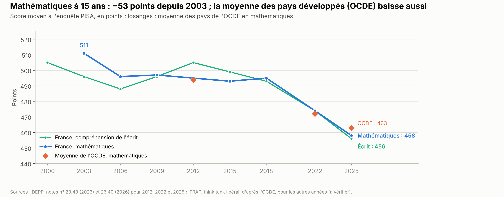
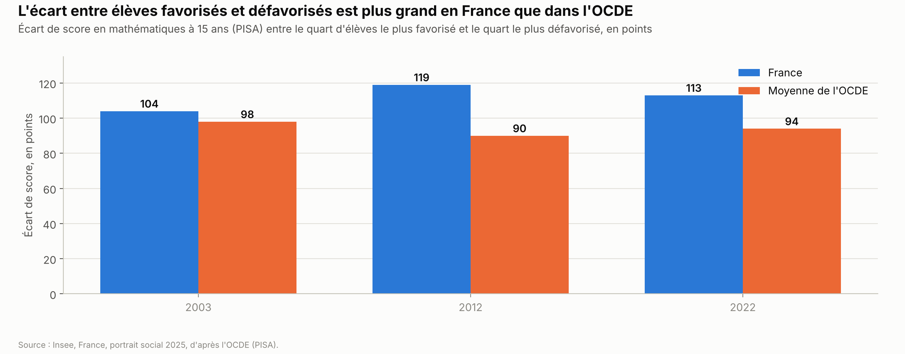
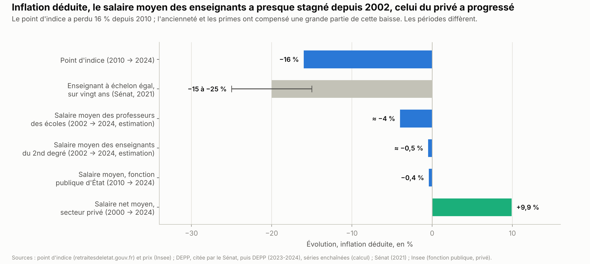
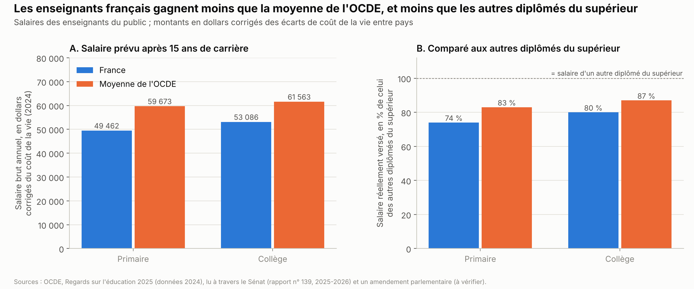
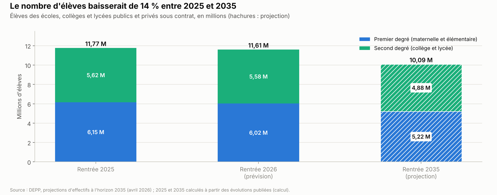
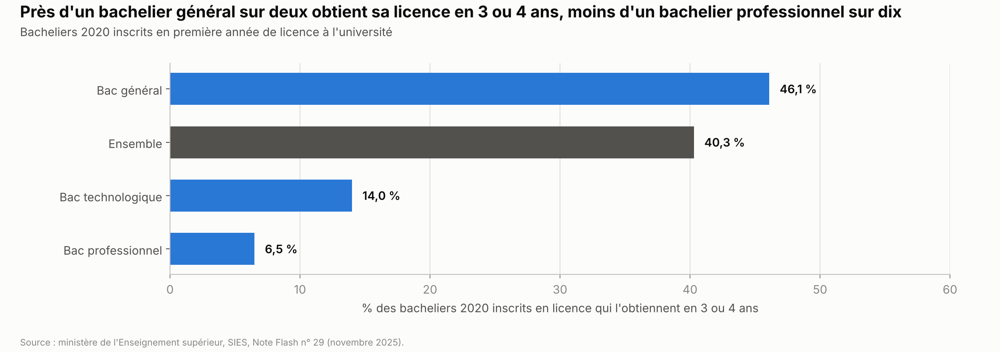

# Éducation

*Version de travail du 7 octobre 2026, corrigée le 21 octobre 2026. Les chiffres seront mis à jour à la date d'arrêt des données de l'édition 1.*

Ce chapitre suit l'enfant de la crèche à l'université. Il présente ce que la France dépense pour l'éducation, le niveau des élèves, les inégalités scolaires, les enseignants et leur salaire, la baisse du nombre d'élèves et les réformes récentes. Il traite aussi l'accueil avant 3 ans et l'enseignement supérieur, puis les propositions des partis et ce qu'on sait des mesures déjà essayées.

**Voir aussi :**
- [Finances publiques](../finances-publiques/finances_publiques.md), pour le point d'indice des fonctionnaires, la masse salariale publique et le budget de l'État ;
- [Pouvoir d'achat, salaires et inégalités](../pouvoir-achat/pouvoir_achat.md), pour les salaires du privé, le pouvoir d'achat moyen et la mobilité sociale ;
- [Travail et emploi](../travail-emploi/travail_emploi.md), pour l'apprentissage, le chômage des jeunes et le contrat d'engagement jeune ;
- [Immigration](../immigration/immigration.md), section 1.5, pour les diplômes et la maîtrise du français des immigrés adultes ;
- [Santé et assurance maladie](../sante/sante_assurance_maladie.md), pour la santé des enfants et des jeunes ;
- [Sécurité et justice](../securite-justice/securite_justice.md), pour la justice des mineurs ;
- [Retraites et productivité](../retraites-productivite/retraites_productivite.md), pour la cotisation retraite des fonctionnaires ;
- [Défense et Europe](../defense-europe/defense_europe.md), section 1.3, pour le service national ;
- [Présidentielle 2027 : ce que proposent les partis](../partis/programmes_partis_2027.md), pour les programmes complets.

> **Repères.**
> - **Les étapes.** Avant 3 ans : crèche, assistante maternelle ou parents. De 3 à 11 ans : école maternelle, puis élémentaire, qui forment le **premier degré**. L'élémentaire compte cinq classes : CP (cours préparatoire), CE1 (cours élémentaire 1re année), CE2 (2e année), CM1 (cours moyen 1re année) et CM2 (2e année). De 11 à 18 ans : collège (de la 6e à la 3e), puis lycée général, technologique ou professionnel, qui forment le **second degré**. L'instruction est obligatoire de 3 à 16 ans.
> - **Qui décide.** L'État fixe les programmes et les diplômes ; il recrute et paie les enseignants. Les communes ont la charge des écoles, les départements des collèges, les régions des lycées : bâtiments, cantine, personnels techniques.
> - **Le privé sous contrat.** Environ un élève sur six va dans un établissement privé sous contrat avec l'État. L'État y paie les enseignants ; l'établissement suit les programmes nationaux et peut avoir un caractère religieux.
> - **L'éducation prioritaire.** Les écoles et collèges des quartiers les plus défavorisés forment des réseaux d'éducation prioritaire (REP), et des REP renforcés (REP+) pour les plus en difficulté. Ils reçoivent des moyens en plus.
> - **Les enseignants.** Un **titulaire** a réussi un concours et est fonctionnaire ; un **contractuel** est recruté sur contrat. Le salaire de base d'un fonctionnaire est un nombre de points multiplié par la valeur du **point d'indice**.
> - **Les chiffres** viennent surtout de la Direction de l'évaluation, de la prospective et de la performance (DEPP), le service statistique du ministère de l'Éducation nationale, et du Système d'information et d'études statistiques (SIES) pour le supérieur.

---

## L'essentiel

1. **Le niveau en mathématiques a baissé.** Selon l'enquête internationale sur les élèves de 15 ans (PISA), la France obtient 458 points en 2025, contre 511 en 2003 *(à vérifier)*. Elle reste proche de la moyenne des pays développés (463), qui baisse aussi. En 4e, elle est parmi les derniers pays européens testés.
2. **L'origine sociale pèse plus qu'ailleurs.** En 2022, 113 points séparaient les élèves les plus favorisés des plus défavorisés, contre 94 en moyenne dans les pays développés. 83 % des enfants de cadres sont diplômés du supérieur, contre 37 % des enfants d'ouvriers.
3. **La France consacre 6,7 % de son PIB à l'éducation**, soit 199,2 Md€ en 2025. En 2021, elle dépensait par élève 13 % de plus que la moyenne des pays développés au collège et au lycée, mais 11 % de moins en primaire.
4. **Le nombre d'élèves baisse.** L'école compte 161 000 élèves de moins à la rentrée 2026. La baisse atteindrait 1,7 million, soit 14 %, d'ici 2035. Les classes sont moins chargées qu'en 2017, mais plus que la moyenne de l'UE.
5. **Les enseignants fonctionnaires gagnent 3 090 € nets par mois en moyenne (2024).** La valeur du point d'indice a augmenté de 6 % de 2010 à 2024, et les prix de 26 %. Avec l'ancienneté et les primes, le salaire moyen réel a moins baissé : de ≈ 0 à 4 % depuis 2002 *(calcul)*. Il reste inférieur à la moyenne des pays développés.
6. **Les concours font presque le plein en 2026**, après des années de postes vacants : 98,5 % des postes pourvus en primaire, 96,1 % dans le secondaire. Dans les collèges publics, 9 % des heures de cours n'ont pas été assurées en 2023-2024.
7. **Avant 3 ans et après le bac, les écarts sont grands.** Il y a 61 places d'accueil pour 100 enfants de moins de 3 ans (2023), mais 35 en Seine-Saint-Denis (2022). Parmi les bacheliers inscrits en licence, 40 % l'obtiennent en 3 ou 4 ans : 46 % après un bac général, 6,5 % après un bac professionnel.

**Les grandes options en débat.**
- **Moyens** : utiliser la baisse du nombre d'élèves pour alléger les classes, pour mieux payer les enseignants, ou pour supprimer des postes.
- **Salaires** : une hausse pour tous les enseignants (de +135 € par mois à +25 %), ou ciblée sur le milieu de carrière, avec ou sans missions en plus.
- **Organisation** : regrouper les élèves par niveau, rétablir un examen d'entrée en 6e et le redoublement, ou garder des classes mélangées.
- **Mixité** : imposer des obligations sociales au privé sous contrat, ou garder les règles actuelles.
- **Supérieur et petite enfance** : supprimer ou garder Parcoursup ; ouvrir des places en crèche ou allonger les congés des parents.

---

## 1. La situation

### 1.1 Combien coûte l'éducation, et qui paie

**La dépense totale.** En 2025, la France a consacré 199,2 Md€ à l'éducation, soit 6,7 % du PIB. Ce total, appelé dépense intérieure d'éducation, couvre tout : de la maternelle au supérieur, formation continue comprise. Il a augmenté de 1,2 % en un an, soit 0,1 % une fois l'inflation déduite (DEPP, septembre 2026)[^depp-compte-2025].

**Qui paie.**
- l'État : 55 %[^depp-compte-2025] ;
- les communes, départements et régions : 23 %[^depp-compte-2025] ;
- les entreprises : 10 %, surtout pour l'apprentissage et la formation continue[^depp-compte-2025] ;
- les ménages : 8 %[^depp-compte-2025] ;
- d'autres administrations publiques : 4 %[^depp-compte-2025].

**Par élève.** En 2025, un élève coûte en moyenne 9 440 € par an dans le premier degré et 11 780 € dans le second degré. Un étudiant coûte 13 350 € (DEPP)[^depp-compte-2025].

**Le budget de l'État.** Le projet de budget pour 2027 donne 64 Md€ au ministère de l'Éducation nationale, hors retraites des enseignants, soit 1,2 Md€ de plus qu'en 2026. Avec les retraites, le total atteint 89,1 Md€ (ministère, octobre 2026)[^men-budget-2027]. Ce montant couvre le seul ministère ; la mission « Enseignement scolaire » du budget, qui comprend aussi l'enseignement agricole, est un peu plus large (chapitre [Finances publiques](../finances-publiques/finances_publiques.md))[^ch-finances-publiques]. L'enseignement supérieur et la recherche reçoivent 31,8 Md€, soit 0,5 Md€ de plus[^mesr-plf-2027]. Ces textes sont en discussion au Parlement.

**Les collectivités.** Elles investissent ≈ 8,3 Md€ par an dans les bâtiments scolaires : 3,7 Md€ pour les communes, 2,7 Md€ pour les régions et 1,9 Md€ pour les départements (Assemblée nationale, 2023)[^an-ecole-climat].

**La comparaison internationale.** Le Conseil d'analyse économique (CAE), qui conseille le Premier ministre, a comparé la France aux pays de l'Organisation de coopération et de développement économiques (OCDE), qui réunit 38 pays surtout développés. En 2021, la France consacrait 5,4 % de son PIB aux établissements d'enseignement, contre 4,9 % en moyenne. Elle dépensait 13 % de plus par élève dans le secondaire, mais 11 % de moins dans le primaire (CAE, mai 2025)[^cae-84]. Ce périmètre est plus étroit que la dépense intérieure d'éducation.

### 1.2 Le niveau des élèves

**Trois façons de mesurer le niveau.**
- **Les évaluations nationales** testent tous les élèves de certains niveaux (CP, CE1, CM1, 6e, 4e, 2de) chaque année depuis 2017-2019. Elles servent d'abord à repérer les élèves en difficulté.
- **Les enquêtes de la DEPP sur échantillon** répètent les mêmes épreuves à plusieurs années d'écart, parfois sur trente ans. Elles sont faites pour comparer les époques.
- **Les enquêtes internationales** comparent les pays. Le Programme international pour le suivi des acquis des élèves (PISA) teste les élèves de 15 ans tous les trois ou quatre ans. L'enquête sur les mathématiques et les sciences (TIMSS) teste les élèves de CM1 et de 4e, et l'enquête sur la lecture (PIRLS) ceux de CM1.

**PISA 2025** (publié le 8 septembre 2026).
- La France obtient 458 points en mathématiques, 456 en compréhension de l'écrit[^depp-26-40] et 483 en sciences[^depp-26-39]. L'échelle de PISA a été fixée au départ avec une moyenne de 500 points pour les pays de l'OCDE *(à vérifier)*. La moyenne de l'OCDE est de 463 en mathématiques et de 461 à l'écrit[^depp-26-40]. Pour le ministère, la France est « dans la moyenne de l'OCDE »[^men-pisa-2025] dans les trois domaines.
- Depuis 2022, la France a perdu 16 points en mathématiques et 18 à l'écrit. La moyenne de l'OCDE a perdu 9 et 14 points (DEPP, septembre 2026)[^depp-26-40].
- 36 % des élèves français sont « en difficulté » en mathématiques, c'est-à-dire sous le niveau 2 de l'échelle PISA, contre 35 % dans l'OCDE. À l'écrit, c'est 33 %, contre 30 %. 5 % sont très performants en mathématiques, contre 8 % dans l'OCDE[^depp-26-40].
- Sur longue période, le score en mathématiques passe de 511 points en 2003 à 495 en 2012 et en 2018, puis à 474 en 2022 et 458 en 2025 (graphique de « L'essentiel »). Les scores de 2012, 2022 et 2025 viennent des notes de la DEPP[^depp-23-48][^depp-26-40]. Les autres viennent d'une série publiée par la Fondation pour la recherche sur les administrations et les politiques publiques (IFRAP), d'orientation libérale, à partir des données de l'OCDE *(à vérifier)*[^ifrap-pisa].
- Le ministère vise un gain de 20 points d'ici 2029, et un retour « parmi les premiers pays d'Europe et de l'OCDE »[^men-pisa-2025-annonce] au cycle PISA de 2033.

**TIMSS 2023** (publié en décembre 2024).
- En 4e, la France obtient 479 points en mathématiques. La moyenne des 22 pays de l'OCDE et de l'UE participants est de 507. Le score français ne diffère pas nettement de celui du Portugal (475), d'Israël (487) ou des États-Unis (488) ; seul le Chili (416) fait nettement moins bien (DEPP, décembre 2024)[^depp-24-48].
- En CM1, le score en mathématiques est stable : 485 en 2019, 484 en 2023, un écart non significatif[^men-timss-2023]. Il reste sous la moyenne européenne, selon la DEPP[^depp-24-47].

**Les comparaisons sur trente ans** (DEPP).
- **Orthographe.** À la même dictée, les élèves de CM2 faisaient 10,7 erreurs en moyenne en 1987, 14,7 en 2007 et 19,4 en 2021. La DEPP note que la baisse « se poursuit en 2021, mais de façon moins marquée »[^depp-dictee-cm2].
- **Calcul et mathématiques.** Le niveau en calcul des élèves de CM2 a baissé de 1987 à 2017[^depp-calcul-cm2]. Les mathématiques sont « en baisse »[^depp-cedre] de 2008 à 2019, en fin d'école comme en fin de collège.
- **Lecture.** En fin d'école, le niveau en français est en « légère hausse »[^depp-cedre] en 2021 ; en fin de collège, les résultats sont « stables »[^depp-cedre] en 2021.
- **Sciences.** Les résultats sont stables depuis 2007 en fin d'école ; en fin de collège, « la baisse des résultats se poursuit en 2024 »[^depp-cedre].

**Les évaluations nationales récentes.**
- **À l'entrée en 6e**, les résultats montent depuis 2017. En français, la part des élèves les plus faibles est passée de 25,2 % à 21,5 % entre 2017 et 2025 ; celle des plus forts, de 26,8 % à 30,3 % (DEPP, juin 2026)[^depp-26-21].
- **En 4e**, le score en français a baissé de 3 points entre 2023 et 2025 ; la part des élèves les plus faibles est passée de 15,2 % à 17,4 % *(à vérifier)*. Les mathématiques sont stables[^depp-26-21].
- **À l'entrée en 2de**, les résultats en français baissent en 2025 dans les deux voies. En voie générale et technologique, ils reviennent au niveau de 2019 ; en voie professionnelle, ils baissent depuis 2021, et les mathématiques baissent aussi (DEPP, juin 2026)[^depp-eval-2de].
- **À l'école élémentaire**, les résultats sont stables entre 2024 et 2025[^depp-eval-ecole-francais][^depp-eval-ecole-maths].

**Les jeunes adultes.** Lors de la Journée défense et citoyenneté (JDC), que suivent tous les jeunes Français vers 17 ans, 13 % ont des difficultés de lecture en 2024 ; 6 % sont en situation d'illettrisme (DEPP, octobre 2025)[^depp-jdc-2024]. Selon l'enquête internationale sur les compétences des adultes (PIAAC), plus d'un adulte sur quatre maîtrise mal la lecture ou le calcul en 2023, un peu plus que la moyenne de l'OCDE[^depp-piaac].

**Les examens de 2026.**
- **Baccalauréat** : 91,4 % de réussite (95,9 % en voie générale, 90,3 % en voie technologique, 84,3 % en voie professionnelle). 79 % d'une génération obtient le bac (estimation provisoire)[^depp-bac-2026].
- **Brevet** : 81,6 % de réussite, contre 85,5 % en 2025. Les épreuves finales comptent désormais pour 60 % de la note, contre 50 % auparavant (DEPP, juillet 2026)[^depp-brevet-2026].

### 1.3 Les inégalités scolaires

**Le poids de l'origine sociale.**
- À 15 ans, l'écart en mathématiques entre le quart d'élèves le plus favorisé et le quart le plus défavorisé était de 104 points en 2003 et de 113 points en 2022 en France. Dans l'OCDE, il était de 98 et 94 points, selon l'Institut national de la statistique et des études économiques (Insee), d'après PISA (novembre 2025)[^insee-portrait-2025]. Dans PISA 2025, l'écart est de 95 points en mathématiques et 91 à l'écrit, contre 83 et 77 dans l'OCDE (DEPP)[^depp-26-40]. Les groupes comparés ne sont peut-être pas définis de la même façon : ces chiffres ne se comparent pas à ceux de 2003-2022 *(à vérifier)*.
- En 2022, l'origine sociale expliquait 21 % des écarts de résultats en mathématiques en France, contre 15 % en moyenne dans l'OCDE (CAE, d'après PISA)[^cae-84].
- Pour la DEPP, « la France est l'un des pays de l'OCDE où la différence de résultats entre les élèves très favorisés et les élèves très défavorisés est la plus marquée »[^depp-26-40].
- Les écarts existent dès 3 ans. En petite section de maternelle, en 2022, les enfants de milieu très favorisé avaient 32 points de plus que ceux de milieu défavorisé en langage, et 36 points en mathématiques (Insee, d'après la DEPP)[^insee-portrait-2025].
- À la fin des études, parmi les 25-34 ans, 83 % des enfants de cadres sont diplômés du supérieur, contre 37 % des enfants d'ouvriers. Les enfants d'ouvriers sont 15 % à n'avoir aucun diplôme ou le seul brevet, contre 2 % des enfants de cadres (Insee, 2024)[^insee-portrait-2025].

**L'éducation prioritaire.**
- En 2026, elle compte 1 097 réseaux : 365 REP+ et 732 REP (Sénat, mai 2026)[^senat-ep-2026]. À la rentrée 2024, un écolier sur cinq (20,5 %) et un collégien sur cinq (21,5 %) y étaient scolarisés (DEPP) *(source secondaire)*[^weka-ep]. Sa dépense est passée de 1,4 Md€ en 2016 à 2,6 Md€ en 2023, surtout à cause du dédoublement des classes (Cour des comptes, citée par la presse) *(source secondaire)*[^bdt-dedoublement-peu-efficace].
- À l'entrée en 6e, en 2025, les élèves de REP+ ont en moyenne 33 points de moins en français et 35 points de moins en mathématiques que les élèves du public hors éducation prioritaire. L'écart est d'environ 20 points en REP (DEPP)[^depp-26-21]. Sur cette échelle, deux tiers des élèves sont à moins de 50 points de la moyenne *(à vérifier)*.
- La liste des réseaux n'a pas été revue depuis 2015 *(à vérifier)*. Selon un rapport du Sénat de mai 2026, 5 collèges de l'éducation prioritaire ont un indice de position sociale (IPS) supérieur à 110[^senat-ep-2026]. Cet indice mesure le milieu social moyen des élèves ; au-dessus de 110, le public est plutôt favorisé. Une révision ferait entrer 240 réseaux et en sortir autant[^senat-ep-2026]. Le ministre a indiqué en décembre 2025 qu'il n'y aurait « pas de réforme »[^aef-geffray-carte-ep-2025] de la carte cette année-là *(source secondaire)*.

**La ségrégation entre établissements.**
- Les collèges publics accueillent des publics très différents. En 2023, un collège sur dix compte moins de 21 % d'élèves de milieu défavorisé ; un sur dix en compte plus de 62 % (Olivier Monso, DEPP et Sciences Po, mai 2026)[^monso-mixite].
- Environ deux tiers de ces écarts viennent de ce que les familles riches et pauvres n'habitent pas les mêmes quartiers. Le reste tient aux choix des familles : départs vers le privé et demandes de dérogation à la carte scolaire, qui fixe le collège public de chaque adresse. Dans les Hauts-de-Seine, en 2018, 61 % de la ségrégation entre collèges venait de celle des quartiers, et 35 % des choix du privé (même source)[^monso-mixite].
- La ségrégation entre collèges publics a un peu baissé entre 2003 et 2024, selon l'indicateur utilisé par la même étude[^monso-mixite].

**Le privé sous contrat.**
- Il accueille ≈ 2 millions d'élèves, soit 17,6 % (Cour des comptes, juin 2023)[^cour-prive-2023], et emploie 139 900 enseignants payés par l'État (DEPP, rentrée 2025)[^depp-rers-2026].
- **Le financement.** Les ressources des établissements privés sous contrat atteignaient ≈ 13,8 Md€ en 2022 : 8,5 Md€ de l'État, 1,9 Md€ des collectivités et 3,3 Md€ des familles. L'argent public en finance ≈ 75 % (rapport des députés Paul Vannier, LFI, et Christopher Weissberg, Renaissance, avril 2024). Selon ce rapport, aucune administration ne connaît le montant total consolidé de la dépense publique pour le privé[^an-rapport-2423].
- **Le public accueilli.** En 2021, les collèges privés comptaient 40,1 % d'élèves de milieu très favorisé, contre 19,5 % dans le public (rapport Vannier-Weissberg, 2024)[^an-dp-vannier-weissberg]. Les élèves boursiers représentaient 11,8 % des élèves du privé, contre 29,1 % dans le public (Cour des comptes, 2023). Pour la Cour des comptes, « la mixité sociale dans les établissements privés sous contrat est en fort recul depuis une vingtaine d'années »[^cour-prive-2023].
- **Le coût par élève.** Selon l'IFRAP, un élève du privé coûte aux finances publiques 55 % de moins qu'un élève du public en primaire, et 46 % de moins dans le secondaire (données de 2021)[^ifrap-prive]. Les familles paient une partie du coût, et les communes ne financent pas les investissements des écoles privées *(à vérifier)*.
- **Les contrôles.** Selon le rapport de 2024, « la fréquence et la profondeur des contrôles réalisés sur les établissements privés sous contrat sont très largement insuffisantes »[^an-rapport-2423]. Après l'affaire des violences au collège-lycée de Bétharram, l'Assemblée a adopté en juin 2026, à l'unanimité des 187 votants, une proposition de loi portée par Violette Spillebout (Ensemble pour la République) et co-rédigée avec Paul Vannier (LFI)[^an-rapport-2835]. Elle rend obligatoire un contrôle de chaque établissement privé sous contrat tous les cinq ans[^euronews-betharram]. Le Sénat doit encore l'examiner.

**Filles et garçons.**
- Les filles réussissent mieux en français : +11 points en 6e, +15 points en 4e (DEPP, 2025)[^depp-26-21] ; +32 points à l'écrit dans PISA 2025[^depp-26-40].
- Les garçons réussissent mieux en mathématiques : +11 points en 6e[^depp-26-21], +13 points dans PISA 2025[^depp-26-40]. En CM1, l'écart en faveur des garçons est passé de 6 points en 2015 à 23 points en 2023 (TIMSS)[^men-timss-2023].
- Les filles réussissent mieux aux examens : en 2025, 94 % des candidates ont obtenu le bac, contre 90 % des candidats[^depp-filles-garcons-2026]. Mais 17 % des bachelières qui poursuivent leurs études choisissent une filière scientifique ou technique, contre 44 % des garçons (Sénat, octobre 2025)[^senat-femmes-sciences].

**Les territoires.**
- **Outre-mer.** En 2022, 61 % des adultes de Mayotte et 41 % de ceux de Guyane avaient des difficultés à l'écrit en français, contre 10 % dans l'Hexagone (Insee, avril 2025)[^insee-mayotte].
- **Campagne et ville.** À milieu social égal, les élèves de 6e des communes rurales éloignées ont de meilleurs résultats que ceux des grandes villes : 255 points contre 245 en mathématiques (DEPP, 2025)[^depp-26-21]. L'éducation prioritaire est surtout urbaine : selon le Sénat, 9 REP sont en zone rurale, et aucun REP+[^senat-ep-2026].

**Les élèves allophones et handicapés.**
- **Élèves qui arrivent sans parler français.** Ils étaient 88 500 en 2023-2024[^depp-allophones], contre 67 909 en 2018-2019 (DEPP)[^depp-allophones-2018]. Neuf sur dix bénéficient d'un soutien[^depp-allophones].
- **Élèves handicapés.** Environ 520 000 élèves en situation de handicap vont à l'école ordinaire en 2025, trois fois plus qu'en 2006 (Sénat, décembre 2025)[^senat-232-aesh].
- **Leurs accompagnants.** Les accompagnants d'élèves en situation de handicap (AESH) sont ≈ 140 000, contre moins de 43 000 en 2017. Ils gagnent en moyenne 850 € nets par mois, car la plupart travaillent 24 heures par semaine. Un tiers d'entre eux ont démissionné entre 2020 et 2023 ; 63 % ont un contrat à durée indéterminée. Leur coût atteint 2,9 Md€ en 2025. 355 000 élèves ont droit à un accompagnant ; le nombre d'élèves qui n'en ont pas, malgré ce droit, n'est pas publié (même source)[^senat-232-aesh].

**L'accès aux filières sélectives.** En 2016-2017, 64 % des élèves des grandes écoles venaient de milieux très favorisés, contre 23 % des jeunes de 20 à 24 ans. 9 % venaient de milieux défavorisés, contre 36 %. Ces chiffres viennent d'un rapport de 2021 de l'Institut des politiques publiques (IPP)[^ipp-30]. Sur la mobilité sociale en général, voir le chapitre [Pouvoir d'achat](../pouvoir-achat/pouvoir_achat.md), section 5.5.

### 1.4 Les parcours : orientation, voie professionnelle, décrochage

**Après la 3e.** Environ deux élèves sur trois entrent en seconde générale et technologique ; un sur trois choisit la voie professionnelle, au lycée professionnel ou en apprentissage *(à vérifier)*. En 2026, 84,3 % des candidats ont obtenu le bac professionnel[^depp-bac-2026]. Au brevet, la réussite en série professionnelle est tombée de 75,4 % à 64,8 % en un an, avec la nouvelle place des épreuves finales (DEPP)[^depp-brevet-2026]. Une réforme du lycée professionnel, lancée en 2023, rémunère les stages des élèves et allonge le temps passé en entreprise *(à vérifier)*.

**L'apprentissage.** L'apprenti alterne cours et travail en entreprise, avec un contrat de travail.
- 889 400 contrats ont été signés en 2024, soit 4 % de plus qu'en 2023, et plus d'un million étaient en cours fin 2024 (Dares, service statistique du ministère du Travail) *(source secondaire)*[^centreinffo-apprentissage].
- Depuis la réforme de 2018 et les aides à l'embauche de 2020, la hausse vient surtout de l'enseignement supérieur. En 2021, 61 % des nouveaux apprentis préparaient un diplôme de niveau bac+2 ou plus, contre 38 % en 2018, selon l'Unédic, l'organisme qui gère l'assurance chômage (2022)[^unedic-apprentissage].
- L'apprentissage a coûté 16,5 Md€ d'argent public en 2023, dont 7,5 Md€ pour l'État[^lefebvre-apprentissage]. La Cour des comptes juge que les aides ont surtout bénéficié aux étudiants, avec « des effets d'aubaine majeurs »[^lefebvre-apprentissage] : une partie des apprentis aurait été embauchée sans aide *(source secondaire)*. Les aides à l'embauche ont été réduites en 2025 *(à vérifier)*[^lapprenti-aide-embauche-2025].

**Le redoublement.** Il a beaucoup reculé depuis les années 1990 (IPP, 2015)[^ipp-17], mais son taux actuel n'a pas été trouvé. Selon PISA 2012 *(à vérifier)*, 28 % des Français de 15 ans avaient redoublé au moins une fois, contre 12 % en moyenne dans l'OCDE (IPP, 2015)[^ipp-17]. Depuis 2024, la décision finale revient de nouveau aux enseignants, et non plus aux familles *(à vérifier)*.

**Les sorties précoces.** En 2023, 7,6 % des jeunes de 18 à 24 ans avaient au plus le brevet et ne suivaient aucune formation : 10 % des jeunes hommes et 6 % des jeunes femmes. La moyenne de l'UE est de 10 % (Insee, 2025)[^insee-bfe-sortants]. En 2023, 12,3 % des 15-29 ans n'étaient ni en emploi, ni en études, ni en formation (Insee)[^insee-bfe-jeunes]. Les difficultés de lecture à 17 ans sont décrites en section 1.2.

### 1.5 Les enseignants : salaire, temps de travail, recrutement

**Combien ils sont.** À la rentrée 2025, la France compte 851 500 enseignants : 711 600 dans le public et 139 900 dans le privé sous contrat (DEPP, 2026)[^depp-rers-2026].
- Dans le public, 322 500 enseignent dans le premier degré et 389 100 dans le second degré[^depp-rers-2026].
- Ils ont 45 ans en moyenne ; 71 % sont des femmes[^depp-rers-2026].
- Les contractuels représentent 2,6 % des enseignants du premier degré public et 11 % de ceux du second degré public[^depp-rers-2026]. Cette part était de 7,5 % en 2013[^depp-non-titulaires-2013] ; elle est « globalement stable depuis 2023 »[^depp-rers-2026] (DEPP).

**Ce que gagne un enseignant.** En 2024, le salaire net moyen des enseignants fonctionnaires est de 3 090 € par mois, primes comprises. Il a augmenté de 6,4 % en un an, soit 4,3 % une fois l'inflation déduite (DEPP, août 2026)[^depp-salaires-2024].

| Corps (2024) | Salaire net moyen par mois |
|---|---|
| Professeurs des écoles | 2 850 € |
| Professeurs certifiés (collège et lycée) | 3 130 € |
| Professeurs d'éducation physique et sportive | 3 180 € |
| Professeurs de lycée professionnel | 3 390 € |
| Professeurs agrégés (concours plus sélectif) | 4 080 € |

*Source : DEPP, salaires des enseignants en 2024 (août 2026)[^depp-salaires-2024]. Les agrégés gagnent 1,4 fois plus que les professeurs des écoles. Valeurs par corps reprises de la version précédente du chapitre, non relues une à une (à vérifier).*

**Ce qui compose le salaire.** Le salaire de base d'un fonctionnaire, appelé traitement, est un nombre de points multiplié par la valeur du point d'indice. Le nombre de points dépend du métier et de l'échelon, c'est-à-dire de l'ancienneté. S'y ajoutent des primes.

| Date | Valeur mensuelle du point d'indice | Évolution |
|---|---|---|
| Décembre 2000 | 4,2668 € | — |
| Juillet 2010 | 4,6303 € | Gel jusqu'en 2016 |
| Juillet 2016, puis février 2017 | 4,6581 €, puis 4,6860 € | Deux fois +0,6 %, puis gel jusqu'en 2022 |
| Juillet 2022 | 4,8500 € | +3,5 % |
| Juillet 2023 | 4,9228 € | +1,5 %, puis gel en 2024, 2025 et 2026 |

*Source : valeurs officielles du point d'indice (retraitesdeletat.gouv.fr)[^point-indice-historique]. Le projet de budget pour 2027 ne prévoit pas de hausse ; le gouvernement en attend ≈ 2 Md€ d'économies, selon l'Agence France-Presse (AFP), octobre 2026[^afp-moneyvox-budget-2027].*

- **Le point d'indice et les prix.** De juillet 2010 à 2024, le point a augmenté de 6,3 %[^point-indice-historique], et les prix de 26,5 % (Insee) *(à vérifier)*[^insee-inflation]. Inflation déduite, il a perdu 16 % *(calcul)*. De 2000 à 2025, il a augmenté de 15,4 % *(calcul)*[^point-indice-historique], pour des prix en hausse d'≈ 51 % *(à vérifier)*[^insee-inflation].
- **L'avancement.** L'enseignant monte d'échelon avec l'ancienneté. Un accord sur les carrières, appelé Parcours professionnels, carrières et rémunérations (PPCR), a revu entre 2016 et 2020 le salaire prévu à chaque échelon.
- **Les primes.** Elles représentent 16 % du salaire brut dans le premier degré et 21 % dans le second degré en 2024 (DEPP) *(à vérifier)*.
  - Une prime d'attractivité pour les débuts de carrière a été créée en 2021.
  - En septembre 2023, une hausse accordée à tous, appelée « socle », a apporté de 92 à 222 € nets par mois dans le second degré. Elle a notamment doublé une prime versée pour le suivi des élèves, de 1 256 € à 2 550 € bruts par an *(à vérifier)*[^men-revalorisation-2023].
  - Le « Pacte enseignant », créé en 2023, paie des missions en plus, comme les remplacements ou le soutien aux élèves : 1 250 € bruts par mission et par an *(à vérifier)*. Un tiers des enseignants y ont participé ; il a coûté près de 750 M€ en 2023-2024 (Cour des comptes, juillet 2025) *(source secondaire)*[^weka-pacte].
- **Les mesures générales.** Tous les fonctionnaires ont reçu 5 points d'indice de plus en janvier 2024. Selon le gouvernement, les hausses d'avril 2022 à janvier 2024 ont représenté +11 % en moyenne pour les enseignants, pour un coût cumulé de 6,4 Md€ *(à vérifier)*. La garantie individuelle du pouvoir d'achat (GIPA), qui compensait une partie des pertes, n'est plus versée depuis 2024[^lcp-greve-fonctionnaires-2026].
- **En sens inverse.** La cotisation retraite des fonctionnaires est passée de 7,85 % à 11,10 % du traitement entre 2010 et 2020, ce qui réduit le salaire net *(à vérifier)*.

**Le salaire réel.** Selon la DEPP, citée par le Sénat, le salaire net moyen des enseignants a baissé de 8 % dans le primaire et de 5 % dans le secondaire entre 2002 et 2022, inflation déduite[^senat-128-2023]. Il a ensuite augmenté de 0,4 % en 2023[^depp-ni-25-48-salaires] et de 4,3 % en 2024 (DEPP)[^depp-salaires-2024]. Sur 2002-2024, la perte serait d'≈ 4 % dans le primaire et proche de zéro dans le secondaire *(calcul, en enchaînant des séries qui ne sont pas homogènes)*. Le salaire moyen a donc moins baissé que le point d'indice : les enseignants vieillissent et montent d'échelon, et les primes ont augmenté. À échelon égal, en revanche, un enseignant a perdu 15 à 25 % de pouvoir d'achat en vingt ans (Sénat, 2021)[^senat-163-longuet]. Sur des périodes proches, inflation déduite, le salaire net moyen du privé a augmenté de 9,9 % de 2000 à 2024[^insee-2079]. Celui de la fonction publique d'État a baissé de 0,4 % de 2010 à 2024 (Insee, graphique)[^insee-2100]. Sur le pouvoir d'achat moyen, voir le chapitre [Pouvoir d'achat](../pouvoir-achat/pouvoir_achat.md).

**Le début de carrière.** Depuis 2023, aucun enseignant titulaire ne débute sous 2 100 € nets par mois, primes comprises[^men-revalorisation-2023], soit ≈ 1,42 SMIC net *(calcul, SMIC net de ≈ 1 478 € depuis juin 2026)*[^ch-pouvoir-achat]. Les contractuels gagnent en moyenne ≈ 1 980 € nets *(à vérifier)*.

**La comparaison internationale.** Selon l'OCDE, après 15 ans de carrière, un enseignant français gagne ≈ 17 % de moins que la moyenne de l'OCDE dans le primaire et ≈ 14 % de moins au collège *(calcul, données de 2024, à vérifier)*[^ocde-rse-2025-salaires]. Il gagne aussi moins, par rapport aux autres diplômés du supérieur de son pays, que ses collègues des autres pays (graphique). En Allemagne, un enseignant du primaire gagne ≈ 1,8 fois plus qu'en France après 15 ans *(calcul)*[^ocde-rse-2025-salaires]. Ces chiffres tiennent compte des écarts de coût de la vie entre pays ; ils ont été lus à travers le Sénat et la presse *(à vérifier)*[^an-cf1907]. De 2015 à 2024, inflation déduite, le salaire prévu après 15 ans a progressé d'≈ 0 à 1 % en France, contre 4 à 6 % en moyenne dans l'OCDE. En France, le salaire de début de carrière a progressé de 8 % *(à vérifier)*[^ocde-rse-2025-salaires].

**Le temps de travail.**
- **Devant les élèves.** Selon l'OCDE, un enseignant français doit 900 heures de cours par an dans le primaire et 720 heures dans le secondaire (2021), plus que la moyenne de l'OCDE, sauf en maternelle *(source secondaire)*[^acteurspublics-heures]. L'année scolaire compte 162 jours de classe en maternelle, le nombre le plus bas des pays de l'OCDE (OCDE, données de 2025) *(à vérifier)*[^ocde-rse-2026-temps].
- **Au total.** La moitié des enseignants à temps plein déclarent travailler au moins 43 heures par semaine. Le temps passé devant les élèves représente 59 % de ce total dans le premier degré et 49 % dans le second (DEPP, 2022)[^depp-temps-travail].

**Le recrutement.**
- En 2022, environ un poste sur six n'était pas pourvu aux concours du public *(à vérifier)*. En 2025, 92,1 % des postes étaient pourvus dans le premier degré et 90,6 % dans le second degré[^men-concours-2026].
- En 2026, ces taux montent à 98,5 % et 96,1 % (ministère, juillet 2026)[^men-concours-2026]. Cette année-là, un nouveau concours s'ouvre dès la licence (bac+3), en plus de celui de fin de master (bac+5). Le nombre de postes a augmenté de 40 % (ministère)[^men-concours-2026] et celui des inscrits de 46 % (L'Étudiant, décembre 2025) *(source secondaire)*[^letudiant-concours].
- Les lauréats du nouveau concours sont payés pendant deux ans de formation : plus de 1 400 € nets la première année, près de 1 800 € la seconde[^men-budget-2027]. En échange, ils s'engagent à servir l'État quelques années *(durée à vérifier)*.
- Avoir des lauréats ne garantit pas un enseignant devant chaque classe. Selon une enquête du Syndicat national des enseignements de second degré (Snes-FSU), le premier du second degré, 53 % des collèges et lycées qui ont répondu manquaient d'au moins un enseignant à la rentrée 2026[^sudradio-snes-rentree]. L'enquête n'est pas représentative (section 5).

**Le remplacement.** Selon la Cour des comptes (décembre 2025)[^cour-temps-perdu], 9 % des heures de cours n'ont pas été assurées dans les collèges publics en 2023-2024, contre 8,3 % en 2018-2019 et 11,2 % en 2022-2023. C'est 11 % en éducation prioritaire, contre 8 % ailleurs. Les arrêts maladie des enseignants ont augmenté de 41 % en cinq ans. Les absences longues sont remplacées à 94 % ; les absences courtes à 12 %, pour un objectif de 36 % *(source secondaire ; définition des taux à vérifier)*[^bdt-temps-perdu].

**Ce que coûterait une hausse.**
- Le point d'indice vaut pour les ≈ 5,8 millions d'agents publics[^senat-difolco-plf2026]. Le relever de 1 % coûte ≈ 2,3 Md€ par an (chapitre [Finances publiques](../finances-publiques/finances_publiques.md))[^ch-finances-publiques]. Une hausse réservée aux enseignants passe donc par leurs grilles ou leurs primes.
- Pour le ministère de l'Éducation nationale, 1 % de hausse coûte ≈ 0,34 Md€ par an : la hausse du point de 3,5 % en juillet 2022 lui a coûté 1,2 Md€ en 2023 *(calcul, à vérifier)*. Une hausse de 10 % coûterait donc ≈ 3,5 à 4,5 Md€ par an, selon qu'elle porte aussi ou non sur les primes *(calcul)*.
- Le gouvernement prévoit une première hausse pour les enseignants qui ont 10 à 20 ans d'ancienneté, au 1er septembre 2027. Elle coûterait 23 M€ en 2027 et ≈ 100 M€ en année pleine, selon Édouard Geffray, ministre de l'Éducation nationale (AFP, 1er octobre 2026) *(source secondaire)*[^sudradio-budget-2027].

### 1.6 Les élèves et les classes

**Moins d'élèves.** La rentrée 2026 compte 11,6 millions d'élèves, 161 000 de moins qu'en 2025 (ministère, août 2026)[^men-rentree-2026]. Le ministère en attend ≈ 180 000 de moins à la rentrée 2027[^men-budget-2027]. D'ici 2035, la DEPP prévoit 1,68 million d'élèves de moins qu'en 2025, soit −14 % (avril 2026)[^depp-projections-2035]. La baisse touche d'abord le premier degré, puis le collège et le lycée. Elle varie selon les régions : −29 % d'écoliers à Paris d'ici 2035, mais encore une hausse dans le second degré en Guyane et à Mayotte[^depp-projections-2035].

**La cause** est la baisse des naissances : −19,5 % entre 2009 et 2024, soit 160 000 naissances de moins par an (Sénat, d'après la DEPP)[^senat-139-partie2]. En 2025, la France a compté 645 000 naissances, et les femmes avaient en moyenne 1,56 enfant. Pour la première fois depuis la Seconde Guerre mondiale, le pays a compté plus de décès que de naissances (Insee, janvier 2026)[^insee-demographie-2025].

**La taille des classes.**
- Dans le premier degré public, une classe compte en moyenne 23,2 élèves en 2017 et 20,6 prévus en 2027 (ministère)[^men-budget-2027]. En 2024, c'est 21,9 en maternelle, 21,3 à l'école élémentaire, 23,6 au collège, 23,9 au lycée général et technologique et 15,3 au lycée professionnel (Sénat, novembre 2025)[^senat-139-scolaire].
- Les classes restent plus chargées qu'en moyenne dans l'UE : 21,7 élèves contre 19,0 dans le primaire en 2023, et 25,6 contre 20,7 au collège, selon le CAE, d'après l'OCDE[^cae-84]. La mesure de l'OCDE diffère de celle du ministère.
- Depuis 2017, les classes de CP et de CE1 de l'éducation prioritaire ont été coupées en deux, puis la grande section de maternelle. Ailleurs, depuis 2020, le ministère plafonne peu à peu à 24 élèves les classes de grande section, de CP et de CE1[^depp-dedoublement-2026]. En 2024, ce plafond était respecté dans 80,7 % des grandes sections, 90,8 % des CP et 86,4 % des CE1 (Sénat, novembre 2025)[^senat-139-scolaire]. Le ministère l'étend à toutes les grandes sections à la rentrée 2026[^men-rentree-2026].

**Les postes.** Le budget 2026 prévoyait de supprimer 4 018 postes d'enseignants *(chiffre du projet, à vérifier dans la loi votée)*[^senat-139-partie2]. Le projet pour 2027 retire 3 644 postes au titre de la baisse du nombre d'élèves et en recrée une partie : le solde est de 1 588 postes d'enseignants en moins. Il ajoute 3 041 postes pour les futurs enseignants en formation et 1 804 pour l'accompagnement des élèves : 1 300 accompagnants d'élèves handicapés, 304 personnels de santé et sociaux, 200 conseillers principaux d'éducation. Au total, l'Éducation nationale gagnerait 3 257 emplois (ministère, octobre 2026)[^men-budget-2027].

**Les bâtiments.** L'école occupe ≈ 60 000 bâtiments, la moitié du patrimoine bâti des collectivités. Plus de la moitié datent d'avant 1914 ou de la reconstruction d'après-guerre ; 14 % respectent les normes de basse consommation d'énergie. Selon les estimations citées par une mission de l'Assemblée nationale (2023), leur rénovation coûterait ≈ 50 Md€ sur dix ans[^an-ecole-climat]. Pendant la canicule, le 1er juillet 2025, 2 200 écoles étaient fermées (ministère)[^men-canicule-2025]. Le ministère prévoit un plan d'adaptation à la chaleur pour 2 500 écoles exposées[^men-rentree-2026].

### 1.7 La vie à l'école

**Le harcèlement.** En novembre 2024, 3 % des écoliers de CE2 à CM2, 5 % des collégiens et 3 % des lycéens déclaraient être harcelés. Ces taux sont stables (DEPP, juillet 2025) *(source secondaire)*[^bdt-harcelement].

**Les incidents graves.** En 2024-2025, les collèges et lycées ont signalé 14 incidents graves pour 1 000 élèves, et les écoles 4 pour 1 000, en léger recul. Il s'agit surtout de violences verbales. Dans le second degré, un incident sur dix est motivé par le racisme, l'antisémitisme, la xénophobie ou l'homophobie. Élèves et personnels en sont victimes « dans des proportions proches »[^depp-incidents-2025] (DEPP, février 2026). Ces chiffres comptent les incidents que les chefs d'établissement déclarent, pas toutes les violences.

**La laïcité.** Les équipes du ministère chargées des « valeurs de la République » reçoivent entre ≈ 250 et ≈ 530 signalements d'atteintes à la laïcité par mois en 2025-2026 *(à vérifier)*. En juin 2026, sur 385 signalements, 70 portaient sur des signes ou tenues religieux et 49 sur la contestation d'un enseignement[^men-laicite].

**La santé.** Selon un amendement de sénateurs (décembre 2025), l'Éducation nationale compte ≈ 7 500 infirmières scolaires, dont certaines couvrent quatre à six établissements. La Cour des comptes relevait en 2020 un « déficit structurel de médecins scolaires » *(source secondaire)*[^senat-amdt-sante]. Le ministère a annoncé 300 postes d'infirmiers, d'assistants sociaux et de psychologues pour la rentrée 2026[^men-rentree-2026].

**Les téléphones et les écrans** sont traités avec les réformes (section 1.8).

### 1.8 Les réformes récentes

**Sept ministres en quatre ans.** Depuis mai 2022, l'Éducation nationale a eu sept ministres : Pap Ndiaye, Gabriel Attal, Amélie Oudéa-Castéra, Nicole Belloubet, Anne Genetet, Élisabeth Borne, puis Édouard Geffray, en poste depuis octobre 2025 *(dates à vérifier)*[^cafepedagogique-geffray-2025].

**Le « choc des savoirs »**, annoncé en décembre 2023 par Gabriel Attal, alors ministre[^men-choc-savoirs-2023].
- **Les groupes au collège.** En 6e et en 5e, les élèves sont répartis en groupes pour une partie des cours de français et de mathématiques, depuis 2024. Le Conseil d'État a annulé le premier texte en novembre 2024, parce qu'il fallait un décret du Premier ministre, et non un arrêté, simple décision du ministre. Un décret d'avril 2025 a rétabli la mesure ; le Conseil d'État l'a validé en février 2026[^landot-groupes]. En 2024-2025, la moitié des collèges ont formé ces groupes selon le niveau des élèves (DEPP)[^depp-groupes-2026]. Un décret publié le 12 mars 2026 les remplace par un « accompagnement pédagogique renforcé »[^bdt-groupes-decret-2026] : les collèges peuvent former des groupes selon les besoins des élèves, sans obligation *(source secondaire)*[^letudiant-college-2026]. Leur évaluation est en section 4.
- **Le brevet.** Depuis 2026, les épreuves finales comptent pour 60 % de la note. Le brevet n'est toujours pas exigé pour entrer en seconde, contrairement à ce qui avait été annoncé[^letudiant-college-2026].
- **Les programmes.** De nouveaux programmes entrent en vigueur peu à peu, de la maternelle au collège.

**Les autres réformes.**
- **La formation des enseignants** : concours dès la licence, à partir de 2026[^men-concours-2026] (section 1.5).
- **Les téléphones.** La loi de 2018 interdit le téléphone portable à l'école et au collège. Depuis la rentrée 2025, le « portable en pause », téléphone rangé dans un casier ou une pochette, est généralisé au collège[^gouv-portable] ; les départements signalent des difficultés de mise en œuvre *(source secondaire)*[^departements-portable-pause-2025]. Depuis la rentrée 2026, le téléphone est aussi interdit au lycée[^men-rentree-2026].
- **Les réseaux sociaux.** Une loi interdisant les réseaux sociaux aux moins de 15 ans a été adoptée le 21 juillet 2026[^lcp-reseaux-loi]. Le 14 août 2026, le Conseil constitutionnel a censuré cette interdiction, au nom de la liberté d'expression et de la vie privée : la loi ne fixait pas les « garanties légales » de la vérification de l'âge *(source secondaire)*[^lcp-reseaux-censure]. Sa décision ne porte pas sur l'interdiction du téléphone au lycée, prévue par la même loi *(source secondaire)*[^sudradio-reseaux-censure-2026].
- **L'intelligence artificielle** sera enseignée en seconde à partir de 2027[^men-rentree-2026].
- **L'uniforme.** Une tenue commune est testée depuis 2024 dans ≈ 90 établissements volontaires[^linfodurable-rentree-2024] (section 4).
- **Les rythmes.** Une Convention citoyenne sur les temps de l'enfant a rendu son rapport en novembre 2025[^universalis-convention-temps-2025]. Selon la presse, elle propose cinq jours d'école par semaine et deux zones de vacances au lieu de trois *(source secondaire)*[^europe1-convention-temps-2025]. Aucune suite donnée par le gouvernement n'a été trouvée.

### 1.9 Avant 3 ans et à l'école maternelle

**L'offre d'accueil.** En 2023, la France compte 1 306 600 places d'accueil pour les enfants de moins de 3 ans, chez les assistantes maternelles, en crèche ou à l'école dès 2 ans. Cela fait 60,9 places pour 100 enfants (Observatoire national de la petite enfance, décembre 2025)[^cnaf-onape-2025].
- Ce taux augmente parce que les naissances baissent : le nombre de places, lui, a reculé de 0,6 % en un an[^cnaf-onape-2025].
- De 2017 à 2022, les crèches ont gagné 58 300 places et les assistantes maternelles en ont perdu 86 200 (DREES, le service statistique du ministère des Solidarités, mai 2026) *(source secondaire)*[^aladom-drees]. Le nombre d'assistantes maternelles baisse d'≈ 10 000 par an (Cour des comptes, décembre 2024) *(source secondaire)*[^bdt-cour-jeune-enfant].
- L'offre varie beaucoup selon les territoires : 85 places pour 100 enfants en Vendée, 35 en Seine-Saint-Denis (Cour des comptes, données de 2022) *(source secondaire)*[^bdt-cour-jeune-enfant]. Dans les communes rurales très dispersées, il y a 31 places pour 100 enfants, contre 61 dans les petites villes (DREES, données de 2022) *(source secondaire)*[^aladom-drees].
- Selon la Cour des comptes, environ un cinquième des familles qui cherchent un accueil n'en trouvent pas *(source secondaire)*[^bdt-cour-jeune-enfant].

**Le coût.** La dépense publique pour l'accueil des jeunes enfants atteint 17,5 Md€ en 2024. Les caisses d'allocations familiales en paient environ les deux tiers, les collectivités et l'État le reste (Observatoire national de la petite enfance)[^cnaf-onape-2025]. Les familles paient selon leurs revenus en crèche ; elles reçoivent une aide et un crédit d'impôt pour une assistante maternelle.

**Les objectifs et les résultats.**
- En 2023, le gouvernement a annoncé 200 000 places de plus d'ici 2030 *(à vérifier)*[^gouv-200000-places]. La convention entre l'État et la Caisse nationale des allocations familiales visait 35 000 places de crèche de plus entre 2023 et 2027, soit 7 000 par an. Selon la Cour des comptes, il s'en est créé moins de 2 000 par an de 2016 à 2021, et le solde de 2023 est négatif *(source secondaire)*[^bdt-cour-jeune-enfant].
- Depuis le 1er janvier 2025, les communes organisent l'accueil des jeunes enfants sur leur territoire : c'est le « service public de la petite enfance » *(à vérifier : obligations selon la taille des communes)*[^aladom-drees].
- En 2023, un rapport de l'Inspection générale des affaires sociales a décrit une qualité d'accueil très inégale d'une crèche à l'autre et formulé 39 recommandations *(source secondaire)*[^maireinfo-igas-creches-2023]. Des enquêtes de 2024 ont visé des groupes privés de crèches *(à vérifier)*.

**Le congé de naissance.** Depuis le 1er juillet 2026, chaque parent d'un enfant né à partir du 1er janvier 2026 peut prendre un ou deux mois de congé en plus des congés existants. Il est payé 70 % du salaire le premier mois et 60 % le second, dans la limite d'un salaire de 4 005 € par mois (gouvernement, 2026)[^gouv-conge-naissance].

**La comparaison européenne.** En 2024, 39,3 % des enfants de moins de 3 ans de l'UE vont en crèche ou chez une assistante maternelle au moins une heure par semaine. L'objectif européen est de 45 % en 2030. La part française a augmenté de 17,6 points depuis 2015 (Commission européenne, 2026)[^ce-moins-3-ans] ; sa valeur n'a pas été trouvée *(à vérifier)*.

**L'école maternelle.** L'instruction est obligatoire dès 3 ans depuis la rentrée 2019[^depp-reperes-europeens]. Presque tous les enfants de 3 ans étaient déjà scolarisés avant la loi *(à vérifier)*. La France fait partie des huit pays de l'UE où plus de 95 % des enfants vont à l'école à partir de 3 ans (DEPP, mai 2026)[^depp-reperes-europeens]. À 2 ans, 9,2 % des enfants sont scolarisés à la rentrée 2024 (Observatoire national de la petite enfance)[^cnaf-onape-2025]. Le ministère vise que chaque enfant connaisse 2 500 mots en fin de maternelle[^men-rentree-2026].

### 1.10 L'enseignement supérieur

**Les étudiants.** En 2025-2026, la France compte 3 049 600 étudiants, 1,1 % de plus qu'un an plus tôt. Parmi eux, 1 672 900 sont à l'université. Le privé, dont les écoles de commerce, en accueille 786 900, soit 25,8 %. Ce nombre baisse de 1,7 %, une première depuis 2014 (SIES, juillet 2026)[^sies-effectifs-2025].

**L'accès : Parcoursup.** Depuis la loi Orientation et réussite des étudiants (ORE) de 2018, les candidats s'inscrivent sur la plateforme Parcoursup, et chaque formation classe les dossiers.
- En 2026, 660 000 lycéens et 206 000 étudiants qui voulaient changer de voie y étaient inscrits. À la fin de la phase principale, début juillet, 576 749 bacheliers avaient reçu au moins une proposition, soit près de 9 lycéens sur 10 (ministère, juillet 2026)[^mesr-parcoursup-2026]. Selon la presse, 126 632 candidats, dont 77 405 lycéens, n'en avaient aucune à cette date *(source secondaire)*[^thotis-parcoursup]. Une phase complémentaire attribue ensuite les places restantes, plus de 83 000, jusqu'en septembre[^mesr-parcoursup-2026].
- Selon le comité éthique et scientifique de Parcoursup (avril 2026), les places réservées aux boursiers ont permis à 17 000 bacheliers boursiers d'être admis en 2025 dans une formation qu'ils n'auraient « vraisemblablement »[^cesp-8e-rapport] pas obtenue sans elles. C'est une simulation sur les données de la plateforme.

**La réussite.**
- 49,1 % des bacheliers 2023 inscrits en première année de licence sont passés en deuxième année en un an. 10,8 % se sont réorientés ailleurs et 14,7 % ont quitté l'enseignement supérieur (SIES, novembre 2025)[^sies-licence].
- Pour les bacheliers 2020, 40,3 % ont obtenu leur licence en 3 ou 4 ans. La part va de 6,5 % après un bac professionnel à 46,1 % après un bac général[^sies-licence] (graphique).

**Les moyens.**
- La dépense moyenne par étudiant atteint 13 350 € en 2025 (DEPP)[^depp-compte-2025]. Selon le Sénat, elle a baissé d'≈ 1 000 € en dix ans, inflation déduite *(à vérifier)*[^senat-144-sup].
- Selon France Universités, qui réunit les présidents d'université, environ 60 universités sur 75 ont voté un budget en déficit pour 2025, et presque toutes pour 2026 *(source secondaire, à vérifier)*[^letudiant-universites]. Un budget voté en déficit ne dit pas si les comptes seront en déficit à la fin de l'année.
- Les droits d'inscription à l'université restent stables à la rentrée 2026. Les boursiers ne les paient pas. La bourse annuelle va de 1 454 € à 6 335 € selon les revenus des parents (ministère, 2026)[^mesr-cout-rentree].
- Depuis le 4 mai 2026, tous les étudiants peuvent manger au restaurant universitaire pour 1 € (gouvernement)[^gouv-repas-1-euro]. Une proposition de loi des députés socialistes le demandait ; elle a été adoptée en première lecture à l'Assemblée *(source secondaire ; suite de la procédure à vérifier)*[^lcp-ppl-repas]. Le projet de budget pour 2027 y consacre 143 M€[^mesr-plf-2027].

**La comparaison européenne.** En 2025, 44,8 % des 25-34 ans de l'UE sont diplômés du supérieur ; l'objectif européen est de 45 % en 2030 (Eurostat) *(source secondaire)*[^brusselstimes-diplomes]. La France dépasse déjà cet objectif (DEPP, mai 2026)[^depp-reperes-europeens] ; sa valeur n'a pas été trouvée *(à vérifier)*.

---

## 2. Ce qui fait débat

### Question 1. Moins d'élèves : alléger les classes, mieux payer les enseignants, ou faire des économies ?

**Le constat.** L'école perdrait 1,7 million d'élèves d'ici 2035[^depp-projections-2035] (section 1.6). Les classes françaises restent plus chargées que la moyenne de l'UE, et les enseignants moins payés que la moyenne de l'OCDE (section 1.5). Le projet de budget pour 2027 supprime 1 588 postes d'enseignants, mais crée des postes de formation et d'accompagnement[^men-budget-2027].

**Pour alléger les classes.**
- Le PS propose 19 élèves au plus par classe du premier degré[^ps-7-priorites] ; LFI, 19 élèves en moyenne en fin de quinquennat[^publicsenat-candidats-ecole] ; Les Écologistes, 19 élèves par classe d'ici 2032[^publicsenat-candidats-ecole]. Renaissance vise moins de 20 élèves dans le primaire, en s'appuyant sur la baisse du nombre d'élèves *(paraphrase de la presse)*[^lcp-attal-monde]. Le PS demande « l'arrêt de toute fermeture de classe »[^ps-7-priorites] (section 3).
- Argument : les effets d'une classe plus petite sont plus nets pour les jeunes élèves et les élèves défavorisés. En CE1, un élève de moins par classe augmente le score des élèves défavorisés de 0,7 point (Thomas Piketty et Mathieu Valdenaire, 2006)[^piketty-valdenaire-2006].
- Limite : le dédoublement des classes de CP et de CE1 en éducation prioritaire a eu un effet en CP, mais plus aucun écart n'est mesuré à l'entrée en 6e (DEPP, 2026)[^depp-dedoublement-2026]. Selon une synthèse britannique, l'effet apparaît surtout sous 20, voire 15 élèves par classe[^eef-taille-classes] (section 4).

**Pour mieux payer les enseignants.**
- Horizons veut utiliser la baisse du nombre d'élèves pour « continuer à réduire les effectifs dans les classes là où c'est nécessaire et de mieux rémunérer les professeurs sans dégrader les finances publiques » (Édouard Philippe, août 2026)[^lcp-philippe-figaro]. Raphaël Glucksmann (Place publique) place « d'abord la hausse de la rémunération des enseignants, ensuite une baisse du nombre d'élèves par classe en primaire »[^publicsenat-glucksmann].
- Argument : le salaire des enseignants est inférieur à la moyenne de l'OCDE, et le recrutement a manqué de candidats jusqu'en 2025.
- Limite : aucune étude n'a isolé l'effet des hausses de 2023 sur le nombre de candidats (section 4). Les partis qui comptent sur la baisse démographique n'ont pas chiffré l'économie qu'elle permet.

**Pour faire des économies.**
- Le gouvernement retire 3 644 postes en 2027 au titre de la baisse du nombre d'élèves, et en recrée une partie[^men-budget-2027]. Un rapport du Sénat sur le budget 2026 intitule l'une de ses parties : « La baisse démographique, une opportunité pour les politiques de l'Éducation nationale »[^senat-139-demographie-2025].
- Renaissance prévoit 100 000 postes d'État de moins, mais hors Éducation nationale *(source secondaire)*[^moneyvox-attal] ; LR, ≈ 300 000 postes publics de moins par quinquennat ; Sarah Knafo (Reconquête), plus de 800 000 *(source secondaire)*[^capital-emploi-public]. Les deux derniers ne précisent pas la part de l'école (chapitre [Partis](../partis/programmes_partis_2027.md)).
- Argument : la dépense par élève du second degré est déjà supérieure à la moyenne de l'OCDE (section 1.1).
- Limite : la dépense par élève du primaire est inférieure de 11 % à cette moyenne (2021), et les classes françaises restent plus chargées que celles de l'UE[^cae-84] (sections 1.1 et 1.6). Aucun rapport récent ne chiffre l'économie permise par la baisse du nombre d'élèves.

### Question 2. Faut-il regrouper les élèves par niveau et rétablir des examens de passage ?

**Le constat.** Depuis 2024, les élèves de 6e et de 5e sont répartis en groupes pour une partie du français et des mathématiques. Depuis 2026, les épreuves finales du brevet comptent pour 60 % de la note[^depp-brevet-2026], mais le brevet n'est pas exigé pour entrer au lycée[^letudiant-college-2026]. Le redoublement a beaucoup reculé (sections 1.4 et 1.8).

**Pour trier davantage selon le niveau.**
- Renaissance veut rétablir toutes les mesures du « choc des savoirs »[^attal-site-education], généraliser les groupes de niveau, créer un certificat d'études à l'entrée en 6e et exiger le brevet pour entrer au lycée[^lcp-attal-monde]. LR veut un examen d'entrée en 6e, des groupes de niveau et la fin du passage automatique, et remet en cause le « collège unique »[^publicsenat-retailleau]. Le RN veut rétablir des séries au baccalauréat[^publicsenat-candidats-ecole] ; Reconquête proposait en 2022 des classes de niveau au collège[^europe1-2022] (section 3).
- Argument : des classes très mélangées obligent à enseigner au même rythme à des élèves très différents. Au Kenya, une expérience par tirage au sort a trouvé que les groupes de niveau profitaient à tous les élèves (Esther Duflo et ses coauteurs, 2011) *(à vérifier)*. En Floride, le redoublement imposé en fin de 3e année du primaire a amélioré les résultats à court terme, un effet qui diminue ensuite (Guido Schwerdt et ses coauteurs, 2017) *(à vérifier)*.

**Pour garder des classes mélangées.**
- LFI veut « abroger le "Choc des savoirs" » et garantir à chaque élève le droit de progresser « au sein d'une même classe de niveau hétérogène »[^lfi-aec-2025]. Des syndicats d'enseignants, dont le Snes-FSU et le Syndicat général de l'Éducation nationale (Sgen-CFDT), ont attaqué les textes devant le Conseil d'État[^landot-groupes].
- Argument : en France, la première évaluation des groupes de 6e ne trouve aucun effet sur les résultats (DEPP et chercheurs, septembre 2026)[^depp-groupes-2026]. L'inspection générale observait en 2025 que les élèves changeaient très rarement de groupe[^bdt-inspection-groupes]. Une synthèse britannique trouve un effet nul en moyenne, et légèrement négatif pour les élèves les plus faibles[^eef-groupes-niveau] (section 4).
- Limite : l'évaluation française porte sur une seule cohorte, et ses auteurs appellent à la prudence, car la mise en place a beaucoup varié d'un collège à l'autre[^depp-groupes-2026].
- Sur le redoublement, selon l'IPP (2015), une année redoublée retarde d'un an la sortie du système scolaire[^ipp-17] ; d'autres synthèses trouvent un effet moyen nul ou négatif sur les progrès *(à vérifier)*. Son coût atteindrait au plus ≈ 2 Md€ par an (IPP, 2015)[^ipp-17] (section 4).

### Question 3. Le privé sous contrat : que lui demander en échange de l'argent public ?

**Le constat.** L'argent public finance ≈ 75 % des ressources du privé sous contrat[^an-rapport-2423]. Ses collèges accueillent deux fois plus d'élèves très favorisés que le public[^an-dp-vannier-weissberg], et l'ensemble du privé 2,5 fois moins de boursiers *(calcul)*[^cour-prive-2023]. Les contrôles sont rares (section 1.3).

**Pour des obligations nouvelles.**
- LFI veut « appliquer un malus au financement public des établissements privés sous contrat »[^lfi-aec-2025] et abroger la loi Carle, qui oblige une commune, sous conditions, à financer la scolarité d'un enfant dans une école privée d'une autre commune. Des députés PS ont déposé en janvier 2026 une proposition de loi sur la mixité sociale dans le public et le privé[^an-ppl-2372] (section 3).
- Le rapport de Paul Vannier (LFI) et Christopher Weissberg (Renaissance), en 2024, proposait de moduler les moyens selon la composition sociale des établissements[^an-rapport-2423].
- Argument : pour la Cour des comptes, la mixité sociale dans le privé est « en fort recul depuis une vingtaine d'années »[^cour-prive-2023].

**Pour garder les règles actuelles.**
- La liberté de l'enseignement a une valeur constitutionnelle (Conseil constitutionnel, 1977) *(lecture du texte)*[^cc-77-87]. Le financement des établissements sous contrat découle de la loi Debré de 1959.
- Argument : selon l'IFRAP, un élève du privé coûte 46 à 55 % de moins aux finances publiques qu'un élève du public[^ifrap-prive] ; les familles paient ≈ 3,3 Md€ par an[^an-rapport-2423] (section 1.3).

**Les autres partis.** LR veut mettre fin à la règle non écrite du « 80-20 ». Selon LR, elle « étouffe » le privé « en bornant à 20 % les moyens publics qui lui sont accordés »[^lr-livret-ecole-2026]. Aucune proposition sur le privé sous contrat n'a été trouvée pour Renaissance, Horizons, le RN et Reconquête ; pour Les Écologistes, les pages concernées du programme n'ont pas pu être lues. Renaissance propose de fermer les « 100 collèges »[^lcp-attal-monde] publics les plus ségrégués et de répartir leurs élèves ; LR, de donner plus de liberté à 1 000 établissements publics[^publicsenat-retailleau].

**Un point d'accord** : en juin 2026, l'Assemblée a voté à l'unanimité des 187 votants un contrôle obligatoire de chaque établissement privé sous contrat tous les cinq ans, après l'affaire de Bétharram[^euronews-betharram].

### Question 4. L'accès au supérieur : sélectionner les étudiants, ou ouvrir toutes les formations ?

**Le constat.** Parcoursup classe les candidats depuis 2018. 40 % des inscrits en licence l'obtiennent en 3 ou 4 ans ; 6,5 % des bacheliers professionnels[^sies-licence] (section 1.10).

**Pour supprimer la sélection.**
- LFI veut « garantir à tous les bacheliers l'accès sans sélection en démantelant le système Parcoursup »[^lfi-aec-2025], et la gratuité des études. Le Parti communiste français (PCF) proposait en 2022 de supprimer la sélection à l'entrée de l'université et de verser 850 € par mois à tous les étudiants *(à vérifier)*[^votons-pcf-2022]. Le RN proposait en 2022 de supprimer Parcoursup[^publicsenat-le-pen-2022].
- Argument : à la fin de la phase principale de 2026, 126 632 candidats, dont 77 405 lycéens, n'avaient reçu aucune proposition *(source secondaire)*[^thotis-parcoursup]. Le comité éthique et scientifique de Parcoursup juge que la procédure n'induit pas de discrimination sociale, mais que « la distance du domicile par rapport à un pôle majeur ou intermédiaire d'enseignement supérieur est un facteur important d'inégalité »[^cesp-8e-rapport].

**Pour garder la plateforme.**
- Le gouvernement maintient Parcoursup. Selon le comité, les places réservées aux boursiers ont permis 17 000 admissions en 2025. Le passage en deuxième année de licence est passé de 42 % avant la réforme à 49 % en 2022-2023, un résultat « à considérer avec beaucoup de précaution »[^cesp-8e-rapport].
- Argument : les formations les plus demandées ont un nombre limité de places. Supprimer la sélection suppose d'en créer, ce que les partis qui le proposent n'ont pas chiffré.

---

## 3. Ce que proposent les partis

*Les partis sont présentés dans l'ordre où leurs groupes siègent à l'Assemblée nationale, de gauche à droite ; Reconquête, qui n'a pas de groupe, vient en dernier. Les positions sont celles connues au 7 octobre 2026, complétées le 12 octobre. Aucun parti n'a encore publié de programme complet sur l'école pour 2027. LFI publiera le sien le 6 novembre 2026. Raphaël Glucksmann a été désigné candidat du PS et de Place publique le 11 octobre 2026, au premier tour de la primaire *(source secondaire)*[^publicsenat-primaire-resultats]. Les Écologistes décideront en décembre de maintenir ou non leur candidate. Les autres partis ont procédé par entretiens et présentations.*

### Vue d'ensemble

| Parti | Enseignants | Classes et moyens | Exigence et organisation | Mixité et privé | Petite enfance et supérieur |
|---|---|---|---|---|---|
| **LFI** | Rattraper le gel du point d'indice ; point d'indice +10 % pour tous les fonctionnaires ; 160 000 recrutements | 19 élèves en moyenne ; cantine et transports gratuits | Abroger le « choc des savoirs » ; classes mélangées | Malus pour le privé ; abroger la loi Carle | 500 000 places en crèche ; supprimer Parcoursup |
| **Les Écologistes** | +15 % en plus de l'inflation | 19 élèves d'ici 2032, 12 en éducation prioritaire | Apprentissage « hors les murs » | Pages du programme non lues | Pages du programme non lues |
| **PS-Place publique** | +10 à +25 % (Glucksmann) | 19 élèves au plus en primaire ; aucune fermeture de classe (PS) | Petit-déjeuner gratuit, classes de découverte (Faure) | Proposition de loi sur la mixité (PS) | Repas à 1 € pour tous les étudiants (proposition de loi PS, mesure appliquée depuis mai 2026) ; plan pour le supérieur (PS) |
| **Renaissance** | +200 € nets par mois, jusqu'à +500 € | Moins de 20 élèves en primaire ; loi de programmation | Groupes de niveau ; certificat d'études ; brevet exigé | Fermer 100 collèges très ségrégués | 200 000 professionnels de la petite enfance formés *(à vérifier)* |
| **Horizons** | +20 % sur le quinquennat | Baisse du nombre d'élèves utilisée pour financer | Autonomie des établissements ; résultats publiés ; amende pour certains parents | Rien trouvé | Temps partiel parental payé à 100 % ; 100 000 ingénieurs par an *(à vérifier)* |
| **LR** | +135 € à +300 € nets par mois | Baisse du nombre d'élèves utilisée pour financer | Examen d'entrée en 6e ; fin du collège unique ; 1 000 écoles « libres » ; lycées professionnels aux régions | Fin de la règle non écrite du « 80-20 » | Universités qui choisissent leurs étudiants ; « Bachelor Agro » *(à vérifier)* |
| **RN** | « Revaloriser » (2024) ; pas de chiffre pour 2027 | 20 élèves au plus en grande section et CP (2022) | Séries au bac ; Pacte abrogé ; téléphone interdit (2024) | Rien trouvé | Supprimer Parcoursup (2022) |
| **Reconquête** | Rien trouvé pour 2027 | Rien trouvé pour 2027 | Certificat d'études ; classes de niveau (2022) | Rien trouvé | Erasmus réservé aux Européens (2024) *(à vérifier)* |

*Une année entre parenthèses signale une position antérieure à 2025, non confirmée depuis. Les propositions de LFI viennent de son programme de 2025, connu par un site qui compile les programmes ; celles des Écologistes, de la presse : elles sont à vérifier dans les documents des partis. Pour Les Écologistes, les propositions 24 (« Démocratiser l'enseignement supérieur ») et 34 (« Soutenir toutes les familles ») de leur programme de juillet 2026[^ecologistes-programme] n'ont pas pu être lues.*

**Ce qui rapproche et ce qui sépare.**
- **Les salaires.** Tous les partis retenus, sauf Reconquête, proposent une hausse pour les enseignants. Avec le même barème, elle coûterait de ≈ 1,5 Md€ (LR, si +135 € pour tous[^sudradio-candidats]) à ≈ 9 Md€ par an (Horizons[^lcp-philippe-figaro]) *(calcul)*. La hausse de 10 % du point d'indice que propose LFI pour tous les fonctionnaires coûterait ≈ 23 Md€ par an (tableau suivant)[^senat-difolco-plf2026]. Le RN n'a pas donné de chiffre pour 2027.
- **La taille des classes.** LFI[^lfi-aec-2025], Les Écologistes[^publicsenat-candidats-ecole][^sudradio-candidats], le PS[^ps-7-priorites] et Renaissance[^attal-site-education] visent 19 ou 20 élèves par classe, au moins dans le primaire, comme le RN en 2022 pour la grande section et le CP[^publicsenat-le-pen-2022]. La baisse du nombre d'élèves rend l'objectif moins coûteux ; aucun de ces partis n'a publié de chiffrage.
- **Le niveau et l'organisation.** Renaissance, LR, le RN et Reconquête veulent des groupes ou classes de niveau, des examens de passage ou des séries au lycée. LFI veut supprimer les groupes. Horizons et LR veulent plus d'autonomie pour les établissements.
- **Le privé sous contrat.** LFI et le PS veulent lui imposer des obligations de mixité sociale. LR veut mettre fin à la règle non écrite du « 80-20 », qui borne selon lui à 20 % les moyens publics du privé[^lr-livret-ecole-2026]. Aucune proposition n'a été trouvée pour les autres partis (pour Les Écologistes, les pages concernées du programme n'ont pas pu être lues). En juin 2026, l'Assemblée a voté à l'unanimité des 187 votants un contrôle obligatoire de chaque établissement privé tous les cinq ans[^euronews-betharram].
- **Parcoursup.** LFI veut le supprimer, comme le RN en 2022. LR veut un « Parcoursup refondé en outil d'information et de sélection », par lequel les universités choisiraient leurs étudiants[^lr-livret-ecole-2026]. Aucune position pour 2027 n'a été trouvée pour les autres partis.

### Le tableau standard

*Partis dans l'ordre de l'hémicycle, comme ci-dessus. Levier : ce qu'il faut pour appliquer la mesure (liste dans le mode d'emploi) ; le premier cité est le plus décisif. Les coûts et les obstacles sont attribués à leur source. Le barème utilisé pour les salaires : une hausse de 10 % pour les enseignants coûte ≈ 3,5 à 4,5 Md€ par an (section 1.5) *(calcul)*.*

| Parti | Propositions | Levier | Obstacles et coût |
|---|---|---|---|
| **LFI** | « Rattraper le gel du point d'indice depuis 2010 et revaloriser les grilles salariales » ; « plan pluriannuel de recrutement » (« L'Avenir en commun », édition 2025, chapitre 5)[^lfi-aec-2025] ; 160 000 enseignants recrutés (Public Sénat, août 2026) *(source secondaire)*[^publicsenat-candidats-ecole]. Point d'indice +10 % pour tous les fonctionnaires (programme du Nouveau Front populaire, 2024)[^nfp-programme] | Budget ; Décret (point d'indice, grilles) | Le point d'indice vaut pour toute la fonction publique : +1 % coûte ≈ 2,3 Md€ par an[^senat-difolco-plf2026], donc +10 % ≈ 23 Md€ *(calcul)*. Rattraper toute la perte depuis 2010 (≈ +19 % jusqu'en 2024[^point-indice-historique][^insee-inflation]) coûterait ≈ 44 Md€ par an *(calcul)*. Le contre-budget 2026 de LFI prévoyait 22 Md€ pour les salaires des fonctionnaires *(source secondaire)*[^insoumission-contre-budget]. Un amendement de LFI au budget 2026 proposait +15 % pour les enseignants, ≈ 5,5 Md€ par an *(à vérifier)* ; le barème donne 5,3 à 6,8 Md€ *(calcul)*. Recrutements non chiffrés ; ils dépendent du nombre de candidats. |
| | « Réduire partout les effectifs par classe » sous la moyenne européenne de « 19 élèves par classe » ; « gratuité réelle de l'éducation publique, y compris les cantines, le transport et les activités périscolaires » (même source[^lfi-aec-2025]) | Budget ; Collectivités (cantines, transports) | Cantines et transports relèvent des communes, départements et régions : la gratuité suppose une compensation de l'État. Non chiffré. Effet mesuré de classes plus petites : le dédoublement a eu un effet en CP, plus mesurable à l'entrée en 6e[^depp-dedoublement-2026] ; selon une synthèse britannique, les effets apparaissent surtout sous 20, voire 15 élèves[^eef-taille-classes] (section 4). |
| | « Abroger le "Choc des savoirs" » ; classes « de niveau hétérogène » ; « rétablir le diplôme national du baccalauréat » ; scolarité obligatoire jusqu'à 18 ans (même source[^lfi-aec-2025]) | Décret ; Loi (âge de l'obligation scolaire) | Les groupes relèvent d'un décret, que le gouvernement peut modifier[^landot-groupes]. Depuis 2019, une obligation de formation existe déjà de 16 à 18 ans. |
| | « Abolir les privilèges de l'enseignement privé et abroger la loi Carle » ; « appliquer un malus au financement public des établissements privés sous contrat » (même source[^lfi-aec-2025]) | Loi ; Budget | La liberté de l'enseignement a une valeur constitutionnelle (Conseil constitutionnel, décision du 23 novembre 1977) : un malus devrait rester proportionné *(lecture du texte)*[^cc-77-87]. Montant du malus non précisé. |
| | « Créer un service public de la petite enfance et ouvrir 500 000 places en crèche » ; supérieur gratuit ; « démanteler » Parcoursup (même source[^lfi-aec-2025]) ; crèches publiques gratuites (site compilateur *(à vérifier)*[^votons-lfi]) | Loi ; Budget ; Collectivités | Non chiffré. Le manque de professionnels limite l'ouverture de places (section 1.9). Supprimer la sélection suppose des places en plus dans les formations demandées. |
| **Les Écologistes** | Programme de juillet 2026, connu par la presse : salaires +15 % en cinq ans en plus de l'inflation ; 19 élèves par classe d'ici 2032, 12 en éducation prioritaire ; un statut de fonctionnaire de catégorie B pour les accompagnants d'élèves handicapés ; établissements « refuges climatiques », 2 Md€ par an (Public Sénat, Sud Radio, août-septembre 2026) *(source secondaire)*[^publicsenat-candidats-ecole][^sudradio-candidats] | Budget ; Loi (statut des accompagnants) *(à vérifier)* ; Collectivités (bâtiments) | Salaires : ≈ 5,3 à 6,8 Md€ par an au terme en euros d'aujourd'hui, plus la compensation de l'inflation pendant cinq ans, non chiffrée *(calcul)*. Intégrer les accompagnants dans la fonction publique coûterait « plus de 4 milliards d'euros »[^senat-232-aesh] en année pleine, selon un rapport du Sénat (décembre 2025), contre 2,9 Md€ de dépense aujourd'hui (coût total ou supplémentaire *à vérifier*). Classes à 19 : non chiffré. Effet mesuré de classes plus petites : le dédoublement a eu un effet en CP, plus mesurable à l'entrée en 6e[^depp-dedoublement-2026] ; selon une synthèse britannique, les effets apparaissent surtout sous 20, voire 15 élèves[^eef-taille-classes] (section 4). Les pages éducation du programme n'ont pas pu être lues. |
| **PS-Place publique** | PS, « 7 priorités budgétaires » (24 septembre 2026) : « garantir 19 élèves au maximum par classe du premier degré par l'arrêt de toute fermeture de classe » ; plan de rénovation et de climatisation des écoles ; plan d'investissement pour le supérieur et « lutte contre la précarité étudiante »[^ps-7-priorites] | Budget ; Collectivités (bâtiments) | Pas de coût isolé pour l'éducation. Ne fermer aucune classe alors que le nombre d'élèves baisse revient à garder des postes : coût non chiffré. Effet mesuré de classes plus petites : le dédoublement a eu un effet en CP, plus mesurable à l'entrée en 6e[^depp-dedoublement-2026] ; selon une synthèse britannique, les effets apparaissent surtout sous 20, voire 15 élèves[^eef-taille-classes] (section 4). |
| | Proposition de loi de 44 députés PS sur la mixité sociale et scolaire dans le public et le privé (27 janvier 2026)[^an-ppl-2372] | Loi | La liberté de l'enseignement a une valeur constitutionnelle (Conseil constitutionnel, décision du 23 novembre 1977) : des obligations imposées au privé devraient rester proportionnées *(lecture du texte, à vérifier)*[^cc-77-87]. Une proposition de loi socialiste sur la mixité a été rejetée par le Sénat *(date à vérifier)*[^publicsenat-mixite]. Non chiffré. |
| | Raphaël Glucksmann (Place publique) : « plan de sauvetage de l'école publique »[^publicsenat-glucksmann] ; salaires +10 %, jusqu'à +25 % selon la carrière, 6 Md€ par an[^publicsenat-candidats-ecole] ; service civique de dix mois pour tous les jeunes[^publicsenat-glucksmann] (Public Sénat, août 2026) *(source secondaire)* | Budget ; Décret ; Loi (service civique obligatoire) | 6 Md€ : chiffre du candidat, sans évaluation indépendante trouvée. Il correspond à une hausse moyenne d'≈ 15 % selon le barème *(calcul)*. |
| | Olivier Faure (PS) : petit-déjeuner gratuit pour chaque enfant ; meilleure paie des accompagnants d'élèves handicapés ; accès garanti aux psychologues et infirmiers scolaires ; classes de découverte pour tous (Public Sénat, août 2026) *(source secondaire)*[^publicsenat-candidats-ecole] | Budget ; Collectivités (restauration) | Non chiffré. |
| **Renaissance** | « Choc des savoirs » : « l'une de mes premières décisions sera d'en rétablir les mesures » ; « moins de 20 élèves par classe » ; groupes de niveau généralisés en français et en mathématiques ; certificat d'études à l'entrée en 6e, avec une année de transition ; brevet exigé pour entrer au lycée (site de Gabriel Attal[^attal-site-education] ; entretien au *Monde*, 25 août 2026, rapporté par La Chaîne parlementaire, LCP[^lcp-attal-monde]) | Décret (organisation, examens) ; Loi (collège unique, programmation) ; Budget | Les groupes de niveau ont déjà été appliqués en 6e et en 5e ; leur première évaluation ne trouve pas d'effet sur les résultats[^depp-groupes-2026] (section 4). Un certificat qui conditionnerait l'entrée au collège toucherait au collège unique, inscrit dans la loi depuis 1975 *(lecture du texte, à vérifier)*. Que deviendraient les élèves sans certificat ni brevet : non précisé. Le coût des classes à moins de 20 n'est pas publié. Effet mesuré de classes plus petites : le dédoublement a eu un effet en CP, plus mesurable à l'entrée en 6e[^depp-dedoublement-2026] ; selon une synthèse britannique, les effets apparaissent surtout sous 20, voire 15 élèves[^eef-taille-classes] (section 4). |
| | Salaires : +200 € nets par mois, jusqu'à +500 € en milieu de carrière[^lcp-attal-monde], pour 2,5 Md€ par an (équipe de Gabriel Attal, AFP, 25 août 2026)[^afp-gazette-syndicats] ; loi de programmation pour l'école ; un ministre de l'Éducation pour cinq ans[^lcp-attal-monde] | Budget ; Décret ; Président (nomination du ministre) | Avec le barème de la section 1.5, +200 € nets, soit ≈ 6,5 % du salaire net moyen[^depp-salaires-2024], coûteraient ≈ 2,3 à 2,9 Md€ par an *(calcul)*, un montant proche des 2,5 Md€ annoncés. Aucune évaluation indépendante trouvée. |
| | Fermer les « 100 collèges » les plus ségrégués et répartir leurs élèves ailleurs (même entretien, LCP) *(paraphrase de la presse)*[^lcp-attal-monde] | Collectivités (les départements ouvrent les collèges et fixent leurs secteurs) | Suppose l'accord des départements concernés. |
| **Horizons** | « Une augmentation de 20 % de la rémunération moyenne des enseignants » sur le quinquennat, pour la porter « au niveau de la moyenne européenne, notamment en milieu de carrière », financée par la baisse du nombre d'élèves (Édouard Philippe, *Le Figaro*, 24 août 2026, rapporté par LCP)[^lcp-philippe-figaro] | Budget ; Décret | Coût non publié : ≈ 7 à 9 Md€ par an au terme, selon le barème *(calcul)* ; Horizons ne dit pas si les 20 % comprennent l'inflation. L'économie liée à la démographie n'est pas chiffrée. |
| | Autonomie des établissements pour adapter « l'organisation des classes, des rythmes scolaires et de la pédagogie » ; publication de leurs résultats ; recrutement par l'établissement[^sudradio-candidats] ; « une amende de responsabilisation scolaire » pour les « parents d'enfants harceleurs, perturbateurs ou absentéistes et les parents violents » ; pas d'intelligence artificielle avant le collège (même source[^lcp-philippe-figaro] ; Public Sénat, août 2026 *(source secondaire)*[^publicsenat-candidats-ecole]). Méthode : réformes par ordonnances, autorisées par référendum (chapitre Partis)[^europe1-philippe-ordonnances-2025] | Loi (amende, statut des établissements) ; Décret (rythmes) ; Référendum (habilitation à légiférer par ordonnances) | Une sanction financière des parents suppose une loi. Une mesure proche, la suspension des allocations familiales pour absentéisme, votée en 2010, a été abrogée en 2013 *(à vérifier)*. Montant de l'amende non précisé. L'article 38 de la Constitution prévoit que le gouvernement demande cette autorisation « au Parlement » ; une habilitation par référendum ne suivrait pas cette procédure *(lecture du texte)*[^constitution]. |
| **LR** | Livret « Pour une école de la transmission, de l'égalité des chances, de l'autorité et de la liberté » (septembre 2026) : « Un examen d'entrée en sixième, des groupes selon le niveau dont on change dès que l'on progresse » ; « une remise à niveau, pas un passage automatique » ; « Il sera mis fin au collège unique » ; « Mille écoles libres dans l'école publique » ; « établissements disciplinaires » pour les élèves exclus à répétition ; « contrat d'engagement » signé par chaque famille, avec, « s'il le faut », des allocations réduites ou suspendues ; fin de la règle non écrite du « 80-20 », qui borne selon LR à 20 % les moyens publics du privé sous contrat[^lr-livret-ecole-2026]. Projet présenté le 31 août 2026 (Public Sénat) *(source secondaire)*[^publicsenat-retailleau] | Décret (examens, groupes, redoublement) ; Loi (collège unique, statut des établissements, allocations) ; Budget (moyens du privé) | Un examen qui conditionnerait l'entrée au collège toucherait au collège unique, inscrit dans la loi depuis 1975 *(lecture du texte, à vérifier)*. Les groupes de niveau ont déjà été appliqués en 6e et en 5e ; leur première évaluation ne trouve pas d'effet sur les résultats[^depp-groupes-2026] (section 4). Le statut des écoles « libres » n'est pas précisé. Une suspension des allocations familiales pour absentéisme, votée en 2010, a été abrogée en 2013 *(à vérifier)*. L'État verse ≈ 8,5 Md€ par an au privé sous contrat (2022)[^an-rapport-2423] ; le coût de la fin du « 80-20 » n'est pas chiffré. |
| | Salaires : « 135 euros nets de plus par mois en début de carrière, jusqu'à 300 euros en milieu », financés par « plus de 3 milliards d'euros par an en fin de quinquennat » que libérerait, selon LR, la baisse du nombre d'élèves ; lycées professionnels « confiés aux Régions » (livret de septembre 2026)[^lr-livret-ecole-2026]. Affectations moins fondées sur l'ancienneté (Sud Radio, 3 septembre 2026) *(source secondaire)*[^sudradio-candidats] ; orientation confiée aux régions et aux entreprises (plan travail de LR, site compilateur *(à vérifier)*[^votons-retailleau-education]) | Budget ; Décret ; Loi et Collectivités (lycées professionnels) | Avec le barème de la section 1.5, +135 € (≈ 4,4 % du salaire net moyen[^depp-salaires-2024]) coûteraient ≈ 1,5 à 2,0 Md€ par an s'ils étaient versés à tous, et +300 € (≈ 9,7 %) ≈ 3,4 à 4,4 Md€ *(calcul)*. La répartition entre début et milieu de carrière n'est pas précisée. LR prévoit aussi ≈ 300 000 postes publics de moins par quinquennat, sans dire combien dans l'école *(source secondaire)*[^capital-emploi-public]. |
| **RN** | Programme des législatives de 2024 : « recentrer les enseignements sur les savoirs fondamentaux (sciences, français, histoire) » ; « revaloriser le métier d'enseignant du recrutement à la fin de la carrière »[^rn-programme-2024]. Positions de 2026 rapportées par la presse : séries au baccalauréat, notation plus stricte, Pacte enseignant abrogé, remplacement obligatoire des absents, carte de France et frise chronologique affichées en classe (Public Sénat, 31 août 2026) *(source secondaire)*[^publicsenat-candidats-ecole] | Décret ; Budget | Montant de la hausse non précisé pour 2027[^sudradio-candidats]. En 2022, la hausse promise (+15 % sur cinq ans[^publicsenat-le-pen-2022]) avait été chiffrée à 5,8 Md€ par l'Institut Montaigne (libéral) *(à vérifier)*[^montaigne-le-pen-enseignants-2022]. Le remplacement obligatoire suppose des remplaçants, non chiffrés. |
| | Jordan Bardella, juin 2024 : téléphone interdit dans tous les établissements, « dont les lycées » ; vouvoiement des enseignants obligatoire ; uniforme favorisé au primaire et au collège ; « collège modulaire » avec orientation dès la 4e ; suspension des allocations familiales en cas de perturbation grave (Public Sénat, 24 juin 2024)[^publicsenat-bardella] | Décret ; Loi (collège modulaire, allocations familiales) | Le téléphone est interdit au lycée depuis la rentrée 2026[^men-rentree-2026]. Une orientation dès la 4e toucherait au collège unique, inscrit dans la loi depuis 1975 *(lecture du texte, à vérifier)*. Une suspension des allocations familiales pour absentéisme, votée en 2010, a été abrogée en 2013 *(à vérifier)*. |
| **Reconquête** | Programme de 2022 : école centrée sur « la lecture, l'écriture et le calcul » ; certificat d'études à la fin du primaire ; classes de niveau au collège ; retour des séries scientifique (S), économique et sociale (ES) et littéraire (L) au lycée ; « interdire toute forme de propagande idéologique à l'école » (Europe 1, mars 2022) *(source secondaire)*[^europe1-2022]. Programme européen de 2024 : Erasmus réservé aux jeunes Européens *(à vérifier)*[^votons-zemmour-education] | Décret ; Loi (« propagande ») ; UE (Erasmus) | Rien n'a été trouvé pour 2027. Classes de niveau : Les groupes de niveau ont déjà été appliqués en 6e et en 5e ; leur première évaluation ne trouve pas d'effet sur les résultats[^depp-groupes-2026] (section 4). Un certificat qui conditionnerait l'entrée au collège toucherait au collège unique, inscrit dans la loi depuis 1975 *(lecture du texte, à vérifier)*. Interdire une « propagande »[^europe1-2022] demanderait de la définir dans la loi. Coûts non publiés. |
| **Autres** | Parti communiste français (PCF), programme de 2022 : sélection à l'université supprimée ; 850 € par mois pour chaque étudiant ; salaires +30 % ; 90 000 enseignants recrutés (Europe 1[^europe1-2022], site compilateur[^votons-pcf-2022]) *(à vérifier)*. Rien trouvé pour 2027 | Budget ; Loi | Un revenu de 850 € pour ≈ 3 millions d'étudiants[^sies-effectifs-2025] coûterait ≈ 30 Md€ par an *(calcul)*. Salaires +30 % : ≈ 10,5 à 13,5 Md€ par an selon le barème *(calcul)*. |
| **Gouvernement** (contexte) | Projet de budget pour 2027 : 64 Md€ pour l'Éducation nationale (+1,2 Md€) ; 1 588 postes d'enseignants en moins[^men-budget-2027] ; hausse pour le milieu de carrière au 1er septembre 2027[^sudradio-budget-2027]. Groupes en 6e et 5e (facultatifs depuis un décret de mars 2026[^bdt-groupes-decret-2026]) ; téléphone interdit au lycée[^men-rentree-2026] ; congé de naissance depuis juillet 2026[^gouv-conge-naissance] | Budget ; Décret | Hausse de milieu de carrière : 23 M€ en 2027, ≈ 100 M€ en année pleine[^sudradio-budget-2027]. Le vote du budget est incertain, faute de majorité à l'Assemblée. |

*Note : ce tableau suit l'ordre des groupes dans l'hémicycle (législature 2022-2024), de gauche à droite. Cet ordre n'est pas un classement.*

### Comment ils le mettraient en place : ce qui reste sans réponse

*Les chiffrages globaux des programmes par des instituts (Nouveau Front populaire, Ensemble et RN en 2024) sont présentés dans le chapitre [Partis](../partis/programmes_partis_2027.md) ; la part de l'école n'y est pas isolée.*

**LFI.**
- *Sans réponse* :
  - le coût des 160 000 recrutements[^publicsenat-candidats-ecole], de la gratuité des cantines et du supérieur, et des 500 000 places de crèche[^lfi-aec-2025] ;
  - le calendrier de la baisse des effectifs par classe, et la part due à la baisse du nombre d'élèves ;
  - le montant et les critères du « malus »[^lfi-aec-2025] pour le privé ;
  - où trouver les candidats aux concours, qui ont manqué jusqu'en 2025 ;
  - le montant de la « garantie d'autonomie » proposée aux jeunes dès 16 ans[^lfi-aec-2025].
- *Critiques* : aucune critique nommée du volet éducation n'a été trouvée.
- *Réponses* : sans objet. Jean-Luc Mélenchon critique de son côté l'autonomie des établissements proposée par Gabriel Attal et Édouard Philippe (voir Renaissance).

**Les Écologistes.**
- *Sans réponse* :
  - le coût total, et les classes concernées par la limite de 12 élèves en éducation prioritaire[^publicsenat-candidats-ecole], où le dédoublement existe déjà en grande section, CP et CE1 ;
  - le nombre d'enseignants à recruter pour atteindre ces effectifs par classe, et où les trouver ;
  - les positions sur le privé, la petite enfance et Parcoursup : les pages du programme qui en traitent n'ont pas pu être lues.
- *Critiques* : aucune critique nommée n'a été trouvée.
- *Réponses* : sans objet.

**PS-Place publique.** Raphaël Glucksmann a été désigné candidat le 11 octobre 2026, dès le premier tour de la primaire, avec 66,17 % des voix *(source secondaire)*[^publicsenat-primaire-resultats]. Il propose un « plan de sauvetage de l'école publique » sur cinq ans. Il prévoit « d'abord la hausse de la rémunération des enseignants » : +10 %, jusqu'à +25 % selon la carrière, pour 6 Md€ selon lui. Viendraient « ensuite une baisse du nombre d'élèves par classe en primaire et la rénovation du bâti scolaire » *(source secondaire)*[^publicsenat-glucksmann][^publicsenat-candidats-ecole]. Les autres candidats à la primaire, Jérôme Guedj, Emmanuel Maurel et Ségolène Royal, n'ont pas fait de proposition sur l'école dans les sources lues. François Hollande, rattaché à cette colonne s'il est candidat, n'a pas été étudié.
- *Sans réponse* :
  - le coût de 19 élèves par classe et de l'arrêt des fermetures de classes[^ps-7-priorites], et le nombre d'enseignants à recruter ;
  - le nombre d'élèves par classe visé par Raphaël Glucksmann, et le coût de la rénovation du bâti scolaire ;
  - le contenu exact de la mixité sociale demandée au privé ;
  - la position sur Parcoursup et sur les groupes de niveau.
- *Critiques* : aucune critique nommée n'a été trouvée. Le Sénat a rejeté une proposition de loi socialiste sur la mixité dans le public et le privé *(date à vérifier)*[^publicsenat-mixite].
- *Réponses* : sans objet.

**Renaissance.** Gabriel Attal a été ministre de l'Éducation nationale de juillet 2023 à janvier 2024 ; il a lancé le « choc des savoirs »[^men-choc-savoirs-2023].
- *Sans réponse* :
  - le contenu et le calendrier de la loi de programmation ;
  - le coût des classes à moins de 20 élèves[^attal-site-education], et le nombre d'enseignants à recruter ;
  - la place des 2,5 Md€ de hausse de salaires[^afp-gazette-syndicats] dans un plan de 120 à 150 Md€ d'économies *(source secondaire)*[^jdd-attal] ;
  - le contenu du certificat d'études, et ce que deviendraient les élèves qui ne l'obtiennent pas.
- *Critiques* :
  - Syndicats d'enseignants, le 25 août 2026, à propos de Gabriel Attal et d'Édouard Philippe (AFP). Élisabeth Allain-Moreno dirige le Syndicat des enseignants de l'Union nationale des syndicats autonomes (Unsa). Pour elle, « ce sont des promesses traditionnelles dans une présidentielle de deux personnages politiques qui ont quand même été sur des fonctions où ils pouvaient améliorer les rémunérations des personnels mais ne l'ont pas fait »[^afp-gazette-syndicats]. Pour Sophie Vénétitay, secrétaire générale du Snes-FSU, « c'est très agaçant et méprisant de voir des politiques qui ont été en responsabilité et ne proposent des hausses de salaire que quand ils sont candidats »[^afp-gazette-syndicats].
  - Jean-Luc Mélenchon (LFI), le même jour sur X : les deux anciens Premiers ministres proposent « de dynamiter l'école publique » ; « Ils proposent l'autonomie pour tous les établissements scolaires »[^afp-gazette-syndicats].
  - Sur les groupes de niveau : la première évaluation ne trouve pas d'effet sur les résultats (DEPP, septembre 2026)[^depp-groupes-2026] ; le Snes-FSU et le Sgen-CFDT les ont contestés devant le Conseil d'État[^landot-groupes] (section 1.8).
  - Public Sénat (25 août 2026) rappelle que Gabriel Attal est resté « quelques mois » ministre de l'Éducation, et que le Pacte enseignant a coûté moins que prévu *(source secondaire)*[^publicsenat-attal-philippe-2026].
  - Aucune critique venue de la droite n'a été trouvée.
- *Réponses* : aucune réponse directe n'a été trouvée. Le site de Gabriel Attal présente la stabilité du ministre et la loi de programmation comme la réponse aux réformes interrompues[^attal-site-education].

**Horizons.**
- *Sans réponse* :
  - le coût de la hausse de 20 %[^lcp-philippe-figaro], et sa place dans un projet qui vise un déficit de 2 % du PIB en fin de quinquennat[^philippe-prospere] ;
  - l'économie réellement permise par la baisse du nombre d'élèves ;
  - le montant de l'amende, et qui la prononcerait.
- *Critiques* : les mêmes que pour Renaissance (syndicats ; Jean-Luc Mélenchon sur l'autonomie). Aucune critique d'économiste ou de think tank n'a été trouvée.
- *Réponses* : Édouard Philippe présente la baisse du nombre d'élèves comme le moyen de financer la hausse « sans dégrader les finances publiques »[^lcp-philippe-figaro]. Aucune réponse aux syndicats n'a été trouvée.

**LR.**
- *Sans réponse* :
  - le coût exact des hausses de salaires, et leur place dans un plan de 120 Md€ d'économies sur cinq ans et de ≈ 300 000 postes publics en moins *(sources secondaires)*[^europe1-retailleau-2026][^capital-emploi-public] ;
  - ce que deviendraient les élèves qui échouent à l'examen d'entrée en 6e ;
  - le statut juridique des établissements « libres »[^publicsenat-retailleau].
- *Critiques* : aucune critique nommée du projet de LR n'a été trouvée.
- *Réponses* : sans objet.

**RN.**
- *Sans réponse* :
  - le montant de la hausse pour les enseignants en 2027 ;
  - la place de l'école dans les 140 Md€ d'économies annoncés pour 2032 *(source secondaire)*[^publicsenat-rn-plan] ;
  - le maintien ou non des positions de 2022 : suppression de Parcoursup, 20 élèves en grande section et en CP[^publicsenat-le-pen-2022].
- *Critiques* : selon un titre du Courrier de l'Atlas (2024), des syndicats d'enseignants, non nommés, ont jugé son programme sur l'école « peu innovant et discriminatoire » *(source secondaire, article non lu)*[^courrieratlas-rn-syndicats-2024]. Aucune critique datée de 2025 ou 2026 n'a été trouvée.
- *Réponses* : aucune trouvée.

**Reconquête.**
- *Sans réponse* : tout le programme de 2027 sur l'école ; les salaires des enseignants ; le privé ; la petite enfance ; le supérieur.
- *Critiques* : aucune trouvée.
- *Réponses* : sans objet.

**Le gouvernement.** Édouard Geffray est ministre de l'Éducation nationale depuis le 12 octobre 2025[^cafepedagogique-geffray-2025] ; Philippe Baptiste est chargé de l'Enseignement supérieur *(intitulés exacts à vérifier)*[^lcp-repas-budget].
- Il défend un budget 2027 où « la priorité à l'éducation est objectivement préservée » (Édouard Geffray, AFP, 1er octobre 2026)[^sudradio-budget-2027].
- Le point d'indice reste gelé[^lcp-greve-fonctionnaires-2026] ; une première hausse est prévue pour le milieu de carrière en septembre 2027[^sudradio-budget-2027].
- Il maintient Parcoursup et l'interdiction du téléphone au lycée. Les groupes de 6e et de 5e restent possibles, mais ne sont plus obligatoires depuis un décret de mars 2026 *(source secondaire)*[^bdt-groupes-decret-2026][^letudiant-college-2026].
- Il finance le repas à 1 € pour tous les étudiants, en vigueur depuis le 4 mai 2026[^gouv-repas-1-euro], que demandait une proposition de loi socialiste[^lcp-ppl-repas]. Selon Philippe Baptiste, « si la loi de finances n'est pas adoptée au Parlement d'ici la fin de l'année, nous serons incapables d'assurer le repas à 1 euro pour tous » (LCP, 21 septembre 2026)[^lcp-repas-budget].
- *Critiques* : selon le Snes-FSU (septembre 2026), « il n'y a pas un professeur devant chaque classe à la rentrée »[^sudradio-snes-rentree].

---

## 4. Ce que disent les évaluations

*Chaque évaluation précise ce qu'elle mesure. Un effet mesuré après coup compare la situation avec un groupe témoin ou un point de référence. Un constat décrit une évolution, sans dire ce qui se serait passé sans la mesure. Une modélisation estime un effet par un calcul ou une simulation.*

**Le dédoublement des classes en éducation prioritaire (depuis 2017).** Les classes de CP, puis de CE1, en REP+ et en REP, ont été coupées en deux, à environ 12 élèves.
- *Effet mesuré après coup* (DEPP, 2021) : les progrès des élèves de REP+, dédoublés en premier, ont été comparés à ceux d'écoles de REP proches. L'effet est « surtout visible en CP et subsiste en CE1 sans effet supplémentaire »[^depp-dedoublement-2026]. Il réduit l'écart avec les écoles hors éducation prioritaire de 16 % en français et de 38 % en mathématiques. Il est plus fort pour les élèves les plus en difficulté en mathématiques[^depp-dedoublement-2026].
- *Effet mesuré après coup, à plus long terme* (DEPP, février 2026) : les mêmes élèves suivis jusqu'en 6e ne montrent plus « aucune différence statistiquement significative », en français comme en mathématiques, sauf en français dans les outre-mer[^depp-dedoublement-2026].
- *Limites signalées par les auteurs* : la crise du Covid-19 a pu effacer une partie des gains ; 23 % des écoles faisaient partager une même salle à deux classes de CP. Les écoles de REP servant de comparaison ont elles-mêmes été dédoublées un an plus tard : la comparaison porte sur un an d'écart *(lecture du texte, à vérifier)*[^depp-dedoublement-2026].
- *Autre constat* : selon la Cour des comptes, citée dans un rapport parlementaire de juin 2025, la politique « ne semble pas avoir d'effet supplémentaire significatif après le CP » *(source secondaire)*.
- *Coût* : ≈ 16 000 postes, soit ≈ 800 M€ par an selon la Cour des comptes citée par la presse *(source secondaire)*[^bdt-dedoublement-peu-efficace] ; 1,3 Md€ selon un rapport du Sénat (2025), dont l'année de référence est à vérifier[^senat-139-scolaire].

**La taille des classes en général.**
- *Effet mesuré après coup* (Thomas Piketty et Mathieu Valdenaire, DEPP, 2006) : les auteurs comparent des classes qui s'ouvrent ou non selon le nombre d'inscrits. Un élève de moins par classe en CE1 augmente de 0,7 point le score en mathématiques des élèves défavorisés. L'effet est plus faible au collège et presque nul au lycée[^piketty-valdenaire-2006].
- *Synthèse internationale* : l'Education Endowment Foundation (EEF), un organisme britannique, estime le gain moyen à un mois de progrès scolaire, pour un coût qu'elle juge très élevé. Selon elle, les effets apparaissent sous 20, voire 15 élèves par classe (2025)[^eef-taille-classes].
- *Autres études* : aux États-Unis, l'expérience STAR (Tennessee, années 1980), qui a tiré au sort des élèves entre petites et grandes classes, a mesuré un gain d'≈ 0,2 écart-type. L'écart-type mesure la dispersion habituelle des scores entre élèves *(à vérifier)*. En Israël, une étude récente ne retrouve pas l'effet mesuré dans les années 1990 (Angrist et ses coauteurs, 2019) *(à vérifier)*[^angrist-2019].

**Les groupes en 6e et en 5e (« choc des savoirs », 2024).**
- *Constat* (inspection générale, juin 2025, 39 collèges) : la plupart des collèges ont fait des groupes de niveau plutôt que des groupes adaptés aux besoins de chaque élève. L'inspection note « une quasi-absence de mobilité des élèves entre les groupes » ; les élèves fragiles n'en ont « clairement pas bénéficié » *(source secondaire)*[^bdt-inspection-groupes].
- *Effet mesuré après coup* (DEPP et chercheurs de l'École d'économie de Paris et d'autres institutions, septembre 2026) : la première cohorte a été comparée aux précédentes, puis les élèves entre eux selon le type de groupe. « Les nouvelles organisations n'ont pas eu d'effet significatif sur les scores en français et en mathématiques », quel que soit le profil des élèves[^depp-groupes-2026]. Les auteurs appellent à la prudence, car la mise en place a beaucoup varié d'un collège à l'autre.
- *Synthèse internationale* (EEF, 2021) : regrouper les élèves par niveau n'apporte en moyenne aucun progrès, avec un petit effet négatif pour les élèves les plus faibles[^eef-groupes-niveau]. Au Kenya, une expérience par tirage au sort a trouvé l'inverse : un gain pour tous les groupes (Duflo et ses coauteurs, 2011) *(à vérifier)*.

**Le redoublement.**
- *Constat* : il a beaucoup reculé en France depuis les années 1990 (IPP, 2015)[^ipp-17].
- *Effet mesuré après coup* : selon la synthèse de l'IPP, « une année redoublée retarde d'un an la sortie du système scolaire », et rend plus probable une orientation vers la voie professionnelle[^ipp-17]. Selon d'autres synthèses, l'effet moyen sur les progrès des élèves est nul ou négatif *(à vérifier)*[^cnesco-redoublement-2014].
- *Modélisation* : l'IPP estimait en 2015 son coût à ≈ 2 Md€ par an, en précisant que c'est un maximum[^ipp-17].

**L'éducation prioritaire (depuis 1981).**
- *Constat* (Cour des comptes, 2018) : l'objectif était de réduire à moins de 10 % l'écart de résultats avec les autres élèves. Cet écart restait « de l'ordre de 20 à 35 % » en français et en mathématiques : la politique a stabilisé la situation sans réduire l'écart *(paraphrase)*[^cour-ep-2018]. La Cour recommandait de concentrer les moyens sur le primaire et de les répartir de façon progressive selon les besoins, plutôt que d'être dedans ou dehors.
- Aucune évaluation de l'effet propre du label REP+, créé en 2015, n'a été trouvée.

**Les hausses de salaire et le recrutement.**
- *Constat* : les inscriptions aux concours ont augmenté de 46 % en 2026. Cette hausse coïncide avec la création du concours à bac+3 et le paiement des étudiants pendant leur formation : on ne peut pas séparer l'effet de ces mesures de celui des hausses de 2023 *(source secondaire)*[^letudiant-concours].
- Aucune étude française n'isole l'effet des hausses de 2023. À San Francisco[^pace-hough-loeb-sf] et en Norvège, un salaire plus élevé a attiré plus de candidats ou des candidats plus diplômés. En Angleterre, les écoles où le salaire privé local dépasse la grille des enseignants ont de moins bons résultats *(à vérifier)*.

**Le « Pacte enseignant » (2023).**
- *Constat* (Cour des comptes, juillet 2025) : coût de près de 750 M€ en 2023-2024 ; un tiers des enseignants y participent, inégalement selon les territoires. Les premiers effets sur le remplacement des absences courtes et le soutien aux élèves « semblent positifs »[^weka-pacte]. Pour la Cour, le Pacte « oscille » entre la transformation des pratiques et « le risque de devenir un outil de régulation budgétaire » *(source secondaire)*[^weka-pacte].
- Aucune évaluation avec groupe témoin n'a été trouvée.

**La réforme du lycée et du baccalauréat (2019).**
- *Constat* (Sénat, 2022) : avant la réforme, 90 % des élèves de terminale générale faisaient des mathématiques ; après, 59 %[^senat-reforme-lycee]. Selon une délégation du Sénat (2025), les filles choisissent nettement moins la spécialité mathématiques, « en particulier depuis la réforme du lycée de 2019 »[^senat-femmes-sciences]. Les mathématiques sont redevenues obligatoires pour tous en première en 2023.
- Aucune évaluation de l'effet de la réforme n'a été trouvée.

**Parcoursup (2018).**
- *Constat* (comité éthique et scientifique, avril 2026) : le passage en deuxième année de licence est passé de 42 % avant la loi à 49 % en 2022-2023, à considérer « avec beaucoup de précaution »[^cesp-8e-rapport]. Pour le comité, ni la procédure ni les classements « n'induisent une discrimination en raison de l'origine sociale ou géographique », mais la distance du domicile à une ville universitaire est « un facteur important d'inégalité »[^cesp-8e-rapport]. Les critères de classement des formations restent peu transparents.
- *Modélisation* : les places réservées aux boursiers ont permis 17 000 admissions en 2025, selon une simulation du comité[^cesp-8e-rapport].
- *Limite* : le comité juge « très difficile » de savoir si la réforme a amélioré la réussite, à cause du Covid-19[^cesp-8e-rapport].

**L'accueil en crèche.**
- *Effet mesuré, sans tirage au sort* : l'Institut national d'études démographiques (INED) a suivi 18 000 enfants nés en 2011 (2021). Vers 2 ans, les enfants allant en crèche disent en moyenne 12 mots de plus que ceux gardés à la maison *(âge à vérifier)*[^ined-creche]. L'écart est plus grand pour les enfants de milieu défavorisé. Sur le comportement, l'effet est légèrement négatif, sauf chez les enfants moins favorisés *(paraphrase)*[^ined-creche]. Les familles qui choisissent la crèche diffèrent des autres, même après correction.
- À l'étranger, en Norvège, l'ouverture de crèches dans les années 1970 a allongé les études des enfants concernés[^havnes-mogstad-2011]. Au Québec, des places à bas prix ont augmenté l'emploi des mères ; des effets négatifs sur le comportement des enfants ont aussi été mesurés *(à vérifier)*[^baker-quebec-2008].

**L'école obligatoire à 3 ans (2019).** Aucune évaluation de l'effet de la loi n'a été trouvée. Presque tous les enfants de 3 ans étaient déjà scolarisés *(à vérifier)*.

**L'apprentissage.**
- *Constat* (Unédic, 2022) : les entrées en apprentissage sont passées de ≈ 280 000 par an en 2015-2017 à ≈ 720 000 en 2021, surtout dans le supérieur. L'apprentissage a « contribué de manière sensible à la croissance de l'emploi », mais « davantage de recul est nécessaire »[^unedic-apprentissage].
- *Constat* (Cour des comptes, 2025) : 16,5 Md€ de dépense en 2023 ; des « effets d'aubaine majeurs » *(source secondaire)*[^lefebvre-apprentissage].

**Le téléphone à l'école.**
- *Constat* : selon le gouvernement, le « portable en pause », testé par plus de 32 000 collégiens en 2024-2025, a amélioré le climat scolaire et la concentration (septembre 2025)[^gouv-portable]. La méthode et les chiffres ne sont pas publiés.
- À l'étranger, les résultats divergent. Après une interdiction, les résultats scolaires ont progressé en Angleterre et en Norvège[^abrahamsson-norvege-portable], mais pas en Suède (Kessel et ses coauteurs, 2020). Une étude anglaise de 2025 ne trouve aucune différence de bien-être *(à vérifier)*[^weiss-bonell-lancet-2025].

**L'uniforme (« tenue commune », 2024-2026).**
- *Constat* (DEPP, mai 2026) : 75 % des directeurs d'école concernés déclarent une évolution positive du sentiment d'appartenance, 36 % du climat scolaire et 7 % des résultats des élèves. Les études sur place montrent « le faible niveau d'adhésion des élèves »[^depp-tenue-commune]. L'uniforme coûte ≈ 180 € par élève, dont l'État paie la moitié[^depp-tenue-commune].
- *Limites signalées par les auteurs* : pas de groupe témoin ; des établissements volontaires ; un an de recul[^depp-tenue-commune].

**La mixité sociale.**
- *Effet mesuré après coup* (IPP, 2023) : à Paris, l'affectation des élèves dans les lycées publics tient compte de leur origine sociale depuis 2021. La ségrégation sociale entre lycées publics a diminué de 39 % par rapport à 2019. Les départs vers le privé, 3 à 5 % des élèves, n'ont pas augmenté. Les lycées privés, qui accueillent 41 % des lycéens parisiens, ne sont pas concernés[^ipp-88].
- *Constat* : le protocole sur la mixité signé en 2023 avec l'enseignement catholique n'a pas fait l'objet d'un bilan chiffré publié.

**Ce qui revient dans plusieurs évaluations.**
- Des effets à court terme qui s'effacent : l'effet du dédoublement, net en CP, n'est plus mesurable à l'entrée en 6e.
- Des effets plus nets pour les plus jeunes et les plus défavorisés : taille des classes, dédoublement, crèche.
- Des mesures appliquées de façon très différente d'un établissement à l'autre, ce qui complique leur évaluation : groupes de niveau, Pacte, uniforme.
- Beaucoup de mesures lancées sans évaluation avec groupe témoin : uniforme, téléphone, école à 3 ans, réforme du lycée.

**Sans évaluation trouvée** :
- le plafond de 24 élèves en grande section, CP et CE1 ; l'effet des hausses de 2023 sur les candidatures ;
- le label REP+ ; la réforme du lycée ; l'école obligatoire à 3 ans ;
- l'aide aux devoirs au collège (« Devoirs faits ») et les stages de réussite.

---

## 5. Pour débattre : affirmations vérifiées

*Chaque affirmation est attribuée à un exemple daté. Quand aucun auteur n'a été identifié, elle est notée « idée répandue ». Le verdict porte sur l'affirmation, pas sur la personne.*

| Affirmation (qui, quand) | Verdict | Ce que disent les données |
|---|---|---|
| « Il y a un problème de niveau à l'école » (Gabriel Attal, Renaissance, entretien au *Monde*, 25 août 2026, rapporté par Sud Radio)[^sudradio-attal] | **Plutôt vrai** | En mathématiques, le score PISA est passé de 511 points en 2003[^ifrap-pisa] à 458 en 2025[^depp-26-40] *(à vérifier pour 2003)*. Les enquêtes de la DEPP montrent une baisse en mathématiques[^depp-calcul-cm2][^depp-cedre] et en orthographe[^depp-dictee-cm2]. En revanche, le niveau en lecture est stable en fin de collège (2021)[^depp-cedre], les résultats d'entrée en 6e montent depuis 2017[^depp-26-21], et la France reste dans la moyenne de l'OCDE[^men-pisa-2025]. |
| « Je ne me résous pas à la dégradation éducative de la France » (Jordan Bardella, RN, conférence de presse, 24 juin 2024)[^publicsenat-bardella] | **Plutôt vrai** | Mêmes données : la baisse est nette en mathématiques et en orthographe sur longue période[^depp-calcul-cm2][^depp-dictee-cm2], moins en lecture[^depp-cedre]. L'exemple date de 2024 ; aucune déclaration chiffrée du RN sur le niveau n'a été trouvée pour 2025-2026. |
| « l'effondrement du niveau scolaire est une catastrophe nationale » (Éric Zemmour, Reconquête, conférence de presse, 10 janvier 2022[^publicsenat-zemmour] ; idée reprise sur X le 8 septembre 2026, message lu dans un aperçu de moteur de recherche[^x-zemmour-2026]) | **À nuancer** | La baisse en mathématiques est établie sur trente ans[^cae-84]. Le mot « effondrement » va au-delà des données d'ensemble : la France est dans la moyenne de l'OCDE à PISA 2025[^men-pisa-2025], et ses scores TIMSS sont stables entre 2019 et 2023, à un niveau bas[^men-timss-2023]. |
| La France est dernière de l'UE en mathématiques (idée répandue, reprise après l'enquête TIMSS de décembre 2024)[^rci-timss-2024][^letudiant-timss-2024] | **À nuancer** | En 4e, la France (479 points) est parmi les derniers des 22 pays de l'OCDE et de l'UE participants, au niveau du Portugal (475) ; seul le Chili fait nettement moins bien[^depp-24-48]. Tous les pays de l'UE ne participent pas. À PISA, la France est dans la moyenne de l'OCDE[^men-pisa-2025]. |
| « la France demeure un pays où le poids des conditions sociales influe fortement sur la réussite scolaire » (Idir Boumertit, député LFI, question écrite, 16 mai 2023)[^an-qe-7962] | **Vrai** | En 2022, l'origine sociale expliquait 21 % des écarts de résultats en mathématiques à 15 ans en France, contre 15 % dans l'OCDE (CAE, d'après PISA)[^cae-84]. L'écart entre élèves favorisés et défavorisés atteignait 113 points, contre 94 (Insee)[^insee-portrait-2025]. |
| « selon l'OCDE, nous avons l'école qui reproduit le plus les inégalités en Europe, qui maltraite le plus les enseignants » (Raphaël Glucksmann, Place publique, TF1 (télévision), août 2026, rapporté par Public Sénat)[^publicsenat-glucksmann] | **À nuancer** pour les inégalités ; **Plutôt faux** pour le salaire des enseignants | La France est parmi les pays de l'OCDE où l'origine sociale pèse le plus[^cae-84][^depp-26-40] ; la première place en Europe n'est pas établie. Les enseignants français gagnent moins que la moyenne de l'OCDE[^cae-84], mais plusieurs pays de l'UE les paient moins, comme la Slovaquie ou la Hongrie (réseau Eurydice de la Commission européenne, montants en euros non corrigés du coût de la vie, rapportés par Euronews, septembre 2026) *(source secondaire)*[^euronews-salaires-ue]. |
| Le privé sous contrat est financé à plus de 75 % par l'argent public (Paul Vannier, LFI, et Christopher Weissberg, Renaissance, dossier de presse de leur rapport d'information, 2 avril 2024)[^an-dp-vannier-weissberg] | **Vrai** | En 2021, l'argent public finançait 76,3 % des ressources du privé sous contrat dans le premier degré et 75,4 % dans le second degré[^an-dp-vannier-weissberg] ; en 2022, ≈ 75 % au total *(calcul sur les chiffres du rapport)*[^an-rapport-2423]. Le montant total de la dépense publique reste mal connu : selon le périmètre, on compte 10,4 Md€ (État et collectivités) ou 13,8 Md€ (toutes les ressources)[^an-rapport-2423] (section 1.3). |
| La France dépense plus que la moyenne de l'OCDE pour des résultats moins bons (idée répandue) | **À nuancer** | En 2021, elle consacrait 5,4 % de son PIB aux établissements d'enseignement, contre 4,9 %. Elle dépense plus par élève dans le secondaire (+13 %), mais moins dans le primaire (−11 %) (CAE)[^cae-84]. Ses résultats sont dans la moyenne à PISA[^men-pisa-2025] et en dessous à TIMSS[^depp-24-48]. |
| Les classes françaises sont les plus chargées d'Europe (idée répandue)[^24matins-classes-europe] | **À nuancer** | Aucun classement trouvé ne met la France en tête. En 2023, une classe compte 21,7 élèves dans le primaire en France, contre 19,0 en moyenne dans l'UE ; au collège, 25,6 contre 20,7 (CAE, d'après l'OCDE)[^cae-84]. Selon le Sénat, d'après l'OCDE, les classes du primaire sont plus chargées en France qu'en Allemagne ou en Finlande, mais moins qu'au Royaume-Uni (26 élèves). Dans le secondaire, elles le sont plus qu'en Pologne, en Italie, en Allemagne ou au Royaume-Uni[^senat-139-scolaire]. Le Sénat donne 21,6 et 25,9 élèves : sa mesure diffère un peu de celle du CAE. |
| Une hausse de 20 % pour payer les enseignants « au niveau de la moyenne européenne, notamment en milieu de carrière » (Édouard Philippe, Horizons, *Le Figaro*, 24 août 2026)[^lcp-philippe-figaro] | **Plutôt vrai** par rapport à la moyenne de l'OCDE ; **Non démontré** pour la moyenne de l'UE | En primaire, un enseignant français gagne 17 % de moins que la moyenne de l'OCDE après 10 ans de carrière, selon le CAE[^cae-84]. L'OCDE donne ≈ 17 % après 15 ans (données de 2024, section 1.5) *(à vérifier)*[^ocde-rse-2025-salaires]. Il faut ≈ +20 % pour rejoindre la moyenne *(calcul)*. La moyenne de l'UE, que vise Édouard Philippe, n'a pas été lue : elle peut différer de celle de l'OCDE. |
| « Un enseignant français en école primaire gagne moins qu'un enseignant portugais ou slovène » (Raphaël Glucksmann, Place publique, TF1 (télévision), août 2026, rapporté par Public Sénat)[^publicsenat-glucksmann] | **Non démontré** | Les salaires du Portugal et de la Slovénie n'ont pas été lus dans les tableaux de l'OCDE. Le résultat dépend aussi de la mesure : début ou milieu de carrière, salaire prévu ou réellement versé. |
| Aucun enseignant titulaire ne débute sous 2 100 € nets par mois (gouvernement, revalorisation de 2023 ; formulation exacte non retrouvée)[^men-revalorisation-2023] | **Vrai** pour les titulaires ; **À nuancer** pour l'ensemble | Le seuil vaut depuis 2023, primes comprises[^men-revalorisation-2023], soit ≈ 1,42 SMIC net *(calcul)*[^ch-pouvoir-achat]. Les contractuels, 11 % des enseignants du second degré public[^depp-rers-2026], gagnent en moyenne ≈ 1 980 € nets *(à vérifier)*. |
| « Entre 2020 et 2026, la valeur du point d'indice n'a augmenté que de 5 % alors que l'inflation était de 21 % » (Sophie Vénétitay, Snes-FSU, 23 août 2026)[^snes-3090] | **Plutôt vrai** | La hausse du point est exacte : +5,05 % *(calcul)*[^point-indice-historique]. Entre 2020 et 2026, les prix ont augmenté d'≈ 17 % selon l'indice des prix à la consommation de l'Insee, et d'≈ 20 à 21 % selon l'indice harmonisé européen, selon les mois retenus *(calcul, à vérifier)*[^insee-ipc-bilan-2025][^insee-ipc-juillet-2026] : 21 % est le haut de la fourchette. Le point ne dit pas tout du salaire : avancement et primes ont joué (section 1.5). |
| Les profs ont eu +6 % de salaire pendant que l'inflation faisait +26 % (idée répandue) | **À nuancer** | Vrai pour le point d'indice de 2010 à 2024 : +6,3 %[^point-indice-historique] contre +26,5 % pour les prix[^insee-inflation]. Faux pour le salaire réellement versé : le salaire moyen réel a varié d'≈ −4 % à 0 % de 2002 à 2024 *(calcul)*[^senat-128-2023][^depp-ni-25-48-salaires][^depp-salaires-2024]. À échelon égal, la perte atteint 15 à 25 % en vingt ans (Sénat, 2021)[^senat-163-longuet]. |
| Les enseignants français travaillent moins que leurs collègues étrangers (idée répandue) | **Plutôt faux** | Ils doivent 900 heures de cours par an dans le primaire et 720 dans le secondaire, plus que la moyenne de l'OCDE sauf en maternelle (2021) *(source secondaire)*[^acteurspublics-heures]. L'année scolaire est plus courte qu'ailleurs[^ocde-rse-2026-temps], mais la moitié des enseignants déclarent au moins 43 heures de travail par semaine (DEPP, 2022)[^depp-temps-travail]. |
| La réforme du concours permet de « recruter quasiment à plein » (Édouard Geffray, ministre de l'Éducation nationale, 2026, cité dans un titre de franceinfo) *(source secondaire)*[^franceinfo-recrutement] | **Plutôt vrai** | En 2026, 98,5 % des postes sont pourvus dans le premier degré et 96,1 % dans le second degré, contre 92,1 % et 90,6 % en 2025[^men-concours-2026]. La hausse vient en partie du double concours (bac+3 et bac+5)[^men-concours-2026], et des postes pourvus ne garantissent pas un enseignant devant chaque classe. |
| « Il manquait au moins un professeur dans 53 % des collèges et des lycées publics » (Snes-FSU, enquête de rentrée, 7 septembre 2026)[^sudradio-snes-rentree] | **Non démontré** | L'enquête porte sur les 1 033 établissements qui ont répondu[^sudradio-snes-rentree], pas sur un échantillon représentatif. Le ministère ne publie pas le nombre de classes sans enseignant à la rentrée. |
| « Avec près d'un million d'élèves en moins, nous avons les moyens de continuer à réduire les effectifs dans les classes » (Édouard Philippe, Horizons, *Le Figaro*, 24 août 2026)[^lcp-philippe-figaro] | **Plutôt vrai** | Le premier degré a perdu 621 000 élèves de 2015 à 2025[^senat-139-partie2] ; les deux degrés en perdraient 1,7 million de 2025 à 2035 (DEPP)[^depp-projections-2035]. Alléger les classes dépend ensuite d'un choix : garder les postes. Le budget 2027 en supprime 1 588[^men-budget-2027]. |
| Le dédoublement des classes de CP et de CE1 a réussi (gouvernement ; selon un titre de la Banque des territoires, le ministère a publié un « premier bilan encourageant ») *(source secondaire, date à vérifier)*[^bdt-dedoublement-bilan] | **À nuancer** | L'effet est mesuré en CP et en CE1 : il réduit de 16 % l'écart avec les autres écoles en français et de 38 % en mathématiques. Il n'est plus visible à l'entrée en 6e (DEPP, 2021 et 2026)[^depp-dedoublement-2026]. |
| « on a eu sept ministres de l'Education nationale en quatre ans » (Gabriel Attal, Renaissance, *Le Monde*, 25 août 2026)[^sudradio-attal] | **Vrai** | De mai 2022 à août 2026 : Pap Ndiaye, Gabriel Attal lui-même, Amélie Oudéa-Castéra, Nicole Belloubet, Anne Genetet, Élisabeth Borne, Édouard Geffray *(dates à vérifier)*[^cafepedagogique-geffray-2025]. |
| « Nous sommes le seul pays où le système est géré depuis un ministère omnipotent » (Max Brisson, sénateur LR, présentation du projet de Bruno Retailleau, 31 août 2026)[^publicsenat-retailleau] | **Non démontré** | L'OCDE mesure la part des décisions prises par l'État, les collectivités et les établissements ; ces données n'ont pas été lues. « Le seul pays » est une formule absolue que les sources lues ne permettent pas d'établir. |
| « En juin 2025, 2 200 écoles françaises avaient été contraintes de fermer » (groupe Écologiste et social de l'Assemblée nationale, livret sur la canicule, 2025-2026)[^ecologistes-canicule] | **Plutôt vrai** | Le 1er juillet 2025 au soir, 2 213 établissements étaient fermés, dont 2 200 écoles (ministère)[^men-canicule-2025]. C'était le 1er juillet et non en juin, et souvent pour un ou deux jours. |
| Un élève sur quatre ne sait pas lire correctement à l'entrée en 6e (idée répandue) | **Non démontré** | Tout dépend du seuil retenu. En français, 21,5 % des élèves de 6e étaient dans les deux groupes les plus faibles en 2025, contre 25,2 % en 2017. Mais 42,6 % des élèves maîtrisent de façon satisfaisante la compréhension de l'écrit, et 61,1 % la lecture à voix haute (DEPP, juin 2026)[^depp-26-21]. Aucun seuil officiel ne définit « lire correctement ». |
| « il manque 200 000 places d'accueil pour les jeunes enfants en France » (Khalifé Khalifé, sénateur LR, question écrite, 13 juin 2024)[^senat-qe-khalife] | **Non démontré** | 200 000 est l'objectif de places nouvelles annoncé par le gouvernement en 2023 pour 2030[^gouv-200000-places], pas une mesure des besoins. Selon la Cour des comptes, environ un cinquième des demandes d'accueil n'est pas satisfait *(source secondaire)*[^bdt-cour-jeune-enfant] ; aucun chiffre public de places manquantes n'a été trouvé. |
| « 80 % d'une classe d'âge atteint le bac contre seulement 10 % en 58 » (Jean-Luc Mélenchon, LFI, meeting de Saint-Denis, 7 juin 2026)[^melenchon-saint-denis-2026] | **Vrai** pour 80 % ; **Plutôt vrai** pour 1958 | Selon la DEPP, 79 % d'une génération obtient le bac en 2026 (estimation provisoire)[^depp-bac-2026]. Pour la fin des années 1950, une série du ministère donne 7,4 % en 1956 et 11,2 % en 1961, sans valeur pour 1958 (France métropolitaine)[^men-bac-2009]. Les 10 % cités se situent dans cet écart. |
| Plus de la moitié des étudiants échouent en première année (idée répandue) | **À nuancer** | 49,1 % des nouveaux bacheliers inscrits en licence passent en deuxième année en un an. Mais parmi les autres, beaucoup redoublent ou se réorientent vers une autre formation : 14,7 % quittent l'enseignement supérieur (SIES, 2025)[^sies-licence]. |

*Équilibre : chaque parti retenu a au moins une affirmation testée. Plusieurs exemples sont anciens (RN, 2024 ; Reconquête, 2022, repris en 2026) : aucune déclaration chiffrée et vérifiable de ces partis n'a été trouvée pour 2025-2026. Pour LFI, l'exemple de 2023 est complété par un exemple de 2026.*

---

## 6. Points incertains

*La recherche de ce chapitre date du 7 octobre 2026 (notes de recherche, non publiées). Plusieurs sites étaient inaccessibles à l'outil de lecture : les rapports en PDF de l'OCDE, la base de données d'Eurostat et le site de la Cour des comptes. C'était aussi le cas des sites de l'inspection générale, de l'Observatoire français des conjonctures économiques (OFCE), de franceinfo et de X, et d'un document de l'IFRAP. Les chiffres qui en viennent ont été lus par la presse ou par d'autres institutions.*

- **Le niveau des élèves.**
  - Les scores PISA de 2003 à 2018 viennent d'une série de l'IFRAP ; seuls ceux de 2012, 2022 et 2025 ont été relus dans les notes de la DEPP. L'échelle de PISA, fixée au départ avec une moyenne de 500 points, est à confirmer.
  - Les écarts de 91 et 95 points de PISA 2025 ne portent peut-être pas sur les mêmes groupes que la série de l'Insee (2003-2022).
  - Le rang de la France parmi les pays de l'UE en CM1 (TIMSS 2023), l'échelle des scores des évaluations de 6e, et la part des élèves les plus faibles en 4e (15,2 % puis 17,4 %).
- **Les inégalités et le privé.**
  - La dispersion des scores d'évaluation (deux tiers des élèves à moins de 50 points de la moyenne).
  - La part d'élèves en éducation prioritaire (public seul, ou public et privé), la date de la dernière révision de la liste des réseaux (2015), et la suite donnée au texte du Sénat de mai 2026.
  - La composition sociale du privé : deux séries tirées du rapport de la Cour des comptes (2023) ne concordent pas, selon la façon de regrouper les milieux sociaux.
  - Le coût par élève du privé selon l'IFRAP, et la règle de financement des investissements des écoles privées par les communes.
  - Le coût du dédoublement : ≈ 800 M€ par an selon la Cour des comptes citée par la presse, 1,3 Md€ selon le Sénat.
- **Les parcours.**
  - La part des élèves qui entrent en voie professionnelle après la 3e, et le contenu de la réforme du lycée professionnel.
  - Le nombre d'apprentis en 2025, la part préparant un diplôme du secondaire, la baisse des aides à l'embauche en 2025.
  - La règle du redoublement depuis 2024, son taux actuel, et la part d'élèves de 15 ans ayant redoublé selon PISA 2012.
  - Les sorties précoces en 2024 : les graphiques de la DEPP (*Filles et garçons 2026*) n'ont pas pu être lus de façon fiable ; le chapitre retient les chiffres de 2023 de l'Insee.
- **Les salaires.**
  - Les salaires par corps du tableau de la section 1.5, repris de la version précédente du chapitre et non relus un à un.
  - La part des primes (16 % et 21 % du salaire brut) et le Pacte (1 250 € par mission).
  - Le détail de la hausse « socle » de 2023 (dont la prime de suivi des élèves, de 1 256 € à 2 550 €), et la hausse moyenne de 11 % pour 6,4 Md€ annoncée par le gouvernement.
  - Le salaire moyen des contractuels (≈ 1 980 €) et la hausse de la cotisation retraite (7,85 % à 11,10 %).
  - La hausse des prix : 26,5 % de 2010 à 2024 ; ≈ 51 % de 2000 à 2025 ; ≈ 17 % à 21 % de 2020 à la mi-2026 selon l'indice. Ces chiffres sont à recalculer avec les séries de l'Insee.
  - Le coût d'une hausse de 1 % pour le seul ministère (≈ 0,34 Md€), calculé à partir d'un chiffre de 2023 non relu.
  - La hausse de 5 points d'indice de janvier 2024, et la note de la DEPP qui donne la part des primes : aucune source n'a été relue.
- **Les comparaisons avec l'OCDE.**
  - Les salaires de l'édition 2025 (données 2024) et leur évolution de 2015 à 2024, lus à travers le Sénat et la presse.
  - Les heures de cours de 2021, lues à travers la presse, et les 162 jours de classe en maternelle.
  - L'édition 2026, parue le 29 septembre 2026, n'a pas pu être lue pour la France.
- **Le recrutement et les postes.**
  - La part de postes non pourvus en 2022 (« un sur six ») et la durée de l'engagement de service des nouveaux lauréats.
  - La hausse des inscriptions de 2026, connue par la presse ; les 4 018 postes supprimés en 2026, chiffre du projet de budget et non de la loi votée.
  - La définition des taux de remplacement des absences (94 % et 12 %).
- **La vie à l'école et les réformes.**
  - Les signalements d'atteintes à la laïcité mois par mois, lus par un outil automatique.
  - Les dates exactes des sept ministres et les intitulés des ministères d'Édouard Geffray et de Philippe Baptiste.
  - Le décret de mars 2026 sur les groupes de 6e et de 5e et la décision du Conseil constitutionnel du 14 août 2026, connus par la presse et non relus au Journal officiel.
  - Des faits datés cités sans texte relu : la loi de 2018 sur le téléphone à l'école et la loi Orientation et réussite des étudiants (2018). De même pour l'obligation de formation de 16 à 18 ans (2019), les mathématiques obligatoires en première (2023) et les dates de Gabriel Attal au ministère.
- **Avant 3 ans.**
  - L'annonce de 200 000 places en 2023 ; les obligations des communes depuis 2025 ; les enquêtes de 2024 sur les crèches privées.
  - La part française d'enfants accueillis selon l'UE ; le taux de scolarisation à 3 ans avant 2019.
  - Les chiffres de la DREES et de la Cour des comptes, lus par la presse.
- **Le supérieur.**
  - La baisse de la dépense par étudiant en dix ans (Sénat) et le nombre d'universités en déficit, connu par la presse.
  - La part française de diplômés du supérieur chez les 25-34 ans, et la suite donnée à la proposition de loi socialiste sur le repas à 1 €.
- **Les partis.**
  - Pour tous : l'inscription du collège unique dans la loi de 1975, et l'abrogation en 2013 de la suspension des allocations familiales pour absentéisme. Ces deux points touchent les propositions de Renaissance, d'Horizons, de LR, du RN et de Reconquête.
  - LFI : les propositions viennent de « L'Avenir en commun » 2025 ; son chapitre 5 a été relu le 21 octobre 2026. Les 160 000 recrutements (Public Sénat) et les crèches publiques gratuites (site compilateur) n'y ont pas été retrouvés. L'amendement de +15 % au budget 2026 (≈ 5,5 Md€) n'a pas été relu. Le programme sort le 6 novembre 2026.
  - Les Écologistes : les pages du programme sur l'école, le supérieur et les familles n'ont pas pu être lues ; leurs propositions viennent de la presse. Le coût d'un statut pour les accompagnants (plus de 4 Md€) est peut-être un coût total et non un surcoût.
  - PS-Place publique : la mixité demandée au privé, la portée de la décision du Conseil constitutionnel de 1977 sur le privé, et la date du rejet par le Sénat de la proposition de loi socialiste sur la mixité.
  - Renaissance : l'objectif de 200 000 professionnels de la petite enfance, non relu à la source.
  - Horizons : le temps partiel parental payé à 100 % et l'objectif de 100 000 ingénieurs par an.
  - LR : le livret sur l'école (septembre 2026) a été lu par un outil de lecture automatique ; ses citations restent à relire sur le document. Le « Bachelor Agro » et l'orientation confiée aux régions viennent d'un site compilateur.
  - RN : l'origine des positions de 2026 ; le jugement de syndicats sur son programme de 2024. La hausse promise en 2022 était de +15 % sur cinq ans selon une source, de +5 % par an selon une autre ; son chiffrage par l'Institut Montaigne (5,8 Md€) n'a pas été relu.
  - Reconquête : rien pour 2027 ; la proposition sur Erasmus vient d'un site compilateur.
  - PCF : les propositions de 2022 viennent d'Europe 1 et d'un site compilateur.
- **Les évaluations.**
  - Les études étrangères ont été citées sans relecture des articles : expérience STAR et sens de l'écart-type, Israël, Kenya, Floride, salaires des enseignants à San Francisco, en Norvège et en Angleterre.
  - De même pour les crèches en Norvège et au Québec, le téléphone en Angleterre, en Norvège et en Suède, et les synthèses sur le redoublement.
  - Le dédoublement : le décalage d'un an du groupe de comparaison, et la phrase de la Cour des comptes, connue par un rapport parlementaire.
  - L'âge auquel l'INED mesure le vocabulaire des enfants, et son résultat sur le comportement (paraphrase).
- **Les citations.**
  - Plusieurs ont été relevées par un outil de lecture automatique et sont à relire sur la source.
  - La date de l'émission de TF1 où s'exprime Raphaël Glucksmann, la date du « premier bilan encourageant » du dédoublement, et la phrase exacte du gouvernement sur les 2 100 € n'ont pas été retrouvées.
  - La déclaration d'Édouard Geffray sur le recrutement est connue par le titre d'un article de franceinfo. Le message d'Éric Zemmour du 8 septembre 2026 a été lu dans un aperçu de moteur de recherche, tronqué.
  - Le discours de Jean-Luc Mélenchon à Saint-Denis (7 juin 2026) est une transcription publiée par le candidat. La part de bacheliers en 1958 n'est pas publiée : le verdict s'appuie sur 1956 et 1961, dans un tableau du ministère de 2009 (relecture du 21 octobre 2026).

---

## Sources

**Dépense et budget**
- DEPP, [compte de l'éducation 2025, Note d'information n° 26.42 (septembre 2026)](https://www.education.gouv.fr/depp/en-2025-1992-milliards-d-euros-consacres-l-education-soit-67-du-pib-506005) · [compte de l'éducation 2024 (septembre 2025)](https://www.education.gouv.fr/depp/en-2024-1971-milliards-d-euros-consacres-l-education-soit-68-du-pib-452853)
- Ministère, [« Budget 2027 pour l'École », dossier de presse (octobre 2026)](https://www.education.gouv.fr/sites/default/files/document/budget-2027-pour-l-cole-le-dossier-de-presse-521314.pdf) · [projet de loi de finances 2027 pour l'enseignement supérieur (5 octobre 2026)](https://www.enseignementsup-recherche.gouv.fr/fr/projet-de-loi-de-finances-2027-un-budget-de-responsabilite-au-service-des-etudiants-des-universites-104338) · [Sud Radio et AFP, budget 2027 de l'éducation (1er octobre 2026)](https://www.sudradio.fr/societe/budget-education-2027-on-ne-fait-pas-deconomies-sur-la-jeunesse-assure-le-ministre-edouard-geffray) *(source secondaire)*
- Sénat, [rapport n° 139 (2025-2026) sur l'enseignement scolaire](https://www.senat.fr/rap/l25-139-313/l25-139-3135.html) · [avis n° 144 sur l'enseignement supérieur (novembre 2025)](https://www.senat.fr/rap/a25-144-52/a25-144-526.html)
- [Conseil d'analyse économique, note n° 84 sur l'éducation (mai 2025)](https://cae-eco.fr/static/pdf/cae084-education-250514.pdf)

**Niveau des élèves et examens**
- DEPP, PISA 2025 : [note n° 26.40, écrit et mathématiques](https://www.education.gouv.fr/sites/default/files/document/depp-ni-2026-40pisa-mathspdf-520231.pdf) · [note n° 26.39, sciences](https://www.education.gouv.fr/depp/pisa-2025-en-culture-scientifique-le-score-baisse-par-rapport-2015-en-france-comme-dans-l-ocde-et-505639) · [dossier du ministère (8 septembre 2026)](https://www.education.gouv.fr/dossier-pisa-2025-une-baisse-des-resultats-commune-l-ocde-un-relevement-poursuivre-505714)
- DEPP, PISA 2022 : [note n° 23.48, mathématiques](https://education.gouv.fr/media/159228/download) · [note n° 23.49, sciences et écrit](https://education.gouv.fr/media/159234/download) · [IFRAP, série des scores PISA (septembre 2026)](https://www.ifrap.org/education-et-culture/les-evolutions-du-classement-francais-au-test-pisa-depuis-25-ans)
- TIMSS 2023 : [ministère](https://www.education.gouv.fr/timss-2023-resultats-en-mathematiques-et-en-sciences-des-eleves-de-cm1-et-4eme-462435) · [DEPP, note n° 24.48](https://education.gouv.fr/media/198560/download)
- DEPP, études de long terme : [dictée de CM2 (2022)](https://www.education.gouv.fr/depp/les-performances-en-orthographe-des-eleves-de-cm2-toujours-en-baisse-mais-de-maniere-moins-marquee-452178) · [calcul en CM2, 1987-2017](https://www.education.gouv.fr/depp/l-evolution-des-performances-en-calcul-des-eleves-de-cm2-trente-ans-d-intervalle-1987-2017-11978) · [enquêtes Cedre](https://www.education.gouv.fr/depp/le-cycle-des-evaluations-disciplinaires-realisees-sur-echantillon-cedre-274214)
- DEPP, évaluations nationales 2025 : [français, école](https://www.education.gouv.fr/depp/les-resultats-2025-des-evaluations-reperes-l-ecole-elementaire-en-francais-504914) · [mathématiques, école](https://www.education.gouv.fr/depp/les-resultats-2025-des-evaluations-reperes-l-ecole-elementaire-en-mathematiques-504917) · [6e, 5e, 4e](https://www.education.gouv.fr/sites/default/files/document/depp-ni-2026-21evals-2dpdf-517319.pdf) · [2de](https://www.education.gouv.fr/depp/test-de-positionnement-de-seconde-2025-des-resultats-en-baisse-en-francais-dans-les-deux-voies-et-en-505001)
- DEPP : [Journée défense et citoyenneté 2024](https://www.education.gouv.fr/depp/journee-defense-et-citoyennete-2024-un-jeune-francais-sur-vingt-en-situation-d-illettrisme-469313) · [compétences des adultes, PIAAC 2023](https://www.education.gouv.fr/depp/competences-des-adultes-en-2023-quelle-maitrise-de-la-recherche-et-de-l-utilisation-des-informations-452640) · [baccalauréat 2026](https://www.education.gouv.fr/depp/baccalaureat-2026-session-de-juin-505283) · [brevet 2026](https://www.education.gouv.fr/depp/diplome-national-du-brevet-2026-session-de-juin-505280)

**Inégalités**
- [Conseil constitutionnel, décision du 23 novembre 1977 sur la liberté de l'enseignement](https://www.conseil-constitutionnel.fr/decision/1977/7787DC.htm) · [Proposition de loi n° 2372 du PS sur la mixité (janvier 2026)](https://www.assemblee-nationale.fr/dyn/17/textes/l17b2372_proposition-loi.pdf) · [Public Sénat, rejet de la proposition de loi socialiste sur la mixité](https://www.publicsenat.fr/actualites/education/le-senat-rejette-une-proposition-de-loi-socialiste-pour-renforcer-la-mixite-dans-les-etablissements-publics-et-prives)
- [Insee, France, portrait social 2025, inégalités sociales à l'école](https://www.insee.fr/fr/statistiques/8612522) · [Insee, l'écrit à Mayotte et en outre-mer (avril 2025)](https://www.insee.fr/fr/statistiques/fichier/8542864/my_ina_38.pdf)
- [Sénat, rapport sur les critères de l'éducation prioritaire (mai 2026)](https://www.senat.fr/rap/l25-648/l25-648-syn.pdf) · [Weka, élèves en éducation prioritaire (octobre 2025)](https://www.weka.fr/actualite/education/article/un-collegien-et-un-ecolier-sur-cinq-en-education-prioritaire-205114/) *(source secondaire)* · [Olivier Monso, mixité sociale au collège (mai 2026)](https://www.csen.education.gouv.fr/wp-content/uploads/2026/05/ae150fdc-5025-4c8d-bbed-0c8c86bbc5bc-ConfrenceRenforcermixitsocialeaucollgepartieOMonso.pdf)
- Privé sous contrat : [Cour des comptes (juin 2023)](https://www.ccomptes.fr/fr/publications/lenseignement-prive-sous-contrat) · [rapport Vannier-Weissberg (avril 2024)](https://www.assemblee-nationale.fr/dyn/16/rapports/cion-cedu/l16b2423_rapport-information.pdf) · [IFRAP, coût du privé (avril 2024)](https://www.ifrap.org/education-et-culture/lenseignement-prive-coute-beaucoup-moins-cher-que-le-public-et-cest-un-rapport-parlementaire-qui-le-dit) · [Euronews, proposition de loi « Bétharram » (juin 2026)](https://fr.euronews.com/my-europe/2026/06/02/violences-dans-lenseignement-et-le-periscolaire-la-proposition-de-loi-betharram-adoptee) *(source secondaire)*
- DEPP : [Filles et garçons sur le chemin de l'égalité 2026](https://www.education.gouv.fr/sites/default/files/document/filles-et-gar-ons-sur-le-chemin-de-l-galit-2026---mise-jour-septembre-2026-520024.pdf) · [élèves allophones 2023-2024](https://www.education.gouv.fr/depp/88-500-eleves-allophones-nouvellement-arrives-scolarises-en-2023-2024-neuf-sur-dix-beneficient-d-un-452808) · [Sénat, rapport n° 232 sur les accompagnants d'élèves handicapés (décembre 2025)](https://www.senat.fr/rap/l25-232/l25-2321.pdf)
- [IPP, rapport n° 30 sur les grandes écoles (2021)](https://www.ipp.eu/wp-content/uploads/2021/01/synthese-ipp-rapport-30-democratisation-grandes-ecoles.pdf) · [Sénat, les femmes dans les sciences (octobre 2025)](https://femmes-et-maths.fr/wp-content/uploads/2025/12/rapportSenat.pdf)

**Parcours**
- [Centre Inffo, apprentissage en 2024, d'après la Dares (février 2026)](https://www.centre-inffo.fr/site-centre-inffo/actualites-centre-inffo/le-quotidien-de-la-formation-actualite-formation-professionnelle-apprentissage/actualites-2026/apprentissage-un-marche-qui-resiste-aux-coups-de-rabot-budgetaires) *(source secondaire)* · [Unédic, l'essor de l'apprentissage (décembre 2022)](https://www.unedic.org/publications/lessor-de-lapprentissage-et-ses-effets-sur-lemploi-et-lassurance-chomage) · [Lefebvre Dalloz, la Cour des comptes et l'apprentissage (février 2025)](https://formation.lefebvre-dalloz.fr/actualite/lapprentissage-et-la-formation-professionnelle-dans-le-viseur-de-la-cour-des-comptes) *(source secondaire)*
- [IPP, note n° 17 sur le redoublement (2015)](https://www.ipp.eu/wp-content/uploads/2015/01/n17-notesIPP-janvier2015.pdf) · [Insee, jeunes de 15 à 29 ans (2025)](https://www.insee.fr/fr/statistiques/fichier/8305512/BFE2025-F7.pdf) · [Insee, sortants précoces (2025)](https://www.insee.fr/fr/statistiques/fichier/8305510/BFE2025-F6.pdf)

**Enseignants**
- Insee : [Insee Première n° 2079 (salaires du privé)](https://www.insee.fr/fr/statistiques/8657156) · [Insee Première n° 2100 (fonction publique)](https://www.insee.fr/fr/statistiques/8986474) · [amendement CF1907 au budget 2026 (salaires comparés de l'OCDE)](https://www.assemblee-nationale.fr/dyn/17/amendements/1906C/CION_FIN/CF1907.pdf)
- DEPP : [salaires 2023-2024 (août 2026)](https://www.education.gouv.fr/depp/l-evolution-du-salaire-des-enseignants-fonctionnaires-ou-assimiles-entre-2023-et-2024-505401) · [Repères et références statistiques 2026, les personnels](https://www.education.gouv.fr/sites/default/files/document/9-les-personnelspdf-519300.pdf) · [temps de travail déclaré (2022)](https://www.education.gouv.fr/depp/la-moitie-des-enseignants-declare-travailler-au-moins-43-heures-par-semaine-452151)
- [Valeurs historiques du point d'indice](https://retraitesdeletat.gouv.fr/files/files/Professionnels/Indice%20FP/Historique_valeur_point_indice_FP.pdf) · [Insee, l'essentiel sur l'inflation](https://www.insee.fr/fr/statistiques/4268033) · [Sénat, rapport Longuet n° 163 (2021)](https://www.senat.fr/rap/l21-163-314/l21-163-3144.html) · [Sénat, rapport n° 128 (2023)](https://www.senat.fr/rap/l23-128-314/l23-128-3143.html)
- [OCDE, Regards sur l'éducation 2025, salaires](https://www.oecd.org/fr/publications/regards-sur-l-education-2025_b26d545c-fr/full-report/how-much-are-teachers-and-school-heads-paid_5daf5678) · [édition 2026, temps d'enseignement](https://www.oecd.org/fr/publications/regards-sur-l-education-2026_cba0b622-fr/full-report/how-much-time-do-teachers-spend-teaching-and-working_b28a280b) · [Acteurs publics, heures de cours (octobre 2022)](https://acteurspublics.fr/articles/les-enseignants-francais-restent-a-la-traine-en-matiere-de-remuneration) *(source secondaire)*
- Ministère, [concours 2026 (juillet 2026)](https://www.education.gouv.fr/concours-enseignants-de-la-session-2026-premiers-effets-de-la-reforme-de-la-formation-initiale-des-505268) · [L'Étudiant, inscriptions aux concours (décembre 2025)](https://www.letudiant.fr/etudes/fac/concours-enseignants-comment-expliquer-laugmentation-du-nombre-dinscrits.html) *(source secondaire)* · [Sud Radio, enquête de rentrée du Snes-FSU (7 septembre 2026)](https://www.sudradio.fr/societe/rentree-toujours-des-profs-manquants-dans-53-des-colleges-et-lycees-selon-le-premier-syndicat-du-second-degre) *(source secondaire)*
- Cour des comptes, [temps d'enseignement perdu au collège (décembre 2025)](https://www.ccomptes.fr/sites/default/files/2025-12/20251212-Temps-enseignement-perdu-par-eleves-au-college.pdf), lu par la [Banque des territoires](https://www.banquedesterritoires.fr/au-college-le-temps-denseignement-perdu-est-source-diniquite-notamment-territoriale) *(source secondaire)* · [Weka, la Cour des comptes et le Pacte (juillet 2025)](https://www.weka.fr/actualite/education/article/le-pacte-enseignant-un-dispositif-a-clarifier-selon-la-cour-des-comptes-201317/) *(source secondaire)*

**Élèves, classes, vie scolaire et réformes**
- DEPP, [projections d'effectifs à l'horizon 2035 (avril 2026)](https://www.education.gouv.fr/depp/projections-d-effectifs-d-eleves-dans-les-premier-et-second-degres-horizon-2035-504275) · [ministère, rentrée 2026 (31 août 2026)](https://www.education.gouv.fr/la-rentree-scolaire-2026-communication-en-conseil-des-ministres-505564) · [Insee, bilan démographique 2025](https://www.insee.fr/fr/statistiques/8719824)
- [Assemblée nationale, l'école face au climat (décembre 2023)](https://www.assemblee-nationale.fr/dyn/media/16/organes/commissions-permanentes-legislatives/affaires-culturelles/dossier-de-presse-mi-adaptation-de-l-ecole-aux-enjeux-climatiques) · [ministère, écoles fermées pendant la canicule (2 juillet 2025)](https://www.education.gouv.fr/point-d-etape-des-consequences-de-la-canicule-sur-l-accueil-des-eleves-et-des-personnels-463008)
- DEPP, [incidents graves 2024-2025 (février 2026)](https://www.education.gouv.fr/depp/les-signalements-d-incidents-graves-dans-les-ecoles-et-etablissements-publics-et-prives-sous-contrat-469379) · [Banque des territoires, harcèlement (juillet 2025)](https://www.banquedesterritoires.fr/harcelement-scolaire-des-taux-stables-mais-des-signaux-de-vulnerabilite-persistants) *(source secondaire)* · [ministère, bilans des équipes « valeurs de la République »](https://www.education.gouv.fr/bilans-de-l-action-des-equipes-valeurs-de-la-republique-377756) · [Sénat, amendement sur la santé scolaire (décembre 2025)](https://www.senat.fr/enseance/2025-2026/138/Amdt_II-456.html)
- Groupes de niveau : [Landot avocats, décision du Conseil d'État (mars 2026)](https://blog.landot-avocats.net/2026/03/01/colleges-apres-un-redoublement-le-decret-groupes-de-niveau-obtient-enfin-en-droit-une-bonne-note/) · [L'Étudiant, ce qui change au collège en 2026](https://www.letudiant.fr/college/nouveau-brevet-fin-des-groupes-de-besoin-ce-qui-change-pour-les-collegiens-en-2026.html) *(source secondaire)*
- [LCP, loi sur les réseaux sociaux (juillet 2026)](https://lcp.fr/actualites/interdiction-des-reseaux-sociaux-aux-moins-de-15-ans-ce-que-contient-la-loi-qui-vient-d) · [LCP, censure par le Conseil constitutionnel](https://lcp.fr/actualites/reseaux-sociaux-pourquoi-le-conseil-constitutionnel-a-censure-l-interdiction-pour-les) *(source secondaire)*

**Avant 3 ans et maternelle**
- [Caisse nationale des allocations familiales, rapport de l'Observatoire national de la petite enfance (décembre 2025)](https://www.caf.fr/sites/default/files/medias/cnaf/Nous_connaitre/Presse/2025/Cp%20Rapport%20de%20l%27Onape.pdf) · [Aladom, étude de la DREES sur l'accès aux modes d'accueil (mai 2026)](https://www.aladom.fr/actualites/secteur-service/11172/modes-daccueil-des-jeunes-enfants-une-meilleure-accessibilite-portee-par-la-baisse-de-la-natalite-mais-des-fractures-territoriales-accrues/) *(source secondaire)* · [Banque des territoires, la Cour des comptes et l'accueil du jeune enfant (décembre 2024)](https://www.banquedesterritoires.fr/accueil-du-jeune-enfant-la-cour-des-comptes-appelle-mieux-piloter-la-depense-publique) *(source secondaire)*
- [Gouvernement, congé de naissance](https://www.info.gouv.fr/actualite/conge-de-naissance-montant-duree-et-conditions) · [Commission européenne, accueil des moins de 3 ans (mars 2026)](https://education.ec.europa.eu/resources-and-tools/data-and-analysis-on-education-and-skills/key-trends-in-education/early-education-for-under-3s) · [DEPP, la France face aux repères européens (mai 2026)](https://www.education.gouv.fr/depp/la-france-face-aux-reperes-europeens-en-education-en-2026-des-acquis-solides-des-defis-persistants-504587)

**Enseignement supérieur**
- [Thotis Media, bilan de Parcoursup 2026](https://thotismedia.com/bilan-parcoursup-2026-plus-de-126-000-candidats-encore-sans-proposition-a-lissue-de-la-phase-principale/) *(source secondaire)* · [LCP, proposition de loi socialiste sur le repas à 1 €](https://lcp.fr/actualites/repas-a-1-euro-pour-tous-les-etudiants-une-proposition-de-loi-des-deputes-socialistes) · [gouvernement, repas à 1 € pour tous les étudiants (avril 2026)](https://www.info.gouv.fr/actualite/repas-a-1-euro-une-mesure-etendue-a-tous-les-etudiants)
- SIES : [effectifs 2025-2026 (juillet 2026)](https://www.enseignementsup-recherche.gouv.fr/sites/default/files/2026-07/nf-sies-2026-17-40878.pdf) · [réussite en licence (novembre 2025)](https://www.enseignementsup-recherche.gouv.fr/sites/default/files/2025-11/nf-sies-2025-29-38293.pdf)
- [Ministère, Parcoursup 2026 (juillet 2026)](https://www.enseignementsup-recherche.gouv.fr/fr/parcoursup-fin-de-la-phase-principale-poursuite-des-dispositifs-d-accompagnement-des-candidats-103852) · [comité éthique et scientifique de Parcoursup, 8e rapport (avril 2026)](https://www.enseignementsup-recherche.gouv.fr/sites/default/files/2026-04/8e-rapport-du-comit-thique-et-scientifique-de-parcoursup-et-mon-master-39958.pdf) · [ministère, coût de la rentrée étudiante 2026](https://www.enseignementsup-recherche.gouv.fr/fr/cout-de-la-rentree-etudiante-un-investissement-constant-au-service-de-l-accompagnement-des-etudiants-103861)
- [L'Étudiant, budgets des universités (décembre 2025)](https://www.letudiant.fr/etudes/fac/dans-les-universites-les-impacts-du-sous-financement-deja-concrets-pour-les-etudiants.html) *(source secondaire)* · [Brussels Times, diplômés du supérieur dans l'UE, d'après Eurostat (septembre 2026)](https://www.brusselstimes.com/2301302/women-lead-rise-in-eu-degrees-nearing-2030-target-early) *(source secondaire)*

**Partis**
- LFI : [« L'Avenir en commun », édition 2025](https://melenchon2027.fr/wp-content/uploads/2025/02/A5-PROGRAMME-SITE.pdf) · [site compilateur, « L'Avenir en commun » 2025](https://votons-2027.fr/candidats/melenchon/programme/education) · Les Écologistes : [programme de juillet 2026](https://lesecologistes.fr/document/3N4JsAEmq6vsx42IITGNZa/vdef-programme-1.pdf) · PS : [« Les 7 priorités budgétaires » (septembre 2026)](https://parti-socialiste.fr/wp-content/uploads/2026/10/7-priorites-budgetaires_SYNTHESE-V3.pdf) · [Public Sénat, Raphaël Glucksmann (24 août 2026)](https://www.publicsenat.fr/actualites/politique/fiscalite-ecole-immigration-ce-que-propose-raphael-glucksmann)
- Renaissance : [site de Gabriel Attal, éducation](https://attalpresident.fr/programme/education) · [LCP, entretien au *Monde* (25 août 2026)](https://lcp.fr/actualites/presidentielle-retour-du-certificat-d-etudes-revalorisation-des-salaires-ce-que-propose) · Horizons : [LCP, entretien au *Figaro* (24 août 2026)](https://lcp.fr/actualites/presidentielle-salaires-des-enseignants-sanctions-pour-les-parents-ce-que-propose)
- LR : [livret « Pour une école de la transmission, de l'égalité des chances, de l'autorité et de la liberté » (septembre 2026)](https://republicains.fr/wp-content/uploads/2026/09/LR_Ecole_vF.pdf) · [Public Sénat, projet pour l'école (31 août 2026)](https://www.publicsenat.fr/actualites/politique/presidentielle-2027-bruno-retailleau-veut-refonder-lecole-autour-de-quatre-axes-principaux) · RN : [programme des législatives de 2024](https://rassemblementnational.fr/documents/202406-programme.pdf) · [Public Sénat, Jordan Bardella (24 juin 2024)](https://www.publicsenat.fr/actualites/education/interdiction-des-portables-vouvoiement-des-professeurs-uniforme-jordan-bardella-promet-un-big-bang-de-lautorite-a-lecole) · Reconquête et PCF : [Europe 1, propositions de 2022](https://www.europe1.fr/politique/education-les-propositions-des-candidats-a-la-presidentielle-4101124)
- Vues d'ensemble et critiques : [Public Sénat, que proposent les candidats pour l'école (31 août 2026)](https://www.publicsenat.fr/actualites/politique/presidentielle-2027-que-proposent-les-candidats-pour-lecole) · [Sud Radio (3 septembre 2026)](https://www.sudradio.fr/sud-radio/presidentielle-2027-comment-les-candidats-draguent-les-professeurs-et-lecole) · [AFP, via La Gazette France (25 août 2026)](https://www.lagazettefrance.fr/article/presidentielle-attal-et-philippe-tentent-de-seduire-les-enseignants) · [LCP, repas à 1 € (21 septembre 2026)](https://lcp.fr/actualites/universite-pas-de-repas-a-1-euro-pour-tous-si-le-budget-2027-n-est-pas-adopte-previent)

**Évaluations**
- DEPP, [réduction de la taille des classes en éducation prioritaire (février 2026)](https://www.education.gouv.fr/depp/reduction-de-la-taille-de-classe-en-education-prioritaire-que-nous-apprennent-les-donnees-de-la-depp-468869) · [groupes en 6e et 5e (septembre 2026)](https://www.education.gouv.fr/depp/evaluation-des-organisations-des-enseignements-de-francais-et-de-mathematiques-en-sixieme-et-505810) · [tenue commune (mai 2026)](https://www.education.gouv.fr/depp/evaluation-des-experimentations-du-port-de-la-tenue-commune-l-ecole-504773) · [Piketty et Valdenaire (2006)](https://media.education.gouv.fr/file/48/4/2484.pdf)
- [Education Endowment Foundation, taille des classes](https://educationendowmentfoundation.org.uk/education-evidence/teaching-learning-toolkit/reducing-class-size) · [regroupement par niveau](https://educationendowmentfoundation.org.uk/education-evidence/teaching-learning-toolkit/setting-and-streaming) · [Banque des territoires, rapport de l'inspection sur les groupes (juin 2025)](https://www.banquedesterritoires.fr/groupes-de-besoins-au-college-un-premier-bilan-negatif) *(source secondaire)*
- [Cour des comptes, éducation prioritaire (2018)](https://media.ac-normandie.fr/normandie/politique-educative/education-prioritaire/EP_ressource_rapport_cour_compte.pdf) · [Sénat, réforme du lycée (2022)](https://www.senat.fr/rap/r21-543/r21-54313.html) · [IPP, note n° 88, Affelnet à Paris (2023)](https://www.ipp.eu/wp-content/uploads/2023/02/Note_IPP_88.pdf) · [INED, crèche et langage (2021)](https://www.ined.fr/fr/presse/creche-effet-positif-sur-developpement-du-langage-particulierement-pour-enfants-defavorises) · [Angrist et ses coauteurs, taille des classes en Israël (2019)](https://www.aeaweb.org/doi/10.1257/aeri.20180120) · [AEF info, dédoublement sans effet à long terme (titre)](https://www.aefinfo.fr/depeche/745281-le-dedoublement-en-education-prioritaire-semble-sans-effet-a-long-terme-sur-les-performances-des-eleves-depp) *(source secondaire)* · [gouvernement, « portable en pause » (septembre 2025)](https://www.info.gouv.fr/actualite/telephone-portable-au-college-une-mise-a-l-ecart-benefique-generalisee-des-la-rentree)

**Pour débattre**
- [Public Sénat, É. Zemmour (10 janvier 2022)](https://www.publicsenat.fr/actualites/politique/presidentielle-eric-zemmour-egratigne-les-journalistes-et-promet-une-revolution) · [J.-L. Mélenchon, discours de Saint-Denis (7 juin 2026)](https://melenchon.fr/2026/06/07/meeting-de-jean-luc-melenchon-a-saint-denis/) · [ministère, tableaux statistiques du baccalauréat (2009)](https://cache.media.education.gouv.fr/file/06_juin/19/3/Baccalaureat-tableaux-statistiques_61193.pdf) · [question écrite n° 7962 d'I. Boumertit (2023)](https://questions.assemblee-nationale.fr/dyn/16/questions/QANR5L16QE7962.pdf) · [dossier de presse Vannier-Weissberg (2 avril 2024)](https://www.assemblee-nationale.fr/dyn/contenu/visualisation/824787/file/Dossier%20de%20presse%20-%20MI%20financement%20public%20enseignement%20priv%C3%A9.pdf) · [Sud Radio, G. Attal au *Monde*](https://www.sudradio.fr/societe/education-attal-veut-un-ministre-pour-5-ans-et-retablir-le-certificat-detudes) *(source secondaire)*
- [Euronews, salaires des enseignants dans l'UE (4 septembre 2026)](https://fr.euronews.com/my-europe/2026/09/04/nouvelle-annee-scolaire-quels-pays-de-lue-paient-le-mieux-leurs-enseignants) *(source secondaire)* · [Snes-FSU (23 août 2026)](https://www.snes.edu/article/3090-euros-par-mois-le-snes-fsu-remet-les-pendules-a-lheure/) · [franceinfo, titre sur le recrutement](https://www.franceinfo.fr/vrai-ou-fake/vrai-ou-faux-la-reforme-du-concours-des-enseignants-a-t-elle-permis-de-recruter-quasiment-a-plein-comme-l-affirme-le-ministre-de-l-education-nationale_8171921.html) *(source secondaire)* · [Banque des territoires, premier bilan du dédoublement](https://www.banquedesterritoires.fr/le-ministere-publie-un-premier-bilan-encourageant-du-dedoublement-des-classes-de-cp-en-rep) *(source secondaire)*
- [Groupe Écologiste et social, livret canicule](https://www.cyriellechatelain.fr/wp-content/uploads/Livret-canicule-2026-groupe-ecologiste-et-social.pdf) · [question écrite de K. Khalifé (2024)](https://www.senat.fr/questions/base/2024/qSEQ240612192.html) · [info.gouv.fr, 200 000 places en crèche](https://www.info.gouv.fr/actualite/200-000-nouvelles-places-en-creche-dici-a-2030) · [Sénat, rapport n° 139, partie II (naissances, élèves)](https://www.senat.fr/rap/l25-139-313/l25-139-3134.html)

[^depp-compte-2025]: DEPP, [compte de l'éducation 2025, Note d'information n° 26.42](https://www.education.gouv.fr/depp/en-2025-1992-milliards-d-euros-consacres-l-education-soit-67-du-pib-506005), septembre 2026.
[^men-budget-2027]: Ministère de l'Éducation nationale, [« Budget 2027 pour l'École », dossier de presse](https://www.education.gouv.fr/sites/default/files/document/budget-2027-pour-l-cole-le-dossier-de-presse-521314.pdf), octobre 2026.
[^ch-finances-publiques]: Chapitre [Finances publiques](../finances-publiques/finances_publiques.md), qui donne les sources d'origine.
[^mesr-plf-2027]: Ministère de l'Enseignement supérieur, [projet de loi de finances 2027 pour l'enseignement supérieur](https://www.enseignementsup-recherche.gouv.fr/fr/projet-de-loi-de-finances-2027-un-budget-de-responsabilite-au-service-des-etudiants-des-universites-104338), 5 octobre 2026.
[^an-ecole-climat]: Assemblée nationale, [l'école face aux enjeux climatiques, dossier de presse](https://www.assemblee-nationale.fr/dyn/media/16/organes/commissions-permanentes-legislatives/affaires-culturelles/dossier-de-presse-mi-adaptation-de-l-ecole-aux-enjeux-climatiques), décembre 2023.
[^cae-84]: Conseil d'analyse économique, [note n° 84 sur l'éducation](https://cae-eco.fr/static/pdf/cae084-education-250514.pdf), mai 2025.
[^depp-26-40]: DEPP, [PISA 2025, Note d'information n° 26.40 (écrit et mathématiques)](https://www.education.gouv.fr/sites/default/files/document/depp-ni-2026-40pisa-mathspdf-520231.pdf), septembre 2026.
[^depp-26-39]: DEPP, [PISA 2025, Note d'information n° 26.39 (sciences)](https://www.education.gouv.fr/depp/pisa-2025-en-culture-scientifique-le-score-baisse-par-rapport-2015-en-france-comme-dans-l-ocde-et-505639), septembre 2026.
[^men-pisa-2025]: Ministère de l'Éducation nationale, [dossier PISA 2025](https://www.education.gouv.fr/dossier-pisa-2025-une-baisse-des-resultats-commune-l-ocde-un-relevement-poursuivre-505714), 8 septembre 2026.
[^depp-23-48]: DEPP, [PISA 2022, Note d'information n° 23.48 (mathématiques)](https://education.gouv.fr/media/159228/download), décembre 2023.
[^ifrap-pisa]: Fondation IFRAP (libérale), [série des scores PISA de la France](https://www.ifrap.org/education-et-culture/les-evolutions-du-classement-francais-au-test-pisa-depuis-25-ans), septembre 2026.
[^men-pisa-2025-annonce]: Ministère de l'Éducation nationale, [« PISA 2025 : une baisse des résultats commune à l'OCDE, un relèvement à poursuivre », annonce et objectifs du ministère](https://www.education.gouv.fr/pisa-2025-une-baisse-des-resultats-commune-l-ocde-un-relevement-poursuivre-505690), 8 septembre 2026.
[^depp-24-48]: DEPP, [TIMSS 2023, Note d'information n° 24.48](https://education.gouv.fr/media/198560/download), décembre 2024.
[^men-timss-2023]: Ministère de l'Éducation nationale, [TIMSS 2023, résultats en mathématiques et en sciences](https://www.education.gouv.fr/timss-2023-resultats-en-mathematiques-et-en-sciences-des-eleves-de-cm1-et-4eme-462435), décembre 2024.
[^depp-24-47]: DEPP, [TIMSS 2023 en CM1, Note d'information n° 24.47](https://www.education.gouv.fr/timss-2023-en-cm1-les-resultats-en-mathematiques-et-en-sciences-restent-stables-en-france-sous-la-415946), décembre 2024.
[^depp-dictee-cm2]: DEPP, [les performances en orthographe des élèves de CM2](https://www.education.gouv.fr/depp/les-performances-en-orthographe-des-eleves-de-cm2-toujours-en-baisse-mais-de-maniere-moins-marquee-452178), 2022.
[^depp-calcul-cm2]: DEPP, [l'évolution des performances en calcul des élèves de CM2, 1987-2017](https://www.education.gouv.fr/depp/l-evolution-des-performances-en-calcul-des-eleves-de-cm2-trente-ans-d-intervalle-1987-2017-11978).
[^depp-cedre]: DEPP, [le cycle des évaluations disciplinaires Cedre](https://www.education.gouv.fr/depp/le-cycle-des-evaluations-disciplinaires-realisees-sur-echantillon-cedre-274214).
[^depp-26-21]: DEPP, [évaluations de 6e, 5e et 4e, Note d'information n° 26.21](https://www.education.gouv.fr/sites/default/files/document/depp-ni-2026-21evals-2dpdf-517319.pdf), juin 2026.
[^depp-eval-2de]: DEPP, [test de positionnement de seconde](https://www.education.gouv.fr/depp/test-de-positionnement-de-seconde-2025-des-resultats-en-baisse-en-francais-dans-les-deux-voies-et-en-505001).
[^depp-eval-ecole-francais]: DEPP, [évaluations nationales 2025 à l'école élémentaire, français](https://www.education.gouv.fr/depp/les-resultats-2025-des-evaluations-reperes-l-ecole-elementaire-en-francais-504914), 2025.
[^depp-eval-ecole-maths]: DEPP, [évaluations nationales 2025 à l'école élémentaire, mathématiques](https://www.education.gouv.fr/depp/les-resultats-2025-des-evaluations-reperes-l-ecole-elementaire-en-mathematiques-504917), 2025.
[^depp-jdc-2024]: DEPP, [Journée défense et citoyenneté 2024](https://www.education.gouv.fr/depp/journee-defense-et-citoyennete-2024-un-jeune-francais-sur-vingt-en-situation-d-illettrisme-469313).
[^depp-piaac]: DEPP, [compétences des adultes en 2023 (PIAAC)](https://www.education.gouv.fr/depp/competences-des-adultes-en-2023-quelle-maitrise-de-la-recherche-et-de-l-utilisation-des-informations-452640).
[^depp-bac-2026]: DEPP, [baccalauréat 2026, session de juin](https://www.education.gouv.fr/depp/baccalaureat-2026-session-de-juin-505283), 2026.
[^depp-brevet-2026]: DEPP, [diplôme national du brevet 2026](https://www.education.gouv.fr/depp/diplome-national-du-brevet-2026-session-de-juin-505280), 2026.
[^insee-portrait-2025]: Insee, [France, portrait social 2025, inégalités sociales à l'école](https://www.insee.fr/fr/statistiques/8612522), novembre 2025.
[^senat-ep-2026]: Sénat, [rapport sur les critères de l'éducation prioritaire](https://www.senat.fr/rap/l25-648/l25-648-syn.pdf), mai 2026.
[^weka-ep]: Weka, [un collégien et un écolier sur cinq en éducation prioritaire](https://www.weka.fr/actualite/education/article/un-collegien-et-un-ecolier-sur-cinq-en-education-prioritaire-205114/), octobre 2025 *(source secondaire)*.
[^bdt-dedoublement-peu-efficace]: Banque des territoires, d'après la Cour des comptes, [le dédoublement des classes, un dispositif « peu efficace » (titre)](https://www.banquedesterritoires.fr/dedoublement-de-classes-un-dispositif-peu-efficace) *(source secondaire)*.
[^aef-geffray-carte-ep-2025]: AEF info, via la revue de presse de l'académie de Normandie, [« Il n'y aura pas de réforme » de la carte de l'éducation prioritaire cette année (titre de la dépêche)](https://media.ac-normandie.fr/-/communication/revue-presse/2025/12/11/AEF_nat_cri_National_Carte%20de%20l%3f%e9ducation%20prioritaire.%20%27Il%20n%3fy%20aura%20pas%20de%20r%e9forme%27%20cette%20ann%e9e,%20mais%20des%20%27actions%20ponctuelles%27%20%28%c9.%20Geffray%29.pdf), 11 décembre 2025 *(source secondaire)*.
[^monso-mixite]: Olivier Monso, [mixité sociale au collège](https://www.csen.education.gouv.fr/wp-content/uploads/2026/05/ae150fdc-5025-4c8d-bbed-0c8c86bbc5bc-ConfrenceRenforcermixitsocialeaucollgepartieOMonso.pdf), mai 2026.
[^cour-prive-2023]: Cour des comptes, [l'enseignement privé sous contrat](https://www.ccomptes.fr/fr/publications/lenseignement-prive-sous-contrat), juin 2023.
[^depp-rers-2026]: DEPP, [Repères et références statistiques 2026, les personnels](https://www.education.gouv.fr/sites/default/files/document/9-les-personnelspdf-519300.pdf), 2026.
[^an-rapport-2423]: Assemblée nationale, [rapport d'information n° 2423 de P. Vannier et C. Weissberg sur le financement du privé](https://www.assemblee-nationale.fr/dyn/16/rapports/cion-cedu/l16b2423_rapport-information.pdf), 5 avril 2024.
[^an-dp-vannier-weissberg]: Assemblée nationale, [dossier de presse de la mission Vannier-Weissberg](https://www.assemblee-nationale.fr/dyn/contenu/visualisation/824787/file/Dossier%20de%20presse%20-%20MI%20financement%20public%20enseignement%20priv%C3%A9.pdf), 2 avril 2024.
[^ifrap-prive]: Fondation IFRAP (libérale), [coût du privé sous contrat](https://www.ifrap.org/education-et-culture/lenseignement-prive-coute-beaucoup-moins-cher-que-le-public-et-cest-un-rapport-parlementaire-qui-le-dit), avril 2024.
[^an-rapport-2835]: Assemblée nationale, V. Spillebout, [rapport n° 2835 sur la proposition de loi n° 2708 visant à protéger les enfants et à lutter contre les violences en milieu scolaire](https://www.assemblee-nationale.fr/dyn/opendata/RAPPANR5L17B2835.html), 27 mai 2026.
[^euronews-betharram]: Euronews, [proposition de loi « Bétharram » adoptée](https://fr.euronews.com/my-europe/2026/06/02/violences-dans-lenseignement-et-le-periscolaire-la-proposition-de-loi-betharram-adoptee), juin 2026 *(source secondaire)*.
[^depp-filles-garcons-2026]: DEPP, [Filles et garçons sur le chemin de l'égalité 2026](https://www.education.gouv.fr/sites/default/files/document/filles-et-gar-ons-sur-le-chemin-de-l-galit-2026---mise-jour-septembre-2026-520024.pdf), septembre 2026.
[^senat-femmes-sciences]: Sénat, [les femmes dans les sciences](https://femmes-et-maths.fr/wp-content/uploads/2025/12/rapportSenat.pdf), octobre 2025.
[^insee-mayotte]: Insee, [l'écrit à Mayotte et en outre-mer](https://www.insee.fr/fr/statistiques/fichier/8542864/my_ina_38.pdf), avril 2025.
[^depp-allophones]: DEPP, [élèves allophones nouvellement arrivés en 2023-2024](https://www.education.gouv.fr/depp/88-500-eleves-allophones-nouvellement-arrives-scolarises-en-2023-2024-neuf-sur-dix-beneficient-d-un-452808).
[^depp-allophones-2018]: DEPP, [élèves allophones nouvellement arrivés en 2018-2019](https://www.education.gouv.fr/depp/67-909-eleves-allophones-nouvellement-arrives-en-2018-2019-451770).
[^senat-232-aesh]: Sénat, [rapport n° 232 sur les accompagnants d'élèves handicapés](https://www.senat.fr/rap/l25-232/l25-2321.pdf), décembre 2025.
[^ipp-30]: Institut des politiques publiques, [rapport n° 30 sur les grandes écoles](https://www.ipp.eu/wp-content/uploads/2021/01/synthese-ipp-rapport-30-democratisation-grandes-ecoles.pdf), 2021.
[^centreinffo-apprentissage]: Centre Inffo, d'après la Dares, [apprentissage en 2024](https://www.centre-inffo.fr/site-centre-inffo/actualites-centre-inffo/le-quotidien-de-la-formation-actualite-formation-professionnelle-apprentissage/actualites-2026/apprentissage-un-marche-qui-resiste-aux-coups-de-rabot-budgetaires), février 2026 *(source secondaire)*.
[^unedic-apprentissage]: Unédic, [l'essor de l'apprentissage et ses effets](https://www.unedic.org/publications/lessor-de-lapprentissage-et-ses-effets-sur-lemploi-et-lassurance-chomage), décembre 2022.
[^lefebvre-apprentissage]: Lefebvre Dalloz, [la Cour des comptes et l'apprentissage](https://formation.lefebvre-dalloz.fr/actualite/lapprentissage-et-la-formation-professionnelle-dans-le-viseur-de-la-cour-des-comptes), février 2025 *(source secondaire)*.
[^lapprenti-aide-embauche-2025]: lapprenti.com, [« Aide à l'embauche des apprentis rabotée en 2025 » (titre)](https://lapprenti.com/articles/infos_apprentissage/3445) *(source secondaire)*.
[^ipp-17]: Institut des politiques publiques, [note n° 17 sur le redoublement](https://www.ipp.eu/wp-content/uploads/2015/01/n17-notesIPP-janvier2015.pdf), janvier 2015.
[^insee-bfe-sortants]: Insee, [Formations et emploi 2025, fiche sur les sortants précoces](https://www.insee.fr/fr/statistiques/fichier/8305510/BFE2025-F6.pdf), 2025.
[^insee-bfe-jeunes]: Insee, [Formations et emploi 2025, fiche sur les jeunes de 15 à 29 ans](https://www.insee.fr/fr/statistiques/fichier/8305512/BFE2025-F7.pdf), 2025.
[^depp-non-titulaires-2013]: DEPP, [les enseignants non titulaires du second degré public : 7,5 % des effectifs en 2013](https://www.education.gouv.fr/depp/les-enseignants-non-titulaires-du-second-degre-public-75-de-l-ensemble-des-effectifs-en-2013-1184).
[^depp-salaires-2024]: DEPP, [l'évolution du salaire des enseignants entre 2023 et 2024](https://www.education.gouv.fr/depp/l-evolution-du-salaire-des-enseignants-fonctionnaires-ou-assimiles-entre-2023-et-2024-505401), août 2026.
[^point-indice-historique]: Service des retraites de l'État, [valeurs historiques du point d'indice](https://retraitesdeletat.gouv.fr/files/files/Professionnels/Indice%20FP/Historique_valeur_point_indice_FP.pdf).
[^afp-moneyvox-budget-2027]: Moneyvox, d'après l'AFP, [principaux points du projet de budget 2027](https://www.moneyvox.fr/actu/110613/retraites-mis-a-contribution-arrets-maladie-les-principaux-points-du-projet-de-budget-2027), 1er octobre 2026 *(source secondaire)*.
[^insee-inflation]: Insee, [l'essentiel sur l'inflation](https://www.insee.fr/fr/statistiques/4268033).
[^men-revalorisation-2023]: Ministère de l'Éducation nationale, [revalorisation des enseignants en 2023](https://education.gouv.fr/media/155630/download), 2023.
[^weka-pacte]: Weka, [la Cour des comptes et le Pacte enseignant](https://www.weka.fr/actualite/education/article/le-pacte-enseignant-un-dispositif-a-clarifier-selon-la-cour-des-comptes-201317/), juillet 2025 *(source secondaire)*.
[^lcp-greve-fonctionnaires-2026]: LCP, [grève du 29 septembre : pourquoi les fonctionnaires réclament une hausse des salaires](https://lcp.fr/actualites/greve-du-29-septembre-pourquoi-les-fonctionnaires-reclament-une-hausse-des-salaires), septembre 2026 *(source secondaire)*.
[^senat-128-2023]: Sénat, [rapport n° 128 sur l'enseignement scolaire](https://www.senat.fr/rap/l23-128-314/l23-128-3143.html), 2023.
[^depp-ni-25-48-salaires]: DEPP, [Note d'information n° 25.48 sur les salaires des enseignants](https://www.education.gouv.fr/sites/default/files/2025-10/education-nationale-depp-ni-2025-48-441813.pdf), 2025.
[^senat-163-longuet]: Sénat, [rapport n° 163 de G. Longuet](https://www.senat.fr/rap/l21-163-314/l21-163-3144.html), 2021.
[^insee-2079]: Insee, [Insee Première n° 2079, salaires du secteur privé](https://www.insee.fr/fr/statistiques/8657156).
[^insee-2100]: Insee, [Insee Première n° 2100, salaires de la fonction publique](https://www.insee.fr/fr/statistiques/8986474).
[^ch-pouvoir-achat]: Chapitre [Pouvoir d'achat, salaires et inégalités](../pouvoir-achat/pouvoir_achat.md), qui donne les sources d'origine.
[^ocde-rse-2025-salaires]: OCDE, [Regards sur l'éducation 2025, salaires des enseignants](https://www.oecd.org/fr/publications/regards-sur-l-education-2025_b26d545c-fr/full-report/how-much-are-teachers-and-school-heads-paid_5daf5678), 2025.
[^an-cf1907]: Assemblée nationale, [amendement CF1907 au projet de budget 2026 (salaires comparés de l'OCDE)](https://www.assemblee-nationale.fr/dyn/17/amendements/1906C/CION_FIN/CF1907.pdf), 2025.
[^acteurspublics-heures]: Acteurs publics, [heures de cours des enseignants français](https://acteurspublics.fr/articles/les-enseignants-francais-restent-a-la-traine-en-matiere-de-remuneration), octobre 2022 *(source secondaire)*.
[^ocde-rse-2026-temps]: OCDE, [Regards sur l'éducation 2026, temps d'enseignement](https://www.oecd.org/fr/publications/regards-sur-l-education-2026_cba0b622-fr/full-report/how-much-time-do-teachers-spend-teaching-and-working_b28a280b), septembre 2026.
[^depp-temps-travail]: DEPP, [temps de travail déclaré des enseignants](https://www.education.gouv.fr/depp/la-moitie-des-enseignants-declare-travailler-au-moins-43-heures-par-semaine-452151), 2022.
[^men-concours-2026]: Ministère de l'Éducation nationale, [concours enseignants de la session 2026](https://www.education.gouv.fr/concours-enseignants-de-la-session-2026-premiers-effets-de-la-reforme-de-la-formation-initiale-des-505268), juillet 2026.
[^letudiant-concours]: L'Étudiant, [inscriptions aux concours enseignants](https://www.letudiant.fr/etudes/fac/concours-enseignants-comment-expliquer-laugmentation-du-nombre-dinscrits.html), décembre 2025 *(source secondaire)*.
[^sudradio-snes-rentree]: Sud Radio, [enquête de rentrée du Snes-FSU](https://www.sudradio.fr/societe/rentree-toujours-des-profs-manquants-dans-53-des-colleges-et-lycees-selon-le-premier-syndicat-du-second-degre), 7 septembre 2026 *(source secondaire)*.
[^cour-temps-perdu]: Cour des comptes, [temps d'enseignement perdu par les élèves au collège](https://www.ccomptes.fr/sites/default/files/2025-12/20251212-Temps-enseignement-perdu-par-eleves-au-college.pdf), décembre 2025.
[^bdt-temps-perdu]: Banque des territoires, [le temps d'enseignement perdu au collège, d'après la Cour des comptes](https://www.banquedesterritoires.fr/au-college-le-temps-denseignement-perdu-est-source-diniquite-notamment-territoriale), décembre 2025 *(source secondaire)*.
[^senat-difolco-plf2026]: Sénat, commission des lois, C. Di Folco, [« L'essentiel » sur la fonction publique, projet de loi de finances pour 2026](https://www.senat.fr/rap/a25-145-5/a25-145-5-syn.pdf), 25 novembre 2025.
[^sudradio-budget-2027]: Sud Radio, d'après l'AFP, [budget 2027 de l'éducation](https://www.sudradio.fr/societe/budget-education-2027-on-ne-fait-pas-deconomies-sur-la-jeunesse-assure-le-ministre-edouard-geffray), 1er octobre 2026 *(source secondaire)*.
[^men-rentree-2026]: Ministère de l'Éducation nationale, [la rentrée scolaire 2026, communication en Conseil des ministres](https://www.education.gouv.fr/la-rentree-scolaire-2026-communication-en-conseil-des-ministres-505564), 31 août 2026.
[^depp-projections-2035]: DEPP, [projections d'effectifs d'élèves à l'horizon 2035](https://www.education.gouv.fr/depp/projections-d-effectifs-d-eleves-dans-les-premier-et-second-degres-horizon-2035-504275), avril 2026.
[^senat-139-partie2]: Sénat, [rapport n° 139, partie II (naissances, élèves)](https://www.senat.fr/rap/l25-139-313/l25-139-3134.html), novembre 2025.
[^insee-demographie-2025]: Insee, [bilan démographique 2025](https://www.insee.fr/fr/statistiques/8719824).
[^senat-139-scolaire]: Sénat, [rapport n° 139 (2025-2026) sur l'enseignement scolaire](https://www.senat.fr/rap/l25-139-313/l25-139-3135.html), 2025.
[^depp-dedoublement-2026]: DEPP, [réduction de la taille des classes en éducation prioritaire](https://www.education.gouv.fr/depp/reduction-de-la-taille-de-classe-en-education-prioritaire-que-nous-apprennent-les-donnees-de-la-depp-468869), février 2026.
[^men-canicule-2025]: Ministère de l'Éducation nationale, [conséquences de la canicule sur les écoles](https://www.education.gouv.fr/point-d-etape-des-consequences-de-la-canicule-sur-l-accueil-des-eleves-et-des-personnels-463008), 2 juillet 2025.
[^bdt-harcelement]: Banque des territoires, [harcèlement scolaire](https://www.banquedesterritoires.fr/harcelement-scolaire-des-taux-stables-mais-des-signaux-de-vulnerabilite-persistants), juillet 2025 *(source secondaire)*.
[^depp-incidents-2025]: DEPP, [signalements d'incidents graves en 2024-2025](https://www.education.gouv.fr/depp/les-signalements-d-incidents-graves-dans-les-ecoles-et-etablissements-publics-et-prives-sous-contrat-469379), février 2026.
[^men-laicite]: Ministère de l'Éducation nationale, [bilans des équipes « valeurs de la République »](https://www.education.gouv.fr/bilans-de-l-action-des-equipes-valeurs-de-la-republique-377756).
[^senat-amdt-sante]: Sénat, [amendement II-456 sur la santé scolaire](https://www.senat.fr/enseance/2025-2026/138/Amdt_II-456.html), décembre 2025.
[^cafepedagogique-geffray-2025]: Café pédagogique, via la revue de presse de l'académie de Normandie, [Édouard Geffray, 7e ministre de l'Éducation nationale (titre)](https://media.ac-normandie.fr/-/communication/revue-presse/2025/10/13/Caf%e9%20P%e9dagogique_nat_cri_National_Edouard%20Geffray,%20bras%20droit%20de%20Jean-Michel%20Blanquer,%20est%20le%207%e8me%20ministre%20de%20l%3fEducation%20nationale.pdf), 13 octobre 2025 *(source secondaire)*.
[^men-choc-savoirs-2023]: Ministère de l'Éducation nationale, [« Choc des savoirs » : une mobilisation générale pour élever le niveau de l'école](https://education.gouv.fr/choc-des-savoirs-une-mobilisation-generale-pour-elever-le-niveau-de-notre-ecole-380226).
[^landot-groupes]: Landot avocats, [décision du Conseil d'État sur les groupes de niveau](https://blog.landot-avocats.net/2026/03/01/colleges-apres-un-redoublement-le-decret-groupes-de-niveau-obtient-enfin-en-droit-une-bonne-note/), mars 2026.
[^depp-groupes-2026]: DEPP, [évaluation des organisations en français et en mathématiques en 6e et en 5e](https://www.education.gouv.fr/depp/evaluation-des-organisations-des-enseignements-de-francais-et-de-mathematiques-en-sixieme-et-505810), septembre 2026.
[^bdt-groupes-decret-2026]: Banque des territoires, [les groupes de besoins remplacés par un accompagnement pédagogique renforcé](https://www.banquedesterritoires.fr/au-college-les-groupes-de-besoins-sont-remplaces-par-un-accompagnement-pedagogique-renforce) *(source secondaire)*.
[^letudiant-college-2026]: L'Étudiant, [ce qui change au collège en 2026](https://www.letudiant.fr/college/nouveau-brevet-fin-des-groupes-de-besoin-ce-qui-change-pour-les-collegiens-en-2026.html) *(source secondaire)*.
[^gouv-portable]: Gouvernement, [« portable en pause » au collège](https://www.info.gouv.fr/actualite/telephone-portable-au-college-une-mise-a-l-ecart-benefique-generalisee-des-la-rentree), septembre 2025.
[^departements-portable-pause-2025]: Départements de France, [la généralisation du « portable en pause » au collège n'est pas prête (titre)](https://departements.fr/rentree-pourquoi-la-generalisation-du-dispositif-portable-en-pause-au-college-nest-pas-prete/) *(source secondaire)*.
[^lcp-reseaux-loi]: LCP, [loi sur les réseaux sociaux avant 15 ans](https://lcp.fr/actualites/interdiction-des-reseaux-sociaux-aux-moins-de-15-ans-ce-que-contient-la-loi-qui-vient-d), juillet 2026.
[^lcp-reseaux-censure]: LCP, [« Réseaux sociaux: pourquoi le Conseil constitutionnel a censuré l'interdiction pour les moins de 15 ans »](https://lcp.fr/actualites/reseaux-sociaux-pourquoi-le-conseil-constitutionnel-a-censure-l-interdiction-pour-les), 14 août 2026 *(source secondaire)*.
[^sudradio-reseaux-censure-2026]: Sud Radio, d'après l'AFP, [interdiction des réseaux sociaux avant 15 ans censurée par le Conseil constitutionnel](https://www.sudradio.fr/societe/linterdiction-des-reseaux-sociaux-aux-moins-de-15-ans-censuree-au-nom-de-la-liberte-dexpression) *(source secondaire)*.
[^linfodurable-rentree-2024]: L'info durable, d'après l'AFP, [téléphones, uniformes, groupes de besoins : la rentrée scolaire 2024](https://www.linfodurable.fr/telephones-uniformes-groupes-de-besoins-les-choses-savoir-sur-la-rentree-scolaire-46729), 2 septembre 2024 *(source secondaire)*.
[^universalis-convention-temps-2025]: Universalis, [rapport final de la Convention citoyenne sur les temps de l'enfant (titre)](https://www.universalis.fr/evenement/23-novembre-2025-rapport-final-de-la-convention-citoyenne-sur-les-temps-de-l-enfant/) *(source secondaire)*.
[^europe1-convention-temps-2025]: Europe 1, [les six principales mesures de la Convention citoyenne sur le rythme scolaire (titre)](https://www.europe1.fr/societe/cinq-jours-decole-par-semaine-bricolage-et-deux-zones-de-vacances-les-six-principales-mesures-de-la-convention-citoyenne-sur-le-rythme-scolaire-872403) *(source secondaire)*.
[^cnaf-onape-2025]: Caisse nationale des allocations familiales, [rapport de l'Observatoire national de la petite enfance](https://www.caf.fr/sites/default/files/medias/cnaf/Nous_connaitre/Presse/2025/Cp%20Rapport%20de%20l%27Onape.pdf), décembre 2025.
[^aladom-drees]: Aladom, d'après la DREES, [accès aux modes d'accueil des jeunes enfants](https://www.aladom.fr/actualites/secteur-service/11172/modes-daccueil-des-jeunes-enfants-une-meilleure-accessibilite-portee-par-la-baisse-de-la-natalite-mais-des-fractures-territoriales-accrues/), mai 2026 *(source secondaire)*.
[^bdt-cour-jeune-enfant]: Banque des territoires, [la Cour des comptes et l'accueil du jeune enfant](https://www.banquedesterritoires.fr/accueil-du-jeune-enfant-la-cour-des-comptes-appelle-mieux-piloter-la-depense-publique), décembre 2024 *(source secondaire)*.
[^gouv-200000-places]: Gouvernement, [200 000 nouvelles places en crèche d'ici 2030](https://www.info.gouv.fr/actualite/200-000-nouvelles-places-en-creche-dici-a-2030).
[^maireinfo-igas-creches-2023]: Maire-info, [rapport de l'IGAS sur les maltraitances dans les crèches](https://www.maire-info.com/petite-enfance/-maltraitances-dans-les-creches-igas-appelle-chaque-acteur-prendre-ses-responsabilites-article-27401) *(source secondaire)*.
[^gouv-conge-naissance]: Gouvernement, [congé de naissance : montant, durée et conditions](https://www.info.gouv.fr/actualite/conge-de-naissance-montant-duree-et-conditions).
[^ce-moins-3-ans]: Commission européenne, [accueil des enfants de moins de 3 ans](https://education.ec.europa.eu/resources-and-tools/data-and-analysis-on-education-and-skills/key-trends-in-education/early-education-for-under-3s), mars 2026.
[^depp-reperes-europeens]: DEPP, [la France face aux repères européens](https://www.education.gouv.fr/depp/la-france-face-aux-reperes-europeens-en-education-en-2026-des-acquis-solides-des-defis-persistants-504587), mai 2026.
[^sies-effectifs-2025]: SIES, [effectifs d'étudiants en 2025-2026](https://www.enseignementsup-recherche.gouv.fr/sites/default/files/2026-07/nf-sies-2026-17-40878.pdf), juillet 2026.
[^mesr-parcoursup-2026]: Ministère de l'Enseignement supérieur, [Parcoursup 2026, fin de la phase principale](https://www.enseignementsup-recherche.gouv.fr/fr/parcoursup-fin-de-la-phase-principale-poursuite-des-dispositifs-d-accompagnement-des-candidats-103852), juillet 2026.
[^thotis-parcoursup]: Thotis Media, [bilan de Parcoursup 2026](https://thotismedia.com/bilan-parcoursup-2026-plus-de-126-000-candidats-encore-sans-proposition-a-lissue-de-la-phase-principale/) *(source secondaire)*.
[^cesp-8e-rapport]: Comité éthique et scientifique de Parcoursup, [8e rapport](https://www.enseignementsup-recherche.gouv.fr/sites/default/files/2026-04/8e-rapport-du-comit-thique-et-scientifique-de-parcoursup-et-mon-master-39958.pdf), avril 2026.
[^sies-licence]: SIES, [parcours et réussite en licence](https://www.enseignementsup-recherche.gouv.fr/sites/default/files/2025-11/nf-sies-2025-29-38293.pdf), novembre 2025.
[^senat-144-sup]: Sénat, [avis n° 144 sur l'enseignement supérieur](https://www.senat.fr/rap/a25-144-52/a25-144-526.html), novembre 2025.
[^letudiant-universites]: L'Étudiant, [budgets des universités](https://www.letudiant.fr/etudes/fac/dans-les-universites-les-impacts-du-sous-financement-deja-concrets-pour-les-etudiants.html), décembre 2025 *(source secondaire)*.
[^mesr-cout-rentree]: Ministère de l'Enseignement supérieur, [coût de la rentrée étudiante 2026](https://www.enseignementsup-recherche.gouv.fr/fr/cout-de-la-rentree-etudiante-un-investissement-constant-au-service-de-l-accompagnement-des-etudiants-103861).
[^gouv-repas-1-euro]: Gouvernement, [repas à 1 € pour tous les étudiants](https://www.info.gouv.fr/actualite/repas-a-1-euro-une-mesure-etendue-a-tous-les-etudiants), 20 avril 2026.
[^lcp-ppl-repas]: LCP, [proposition de loi socialiste sur le repas à 1 €](https://lcp.fr/actualites/repas-a-1-euro-pour-tous-les-etudiants-une-proposition-de-loi-des-deputes-socialistes) *(source secondaire)*.
[^brusselstimes-diplomes]: Brussels Times, d'après Eurostat, [diplômés du supérieur dans l'UE](https://www.brusselstimes.com/2301302/women-lead-rise-in-eu-degrees-nearing-2030-target-early), septembre 2026 *(source secondaire)*.
[^ps-7-priorites]: Parti socialiste, [« Les 7 priorités budgétaires »](https://parti-socialiste.fr/wp-content/uploads/2026/10/7-priorites-budgetaires_SYNTHESE-V3.pdf), septembre 2026.
[^publicsenat-candidats-ecole]: Public Sénat, [que proposent les candidats pour l'école](https://www.publicsenat.fr/actualites/politique/presidentielle-2027-que-proposent-les-candidats-pour-lecole), 31 août 2026 *(source secondaire)*.
[^lcp-attal-monde]: LCP, [Gabriel Attal, entretien au *Monde*](https://lcp.fr/actualites/presidentielle-retour-du-certificat-d-etudes-revalorisation-des-salaires-ce-que-propose), 25 août 2026 *(source secondaire)*.
[^piketty-valdenaire-2006]: Thomas Piketty et Mathieu Valdenaire, DEPP, [l'impact de la taille des classes sur la réussite scolaire](https://media.education.gouv.fr/file/48/4/2484.pdf), 2006.
[^eef-taille-classes]: Education Endowment Foundation, [réduire la taille des classes (en anglais)](https://educationendowmentfoundation.org.uk/education-evidence/teaching-learning-toolkit/reducing-class-size), 2025.
[^lcp-philippe-figaro]: LCP, [Édouard Philippe, entretien au *Figaro*](https://lcp.fr/actualites/presidentielle-salaires-des-enseignants-sanctions-pour-les-parents-ce-que-propose), 24 août 2026 *(source secondaire)*.
[^publicsenat-glucksmann]: Public Sénat, [Raphaël Glucksmann sur la fiscalité, l'école et l'immigration](https://www.publicsenat.fr/actualites/politique/fiscalite-ecole-immigration-ce-que-propose-raphael-glucksmann), 24 août 2026 *(source secondaire)*.
[^senat-139-demographie-2025]: Sénat, [rapport n° 139 (2025-2026), partie « La baisse démographique, une opportunité pour les politiques de l'Éducation nationale »](https://www.senat.fr/rap/l25-139-313/l25-139-3136.html), novembre 2025.
[^attal-site-education]: Gabriel Attal (site de campagne), [programme pour l'éducation](https://attalpresident.fr/programme/education).
[^publicsenat-retailleau]: Public Sénat, [projet de Bruno Retailleau pour l'école](https://www.publicsenat.fr/actualites/politique/presidentielle-2027-bruno-retailleau-veut-refonder-lecole-autour-de-quatre-axes-principaux), 31 août 2026 *(source secondaire)*.
[^europe1-2022]: Europe 1, [propositions des candidats à la présidentielle sur l'éducation](https://www.europe1.fr/politique/education-les-propositions-des-candidats-a-la-presidentielle-4101124), 25 mars 2022 *(source secondaire)*.
[^lfi-aec-2025]: La France insoumise, [*L'Avenir en commun*, édition mise à jour](https://melenchon2027.fr/wp-content/uploads/2025/02/A5-PROGRAMME-SITE.pdf), 2025.
[^votons-lfi]: Votons 2027 (site compilateur), [« L'Avenir en commun », édition 2025, éducation](https://votons-2027.fr/candidats/melenchon/programme/education) *(source secondaire)*.
[^bdt-inspection-groupes]: Banque des territoires, [rapport de l'inspection sur les groupes de besoins](https://www.banquedesterritoires.fr/groupes-de-besoins-au-college-un-premier-bilan-negatif), juin 2025 *(source secondaire)*.
[^eef-groupes-niveau]: Education Endowment Foundation, [regroupement par niveau (en anglais)](https://educationendowmentfoundation.org.uk/education-evidence/teaching-learning-toolkit/setting-and-streaming), 2021.
[^an-ppl-2372]: Assemblée nationale, [proposition de loi n° 2372 du PS sur la mixité](https://www.assemblee-nationale.fr/dyn/17/textes/l17b2372_proposition-loi.pdf), janvier 2026.
[^cc-77-87]: Conseil constitutionnel, [décision sur la liberté de l'enseignement](https://www.conseil-constitutionnel.fr/decision/1977/7787DC.htm), 23 novembre 1977.
[^votons-pcf-2022]: Votons 2027 (site compilateur), [« La France des jours heureux », programme du PCF de 2022, éducation](https://votons-2027.fr/candidats/roussel/programme/education) *(source secondaire)*.
[^publicsenat-le-pen-2022]: Public Sénat, [duel Macron-Le Pen, les propositions des candidats](https://www.publicsenat.fr/actualites/politique/presidentielle-duel-macron-le-pen-quelles-sont-les-propositions-des-candidats-en), 12 avril 2022 *(source secondaire)*.
[^ecologistes-programme]: Les Écologistes, [programme](https://lesecologistes.fr/document/3N4JsAEmq6vsx42IITGNZa/vdef-programme-1.pdf), juillet 2026.
[^sudradio-candidats]: Sud Radio, [comment les candidats s'adressent aux professeurs](https://www.sudradio.fr/sud-radio/presidentielle-2027-comment-les-candidats-draguent-les-professeurs-et-lecole), 3 septembre 2026 *(source secondaire)*.
[^publicsenat-mixite]: Public Sénat, [rejet de la proposition de loi socialiste sur la mixité](https://www.publicsenat.fr/actualites/education/le-senat-rejette-une-proposition-de-loi-socialiste-pour-renforcer-la-mixite-dans-les-etablissements-publics-et-prives) *(source secondaire)*.
[^afp-gazette-syndicats]: AFP, via La Gazette France, [réactions des syndicats aux propositions d'Attal et de Philippe](https://www.lagazettefrance.fr/article/presidentielle-attal-et-philippe-tentent-de-seduire-les-enseignants), 25 août 2026 *(source secondaire)*.
[^europe1-philippe-ordonnances-2025]: Europe 1, d'après l'AFP, [méthode d'Édouard Philippe au congrès d'Horizons à Lille](https://www.europe1.fr/node/668233), 16 mars 2025 *(source secondaire)*.
[^votons-retailleau-education]: Votons 2027 (site compilateur), [plan travail de LR, éducation et voie professionnelle](https://votons-2027.fr/candidats/retailleau/programme/education) *(source secondaire)*.
[^rn-programme-2024]: Rassemblement national, [programme des élections législatives](https://rassemblementnational.fr/documents/202406-programme.pdf), juin 2024.
[^montaigne-le-pen-enseignants-2022]: Institut Montaigne (libéral), [présidentielle 2022, chiffrage de la revalorisation des enseignants proposée par Marine Le Pen](https://www.institutmontaigne.org/presidentielle-2022/marine-le-pen/revaloriser-les-salaires-des-enseignants-et-refonder-leur-formation).
[^publicsenat-bardella]: Public Sénat, [Jordan Bardella, conférence de presse sur l'école](https://www.publicsenat.fr/actualites/education/interdiction-des-portables-vouvoiement-des-professeurs-uniforme-jordan-bardella-promet-un-big-bang-de-lautorite-a-lecole), 24 juin 2024 *(source secondaire)*.
[^votons-zemmour-education]: Votons 2027 (site compilateur), [programme européen de Reconquête (2024), éducation](https://votons-2027.fr/candidats/zemmour/programme/education) *(source secondaire)*.
[^publicsenat-attal-philippe-2026]: Public Sénat, [Philippe et Attal font de l'école un nouveau terrain de bataille, au risque d'éreinter le bilan Macron](https://www.publicsenat.fr/actualites/politique/presidentielle-2027-philippe-et-attal-font-de-lecole-un-nouveau-terrain-de-bataille-au-risque-dereinter-le-bilan-macron), 25 août 2026 *(source secondaire)*.
[^courrieratlas-rn-syndicats-2024]: Le Courrier de l'Atlas, [le programme du RN pour l'éducation jugé « peu innovant et discriminatoire » par les syndicats (titre)](https://www.lecourrierdelatlas.com/education-le-programme-du-rn-juge-peu-innovant-et-discriminatoire-par-les-syndicats/) *(source secondaire)*.
[^lcp-repas-budget]: LCP, [repas à 1 € et budget 2027](https://lcp.fr/actualites/universite-pas-de-repas-a-1-euro-pour-tous-si-le-budget-2027-n-est-pas-adopte-previent), 21 septembre 2026 *(source secondaire)*.
[^angrist-2019]: Joshua Angrist et ses coauteurs, [« Maimonides' Rule Redux », *American Economic Review: Insights*](https://www.aeaweb.org/doi/10.1257/aeri.20180120), 2019.
[^cnesco-redoublement-2014]: Conseil national d'évaluation du système scolaire (CNESCO), [conférence de consensus sur le redoublement, synthèse](https://cnesco.fr/wp-content/uploads/2014/10/CC_redoublement_synthèse.pdf), 2014.
[^cour-ep-2018]: Cour des comptes, [l'éducation prioritaire](https://media.ac-normandie.fr/normandie/politique-educative/education-prioritaire/EP_ressource_rapport_cour_compte.pdf), 2018.
[^pace-hough-loeb-sf]: Hough et Loeb, PACE (université Stanford), [Policy Brief 13-4 sur les salaires des enseignants à San Francisco (en anglais, copie archivée)](https://swap.stanford.edu/was/20160311035101mp_/http://cepa.stanford.edu/sites/default/files/PACE%20Policy%20Brief%2013-4_LowRes.pdf).
[^senat-reforme-lycee]: Sénat, [rapport sur la réforme du lycée](https://www.senat.fr/rap/r21-543/r21-54313.html), 2022.
[^ined-creche]: INED, [crèche et développement du langage](https://www.ined.fr/fr/presse/creche-effet-positif-sur-developpement-du-langage-particulierement-pour-enfants-defavorises), 17 juin 2021.
[^havnes-mogstad-2011]: Havnes et Mogstad, université d'Oslo, [présentation de leur article sur les crèches en Norvège (en anglais)](https://sv.uio.no/esop/english/publications/articles/2011/havnes-mogstad-2011.html), 2011.
[^baker-quebec-2008]: Baker, Gruber et Milligan, [présentation de leur étude sur la garde d'enfants à bas prix au Québec (en anglais)](https://crdcn.ca/publication/universal-childcare-maternal-labour-supply-and-family-well-being/), 2008.
[^abrahamsson-norvege-portable]: Abrahamsson, *Journal of Human Resources*, [interdiction des smartphones dans les collèges norvégiens (en anglais)](https://jhr.uwpress.org/node/16076).
[^weiss-bonell-lancet-2025]: Weiss et Bonell, *The Lancet Regional Health – Europe*, [commentaire de l'étude de Goodyear et ses coauteurs sur le téléphone dans les écoles anglaises (en anglais)](https://pmc.ncbi.nlm.nih.gov/articles/PMC11850730/), 2025 *(source secondaire)*.
[^depp-tenue-commune]: DEPP, [évaluation de l'expérimentation de la tenue commune](https://www.education.gouv.fr/depp/evaluation-des-experimentations-du-port-de-la-tenue-commune-l-ecole-504773), mai 2026.
[^ipp-88]: Institut des politiques publiques, [note n° 88, Affelnet et la mixité sociale à Paris](https://www.ipp.eu/wp-content/uploads/2023/02/Note_IPP_88.pdf), février 2023.
[^sudradio-attal]: Sud Radio, [Gabriel Attal veut un ministre pour cinq ans](https://www.sudradio.fr/societe/education-attal-veut-un-ministre-pour-5-ans-et-retablir-le-certificat-detudes) *(source secondaire)*.
[^publicsenat-zemmour]: Public Sénat, [conférence de presse d'Éric Zemmour](https://www.publicsenat.fr/actualites/politique/presidentielle-eric-zemmour-egratigne-les-journalistes-et-promet-une-revolution), 10 janvier 2022 *(source secondaire)*.
[^x-zemmour-2026]: Éric Zemmour, [message sur X (texte tronqué, lu dans un aperçu de moteur de recherche)](https://x.com/ZemmourEric/status/2097273639569637837), 8 septembre 2026.
[^rci-timss-2024]: RCI, [« Les élèves français toujours parmi les derniers de la classe en maths » (titre)](https://rci.fm/deuxiles/infos/Education/Les-eleves-francais-toujours-parmi-les-derniers-de-la-classe-en-maths) *(source secondaire)*.
[^letudiant-timss-2024]: L'Étudiant, [TIMSS en maths et en sciences : « les collégiens français toujours à la traîne » (titre)](https://www.letudiant.fr/college/etude-timss-en-maths-et-en-sciences-les-collegiens-francais-toujours-a-la-traine.html) *(source secondaire)*.
[^an-qe-7962]: Assemblée nationale, [question écrite n° 7962 d'Idir Boumertit](https://questions.assemblee-nationale.fr/dyn/16/questions/QANR5L16QE7962.pdf), 16 mai 2023.
[^euronews-salaires-ue]: Euronews, [quels pays de l'UE paient le mieux leurs enseignants](https://fr.euronews.com/my-europe/2026/09/04/nouvelle-annee-scolaire-quels-pays-de-lue-paient-le-mieux-leurs-enseignants), 4 septembre 2026 *(source secondaire)*.
[^24matins-classes-europe]: 24matins, [« Éducation : les classes scolaires françaises les plus chargées d'Europe » (titre)](https://www.24matins.fr/education-les-classes-scolaires-francaises-les-plus-chargees-deurope-1349548) *(source secondaire)*.
[^snes-3090]: Snes-FSU, [« 3 090 euros par mois »](https://www.snes.edu/article/3090-euros-par-mois-le-snes-fsu-remet-les-pendules-a-lheure/), 23 août 2026.
[^insee-ipc-bilan-2025]: Insee, [indices des prix à la consommation, bilan de l'année 2025](https://www.insee.fr/fr/statistiques/fichier/version-html/8726461/IR08_IPCan-2025.pdf).
[^insee-ipc-juillet-2026]: Insee, [indices des prix à la consommation de juillet 2026, résultats provisoires](https://www.insee.fr/fr/statistiques/fichier/version-html/9032859/IR188_IPCprov-juil26.pdf), juillet 2026.
[^franceinfo-recrutement]: franceinfo, [vrai ou faux sur le recrutement des enseignants (titre)](https://www.franceinfo.fr/vrai-ou-fake/vrai-ou-faux-la-reforme-du-concours-des-enseignants-a-t-elle-permis-de-recruter-quasiment-a-plein-comme-l-affirme-le-ministre-de-l-education-nationale_8171921.html), 2026 *(source secondaire)*.
[^bdt-dedoublement-bilan]: Banque des territoires, [premier bilan du dédoublement (titre)](https://www.banquedesterritoires.fr/le-ministere-publie-un-premier-bilan-encourageant-du-dedoublement-des-classes-de-cp-en-rep) *(source secondaire)*.
[^ecologistes-canicule]: Groupe Écologiste et social de l'Assemblée nationale, [livret sur la canicule](https://www.cyriellechatelain.fr/wp-content/uploads/Livret-canicule-2026-groupe-ecologiste-et-social.pdf), 2025-2026.
[^senat-qe-khalife]: Sénat, [question écrite de Khalifé Khalifé](https://www.senat.fr/questions/base/2024/qSEQ240612192.html), 13 juin 2024.
[^moneyvox-attal]: Moneyvox, [plan de G. Attal : départs volontaires de fonctionnaires et « impunité budgétaire zéro »](https://www.moneyvox.fr/impot/actualites/109548/attal-veut-100-000-departs-volontaires-de-fonctionnaires-et-impunite-budgetaire-zero), juillet 2026 *(source secondaire)*.
[^capital-emploi-public]: *Capital* (via Yahoo Finance), [propositions sur l'emploi public](https://fr.finance.yahoo.com/actualites/sattaquer-a-l-administration-administrante-133129037.html), 23 septembre 2026 *(source secondaire)*.
[^lr-livret-ecole-2026]: Les Républicains, [« Pour une école de la transmission, de l'égalité des chances, de l'autorité et de la liberté », livret « Éducation »](https://republicains.fr/wp-content/uploads/2026/09/LR_Ecole_vF.pdf), septembre 2026.
[^publicsenat-primaire-resultats]: Public Sénat, F. Vignal, [« Primaire de la gauche : Raphaël Glucksmann plie le match et remporte le scrutin dès le premier tour avec 66 % »](https://www.publicsenat.fr/actualites/politique/primaire-de-la-gauche-raphael-glucksmann-plie-le-match-et-remporte-le-scrutin-des-le-premier-tour-avec-66), 11 octobre 2026, mis à jour le même jour à 23 h 46 *(source secondaire)*.
[^nfp-programme]: Nouveau Front populaire, [programme de 2024, republié par la campagne de J.-L. Mélenchon](https://melenchon2027.fr/wp-content/uploads/2026/04/PROGRAMME-FRONT-POPULAIRE.pdf), avril 2026.
[^insoumission-contre-budget]: L'insoumission, [contre-budget de LFI pour 2026](https://linsoumission.fr/2025/10/23/contre-budget-lfi-2026/), 23 octobre 2025 *(source secondaire)*.
[^constitution]: Conseil constitutionnel, [Constitution du 4 octobre 1958, texte intégral en vigueur](https://www.conseil-constitutionnel.fr/le-bloc-de-constitutionnalite/texte-integral-de-la-constitution-du-4-octobre-1958-en-vigueur).
[^jdd-attal]: *Le Journal du Dimanche*, [plan de Gabriel Attal pour redresser les finances publiques](https://www.lejdd.fr/politique/presidentielle-le-plan-de-gabriel-attal-pour-redresser-les-finances-publiques-177987), juillet 2026 *(source secondaire)*.
[^philippe-prospere]: Édouard Philippe, site de campagne, [« Pour une France plus prospère »](https://www.edouardphilippe.fr/priorites/pour-une-france-plus-prospere), consulté le 9 octobre 2026.
[^europe1-retailleau-2026]: Bruno Retailleau, « La Grande interview Europe 1-CNews », [Europe 1](https://www.europe1.fr/node/963669), 1er juillet 2026 *(source secondaire)*.
[^publicsenat-rn-plan]: Public Sénat, [plan de 140 milliards d'euros d'économies d'ici 2032 présenté par M. Le Pen](https://www.publicsenat.fr/actualites/politique/140-milliards-deuros-deconomies-dici-2032-leffort-radical-propose-par-marine-le-pen-pour-redresser-les-f), 6 octobre 2026 *(source secondaire)*.
[^melenchon-saint-denis-2026]: Jean-Luc Mélenchon, [« Le discours de Jean-Luc Mélenchon à Saint-Denis pour ouvrir la campagne présidentielle des insoumis »](https://melenchon.fr/2026/06/07/meeting-de-jean-luc-melenchon-a-saint-denis/), melenchon.fr, 7 juin 2026.
[^men-bac-2009]: Ministère de l'Éducation nationale, [« Baccalauréat 2009 : tableaux statistiques », sources DEPP](https://cache.media.education.gouv.fr/file/06_juin/19/3/Baccalaureat-tableaux-statistiques_61193.pdf), juin 2009.
