# Énergie : électricité, carburants, électrification

*Version de travail du 11 octobre 2026. Les chiffres seront mis à jour à la date d'arrêt des données de l'édition 1.*

Ce chapitre explique d'où vient l'énergie de la France, comment se forment les prix de l'électricité et des carburants, et ce que l'Union européenne décide. Il présente ensuite les propositions des partis, et ce qu'on sait des mesures déjà essayées.

**Voir aussi :**
- [Pouvoir d'achat, salaires et inégalités](../pouvoir-achat/pouvoir_achat.md), pour le poids de l'énergie dans le budget des ménages ;
- [Finances publiques](../finances-publiques/finances_publiques.md), pour le coût des aides, et l'étude de cas [TotalEnergies : profits et impôts](../finances-publiques/encadre_totalenergies.md) ;
- [Logement](../logement/logement.md), pour la rénovation et le diagnostic de performance énergétique ;
- [Défense et Europe](../defense-europe/defense_europe.md), section 1.5 pour le gaz russe, et section 1.7 pour les règles de décision de l'UE ;
- [Présidentielle 2027 : ce que proposent les partis](../partis/programmes_partis_2027.md), pour les programmes complets ;
- [Climat et environnement](../climat-environnement/climat_environnement.md), pour les émissions de gaz à effet de serre, le prix du carbone, l'adaptation, l'eau, les pesticides et la biodiversité.

> **Repères.**
> - **Énergie et puissance.** Le kilowattheure (kWh) mesure une quantité d'énergie. 1 mégawattheure (MWh) = 1 000 kWh ; 1 gigawattheure (GWh) = 1 000 MWh ; 1 térawattheure (TWh) = 1 milliard de kWh. Un ménage type consomme ≈ 4,5 MWh d'électricité par an[^afp-trve-aout-2026] ; la France en consomme ≈ 450 TWh[^rte-consommation-2025]. Le mégawatt (MW, 1 000 kW) et le gigawatt (GW, 1 000 MW) mesurent une puissance, c'est-à-dire ce qu'une centrale peut produire à un instant donné : un réacteur nucléaire fait ≈ 1 GW.
> - **Énergie finale et énergie primaire.** L'énergie finale est celle qu'achètent les consommateurs (carburant, électricité, gaz). L'énergie primaire est celle prélevée dans la nature avant transformation (pétrole brut, uranium, vent). Les deux ne donnent pas les mêmes parts.
> - **Les principaux acteurs.**
>   - Électricité de France (EDF) produit l'essentiel de l'électricité ; l'État la détient à 100 % depuis 2023[^edf-etat-actionnaire-2023].
>   - Le Réseau de transport d'électricité (RTE) gère les lignes à haute tension et publie les bilans et prévisions officiels. Il appartient à EDF (50,1 %), à la Caisse des Dépôts (29,9 %) et à CNP Assurances (20 %)[^rte-actionnaires]. Enedis, filiale d'EDF, gère le réseau de distribution, jusqu'aux logements[^edf-resultats-2025].
>   - La Commission de régulation de l'énergie (CRE) est l'autorité indépendante qui surveille les marchés et propose les tarifs réglementés.
> - **« Superprofits ».** Bénéfices exceptionnels dus à une crise, et non à l'activité normale d'une entreprise.

---

## L'essentiel

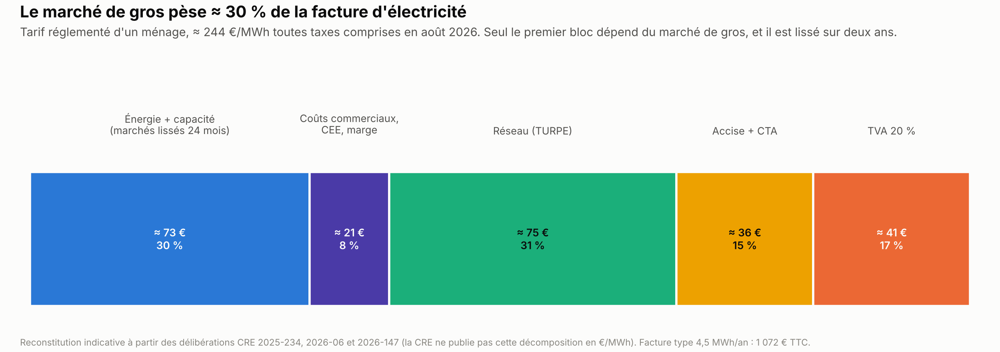

1. **En Europe, le prix de gros de l'électricité est fixé par la dernière centrale appelée, souvent au gaz.** C'est le prix payé aux producteurs par les fournisseurs. La réforme européenne de 2024 a gardé cette règle. L'éolien et le solaire, sans combustible, font baisser ce prix.
2. **Ce prix représente ≈ 30 % de la facture d'un ménage.** Le reste paie le réseau (≈ 31 %), les taxes (≈ 32 %) et le fournisseur. Le tarif réglementé suit les prix des deux années passées : la flambée de 2022 a pesé jusqu'en 2025.
3. **L'électricité française est bas-carbone à 95 %, mais 57 % de l'énergie consommée en France reste fossile** : pétrole des transports, gaz du chauffage et de l'industrie (SDES, 2025).
4. **La France exporte des volumes records (92 TWh en 2025)**, en partie parce que sa consommation reste ≈ 6 % sous la moyenne 2014-2019.
5. **Aucun texte européen ne permet de quitter le marché de l'électricité en restant dans l'UE.** Le Royaume-Uni négocie son retour ; la Suisse a signé un accord de retour en 2026. Des outils européens peuvent rapprocher le prix des coûts français, avec l'accord de la Commission : contrats à prix garanti, tarifs réglementés.
6. **Nouveau nucléaire ou renouvelables ?** Selon RTE, le gestionnaire du réseau, un système avec nouveaux réacteurs coûterait ≈ 10 à 20 Md€ de moins par an en 2060 selon les scénarios comparés, si les centrales empruntent à 4 %. Tous ses scénarios exigent beaucoup d'éolien et de solaire.
7. **Carburants : en 2025, les taxes faisaient 54 % du prix du gazole.** En 2026, la hausse vient surtout du pétrole brut et des marges de raffinage (ministère de l'Économie, Agence France-Presse).

**Les grandes options en débat.**
- **Marché européen** : réformer de l'intérieur (contrats à prix garanti, tarifs réglementés), s'affranchir des règles de prix, ou sortir du marché.
- **Production** : relancer le nucléaire et freiner l'éolien et le solaire ; développer les deux ; ou sortir du nucléaire pour 100 % de renouvelables.
- **Électrification** : garder les contraintes (zones à faibles émissions, interdictions de louer les logements mal isolés, fin des voitures thermiques neuves en 2035), les assouplir, ou les supprimer et inciter par les prix et les aides.
- **Taxes et aides** : baisser la TVA sur l'énergie pour tous, bloquer les prix, ou cibler les aides sur les ménages modestes.
- **Carburants** : taxer les « superprofits » des pétroliers, plafonner leurs marges, ou baisser les taxes sur les carburants.

---

## 1. La situation

### 1.1 D'où vient l'énergie de la France

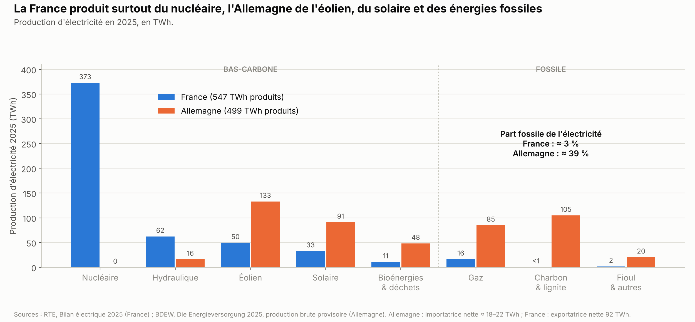

**L'électricité.** En 2025, la France a produit 547,5 TWh d'électricité, bas-carbone à 95,2 % (RTE)[^rte-bilan-2025].
- Le nucléaire en fournit les deux tiers (373 TWh)[^rte-bilan-2025]. Le détail par source, comparé à l'Allemagne, est dans le graphique.
- Les centrales à gaz, à charbon et au fioul en fournissent ≈ 3 %. RTE compte comme bas-carbone le nucléaire et les renouvelables ; il compte pour moitié comme renouvelable la production à partir de déchets ménagers[^rte-bilan-2025].
- La France a consommé 451 TWh, corrigés du climat (RTE recalcule la consommation comme si la météo avait été normale)[^rte-consommation-2025]. Elle a exporté 92,3 TWh de plus qu'elle n'en a importé, pour une valeur d'≈ 5,4 Md€[^rte-echanges-2025].

**Toute l'énergie.** L'électricité représente 27 % de l'énergie finale consommée en France (SDES, le service statistique du ministère chargé de l'énergie, 2025)[^sdes-chiffres-cles-2026].

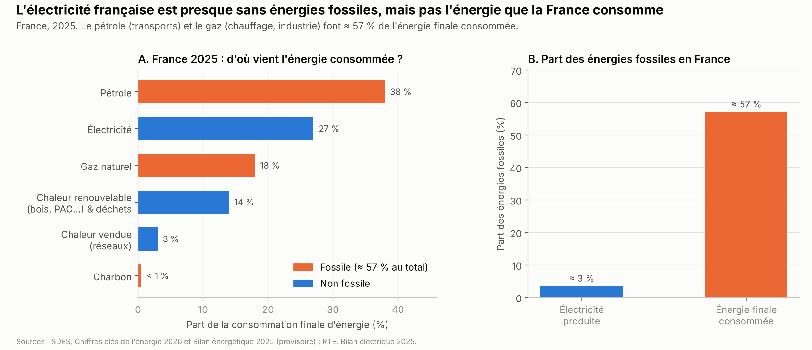

| Énergie | Part de la consommation finale (2025)[^sdes-chiffres-cles-2026] |
|---|---|
| Pétrole | 38 % |
| Électricité | 27 % |
| Gaz | 18 % |
| Chaleur renouvelable (bois, pompes à chaleur…) et déchets | 14 % |
| Réseaux de chaleur | 3 % |
| Charbon | < 1 % |

- **Les énergies fossiles pèsent donc ≈ 57 %[^sdes-chiffres-cles-2026].**
- **La facture d'importation d'énergie** a été de 45,8 Md€ en 2025, près de trois fois moins qu'en 2022, année record (SDES)[^sdes-bilan-2025].
- **Le taux d'indépendance énergétique**, c'est-à-dire la part de l'énergie consommée produite en France, est de 62,7 %, le plus haut depuis 1970[^sdes-bilan-2025]. Par convention, le nucléaire y compte comme une énergie nationale, même si l'uranium est importé.
- **Pour comparer, l'Allemagne** produit ≈ 39 % de son électricité à partir d'énergies fossiles (BDEW, 2025)[^bdew-energieversorgung-2025]. Les fossiles font 76,5 % de son énergie primaire (AGEB, 2025)[^ageb-2025]. Ce chiffre ne se compare pas aux 57 % de la France, qui portent sur l'énergie finale : en énergie primaire, le nucléaire pèse lourd, ce qui réduit la part fossile de la France (≈ 40 % en 2025) *(calcul)*[^insee-energie-primaire-2025].

### 1.2 Comment se forme le prix de gros de l'électricité

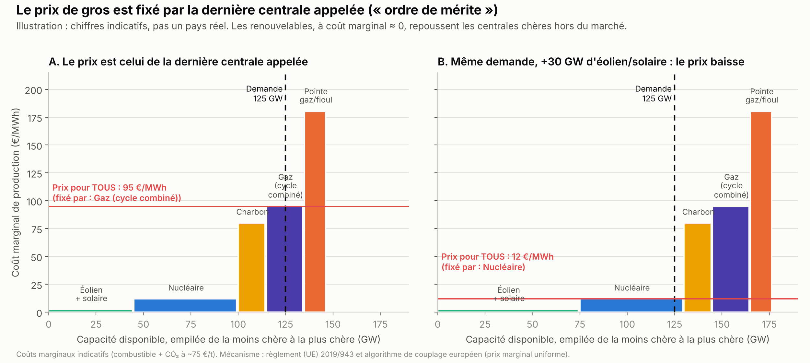

**La règle : le prix de la dernière centrale appelée.**
- Chaque jour, pour chaque quart d'heure du lendemain, les producteurs proposent leur électricité à leur coût de fonctionnement, appelé « coût marginal » : combustible, CO₂, usure[^nemo-15min-2025].
- Le marché classe ces offres de la moins chère à la plus chère : éolien et solaire (≈ 0 €/MWh), nucléaire (≈ 10 €/MWh de combustible), charbon, gaz, puis centrales de pointe. On parle d'« ordre de mérite ».
- La dernière centrale nécessaire pour couvrir la demande fixe le prix, et **toutes** les centrales retenues sont payées à ce prix.

**L'éolien et le solaire font baisser le prix de gros.** Sans combustible à acheter, ils repoussent les centrales à gaz hors du marché.
- Selon l'Agence internationale de l'énergie (AIE), sans l'éolien et le solaire ajoutés entre 2021 et 2023, le prix de gros européen aurait été 8 % plus élevé en 2022 et ≈ 15 % en 2023. Les consommateurs auraient ainsi économisé ≈ 100 Md€[^aie-renouvelables-2023].
- Selon la CRE (septembre 2026), le développement du parc de production entre 2020 et 2025, surtout éolien et solaire, a fait baisser le prix de marché d'≈ 20 €/MWh par rapport à 2020. C'est une estimation par simulation : la CRE rejoue l'année 2025 avec d'autres hypothèses de parc[^cre-economie-systeme-2026].
- Le gaz fixe de moins en moins souvent le prix. En Espagne, le prix a reflété le coût des centrales fossiles 19 % des heures au premier semestre 2025, contre 75 % au premier semestre 2019 (Ember, centre d'études sur l'énergie)[^ember-espagne-2025].
- Pendant le choc pétrolier et gazier de 2026, lié au blocage du détroit d'Ormuz, le gaz a pris +88 % entre février et août, et l'électricité de l'UE +23 %, selon Eurelectric, la fédération européenne des électriciens. Selon la même source, 72 % de la production d'électricité de l'UE était bas-carbone en 2026 *(source secondaire)*[^eurelectric-2026].

**Un effet inverse : la « cannibalisation ».** Quand tous les panneaux solaires produisent en même temps, le prix s'effondre, parfois sous zéro.
- On a compté 513 heures à prix négatif en France en 2025[^cre-surveillance-2025], et 573 en Allemagne[^bnetza-prix-2025].
- En Allemagne, le solaire a touché en moyenne 50 % du prix moyen du marché[^netztransparenz-valeur-marche]. En France, ce serait ≈ 59 % *(estimation d'un fournisseur, chiffre non officiel)*.
- Conséquence : le marché seul ne finance plus assez de nouvelles centrales, renouvelables comme nucléaires. La réforme européenne de 2024 impose donc des contrats à prix garanti aux nouvelles centrales aidées par l'État (en anglais *contracts for difference*)[^conseil-reforme-2024]. Si le marché paie moins que le prix garanti, l'État verse la différence. S'il paie plus, le producteur la rend.

**Le calcul est européen, mais chaque zone a son prix.**
- Chaque jour à midi, un même programme calcule les prix du lendemain pour toute l'Europe reliée : ≈ 27 pays[^epex-resultats-2025] et 16 bourses[^entsoe-sdac], dont la bourse européenne de l'électricité EPEX SPOT, à Paris. Il calcule aussi les échanges d'électricité entre pays. On parle de « couplage » des marchés. Depuis le 1er octobre 2025, il fixe 96 prix par jour, un par quart d'heure, au lieu de 24[^nemo-15min-2025].
- Le résultat donne un prix par zone. La France forme une zone ; l'Allemagne et le Luxembourg en forment une autre. Quand les lignes entre deux zones ne sont pas saturées, les prix sont égaux. Quand elles le sont, les prix divergent.
- **L'Europe pèse sur le prix français de quatre façons** : les règles de calcul, les échanges, le prix du CO₂ du marché carbone européen et le découpage des zones. La France importe quand elle manque d'électricité, comme en 2022, et exporte ses surplus.

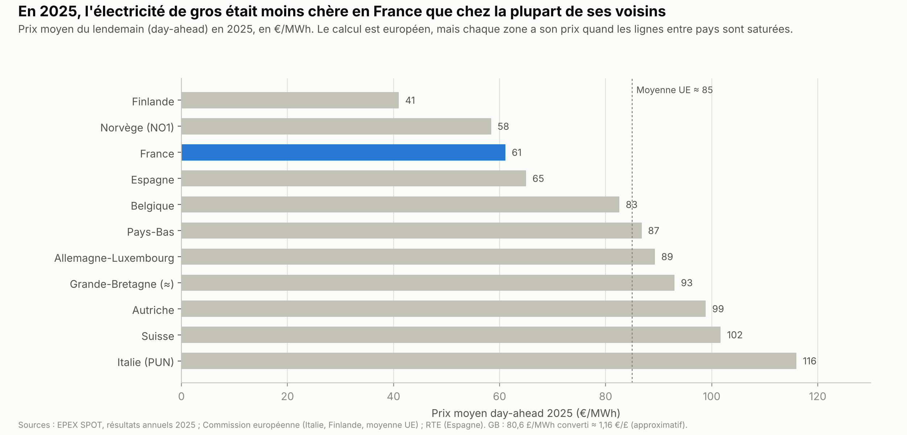

**En 2025, le prix de gros français a été plus bas que chez ses voisins** : 61 €/MWh, contre 89 en Allemagne, 83 en Belgique, ≈ 93 en Grande-Bretagne, 102 en Suisse[^epex-resultats-2025] et 116 en Italie. Selon la CRE, la France a été 20 à 30 €/MWh moins chère que l'Allemagne, la Belgique et le Royaume-Uni[^cre-surveillance-2025].

### 1.3 Ce que paie un ménage pour son électricité

**Le tarif réglementé n'est pas le prix du marché du jour.** Le tarif réglementé de vente d'électricité est fixé par l'État sur proposition de la CRE. Au 30 juin 2026, ≈ 55 % des ménages (19,2 millions de logements) l'ont choisi[^cre-observatoire-t2-2026]. La CRE le construit en additionnant des coûts[^cre-methode-trve-2025]. Pour un tarif d'≈ 244 €/MWh toutes taxes comprises en août 2026 :

| Poste | Montant (≈) | Part (≈) |
|---|---|---|
| Énergie et capacité (garantie d'avoir assez de production en hiver) | 73 €/MWh | 30 % |
| Coûts du fournisseur, certificats d'économies d'énergie, marge | 21 €/MWh | 8 % |
| Réseau (tarif d'utilisation des réseaux publics d'électricité, TURPE) | 75 €/MWh | 31 % |
| Accise (taxe fixe par MWh) et contribution tarifaire d'acheminement | 36 €/MWh | 15 % |
| TVA | 41 €/MWh | 17 % |

*Reconstitution indicative[^cre-trve-2026][^cre-trve-aout-2026] : la CRE ne publie pas ce tableau en €/MWh.*

- **Seul le premier poste dépend du marché de gros**, soit ≈ 30 % de la facture.
- **Il est lissé sur deux ans.** L'électricité du tarif est achetée sur les marchés « à terme », où l'on achète aujourd'hui une électricité livrée plus tard. Le tarif d'une année reprend la moyenne des prix payés pendant les deux années précédentes. Exemple : le tarif de 2026 reprend les prix payés de janvier 2024 à décembre 2025 pour une électricité livrée en 2026. Livrée en continu toute l'année, elle revient à 63,9 €/MWh, contre 103 €/MWh dans le tarif de 2025[^cre-trve-2026].
- **La capacité** : le mécanisme qui garantit assez de production en hiver a ajouté ≈ 3,4 €/MWh au tarif d'août 2026[^cre-trve-aout-2026].
- **C'est ce lissage qui explique le décalage.** La flambée de 2022 a pesé sur les factures de 2023 à 2025, et la baisse arrive en 2026.
- **Les certificats d'économies d'énergie (CEE)** obligent les vendeurs d'énergie à financer des économies d'énergie chez leurs clients (isolation, pompes à chaleur). Ce coût est répercuté sur les prix de l'électricité, du gaz et des carburants. Dans le tarif réglementé, ils pèsent ≈ 10 €/MWh, soit ≈ 4 % de la facture *(calcul)* ; les autres coûts du fournisseur font ≈ 8 €/MWh, et sa marge ≈ 4 €/MWh[^cre-trve-2026].
- **Les taxes** : accise de 30,62 €/MWh depuis le 1er août 2026 (30,85 €/MWh auparavant)[^cre-trve-aout-2026] ; TVA à 20 %, y compris sur l'abonnement depuis août 2025 (elle y était auparavant à 5,5 %)[^mne-tva-abonnement-2025].
- **Exemple** : une facture type de 4,5 MWh par an coûte 1 072 € toutes taxes comprises au 1er août 2026 (+2,5 %)[^afp-trve-aout-2026]. Selon ce que l'on compte, le prix varie : ≈ 0,20 € par kWh pour la seule consommation en option Base, ≈ 0,24 € abonnement compris. Les comparaisons européennes d'Eurostat (graphique ci-dessous) portent sur des moyennes annuelles, abonnement compris[^eurostat-prix-menages].

**Pourquoi le tarif suit le marché.** La loi oblige à fixer le tarif réglementé à un niveau qu'un concurrent d'EDF, qui achète son électricité sur le marché, peut égaler sans perdre d'argent (Code de l'énergie, article L. 337-6). On parle de « contestabilité »[^cre-methode-trve-2025]. C'est ce choix juridique, lié à l'ouverture à la concurrence, qui relie le tarif au prix de marché plutôt qu'aux coûts de production d'EDF.

**Du nucléaire vendu à prix fixe au versement nucléaire universel.**
- **De 2011 à 2025**, l'accès régulé à l'électricité nucléaire historique (ARENH) obligeait EDF à vendre jusqu'à 100 TWh par an de son nucléaire à ses concurrents, à 42 €/MWh[^senat-arenh-2024]. C'était un compromis avec la Commission européenne. Il a pris fin le 31 décembre 2025[^senat-arenh-2024] (son bilan est en section 4).
- **Depuis 2026, le versement nucléaire universel (VNU).** Quand EDF vend l'électricité de ses réacteurs existants plus de 78 €/MWh, il reverse aux consommateurs la moitié de ce qui dépasse ce seuil. Au-delà de 110 €/MWh, il en reverse 90 % (seuils 2026-2028)[^edf-vnu]. Avec des prix autour de 60 €/MWh, il ne reverse rien aujourd'hui.
- **Repère** : la CRE évalue le coût complet du nucléaire existant à 60,3 €/MWh pour 2026-2028[^cre-cout-nucleaire-2025].

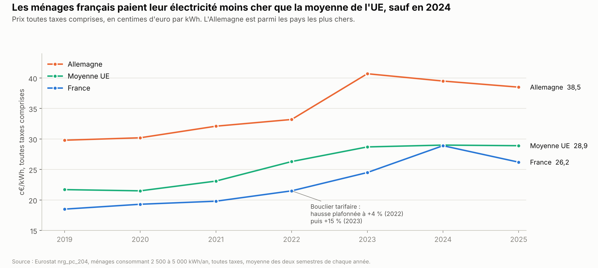

**Le prix comparé.**
- Le prix de l'électricité payé par les ménages a pris ≈ +45 % entre 2021 et 2024 (Eurostat, moyennes annuelles)[^eurostat-prix-menages]. Le « bouclier tarifaire » plafonnait pourtant la hausse du tarif réglementé à +4 % en 2022 et à +15 % en 2023[^afp-trve-fevrier-2025] (son coût est en section 4).
- Il a baissé d'≈ 15 % en février 2025[^afp-trve-fevrier-2025], puis augmenté de 2,5 % en août 2026[^cre-trve-aout-2026].
- Selon Eurostat, l'office statistique de l'UE, la France est restée sous la moyenne de l'UE, sauf en 2024 où elle l'a rejointe. L'Allemagne est parmi les pays les plus chers (≈ 38,5 c€/kWh en 2025)[^eurostat-prix-menages].

### 1.4 Qui décide : l'Union européenne ou la France ?

**Le partage des rôles.**

| | **Marché de gros** | **Prix aux particuliers** |
|---|---|---|
| Textes européens | Des règlements, qui s'appliquent directement (règlements 2019/943 et 2015/1222) | Une directive, que chaque pays transpose dans sa loi (directive 2019/944, article 5)[^directive-2019-944] |
| Marge de la France | Presque nulle : le prix de la dernière centrale s'applique dans chaque zone | Réelle : tarifs réglementés permis pour les ménages et les micro-entreprises, au-dessus des coûts ; et pour les ménages vulnérables, même en dessous[^directive-2019-944][^directive-2024-1711] |
| En cas de crise (depuis 2024) | — | Les pays de l'UE peuvent déclarer ensemble une crise si le prix de gros reste très haut pendant 6 mois (plus de 2,5 fois la moyenne des 5 années précédentes, et au moins 180 €/MWh). Pendant un an au plus, ils peuvent alors vendre une partie de l'électricité sous son coût : jusqu'à 80 % de la consommation médiane des ménages, et 70 % de la consommation de l'année précédente de chaque petite ou moyenne entreprise[^directive-2024-1711]. |
| Taxes | — | Nationales. Le minimum européen est de 1 €/MWh pour les ménages[^directive-2003-96] ; l'accise française est d'≈ 30 €/MWh[^cre-trve-aout-2026]. |

**D'autres règles européennes comptent.**
- **Les tarifs réglementés.** La Cour de justice de l'UE les admet sous conditions (arrêt Federutility, 2010)[^cjue-federutility-2010]. En France, saisi par des fournisseurs concurrents d'EDF, le Conseil d'État a jugé en 2018 qu'ils ne pouvaient plus s'appliquer aux sites des grandes entreprises[^cms-trv-2019]. La loi énergie-climat de 2019 les a ensuite réservés aux ménages et aux micro-entreprises : ils ont disparu pour les autres entreprises le 1er janvier 2021[^seban-trv-2021].
- **Les aides d'État**, c'est-à-dire les aides publiques aux entreprises, que la Commission européenne doit autoriser.
  - Programme de nouveaux réacteurs EPR2, une version simplifiée du réacteur pressurisé européen (EPR) : la Commission a ouvert une enquête approfondie le 31 mars 2026[^commission-epr2-2026].
  - Barrages : l'État confiait ses barrages à EDF pour une durée limitée (des « concessions ») ; la France et la Commission européenne s'opposaient sur l'absence de mise en concurrence à leur échéance. Après un accord avec la Commission (août 2025), la loi du 29 juin 2026 remplace les concessions par des autorisations. En échange, EDF mettra aux enchères, pendant 20 ans, une « capacité hydroélectrique virtuelle » de 6 GW au départ ; la loi vise à ouvrir à d'autres qu'EDF au moins 40 % de la capacité hydroélectrique installée en France. Les ouvrages restent la propriété de l'État ; EDF continue de les exploiter[^gossement-hydro-2026].
- **La réforme du marché de 2024.** Elle garde la règle du prix de la dernière centrale. Elle ajoute les contrats à prix garanti dans les deux sens pour les nouvelles installations aidées, le mécanisme de crise décrit plus haut, et des contrats de long terme facilités entre producteurs et clients[^conseil-reforme-2024].
- **Le gaz russe** sera interdit dans l'UE : le gaz naturel liquéfié (GNL) à partir du 1er janvier 2027, le gaz par gazoduc à l'automne 2027 *(calendrier exact selon la durée des contrats, à vérifier)*[^conseil-gaz-russe-2026].

**Peut-on « sortir du marché » ?**
- Il faut distinguer deux choses : le calcul européen du prix de gros et les échanges entre pays, régis par des règlements ; et la concurrence entre fournisseurs pour vendre aux particuliers. Les propositions politiques visent tantôt l'un, tantôt l'autre.
- **Aucun texte européen ne permet à un pays de quitter le marché intérieur de l'électricité** (traité sur le fonctionnement de l'UE, articles 114 et 194 ; règlement 2019/943). Le traité laisse chaque pays choisir ses sources d'énergie (nucléaire, éolien, gaz…). Il ne l'autorise pas à fixer seul les règles du marché[^tfue-194].
- Il reste trois voies : négocier une réforme ou une dérogation, comme l'Espagne et le Portugal en 2022[^cgep-iberique-2023] ; enfreindre les règles, au risque d'une procédure de la Commission européenne pouvant aboutir à des amendes ; ou sortir de l'UE.

### 1.5 Consommation, exportations et électrification

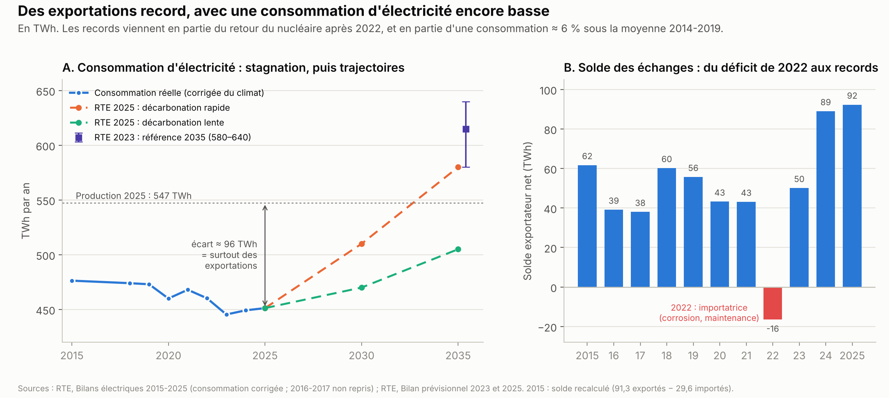

**La consommation d'électricité reste basse.** En 2025, elle est ≈ 6 % sous la moyenne 2014-2019[^rte-consommation-2025] (≈ 475 à 480 TWh par an dans les années 2010)[^rte-bp2023-consommation] ; sa baisse s'est arrêtée en 2024[^rte-consommation-2025]. En hiver, chaque degré en moins sous 15 °C ajoute ≈ 2 400 MW de consommation, soit la production de deux à trois réacteurs, surtout à cause du chauffage électrique.
- **De 2010 à 2019 : efficacité et désindustrialisation.** L'éclairage par diodes électroluminescentes (LED) a économisé ≈ 10 TWh entre 2010 et 2020[^rte-bp2023-consommation]. L'industrie est passée d'≈ 140 TWh au milieu des années 2000 à ≈ 100 TWh[^rte-bp2025-consommation].
- **Depuis 2022 : économies et prix élevés.** Pendant l'hiver 2022-2023, la consommation a été 9 % sous la moyenne 2014-2019. Selon RTE, ≈ 20 TWh de cette baisse ne s'expliquent pas par la météo : ils viennent de la réaction aux prix et des économies volontaires[^rte-hiver-2022-2023].
- **L'industrie raccordée au réseau de RTE** a consommé 47,2 TWh en 2025, 13 % de moins qu'en 2014-2019[^rte-bilan-2025].
- **L'autoconsommation solaire** (2,9 TWh en 2025, +45 %) ne passe plus par le réseau[^rte-consommation-2025].

**Les exportations battent des records.**
- 92,3 TWh exportés en solde en 2025[^rte-echanges-2025]. Au premier semestre 2026, le solde a atteint 51,0 TWh, un record pour un premier semestre, contre 37,8 TWh un an plus tôt (RTE)[^rte-semestre1-2026].
- Ce record vient à la fois du retour de la production nucléaire après la crise de 2022 et d'une consommation encore basse.
- Il a un revers. EDF a réduit sa production nucléaire de 33 TWh en 2025 faute de débouchés[^edf-resultats-2025], et ≈ 3 TWh d'éolien et de solaire ont été arrêtés pendant les heures à prix négatif[^cre-economie-systeme-rapport-2026].

**Les projections de RTE ont été revues à la baisse.**

| Édition | 2030 | 2035 |
|---|---|---|
| Bilan prévisionnel 2023 (référence)[^rte-bp2023-consommation] | ≈ 530 TWh | ≈ 615 TWh (580 à 640) |
| Bilan prévisionnel 2025, « décarbonation rapide »[^rte-bp2025] | 510 TWh | 580 TWh |
| Bilan prévisionnel 2025, « décarbonation lente »[^rte-bp2025] | ≈ 470 TWh | 505 TWh |

Selon RTE, le remplacement des énergies fossiles par l'électricité « ne s'est pas encore pleinement enclenché en France »[^rte-bp2025-consommation]. Il prévoit « une période de surcapacité de production qui durera au moins quelques années »[^rte-bp2025]. L'électricité fait 27 % de l'énergie finale[^sdes-chiffres-cles-2026], pour un objectif de 34 % en 2030 dans la programmation pluriannuelle de l'énergie (PPE3), la feuille de route énergétique de l'État pour 2026-2035, adoptée par décret le 12 février 2026[^seban-ppe3-2026]. La rentabilité des nouvelles centrales, nucléaires ou renouvelables, suppose que la consommation augmente.

**Où en est l'électrification.**
- **Voitures** : ≈ 20 % des ventes de voitures neuves étaient électriques en 2025[^avere-bilan-2025], et 38,8 % en août 2026, en plein choc pétrolier (Avere-France, association de la mobilité électrique)[^avere-aout-2026].
- **Chauffage** : les ventes de pompes à chaleur air-eau ont chuté d'≈ 40 % en 2024 (≈ 185 000, contre ≈ 310 000 en 2023)[^rte-bp2025-consommation], puis ont encore reculé en 2025. Les pompes à chaleur air-eau progressent de 14,7 % au premier semestre 2026, et les chaudières au gaz et au fioul reculent de 23 %[^uniclima-s1-2026].
- **Industrie** : 35 MW d'électrolyseurs (appareils qui produisent de l'hydrogène à partir d'eau et d'électricité) étaient installés fin 2024[^rte-bp2025-consommation].

**Le plan du gouvernement, « Électrifions la France ! » (avril-mai 2026).**
- **Objectifs** :
  - ramener la part des énergies fossiles à 30 % de la consommation d'énergie en 2035 (le gouvernement part d'≈ 60 %[^elysee-electrification-2026] ; le SDES donne 57 %[^sdes-chiffres-cles-2026]) ;
  - produire un million de pompes à chaleur en France en 2030[^elysee-electrification-2026] ;
  - signer plus de 50 TWh de contrats de long terme avec l'industrie[^elysee-electrification-2026].
- **Transport** :
  - location longue durée d'une voiture électrique à prix réduit pour 50 000 ménages modestes en 2026, à 200 € par mois au plus (« leasing social »)[^bercy-plan-electrification-2026] ;
  - primes financées par les certificats d'économies d'énergie[^bercy-plan-electrification-2026] ;
  - 400 000 bornes de recharge publiques en 2030[^elysee-electrification-2026] ; à partir de 2027, tous les véhicules achetés par l'État seront électriques[^bercy-plan-electrification-2026].
- **Bâtiment** :
  - plus de gaz dans les logements collectifs neufs à partir du 1er janvier 2027, ni dans aucun bâtiment neuf à partir de 2030[^bercy-plan-electrification-2026] ;
  - depuis le 1er septembre 2026, une rénovation d'ampleur d'une maison financée par MaPrimeRénov', l'aide publique à la rénovation, ne peut plus garder un chauffage au gaz[^bercy-plan-electrification-2026] ;
  - depuis le 1er octobre 2026, une offre « clés en main » de pompes à chaleur : 55 000 installations, aide moyenne de 9 800 €, électricité à prix fixe pendant 3 ans[^bercy-pac-2026].
- **Industrie** : contrats d'électricité de 8 à 10 ans à partir de 2027[^bercy-plan-electrification-2026] ; 9 GW de raccordements en plus à Dunkerque, au Havre et à Fos ; 109 « territoires d'électrification »[^ademe-territoires-2026].

**Les règles qui poussent à électrifier, et leur état au 11 octobre 2026.**
- **Fin des voitures thermiques neuves en 2035** (règlement européen) : la Commission européenne a proposé le 16 décembre 2025 de ramener l'objectif à −90 % d'émissions au lieu de −100 %[^commission-co2-voitures]. La procédure était encore en cours en juillet 2026 *(source secondaire, à vérifier)*[^saisir-europe-2035].
- **Zones à faibles émissions (ZFE)** : elles interdisent l'entrée des véhicules les plus polluants dans certaines villes. Le Parlement en a voté la suppression dans une loi de simplification. Le Conseil constitutionnel l'a censurée le 21 mai 2026, parce qu'elle n'avait pas de lien suffisant avec cette loi[^bdt-zfe-2026]. Une proposition de loi du RN pour les abroger a été rejetée en commission (21 voix contre 19)[^lcp-zfe-commission-2026]. En séance, le 8 octobre 2026, elle n'a pas pu être votée : les débats se sont arrêtés à minuit, comme le prévoit le règlement[^lcp-zfe-8-octobre].
- **Diagnostic de performance énergétique (DPE)** : cette étiquette, de A à G, classe les logements selon leur consommation d'énergie. Depuis 2025, un logement classé G ne peut plus faire l'objet d'un nouveau bail, ni d'un renouvellement ou d'une reconduction du bail[^an-qe-10997-2023] ; ce sera le cas des F en 2028 et des E en 2034[^an-qe-914-2022] (voir [Logement](../logement/logement.md)).
- **Marché carbone européen pour le chauffage et les carburants (ETS2)** : il doit faire payer le CO₂ émis par le chauffage et les carburants des particuliers à partir de 2028[^commission-ets2].

### 1.6 Le nucléaire et les renouvelables : coûts et projets

**Le parc nucléaire existant.** La CRE évalue son coût complet à 60,3 €/MWh pour 2026-2028[^cre-cout-nucleaire-2025]. Le programme d'EDF de rénovation des réacteurs, pour les faire fonctionner au-delà de 40 ans (le « grand carénage »), coûte 100,8 Md€ sur 2014-2035 selon la Cour des comptes. Selon l'AIE et l'Agence pour l'énergie nucléaire de l'Organisation de coopération et de développement économiques (OCDE), prolonger les réacteurs existants est la façon la moins chère de produire une électricité bas-carbone[^iea-nea-couts-2020].

**Le programme EPR2.**
- Six réacteurs (≈ 10 GW) à Penly, Gravelines et Bugey[^commission-epr2-2026]. En euros de 2020 et hors frais financiers (les intérêts des emprunts), le devis d'EDF est passé de 51,7 Md€ (2022) à 67,4 Md€ (fin 2023)[^energeek-epr2-2025], puis à 72,8 Md€ (décembre 2025)[^edf-resultats-2025]. La Cour des comptes (janvier 2025) exprimait le devis de fin 2023 en euros de 2023 : 79,9 Md€ *(source secondaire, à vérifier dans le rapport)*[^energeek-epr2-2025]. Les « euros de 2020 » ou « de 2023 » corrigent la hausse des prix, pour comparer des montants d'années différentes.
- **Financement** : un prêt de l'État sur l'épargne réglementée (Livret A)[^bdt-epr2-2026] pour 60 % du coût ; un contrat à prix garanti sur 40 ans[^commission-epr2-2026], plafonné à 100 €/MWh (euros 2024)[^elysee-cpn-2025].
- **Calendrier** : décision finale d'investissement annoncée « avant la fin de l'année 2026 »[^bdt-epr2-2026], non annoncée au 11 octobre 2026 ; première mise en service en 2038[^commission-epr2-2026]. Des études sont demandées pour 8 réacteurs de plus.
- **Contrôle** : la Commission européenne enquête depuis le 31 mars 2026 sur l'aide publique[^commission-epr2-2026]. La Cour des comptes recommande d'attendre, avant la décision finale, que le financement soit sécurisé et les études avancées[^cereme-epr-2025].

**Les renouvelables.** On dit que l'éolien et le solaire « ne coûtent presque rien » parce que leur coût de fonctionnement est ≈ 0. Leur coût complet, qui compte la construction, le financement, l'entretien et le démantèlement, est de 59 à 91 €/MWh selon l'Agence de la transition écologique (ADEME)[^ademe-couts-enr-2025] :

| Technologie | Coût complet en France (ADEME, données 2022)[^ademe-couts-enr-2025] | Prix garantis des appels d'offres de la CRE (2025-2026)[^cre-ao-ppe2-2026] |
|---|---|---|
| Éolien terrestre | 59 €/MWh | 77 à 87 €/MWh |
| Solaire au sol | 70 €/MWh | 74 à 79 €/MWh |
| Solaire sur toiture | 76 à 91 €/MWh | 83 à 96 €/MWh |

*L'ADEME est l'Agence de la transition écologique.*

- La construction représente ≈ 75 % du coût complet de l'éolien et du solaire *(calcul, à partir des coûts de la CRE, avec un taux de 5 % sur 25 ans)*. Les contrats de soutien durent 20 ans ; les installations durent ≈ 25 à 30 ans.
- **Le soutien public fonctionne dans les deux sens.** Le producteur reçoit un prix garanti, fixé par appel d'offres, qui couvre sa construction. Si le prix du marché est plus bas, l'État lui verse la différence. S'il est plus haut, le producteur la rend.
- **Délais** : ≈ 5 ans de procédures pour un parc solaire, ≈ 7 ans pour l'éolien terrestre, ≈ 10 ans pour l'éolien en mer ; les travaux eux-mêmes durent de quelques mois à 3 ans *(à vérifier)*.

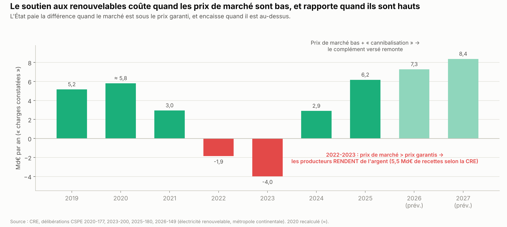

**Le coût public du soutien** (CRE, métropole continentale) : 6,2 Md€ en 2025[^cre-cspe-2026] ; les autres années sont dans le graphique. En 2022 et 2023, quand les prix de marché ont dépassé les prix garantis, les producteurs ont **rendu** de l'argent, dont 4,0 Md€ au titre de 2023[^cre-cspe-2025]. Selon la CRE, ces contrats ont apporté 5,5 Md€ de recettes au titre de 2022 et 2023[^cre-cspe-2025]. Cet argent a aidé à financer le bouclier tarifaire. Le projet de budget pour 2027 met fin à une partie des aides versées aux anciens contrats solaires de 2006-2010 (≈ 120 M€ en 2027), ce que conteste la filière *(source secondaire)*[^afp-budget-enr-2027].

**Le bilan carbone.** Émissions par kWh produit, sur tout le cycle de vie, fabrication comprise, en grammes d'équivalent CO₂, selon le Groupe d'experts intergouvernemental sur l'évolution du climat (GIEC) et l'ADEME :

| Source | GIEC, 2014 (médiane)[^giec-ar5-annexe3] | ADEME[^ademe-base-carbone-enr] |
|---|---|---|
| Charbon | 820 | — |
| Gaz (cycle combiné) | 490 | — |
| Solaire au sol | 48 | 25 à 44 selon l'origine des panneaux (France 25, UE 32, Chine 44) |
| Solaire sur toiture | 41 | — |
| Hydraulique | 24 | — |
| Éolien terrestre | 11 | ≈ 14 |
| Éolien en mer | 12 | ≈ 16 |
| Nucléaire | 12 | — |

Un panneau solaire produit en ≈ 1 an, en Europe, l'énergie qu'a demandée sa fabrication (Institut Fraunhofer pour les systèmes d'énergie solaire, centre de recherche allemand, 2026)[^fraunhofer-pv-2026].

### 1.7 Les carburants et le pétrole

**La France importe presque tout son pétrole.**
- Elle importe ≈ 0,9 million de barils de pétrole brut par jour[^ufip-appro-2026]. Sa production couvre ≈ 1 % de ses besoins[^sdes-petrole-2026]. En 2025, le brut venait des États-Unis (22 %), du Kazakhstan (15 %), du Nigeria (12 %) et de Norvège (10 %), et plus du tout de Russie (SDES)[^insee-brut-origine-2025].
- Elle importe aussi plus de la moitié de son gazole[^ufip-appro-2026].

**Le poids de TotalEnergies.**
- **Raffinage** : ≈ 50 % des capacités françaises (≈ 29 des 57,4 millions de tonnes par an en métropole)[^ufip-appro-2026], avec les raffineries de Gonfreville (12 millions de tonnes), Donges (11) et Feyzin (5,6)[^cde-raffineries]. La part du pétrole brut fournie par TotalEnergies n'est pas publiée. Les autres appartiennent à North Atlantic Energies (Port-Jérôme), Petroineos (Lavéra) et Rhône Energies (Fos). Grandpuits et La Mède ont été reconverties aux biocarburants[^cde-raffineries].
- **Stations-service** : ≈ 3 000 stations selon le groupe, stations pour poids lourds comprises[^te-france], sur 10 764 en France[^ufip-stations-2025] ; ≈ 22 % des ventes, et 25 % pendant la crise de 2026 selon le groupe[^afp-totalenergies-2026-09]. Les grandes surfaces vendent 65 % des volumes[^ufip-stations-2025].
- Ses profits et ses impôts sont traités dans l'étude de cas [TotalEnergies : profits et impôts](../finances-publiques/encadre_totalenergies.md).

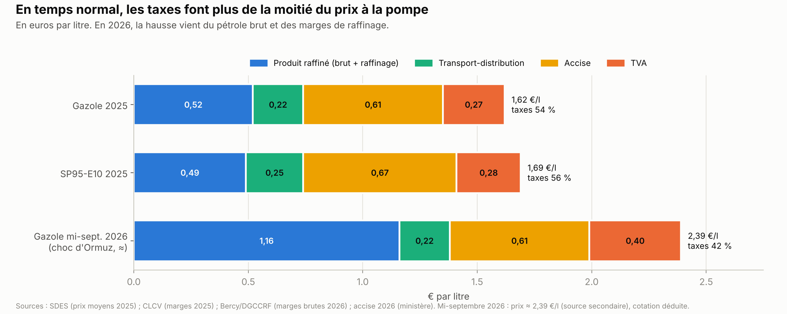

**Qui touche quoi à la pompe.** En 2025, sur un litre de gazole à 1,62 €, les taxes faisaient 0,88 € (54 %). Le détail, pour le gazole et l'essence, est dans le graphique.

**En 2026, le choc d'Ormuz.**
- Le gazole a atteint ≈ 2,39 € le litre à la mi-septembre *(source secondaire)*[^ebn-marge-raffinage-2026].
- Ce qui a augmenté : le produit raffiné (≈ 1,16 €), parce que le pétrole brut est plus cher et que les **marges de raffinage ont fortement augmenté**. La marge de raffinage du gazole est passée d'≈ 13 centimes par litre en 2025 à ≈ 36 centimes début avril 2026 (association de consommateurs Consommation, logement et cadre de vie)[^clcv-marges]. La marge de raffinage publiée par TotalEnergies est passée de 4,7 à 13,5 dollars par baril (un baril fait ≈ 159 litres) entre le 2e trimestre 2025 et le 2e trimestre 2026[^te-resultats-s1-2026].
- Ce qui n'a pas augmenté : selon le ministère de l'Économie, les marges des distributeurs sont restées « équivalentes à celles pratiquées avant crise »[^bercy-marges-2026].

**Pourquoi la marge de raffinage a tant augmenté.** Cette marge n'est pas le coût du raffinage : c'est l'écart entre le prix des carburants et celui du pétrole brut. Le coût des raffineries a peu bougé. La marge a augmenté parce que les carburants sont devenus beaucoup plus rares que le brut, pour quatre raisons.
1. **Le Golfe exporte aussi des carburants.** Ses grandes raffineries fournissaient ≈ 3 millions de barils par jour de produits raffinés, surtout du gazole et du kérosène[^aie-omr-mars-2026]. Avec le blocage d'Ormuz, ce flux est tombé à presque rien. Selon l'AIE, les raffineries du Golfe et celles d'Asie privées de brut ont réduit leur production d'≈ 6 millions de barils par jour en avril 2026[^aie-omr-avril-2026].
2. **L'Europe manque de gazole.** Ses raffineries produisent surtout de l'essence, alors que ses voitures et ses camions roulent beaucoup au diesel. Elle importe ≈ 1 million de barils de gazole par jour, dont un peu plus de la moitié venait du Moyen-Orient en 2025[^afp-gazette-gazole-2026-04] ; le gazole russe est interdit depuis février 2023[^commission-produits-russes-2023]. En France, le gazole a pris +33 % en un mois, contre +17 % pour l'essence[^afp-gazette-gazole-2026-04].
3. **On peut remplacer du brut, pas une raffinerie.** Le brut peut venir des stocks stratégiques ou d'autres producteurs. Une raffinerie ne se construit pas en quelques semaines, et celles d'Europe tournaient déjà à plein. Fin septembre, les exportations de brut du Golfe étaient revenues à ≈ 98 % de leur niveau d'avant-guerre, mais le gazole restait cher[^energeek-petrole-2026-10].
4. **Le transport a renchéri** : ≈ 10 $ de plus par baril pour l'assurance « risque de guerre » et les détours.

Une deuxième vague a suivi à la fin de l'été : la Russie a suspendu ses exportations de gazole fin juillet, des frappes ukrainiennes ont visé ses raffineries, et les Houthis ont menacé l'Arabie saoudite[^afp-diesel-2026-09]. La marge brute de raffinage, un autre indicateur qui porte sur l'ensemble des carburants, a atteint ≈ 281 € par tonne début septembre, contre 41 € en février *(source secondaire)*[^ebn-marge-raffinage-2026]. Elle ne se compare pas à la marge du gazole citée plus haut.

**Le même mécanisme que pour l'électricité.** Le prix du gazole est fixé par le dernier litre nécessaire, importé de loin et cher. Toutes les raffineries vendent à ce prix, même celles dont le coût n'a pas changé. Elles touchent une « rente de rareté », comparable à la rente des centrales bon marché sur le marché de l'électricité. C'est cette rente que visent les propositions de taxe sur les « superprofits ».

**Qui en profite.** Les raffineurs, dont TotalEnergies (sa branche raffinage-chimie a dégagé 1,8 Md$ de résultat au 2e trimestre 2026)[^te-resultats-s1-2026] ; les exportateurs de gazole vers la France. Pas les grandes surfaces, qui vendent 65 % des volumes mais ne raffinent pas[^ufip-stations-2025].

**Et l'État ?** Selon l'Agence France-Presse (AFP), depuis février 2026, la TVA rapporte plus quand les prix montent (+710 M€), mais l'accise, fixe par litre, rapporte moins quand les volumes baissent (−1 117 M€). Le solde est de −407 M€ *(source secondaire)*[^afp-fiscalite-carburants-2026]. Le gouvernement prévoit une « règle d'or » pour rendre aux Français le surplus de TVA[^afp-tva-carburants].

**Le plafonnement de TotalEnergies.** Le groupe a plafonné ses prix dans ses stations : essence à 1,99 € le litre, gazole à 2,09[^afp-plafond-gazole-2026-03] puis 2,25 €[^afp-plafonnement-2026-07]. Selon son président-directeur général, Patrick Pouyanné, cela a coûté ≈ 200 M€ à la mi-juin[^afp-autorite-concurrence-2026], puis 250 à 300 M€ à la mi-septembre[^afp-totalenergies-2026-09] ; il a menacé d'y mettre fin en cas de taxe exceptionnelle[^afp-totalenergies-2026-09]. Des stations indépendantes ont saisi l'Autorité de la concurrence[^afp-autorite-concurrence-2026], et selon l'AFP, « près de neuf stations en rupture de carburant sur dix appartiennent au réseau TotalEnergies »[^afp-totalenergies-2026-09].

### 1.8 L'Allemagne : la crise et l'après

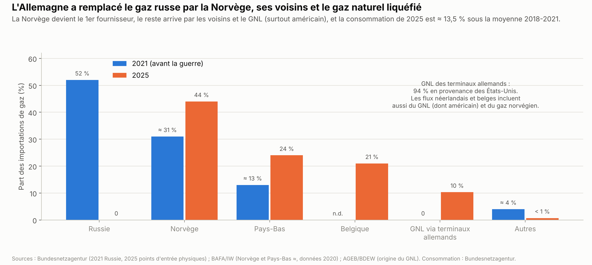

**Comment la crise est arrivée.**
- **Un modèle industriel bâti sur le gaz russe bon marché.** En 2021, la Russie fournissait 52 % du gaz importé par l'Allemagne, qui servait au chauffage, à l'industrie et à l'électricité[^bnetza-gaz-2022].
- **La sortie du nucléaire.** Décidée en 2000, repoussée en 2010 par une prolongation des réacteurs, relancée après l'accident de Fukushima en 2011, elle s'est achevée le 15 avril 2023[^bpb-atomausstieg-2023]. Le pays a perdu une production bas-carbone et pilotable, c'est-à-dire réglable à la demande.
- **Des prix déjà élevés.** Une surtaxe sur les factures a financé les renouvelables jusqu'en 2022[^bundesregierung-eeg-2022]. Les prix allemands étaient parmi les plus élevés d'Europe avant la crise[^eurostat-prix-menages].
- **Le choc de 2022.** Le gazoduc Nord Stream 1 a cessé de livrer début septembre 2022, puis les gazoducs ont été sabotés. Le gaz a culminé à 316 €/MWh fin août 2022, environ quatre fois son prix d'avant la guerre[^bnetza-gaz-2022]. L'Allemagne a construit des terminaux de gaz liquéfié en quelques mois, nationalisé le gazier Uniper, plafonné des prix et rouvert temporairement des centrales à charbon. Elle a connu la récession en 2023 et en 2024[^ageb-2025], avec un recul de l'industrie lourde (chimie, acier, verre).

**Comment le gaz russe a été remplacé.** En 2025, la Norvège fournissait 44 % du gaz importé[^bnetza-gaz-2025]. Le reste venait surtout des Pays-Bas, de Belgique et des terminaux allemands de gaz liquéfié, alimentés à 94 % par les États-Unis (AGEB ; détail dans le graphique)[^ageb-2025]. En 2025, la consommation de gaz était ≈ 13,5 % sous la moyenne 2018-2021 (Bundesnetzagentur, le régulateur allemand)[^bnetza-gaz-2025]. La dépendance s'est déplacée vers la Norvège et le gaz liquéfié américain, plus cher et exposé au marché mondial, comme l'a montré le choc de 2026.

**Où en est l'Allemagne en 2026.**
- Les ménages paient ≈ 37 centimes par kWh (BDEW, fédération allemande de l'énergie), contre 32,8 en 2021[^bdew-prix-2026].
- Les renouvelables couvrent ≈ 56 % de la consommation d'électricité (2025)[^bdew-energieversorgung-2025].
- Le gouvernement de Friedrich Merz subventionne l'électricité de l'industrie : 5 centimes par kWh sur la moitié de la consommation, en 2026-2028, en échange d'investissements de décarbonation (≈ 3,1 Md€ au total, selon le cabinet d'avocats Gleiss Lutz)[^gleiss-lutz-industriestrompreis].
- Il finance une baisse des frais de réseau[^bundestag-netzentgelte-2025].
- Il a obtenu de Bruxelles, en janvier 2026, le feu vert pour 12 GW de centrales pilotables, dont 10 GW au gaz ; le premier appel d'offres est prévu en 2026[^pv-magazine-kraftwerke-2026].
- Il exclut un retour au nucléaire[^cepa-allemagne-2025] et garde une zone de prix unique pour tout le pays (décision de décembre 2025)[^ifri-zone-allemande-2026], alors qu'une étude des gestionnaires de réseau européens (avril 2025) jugeait plus efficace une division en cinq zones[^entsoe-zones-2025].

---

## 2. Ce qui fait débat

### Question 1. Le prix de l'électricité : réformer les règles européennes ou s'en affranchir ?

**Les arguments pour la règle actuelle**, celle du prix de la dernière centrale appelée.
- **Payer chacun à son prix ne changerait pas grand-chose.** Chaque producteur proposerait alors le prix qu'il attend pour la dernière centrale, et non son vrai coût. Le résultat serait proche, avec des erreurs d'anticipation en plus (étude pour le Parlement européen, 2023)[^ipol-2023].
- **Les centrales sans combustible doivent se rembourser.** Le nucléaire, l'éolien et le solaire coûtent cher à construire, mais presque rien à faire tourner. Quand le prix du marché dépasse ce que coûte une centrale pour tourner, la différence lui reste. Ce surplus, appelé « rente inframarginale », rembourse sa construction.
- **Le marché européen fait tourner les centrales les moins chères du continent.** Selon l'Agence de l'Union européenne pour la coopération des régulateurs de l'énergie (ACER), les échanges entre pays ont fait économiser ≈ 34 Md€ en 2021 (évaluation d'avril 2022) *(source secondaire)*[^cde-acer-2022].
- **En sortir aurait un coût.** Au Sénat, en janvier 2023, André Gattolin (Renaissance) estimait que « les conséquences directes et indirectes d'un Frexit énergétique seraient extrêmement graves », face à une résolution du groupe communiste (Public Sénat) *(source secondaire)*[^publicsenat-frexit-2023].

**Les arguments contre.**
- **En crise, le prix du gaz s'impose à toute l'électricité.** En 2022, le gaz a fixé le prix européen 55 % du temps, alors qu'il produisait 19 % de l'électricité. Les énergies fossiles le fixaient ≈ 86 % du temps (Centre commun de recherche de la Commission européenne)[^jrc-prix-2022].
- **Les producteurs bon marché ont fait des profits exceptionnels**, alors que les consommateurs payaient des prix records.
- **Le prix ne reflète pas les coûts français.** Le parc nucléaire existant coûte 60,3 €/MWh selon la CRE[^cre-cout-nucleaire-2025] ; le prix de gros français a été de 273 €/MWh en moyenne entre juin 2022 et février 2023 (Center on Global Energy Policy, université Columbia)[^cgep-iberique-2023].

**Ce que changerait une sortie du marché.**
- **Les échanges.** La France est reliée à ses voisins par ≈ 20 GW de lignes[^tresor-eco-383]. En 2022, elle a importé jusqu'à 14,9 GW (le 8 décembre, selon la CRE)[^cre-interconnexions-2024]. La direction du Trésor reprend une estimation de RTE : si ces lignes n'avaient pas été développées depuis les années 2010, l'hiver 2022-2023 aurait compté 12 signaux d'alerte rouge Ecowatt[^tresor-eco-383]. Ce signal de RTE annonce un risque de coupure.
- **En temps normal, le gain serait faible.** En 2025, le prix de gros (≈ 61 €/MWh)[^epex-resultats-2025] était proche du coût du nucléaire existant (60,3 €/MWh)[^cre-cout-nucleaire-2025].
- **En crise, le gain serait important**, mais en 2022 la France était justement importatrice, parce que ses réacteurs produisaient peu[^rte-bilan-2022].
- **L'effet sur la facture est limité.** Le marché représente ≈ 30 % de la facture en 2026. En 2024, avant la fin de l'ARENH, Terra Nova (think tank de centre gauche) estimait que seul ≈ 1/6 de la facture dépendait du prix de marché[^terranova-bardella-2024].
- **La France perdrait des recettes d'exportation** : ≈ 5,4 Md€ en 2025[^rte-echanges-2025].

**Les options dans le cadre européen.** Plusieurs supposent l'accord de la Commission.
- **Un contrat à prix garanti sur le nucléaire existant.** La commission d'enquête du Sénat de 2024 le proposait autour de 60 à 65 €/MWh[^senat-ce-electricite-2024] ; c'est aussi ce que propose une proposition de loi de LFI (section 3)[^ppl-lfi-2302]. Le droit européen prévoit ces contrats pour les nouveaux investissements, y compris la prolongation des réacteurs. Les appliquer à toute la production du parc existant serait une aide d'État, à faire autoriser par la Commission *(lecture du texte, à vérifier)*[^ue-reglement-2024-1747].
- **Le versement nucléaire universel**, qui ne reverse rien tant que les prix restent sous 78 €/MWh[^edf-vnu].
- **L'extension des tarifs réglementés**, dans les limites de la directive européenne : ménages et micro-entreprises[^directive-2019-944].
- **Le mécanisme de crise européen** créé en 2024[^conseil-reforme-2024].
- **Une dérogation négociée**, temporaire et soumise à l'accord de la Commission, sur le modèle de l'Espagne et du Portugal en 2022 (son bilan est en section 4).

### Question 2. Nouveau nucléaire, renouvelables, ou les deux ?

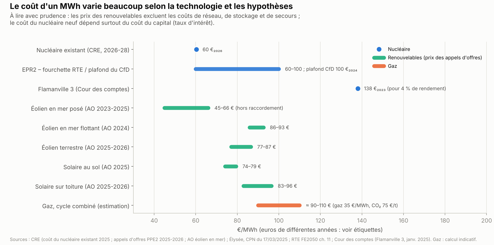

**Le coût d'un mégawattheure** va de 45 € (éolien en mer posé, hors raccordement) à ≈ 138 € (Flamanville 3)[^enviscope-flamanville-2025], selon la technologie et les hypothèses. Le détail et les sources sont dans le graphique. Le coût d'une centrale au gaz (≈ 90 à 110 €) est un calcul indicatif, avec un gaz à 35 €/MWh et un CO₂ à 75 € la tonne.

**Ces comparaisons ont des limites.**
- Les prix des renouvelables ne comptent pas le réseau, le stockage et les centrales de secours nécessaires quand il n'y a ni vent ni soleil.
- Le coût du nucléaire neuf dépend surtout du taux d'intérêt de son financement, parce qu'il faut emprunter longtemps avant de produire.
- Les chiffres sont exprimés en euros d'années différentes.

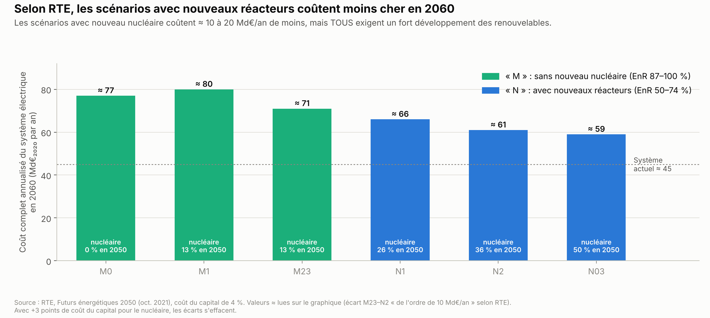

**Le coût de tout le système.** RTE a calculé ce que coûterait chaque année tout le système électrique en 2060 : centrales, réseaux et moyens de secours (*Futurs énergétiques 2050*, octobre 2021). Il suppose que les centrales empruntent à 4 % par an. Les scénarios avec nouveaux réacteurs (codes N1, N2, N03) coûteraient ≈ 59 à 66 Md€ par an, ceux sans nouveaux réacteurs (M0, M1, M23) ≈ 71 à 80 Md€. Le système actuel coûte ≈ 45 Md€ *(valeurs lues sur un graphique de RTE)*[^rte-fe2050].

- **L'avantage du nucléaire dépend du taux d'intérêt.** Si le nucléaire emprunte 3 points plus cher, les écarts disparaissent[^rte-fe2050].
- **Tous les scénarios exigent beaucoup d'éolien et de solaire.** Même le plus nucléaire (N03) suppose ≈ 70 GW de solaire, 43 GW d'éolien terrestre et 22 GW d'éolien en mer en 2050. Le scénario sans nucléaire en 2050 (M0) en suppose ≈ 208, 74 et 62 GW, avec des rythmes de construction supérieurs à ceux des pays européens les plus rapides[^rte-fe2050].
- **La nuance de RTE en 2025.** Tant que la consommation stagne, installer moins de parcs chaque année (2,5 GW au lieu de 3,5) ferait baisser le coût de l'électricité d'≈ 2 € par MWh[^rte-bp2025]. C'est moins de 1 % du prix payé par un ménage *(calcul)*.
- **Le débat porte donc sur les proportions et le calendrier** : combien de réacteurs, combien de parcs, à quel rythme, et avec quel financement.

### Question 3. Électrifier : contraindre ou inciter ?

**Ce qui est en jeu.** Les énergies fossiles font encore 57 % de l'énergie consommée[^sdes-chiffres-cles-2026]. Les remplacer suppose de changer de voiture, de chauffage et de procédés industriels.

**Les contraintes** : les zones à faibles émissions, les interdictions de louer les logements les moins bien classés, la fin des voitures thermiques neuves en 2035, le marché carbone pour le chauffage et les carburants (section 1.5).
- **Pour** : elles donnent un cap aux ménages et aux industriels. Selon Santé publique France, ≈ 40 000 décès par an sont attribuables aux particules fines (2016-2019, cité par le Sénat)[^spf-pollution-2021][^senat-zfe-2023]. Les Écologistes défendent ces règles[^ecologistes-programme].
- **Contre** : elles pèsent d'abord sur les ménages qui n'ont pas les moyens de changer de voiture ou de chauffage. Dans le 3e arrondissement de Marseille, 52 % des voitures sont trop anciennes pour certaines ZFE (Sénat, 2023)[^senat-zfe-2023]. Le RN et LR veulent les supprimer[^rn-programme-2024] ; Bruno Retailleau (LR) y voit « le symbole de l'écologie punitive » (mai 2026)[^europe1-zfe-censure]. Renaissance et Horizons proposent de les assouplir[^lcp-zfe-commission-2026] ; LFI veut des ZFE conditionnées à l'existence d'alternatives[^lcp-zfe-8-octobre].

**Les incitations** : une électricité moins chère, des aides à l'achat (leasing social, bonus, prêts à taux zéro), des aides à la rénovation (MaPrimeRénov').
- **Pour** : elles ne contraignent personne. Selon France Stratégie, MaPrimeRénov' a coûté ≈ 70 € de prime par tonne de CO₂ évitée (2022), en supposant aucun effet d'aubaine ni de rebond, une hypothèse que le rapport juge « évidemment irréaliste »[^france-strategie-mpr-2024]. En 2024, ≈ 40 % des 25 000 premiers bénéficiaires du leasing social faisaient partie des 30 % de ménages les plus modestes *(source secondaire)*[^lautomobiliste-leasing-2024].
- **Contre** : elles coûtent cher au budget, et leur effet est parfois plus faible que prévu (section 4).

**Un point d'accord.** Presque tous les partis veulent baisser le prix de l'électricité pour encourager l'électrification. Ils divergent sur la manière.

### Question 4. Baisser les taxes pour tous, ou aider de façon ciblée ?

**Baisser la TVA sur l'énergie à 5,5 %**, au lieu de 20 %.
- **Coût** : ≈ 11 Md€ par an selon le RN (contre-budget d'octobre 2025)[^rn-contre-budget-2026] et 11,3 selon l'Institut Montaigne (think tank libéral)[^montaigne-tva-rn-2024]. La Fondation pour la recherche sur les administrations et les politiques publiques (IFRAP, libérale) l'estime à 16,7 Md€[^ifrap-energie-2024], le ministère de l'Économie à 16,8[^publicsenat-tva-bercy-2024].
- **Droit européen** : la directive 2022/542 permet un taux réduit sur l'électricité, et sur le gaz jusqu'en 2030, mais pas sur les carburants[^directive-2022-542].
- **Qui y gagne** : selon la Fondation Jean-Jaurès (proche du PS), un client moyen gagnerait ≈ 70 € par an sur sa facture d'électricité[^jean-jaures-tva]. Sur l'électricité et le gaz, la Cour des comptes estimait le gain à ≈ 130 € pour les 10 % les plus aisés, contre 82 € pour les 30 % les plus modestes[^jean-jaures-tva]. Mais les dépenses d'énergie du logement pèsent plus lourd dans le budget des ménages modestes (INSEE, 2025)[^insee-ia-106] : rapportée au revenu, la baisse les aiderait davantage.

**Bloquer les prix.** Le gouvernement peut bloquer des prix par décret en cas de crise, pour 6 mois au plus (Code de commerce, article L. 410-2)[^cdj-blocage-2024]. Le blocage des prix de l'énergie et des produits de première nécessité proposé par le Nouveau Front populaire en 2024 coûterait ≈ 24 Md€ par an selon l'Institut Montaigne (fourchette de 9 à 38)[^montaigne-nfp-blocage], 21,5 Md€ selon l'IFRAP[^ifrap-energie-2024].

**Aider de façon ciblée.** Le chèque énergie actuel va de 48 à 277 € par an, pour ≈ 5,6 millions de ménages (2023)[^gouv-cheque-energie-2023]. Le bilan du bouclier tarifaire de 2021-2024, dont 90 % des aides n'étaient pas ciblées selon les revenus[^cour-comptes-boucliers], est en section 4.

**Carburants : qui doit payer ?**
- **Taxer les « superprofits »** des pétroliers. Une contribution de ce type, sur les bénéfices de 2022, a rapporté en France moins de 100 M€[^afp-cts-2022], ≈ 68,5 M€ selon la proposition de loi écologiste de 2026[^an-ppl-2675]. Les bénéfices réalisés en France sont en effet faibles (voir l'étude de cas [TotalEnergies](../finances-publiques/encadre_totalenergies.md)).
- **Plafonner les marges** ou **bloquer les prix** à la pompe.
- **Baisser les taxes** : l'accise ou la TVA (la TVA réduite est interdite sur les carburants par le droit européen)[^directive-2022-542].
- **Supprimer les certificats d'économies d'énergie** : selon LR et la profession pétrolière, cela baisserait le prix de 15 à 17 centimes par litre en 2026 ; la Cour des comptes estimait leur coût à ≈ 7,3 centimes en 2023. Les deux chiffres ne portent pas sur la même année. Ces certificats financent des pompes à chaleur et des rénovations (AFP) *(source secondaire)*[^afp-cee].

---

## 3. Ce que proposent les partis

*Les partis sont présentés dans l'ordre où leurs groupes siègent à l'Assemblée nationale, de gauche à droite ; Reconquête, qui n'a pas de groupe, vient en dernier. Les positions sont celles connues au 11 octobre 2026. Le programme de LFI sera publié le 6 novembre 2026[^lcp-lfi-programme-2026]. Raphaël Glucksmann a été désigné candidat du PS et de Place publique le 11 octobre 2026, dès le premier tour de la primaire, avec 66,17 % des voix[^publicsenat-primaire-resultats].*

### Vue d'ensemble

| Parti | Prix et marché européen | Nucléaire | Éolien et solaire | Électrification (2035, ZFE, logements) | Taxes et carburants |
|---|---|---|---|---|---|
| **LFI** | Prix fondé sur les coûts ; sortir du marché européen (2024) ; contrat à prix garanti (2025) | Sortie : 2045 (programme 2022) ; « 100 % d'énergies renouvelables en 2050 » (programme 2025) | 100 % renouvelables | ZFE conditionnées à l'existence d'alternatives ; 700 000 rénovations par an *(à vérifier)* | TVA à 5,5 % pour les ménages ; blocage des prix ; carburants à 1,70 € le litre |
| **Les Écologistes** | Découpler le prix de l'électricité de celui des énergies fossiles | Sortie planifiée sur ≈ 20 ans ; arrêt des EPR2 | 44 % de renouvelables (barrages compris) dans l'électricité consommée en 2030 | Maintien de 2035 et des interdictions de louer ; contre la suppression des ZFE | Baisse des taxes sur l'électricité ; taxe de 66 % sur les surprofits pétroliers |
| **PS-Place publique** | « Sortir l'électricité de la logique de marché » (PS) ; une partie de la facture aux coûts (Place publique) | Nucléaire et renouvelables, avec un « plan Messmer » de la transition (Raphaël Glucksmann) | Plan pluriannuel | Prêts à taux zéro ; leasing social « à grande échelle » | Chèque énergie à 500 € ; taxe sur les superprofits |
| **Renaissance** | Pas de position trouvée | Nucléaire et renouvelables | Nucléaire et renouvelables | TVA à 5,5 % sur les voitures électriques ; ZFE assouplies | Pas de baisse générale des taxes sur les carburants ; aides ciblées |
| **Horizons** | Pas de position trouvée sur le prix ; prix du carbone aux frontières de l'UE | Relancer | Développer | Électrifier « massivement nos usages » ; contre une « interdiction sèche » en ZFE | Doubler les aides ciblées aux automobilistes ; pas de nouvel impôt |
| **LR** | Faire profiter du parc nucléaire ; −10 % sur le coût de l'électricité | Parc prolongé jusqu'à 80 ans ; EPR2 | Fin des subventions aux nouveaux parcs | Supprimer les ZFE et les interdictions de louer | Supprimer les certificats d'économies d'énergie |
| **RN** | « Prix national régulé » à 50-60 €/MWh, en restant dans le marché européen | 20 réacteurs entre 2033 et 2042 | Moratoire ; fin des aides | Renoncer à 2035 ; supprimer les ZFE et les obligations liées au DPE | TVA à 5,5 % sur l'électricité, le gaz et les carburants |
| **Reconquête** *(programme 2022)* | Pas de position trouvée | 14 EPR2 d'ici 2050 | Arrêt de tout nouveau projet éolien | Contre 2035 *(à vérifier)* | Baisse des taxes sur les carburants *(à vérifier)* |

**Autres.** Le Parti communiste français (PCF, Fabien Roussel) veut un pôle public de l'énergie et remettre en cause les directives européennes de mise en concurrence ; il soutient le nucléaire *(à vérifier)*. Ses sénateurs proposent de bloquer les prix du gaz et des carburants à leur niveau moyen des douze mois précédant mars 2026 (proposition de loi du 13 mars 2026)[^senat-ppl-pcf-453]. Fabien Roussel demande aussi la suppression des certificats d'économies d'énergie et une TVA à 5,5 % sur les carburants (septembre 2026) *(source secondaire)*[^pcf-objectif-2]. David Lisnard (Nouvelle Énergie) propose de supprimer les certificats d'économies d'énergie[^afp-cee].

**Ce qui rapproche et ce qui sépare.**
- **Le prix de l'électricité** : LFI, Les Écologistes, le PS-Place publique, LR et le RN veulent, sous des formes différentes, un prix plus proche des coûts de production français ou moins lié à celui du gaz. Ils divergent sur la méthode et sur le rapport à l'UE. En octobre 2025, le RN a voté en commission un amendement de LFI au budget 2026 qui visait à capter une partie des revenus des producteurs[^afp-rn-amendement-lfi-2025].
- **Le nucléaire** : six partis sur huit veulent le maintenir ou le relancer. LFI et Les Écologistes veulent en sortir.
- **Les contraintes d'électrification** : Les Écologistes veulent les garder. LFI accepte les ZFE à condition qu'il existe des alternatives : elle avait voté leur suppression en 2025. En 2026, elle a annoncé qu'elle ne soutiendrait pas le texte du RN, puis a voté avec lui, le 8 octobre, contre un amendement écologiste qui le vidait de son contenu (164 voix contre 49). Faute de temps, le texte n'a pas été soumis au vote final[^lcp-zfe-arithmetique]. Renaissance et Horizons veulent les assouplir. LR, le RN et Reconquête veulent en supprimer plusieurs.

### Le tableau standard

*Partis dans l'ordre de l'hémicycle, comme ci-dessus. Levier : ce qu'il faut pour appliquer la mesure (liste dans le mode d'emploi) ; le premier cité est le plus décisif. Les coûts et obstacles sont attribués à leur source. Quand une proposition est connue par la presse et non par un programme, la case le signale.*

| Parti | Propositions | Levier | Obstacles et coût |
|---|---|---|---|
| **LFI** | Contrat à prix garanti dans les deux sens sur le nucléaire existant, prix fixé chaque année par la CRE ; tarifs réglementés fondés sur « l'ensemble des coûts du système électrique français », importations comprises, ouverts aux collectivités, aux organismes de logement social (HLM) et à toutes les entreprises ; accise des petites et moyennes entreprises ramenée au taux des industries grosses consommatrices d'électricité (7,5 €/MWh au lieu de 20,9, pendant un an) ; interdiction des coupures toute l'année. Proposition de loi n° 2302, déposée le 23 décembre 2025 par 71 députés, non examinée[^ppl-lfi-2302] | Loi ; UE (aides d'État ; tarifs pour toutes les entreprises) | Le droit européen prévoit ces contrats pour les nouveaux investissements ; sur tout le parc existant, ce serait une aide d'État à faire autoriser par la Commission *(lecture du texte, à vérifier)*[^ue-reglement-2024-1747]. Ouvrir les tarifs réglementés à toutes les entreprises dépasse ce que permet la directive 2019/944[^directive-2019-944]. Non chiffré. |
| | Sortir du marché européen de l'électricité et créer un « pôle public de l'énergie » (programme européen de 2024, qui assume en introduction « la désobéissance » aux règles européennes, sans viser l'énergie en particulier)[^lfi-programme-ue-2024] ; renationaliser Engie (programme de 2022 ; l'État détenait 23,64 % du capital fin 2021)[^montaigne-edf-engie-2022][^montaigne-edf-engie-2022] ; barrages gérés directement par une structure publique, sans mise en concurrence[^lfi-programme-ue-2024] | UE ; Loi ; Budget | Aucun texte ne permet de quitter le marché : risque de procédure de la Commission[^lessurligneurs-bardella-2024]. Selon l'Institut La Boétie (fondation de LFI), il faudrait déroger au traité et à la directive[^laboetie-2022]. Rachat d'Engie : 22,6 à 31 Md€ selon l'Institut Montaigne (libéral, 2022)[^montaigne-edf-engie-2022] ; ≈ 43 Md€ à la valeur boursière de 2026, hors prime *(calcul)*. |
| | Sortie du nucléaire et 100 % renouvelables[^lfi-programme-ue-2024][^an-amdt-lfi-297] | Décret (PPE) ; Loi | Selon RTE, les scénarios sans nouveaux réacteurs coûtent ≈ 10 à 20 Md€ de plus par an en 2060 (taux de 4 %) *(lecture du graphique de RTE ; le texte donne ≈ 10 Md€ entre les deux scénarios les moins chers de chaque famille)* ; l'écart disparaît si le nucléaire emprunte 3 points plus cher. Le scénario sans nucléaire en 2050 suppose des rythmes de construction supérieurs à ceux des pays européens les plus rapides (RTE)[^rte-fe2050]. |
| | 700 000 rénovations de logements par an *(à vérifier)* ; plan pour le rail et le fret ; ZFE conditionnées à l'existence d'alternatives (Sylvain Carrière, octobre 2026) *(source secondaire)* | Budget ; Loi ; Collectivités | Non chiffré. Fin des voitures thermiques en 2035 et ETS2 : pas de position publique trouvée. |
| | Blocage des prix de l'énergie[^montaigne-nfp-blocage] ; carburants à 1,70 € le litre ; plafonnement légal des marges de raffinage[^publicsenat-melenchon-carburants] ; TVA à 5,5 % pour les ménages[^ppl-lfi-2302] ; gratuité des premiers kWh[^lfi-aec-2025], sans volume précisé (un amendement d'octobre 2023, sur le budget 2024, proposait une TVA à 5,5 % sur « les premiers kilowatts », en citant une consommation moyenne d'≈ 6 kWh par jour et par personne)[^an-amdt-lfi-3842] | Décret ; Loi ; Budget | Blocage par décret limité à 6 mois en cas de crise[^cdj-blocage-2024]. Coût du blocage : ≈ 24 Md€ par an (Institut Montaigne)[^montaigne-nfp-blocage] ou 21,5 Md€ (IFRAP, libérale)[^ifrap-energie-2024], pour le programme de 2024. |
| **Les Écologistes** | Découpler le prix de l'électricité de celui des énergies fossiles ; contrats à prix garanti qui reversent les surplus aux consommateurs ; tarification progressive[^ecologistes-programme] | UE ; Loi | Méthode du découplage non précisée. Les contrats à prix garanti sont prévus par le droit européen pour les nouvelles installations[^ue-reglement-2024-1747]. Non chiffré. |
| | « Planifier la sortie du nucléaire » sur ≈ 20 ans ; arrêt des EPR2 et des petits réacteurs modulaires ; 44 % de renouvelables (barrages compris) dans l'électricité consommée en 2030[^ecologistes-programme] | Décret (PPE) ; Loi | Mêmes estimations de RTE que pour LFI. Le programme ne dit pas ce qui remplacerait les 373 TWh du nucléaire[^rte-bilan-2025]. Non chiffré. |
| | Maintien de la fin des voitures thermiques en 2035 ; leasing social d'un million de voitures ; 500 000 rénovations par an ; maintien des interdictions de louer ; fin du chauffage au fioul en 2032 ; refus du marché carbone pour les particuliers[^ecologistes-programme] | UE ; Budget ; Loi | Non chiffré. Changer l'ETS2 suppose de réviser une directive européenne[^commission-ets2]. |
| | Même accise pour le gaz et l'électricité ; TVA réduite sur l'abonnement ; suppression progressive des réductions de taxe sur les carburants dont bénéficient certains secteurs[^ecologistes-programme] ; contribution de 66 % sur les surprofits des groupes pétroliers et gaziers pendant 3 ans[^an-ppl-2675] ; « action spécifique » de l'État dans TotalEnergies (droit de veto sur certaines décisions)[^senat-ppl-jadot] | Budget ; Loi | Secteurs visés et rendement non précisés. Une taxe sur les bénéfices réalisés en France rapporterait peu (voir l'étude de cas TotalEnergies, en annexe). Le 9 avril 2026, avant le dépôt de ce texte (14 avril), Cécile Cukierman (PCF) interrogeait au Sénat le Premier ministre, Sébastien Lecornu, sur l'idée d'une taxe sur les superprofits des groupes pétroliers. Il répondait : « quelle est son assiette ? Quel est son rendement ? Quel est son fonctionnement ? »[^publicsenat-ppl-superprofits] |
| **PS-Place publique** | « Sortir l'électricité de la logique de marché » (projet du PS, avril 2026) *(source secondaire)*[^lcp-projet-ps-2026] ; fonder une partie de la facture sur les coûts de production (Place publique, document non daté, postérieur à octobre 2024)[^pp-vision] | Loi ; UE | Méthode et part de la facture non précisées. Des outils existent dans le cadre européen, souvent avec l'accord de la Commission (section 2). Non chiffré. |
| | Nucléaire et renouvelables : Raphaël Glucksmann refuse de choisir et propose un « plan Messmer » de la transition (juin 2026) *(source secondaire)*[^ecoinfos-glucksmann-2026] ; un « mix énergétique 100 % décarboné en 2050 » (PS)[^lcp-projet-ps-2026] | Décret (PPE) ; Budget ; UE | Enquête de la Commission sur l'aide à l'EPR2[^commission-epr2-2026]. Non chiffré. |
| | Prêt à taux zéro pour une voiture électrique et pour la rénovation, Fonds vert pour les collectivités multiplié par quatre (PS)[^ps-7-priorites] ; leasing social « à grande échelle », « relancer et simplifier MaPrimeRénov' » (Place publique)[^pp-vision] | Budget | Selon le PS : 2,5 Md€ pour les transports collectifs et ces prêts, 1,5 Md€ pour le Fonds vert[^ps-7-priorites]. Pas d'évaluation indépendante. |
| | Chèque énergie à 500 €, étendu aux classes moyennes (Glucksmann) *(source secondaire)*[^parlons-politique-cheque-energie] ; taxe de 20 à 40 % sur les profits qui dépassent de plus de 20 % la moyenne des 3 années précédentes, pour les entreprises de plus de 750 M€ de chiffre d'affaires[^publicsenat-ppl-superprofits] | Budget | 4 Md€ pour le chèque selon Raphaël Glucksmann[^parlons-politique-cheque-energie] ; ≈ 2 Md€ attendus de la taxe selon Olivier Faure[^publicsenat-ppl-superprofits]. Pas d'évaluation indépendante. |
| **Renaissance** | Nucléaire et renouvelables[^afp-linfodurable-attal-2025] ; baisse des émissions portée de 1,8 % à 5 % par an d'ici 2030[^attal-dette-ecologique] ; loi de programmation écologique tous les cinq ans[^afp-linfodurable-attal-2025] | Décret (PPE) ; Loi ; Budget | Mesures et coût non précisés. |
| | TVA à 5,5 % sur les voitures électriques (2025)[^pressecitron-attal-tva] ; bonus étendu aux voitures électriques d'occasion (2026)[^titrespresse-attal-rtl] ; ZFE plus souples pour les maires *(sources secondaires)*[^lcp-zfe-commission-2026] | UE (TVA) ; Budget ; Loi ; Collectivités | La directive TVA ne semble pas permettre un taux réduit sur les voitures *(lecture du texte, à vérifier)*[^directive-2022-542]. Non chiffré. |
| | Pas de baisse générale des taxes sur les carburants, « ni possible ni souhaitable » ; aides ciblées aux salariés qui dépendent de leur voiture[^parlons-politique-attal-carburants] ; « compte épargne carbone-transition » *(sources secondaires)*[^afp-linfodurable-attal-2025] | Budget | Montant des aides non précisé. |
| **Horizons** | Assurer la souveraineté énergétique « en relançant le nucléaire, en développant les renouvelables et en électrifiant massivement nos usages »[^philippe-conquerante] | Décret (PPE) ; Budget ; UE | Nombre de réacteurs, calendrier et coût non précisés. |
| | Prix du carbone aux frontières de l'UE, pour protéger les industries qui se décarbonent[^philippe-conquerante] | UE | Un mécanisme européen de ce type s'applique déjà depuis 2026[^ce-cbam] ; ce que la proposition ajoute n'est pas précisé. |
| | Doubler immédiatement les aides ciblées aux automobilistes, financées par des économies de l'État (septembre 2026) *(source secondaire)*[^titrespresse-philippe-carburants] ; doubler le Fonds vert[^philippe-conquerante] ; pas de nouvel impôt pendant le quinquennat[^philippe-prospere] | Budget ; Décret | Montants non précisés. Le gouvernement a annoncé ce doublement le 22 septembre 2026[^publicsenat-melenchon-carburants]. |
| **LR** | Prolonger le parc nucléaire jusqu'à 80 ans ; « maîtriser les coûts et les délais » des EPR2 ; relancer un prototype de réacteur à neutrons rapides (une technologie qui réutilise le combustible usé)[^lr-propositions] ; −10 % sur le coût de l'électricité (débat du Medef, août 2026) *(source secondaire)*[^ecoinfos-medef-energie] | Décret (PPE) ; Budget ; UE | La baisse de 10 % n'a pas été détaillée[^ecoinfos-medef-energie]. Non chiffré par LR. |
| | Ne plus subventionner de nouveaux parcs éoliens et solaires[^lr-propositions] ; supprimer la programmation pluriannuelle de l'énergie, qui ferait monter selon LR le coût de l'électricité de 10 à 15 %[^ecoinfos-medef-energie] | Décret (PPE) | La hausse de 10 à 15 % n'a pas été détaillée[^ecoinfos-medef-energie]. Le soutien aux renouvelables a coûté 6,2 Md€ en 2025[^cre-cspe-2026]. |
| | Supprimer les ZFE[^lcp-zfe-commission-2026] et les interdictions de louer liées au DPE[^lr-propositions] ; supprimer les certificats d'économies d'énergie (15 à 17 centimes de moins par litre selon LR)[^afp-cee] | Loi ; Décret | La Cour des comptes estimait le coût des certificats à ≈ 7,3 centimes par litre en 2023. Ils financent rénovations et pompes à chaleur[^afp-cee]. |
| **RN** | « Prix national régulé » autour de 50-60 €/MWh ; modifier l'« ordre de mérite » ; supprimer le mécanisme de capacité ; baisser la fiscalité ; la France « resterait bien entendu au sein du marché européen de l'électricité » mais « remettrait en cause les règles de fixation des prix » (Jordan Bardella, avril 2026)[^publicsenat-rn-marche-2026]. Proposition de loi annoncée le 18 juin 2026 par Maxime Amblard et Jean-Philippe Tanguy, non déposée au 11 octobre *(sources secondaires)*[^revolution-energetique-rn-2026] | UE ; Loi | Le RN ne dit pas s'il négocierait une dérogation ou agirait seul. La cible est inférieure ou égale au coût du nucléaire existant (60,3 €/MWh selon la CRE)[^cre-cout-nucleaire-2025]. |
| | Moratoire sur l'éolien et le solaire ; fin des aides (7,2 Md€ d'économies attendues dans le contre-budget d'octobre 2025 ; plus de 5 Md€ la première année dans le plan du 6 octobre 2026 *(source secondaire)*[^vert-rn-contre-budget-2026])[^rn-contre-budget-2026] ; réexamen des contrats existants[^revolution-energetique-rn-2026] | Loi ; Décret (PPE) ; UE (aides d'État) | En juin 2025, l'Assemblée a voté un moratoire (65 voix contre 62, dont 57 du RN)[^lcp-moratoire-2025], tombé avec le rejet du texte qui le portait[^bdt-gremillet-2025] ; la PPE3 a ensuite été adoptée par décret, sans moratoire[^seban-ppe3-2026]. La révision d'anciens contrats solaires, votée fin 2020, a été validée par le Conseil constitutionnel, mais son arrêté d'application a été annulé par le Conseil d'État en janvier 2023, faute de notification à la Commission[^taylorwessing-pv-2023]. Le projet de budget 2027 attend ≈ 120 M€ d'une mesure de ce type[^afp-budget-enr-2027]. Selon l'IFRAP (libérale, 2024), un moratoire comporte des « risques » pour l'approvisionnement en attendant les nouveaux réacteurs[^ifrap-energie-2024]. |
| | 20 réacteurs (programme de 2022 : mises en service en 2031 et 2036 ; calendrier non actualisé)[^vert-rn-2024], financés par « le fonds souverain et la politique monétaire » (Jean-Philippe Tanguy, 2024)[^lgc-terranova-tanguy-2024][^lgc-terranova-tanguy-2024] | Décret (PPE) ; Budget ; UE | Le premier EPR2 est attendu en 2038 (Élysée, mars 2025)[^elysee-cpn-2025]. Au devis d'EDF (72,8 Md€ pour 6 réacteurs, euros de 2020, hors frais financiers)[^afp-epr2-2025], 20 réacteurs coûteraient ≈ 240 Md€ *(calcul)*. Selon Terra Nova (centre gauche, 2024), changer le mandat de la Banque centrale européenne suppose de modifier les traités à l'unanimité : le levier monétaire est trop incertain pour fonder un financement[^lgc-terranova-tanguy-2024]. |
| | TVA à 5,5 % sur l'électricité, le gaz et les carburants[^planet-rn-2026] ; baisse de l'accise sur les carburants *(à vérifier)* ; renoncer à 2035 ; supprimer les ZFE[^rn-programme-2024] et les obligations liées au DPE *(à vérifier pour le DPE)* ; « 100 % Rénov » à la place de MaPrimeRénov'[^vert-rn-contre-budget-2026] ; abandonner l'ETS2 *(à vérifier)* ; prêt à taux zéro pour les « voitures propres » et neutralité carbone « avant 2050 » (plan du 6 octobre 2026) *(source secondaire)*[^lalibre-le-pen-regle-or] | Budget ; UE ; Loi | TVA : 11 à 16,8 Md€ par an selon les sources (question 4) ; interdite sur les carburants par le droit européen[^directive-2022-542]. 2035 et ETS2 relèvent du droit de l'UE[^commission-co2-voitures][^commission-ets2]. |
| **Reconquête** | Programme 2022 : au moins 14 EPR2 d'ici 2050 ; parc prolongé à 60 ans « voire plus » ; arrêt de tout nouveau projet éolien[^monvote2027-zemmour]. Rien de publié pour 2027[^reconquete-consultation]. | Décret (PPE) ; Budget ; Loi | Au devis d'EDF[^afp-epr2-2025], 14 EPR2 coûteraient ≈ 170 Md€ (euros de 2020, hors frais financiers) *(calcul)*. Selon l'Institut Montaigne (2022), il faudrait remplacer ≈ 112 TWh d'éolien, par exemple en multipliant le solaire par 15 ; coût supplémentaire de ≈ 2,5 Md€ par an en 2050[^montaigne-zemmour-epr-2022]. |

### Comment ils le mettraient en place : ce qui reste sans réponse

Pour chaque parti : les questions que ses propositions laissent ouvertes, les principales critiques publiques, et ses réponses.

**LFI.**
- *Sans réponse* :
  - la date de sortie du nucléaire retenue pour 2027 ;
  - le prix de référence de l'électricité une fois le nucléaire existant fermé, alors que la proposition de loi fonde le tarif sur ce parc ;
  - le financement du rachat d'Engie et le sort des fournisseurs concurrents d'EDF.
- *Critiques* : selon l'IFRAP (libérale, 2024), vouloir baisser les prix sans dire comment augmenter la production est « contradictoire »[^ifrap-energie-2024]. Selon l'Institut Montaigne (libéral, 2024), le blocage des prix coûterait ≈ 24 Md€ par an[^montaigne-nfp-blocage].
- *Réponses* : Dans son programme de 2022, LFI présentait l'énergie comme « un bien commun » et voulait annuler la libéralisation du marché de l'électricité et du gaz (Institut Montaigne)[^montaigne-edf-engie-2022]. Elle estime le nouveau nucléaire à « 250 Md€ » et à « 15 ou 20 ans » de délai (mai 2026)[^lfi-electrification-2026]. Sa proposition de loi utilise un outil européen plutôt qu'une sortie du marché[^ppl-lfi-2302].

**Les Écologistes.**
- *Sans réponse* :
  - le point de départ des ≈ 20 ans de fermeture du parc et ce qui remplacerait sa production ;
  - la manière de « découpler » le prix : réforme européenne ou mesure nationale ;
  - le coût de 500 000 rénovations par an et d'un million de leasings.
- *Critiques* : aucune critique nommée du programme de juillet 2026 n'a été trouvée. À gauche, Raphaël Glucksmann refuse de choisir entre nucléaire et renouvelables (juin 2026) *(source secondaire)*[^ecoinfos-glucksmann-2026].
- *Réponses* : Marine Tondelier cite Flamanville, « un projet qui prend 12 ans de retard et engendre un surcoût de 15,8 milliards » (2024)[^x-tondelier-2024]. Le programme demande un rapport public sur les coûts réels de la filière nucléaire[^ecologistes-programme].

**PS-Place publique.**
- *Sans réponse* :
  - le contenu du « plan Messmer » de la transition : nombre de réacteurs, part des renouvelables, calendrier ;
  - la part de la facture fondée sur les coûts, et l'outil juridique choisi ;
  - le plafond de revenus des « classes moyennes » pour le chèque énergie ;
  - l'usage des ≈ 2 Md€ attendus de la taxe sur les superprofits, qui financeraient la moitié du chèque énergie selon Raphaël Glucksmann[^parlons-politique-cheque-energie].
- *Critiques* : le 9 avril 2026, en réponse à Cécile Cukierman (PCF), le Premier ministre Sébastien Lecornu s'interrogeait sur l'assiette, le rendement et le fonctionnement d'une taxe sur les superprofits des groupes pétroliers. C'était avant l'annonce du texte du PS, le 30 avril[^publicsenat-ppl-superprofits]. Le président-directeur général de TotalEnergies a menacé de mettre fin au plafonnement de ses prix en cas de taxe exceptionnelle[^afp-totalenergies-2026-09].
- *Réponses* : selon Raphaël Glucksmann, « le gouvernement ne veut pas heurter Monsieur Pouyanné et Total » (septembre 2026)[^franceinfo-glucksmann-superprofits].

**Renaissance.**
- *Sans réponse* :
  - la position sur le prix de l'électricité et le marché européen ;
  - la voie juridique et le coût d'une TVA réduite sur les voitures électriques ;
  - les mesures qui feraient passer la baisse des émissions de 1,8 % à 5 % par an.
- *Critiques* : Marine Le Pen a répondu au refus de baisser les taxes sur les carburants : « Merci de cette clarification » (septembre 2026) *(source secondaire)*[^cnews-le-pen-attal].
- *Réponses* : selon Gabriel Attal, baisser toutes les taxes serait « la plus populaire sans doute, mais aussi la plus politicienne » des solutions, avec une situation budgétaire « extraordinairement tendue »[^parlons-politique-attal-carburants].

**Horizons.**
- *Sans réponse* :
  - le nombre de réacteurs, leur calendrier et leur financement ;
  - la position sur le prix de l'électricité et la TVA sur l'énergie ;
  - l'articulation entre « pas de nouvel impôt » et le marché carbone européen, qui doit renchérir le chauffage et les carburants à partir de 2028.
- *Critiques* : aucune critique nommée de ses propositions sur l'énergie n'a été trouvée, en dehors d'un échange avec Marine Le Pen sur leurs positions passées sur le nucléaire.
- *Réponses* : « Madame Le Pen, je n'ai pas dit, comme vous, que le nucléaire était dangereux et qu'il fallait en sortir pour ensuite le défendre » (Édouard Philippe, avril 2026)[^x-philippe-2026].

**LR.**
- *Sans réponse* :
  - ce qui remplacerait la programmation pluriannuelle de l'énergie ;
  - ce qui financerait les rénovations et les pompes à chaleur sans les certificats d'économies d'énergie ;
  - le calcul de la baisse de 10 % promise.
- *Critiques* : le ministre Serge Papin voit « un côté démagogique » à supprimer les certificats (septembre 2026)[^afp-cee]. Le Syndicat des énergies renouvelables, organisation professionnelle du secteur, juge « irréalistes » ses propositions sur les renouvelables (2025)[^natura-retailleau-2025].
- *Réponses* : selon Bruno Retailleau, l'éolien et le solaire ont atteint une « maturité économique » qui ne justifie plus de subventions (août 2026)[^ecoinfos-medef-energie].

**RN.**
- *Sans réponse* :
  - qui fixerait le « prix national régulé », et par quelle voie : dérogation négociée ou décision unilatérale ;
  - le sort des exportations, des fournisseurs concurrents et des contrats de soutien en cours ;
  - le financement des 20 réacteurs si le levier monétaire n'est pas disponible, et leur calendrier, plus rapide que celui de l'EPR2.
- *Critiques* :
  - selon Terra Nova (centre gauche, 2024), seul ≈ 1/6 de la facture dépendait alors du prix de marché[^terranova-bardella-2024] ;
  - selon la Fondation Jean-Jaurès (proche du PS), la TVA à 5,5 % profiterait davantage aux ménages aisés, en euros[^jean-jaures-tva] ;
  - selon l'IFRAP (libérale, 2024), un moratoire sur l'éolien et le solaire comporte des « risques » pour l'approvisionnement[^ifrap-energie-2024] ;
  - Jean-Luc Mélenchon estime qu'une baisse de TVA ne garantit pas une baisse des prix (septembre 2026)[^publicsenat-melenchon-carburants].
- *Réponses* : le RN demandait dès novembre 2022 un prix fondé sur un « mécanisme de coût moyen de production de son propre parc de production » (proposition de résolution de Marine Le Pen et Jean-Philippe Tanguy). La France « resterait bien entendu au sein du marché européen de l'électricité » (Jordan Bardella, avril 2026)[^publicsenat-rn-marche-2026]. « La France produit l'électricité la plus propre et la moins chère grâce à son parc nucléaire. Pourtant, nous l'achetons au prix européen » (Kévin Mauvieux, député RN, 2025)[^an-qg-mauvieux-2025].

**L'évolution du discours du RN sur le marché européen.**

| Date | Formulation |
|---|---|
| Mars 2022, Marine Le Pen | Sortir du marché européen de l'électricité (programme) ; « Je veux qu'on revienne aux prix régulés du gaz et de l'électricité » |
| Mai-juin 2024, Jordan Bardella | « Sortie des règles européennes de fixation des prix de l'électricité » (programme des législatives)[^rn-programme-2024] ; négocier une dérogation[^europe1-bardella-2024] ; « baisser de 30% à 40% la facture d'électricité »[^terranova-bardella-2024] |
| Juin 2024, Marine Le Pen | « Nous ne souhaitions pas sortir du marché européen de l'électricité mais des règles de fixation des prix qu'il impose »[^x-le-pen-2024] |
| Avril 2026, Jordan Bardella (message sur X) | La France « resterait bien entendu au sein du marché européen de l'électricité » mais « remettrait en cause les règles de fixation des prix »[^publicsenat-rn-marche-2026] |

**Reconquête.**
- *Sans réponse* :
  - le maintien des propositions de 2022 dans le programme de 2027 ;
  - la position sur le prix de l'électricité et les taxes ;
  - ce qui remplacerait l'éolien d'ici la mise en service des nouveaux réacteurs.
- *Critiques* : l'Institut Montaigne jugeait en 2022 son chiffrage d'une « fiabilité modérée », faute de précision sur ce qui remplacerait l'éolien[^montaigne-zemmour-epr-2022]. Aucune critique ni réponse datée de 2026 n'a été trouvée.

---

## 4. Ce que disent les évaluations

**L'ARENH (2011-2025).** EDF vendait jusqu'à 100 TWh par an à ses concurrents, à 42 €/MWh[^senat-arenh-2024].
- *Coût et effet* : selon la Cour des comptes (2022), le parc nucléaire a couvert ses coûts sur 2011-2021, avec un surplus de 1,7 Md€ « essentiellement dû au hasard » des prix[^senat-arenh-2024].
- *Concurrence* : selon la CRE (2018) et la Cour, l'ARENH a ouvert la vente au détail à la concurrence, sans faire investir les concurrents d'EDF dans la production[^cre-arenh-2018][^cour-arenh-2017].
- *Limites* : le dispositif était asymétrique. Personne ne le demandait quand le marché était moins cher (2016), et les demandes dépassaient le plafond quand il était plus cher[^cre-arenh-2018]. Le prix est resté à 42 €/MWh de 2012 à la fin du dispositif, en 2025[^senat-arenh-2024]. En 2022, l'État a imposé 20 TWh de plus pour freiner la hausse des tarifs ; EDF a chiffré son préjudice à 8,34 Md€[^edf-recours-arenh-2022].

**Le bouclier tarifaire et les aides énergie (2021-2024).** 25 mesures, dont le plafonnement des tarifs de l'électricité et du gaz, la remise sur les carburants et des chèques énergie exceptionnels.
- *Coût* : « près de 72 Md€ » bruts, 36 Md€ nets, surtout parce que les charges de soutien aux renouvelables ont baissé de plus de 28 Md€ pendant la crise, les producteurs sous contrat reversant de l'argent (Cour des comptes, mars 2024)[^cour-comptes-boucliers].
- *Ciblage* : les aides étaient « pour l'essentiel (à 90 %) non ciblées en fonction des revenus ». Plus de 17 Md€ ont soutenu la consommation de gaz et de carburants, à l'encontre des objectifs climatiques selon la Cour[^cour-comptes-boucliers].
- *Effet sur les prix* : selon l'Institut national de la statistique et des études économiques (INSEE), le bouclier a réduit l'inflation de 3,1 points entre mi-2021 et mi-2022[^insee-ia-75]. Selon la Banque de France, il l'a réduite de 2,2 points sur 2022-2023, pour un coût de 2,2 % du PIB. Elle ajoute qu'un bouclier « ne ferait que différer » l'inflation si le choc dure[^bdf-bouclier].

**La contribution sur la « rente inframarginale » (2022-2023).** L'UE a plafonné à 180 €/MWh les recettes des producteurs d'électricité bon marché[^ue-reglement-2022-1854]. La loi de finances pour 2023 en attendait 12,3 Md€, en supposant un prix de marché supérieur à 500 €/MWh[^senat-mi-finances-2024]. Les prix sont vite retombés : la recette encaissée en 2023 a été de 638 M€, « soit 5 % seulement du produit initialement prévu » (Sénat, 2024)[^senat-reglement-2023].

**L'« exception ibérique » (Espagne et Portugal, juin 2022 à fin 2023).** Les deux pays ont plafonné le prix du gaz utilisé par les centrales électriques, avec l'accord de la Commission.
- *Effet* : le prix de gros espagnol a été de 128 €/MWh en moyenne de juin 2022 à février 2023, contre 273 en France (Center on Global Energy Policy, université Columbia)[^cgep-iberique-2023]. Une étude d'EsadeEcPol, centre de recherche espagnol, estime que le tarif réglementé espagnol a été en moyenne 20 à 27 % plus bas grâce au mécanisme (*Energy Policy*, 2024)[^esade-iberique-2023].
- *Limites* : l'Espagne a brûlé davantage de gaz pour son électricité (+53 % en 2022, toutes causes confondues). Ses exportations vers la France ont augmenté jusqu'à saturer les lignes : ≈ 0,6 Md€ aurait ainsi été transféré aux consommateurs français, selon le même centre de l'université Columbia[^cgep-iberique-2023].
- *Contexte* : la Commission l'avait accepté au motif que la péninsule est peu reliée au reste de l'Europe (décision de juin 2022). La France est reliée à ses voisins par ≈ 20 GW de lignes (section 2)[^tresor-eco-383].

**Sortir du marché européen : le Royaume-Uni (depuis le Brexit, 2021).**
- *Ce qui a changé* : l'électricité s'échange par des enchères séparées sur chaque câble[^elia-couplage-2024]. Le Royaume-Uni a aussi quitté l'agence européenne des régulateurs (ACER) et le réseau européen des gestionnaires de réseau (ENTSO-E)[^ce-royaume-uni]. Il a créé son propre marché carbone, dont le prix est resté 13 à 31 £ par tonne sous le prix européen *(à vérifier)*. Depuis 2026, la taxe carbone européenne aux frontières s'applique à l'électricité britannique vendue dans l'UE[^energy-uk-2024].
- *Effet* : en 2023, les flux allaient à contre-sens (du pays cher vers le pays bon marché) 20 à 23 % des heures, contre moins de 2 % entre pays couplés. Les câbles étaient utilisés à ≈ 71-78 % de leur capacité (Elia, gestionnaire du réseau belge)[^elia-couplage-2024]. Coût estimé : de ≈ 30 M€ par an (Guo et Newbery, 2021)[^guo-newbery-2021] à 120 à 370 M£ pour la seule année 2022 (Energy UK, la fédération britannique des énergéticiens)[^energy-uk-2024].
- *Les échanges continuent* : 10,3 GW de câbles[^ofgem-2026] ; le solde des exportations françaises vers la Grande-Bretagne a atteint 22,6 TWh en 2025[^rte-echanges-2025] ; le Royaume-Uni importe ≈ 30 TWh de plus qu'il n'exporte *(à vérifier)*.
- *Le retour* : au sommet du 19 mai 2025, les deux parties se sont engagées à explorer un retour[^gouv-uk-sommet-2025]. Le 30 mars 2026, le Conseil de l'UE a fixé ses conditions : que le Royaume-Uni s'aligne en continu sur les règles européennes et verse une contribution financière[^conseil-ue-ru-2026]. Aucun accord n'était conclu au 2 octobre 2026[^hsf-kramer-2026].

**Être exclu du marché européen : la Suisse (depuis 2014).**
- *Effet* : les flux imprévus ont fortement augmenté. Les corrections ordonnées par le gestionnaire du réseau suisse sont passées de 17 GWh en 2014 à 552 GWh en 2024 (Swissgrid)[^swissgrid-2025]. Une règle européenne réserve 70 % des capacités des lignes aux échanges entre pays de l'UE, ce qui réduit les importations possibles de la Suisse en hiver[^swissgrid-70-pourcent]. Sans accord, une étude citée par Swissgrid estime les coûts supplémentaires à ≈ 1 milliard de francs suisses par an d'ici 2050[^swissgrid-2025].
- *Le retour* : un accord a été signé en mars 2026[^dfae-paquet]. Il ouvre tout le marché, avec un prix encadré pour les consommateurs de moins de 50 MWh par an[^dfae-fiche-electricite]. Fin septembre 2026, le Conseil des États a voté un référendum obligatoire *(source secondaire)*[^frontaliere-ticino-2026] ; l'accord doit encore passer devant le Conseil national et le peuple.

**Les réacteurs EPR.**
- *Flamanville 3* devait coûter 3,3 Md€ et démarrer en 2012[^cde-flamanville-2024]. Il a été raccordé fin 2024, pour 13,2 Md€ de construction selon EDF. Avec les frais financiers, il a coûté 23,7 Md€ selon la Cour des comptes (2025). Pour que l'investissement rapporte 4 % par an, il faudrait vendre son électricité ≈ 138 €/MWh (en euros de 2023), si le réacteur produit 75 % du temps[^enviscope-flamanville-2025].
- *Olkiluoto 3*, en Finlande, a coûté ≈ 11 Md€ au lieu de 3,4 et produit depuis 2023 au lieu de 2009 *(source secondaire)*[^cde-olkiluoto-2023].
- *Hinkley Point C*, au Royaume-Uni, est estimé à 35 Md£ (livres de 2015) au lieu de 18, pour un premier réacteur en 2030 au lieu de 2025 *(source secondaire)*[^wikipedia-hpc].

**La révision des anciens contrats solaires (2020-2023).** Le Conseil constitutionnel a validé en décembre 2020 la loi qui permettait de réduire les tarifs de contrats signés en 2006-2010. Le Conseil d'État a annulé l'arrêté d'application en janvier 2023, faute de notification à la Commission européenne[^taylorwessing-pv-2023].

**MaPrimeRénov' (depuis 2020).**
- *Coût* : 3,1 Md€ en 2022[^cour-comptes-logement-2023]. L'Agence nationale de l'habitat (Anah), qui gère la prime, a distribué 4,39 Md€ d'aides en 2025, MaPrimeRénov' et ses autres aides comprises[^anah-chiffres-cles-2025].
- *Ce qui a été financé* : en 2022, 73 % des dossiers finançaient un seul type de travaux, souvent un changement de chauffage (Cour des comptes, 2023)[^cour-comptes-logement-2023]. Les rénovations d'ampleur aidées par l'Anah sont passées de 91 374 en 2024[^anah-chiffres-cles-2024] à 120 305 en 2025[^anah-chiffres-cles-2025], puis les demandes ont chuté de ≈ 80 % au premier semestre 2026, après la baisse des aides *(source secondaire)*[^afp-mpr-2026].
- *Effet mesuré* : sur les consommations réelles mesurées par les compteurs, l'isolation aidée réduit la consommation de 9 % (chauffage au gaz) et de 5 % (chauffage électrique). C'est 36 à 47 % des économies calculées sur le papier (SDES, 2025)[^sdes-isolation-2025]. Selon France Stratégie, la prime a coûté ≈ 70 € par tonne de CO₂ évitée (2022), en supposant aucun effet d'aubaine ni de rebond, hypothèse que le rapport juge « évidemment irréaliste »[^france-strategie-mpr-2024].

**Le leasing social (2024, 2025).** En 2024, ≈ 50 000 voitures, deux fois l'objectif, pour ≈ 650 M€[^iddri-leasing-2024] ; ≈ 40 % des 25 000 premiers bénéficiaires faisaient partie des 30 % de ménages les plus modestes (étude du ministère citée par la presse) *(source secondaire)*[^lautomobiliste-leasing-2024]. En 2025, 50 000 voitures prévues, pour ≈ 370 M€ financés par les certificats d'économies d'énergie[^journalauto-leasing-2025]. Aucune évaluation publique de l'effet sur les émissions n'a été trouvée.

**Les zones à faibles émissions.**
- *Londres* : la première zone (2019) a réduit le dioxyde d'azote d'≈ 20 % près des axes routiers ; son extension de 2023 n'a pas eu d'effet détectable (*npj Clean Air*, 2025)[^tong-npj-2025].
- *Grand Paris* : les émissions d'oxydes d'azote ont baissé de 42 % entre 2017 et 2023. Sans la ZFE, elles auraient baissé de 36 %, selon une modélisation d'Airparif[^airparif-zfe-2026]. La ZFE expliquerait donc 6 points de cette baisse *(calcul)*. L'effet sur les particules est plus faible : une grande part vient de l'usure des pneus et des freins[^airparif-zfe-2026].
- *En France*, le Sénat jugeait en 2023 « trop tôt » pour mesurer les résultats[^senat-zfe-2023].

---

## 5. Pour débattre : affirmations vérifiées

*Chaque affirmation est attribuée à un exemple daté. Quand aucun auteur n'a été identifié, elle est notée « idée répandue ».*

| Affirmation (qui, quand) | Verdict | Ce que disent les données |
|---|---|---|
| « On paie l'électricité au prix du gaz à cause de Bruxelles » (Kévin Mauvieux, RN, 2025 : « nous l'achetons au prix européen »[^an-qg-mauvieux-2025] ; LFI, programme 2024[^lfi-programme-ue-2024]) | **À nuancer** | Le prix de gros suit bien la dernière centrale appelée, souvent au gaz, selon des règles européennes[^jrc-prix-2022]. Mais ce prix représente ≈ 30 % de la facture, avec un lissage sur deux ans. En 2022, la France a aussi dû importer, car ses réacteurs ont peu produit (279 TWh, contre 373 TWh en 2025)[^rte-bilan-2025], à cause de la corrosion et des maintenances[^rte-bilan-2022]. En 2025, son prix de gros était plus bas que chez ses voisins (61 €/MWh, contre 89 en Allemagne)[^epex-resultats-2025]. |
| « Il faut sortir du marché européen de l'électricité » (Marine Le Pen, 2022[^effy-le-pen-2022] ; LFI, programme 2024[^lfi-programme-ue-2024]) | **Plutôt faux** qu'on puisse le faire en restant dans l'UE | Aucun texte ne le permet[^lessurligneurs-bardella-2024]. Le Royaume-Uni et la Suisse, hors du marché, négocient leur retour en acceptant les règles européennes (section 4). Des outils européens peuvent rapprocher le prix des coûts, souvent avec l'accord de la Commission (section 2). |
| « La France produit l'électricité la plus propre et la moins chère grâce à son parc nucléaire » (Kévin Mauvieux, RN, 2025)[^an-qg-mauvieux-2025] | **Plutôt vrai** | Elle est bas-carbone à 95 %[^rte-bilan-2025]. En 2025, son prix de gros était plus bas que chez tous ses voisins directs, mais plus haut qu'en Finlande et que dans une partie de la Norvège[^epex-resultats-2025]. Pour les ménages, elle reste sous la moyenne de l'UE, sauf en 2024[^eurostat-prix-menages]. |
| « L'ouverture à la concurrence a fait monter le prix de l'électricité » (LFI, programme 2022 : « annuler la libéralisation du marché de l'électricité »[^montaigne-edf-engie-2022]) | **À nuancer** | C'est bien l'ouverture à la concurrence qui relie le tarif réglementé au prix du marché, par la règle de « contestabilité » (section 1.3). En 2022-2023, la flambée du marché est donc passée dans les tarifs, malgré le bouclier. Mais la hausse venait aussi du gaz et de la faible production nucléaire, et aucune étude ne mesure ce qu'aurait été le prix sans concurrence. |
| « On peut sortir du nucléaire et passer à 100 % de renouvelables » (amendements de LFI, juin 2025[^an-amdt-lfi-297] ; programme des Écologistes, juillet 2026[^ecologistes-programme]) | **À nuancer** | RTE a étudié des scénarios sans nouveaux réacteurs, dont un sans nucléaire en 2050. Ils supposent des rythmes de construction supérieurs à ceux des pays européens les plus rapides, et coûtent ≈ 10 à 20 Md€ de plus par an en 2060 à un taux de 4 % (≈ 10 Md€ entre les scénarios les moins chers de chaque famille). L'écart disparaît si le nucléaire emprunte 3 points plus cher[^rte-fe2050]. |
| « Bloquer les prix de l'énergie protège les ménages » (programme du Nouveau Front populaire, 2024[^montaigne-nfp-blocage] ; proposition de loi des sénateurs communistes, mars 2026[^senat-ppl-pcf-453]) | **À nuancer** | Le bouclier a réduit l'inflation de 2 à 3 points (INSEE, Banque de France)[^insee-ia-75][^bdf-bouclier]. Mais il a coûté 72 Md€ bruts et 36 Md€ nets, à 90 % sans ciblage selon les revenus (Cour des comptes)[^cour-comptes-boucliers]. Si la crise dure, il retarde la hausse des prix sans l'empêcher (Banque de France)[^bdf-bouclier]. |
| « Les renouvelables sont moins chers que le nouveau nucléaire » (LFI : le nouveau nucléaire coûterait « 250 Md€ », mai 2026[^lfi-electrification-2026] ; Marine Tondelier sur Flamanville, 2024[^x-tondelier-2024]) | **À nuancer** | Au mégawattheure, les prix des appels d'offres (45 à 96 € selon la technologie)[^cre-ao-ppe2-2026] se recoupent avec le coût estimé de l'EPR2 (60 à 100 €). Mais ces prix ne comptent ni le réseau ni les secours. Pour le système entier, RTE estime les scénarios avec nucléaire moins chers, à un taux de 4 %[^rte-fe2050]. |
| « La taxe sur les superprofits rapportera ≈ 2 Md€ » (Olivier Faure, PS, avril 2026)[^publicsenat-ppl-superprofits] | **Non démontré** | Aucune évaluation indépendante. La contribution de 2022-2023, à l'assiette plus étroite, a rapporté en France moins de 100 M€[^afp-cts-2022] (≈ 68,5 M€ sur les bénéfices de 2022)[^an-ppl-2675], parce que les bénéfices réalisés en France étaient faibles. |
| « Le versement nucléaire universel protège les ménages en cas de flambée » (gouvernement, qui l'a créé pour l'après-ARENH) | **À nuancer** | Il ne reverse rien sous 78 €/MWh, et la moitié de ce qui dépasse ce seuil jusqu'à 110 €/MWh[^edf-vnu]. Il n'a pas encore joué : son effet en cas de crise n'est pas mesuré. |
| « Les six EPR2 coûteront 72,8 Md€ » (devis d'EDF, décembre 2025)[^afp-epr2-2025] | **Non démontré** | En euros de 2020, le devis est passé de 51,7 Md€ (2022) à 67,4 Md€ (fin 2023), puis à 72,8 Md€ (2025)[^afp-epr2-2025]. Les trois EPR terminés ou très avancés en Europe ont dépassé leur budget initial : ≈ 2 fois pour Hinkley Point C[^wikipedia-hpc], ≈ 3 fois pour Olkiluoto 3[^cde-olkiluoto-2023], ≈ 4 fois pour Flamanville 3[^cde-flamanville-2024][^enviscope-flamanville-2025]. La décision finale d'investissement, attendue fin 2026, n'était pas annoncée au 11 octobre 2026 *(à vérifier)*. |
| « Les renouvelables font monter les prix » (Bruno Retailleau, LR : la PPE3 ferait monter le coût de l'électricité de 10 à 15 %, août 2026)[^ecoinfos-medef-energie] | **Plutôt faux** pour le prix de gros | Sur le marché de gros, ils font baisser les prix : de 8 à 15 % en Europe en 2022-2023 selon l'AIE[^aie-renouvelables-2023], et d'≈ 20 €/MWh en France en 2025 selon la CRE[^cre-economie-systeme-2026]. Ils ont un coût ailleurs : le soutien public (6,2 Md€ en 2025)[^cre-cspe-2026], les réseaux, le stockage. En 2022-2023, ils ont rapporté ≈ 5,5 Md€ à l'État, avec les cogénérations au gaz (CRE)[^cre-cspe-2026]. La hausse de 10 à 15 % avancée par LR n'a pas été détaillée[^ecoinfos-medef-energie]. |
| « Baisser la TVA sur l'énergie aide les ménages » (Marine Le Pen, RN : l'énergie est « un bien de première nécessité »[^europe1-le-pen-tva], septembre 2026) | **À nuancer** | En euros, les ménages aisés gagneraient davantage : ≈ 130 € pour les 10 % les plus aisés, contre 82 € pour les 30 % les plus modestes, sur l'électricité et le gaz (Cour des comptes, citée par la Fondation Jean-Jaurès, proche du PS)[^jean-jaures-tva]. Mais les dépenses d'énergie du logement pèsent plus lourd dans le budget des ménages modestes (INSEE, 2025)[^insee-ia-106]. La mesure coûterait 11 à 16,8 Md€ par an[^rn-contre-budget-2026][^publicsenat-tva-bercy-2024]. |
| « Supprimer les certificats d'économies d'énergie ferait baisser l'essence de 15 à 17 centimes » (LR et David Lisnard, septembre 2026)[^afp-cee] | **À nuancer** | La Cour des comptes estimait leur coût à ≈ 7,3 centimes par litre en 2023 ; la profession pétrolière avance 15 à 17 centimes en 2026, après une hausse des obligations *(à vérifier)*[^afp-cee]. Ces certificats financent aussi des rénovations et des pompes à chaleur, qu'il faudrait financer autrement. |
| « J'arrête toutes les éoliennes ; on va faire le maximum avec le nucléaire »[^franceinfo-zemmour-2022] (Éric Zemmour, Reconquête, 2022) | **À nuancer** | Le premier EPR2 est attendu en 2038[^elysee-cpn-2025]. D'ici là, il faudrait remplacer ≈ 112 TWh d'éolien prévus, selon l'Institut Montaigne (2022)[^montaigne-zemmour-epr-2022]. Tous les scénarios de RTE, même le plus nucléaire, supposent beaucoup d'éolien[^rte-fe2050]. |
| « L'éolien et le solaire ne coûtent rien » (idée répandue) | **Plutôt faux** | Leur coût de fonctionnement est ≈ 0, d'où leur effet à la baisse sur le prix de gros. Mais leur coût complet est de 59 à 91 €/MWh selon l'ADEME[^ademe-couts-enr-2025], et de 74 à 96 €/MWh dans les appels d'offres terrestres et solaires[^cre-ao-ppe2-2026], dont ≈ 75 % pour la construction. |
| « Le nouveau nucléaire est moins cher que les renouvelables » (idée répandue) | **À nuancer** | Au mégawattheure, l'EPR2 (60 à 100 €) et les renouvelables (45 à 96 €) se recoupent. Pour le système entier, RTE donne l'avantage au nucléaire à un taux de 4 %, mais cet avantage disparaît si le taux augmente de 3 points[^rte-fe2050]. Le seul EPR terminé en France reviendrait à ≈ 138 €/MWh[^enviscope-flamanville-2025]. |
| « La France exporte des records, donc son système électrique va bien » (idée répandue) | **À nuancer** | Les records traduisent le retour du nucléaire, mais aussi une consommation ≈ 6 % sous la moyenne 2014-2019[^rte-bilan-2025] et une électrification lente. EDF a modulé sa production nucléaire de 33 TWh en 2025, surtout à cause de la hausse du solaire et de l'éolien dans une consommation atone[^edf-modulation-2026]. Le pays reste dépendant à 57 % des énergies fossiles[^sdes-chiffres-cles-2026]. |
| « L'Allemagne est en crise parce qu'elle a fermé ses centrales nucléaires » (idée répandue) | **À nuancer** | La sortie du nucléaire a aggravé la crise. Mais la dépendance au gaz russe en est une cause majeure : ce gaz faisait 52 % du gaz importé en 2021 et servait aussi au chauffage et à l'industrie[^bnetza-gaz-2022]. |
| « La hausse des prix à la pompe enrichit l'État » (idée répandue) | **Plutôt faux** en 2026 | L'accise est fixe par litre : elle rapporte moins quand les volumes baissent. Depuis février 2026, le solde serait négatif pour l'État (−407 M€ selon l'AFP) *(source secondaire)*[^afp-tva-carburants]. En temps normal, les taxes font 54 à 56 % du prix. |
| « Les zones à faibles émissions ne servent à rien » (idée répandue) | **À nuancer** | Effets mesurés : −20 % de dioxyde d'azote près des axes à Londres en 2019, mais pas d'effet détectable de l'extension de 2023[^tong-npj-2025]. Dans le Grand Paris, la ZFE expliquerait 6 des 42 points de baisse des émissions d'oxydes d'azote entre 2017 et 2023 *(calcul)*[^airparif-zfe-2026]. L'effet sur les particules est plus faible. |

*Les affirmations sur les impôts de TotalEnergies sont dans l'étude de cas [TotalEnergies](../finances-publiques/encadre_totalenergies.md).*

---

## 6. Points incertains

- **Positions des partis.**
  - La proposition de loi du RN sur l'électricité, annoncée en juin 2026, n'était pas déposée au 11 octobre 2026. Son contenu est connu par la presse[^revolution-energetique-rn-2026].
  - Le programme de LFI sera publié le 6 novembre 2026[^lcp-lfi-programme-2026]. Deux points restent à confirmer : la position sur le marché européen et la date de sortie du nucléaire. Celle-ci était 2045 dans le programme de 2022. L'édition 2025 annonce, dans son sommaire, « le 100 % d'énergies renouvelables en 2050 »[^lfi-aec-2025] ; la partie qui développe cet objectif n'a pas pu être lue. Une dépêche de presse payante, non lue, évoque « 2060 au plus tard »[^aef-lfi-2060]. Un amendement du groupe LFI de juin 2025 vise « 100% d'énergies renouvelables en 2060 », tout en jugeant « souhaitable » l'abandon du nucléaire « à l'horizon 2050 »[^an-amdt-lfi-297].
  - Raphaël Glucksmann a été désigné candidat du PS et de Place publique le 11 octobre 2026, dès le premier tour de la primaire, avec 66,17 % des voix[^publicsenat-primaire-resultats]. Sur l'énergie, il défend le nucléaire et les renouvelables, avec un « plan Messmer » de la transition *(source secondaire)*[^ecoinfos-glucksmann-2026]. Aucun programme complet du candidat n'a été trouvé. Du 10 au 13 décembre, les adhérents des Écologistes choisiront entre la candidature de Marine Tondelier et le soutien à un candidat d'une autre force de gauche[^lcp-ecologistes-decembre].
  - Renaissance, Horizons et Reconquête n'ont pas publié de programme détaillé sur l'énergie. Reconquête est présenté avec son programme de 2022 ; ses positions sur 2035 et sur les carburants viennent d'un site compilateur[^monvote2027-zemmour].
  - Plusieurs positions viennent de la presse : chèque énergie à 500 € (PS), TVA réduite sur les voitures électriques (Renaissance), aides aux automobilistes (Horizons), baisse de 10 % (LR).
  - L'avenir du texte du RN sur la suppression des ZFE, qui n'a pas pu être voté le 8 octobre 2026, faute de temps.
- **Droit.**
  - Un contrat à prix garanti sur tout le parc nucléaire existant, et une TVA réduite sur les voitures électriques : lectures des textes européens par ce document, à confirmer.
  - Le calendrier exact de l'interdiction du gaz russe.
  - L'état de la règle européenne sur les voitures neuves en 2035, à vérifier sur le site de la Commission.
- **Prix et marché.**
  - La décomposition du tarif réglementé en €/MWh est une reconstitution, pas un chiffre de la CRE.
  - La valeur captée par le solaire en France (≈ 59 %) est l'estimation d'un fournisseur.
  - Le prix britannique est converti à ≈ 1,16 € pour 1 £.
- **Coûts.**
  - Les coûts du système de RTE sont lus sur un graphique ; le coût d'une centrale au gaz est un calcul indicatif.
  - Les chiffres de la Cour des comptes sur les EPR (2025) ont été lus à travers une note du Cérémé, un think tank favorable au nucléaire, et à travers la presse.
  - Olkiluoto 3 et Hinkley Point C : sources secondaires.
  - Les délais de procédure des renouvelables n'ont pas de source précise.
  - Le coût des certificats d'économies d'énergie en 2026.
- **Évaluations.** Aucune évaluation publique du leasing social sur les émissions n'a été trouvée. Le bilan de MaPrimeRénov' en 2026 vient de la presse.
- **Carburants.** Le prix du gazole à la mi-septembre 2026, la marge brute de raffinage et le solde pour l'État sont des chiffres de presse.
- **Chiffres sans source vérifiée lors de la relecture du 11 octobre 2026.** Puissance d'un réacteur (≈ 1 GW) et coût de son combustible (≈ 10 €/MWh). Heure du calcul des prix européens et prix de gros italien de 2025. Prix du kWh en option Base (≈ 0,20 €). Effet d'un degré en moins en hiver (≈ 2 400 MW). Objectif de 34 % d'électricité en 2030 et 9 GW de raccordements industriels. Coût du grand carénage (100,8 Md€), premier devis de l'EPR2 (51,7 Md€) et études pour 8 réacteurs de plus. Durée des contrats et des installations renouvelables. Coût de l'éolien en mer posé (45 €/MWh) et bas de la fourchette de l'EPR2 (60 €/MWh). Taxes sur le gazole en 2025 (0,88 € sur 1,62 €) et en temps normal (54 à 56 %) ; surcoût du transport (≈ 10 $ par baril). Recul de l'industrie lourde allemande. Motif de l'accord de la Commission sur l'exception ibérique.

---

## Sources

**Marché européen et prix**
- Commission européenne : [COM(2021) 660](https://eur-lex.europa.eu/legal-content/EN/TXT/HTML/?uri=CELEX:52021DC0660) · [Règlement 2019/943](https://eur-lex.europa.eu/legal-content/EN/TXT/HTML/?uri=CELEX:32019R0943) · [Directive 2024/1711](https://eur-lex.europa.eu/legal-content/EN/TXT/HTML/?uri=CELEX:32024L1711) · [Règlement 2022/1854](https://eur-lex.europa.eu/legal-content/FR/TXT/HTML/?uri=CELEX:32022R1854) · [Conseil, réforme 2024](https://www.consilium.europa.eu/en/press/press-releases/2024/05/21/electricity-market-reform-council-signs-off-on-updated-rules/) · [Directive TVA 2022/542](https://eur-lex.europa.eu/legal-content/FR/TXT/PDF/?uri=CELEX:32022L0542)
- [JRC, formation des prix en 2022](https://publications.jrc.ec.europa.eu/repository/bitstream/JRC134300/JRC134300_01.pdf) · [Parlement européen, étude IPOL 2023](https://www.europarl.europa.eu/RegData/etudes/STUD/2023/740094/IPOL_STU(2023)740094_EN.pdf) · [ACER, évaluation d'avril 2022 (Connaissance des Énergies)](https://www.connaissancedesenergies.org/le-marche-de-gros-de-lelectricite-dans-lue-evaluation-de-lacer-241104)
- [AIE, économies grâce aux renouvelables](https://www.iea.org/reports/renewable-energy-market-update-june-2023/how-much-money-are-european-consumers-saving-thanks-to-renewables) · [CRE, Économie du système électrique français hexagonal (septembre 2026)](https://www.cre.fr/actualites/toute-lactualite/la-cre-presente-son-rapport-sur-leconomie-du-systeme-electrique-francais-hexagonal.html) · [Le Grand Continent, choc gazier 2026](https://legrandcontinent.eu/fr/2026/04/03/europe-choc-gazier/) · [Eurelectric via Yahoo](https://fr.finance.yahoo.com/actualites/l%C3%A9lectricit%C3%A9-r%C3%A9sist%C3%A9-chocs-%C3%A9nerg%C3%A9tiques-2026-100000424.html) *(source secondaire)*
- [ENTSO-E, couplage day-ahead (SDAC)](https://www.entsoe.eu/network_codes/cacm/implementation/sdac/) · [NEMO Committee, pas de 15 minutes](https://www.nemo-committee.eu/assets/files/15-minute-mtu-in-sdac-was-implemented.pdf) · [EPEX SPOT, résultats 2025](https://www.epexspot.com/sites/default/files/download_center_files/2026-01-19_EPEX%20SPOT_Annual%20Power%20Trading%20Results%202025_final_0.pdf) · [ENTSO-E, revue des zones de prix](https://www.entsoe.eu/network_codes/bzr/) · [IFRI, zone de prix allemande](https://www.ifri.org/en/papers/germany-maintains-its-single-electricity-price-zone-implications)
- [Public Sénat, débat sur le marché européen (janvier 2023)](https://www.publicsenat.fr/actualites/politique/le-senat-se-divise-sur-l-avenir-du-marche-europeen-de-l-electricite-232381) *(source secondaire)*
- [Bundesnetzagentur, prix négatifs 2025](https://www.bundesnetzagentur.de/1087156) · [Netztransparenz, valeur de marché du solaire](https://www.netztransparenz.de/en/Renewable-energies-and-levies/EEG/Transparency-requirements/Market-premium/Market-value-overview)

**France : tarifs, CRE, RTE, SDES**
- CRE : [Méthode du tarif réglementé 2025-234](https://www.cre.fr/fileadmin/Documents/Deliberations/2025/251009_2025-234_Methode_TRVE.pdf) · [Tarif 2026 (2026-06)](https://www.cre.fr/fileadmin/Documents/Deliberations/2026/260114_2026-06_TRVE_2026.pdf) · [Annexe A](https://www.cre.fr/fileadmin/Documents/Deliberations/2026/260114_2026-06_TRVE_2026_Annexe_A.pdf) · [Tarif août 2026 (2026-147)](https://www.cre.fr/fileadmin/Documents/Deliberations/2026/260715_2026-147_TRVE.pdf) · [Communiqué sur les tarifs de février 2026](https://www.cre.fr/fileadmin/Documents/Communiques_de_presse/2026/260120_CP_CRE_TRVE_Fev26.pdf) · [Observatoire T2 2026](https://www.cre.fr/actualites/toute-lactualite/la-cre-publie-son-observatoire-des-marches-de-detail-du-2eme-trimestre-2026.html) · [Coût du nucléaire 2026-2028](https://www.cre.fr/actualites/toute-lactualite/la-commission-de-regulation-de-lenergie-publie-son-evaluation-des-couts-complets-de-production-de-lelectricite-au-moyen-des-centrales-electronucleaires-historiques-pour-la-periode-2026-2028.html) · [Charges de service public 2026-2027 (2026-149)](https://www.cre.fr/fileadmin/Documents/Deliberations/2026/260715_2026-149_CSPE_2026-2027.pdf) · [Bilan des appels d'offres PPE2](https://www.cre.fr/fileadmin/Documents/Communiques_de_presse/2026/260218_CP_Rapport_AO_PPE2.pdf) · [Rapport de surveillance 2025](https://www.cre.fr/fileadmin/Documents/Rapports_et_etudes/2026/Rapport_de_surveillance_2025.pdf) · [Interconnexions](https://www.cre.fr/fileadmin/Documents/Rapports_et_etudes/2024/Rapport_Interconnexions_CRE.pdf)
- [EDF, versement nucléaire universel](https://www.edf.fr/entreprises/decryptages/normes-et-reglementations/versement-nucleaire-universel-les-cles-pour-tout-comprendre) · [EDF, modulation du parc](https://www.edf.fr/groupe-edf/espaces-dedies/journalistes/tous-les-communiques-de-presse/le-groupe-edf-partage-les-principaux-enseignements-de-son-rapport-sur-la-modulation-de-son-parc-de-production)
- RTE : [Bilan électrique 2025](https://assets.rte-france.com/prod/public/2026-03/Bilan-electrique-2025-rapport-complet_0.pdf) · [Consommation 2025](https://analysesetdonnees.rte-france.com/en/annual-review-2025/consumption) · [Bilan du premier semestre 2026](https://assets.rte-france.com/prod/public/2026-07/2026-07-16-bilan-semestre1-synthese.pdf) · [Bilan prévisionnel 2025](https://assets.rte-france.com/prod/public/2025-12/2025-12-09-BP2025-resume-executif-synthese.pdf) · [BP2025, consommation](https://assets.rte-france.com/prod/public/2025-12/2025-12-23-bilan-previsionnel-2025-consommation.pdf) · [BP2023, consommation](https://assets.rte-france.com/prod/public/2023-10/2023-10-31-rte-chapitre-consommation.pdf) · [Hiver 2022-2023](https://assets.rte-france.com/prod/public/2023-03/RTE_presentation-bilan-hiver-2022-2023.pdf) · [Futurs énergétiques 2050](https://assets.rte-france.com/prod/public/2021-10/Futurs-Energetiques-2050-principaux-resultats_0.pdf) · [Échanges 2025](https://analysesetdonnees.rte-france.com/en/annual-review-2025/trade) · [Qui est RTE](https://www.rte-france.com/en/discover-rte/about-rte)
- [DG Trésor, exportations du premier semestre 2026](https://www.tresor.economie.gouv.fr/Articles/2026/07/10/flash-conjoncture-france-un-solde-record-pour-les-exportations-nettes-d-electricite-au-1er-semestre-2026)
- SDES et INSEE : [Chiffres clés de l'énergie 2026](https://www.statistiques.developpement-durable.gouv.fr/chiffres-cles-de-lenergie-edition-2026) · [Bilan énergétique 2025](https://www.statistiques.developpement-durable.gouv.fr/bilan-energetique-de-la-france-en-2025-donnees-provisoires) · [SDES, pétrole](https://www.statistiques.developpement-durable.gouv.fr/edition-numerique/chiffres-cles-energie/12-petrole) · [INSEE](https://www.insee.fr/fr/statistiques/2016345) · [INSEE Analyses n° 106, dépenses d'énergie selon le revenu (avril 2025)](https://www.insee.fr/fr/statistiques/fichier/8382704/ia106.pdf)
- [Gouvernement, chèque énergie 2023](https://www.info.gouv.fr/actualite/lancement-de-la-campagne-denvoi-du-cheque-energie-2023) · Code de commerce, article L. 410-2 (blocage temporaire des prix), présenté par [Le Club des juristes (juin 2024)](https://www.leclubdesjuristes.com/economie/le-blocage-des-prix-sur-les-produits-de-premiere-necessite-oui-mais-6385/)
- [ADEME, coûts des renouvelables](https://infos.ademe.fr/energies/2025/electricite-et-chaleur-renouvelables-quel-mode-de-production-est-le-moins-cher/) · [GIEC AR5, annexe III](https://www.ipcc.ch/site/assets/uploads/2018/02/ipcc_wg3_ar5_annex-iii.pdf) · [ADEME, Base Carbone](https://prod-basecarbonesolo.ademe-dri.fr/documentation/UPLOAD_DOC_FR/renouvelable.htm) · [Fraunhofer ISE, Photovoltaics Report](https://www.ise.fraunhofer.de/content/dam/ise/de/documents/publications/studies/Photovoltaics-Report.pdf)
- [Eurostat, prix pour les ménages](https://ec.europa.eu/eurostat/api/dissemination/statistics/1.0/data/nrg_pc_204?geo=FR&nrg_cons=KWH2500-4999&unit=KWH&tax=I_TAX&currency=EUR&format=JSON) · [Seban Avocats, PPE3](https://www.seban-associes.avocat.fr/la-feuille-de-route-energetique-nationale-2026-2035-enfin-devoilee-publication-de-la-troisieme-programmation-pluriannuelle-de-lenergie/) · [Gossement Avocats, loi hydroélectricité 2026](https://www.gossement-avocats.com/blog/hydroelectricite-ce-que-contient-la-loi-n2026-554-du-29-juin-2026-visant-a-relancer-les-investissements-dans-le-secteur-de-lhydroelectricite/) · [AFP, anciens contrats solaires dans le budget 2027](https://connaissancedesenergies.org/afp/budget-le-gouvernement-veut-mettre-fin-aux-rentes-de-soutien-aux-energies-renouvelables-261001) *(source secondaire)*

**Allemagne**
- [Bundesnetzagentur, gaz 2022](https://www.bundesnetzagentur.de/SharedDocs/Pressemitteilungen/EN/2023/20230105_RueckblickGas2022.html) · [Gaz 2025](https://www.bundesnetzagentur.de/SharedDocs/Pressemitteilungen/EN/2026/20260112_GAS.html) · [SMARD, marché du gaz 2025](https://www.smard.de/page/en/topic-article/5892/219670/the-gas-market-in-2025) · [AGEB, rapport annuel 2025](https://ag-energiebilanzen.de/wp-content/uploads/AGEB_Jahresbericht2025_20260709_dt.pdf) · [BDEW, Die Energieversorgung 2025](https://www.bdew.de/media/documents/Die_Energieversorgung_2025_FINAL_2025_12_17_1.pdf) · [BDEW, prix 2026](https://www.rechnerportal.net/news/bdew-haushaltsstrompreis-2026/)
- [Clean Energy Wire, renouvelables 2025](https://www.cleanenergywire.org/news/germany-covers-nearly-56-percent-2025-electricity-use-renewables) · [Gleiss Lutz, prix industriel](https://www.gleisslutz.com/en/news-events/know-how/germany-cuts-costs-electricity-intensive-companies-1-january-2026-new-industrial-electricity-price) · [pv magazine, stratégie des centrales à gaz](https://www.pv-magazine.de/2026/01/16/bundesregierung-einigt-sich-mit-eu-kommission-auf-eckpunkte-der-kraftwerksstrategie/) · [CEPA](https://cepa.org/article/german-energy-policy-seeks-pragmatism/) · [Conseil de l'UE, interdiction du gaz russe](https://www.consilium.europa.eu/en/press/press-releases/2026/01/26/russian-gas-imports-council-gives-final-greenlight-to-a-stepwise-ban/)

**Nucléaire et coûts**
- [Élysée, conseil de politique nucléaire du 17/03/2025](https://www.elysee.fr/emmanuel-macron/2025/03/17/reunion-du-4eme-conseil-de-politique-nucleaire) · [Commission, enquête sur l'EPR2 (IP/26/744)](https://ec.europa.eu/commission/presscorner/detail/en/ip_26_744) · [Banque des Territoires, prêt EPR2](https://www.banquedesterritoires.fr/nucleaire-un-pret-sur-fonds-depargne-garanti-par-letat-pour-financer-le-programme-epr2) · [Sfen, plafond de 72,8 Md€](https://www.sfen.org/rgn/programme-epr2-un-plafond-a-728-milliards-deuros-pour-les-six-premiers-reacteurs/) · [Cour des comptes, la filière EPR (janvier 2025)](https://www.ccomptes.fr/sites/default/files/2025-01/20250114-La-filiere-EPR%20-une-dynamique-nouvelle-des-risques-persistants.pdf) · [L'EnerGeek, lecture de ce rapport](https://lenergeek.com/2025/01/15/nucleaire-cour-des-comptes-nouveaux-epr2/) *(source secondaire)* · [Cérémé, note sur ce rapport](https://cereme.fr/wp-content/uploads/2025/02/Note-rapport-Cour-des-Comptes-programme-EPR-Ce%CC%81re%CC%81me%CC%81.pdf) · [Enviscope, Flamanville 3](https://www.enviscope.com/flamanville-3-un-cout-de-237-mde-pour-une-rentabilite-propre-mediocre/) · [EDF, résultats 2025](https://www.edf.fr/en/2025-annual-results) · [Lazard, LCOE+ 2025](https://www.lazard.com/media/uounhon4/lazards-lcoeplus-june-2025.pdf) · [Connaissance des Énergies, scénarios RTE](https://www.connaissancedesenergies.org/les-futurs-energetiques-2050-de-rte-en-infographies-241104) · [Connaissance des Énergies, Olkiluoto 3](https://www.connaissancedesenergies.org/olkiluoto-3-le-premier-epr-en-service-en-europe-en-images-230418) · [Hinkley Point C](https://en.wikipedia.org/wiki/Hinkley_Point_C_nuclear_power_station) *(source secondaire)*

**Électrification**
- [Électrifions la France](https://www.electrifions-la-france.gouv.fr/) · [Élysée, 26/05/2026](https://www.elysee.fr/emmanuel-macron/2026/05/26/reunion-de-lequipe-de-france-de-lelectrification) · [Bercy, offre pompes à chaleur](https://www.economie.gouv.fr/actualites/lancement-dune-offre-integree-pour-sequiper-dune-pompe-chaleur) · [Avere, août 2026](https://www.avere-france.org/publication/barometre-aout-2026-nouveau-record-avec-388-de-part-de-marche-pour-les-voitures-particulieres/) · [Uniclima, S1 2026](https://www.uniclima.fr/userfiles/2026/CP_Conjoncture_S1_2026_Sept_26_V.pdf) · [Anah, MaPrimeRénov' 2026](https://www.anah.gouv.fr/presse/maprimerenov-reouverture-du-guichet-la-promulgation-de-la-loi-de-finances) · [Commission, règle 2035](https://climate.ec.europa.eu/eu-action/transport/road-transport-reducing-co2-emissions-vehicles/co2-emission-performance-standards-cars-and-vans_en) · [Saisir l'Europe, règle 2035](https://www.saisirleurope.eu/fin-des-voitures-thermiques-en-2035-que-dit-reellement-la-loi-europeenne/) *(source secondaire)* · [Commission, ETS2](https://climate.ec.europa.eu/eu-action/carbon-markets/ets2-buildings-road-transport-and-additional-sectors_en)

**Évaluations**
- Cour des comptes : [Les mesures exceptionnelles de lutte contre la hausse des prix de l'énergie (mars 2024)](https://www.vie-publique.fr/files/rapport/pdf/293446.pdf) · [L'organisation des marchés de l'électricité (2022)](https://www.ccomptes.fr/fr/publications/lorganisation-des-marches-de-lelectricite) · [Référé sur l'ARENH (2017)](https://www.connaissancedesenergies.org/sites/connaissancedesenergies.org/files/pdf-actualites/20180315-refere-S2017-3856-ARENH%20Cour%20des%20Comptes.pdf) · [Rapport sur le logement et le changement climatique (2023)](https://www.vie-publique.fr/files/rapport/pdf/291673.pdf)
- [CRE, évaluation de l'ARENH 2011-2017 (2018)](https://www.cre.fr/fileadmin/Documents/Rapports_et_etudes/import/180118-RapportARENH.PDF) · [Sénat, commission d'enquête sur l'électricité (2024)](https://www.senat.fr/rap/r23-714-1/r23-714-1-syn.pdf) · [Sénat, section ARENH](https://www.senat.fr/rap/r23-714-1/r23-714-122.html) · [EDF, recours sur l'ARENH 2022](https://www.edf.fr/groupe-edf/espaces-dedies/journalistes/tous-les-communiques-de-presse/recours-relatif-a-lattribution-de-volumes-darenh-supplementaires-pour-2022)
- [INSEE Analyses n° 75 (bouclier tarifaire)](https://www.insee.fr/fr/statistiques/6524161) · [Banque de France, bilan du bouclier (2024)](https://www.banque-france.fr/fr/publications-et-statistiques/publications/bouclier-tarifaire-sur-les-prix-de-lenergie-en-france-quel-bilan) · [Sénat, loi de règlement 2023 (rente inframarginale)](https://www.senat.fr/rap/l24-034-1/l24-034-19.html)
- [Center on Global Energy Policy, exception ibérique](https://www.energypolicy.columbia.edu/wp-content/uploads/2023/05/Iberian-Exception_Commentary_CGEP_051723-2.pdf) · [EsadeEcPol, exception ibérique](https://www.sciencedirect.com/science/article/pii/S0301421524001125)
- [France Stratégie, MaPrimeRénov' (2024)](https://www.strategie-plan.gouv.fr/files/files/Publications/Rapport/fs-2024-rapport-france_relance_vol_ii_6_maprimerenov.pdf) · [SDES, effets de l'isolation sur la consommation réelle (2025)](https://portail.documentation.developpement-durable.gouv.fr/pub/MPDOUV00266319-effets-isolation-thermique-des-logements-sur-conso.html) · [Anah, chiffres clés 2025](https://www.anah.gouv.fr/anatheque/les-chiffres-cles-2025) · [Anah, chiffres clés 2024](https://www.anah.gouv.fr/document/chiffres-cles-2024) · [AFP, demandes MaPrimeRénov' 2026](https://www.connaissancedesenergies.org/afp/maprimerenov-les-nouvelles-demandes-divisees-par-quatre-apres-la-baisse-des-aides-260727) *(source secondaire)*
- [Iddri, leasing social (2024)](https://www.iddri.org/fr/print/pdf/node/27206) · [L'Automobiliste, profil des bénéficiaires](https://lautomobiliste.fr/23/08/2024/voiture-electrique-leasing-social-profils-beneficiaires-dgec/) *(source secondaire)*
- [Airparif, ZFE du Grand Paris (2026)](https://www.airparif.fr/sites/default/files/Evaluation_2025_2030_Sans_ZFE_VF.pdf) · [Tong et al., *npj Clean Air* (2025)](https://www.nature.com/articles/s44407-025-00030-9) · [Sénat, rapport sur les ZFE (2023)](https://www.senat.fr/rap/r22-738/r22-7380.html) · [Banque des Territoires, décision du Conseil constitutionnel (mai 2026)](https://www.banquedesterritoires.fr/loi-de-simplification-les-zfe-remises-en-piste-apres-la-decision-du-conseil-constitutionnel)

**Royaume-Uni et Suisse**
- [Commission européenne, Royaume-Uni](https://energy.ec.europa.eu/topics/international-cooperation/key-partner-countries-and-regions/united-kingdom_en) · [Elia, couplage avec le Royaume-Uni](https://www.eliagroup.eu/-/media/project/elia/shared/documents/elia-group/publications/20241014_elia-technical-study-on-need-for-electricity-market-price-coupling-with-uk.pdf) · [Energy UK](https://www.energy-uk.org.uk/publications/energy-uk-explains-the-cost-of-the-uk-eu-relationship-for-energy/) · [Guo et Newbery, 2021](https://www.sciencedirect.com/science/article/abs/pii/S0301421521004390) · [Ofgem, janvier 2026](https://www.ofgem.gov.uk/sites/default/files/2026-01/State-of-the-Market-Energy-Infrastructure-Highlights-January-2026.pdf) · [Sommet UE–RU 2025](https://www.gov.uk/government/publications/ukeu-summit-key-documentation/uk-eu-summit-common-understanding-html) · [Mandat du Conseil, 30/03/2026](https://www.consilium.europa.eu/en/press/press-releases/2026/03/30/eu-uk-relations-council-greenlights-talks-on-electricity-and-cohesion-deals-as-well-as-uk-s-participation-in-erasmusplus-for-2027/) · [HSF Kramer, octobre 2026](https://www.hsfkramer.com/insights/2026-10/uk-eu-relations-a-wider-range-of-futures-moves-onto-the-political-agenda) *(source secondaire)*
- [Swissgrid, prise de position](https://www.swissgrid.ch/content/dam/swissgrid/about-us/newsroom/positions/stellungnahmen/20251023-Swissgrid-Stellungnahme-Stromabkommen.pdf) · [Swissgrid, règle des 70 %](https://www.swissgrid.ch/en/home/newsroom/blog/2022/the-seventy-percent-rule.html) · [DFAE, paquet Suisse–UE](https://www.europa.eda.admin.ch/en/dispatch-swiss-eu-package) · [DFAE, fiche électricité](https://www.europa.eda.admin.ch/dam/en/sd-web/9TvhXKvZCy3B/12%20Faktenblatt%20Strom_EN%20.pdf)

**Pétrole et carburants**
- [UFIP-EM, approvisionnement 2026](https://www.energiesetmobilites.fr/uploads/pdf/PRES_2026_Appro_de_la_France_en_énergies_liquides_DEF.pdf) · [UFIP-EM, réseau de stations 2025](https://www.energiesetmobilites.fr/uploads/pdf/Etude_réseau_-2025-finale.pdf) · [Connaissance des Énergies, raffineries](https://www.connaissancedesenergies.org/questions-et-reponses-energies/petrole-combien-y-t-il-de-raffineries-en-france-et-ou-sont-elles-situees) · [Bercy/DGCCRF, marges](https://www.economie.gouv.fr/files/files/directions_services/dgccrf/dgccrf/carburant/prix-carburants.gouv_.fr_marges_brutes.pdf) · [CLCV, marges de raffinage](https://www.clcv.org/articles/hausse-des-prix-des-carburants-les-raffineurs-sont-les-grands-gagnants) · [TotalEnergies, Q&R sur les marges de raffinage](https://totalenergies.com/newsroom/qa-pour-tout-savoir-sur-les-marges-de-raffinage/?lang=fra)
- [AIE, Oil Market Report, avril 2026](https://iea.blob.core.windows.net/assets/515f3128-df1a-4d6c-beb4-fd91d2434bef/-14APR2026_OilMarketReport_Free_version1.pdf) · [AIE, Oil Market Report, mars 2026](https://www.iea.org/reports/oil-market-report-march-2026)
- *Sources secondaires* : [AFP, carburants et TotalEnergies, 15/09/2026](https://www.connaissancedesenergies.org/afp/flambee-des-carburants-totalenergies-maitre-du-jeu-critique-par-les-distributeurs-260915) · [AFP, règle d'or sur la TVA](https://www.connaissancedesenergies.org/afp/carburants-lecornu-veut-une-regle-dor-dans-le-budget-pour-que-les-surplus-de-tva-soient-restitues-aux-francais-entourage-260922) · [AFP, saisine de l'Autorité de la concurrence](https://www.connaissancedesenergies.org/afp/prix-plafonne-des-carburants-des-stations-independantes-ont-saisi-lautorite-de-la-concurrence-260717) · [AFP, les raisons de la nouvelle flambée du diesel, 10/09/2026](https://www.connaissancedesenergies.org/afp/detroit-dormuz-russie-houthis-les-raisons-de-la-nouvelle-flambee-du-diesel-260910) · [AFP, certificats d'économies d'énergie, 23/09/2026](https://www.connaissancedesenergies.org/afp/prix-du-carburant-a-quoi-servent-les-certificats-denergie-260923) · [La Gazette France, gazole et essence, 04/04/2026](https://www.lagazettefrance.fr/article/guerre-au-moyen-orient-pourquoi-le-gazole-flambe-plus-que-l-essence-en-europe) · [L'EnerGeek, 01/10/2026](https://lenergeek.com/2026/10/01/paradoxe-petrole-brut-coule-vos-factures-explosent/) · [Europe Business News, marge de raffinage à 281 €/t](https://europe-business-news.com/20/09/2026/marge-de-raffinage-carburants-prix-pompe-2026/)

**Partis politiques**
- LFI : [proposition de loi n° 2302 (décembre 2025)](https://www.assemblee-nationale.fr/dyn/17/textes/l17b2302_proposition-loi.pdf) · [programme des européennes 2024](https://lafranceinsoumise.fr/wp-content/uploads/2024/05/PROGRAMME-UNION-POPULAIRE_EURO-2024.pdf) · [« Pour l'électrification, contre le plan Macron » (mai 2026)](https://lafranceinsoumise.fr/2026/05/27/pour-lelectrification-contre-le-plan-macron/) · [amendement n° 297 (juin 2025)](https://www.assemblee-nationale.fr/dyn/17/amendements/1522/AN/297.pdf) · [Public Sénat, Jean-Luc Mélenchon sur les carburants (23/09/2026)](https://www.publicsenat.fr/actualites/politique/jean-luc-melenchon-denonce-un-gouvernement-depasse-face-a-la-flambee-des-prix-des-carburants) *(source secondaire)* · [Institut La Boétie (fondation de LFI)](https://institutlaboetie.fr/note-demarchandiser-lelectricite-la-solution/) · [AEF, sortie du nucléaire « 2060 au plus tard »](https://www.aefinfo.fr/depeche/757521-la-france-insoumise-reporte-a-2060-au-plus-tard-la-sortie-du-nucleaire-dans-son-programme-lavenir-en-commun) *(source secondaire)*
- Les Écologistes : [programme, juillet 2026](https://lesecologistes.fr/document/3N4JsAEmq6vsx42IITGNZa/vdef-programme-1.pdf) · [Sénat, proposition de loi Jadot](https://www.senat.fr/leg/exposes-des-motifs/ppl25-658-expose.html) · [Marine Tondelier sur X (03/09/2024)](https://x.com/marinetondelier/status/1831062803429617925)
- PS et Place publique : [PS, 7 priorités budgétaires (septembre 2026)](https://parti-socialiste.fr/wp-content/uploads/2026/10/7-priorites-budgetaires_SYNTHESE-V3.pdf) · [Place publique, « Les chantiers » (2024)](https://place-publique.eu/document/3Ari5O0s5O1L4iK1uyUhI0/pp-acte-un.pdf) · [LCP, projet du PS (avril 2026)](https://lcp.fr/actualites/smic-retraites-immigration-le-ps-presente-un-projet-de-144-pages-pour-preparer-2027) · [franceinfo, Glucksmann et les superprofits](https://www.franceinfo.fr/economie/automobile/essence/prix-des-carburants-le-gouvernement-ne-veut-pas-heurter-totalenergies-selon-raphael-glucksmann-qui-reclame-une-taxe-sur-les-superprofits_8202563.html) · [ECOinfos, Glucksmann et le nucléaire](https://www.les-energies-renouvelables.eu/article/actualites/energies/nucleaire-ou-solaire-glucksmann-refuse-de-choisir-1044/) · [Parlons Politique, chèque énergie](https://www.parlons-politique.fr/economie-societe/cheque-energie-a-500-euros-la-promesse-de-glucksmann-face-au-defi-du-financement-public-et-des-classes-moyennes_27452/) *(sources secondaires)*
- Renaissance : [site de campagne, « Dette écologique »](https://attalpresident.fr/programme/dette-ecologique) · [AFP via L'info durable (juillet 2025)](https://www.linfodurable.fr/politique/attal-propose-une-nouvelle-donne-ecologique-en-meme-temps-queconomique-52224) · [Presse-citron, TVA des voitures électriques](https://www.presse-citron.net/une-ecologie-de-la-voiture-gabriel-attal-propose-une-baisse-de-la-tva-sur-les-voitures-electriques/) · [Parlons Politique, aides ciblées (septembre 2026)](https://www.parlons-politique.fr/actualite-nationale/carburant-gabriel-attal-mise-sur-des-aides-ciblees-pour-proteger-les-travailleurs-sans-creuser-davantage-le-deficit-public_27558/) · [CNews, réponse de Marine Le Pen (22/09/2026)](https://www.cnews.fr/france/2026-09-22/merci-de-cette-clarification-marine-le-pen-ironise-et-tacle-gabriel-attal-qui-ne) *(sources secondaires)*
- Horizons : [site de campagne, « France plus conquérante »](https://www.edouardphilippe.fr/priorites/pour-une-france-plus-conquerante) · [Édouard Philippe sur X (avril 2026)](https://x.com/EPhilippe_LH/status/2044857410607583437) · [Titrespresse, carburants (septembre 2026)](https://www.titrespresse.com/21543322603/edouard-philippe-carburants) *(source secondaire)*
- LR : [« Nos propositions »](https://republicains.fr/nos-propositions/) · [ECOinfos, débat du Medef (août 2026)](https://www.les-energies-renouvelables.eu/article/actualites/energies/ce-que-chaque-candidat-a-la-presidentielle-veut-faire-a-votre-facture-electricite-1719/) · [Natura Sciences, Retailleau et les renouvelables](https://www.natura-sciences.com/decider/retailleau-lunion-droites-contre-eoliennes-solaire-renouvelable.html) *(sources secondaires)*
- RN : [programme 2024](https://rassemblementnational.fr/documents/202406-programme.pdf) · [contre-budget 2026](https://rassemblementnational.fr/documents/GRN-CONTRE-BUDGET-2026.pdf) · [Public Sénat, avril 2026](https://www.publicsenat.fr/actualites/politique/marche-europeen-de-lelectricite-sortie-ou-reforme-les-paradoxes-de-la-normalisation-du-rn) · [Révolution Énergétique, juin 2026](https://www.revolution-energetique.com/actus/moratoire-eolien-et-solaire-le-rn-remet-la-pression-a-un-an-de-la-presidentielle/) · [LCP, textes du RN du 8 octobre 2026](https://lcp.fr/actualites/info-lcp-les-textes-que-le-rassemblement-national-defendra-a-l-assemblee-lors-de-sa) · [LCP, ZFE en commission (septembre 2026)](https://lcp.fr/actualites/suppression-des-zfe-rejete-a-deux-voix-pres-en-commission-le-texte-du-rn-revient-dans-l) · [Les Surligneurs](https://lessurligneurs.eu/legalcheck-jordan-bardella-souhaite-sortir-du-marche-europeen-de-lelectricite/) · [LCP, moratoire de 2025](https://lcp.fr/actualites/energie-un-moratoire-sur-l-eolien-et-le-photovoltaique-vote-de-justesse-a-l-assemblee) · [Europe 1, Marine Le Pen et la TVA (17/09/2026)](https://www.europe1.fr/politique/des-choix-a-faire-entre-baisse-de-la-tva-sur-lenergie-et-reduction-des-depenses-marine-le-pen-detaille-son-projet-economique-1083380) · [Planet, plan budgétaire du RN (06/10/2026)](https://www.planet.fr/marine-le-pen-a-presente-son-contre-budget-pour-degager-140-milliards-deuros-deconomies.2999682.817022.html) *(sources secondaires)*
- Reconquête : [« Le programme pour la France » (consultation 2027)](https://leprogrammepourlafrance.fr/) · [franceinfo, 2022](https://www.franceinfo.fr/elections/presidentielle/eric-zemmour-j-arrete-toutes-les-eoliennes-on-va-faire-le-maximum-avec-le-nucleaire_4937419.html) *(source secondaire)* · [MonVote2027, fiche Zemmour](https://monvote2027.fr/candidat/zemmour) *(site compilateur)*
- Autres : [PCF](https://www.pcf.fr/objectif_2) · [Public Sénat, propositions de loi sur les carburants et les superprofits (2026)](https://www.publicsenat.fr/actualites/politique/benefices-de-totalenergies-les-propositions-de-loi-fleurissent-pour-taxer-les-superprofits-de-lindustrie-petro-gaziere) *(source secondaire)* · [Sénat, commission d'enquête 2024](https://www.senat.fr/rap/r23-714-1/r23-714-1-syn.pdf)
- Think tanks (orientation indiquée dans le texte) : [Terra Nova](https://tnova.fr/ecologie/transition-energetique/le-paradis-energetique-de-jordan-bardella/) · [Fondation Jean-Jaurès, TVA](https://www.jean-jaures.org/publication/programme-du-rn-la-baisse-de-la-tva-a-55-sur-lenergie-une-mesure-couteuse-et-inefficace-pour-le-pouvoir-dachat/) · [Institut Montaigne, TVA](https://www.institutmontaigne.org/legislatives-2024/rassemblement-national/baisser-la-tva-de-20-a-55-pour-les-carburants-lelectricite-le-gaz-et-le-fioul-domestique/) · [Institut Montaigne, renationalisations](https://www.institutmontaigne.org/presidentielle-2022/jean-luc-melenchon/annuler-la-liberalisation-du-marche-de-lelectricite-et-du-gaz-en-renationalisant-edf-et-engie/) · [Institut Montaigne, chiffrage NFP 2024](https://institutmontaigne.org/ressources/documents/synthese-legislatives-2024-micro-chiffrages-institut-montaigne-nfp.pdf) · [Institut Montaigne, 14 EPR (2022)](https://www.institutmontaigne.org/presidentielle-2022/eric-zemmour/investir-dans-le-nucleaire-en-construisant-14-nouveaux-epr-a-lhorizon-2050/) · [IFRAP, NFP et RN](https://www.ifrap.org/agriculture-et-energie/energie-comparaison-des-strategies-proposees-par-le-nfp-et-le-rn)

[^afp-trve-aout-2026]: AFP, via Connaissance des Énergies, [« Vers une hausse moyenne de 2,5 % des factures d'électricité au 1er août »](https://www.connaissancedesenergies.org/afp/vers-une-hausse-moyenne-de-25-des-factures-delectricite-au-1er-aout-260716), 16 juillet 2026 *(source secondaire)*.
[^rte-consommation-2025]: RTE, [Bilan électrique 2025, consommation (en anglais)](https://analysesetdonnees.rte-france.com/en/annual-review-2025/consumption), 2026.
[^edf-etat-actionnaire-2023]: EDF, [« L'État redevient l'actionnaire unique d'EDF », communiqué](https://www.edf.fr/sites/groupe/files/2023-06/2023-06-09-cp-etat-redevient-actionnaire-unique-edf.pdf), 8 juin 2023.
[^rte-actionnaires]: RTE, [présentation de l'entreprise et de ses actionnaires (en anglais)](https://www.rte-france.com/en/discover-rte/about-rte), consultée le 11 octobre 2026.
[^edf-resultats-2025]: EDF, [résultats annuels 2025 (en anglais)](https://www.edf.fr/en/2025-annual-results), 2026.
[^rte-bilan-2025]: Réseau de transport d'électricité (RTE), [*Bilan électrique 2025*, rapport complet](https://assets.rte-france.com/prod/public/2026-03/Bilan-electrique-2025-rapport-complet_0.pdf), mars 2026.
[^rte-echanges-2025]: RTE, [Bilan électrique 2025, échanges (en anglais)](https://analysesetdonnees.rte-france.com/en/annual-review-2025/trade), 2026.
[^sdes-chiffres-cles-2026]: SDES, [Chiffres clés de l'énergie, édition 2026](https://www.statistiques.developpement-durable.gouv.fr/chiffres-cles-de-lenergie-edition-2026), 30 septembre 2026.
[^sdes-bilan-2025]: SDES, [Bilan énergétique de la France en 2025, données provisoires](https://www.statistiques.developpement-durable.gouv.fr/bilan-energetique-de-la-france-en-2025-donnees-provisoires), 22 avril 2026.
[^bdew-energieversorgung-2025]: BDEW (fédération allemande de l'énergie), [*Die Energieversorgung 2025* (en allemand)](https://www.bdew.de/media/documents/Die_Energieversorgung_2025_FINAL_2025_12_17_1.pdf), 17 décembre 2025.
[^ageb-2025]: AG Energiebilanzen, [rapport annuel 2025 (en allemand)](https://ag-energiebilanzen.de/wp-content/uploads/AGEB_Jahresbericht2025_20260709_dt.pdf), juillet 2026.
[^insee-energie-primaire-2025]: Insee, d'après le bilan énergétique du SDES, [consommation d'énergie primaire par énergie](https://www.insee.fr/fr/statistiques/2016345), consulté le 11 octobre 2026.
[^nemo-15min-2025]: NEMO Committee (bourses européennes de l'électricité), [passage au pas de 15 minutes dans le couplage journalier européen (en anglais)](https://www.nemo-committee.eu/assets/files/15-minute-mtu-in-sdac-was-implemented.pdf), 2025.
[^aie-renouvelables-2023]: AIE, [« How much money are European consumers saving thanks to renewables? », *Renewable Energy Market Update* (en anglais)](https://www.iea.org/reports/renewable-energy-market-update-june-2023/how-much-money-are-european-consumers-saving-thanks-to-renewables), juin 2023.
[^cre-economie-systeme-2026]: CRE, [« La CRE présente son rapport sur l'économie du système électrique français hexagonal »](https://www.cre.fr/actualites/toute-lactualite/la-cre-presente-son-rapport-sur-leconomie-du-systeme-electrique-francais-hexagonal.html), 9 septembre 2026.
[^ember-espagne-2025]: Ember (centre d'études sur l'énergie), [comment l'Espagne a découplé les prix du gaz et de l'électricité grâce aux renouvelables (en anglais)](https://ember-energy.org/latest-insights/decoupled-how-spain-cut-the-link-between-gas-and-power-prices-using-renewables/), 2 octobre 2025.
[^eurelectric-2026]: Eurelectric (fédération européenne des électriciens), communiqué repris par Yahoo Finance, [l'électricité face aux chocs énergétiques de 2026](https://fr.finance.yahoo.com/actualites/l%C3%A9lectricit%C3%A9-r%C3%A9sist%C3%A9-chocs-%C3%A9nerg%C3%A9tiques-2026-100000424.html), 30 septembre 2026 *(source secondaire)*.
[^cre-surveillance-2025]: CRE, [rapport de surveillance des marchés de gros de l'électricité et du gaz 2025](https://www.cre.fr/fileadmin/Documents/Rapports_et_etudes/2026/Rapport_de_surveillance_2025.pdf), 2026.
[^bnetza-prix-2025]: Bundesnetzagentur (régulateur allemand), [bilan 2025 du marché de gros de l'électricité (en allemand)](https://www.bundesnetzagentur.de/1087156), 5 janvier 2026.
[^netztransparenz-valeur-marche]: Netztransparenz (gestionnaires de réseau allemands), [valeurs de marché annuelles des renouvelables (en anglais)](https://www.netztransparenz.de/en/Renewable-energies-and-levies/EEG/Transparency-requirements/Market-premium/Market-value-overview), consultées le 11 octobre 2026.
[^conseil-reforme-2024]: Conseil de l'UE, [adoption de la réforme du marché de l'électricité (en anglais)](https://www.consilium.europa.eu/en/press/press-releases/2024/05/21/electricity-market-reform-council-signs-off-on-updated-rules/), 21 mai 2024.
[^epex-resultats-2025]: EPEX SPOT, [résultats annuels 2025 (en anglais)](https://www.epexspot.com/sites/default/files/download_center_files/2026-01-19_EPEX%20SPOT_Annual%20Power%20Trading%20Results%202025_final_0.pdf), 19 janvier 2026.
[^entsoe-sdac]: ENTSO-E, [couplage unique journalier européen (SDAC) (en anglais)](https://www.entsoe.eu/network_codes/cacm/implementation/sdac/), consulté le 11 octobre 2026.
[^cre-observatoire-t2-2026]: CRE, [observatoire des marchés de détail du 2e trimestre 2026](https://www.cre.fr/actualites/toute-lactualite/la-cre-publie-son-observatoire-des-marches-de-detail-du-2eme-trimestre-2026.html), 30 septembre 2026.
[^cre-methode-trve-2025]: CRE, [délibération n° 2025-234 sur la méthode de construction des tarifs réglementés de vente d'électricité](https://www.cre.fr/fileadmin/Documents/Deliberations/2025/251009_2025-234_Methode_TRVE.pdf), 9 octobre 2025.
[^cre-trve-2026]: CRE, [délibération n° 2026-06 portant proposition des tarifs réglementés de vente d'électricité](https://www.cre.fr/fileadmin/Documents/Deliberations/2026/260114_2026-06_TRVE_2026.pdf), 14 janvier 2026.
[^cre-trve-aout-2026]: CRE, [délibération n° 2026-147 portant proposition des tarifs réglementés de vente d'électricité](https://www.cre.fr/fileadmin/Documents/Deliberations/2026/260715_2026-147_TRVE.pdf), 15 juillet 2026.
[^mne-tva-abonnement-2025]: Médiateur national de l'énergie, [« Hausse de la TVA : les changements le 1er août 2025 sur vos factures d'énergie »](https://www.energie-info.fr/hausse-de-la-tva-les-changements-le-1er-aout-2025-sur-vos-factures-denergie/?pdf=7336), 2025.
[^eurostat-prix-menages]: Eurostat, [prix de l'électricité pour les ménages consommant 2 500 à 5 000 kWh par an, toutes taxes, tableau nrg_pc_204](https://ec.europa.eu/eurostat/api/dissemination/statistics/1.0/data/nrg_pc_204?geo=FR&nrg_cons=KWH2500-4999&unit=KWH&tax=I_TAX&currency=EUR&format=JSON), mise à jour du 12 août 2026.
[^senat-arenh-2024]: Sénat, commission d'enquête sur la production, la consommation et le prix de l'électricité, [rapport n° 714 (2023-2024), partie sur l'ARENH](https://www.senat.fr/rap/r23-714-1/r23-714-122.html), 2024.
[^edf-vnu]: EDF, [« Versement nucléaire universel : les clés pour tout comprendre »](https://www.edf.fr/entreprises/decryptages/normes-et-reglementations/versement-nucleaire-universel-les-cles-pour-tout-comprendre), consulté le 11 octobre 2026.
[^cre-cout-nucleaire-2025]: CRE, [évaluation des coûts complets de production des centrales nucléaires historiques pour 2026-2028](https://www.cre.fr/actualites/toute-lactualite/la-commission-de-regulation-de-lenergie-publie-son-evaluation-des-couts-complets-de-production-de-lelectricite-au-moyen-des-centrales-electronucleaires-historiques-pour-la-periode-2026-2028.html), 30 septembre 2025.
[^afp-trve-fevrier-2025]: AFP, via Connaissance des Énergies, [« Électricité : une facture en baisse d'environ 15 % pour la plupart des ménages au 1er février »](https://www.connaissancedesenergies.org/afp/electricite-une-facture-en-baisse-denviron-15-pour-la-plupart-des-menages-au-1er-fevrier-250116), 16 janvier 2025 *(source secondaire)*.
[^directive-2019-944]: Union européenne, [directive (UE) 2019/944 concernant des règles communes pour le marché intérieur de l'électricité, article 5](https://eur-lex.europa.eu/legal-content/FR/TXT/HTML/?uri=CELEX:32019L0944), 5 juin 2019.
[^directive-2024-1711]: Union européenne, [directive (UE) 2024/1711 sur l'organisation du marché de l'électricité, considérant 28 et article 66 bis (en anglais)](https://eur-lex.europa.eu/legal-content/EN/TXT/HTML/?uri=CELEX:32024L1711), 13 juin 2024.
[^directive-2003-96]: Union européenne, [directive 2003/96/CE sur la taxation des produits énergétiques et de l'électricité, annexe I](https://eur-lex.europa.eu/legal-content/FR/TXT/HTML/?uri=CELEX:32003L0096), 27 octobre 2003.
[^cjue-federutility-2010]: Cour de justice de l'UE, [arrêt *Federutility e.a.*, affaire C-265/08](https://eur-lex.europa.eu/legal-content/FR/TXT/HTML/?uri=CELEX:62008CJ0265), 20 avril 2010.
[^cms-trv-2019]: CMS Francis Lefebvre (cabinet d'avocats), [« Le Conseil d'État annule partiellement les tarifs réglementés de vente d'électricité »](https://cms.law/en/fra/publication/le-conseil-d-etat-annule-partiellement-les-tarifs-reglementes-de-vente-d-electricite), 23 janvier 2019 *(source secondaire)*.
[^seban-trv-2021]: Seban Avocats, [point d'étape sur la fin partielle des tarifs réglementés de vente d'électricité](https://www.seban-associes.avocat.fr/point-detape-sur-la-fin-partielle-des-tarifs-reglementes-de-vente-delectricite-et-a-la-suppression-des-tarifs-reglementes-de-vente-de-gaz-naturel), 8 avril 2021 *(source secondaire)*.
[^commission-epr2-2026]: Commission européenne, [communiqué IP/26/744 sur l'aide d'État au nouveau programme nucléaire français (en anglais)](https://ec.europa.eu/commission/presscorner/detail/en/ip_26_744), 31 mars 2026.
[^gossement-hydro-2026]: Gossement Avocats, [ce que contient la loi n° 2026-554 du 29 juin 2026 sur l'hydroélectricité](https://www.gossement-avocats.com/blog/hydroelectricite-ce-que-contient-la-loi-n2026-554-du-29-juin-2026-visant-a-relancer-les-investissements-dans-le-secteur-de-lhydroelectricite/), 2026 *(source secondaire)*.
[^conseil-gaz-russe-2026]: Conseil de l'UE, [feu vert final à l'interdiction progressive des importations de gaz russe (en anglais)](https://www.consilium.europa.eu/en/press/press-releases/2026/01/26/russian-gas-imports-council-gives-final-greenlight-to-a-stepwise-ban/), 26 janvier 2026.
[^tfue-194]: Union européenne, [traité sur le fonctionnement de l'UE, article 194](https://eur-lex.europa.eu/legal-content/FR/TXT/HTML/?uri=CELEX:12016E194), version consolidée de 2016.
[^cgep-iberique-2023]: Center on Global Energy Policy (université Columbia), A.-S. Corbeau, J. C. Farfan et S. Orozco, [*The Iberian Exception and Its Impact*](https://www.energypolicy.columbia.edu/wp-content/uploads/2023/05/Iberian-Exception_Commentary_CGEP_051723-2.pdf), mai 2023.
[^rte-bp2023-consommation]: RTE, [Bilan prévisionnel 2023, chapitre consommation](https://assets.rte-france.com/prod/public/2023-10/2023-10-31-rte-chapitre-consommation.pdf), 31 octobre 2023.
[^rte-bp2025-consommation]: RTE, [Bilan prévisionnel 2025, chapitre consommation](https://assets.rte-france.com/prod/public/2025-12/2025-12-23-bilan-previsionnel-2025-consommation.pdf), 23 décembre 2025.
[^rte-hiver-2022-2023]: RTE, [bilan de l'hiver 2022-2023, présentation](https://assets.rte-france.com/prod/public/2023-03/RTE_presentation-bilan-hiver-2022-2023.pdf), mars 2023.
[^rte-semestre1-2026]: RTE, [bilan électrique du premier semestre 2026, synthèse](https://assets.rte-france.com/prod/public/2026-07/2026-07-16-bilan-semestre1-synthese.pdf), 16 juillet 2026.
[^cre-economie-systeme-rapport-2026]: CRE, [*Économie du système électrique français hexagonal*, rapport complet](https://www.cre.fr/fileadmin/Documents/Rapports_et_etudes/2026/CRE_Economie_du_systeme_electrique_francais.pdf), 9 septembre 2026.
[^rte-bp2025]: RTE, [Bilan prévisionnel 2025, résumé exécutif](https://assets.rte-france.com/prod/public/2025-12/2025-12-09-BP2025-resume-executif-synthese.pdf), 9 décembre 2025.
[^seban-ppe3-2026]: Seban Avocats, M. Hauton, [« La feuille de route énergétique nationale 2026-2035 enfin dévoilée »](https://www.seban-associes.avocat.fr/la-feuille-de-route-energetique-nationale-2026-2035-enfin-devoilee-publication-de-la-troisieme-programmation-pluriannuelle-de-lenergie/), 6 mars 2026 *(source secondaire)*.
[^avere-bilan-2025]: Avere-France (association de la mobilité électrique), [communiqué de presse de rentrée 2026](https://www.avere-france.org/wp-content/uploads/2026/01/Communique-de-presse_Avere-France_Rentree_2026.pdf), janvier 2026.
[^avere-aout-2026]: Avere-France (association de la mobilité électrique), [baromètre d'août 2026](https://www.avere-france.org/publication/barometre-aout-2026-nouveau-record-avec-388-de-part-de-marche-pour-les-voitures-particulieres/), 11 septembre 2026.
[^uniclima-s1-2026]: Uniclima (syndicat des industries thermiques, aérauliques et frigorifiques), [conjoncture du premier semestre 2026](https://www.uniclima.fr/userfiles/2026/CP_Conjoncture_S1_2026_Sept_26_V.pdf), septembre 2026.
[^elysee-electrification-2026]: Élysée, [réunion de l'équipe de France de l'électrification](https://www.elysee.fr/emmanuel-macron/2026/05/26/reunion-de-lequipe-de-france-de-lelectrification), 26 mai 2026.
[^bercy-plan-electrification-2026]: Ministère de l'Économie, [« Présentation du plan d'électrification des usages »](https://www.economie.gouv.fr/node/3240316), 23 avril 2026.
[^bercy-pac-2026]: Ministère de l'Économie, [« Lancement d'une offre intégrée pour s'équiper d'une pompe à chaleur »](https://www.economie.gouv.fr/actualites/lancement-dune-offre-integree-pour-sequiper-dune-pompe-chaleur), 1er octobre 2026.
[^ademe-territoires-2026]: ADEME, [« Électrifions la France : 109 territoires retenus pour accélérer la sortie des énergies fossiles »](https://agirpourlatransition.ademe.fr/collectivites/actualites/territoires-retenus-electrifions-la-france), 24 septembre 2026.
[^commission-co2-voitures]: Commission européenne, [normes d'émission de CO₂ des voitures et camionnettes neuves (en anglais)](https://climate.ec.europa.eu/eu-action/transport/road-transport-reducing-co2-emissions-vehicles/co2-emission-performance-standards-cars-and-vans_en), mise à jour du 30 janvier 2026.
[^saisir-europe-2035]: Saisir l'Europe, [« Fin des voitures thermiques en 2035 : que dit réellement la loi européenne ? »](https://www.saisirleurope.eu/fin-des-voitures-thermiques-en-2035-que-dit-reellement-la-loi-europeenne/), 17 juillet 2026 *(source secondaire)*.
[^bdt-zfe-2026]: Banque des Territoires (Localtis), [« Loi de simplification : les ZFE remises en piste après la décision du Conseil constitutionnel »](https://www.banquedesterritoires.fr/loi-de-simplification-les-zfe-remises-en-piste-apres-la-decision-du-conseil-constitutionnel), 22 mai 2026.
[^lcp-zfe-commission-2026]: LCP, [« Suppression des ZFE : rejeté à deux voix près en commission, le texte du RN revient dans l'hémicycle le 8 octobre »](https://lcp.fr/actualites/suppression-des-zfe-rejete-a-deux-voix-pres-en-commission-le-texte-du-rn-revient-dans-l), 30 septembre 2026 *(source secondaire)*.
[^lcp-zfe-8-octobre]: LCP, [« ZFE : le RN ne parvient pas à faire voter leur suppression lors de sa niche parlementaire »](https://lcp.fr/actualites/zfe-le-rn-ne-parvient-pas-a-faire-voter-leur-suppression-lors-de-sa-niche-parlementaire), 9 octobre 2026 *(source secondaire)*.
[^an-qe-10997-2023]: Assemblée nationale, [question écrite n° 10997 et réponse du gouvernement sur la décence énergétique des logements mis en location](https://www.assemblee-nationale.fr/dyn/16/questions/QANR5L16QE10997.pdf), réponse publiée le 10 octobre 2023.
[^an-qe-914-2022]: Assemblée nationale, [question écrite n° 914 et réponse du gouvernement sur le calendrier de décence énergétique des logements](https://questions.assemblee-nationale.fr/dyn/16/questions/QANR5L16QE914.pdf), réponse publiée le 1er novembre 2022.
[^commission-ets2]: Commission européenne, [ETS2 : bâtiments, transport routier et autres secteurs (en anglais)](https://climate.ec.europa.eu/eu-action/carbon-markets/ets2-buildings-road-transport-and-additional-sectors_en), consulté le 11 octobre 2026.
[^iea-nea-couts-2020]: AIE et Agence pour l'énergie nucléaire (OCDE), [*Projected Costs of Generating Electricity 2020* (en anglais)](https://www.iea.org/reports/projected-costs-of-generating-electricity-2020), décembre 2020.
[^energeek-epr2-2025]: L'EnerGeek, [lecture du rapport de la Cour des comptes sur les nouveaux EPR2](https://lenergeek.com/2025/01/15/nucleaire-cour-des-comptes-nouveaux-epr2/), 15 janvier 2025 *(source secondaire)*.
[^bdt-epr2-2026]: Banque des Territoires, [« Nucléaire : un prêt sur fonds d'épargne garanti par l'État pour financer le programme EPR2 »](https://www.banquedesterritoires.fr/nucleaire-un-pret-sur-fonds-depargne-garanti-par-letat-pour-financer-le-programme-epr2), 13 mars 2026.
[^elysee-cpn-2025]: Élysée, [réunion du 4e conseil de politique nucléaire](https://www.elysee.fr/emmanuel-macron/2025/03/17/reunion-du-4eme-conseil-de-politique-nucleaire), 17 mars 2025.
[^cereme-epr-2025]: Cérémé, [note sur le rapport de la Cour des comptes consacré à la filière EPR](https://cereme.fr/wp-content/uploads/2025/02/Note-rapport-Cour-des-Comptes-programme-EPR-Ce%CC%81re%CC%81me%CC%81.pdf), 5 février 2025 *(source secondaire)*.
[^ademe-couts-enr-2025]: ADEME, [« Électricité et chaleur renouvelables : quel mode de production est le moins cher ? »](https://infos.ademe.fr/energies/2025/electricite-et-chaleur-renouvelables-quel-mode-de-production-est-le-moins-cher/), mars 2025.
[^cre-ao-ppe2-2026]: CRE, [communiqué sur le bilan des appels d'offres de la PPE2](https://www.cre.fr/fileadmin/Documents/Communiques_de_presse/2026/260218_CP_Rapport_AO_PPE2.pdf), 18 février 2026.
[^cre-cspe-2026]: CRE, [délibération n° 2026-149 relative aux charges de service public de l'énergie pour 2026 et 2027](https://www.cre.fr/fileadmin/Documents/Deliberations/2026/260715_2026-149_CSPE_2026-2027.pdf), 15 juillet 2026.
[^cre-cspe-2025]: CRE, [délibération n° 2025-180 sur les charges de service public de l'énergie 2025-2026](https://www.cre.fr/fileadmin/Documents/Deliberations/2025/250710_2025-180_CSPE_2025-2026.pdf), 10 juillet 2025.
[^afp-budget-enr-2027]: AFP, via Connaissance des Énergies, [« Budget : le gouvernement veut mettre fin aux rentes de soutien aux énergies renouvelables »](https://connaissancedesenergies.org/afp/budget-le-gouvernement-veut-mettre-fin-aux-rentes-de-soutien-aux-energies-renouvelables-261001), 1er octobre 2026 *(source secondaire)*.
[^giec-ar5-annexe3]: GIEC, [cinquième rapport d'évaluation, groupe de travail III, annexe III (en anglais)](https://www.ipcc.ch/site/assets/uploads/2018/02/ipcc_wg3_ar5_annex-iii.pdf), 2014 *(non relu : site inaccessible)*.
[^ademe-base-carbone-enr]: ADEME, [Base Carbone, documentation des énergies renouvelables](https://prod-basecarbonesolo.ademe-dri.fr/documentation/UPLOAD_DOC_FR/renouvelable.htm), consultée le 11 octobre 2026.
[^fraunhofer-pv-2026]: Fraunhofer ISE (institut de recherche allemand), [*Photovoltaics Report* (en anglais)](https://www.ise.fraunhofer.de/content/dam/ise/de/documents/publications/studies/Photovoltaics-Report.pdf), mise à jour du 14 juillet 2026.
[^ufip-appro-2026]: UFIP Énergies et Mobilités (organisation professionnelle du secteur), [approvisionnement de la France en énergies liquides](https://www.energiesetmobilites.fr/uploads/pdf/PRES_2026_Appro_de_la_France_en_énergies_liquides_DEF.pdf), 2026.
[^sdes-petrole-2026]: SDES, [Chiffres clés de l'énergie, chapitre « Pétrole »](https://www.statistiques.developpement-durable.gouv.fr/edition-numerique/chiffres-cles-energie/12-petrole), édition 2026.
[^insee-brut-origine-2025]: Insee, d'après le SDES, [provenance du pétrole brut importé en France, données annuelles de 2011 à 2025](https://www.insee.fr/fr/statistiques/2119697), 21 mai 2026.
[^cde-raffineries]: Connaissance des Énergies, [nombre et localisation des raffineries en France](https://www.connaissancedesenergies.org/questions-et-reponses-energies/petrole-combien-y-t-il-de-raffineries-en-france-et-ou-sont-elles-situees), mis à jour le 25 septembre 2025 *(source secondaire)*.
[^te-france]: TotalEnergies, [TotalEnergies en France métropolitaine](https://totalenergies.com/fr/france), page consultée le 11 octobre 2026.
[^ufip-stations-2025]: UFIP Énergies et Mobilités (organisation professionnelle du secteur), [étude sur le réseau des stations-service](https://www.energiesetmobilites.fr/uploads/pdf/Etude_réseau_-2025-finale.pdf), 2025.
[^afp-totalenergies-2026-09]: AFP, via Connaissance des Énergies, [« Flambée des carburants : TotalEnergies, maître du jeu critiqué par les distributeurs »](https://www.connaissancedesenergies.org/afp/flambee-des-carburants-totalenergies-maitre-du-jeu-critique-par-les-distributeurs-260915), 15 septembre 2026 *(source secondaire)*.
[^ebn-marge-raffinage-2026]: Europe Business News, d'après l'AFP, [marge de raffinage et prix à la pompe en 2026](https://europe-business-news.com/20/09/2026/marge-de-raffinage-carburants-prix-pompe-2026/), 20 septembre 2026 *(source secondaire)*.
[^clcv-marges]: CLCV (association de consommateurs), [hausse des prix des carburants : les raffineurs sont les grands gagnants](https://www.clcv.org/articles/hausse-des-prix-des-carburants-les-raffineurs-sont-les-grands-gagnants), 9 avril 2026, mis à jour le 21 avril 2026.
[^te-resultats-s1-2026]: TotalEnergies, [communiqué de résultats du deuxième trimestre et du premier semestre 2026](https://totalenergies.com/system/files/documents/totalenergies_cp-resultats-2t26_2026_fr.pdf) (chiffre d'affaires et impôts : [version anglaise](https://totalenergies.com/system/files/documents/totalenergies_pr-results-2q26_2026_en.pdf)), 23 juillet 2026.
[^bercy-marges-2026]: Ministère de l'Économie (DGCCRF), [marges brutes de transport-distribution des carburants](https://www.economie.gouv.fr/files/files/directions_services/dgccrf/dgccrf/carburant/prix-carburants.gouv_.fr_marges_brutes.pdf), données au 4 octobre 2026.
[^aie-omr-mars-2026]: AIE, [*Oil Market Report*, mars 2026 (en anglais)](https://www.iea.org/reports/oil-market-report-march-2026), mars 2026.
[^aie-omr-avril-2026]: AIE, [*Oil Market Report*, avril 2026 (en anglais)](https://iea.blob.core.windows.net/assets/515f3128-df1a-4d6c-beb4-fd91d2434bef/-14APR2026_OilMarketReport_Free_version1.pdf), 14 avril 2026.
[^afp-gazette-gazole-2026-04]: La Gazette France, d'après l'AFP, [« Guerre au Moyen-Orient : pourquoi le gazole flambe plus que l'essence en Europe »](https://www.lagazettefrance.fr/article/guerre-au-moyen-orient-pourquoi-le-gazole-flambe-plus-que-l-essence-en-europe), 4 avril 2026 *(source secondaire)*.
[^commission-produits-russes-2023]: Commission européenne, [accord de l'UE et du G7 sur le plafonnement du prix des produits pétroliers russes (en anglais)](https://enlargement.ec.europa.eu/news/ukraine-eu-and-g7-partners-agree-price-cap-russian-petroleum-products-2023-02-04_uk), 4 février 2023.
[^energeek-petrole-2026-10]: L'EnerGeek, [le pétrole brut coule, les factures augmentent](https://lenergeek.com/2026/10/01/paradoxe-petrole-brut-coule-vos-factures-explosent/), 1er octobre 2026 *(source secondaire)*.
[^afp-diesel-2026-09]: AFP, via Connaissance des Énergies, [« Détroit d'Ormuz, Russie, Houthis : les raisons de la nouvelle flambée du diesel »](https://www.connaissancedesenergies.org/afp/detroit-dormuz-russie-houthis-les-raisons-de-la-nouvelle-flambee-du-diesel-260910), 10 septembre 2026 *(source secondaire)*.
[^afp-fiscalite-carburants-2026]: AFP, via Connaissance des Énergies, [« TVA, accise, règle d'or : comment fonctionne la fiscalité sur les carburants »](https://www.connaissancedesenergies.org/afp/tva-accise-regle-dor-comment-fonctionne-la-fiscalite-sur-les-carburants-260922), 22 septembre 2026 *(source secondaire)*.
[^afp-tva-carburants]: AFP, via Connaissance des Énergies, [« Carburants : Lecornu veut une règle d'or dans le budget pour que les surplus de TVA soient restitués aux Français »](https://www.connaissancedesenergies.org/afp/carburants-lecornu-veut-une-regle-dor-dans-le-budget-pour-que-les-surplus-de-tva-soient-restitues-aux-francais-entourage-260922), 22 septembre 2026 *(source secondaire)*.
[^afp-plafond-gazole-2026-03]: AFP, via Boursorama, [« TotalEnergies maintient le plafond du prix de l'essence dans ses stations, relève celui du gazole »](https://www.boursorama.com/bourse/actualites-amp/totalenergies-maintient-le-plafond-du-prix-de-l-essence-dans-ses-stations-releve-celui-du-gazole-a316f0bea2b17710544fa54566f0cb74), 12 mars 2026 *(source secondaire)*.
[^afp-plafonnement-2026-07]: AFP, via Connaissance des Énergies, [« Guerre au Moyen-Orient : TotalEnergies relance le plafonnement de ses carburants en France hexagonale »](https://www.connaissancedesenergies.org/afp/guerre-au-moyen-orient-totalenergies-relance-le-plafonnement-de-ses-carburants-en-france-hexagonale-260722), 22 juillet 2026 *(source secondaire)*.
[^afp-autorite-concurrence-2026]: AFP, via Connaissance des Énergies, [« Prix plafonné des carburants : des stations indépendantes ont saisi l'Autorité de la concurrence »](https://www.connaissancedesenergies.org/afp/prix-plafonne-des-carburants-des-stations-independantes-ont-saisi-lautorite-de-la-concurrence-260717), 17 juillet 2026 *(source secondaire)*.
[^bnetza-gaz-2022]: Bundesnetzagentur (régulateur allemand), [bilan de l'approvisionnement en gaz en 2022 (en anglais)](https://www.bundesnetzagentur.de/SharedDocs/Pressemitteilungen/EN/2023/20230105_RueckblickGas2022.html), 5 janvier 2023.
[^bpb-atomausstieg-2023]: Bundeszentrale für politische Bildung (agence fédérale allemande d'éducation civique), [« Atomausstieg: Deutschland verabschiedet sich endgültig von der Kernkraft » (en allemand)](https://www.bpb.de/kurz-knapp/hintergrund-aktuell/520059/atomausstieg-deutschland-verabschiedet-sich-endgueltig-von-der-kernkraft/), 14 avril 2023.
[^bundesregierung-eeg-2022]: Gouvernement fédéral allemand, [« Stromkunden werden entlastet », fin de la surtaxe EEG (en allemand)](https://www.bundesregierung.de/breg-de/aktuelles/eeg-umlage-faellt-weg-2011728), 28 mai 2022.
[^bnetza-gaz-2025]: Bundesnetzagentur (régulateur allemand), [bilan de l'approvisionnement en gaz en 2025 (en anglais)](https://www.bundesnetzagentur.de/SharedDocs/Pressemitteilungen/EN/2026/20260112_GAS.html), 12 janvier 2026.
[^bdew-prix-2026]: Rechnerportal, d'après le BDEW, [prix de l'électricité des ménages en 2026 (en allemand)](https://www.rechnerportal.net/news/bdew-haushaltsstrompreis-2026/), 11 mai 2026 *(source secondaire)*.
[^gleiss-lutz-industriestrompreis]: Gleiss Lutz (cabinet d'avocats), [nouveau prix de l'électricité pour l'industrie au 1er janvier 2026 (en anglais)](https://www.gleisslutz.com/en/news-events/know-how/germany-cuts-costs-electricity-intensive-companies-1-january-2026-new-industrial-electricity-price), date non précisée *(source secondaire)*.
[^bundestag-netzentgelte-2025]: Bundestag, [subvention aux coûts du réseau de transport d'électricité pour 2026 (en allemand)](https://www.bundestag.de/dokumente/textarchiv/2025/kw41-de-uebertragungsnetzkosten-1111834), 13 novembre 2025.
[^pv-magazine-kraftwerke-2026]: pv magazine, [accord du gouvernement allemand avec la Commission sur la stratégie des centrales (en allemand)](https://www.pv-magazine.de/2026/01/16/bundesregierung-einigt-sich-mit-eu-kommission-auf-eckpunkte-der-kraftwerksstrategie/), 16 janvier 2026 *(source secondaire)*.
[^cepa-allemagne-2025]: CEPA (Center for European Policy Analysis), [« German Energy Policy Seeks Pragmatism » (en anglais)](https://cepa.org/article/german-energy-policy-seeks-pragmatism/), 14 juillet 2025.
[^ifri-zone-allemande-2026]: Ifri, [« Germany Maintains its Single Electricity Price Zone: Implications » (en anglais)](https://www.ifri.org/en/papers/germany-maintains-its-single-electricity-price-zone-implications), 22 avril 2026.
[^entsoe-zones-2025]: ENTSO-E, [revue des zones de prix (en anglais)](https://www.entsoe.eu/network_codes/bzr/), rapport final du 28 avril 2025.
[^ipol-2023]: Parlement européen, G. Zachmann et al., [*The Design of the European Electricity Market: Current Proposals and Ways Ahead*, étude IPOL](https://www.europarl.europa.eu/RegData/etudes/STUD/2023/740094/IPOL_STU(2023)740094_EN.pdf), septembre 2023.
[^cde-acer-2022]: Connaissance des Énergies, [« Le marché de gros de l'électricité dans l'UE : l'évaluation de l'ACER »](https://www.connaissancedesenergies.org/le-marche-de-gros-de-lelectricite-dans-lue-evaluation-de-lacer-241104), 2 mai 2022, d'après l'ACER *(source secondaire)*.
[^publicsenat-frexit-2023]: Public Sénat, [« Le Sénat se divise sur l'avenir du marché européen de l'électricité »](https://www.publicsenat.fr/actualites/politique/le-senat-se-divise-sur-l-avenir-du-marche-europeen-de-l-electricite-232381), 12 janvier 2023 *(source secondaire)*.
[^jrc-prix-2022]: Centre commun de recherche (JRC) de la Commission européenne, [note sur la formation des prix de l'électricité dans l'UE en 2022](https://publications.jrc.ec.europa.eu/repository/bitstream/JRC134300/JRC134300_01.pdf), 2023.
[^tresor-eco-383]: Direction générale du Trésor, [*Trésor-Éco* n° 383, « Les interconnexions électriques au service de la transition énergétique »](https://www.tresor.economie.gouv.fr/Articles/8d260ce2-a4da-4272-9ea6-f7856824bacf/files/60778887-4aff-4152-87fc-19a3e96e62b2), mars 2026.
[^cre-interconnexions-2024]: Commission de régulation de l'énergie, [rapport sur les interconnexions électriques](https://www.cre.fr/fileadmin/Documents/Rapports_et_etudes/2024/Rapport_Interconnexions_CRE.pdf), 2024.
[^rte-bilan-2022]: RTE, [communiqué de presse sur le bilan électrique 2022](https://assets.rte-france.com/prod/public/2023-02/Communique-presse-bilan-electrique-2022_0.pdf), 16 février 2023.
[^terranova-bardella-2024]: Terra Nova (centre gauche), N. Goldberg, [« Le paradis énergétique de Jordan Bardella »](https://tnova.fr/ecologie/transition-energetique/le-paradis-energetique-de-jordan-bardella/), 6 mai 2024.
[^senat-ce-electricite-2024]: Sénat, commission d'enquête sur la production, la consommation et le prix de l'électricité, [synthèse du rapport n° 714 (2023-2024)](https://www.senat.fr/rap/r23-714-1/r23-714-1-syn.pdf), 2024.
[^ppl-lfi-2302]: Assemblée nationale, groupe LFI, [proposition de loi n° 2302](https://www.assemblee-nationale.fr/dyn/17/textes/l17b2302_proposition-loi.pdf), 23 décembre 2025.
[^ue-reglement-2024-1747]: Parlement européen et Conseil de l'UE, [règlement (UE) 2024/1747 modifiant le règlement 2019/943 (réforme du marché de l'électricité, contrats bidirectionnels pour différence)](https://eur-lex.europa.eu/legal-content/FR/TXT/HTML/?uri=CELEX:32024R1747), 13 juin 2024.
[^enviscope-flamanville-2025]: Enviscope, [« Flamanville 3 : un coût de 23,7 Md€ pour une rentabilité propre médiocre », d'après le rapport de la Cour des comptes du 14 janvier 2025](https://www.enviscope.com/flamanville-3-un-cout-de-237-mde-pour-une-rentabilite-propre-mediocre/), 18 janvier 2025 *(source secondaire)*.
[^rte-fe2050]: RTE, [*Futurs énergétiques 2050*, principaux résultats](https://assets.rte-france.com/prod/public/2021-10/Futurs-Energetiques-2050-principaux-resultats_0.pdf), octobre 2021.
[^spf-pollution-2021]: Santé publique France, [« Pollution de l'air ambiant : nouvelles estimations de son impact sur la santé des Français »](https://www.santepubliquefrance.fr/presse/pollution-de-lair-ambiant-nouvelles-estimations-de-son-impact-sur-la-sante-des-francais), 14 avril 2021.
[^senat-zfe-2023]: Sénat, P. Tabarot, [rapport d'information n° 738 (2022-2023), « Zones à faibles émissions mobilité (ZFE-m) : sortir de l'impasse »](https://www.senat.fr/rap/r22-738/r22-7380.html), 14 juin 2023.
[^ecologistes-programme]: Les Écologistes, [programme](https://lesecologistes.fr/document/3N4JsAEmq6vsx42IITGNZa/vdef-programme-1.pdf), juillet 2026.
[^rn-programme-2024]: Rassemblement national, [programme des élections législatives](https://rassemblementnational.fr/documents/202406-programme.pdf), juin 2024.
[^europe1-zfe-censure]: Europe 1, [« Suppression des ZFE par le Conseil constitutionnel : une grande partie de la classe politique révoltée »](https://www.europe1.fr/politique/suppression-des-zfe-par-le-conseil-constitutionnel-une-grande-partie-de-la-classe-politique-revoltee-937349), 22 mai 2026 *(source secondaire)*.
[^france-strategie-mpr-2024]: France Stratégie, comité d'évaluation du plan France Relance, [rapport final, volet MaPrimeRénov'](https://www.strategie-plan.gouv.fr/files/files/Publications/Rapport/fs-2024-rapport-france_relance_vol_ii_6_maprimerenov.pdf), janvier 2024.
[^lautomobiliste-leasing-2024]: L'Automobiliste, [profil des bénéficiaires du leasing social, d'après la DGEC](https://lautomobiliste.fr/23/08/2024/voiture-electrique-leasing-social-profils-beneficiaires-dgec/), 23 août 2024 *(source secondaire)*.
[^rn-contre-budget-2026]: Rassemblement national, [contre-budget 2026](https://rassemblementnational.fr/documents/GRN-CONTRE-BUDGET-2026.pdf), 2025.
[^montaigne-tva-rn-2024]: Institut Montaigne (libéral), [« Baisser la TVA de 20 à 5,5 % pour les carburants, l'électricité, le gaz et le fioul domestique » (RN)](https://www.institutmontaigne.org/legislatives-2024/rassemblement-national/baisser-la-tva-de-20-a-55-pour-les-carburants-lelectricite-le-gaz-et-le-fioul-domestique/), juin 2024.
[^ifrap-energie-2024]: Fondation IFRAP (libérale), [« Énergie : comparaison des stratégies proposées par le NFP et le RN »](https://www.ifrap.org/agriculture-et-energie/energie-comparaison-des-strategies-proposees-par-le-nfp-et-le-rn), 2 juillet 2024.
[^publicsenat-tva-bercy-2024]: Public Sénat, [« Baisse de la TVA sur l'énergie proposée par le RN : une mesure chiffrée à 17 milliards selon Bercy »](https://www.publicsenat.fr/actualites/politique/baisse-de-la-tva-sur-lenergie-proposee-par-le-rn-une-mesure-chiffree-a-17-milliards-selon-bercy), 14 juin 2024 *(source secondaire)*.
[^directive-2022-542]: Conseil de l'UE, [directive (UE) 2022/542 sur les taux de TVA](https://eur-lex.europa.eu/legal-content/FR/TXT/HTML/?uri=CELEX:32022L0542), 5 avril 2022.
[^jean-jaures-tva]: Fondation Jean-Jaurès (proche du PS), [« Programme du RN : la baisse de la TVA à 5,5 % sur l'énergie, une mesure coûteuse et inefficace pour le pouvoir d'achat »](https://www.jean-jaures.org/publication/programme-du-rn-la-baisse-de-la-tva-a-55-sur-lenergie-une-mesure-couteuse-et-inefficace-pour-le-pouvoir-dachat/), juin 2024.
[^insee-ia-106]: Insee, [*Insee Analyses* n° 106, vulnérabilité énergétique liée au logement](https://www.insee.fr/fr/statistiques/fichier/8382704/ia106.pdf), avril 2025.
[^cdj-blocage-2024]: Le Club des juristes, R. Loir, [« Le blocage des prix sur les produits de première nécessité : oui, mais… »](https://www.leclubdesjuristes.com/economie/le-blocage-des-prix-sur-les-produits-de-premiere-necessite-oui-mais-6385/), 24 juin 2024.
[^montaigne-nfp-blocage]: Institut Montaigne (libéral), [« Bloquer les prix des produits de première nécessité »](https://www.institutmontaigne.org/legislatives-2024/nouveau-front-populaire/bloquer-les-prix-des-produits-de-premiere-necessite), juin 2024.
[^gouv-cheque-energie-2023]: Gouvernement, [« Lancement de la campagne d'envoi du chèque énergie 2023 »](https://www.info.gouv.fr/actualite/lancement-de-la-campagne-denvoi-du-cheque-energie-2023), 20 avril 2023.
[^cour-comptes-boucliers]: Cour des comptes, [mesures exceptionnelles de lutte contre la hausse des prix de l'énergie](https://www.ccomptes.fr/sites/default/files/2024-03/20240315_Mesures-exceptionnelles-lutte-contre-hausse-prix-energie.pdf), 15 mars 2024.
[^afp-cts-2022]: AFP, via Connaissance des Énergies, [raffineurs de pétrole, producteurs d'électricité : taxer les rentes, un rendement faible pour l'instant](https://www.connaissancedesenergies.org/afp/raffineurs-de-petrole-producteurs-delectricite-taxer-les-rentes-un-slogan-faible-rendement-pour-linstant-240419), 19 avril 2024 *(source secondaire)*.
[^an-ppl-2675]: Assemblée nationale, [proposition de loi n° 2675 portant création d'une contribution exceptionnelle de solidarité sur les superprofits des entreprises pétro-gazières](https://www.assemblee-nationale.fr/dyn/opendata/PIONANR5L17B2675.html), 14 avril 2026.
[^afp-cee]: AFP, via Connaissance des Énergies, [à quoi servent les certificats d'économies d'énergie](https://www.connaissancedesenergies.org/afp/prix-du-carburant-a-quoi-servent-les-certificats-denergie-260923), 23 septembre 2026 *(source secondaire)*.
[^lcp-lfi-programme-2026]: LCP, [« Présidentielle : le programme remanié de Jean-Luc Mélenchon »](https://lcp.fr/actualites/presidentielle-le-programme-remanie-de-la-nouvelle-france-de-jean-luc-melenchon-sera), 23 septembre 2026 *(source secondaire)*.
[^publicsenat-primaire-resultats]: Public Sénat, F. Vignal, [« Primaire de la gauche : Raphaël Glucksmann plie le match et remporte le scrutin dès le premier tour avec 66 % »](https://www.publicsenat.fr/actualites/politique/primaire-de-la-gauche-raphael-glucksmann-plie-le-match-et-remporte-le-scrutin-des-le-premier-tour-avec-66), 11 octobre 2026, mis à jour le même jour à 23 h 46 *(source secondaire)*.
[^senat-ppl-pcf-453]: Sénat, F. Gay, C. Cukierman et plusieurs de leurs collègues, [proposition de loi n° 453 (2025-2026) visant à bloquer les prix du gaz et des carburants et à encadrer les marges en période de crise](https://www.senat.fr/leg/ppl25-453.pdf), 13 mars 2026.
[^pcf-objectif-2]: Parti communiste français, [« Objectif 2 », proposition 25](https://www.pcf.fr/objectif_2), consulté le 11 octobre 2026.
[^afp-rn-amendement-lfi-2025]: AFP, via Connaissance des Énergies, [« Prix de l'électricité : le RN vote un amendement de LFI au projet de budget 2026 »](https://www.connaissancedesenergies.org/afp/prix-de-lelectricite-le-rn-vote-un-amendement-de-lfi-au-projet-de-budget-2026-251022), 22 octobre 2025 *(source secondaire)*.
[^lcp-zfe-arithmetique]: LCP, [« Pourquoi le RN risque d'avoir du mal à faire voter la suppression des ZFE lors de sa niche »](https://lcp.fr/actualites/pourquoi-le-rn-risque-d-avoir-du-mal-a-faire-voter-la-suppression-des-zfe-lors-de-sa), 30 septembre 2026 *(source secondaire)*.
[^lfi-programme-ue-2024]: La France insoumise, [programme pour les élections européennes](https://lafranceinsoumise.fr/wp-content/uploads/2024/05/PROGRAMME-UNION-POPULAIRE_EURO-2024.pdf), mai 2024.
[^montaigne-edf-engie-2022]: Institut Montaigne (libéral), [« Annuler la libéralisation du marché de l'électricité et du gaz en renationalisant EDF et Engie » (J.-L. Mélenchon)](https://www.institutmontaigne.org/presidentielle-2022/jean-luc-melenchon/annuler-la-liberalisation-du-marche-de-lelectricite-et-du-gaz-en-renationalisant-edf-et-engie/), mars 2022.
[^lessurligneurs-bardella-2024]: Les Surligneurs, [« Legalcheck : Jordan Bardella souhaite sortir du marché européen de l'électricité »](https://lessurligneurs.eu/legalcheck-jordan-bardella-souhaite-sortir-du-marche-europeen-de-lelectricite/), 12 juin 2024.
[^laboetie-2022]: Institut La Boétie (fondation de LFI), A. Debregeas, [« Démarchandiser l'électricité, la solution »](https://institutlaboetie.fr/note-demarchandiser-lelectricite-la-solution/), 8 décembre 2022.
[^an-amdt-lfi-297]: Assemblée nationale, groupe LFI-NFP, [amendement n° 297 au projet de loi n° 1522](https://www.assemblee-nationale.fr/dyn/17/amendements/1522/AN/297.pdf), 12 juin 2025.
[^publicsenat-melenchon-carburants]: Public Sénat, [Jean-Luc Mélenchon et la flambée des prix des carburants](https://www.publicsenat.fr/actualites/politique/jean-luc-melenchon-denonce-un-gouvernement-depasse-face-a-la-flambee-des-prix-des-carburants), 23 septembre 2026 *(source secondaire)*.
[^lfi-aec-2025]: La France insoumise, [*L'Avenir en commun*, édition mise à jour](https://melenchon2027.fr/wp-content/uploads/2025/02/A5-PROGRAMME-SITE.pdf), 2025.
[^an-amdt-lfi-3842]: Assemblée nationale, groupe LFI-NUPES, [amendement n° I-3842 au projet de loi de finances pour 2024](https://www.assemblee-nationale.fr/dyn/16/amendements/1680A/AN/3842.pdf), 13 octobre 2023.
[^senat-ppl-jadot]: Sénat, [exposé des motifs de la proposition de loi de Yannick Jadot, n° 658 (2025-2026)](https://www.senat.fr/leg/exposes-des-motifs/ppl25-658-expose.html), déposée le 26 mai 2026.
[^publicsenat-ppl-superprofits]: Public Sénat, H. Clavier, [« Bénéfices de TotalEnergies : les propositions de loi fleurissent pour taxer les superprofits de l'industrie pétro-gazière »](https://www.publicsenat.fr/actualites/politique/benefices-de-totalenergies-les-propositions-de-loi-fleurissent-pour-taxer-les-superprofits-de-lindustrie-petro-gaziere), 30 avril 2026 *(source secondaire)*.
[^lcp-projet-ps-2026]: LCP, [« Smic, retraites, immigration : le PS présente un projet de 144 pages pour préparer 2027 »](https://lcp.fr/actualites/smic-retraites-immigration-le-ps-presente-un-projet-de-144-pages-pour-preparer-2027), 22 avril 2026 *(source secondaire)*.
[^pp-vision]: Place publique, [« Notre vision pour la France », Acte I](https://place-publique.eu/document/3Ari5O0s5O1L4iK1uyUhI0/pp-acte-un.pdf), non daté (postérieur à octobre 2024).
[^ecoinfos-glucksmann-2026]: ECOinfos, [« Nucléaire ou solaire : Glucksmann refuse de choisir »](https://www.les-energies-renouvelables.eu/article/actualites/energies/nucleaire-ou-solaire-glucksmann-refuse-de-choisir-1044/), 30 juin 2026 *(source secondaire)*.
[^ps-7-priorites]: Parti socialiste, [« Les 7 priorités budgétaires »](https://parti-socialiste.fr/wp-content/uploads/2026/10/7-priorites-budgetaires_SYNTHESE-V3.pdf), septembre 2026.
[^parlons-politique-cheque-energie]: Parlons Politique, [« Chèque énergie à 500 euros : la promesse de Glucksmann »](https://www.parlons-politique.fr/economie-societe/cheque-energie-a-500-euros-la-promesse-de-glucksmann-face-au-defi-du-financement-public-et-des-classes-moyennes_27452/), septembre 2026 *(source secondaire)*.
[^afp-linfodurable-attal-2025]: L'info durable, d'après l'AFP, [la « nouvelle donne écologique » proposée par Gabriel Attal](https://www.linfodurable.fr/politique/attal-propose-une-nouvelle-donne-ecologique-en-meme-temps-queconomique-52224), 22 juillet 2025 *(source secondaire)*.
[^attal-dette-ecologique]: Gabriel Attal, site de campagne, [page « Dette écologique »](https://attalpresident.fr/programme/dette-ecologique), consultée le 7 octobre 2026.
[^pressecitron-attal-tva]: Presse-citron, [« Une écologie de la voiture : Gabriel Attal propose une baisse de la TVA sur les voitures électriques »](https://www.presse-citron.net/une-ecologie-de-la-voiture-gabriel-attal-propose-une-baisse-de-la-tva-sur-les-voitures-electriques/), 21 juillet 2025 *(source secondaire)*.
[^titrespresse-attal-rtl]: Titrespresse, d'après BFMTV, [Gabriel Attal sur RTL](https://www.titrespresse.com/22640012603/gabriel-attal-rtl), 25 septembre 2026 *(source secondaire)*.
[^parlons-politique-attal-carburants]: Parlons Politique, [Gabriel Attal mise sur des aides ciblées sur les carburants](https://www.parlons-politique.fr/actualite-nationale/carburant-gabriel-attal-mise-sur-des-aides-ciblees-pour-proteger-les-travailleurs-sans-creuser-davantage-le-deficit-public_27558/), septembre 2026 *(source secondaire)*.
[^philippe-conquerante]: Édouard Philippe, site de campagne, [« Pour une France plus conquérante »](https://www.edouardphilippe.fr/priorites/pour-une-france-plus-conquerante), consulté le 11 octobre 2026.
[^ce-cbam]: Commission européenne, [page sur le mécanisme d'ajustement carbone aux frontières](https://taxation-customs.ec.europa.eu/carbon-border-adjustment-mechanism_en), consultée le 7 octobre 2026.
[^titrespresse-philippe-carburants]: Titrespresse, [Édouard Philippe et les carburants](https://www.titrespresse.com/21543322603/edouard-philippe-carburants), septembre 2026 *(source secondaire)*.
[^philippe-prospere]: Édouard Philippe, site de campagne, [« Pour une France plus prospère »](https://www.edouardphilippe.fr/priorites/pour-une-france-plus-prospere), consulté le 9 octobre 2026.
[^lr-propositions]: Les Républicains, [« Nos propositions »](https://republicains.fr/nos-propositions/), page modifiée le 3 septembre 2026.
[^ecoinfos-medef-energie]: ECOinfos, [« Ce que chaque candidat à la présidentielle veut faire à votre facture d'électricité »](https://www.les-energies-renouvelables.eu/article/actualites/energies/ce-que-chaque-candidat-a-la-presidentielle-veut-faire-a-votre-facture-electricite-1719/), août 2026 *(source secondaire)*.
[^publicsenat-rn-marche-2026]: Public Sénat, [« Marché européen de l'électricité : sortie ou réforme ? Les paradoxes de la normalisation du RN »](https://www.publicsenat.fr/actualites/politique/marche-europeen-de-lelectricite-sortie-ou-reforme-les-paradoxes-de-la-normalisation-du-rn), 23 avril 2026 *(source secondaire)*.
[^revolution-energetique-rn-2026]: Révolution Énergétique, [« Moratoire éolien et solaire : le RN remet la pression à un an de la présidentielle »](https://www.revolution-energetique.com/actus/moratoire-eolien-et-solaire-le-rn-remet-la-pression-a-un-an-de-la-presidentielle/), 18 juin 2026, d'après Greenunivers *(source secondaire)*.
[^vert-rn-contre-budget-2026]: Vert, [« Marine Le Pen présente le “contre-budget” du RN pour 2027, une attaque contre les renouvelables et les agences environnementales »](https://vert.eco/chaleurs-actuelles/marine-le-pen-presente-le-contre-budget-du-rn-pour-2027-une-attaque-contre-les-renouvelables-et-les-agences-environnementales/), 7 octobre 2026 *(source secondaire)*.
[^lcp-moratoire-2025]: LCP, [« Énergie : un moratoire sur l'éolien et le photovoltaïque voté de justesse à l'Assemblée »](https://lcp.fr/actualites/energie-un-moratoire-sur-l-eolien-et-le-photovoltaique-vote-de-justesse-a-l-assemblee), 19 juin 2025 *(source secondaire)*.
[^bdt-gremillet-2025]: Banque des Territoires, [« Programmation énergétique : la proposition de loi Gremillet largement rejetée par les députés »](https://www.banquedesterritoires.fr/programmation-energetique-la-proposition-de-loi-gremillet-largement-rejetee-par-les-deputes), 25 juin 2025 *(source secondaire)*.
[^taylorwessing-pv-2023]: Taylor Wessing (cabinet d'avocats), [brève énergie sur l'annulation de l'arrêté révisant les tarifs photovoltaïques de 2006-2010](https://www.taylorwessing.com/fr/insights-and-events/insights/2023/02/breve-energie), février 2023.
[^vert-rn-2024]: Vert, [« Le Rassemblement national dévoile son programme : l'écologie aux abois »](https://vert.eco/articles/le-rassemblement-national-devoile-son-programme-lecologie-aux-abois), 25 juin 2024 *(source secondaire)*.
[^lgc-terranova-tanguy-2024]: Terra Nova (centre gauche), *La Grande Conversation*, [« Programme énergétique du Rassemblement national : notre réponse à Jean-Philippe Tanguy »](https://www.lagrandeconversation.com/ecologie/programme-energetique-du-rassemblement-national-reponse-a-jean-philippe-tanguy/), 31 mai 2024.
[^afp-epr2-2025]: AFP, via Connaissance des Énergies, [« Nucléaire : nouveau surcoût pour le programme des six EPR2 »](https://www.connaissancedesenergies.org/afp/nucleaire-nouveau-surcout-pour-le-programme-des-six-epr2-251218), 18 décembre 2025 *(source secondaire)*.
[^planet-rn-2026]: Planet, [« Marine Le Pen a présenté son contre-budget pour dégager 140 milliards d'euros d'économies »](https://www.planet.fr/marine-le-pen-a-presente-son-contre-budget-pour-degager-140-milliards-deuros-deconomies.2999682.817022.html), 6 octobre 2026 *(source secondaire)*.
[^lalibre-le-pen-regle-or]: La Libre Belgique, d'après l'AFP, [« 140 milliards d'économies : ce qu'il faut retenir de l'intervention de Marine Le Pen »](https://www.lalibre.be/dernieres-depeches/2026/10/06/140-milliards-deconomies-ce-quil-faut-retenir-de-lintervention-de-marine-le-pen-ASYLNEWWL5DUJBSY6JRCGB2NQU/), 6 octobre 2026 *(source secondaire)*.
[^monvote2027-zemmour]: MonVote2027, [fiche Éric Zemmour](https://monvote2027.fr/candidat/zemmour), consultée le 11 octobre 2026 *(site compilateur)*.
[^reconquete-consultation]: Reconquête, [« Le programme pour la France », consultation pour 2027](https://leprogrammepourlafrance.fr/), consultée le 11 octobre 2026.
[^montaigne-zemmour-epr-2022]: Institut Montaigne (libéral), [« Investir dans le nucléaire en construisant 14 nouveaux EPR à l'horizon 2050 » (É. Zemmour)](https://www.institutmontaigne.org/presidentielle-2022/eric-zemmour/investir-dans-le-nucleaire-en-construisant-14-nouveaux-epr-a-lhorizon-2050/), 2022.
[^lfi-electrification-2026]: La France insoumise, [« Pour l'électrification, contre le plan Macron »](https://lafranceinsoumise.fr/2026/05/27/pour-lelectrification-contre-le-plan-macron/), 27 mai 2026.
[^x-tondelier-2024]: Marine Tondelier, [message sur X](https://x.com/marinetondelier/status/1831062803429617925), 3 septembre 2024.
[^franceinfo-glucksmann-superprofits]: franceinfo, [« Prix des carburants : le gouvernement ne veut pas heurter TotalEnergies, selon Raphaël Glucksmann, qui réclame une taxe sur les superprofits »](https://www.franceinfo.fr/economie/automobile/essence/prix-des-carburants-le-gouvernement-ne-veut-pas-heurter-totalenergies-selon-raphael-glucksmann-qui-reclame-une-taxe-sur-les-superprofits_8202563.html), 21 septembre 2026 *(source secondaire)*.
[^cnews-le-pen-attal]: CNews, [« Merci de cette clarification » : Marine Le Pen répond à Gabriel Attal](https://www.cnews.fr/france/2026-09-22/merci-de-cette-clarification-marine-le-pen-ironise-et-tacle-gabriel-attal-qui-ne), 22 septembre 2026 *(source secondaire)*.
[^x-philippe-2026]: Édouard Philippe, [message sur X](https://x.com/EPhilippe_LH/status/2044857410607583437), 16 avril 2026.
[^natura-retailleau-2025]: Natura Sciences, [« Retailleau : l'union des droites contre les éoliennes et le solaire »](https://www.natura-sciences.com/decider/retailleau-lunion-droites-contre-eoliennes-solaire-renouvelable.html), 4 juillet 2025, d'après *L'Opinion* et *Le Figaro* *(source secondaire)*.
[^an-qg-mauvieux-2025]: Assemblée nationale, [question au gouvernement de Kévin Mauvieux (RN) sur le prix de l'électricité](https://questions.assemblee-nationale.fr/dyn/17/questions/QANR5L17QG1007.pdf), 20 novembre 2025.
[^europe1-bardella-2024]: Europe 1, [« La France peut-elle déroger aux règles de fixation du prix de l'électricité en Europe ? »](https://www.europe1.fr/node/12892), 25 juin 2024 *(source secondaire)*.
[^x-le-pen-2024]: Marine Le Pen, [message sur X](https://x.com/MLP_officiel/status/1805141705534185915), 24 juin 2024.
[^cre-arenh-2018]: Commission de régulation de l'énergie, [*Évaluation du dispositif ARENH entre 2011 et 2017*](https://www.cre.fr/fileadmin/Documents/Rapports_et_etudes/import/180118-RapportARENH.PDF), 18 janvier 2018.
[^cour-arenh-2017]: Cour des comptes, [référé S2017-3856 sur l'ARENH](https://www.connaissancedesenergies.org/sites/connaissancedesenergies.org/files/pdf-actualites/20180315-refere-S2017-3856-ARENH%20Cour%20des%20Comptes.pdf), 22 décembre 2017.
[^edf-recours-arenh-2022]: EDF, [communiqué sur le recours relatif à l'attribution de volumes d'ARENH supplémentaires pour 2022](https://www.edf.fr/groupe-edf/espaces-dedies/journalistes/tous-les-communiques-de-presse/recours-relatif-a-lattribution-de-volumes-darenh-supplementaires-pour-2022), 9 août 2022.
[^insee-ia-75]: Insee, A. Bourgeois et R. Lafrogne-Joussier, [« La flambée des prix de l'énergie : un effet sur l'inflation réduit de moitié par le « bouclier tarifaire » », *Insee Analyses* n° 75](https://www.insee.fr/fr/statistiques/6524161), 1er septembre 2022.
[^bdf-bouclier]: Banque de France, M. Lemoine, A. Petronevich et A. Zhutova, [« Bouclier tarifaire sur les prix de l'énergie en France : quel bilan ? », *Bulletin* n° 253-4](https://www.banque-france.fr/fr/publications-et-statistiques/publications/bouclier-tarifaire-sur-les-prix-de-lenergie-en-france-quel-bilan), 15 juillet 2024.
[^ue-reglement-2022-1854]: Conseil de l'UE, [règlement (UE) 2022/1854 sur une intervention d'urgence pour faire face aux prix élevés de l'énergie](https://eur-lex.europa.eu/legal-content/FR/TXT/HTML/?uri=CELEX:32022R1854), 6 octobre 2022.
[^senat-mi-finances-2024]: Sénat, mission d'information sur la dégradation des finances publiques, [synthèse « Entre pari et déni »](https://www.senat.fr/rap/r23-685/r23-685-syn.pdf), 2024.
[^senat-reglement-2023]: Sénat, [rapport n° 34 (2024-2025) sur le projet de loi relatif aux résultats de la gestion 2023, tome I](https://www.senat.fr/rap/l24-034-1/l24-034-19.html), 16 octobre 2024.
[^esade-iberique-2023]: EsadeEcPol, N. Collado, J. Galindo, M. Hidalgo-Pérez et R. Mateo, [« The Iberian exception », document de travail n° 3](https://www.esade.edu/ecpol/wp-content/uploads/2023/11/EcPol_The-Iberian-Exception_v1.pdf), novembre 2023, publié dans *Energy Policy* en 2024.
[^elia-couplage-2024]: Elia (gestionnaire du réseau belge), [étude technique sur le couplage des marchés avec le Royaume-Uni](https://www.eliagroup.eu/-/media/project/elia/shared/documents/elia-group/publications/20241014_elia-technical-study-on-need-for-electricity-market-price-coupling-with-uk.pdf), 14 octobre 2024.
[^ce-royaume-uni]: Commission européenne, [relations énergétiques avec le Royaume-Uni](https://energy.ec.europa.eu/topics/international-cooperation/key-partner-countries-and-regions/united-kingdom_en), consulté le 11 octobre 2026.
[^energy-uk-2024]: Energy UK (fédération britannique des énergéticiens), [« Energy UK explains the cost of the UK-EU relationship for energy »](https://www.energy-uk.org.uk/publications/energy-uk-explains-the-cost-of-the-uk-eu-relationship-for-energy/), 24 octobre 2024.
[^guo-newbery-2021]: B. Guo et D. Newbery, [article dans *Energy Policy*](https://www.sciencedirect.com/science/article/abs/pii/S0301421521004390), 2021.
[^ofgem-2026]: Ofgem, [*State of the Market: Energy Infrastructure Highlights*](https://www.ofgem.gov.uk/sites/default/files/2026-01/State-of-the-Market-Energy-Infrastructure-Highlights-January-2026.pdf), janvier 2026.
[^gouv-uk-sommet-2025]: Gouvernement britannique, [sommet UE–Royaume-Uni, « Common Understanding »](https://www.gov.uk/government/publications/ukeu-summit-key-documentation/uk-eu-summit-common-understanding-html), 19 mai 2025.
[^conseil-ue-ru-2026]: Conseil de l'UE, [feu vert aux négociations avec le Royaume-Uni sur l'électricité](https://www.consilium.europa.eu/en/press/press-releases/2026/03/30/eu-uk-relations-council-greenlights-talks-on-electricity-and-cohesion-deals-as-well-as-uk-s-participation-in-erasmusplus-for-2027/), 30 mars 2026.
[^hsf-kramer-2026]: Herbert Smith Freehills Kramer, [« UK-EU relations: a wider range of futures moves onto the political agenda »](https://www.hsfkramer.com/insights/2026-10/uk-eu-relations-a-wider-range-of-futures-moves-onto-the-political-agenda), 2 octobre 2026 *(source secondaire)*.
[^swissgrid-2025]: Swissgrid, [prise de position sur l'accord sur l'électricité](https://www.swissgrid.ch/content/dam/swissgrid/about-us/newsroom/positions/stellungnahmen/20251023-Swissgrid-Stellungnahme-Stromabkommen.pdf), 23 octobre 2025.
[^swissgrid-70-pourcent]: Swissgrid, [« The seventy percent rule »](https://www.swissgrid.ch/en/home/newsroom/blog/2022/the-seventy-percent-rule.html), 2022.
[^dfae-paquet]: Département fédéral des affaires étrangères (Suisse), [message sur le paquet Suisse–UE](https://www.europa.eda.admin.ch/en/dispatch-swiss-eu-package), 13 mars 2026.
[^dfae-fiche-electricite]: Département fédéral des affaires étrangères (Suisse), [fiche sur l'accord sur l'électricité](https://www.europa.eda.admin.ch/dam/en/sd-web/9TvhXKvZCy3B/12%20Faktenblatt%20Strom_EN%20.pdf), 13 mars 2026.
[^frontaliere-ticino-2026]: Frontaliere Ticino, [« States ask for bilateral referendum »](https://frontaliereticino.ch/en/swiss-articles/states-ask-for-bilateral-referendum/), 30 septembre 2026 *(source secondaire)*.
[^cde-flamanville-2024]: Connaissance des Énergies, [« Quand l'EPR de Flamanville sera-t-il mis en service ? Avec quel retard ? »](https://www.connaissancedesenergies.org/lepr-de-flamanville-en-questions-lapproche-de-sa-mise-en-service-240718), juillet 2024, mis à jour le 4 août 2025 *(source secondaire)*.
[^cde-olkiluoto-2023]: Connaissance des Énergies, [« Olkiluoto 3, le premier EPR en service en Europe, en images »](https://www.connaissancedesenergies.org/olkiluoto-3-le-premier-epr-en-service-en-europe-en-images-230418), 18 avril 2023 *(source secondaire)*.
[^wikipedia-hpc]: Wikipédia, [« Hinkley Point C nuclear power station »](https://en.wikipedia.org/wiki/Hinkley_Point_C_nuclear_power_station), consulté le 11 octobre 2026 *(source secondaire)*.
[^cour-comptes-logement-2023]: Cour des comptes, [« Le soutien aux logements face aux évolutions climatiques et au vieillissement de la population », copie sur vie-publique.fr](https://www.vie-publique.fr/files/rapport/pdf/291673.pdf), octobre 2023.
[^anah-chiffres-cles-2025]: Anah, [« Les chiffres clés 2025 »](https://www.anah.gouv.fr/anatheque/les-chiffres-cles-2025), 20 février 2026.
[^anah-chiffres-cles-2024]: Anah, [« Les Chiffres clés de l'Anah », édition 2024](https://www.anah.gouv.fr/document/chiffres-cles-2024), 24 janvier 2025.
[^afp-mpr-2026]: AFP, via Connaissance des Énergies, [« MaPrimeRénov' : les nouvelles demandes divisées par quatre après la baisse des aides »](https://www.connaissancedesenergies.org/afp/maprimerenov-les-nouvelles-demandes-divisees-par-quatre-apres-la-baisse-des-aides-260727), 27 juillet 2026 *(source secondaire)*.
[^sdes-isolation-2025]: SDES, Observatoire national de la rénovation énergétique, [*Effets de l'isolation thermique des logements sur la consommation réelle d'énergie résidentielle*](https://portail.documentation.developpement-durable.gouv.fr/pub/MPDOUV00266319-effets-isolation-thermique-des-logements-sur-conso.html), juillet 2025.
[^iddri-leasing-2024]: Institut Mobilités en transition (Iddri), M. Mascaro et J.-P. Hermine, [bilan du leasing social](https://www.iddri.org/fr/print/pdf/node/27206), 4 avril 2024.
[^journalauto-leasing-2025]: Journal de l'Automobile, [« Leasing social 2025 : la barre des 50 000 commandes n'est toujours pas atteinte »](https://journalauto.com/constructeurs/leasing-social-2025-la-barre-des-50-000-commandes-nest-toujours-pas-atteinte/), 29 octobre 2025 *(source secondaire)*.
[^tong-npj-2025]: C. Tong et al., [« Further improvement in London's air quality demands more than the Ultra Low Emission Zone policy », *npj Clean Air*](https://www.nature.com/articles/s44407-025-00030-9), 22 octobre 2025.
[^airparif-zfe-2026]: Airparif, [*Évaluation prospective 2030 de la qualité de l'air au sein de la Métropole du Grand Paris*](https://www.airparif.fr/sites/default/files/Evaluation_2025_2030_Sans_ZFE_VF.pdf), 27 janvier 2026.
[^effy-le-pen-2022]: Effy, [« Présidentielle 2022 : le projet énergétique de Marine Le Pen »](https://www.effy.fr/magazine/presidentielle-2022-le-projet-energetique-de-marine-le-pen), 23 mars 2022 *(source secondaire)*.
[^europe1-le-pen-tva]: Europe 1, A. Chauveau, [Marine Le Pen entre baisse de la TVA sur l'énergie et réduction des dépenses](https://www.europe1.fr/politique/des-choix-a-faire-entre-baisse-de-la-tva-sur-lenergie-et-reduction-des-depenses-marine-le-pen-detaille-son-projet-economique-1083380), 17 septembre 2026, propos tenus sur LCI le 16 *(source secondaire)*.
[^franceinfo-zemmour-2022]: franceinfo, [« Éric Zemmour : “J'arrête toutes les éoliennes, on va faire le maximum avec le nucléaire” »](https://www.franceinfo.fr/elections/presidentielle/eric-zemmour-j-arrete-toutes-les-eoliennes-on-va-faire-le-maximum-avec-le-nucleaire_4937419.html), 2022 *(source secondaire)*.
[^edf-modulation-2026]: EDF, [communiqué sur le rapport relatif à la modulation de son parc de production](https://www.edf.fr/groupe-edf/espaces-dedies/journalistes/tous-les-communiques-de-presse/le-groupe-edf-partage-les-principaux-enseignements-de-son-rapport-sur-la-modulation-de-son-parc-de-production), 16 février 2026.
[^aef-lfi-2060]: AEF info, [« La France insoumise reporte à 2060 au plus tard la sortie du nucléaire dans son programme L'Avenir en commun »](https://www.aefinfo.fr/depeche/757521-la-france-insoumise-reporte-a-2060-au-plus-tard-la-sortie-du-nucleaire-dans-son-programme-lavenir-en-commun), date non précisée *(source secondaire, article payant)*.
[^lcp-ecologistes-decembre]: LCP, [« Candidature à la présidentielle : pas de choix définitif des Écologistes avant la mi-décembre »](https://lcp.fr/actualites/candidature-a-la-presidentielle-pas-de-choix-definitif-des-ecologistes-avant-la-mi), 21 septembre 2026 *(source secondaire)*.
