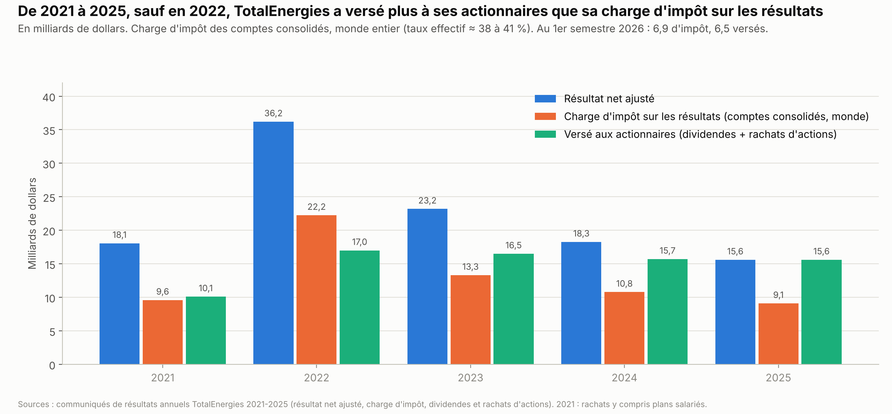
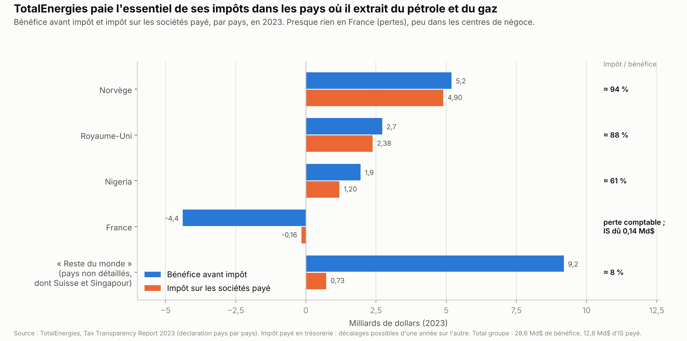

# Étude de cas : TotalEnergies, profits et impôts

*Version de travail du 11 octobre 2026. Annexe liée au chapitre [Finances publiques](finances_publiques.md), qui la résume en section 4.7. Les chiffres seront mis à jour à la date d'arrêt des données de l'édition 1.*

TotalEnergies est au cœur de trois débats : les « superprofits », les prix à la pompe et l'impôt payé par les multinationales. Cette étude de cas rassemble les chiffres sur ses profits et ses impôts. Les chiffres viennent d'abord des publications de l'entreprise (comptes annuels, rapport de transparence fiscale, déclaration pays par pays), puis de ses critiques, toujours citées comme telles.

**Voir aussi :** le chapitre [Énergie](../energie/energie_france_europe_allemagne.md), section 1.7, pour le poids de TotalEnergies dans le raffinage et les stations-service, et pour les prix à la pompe.

---

## L'essentiel

1. **Dans le monde, TotalEnergies paie beaucoup d'impôts sur ses résultats** : sa charge d'impôt est de 9 à 22 Md$ par an depuis 2021, à un taux effectif d'≈ 38 à 41 %. Les pays producteurs de pétrole et de gaz taxent fortement l'extraction.
2. **En France, il ne paie presque pas d'impôt sur les sociétés**, parce que ses bénéfices français sont nuls ou négatifs. Quatre règles légales l'expliquent (section 3). Aucun contentieux fiscal public significatif n'a été trouvé.
3. **Une part notable de ses profits est enregistrée dans des centres de négoce** (Suisse, Singapour), imposés à ≈ 15 % en 2024 mais à 4,4 % en 2022 : de l'ordre d'un quart certaines années, selon l'économiste Gabriel Zucman. L'entreprise conteste cette lecture.
4. **Les taxes sur les « superprofits » rapportent peu en France.** La contribution de 2022-2023 a rapporté moins de 100 M€, tous redevables confondus, faute de bénéfices français imposables.
5. **En 2021 puis de 2023 à 2025, le groupe a versé plus à ses actionnaires que sa charge d'impôt sur les résultats** dans le monde. Au 1er semestre 2026, c'est l'inverse : 6,9 Md$ d'impôt pour 6,5 Md$ versés.

---

## 1. Ce que pèse TotalEnergies en France

- **Pétrole** : la production française couvre ≈ 1 % des besoins du pays. TotalEnergies détient ≈ 50 % des capacités de raffinage[^cde-raffineries] et ≈ 3 000 stations-service[^te-france], soit ≈ 28 % des 10 764 stations du pays fin 2025[^ufip-stations-2025] (voir le chapitre [Énergie](../energie/energie_france_europe_allemagne.md)).
- **Électricité et gaz** : TotalEnergies revendique ≈ 5 millions de clients en gaz et en électricité en France[^te-france] et se présente comme le « premier fournisseur alternatif de gaz et d'électricité en France »[^te-fournisseur-alternatif].
- **Emploi** : ≈ 35 000 salariés en France selon l'entreprise[^te-france] (37 000 selon Gabriel Zucman[^zucman-2026]), soit environ un tiers de l'effectif mondial (101 513 personnes fin 2025[^te-deu-2025]).
- **Actionnaires** (fin 2024) : l'État n'est pas actionnaire. Les actionnaires sont nord-américains à 39,7 %, français à 25,3 % et britanniques à 11,6 %. Fin 2025, toutes nationalités confondues, les investisseurs institutionnels détiennent 74,0 % du capital, les actionnaires individuels 16,9 % et les salariés 9,2 %[^te-deu-2025]. Depuis le 8 décembre 2025, les actions ordinaires sont cotées directement à New York, à la place des certificats américains (ADR)[^te-cotation-new-york] ; le siège reste en France, à Courbevoie (La Défense).

---

## 2. Les profits, et l'impôt payé dans le monde

| Année | Chiffre d'affaires | Résultat net (normes comptables internationales) | Résultat net ajusté |
|---|---|---|---|
| 2019[^total-resultats-2019] | 200 | 11,3 | 11,8 |
| 2020[^te-resultats-2021] | 141 | −7,2 | 4,1 |
| 2021[^te-resultats-2021] | 206 | 16,0 | 18,1 |
| 2022[^te-resultats-2022] | 281 | 20,5 | **36,2** (record) |
| 2023[^te-resultats-2023] | 237 | 21,4 | 23,2 |
| 2024[^te-resultats-2025] | 215 | 15,8 | 18,3 |
| 2025[^te-resultats-2025] | 201 | 13,1 | 15,6 |
| 1er semestre 2026[^te-resultats-s1-2026] | 116 | 11,2 (+72 %) | 11,4 (+47 %) |

*En milliards de dollars.*

- **Le résultat ajusté** exclut les éléments exceptionnels. En 2022, l'écart de 15,7 Md$ vient surtout de 14,8 Md$ de baisses de valeur inscrites dans les comptes, liées à la Russie[^te-resultats-2022].
- **En 2026**, le choc d'Ormuz a fait remonter les profits : le baril de pétrole de référence (Brent) valait en moyenne 104 $ au 2e trimestre[^te-resultats-s1-2026].

**L'impôt sur les résultats dans le monde.**

| Année | Impôt sur les résultats (Md$) | Taux effectif du groupe | Taux effectif de l'extraction |
|---|---|---|---|
| 2021[^te-resultats-2021] | 9,6 | 37,9 % | 45,2 % |
| 2022[^te-resultats-2022] | 22,2 | 40,9 % | 50,8 % |
| 2023[^te-resultats-2023] | 13,3 | 37,5 % | 50,0 % |
| 2024[^te-resultats-2025] | 10,8 | 39,4 % | 47,8 % |
| 2025[^te-resultats-2025] | 9,1 | 39,8 % | 49,9 % |

*L'impôt sur les résultats est la charge d'impôt inscrite dans les comptes consolidés, impôts différés compris, et non l'impôt effectivement versé dans l'année. Le taux effectif est calculé par l'entreprise sur ses résultats ajustés : l'impôt divisé par le résultat avant impôt, hors sociétés mises en équivalence et dividendes reçus[^te-resultats-2025].*

- **Pourquoi ce taux est élevé** : les pays producteurs taxent fortement l'extraction. En Norvège, le taux marginal combiné est de 78 % : 22 % d'impôt sur les sociétés, plus une taxe spéciale de 71,8 % calculée sur une assiette dont l'impôt sur les sociétés est déduit[^norsk-petroleum]. Aux Émirats arabes unis, l'essentiel prend la forme de taxes sur la production : 8,4 Md$ d'impôts sur les bénéfices et sur la production en 2022[^te-ttr-2022-2023].
- **En comptant les redevances**, TotalEnergies dit avoir payé ≈ 100 Md$ depuis 2022 (≈ 25 Md$ par an), à un taux moyen de 43 %, dont 19 Md$ en 2025, à un taux de 40 %[^te-qr-fiscalite].
- **Sa « contribution fiscale totale »** compte aussi les taxes qu'il collecte pour les États, comme les accises sur les carburants : 57 Md$ en 2024, dont 27 Md$ d'impôts qu'il supporte lui-même[^te-ttr-2024-ttc].
- **Au niveau mondial**, les chiffres ne soutiennent donc pas l'idée que TotalEnergies serait « très peu taxé ». Le débat porte sur deux points précis : la France et les centres de négoce.

---

## 3. En France : un impôt sur les sociétés quasi nul

**Impôt sur les sociétés (IS) payé en France** (déclaration pays par pays de l'entreprise) :

| Année | Bénéfice avant impôt en France | IS payé | Remarque |
|---|---|---|---|
| 2019[^te-ttr-2019-2020] | +147 M$ | −139 M$ (remboursement) | acomptes de 2017 remboursés |
| 2020[^te-ttr-2019-2020] | −1 112 M$ | −256 M$ (remboursement) | déficit |
| 2021[^te-ttr-2021-2022] | −458 M$ | −190 M$ (remboursement) | IS dû : 11 M$ ; remboursement de crédits d'impôt recherche |
| 2022[^te-ttr-2022-2023] | −483 M$ | 19 M$ | IS dû : 122 M$ |
| 2023[^te-ttr-2023] | −4 379 M$ (perte comptable) | −162 M$ (trop-perçu remboursé) | IS dû : 139 M$ |
| 2024 | à reporter (rapport de transparence fiscale 2024) | ≈ 95 M$, « payé » selon l'Agence France-Presse | audition de Patrick Pouyanné, 17 juin 2026[^afp-pouyanne-audition] |
| 2025[^reuters-pouyanne-2025] | perte des activités françaises (≈ −300 M€) | 0 | selon Patrick Pouyanné (TF1, février 2026) |

- **Fréquence** : selon son président-directeur général (PDG), Patrick Pouyanné, le groupe a payé l'IS en France 6 fois depuis 2015[^afp-pouyanne-audition]. Une mission de l'Assemblée nationale (2022) comptait 7 années d'IS dû depuis 2007[^an-mission-flash-2022].
- **Ce que le groupe paie quand même en France** : 2,1 Md$ en 2024[^afp-pouyanne-audition] et « plus de 2 Md$ »[^te-qr-fiscalite] en 2025, tous impôts et cotisations confondus. La France est le 3e pays contributeur du groupe[^afp-pouyanne-audition]. Patrick Pouyanné présente aussi le groupe comme le premier contributeur à la taxe française sur les rachats d'actions, avec ≈ 180 M€[^reuters-pouyanne-2025].
- **La critique** (Gabriel Zucman[^zucman-2026]) : ce montant comprend surtout les cotisations sociales liées aux salariés et les taxes sur les dividendes versés aux actionnaires, pas d'impôt sur les bénéfices. L'Agence France-Presse précise que les 2,1 Md$ de 2024 sont versés « essentiellement au titre de charges patronales »[^afp-pouyanne-audition].

**Quatre règles, toutes légales, l'expliquent.**
1. **La territorialité** (article 209-I du Code général des impôts). L'IS français porte sur les bénéfices réalisés en France. Les profits de l'extraction à l'étranger sont taxés dans les pays producteurs, et les conventions fiscales entre pays évitent qu'ils le soient deux fois[^te-qr-fiscalite].
2. **Des activités françaises peu rentables.** TotalEnergies n'a pas d'activité d'extraction en France, et le raffinage et la chimie y sont « structurellement déficitaires »[^te-qr-fiscalite] selon l'entreprise : déficit cumulé de 5,5 Md€ fin 2025 pour sa filiale Raffinage-chimie France[^afp-pouyanne-audition]. Le bénéfice avant impôt en France a été négatif chaque année de 2020 à 2023[^te-ttr-2019-2020][^te-ttr-2021-2022][^te-ttr-2022-2023][^te-ttr-2023].
3. **Le report des déficits et l'intégration fiscale.** Les pertes passées s'imputent sur les bénéfices futurs, dans la limite d'1 M€ par an, plus 50 % de la part du bénéfice qui dépasse 1 M€[^sp-report-deficits]. Les filiales françaises sont imposées ensemble.
4. **Le régime « mère-fille ».** Les dividendes que la société mère reçoit de ses filiales, y compris étrangères, sont exonérés à 95 % (à 99 % entre sociétés d'un même groupe intégré).

**En bref.**
- Un fait établi : l'IS est très faible en France.
- Une cause légale : il découle des règles fiscales et de la géographie des profits, pas d'une fraude.
- Le débat politique : ces règles sont-elles justes pour un groupe dont un tiers des salariés est en France ?
- Devant le Sénat, en avril 2024, le ministre de l'Économie Bruno Le Maire a invoqué le secret fiscal et évoqué des raffineries « très lourdement déficitaires »[^senat-audition-le-maire].

---

## 4. Les pays à faible impôt : ce que montrent les chiffres

- **Transparence.** Depuis 2022, TotalEnergies publie volontairement un rapport de transparence fiscale. Sa déclaration pays par pays (le document où une multinationale publie ses bénéfices et ses impôts dans chaque pays) couvre ≈ 70 pays et plus de 90 % de l'IS. Une directive européenne (2021/2101) rend cette publication obligatoire à partir de l'exercice 2025 ; le premier rapport est attendu d'ici fin 2026[^te-qr-fiscalite].
- **Les paradis fiscaux « classiques »**, selon l'entreprise : 7 filiales consolidées fin 2025 (6 aux Bermudes, 1 aux Bahamas), surtout de très petites participations minoritaires[^te-qr-fiscalite]. Depuis 2012, 27 filiales ont été liquidées ou transférées en Europe depuis les Bermudes, les Bahamas, les îles Caïmans et les îles Vierges britanniques[^te-qr-fiscalite]. La dernière filiale aux îles Caïmans a été transférée en France en 2023[^te-ttr-2023].
- **Le point débattu : les centres de négoce.** Le groupe achète et revend du pétrole et du gaz par des filiales spécialisées. Chiffres de l'Observatoire des multinationales, tirés des comptes de ces filiales[^observatoire-negoce] :

  | Filiale | Activité | Bénéfice | Taux d'impôt effectif |
  |---|---|---|---|
  | TotalEnergies Oil Trading SA, dite « Totsa » (Genève) | pétrole | 2,3 Md€ en 2024 | — |
  | TotalEnergies Gas & Power (Royaume-Uni, équipes à Genève) | gaz et gaz liquéfié | 1,2 Md£ en 2024 | 16,6 % en 2024 (10 % en 2023) |
  | TotalEnergies Trading Asia (Singapour, filiale de Totsa) | négoce | 222 M$ en 2024 | 14,9 % en 2024 (5,3 % en 2022) |

- **La ligne « reste du monde »** de la déclaration pays par pays :
  - en 2023 : 9,2 Md$ de bénéfice pour 0,73 Md$ d'IS payé[^te-ttr-2023] ;
  - selon Gabriel Zucman, elle recouvre surtout la Suisse et Singapour : 5,9 Md$ en 2024 (≈ 25 % des profits), imposés à ≈ 15 % ; 11,6 Md$ en 2022, imposés à 4,4 %[^zucman-2026][^te-ttr-2022-2023].
- **La réponse de TotalEnergies.**
  - Cette ligne regroupe les pays que le rapport ne détaille pas, avec un taux effectif de 18 %, au-dessus du minimum mondial de 15 %, selon le PDG[^afp-pouyanne-audition] (17,8 % pour 2025, d'après la note de Gabriel Zucman[^zucman-2026]).
  - La Suisse (≈ 15 %) n'est pas un paradis fiscal : son taux dépasse ceux de l'Irlande ou de la Hongrie[^te-qr-fiscalite].
  - Plus de 90 % des échanges internes au groupe se font à des prix de marché publics, ce qui limite la manipulation des prix entre filiales[^te-qr-fiscalite].

**En bref.**
- Ce que confirment les chiffres : une part notable des profits, de l'ordre d'un quart certaines années, est enregistrée dans des centres de négoce, là où travaillent les équipes[^zucman-2026]. Cette part a été imposée à ≈ 15 % en 2024 et à 4,4 % en 2022[^zucman-2026].
- Ce qu'ils ne confirment pas : l'idée que la plupart des profits seraient transférés vers des paradis fiscaux.
- Un débat d'économistes : faudrait-il taxer ces profits ailleurs ? Gabriel Zucman propose de taxer les superprofits mondiaux en proportion des ventes dans chaque pays[^zucman-2026]. Cette idée est contestée au regard des conventions fiscales.

---

## 5. Les contributions sur les « superprofits »

- **Contribution européenne de solidarité (2022-2023).** Elle prélevait 33 % des bénéfices dépassant de plus de 20 % la moyenne 2018-2021[^ue-reglement-2022-1854].
  - Pour TotalEnergies, en 2022 : 1,7 Md$ de charges exceptionnelles, dont 0,7 Md$ de contribution européenne sur le raffinage. Ces charges couvrent la contribution européenne, l'effet du prélèvement britannique sur les impôts différés et la contribution française sur les rentes de la production d'électricité. S'y ajoute 1,0 Md$ de prélèvement britannique sur le résultat courant[^te-resultats-2022]. Pour 2023, le montant n'est pas publié à part[^te-resultats-2023]. Patrick Pouyanné parle de « plus de 2 milliards d'euros » payés en Europe et au Royaume-Uni en 2022[^usine-nouvelle-superprofits].
  - En France, la contribution temporaire de solidarité a rapporté moins de 100 M€[^afp-cts-2022] : ≈ 68,5 M€ sur les bénéfices de 2022, selon la proposition de loi écologiste de 2026[^an-ppl-2675]. Ce montant vaut pour tous les redevables, faute de bénéfices français imposables. La part de TotalEnergies n'est pas publiée.
- **Surtaxe d'IS sur les grandes entreprises** (2025-2026, reconduite à taux réduits dans le projet de budget 2027)[^legifiscal-surtaxe-plf2027]. TotalEnergies ne l'a pas payée au titre de 2025, puisqu'elle s'ajoute à un IS français nul.
- **Juillet 2022** : le 23 juillet, l'Assemblée rejette par 114 voix contre 96 des amendements de la gauche créant une taxe de 25 % sur les superprofits[^bloomberg-vote-2022][^orbitax-2022]. La gauche est alors réunie dans la Nouvelle Union populaire écologique et sociale (NUPES). La majorité présidentielle vote contre, à une exception près[^bloomberg-vote-2022].
- **2026, pendant le choc d'Ormuz** :

| Parti | Position |
|---|---|
| LFI | Prix des carburants bloqué à 1,70 € le litre ; plafonnement légal des marges[^publicsenat-melenchon-carburants] |
| Les Écologistes | Contribution de 66 % sur les surprofits des groupes pétroliers et gaziers (proposition de loi n° 2675 d'Eva Sas, 14 avril 2026)[^an-ppl-2675][^publicsenat-ppl-superprofits] ; taxe de 33 % sur le chiffre d'affaires supplémentaire réalisé en France en 2026 et 2027 par rapport à 2025, avec 2,8 Md€ attendus selon eux (contre-budget du 30 septembre 2026)[^afp-contre-budget-ecologistes] ; « action spécifique » de l'État au capital de TotalEnergies, qui lui permettrait de s'opposer à certains transferts de capital (Yannick Jadot, Sénat)[^senat-ppl-jadot] |
| PS | Taxe de 20, 30 ou 40 % sur les superprofits des entreprises de plus de 750 M€ de chiffre d'affaires (≈ 2 Md€ attendus)[^publicsenat-ppl-superprofits] |
| LR | Supprimer le dispositif des certificats d'économies d'énergie, ce qui ferait baisser les carburants de 15 à 17 centimes le litre selon eux (Bruno Retailleau et David Lisnard)[^afp-cee] |
| RN | Baisse de la TVA sur les carburants (Marine Le Pen)[^publicsenat-melenchon-carburants] ; annulation du décret sur la 6e période des certificats d'économies d'énergie, qualifié de « décret de la honte » (Jordan Bardella)[^afp-cee]. Marine Le Pen est favorable à une taxation exceptionnelle ; pour Jordan Bardella, ce n'est pas la priorité *(paraphrase de la presse)*[^publicsenat-ppl-superprofits] |
| *Autres* : PCF | Que TotalEnergies baisse ses prix, « soit on nationalise » (Fabien Roussel)[^franceinfo-roussel] |
| Gouvernement (Sébastien Lecornu) | Réserves sur l'assiette, le rendement et le fonctionnement d'une taxe *(paraphrase de la presse)*[^publicsenat-ppl-superprofits] ; aides ciblées (1,18 Md€ au total au 21 mai 2026[^euronews-aides-carburants], puis un plan de 450 M€ le 22 septembre[^publicsenat-melenchon-carburants]) ; refus de « toute baisse générale indiscriminée de la fiscalité sur le carburant »[^euronews-aides-carburants] ; plaide auprès de TotalEnergies pour un « plafonnement généreux » de ses prix[^afp-lecornu-plafonnement] |

*Partis dans l'ordre où leurs groupes siègent à l'Assemblée, de gauche à droite, puis les autres partis et le gouvernement. Renaissance, Horizons et Reconquête n'apparaissent pas : aucune position de leur part sur une taxe visant les pétroliers n'a été trouvée.*

Au 11 octobre 2026, aucune taxe spécifique sur les superprofits n'a été adoptée. **Une limite de fond** : une taxe sur les bénéfices réalisés en France rapporterait peu, puisqu'ils sont faibles ; une taxe sur les bénéfices mondiaux se heurterait aux conventions fiscales.

---

## 6. Ce que TotalEnergies verse à ses actionnaires

| Année | Dividendes | Rachats d'actions | Total versé | Charge d'impôt sur les résultats |
|---|---|---|---|---|
| 2021[^te-resultats-2021] | 8,2 | 1,8 | ≈ 10,1 | 9,6 |
| 2022[^te-resultats-2022] | 10,0 | 7,0 | ≈ 17,0 | 22,2 |
| 2023[^te-resultats-2023] | 7,5 | 9,0 | 16,5 | 13,3 |
| 2024[^te-resultats-2025] | 7,7 | 8,0 | 15,7 | 10,8 |
| 2025[^te-resultats-2025] | 8,1 | 7,5 | 15,6 | 9,1 |

*En milliards de dollars. Le rachat d'actions consiste, pour une entreprise, à racheter ses propres actions, ce qui augmente la part de chaque actionnaire restant.* En 2021 puis de 2023 à 2025, le groupe a versé plus à ses actionnaires, nord-américains à ≈ 40 %[^te-actionnariat], que sa charge d'impôt sur les résultats dans le monde. C'était l'inverse en 2022, année record, et au 1er semestre 2026 : 6,9 Md$ d'impôt pour 6,5 Md$ versés (4,2 Md$ de dividendes et 2,2 Md$ de rachats)[^te-resultats-s1-2026]. Autre mesure possible : l'impôt sur les sociétés effectivement versé dans l'année, publié dans les déclarations pays par pays. Il atteint 4,3 Md$ en 2021, 14,5 Md$ en 2022, 12,8 Md$ en 2023 et 10,6 Md$ en 2024[^te-ttr-2021-2022][^te-ttr-2022-2023][^te-ttr-2023][^te-ttr-2024]. Avec cette mesure, les versements aux actionnaires sont plus élevés chaque année de 2021 à 2024.

---

## 7. Stratégie

- **Investissements nets** : 17,1 Md$ en 2025, dont ≈ 3,5 Md$ (≈ 20 %) dans les énergies bas-carbone, contre 4,8 Md$ (27 %) en 2024[^te-resultats-2025][^te-resultats-2024]. Environ 15 Md$ sont prévus en 2026[^te-deu-2025], dont ≈ 3 Md$ pour les énergies bas-carbone[^te-resultats-2025].
- **Production de pétrole et de gaz** : +4 % en 2025, avec un objectif d'environ 3 % par an sur les cinq prochaines années[^te-deu-2025]. Pour l'ensemble de sa production d'énergie (pétrole, gaz et électricité), l'objectif est de 4 % par an entre 2024 et 2030[^te-deu-2025].
- **Électricité** : objectif de 100 à 120 TWh produits en 2030[^te-deu-2025].
- **Commission d'enquête du Sénat** (juin 2024, présidée par Roger Karoutchi, rapporteur Yannick Jadot, 33 recommandations)[^senat-ce-totalenergies-2024] :
  - « la possibilité d'un changement de nationalité du groupe à moyen ou long terme ne peut plus être exclue »[^senat-ce-totalenergies-2024] si les tendances actuelles de l'actionnariat se poursuivent ;
  - ses efforts de transition sont jugés « supérieurs à ceux effectués par les autres “majors” des hydrocarbures »[^senat-ce-totalenergies-2024], notamment anglo-saxonnes ;
  - elle recommande une « action spécifique »[^senat-ce-totalenergies-2024] de l'État au capital.

---

## 8. Pour débattre

| Affirmation (qui l'avance) | Verdict | Ce que disent les données |
|---|---|---|
| « Total ne paie pas d'impôts » (idée répandue, sans auteur identifié) | **À nuancer** | Au niveau mondial, la charge d'impôt du groupe sur ses résultats est de 9 à 22 Md$ par an, à un taux effectif d'≈ 40 %, très élevé dans les pays producteurs[^te-resultats-2022][^te-resultats-2025]. En France, l'impôt sur les sociétés est quasi nul, parce que les bénéfices français sont négatifs ou faibles[^afp-pouyanne-audition]. Une part des profits (≈ 1/4 certaines années) est enregistrée dans des centres de négoce, imposée à ≈ 15 % en 2024 et à 4,4 % en 2022[^zucman-2026]. |
| « Total ne paie pas d'impôt sur les sociétés en France » (l'économiste Gabriel Zucman, titre d'une note du 30 juillet 2026)[^zucman-2026] | **Plutôt vrai** | Le groupe a payé l'impôt sur les sociétés en France 6 fois depuis 2015, selon son PDG[^afp-pouyanne-audition] ; les montants récents vont d'un remboursement à ≈ 95 M$ par an (section 3). La raison : ses bénéfices français sont négatifs ou faibles, selon des règles légales. Le groupe verse en revanche ≈ 2 Md$ par an en France en autres impôts et cotisations[^afp-pouyanne-audition][^te-qr-fiscalite]. |
| « Taxer les superprofits des pétroliers en France rapporterait des milliards » (idée répandue, sans auteur identifié ; la taxe du PS, qui vise toutes les grandes entreprises, est traitée dans le chapitre Énergie, section 5) | **Plutôt faux** | Une taxe sur les bénéfices français rapporterait peu : la contribution de solidarité a rapporté moins de 100 M€, tous redevables confondus. Viser les profits mondiaux se heurte aux conventions fiscales. Début 2026, selon l'association de consommateurs Consommation, logement et cadre de vie (CLCV), la marge de raffinage du gazole a presque triplé (36,4 centimes le litre au 3 avril, contre 13,2 en moyenne en 2025), ce qui contribue à maintenir des prix élevés à la pompe[^clcv-marges]. Les écologistes proposent désormais de taxer le chiffre d'affaires supplémentaire plutôt que les bénéfices, avec 2,8 Md€ attendus selon eux, un montant qui n'a pas été évalué de façon indépendante[^afp-contre-budget-ecologistes]. |
| « Total échappe à l'impôt grâce aux paradis fiscaux » (idée répandue, sans auteur identifié) | **Plutôt faux** | L'entreprise compte 7 filiales consolidées aux Bermudes et aux Bahamas fin 2025, et en a liquidé ou transféré 27 depuis 2012 hors des territoires considérés comme des paradis fiscaux[^te-qr-fiscalite]. Le débat porte plutôt sur les centres de négoce en Suisse et à Singapour, imposés à ≈ 15 % en 2024[^zucman-2026], ce qui est légal. |
| « Total paie déjà beaucoup d'impôts en France » (position défendue par TotalEnergies, questions-réponses sur sa fiscalité, 17 juin 2026)[^te-qr-fiscalite] | **À nuancer** | Le groupe verse ≈ 2 Md$ par an en France, tous impôts et cotisations confondus[^afp-pouyanne-audition][^te-qr-fiscalite]. Mais il s'agit surtout de cotisations patronales[^afp-pouyanne-audition] et, selon Gabriel Zucman, de taxes sur les dividendes[^zucman-2026] ; l'impôt sur les bénéfices est quasi nul. |

---

## 9. Points incertains

- L'impôt sur les sociétés en France pour 2024 : ≈ 95 M$, « payé » selon l'Agence France-Presse. Le rapport de transparence fiscale 2024 est publié (rapport des commissaires aux comptes du 24 mars 2026), mais sa ligne France reste à reporter. Pour 2025 : déclarations du PDG ; la déclaration pays par pays obligatoire est attendue d'ici fin 2026.
- Le rendement de la contribution temporaire de solidarité varie selon les sources. Le programme de stabilité, cité par l'Agence France-Presse, indique « à peine 100 millions d'euros ». La proposition de loi écologiste de 2026 retient ≈ 68,5 M€ sur les bénéfices de 2022. Une analyse du cabinet Deloitte, fondée sur le « budget vert » 2025, donne ≈ 61 M€ en 2023.
- La part de TotalEnergies dans la contribution de solidarité française : non publiée.
- La citation de Fabien Roussel (PCF) sur la nationalisation et sa date : la page de franceinfo citée n'a pas pu être relue.
- Les chiffres des filiales de négoce et de la ligne « reste du monde » viennent d'analyses de l'Observatoire des multinationales et de Gabriel Zucman, contestées par l'entreprise.

---

## Sources

- Résultats : [T4 2021](https://www.businesswire.com/news/home/20220209006272/en/TotalEnergies-SE-UK-Regulatory-Announcement-TotalEnergies-Fourth-Quarter-and-Full-year-2021-Results) · [T4 2022](https://www.businesswire.com/news/home/20230208005411/en/TotalEnergies-SE-UK-Regulatory-Announcement-TotalEnergies-Fourth-Quarter-and-Full-year-2022-Results) · [T4 2023](https://www.businesswire.com/news/home/20240206849440/en/TotalEnergies-SE-Fourth-Quarter-and-Full-Year-2023-Results) · [T4 2025](https://www.businesswire.com/news/home/20260210719011/en/TotalEnergies-SE-Fourth-Quarter-and-Full-Year-2025-Results) · [S1 2026](https://totalenergies.com/system/files/documents/totalenergies_cp-resultats-2t26_2026_fr.pdf) · [Document d'enregistrement universel 2025](https://totalenergies.com/system/files/documents/totalenergies_document-enregistrement-universel-2025_2026_fr.pdf)
- Fiscalité, sources de l'entreprise : [rapports de transparence fiscale 2019-2020](https://totalenergies.com/sites/g/files/nytnzq121/files/documents/2022-03/TTR_2019_2020_inter_BD.pdf) · [2021-2022](https://totalenergies.com/sites/g/files/nytnzq121/files/documents/2023-05/TotalEnergies_Tax_transparency_report_2021-2022.pdf) · [2022-2023](https://totalenergies.com/sites/g/files/nytnzq121/files/documents/2024-07/totalenergies_tax-transparency-report-2022-2023_2024_en_pdf.pdf) · [2023](https://totalenergies.com/sites/g/files/nytnzq121/files/documents/totalenergies_tax-transparency-report-2023_2025_en_pdf.pdf) · [2024, section 3](https://totalenergies.com/sites/g/files/nytnzq121/files/documents/totalenergies_tax-transparency-report-2024-statutory-auditors-report-section-3_2026_en.pdf) · [2024, section 4](https://totalenergies.com/sites/g/files/nytnzq121/files/documents/totalenergies_tax-transparency-report-2024-statutory-auditors-report-section-4_2026_en.pdf) · [rapport de transparence fiscale 2024 complet](https://totalenergies.com/sites/g/files/nytnzq121/files/documents/totalenergies_tax-transparency-report-2024_2026_en.pdf) · [Q&R sur la fiscalité, 17/06/2026](https://totalenergies.com/newsroom/qa-pour-tout-savoir-sur-la-fiscalite-de-totalenergies-478148/?lang=eng) · [Actionnariat](https://journal-des-actionnaires.totalenergies.com/77-en/doc/article/17/) · [Cotation à New York](https://www.businesswire.com/news/home/20251207557298/en)
- Fiscalité, analyses : [AFP, audition de P. Pouyanné, 17/06/2026](https://www.connaissancedesenergies.org/afp/pourquoi-totalenergies-echappe-quasiment-a-limpot-sur-les-benefices-en-france-260617) · [Assemblée nationale, mission flash 2022](https://www.assemblee-nationale.fr/dyn/16/documents/mifpetrole/l16n110230759_document) · [Sénat, audition de B. Le Maire](https://www.senat.fr/compte-rendu-commissions/20240401/ce_totalenergies.html) · [Sénat, rapport de la commission d'enquête 2024](https://www.senat.fr/rap/r23-692-1/r23-692-1-syn.pdf) · [Observatoire des multinationales, négoce](https://multinationales.org/fr/enquetes/de-l-ukraine-a-l-iran-petrole-et-profits-de-guerre/les-activites-de-trading-une-part-considerable-des-profits-de-totalenergies) · [G. Zucman, « Pourquoi Total ne paie pas d'impôt sur les sociétés en France », 30/07/2026](https://gabrielzucman.substack.com/p/pourquoi-total-ne-paie-pas-dimpot) · [Norsk Petroleum, fiscalité pétrolière](https://www.norskpetroleum.no/en/economy/petroleum-tax/)
- Superprofits : [L'Usine Nouvelle](https://www.usinenouvelle.com/article/totalenergies-a-paye-plus-de-2-milliards-d-euros-de-contribution-sur-les-superprofits-en-europe-selon-son-pdg.N2094941) · [Public Sénat, propositions de loi 2026](https://www.publicsenat.fr/actualites/politique/benefices-de-totalenergies-les-propositions-de-loi-fleurissent-pour-taxer-les-superprofits-de-lindustrie-petro-gaziere) · [LégiFiscal, PLF 2027](https://www.legifiscal.fr/actualites-fiscales/4660-plf-2027-prorogation-contribution-exceptionnelle-benefices-grandes-entreprises-taux-bas.html) · [Sénat, proposition de loi Jadot](https://www.senat.fr/leg/exposes-des-motifs/ppl25-658-expose.html) · [franceinfo, F. Roussel](https://www.franceinfo.fr/economie/automobile/essence/prix-des-carburants-fabien-roussel-propose-de-nationaliser-totalenergies-si-le-groupe-ne-s-execute-pas-a-baisser-ses-marges_7908467.html) · [Public Sénat, J.-L. Mélenchon et les carburants](https://www.publicsenat.fr/actualites/politique/jean-luc-melenchon-denonce-un-gouvernement-depasse-face-a-la-flambee-des-prix-des-carburants) *(sources secondaires)*

[^cde-raffineries]: Connaissance des Énergies, [nombre et localisation des raffineries en France](https://www.connaissancedesenergies.org/questions-et-reponses-energies/petrole-combien-y-t-il-de-raffineries-en-france-et-ou-sont-elles-situees), mis à jour le 25 septembre 2025 *(source secondaire)*.
[^te-france]: TotalEnergies, [TotalEnergies en France métropolitaine](https://totalenergies.com/fr/france), page consultée le 11 octobre 2026.
[^ufip-stations-2025]: UFIP Énergies et Mobilités (organisation professionnelle du secteur), [étude sur le réseau des stations-service](https://www.energiesetmobilites.fr/uploads/pdf/Etude_réseau_-2025-finale.pdf), 2025.
[^te-fournisseur-alternatif]: TotalEnergies, [fournisseur d'énergie en Occitanie et Nouvelle-Aquitaine](https://www.totalenergies.fr/particuliers/electricite-et-gaz/l-electricite-et-le-gaz-avec-totalenergies/totalenergies-en-regions/fournisseur-d-energie-en-midi-pyrenees-et-aquitaine), date non précisée.
[^zucman-2026]: Gabriel Zucman (économiste), [« Pourquoi Total ne paie pas d'impôt sur les sociétés en France »](https://gabrielzucman.substack.com/p/pourquoi-total-ne-paie-pas-dimpot), 30 juillet 2026.
[^te-deu-2025]: TotalEnergies, [document d'enregistrement universel 2025](https://totalenergies.com/system/files/documents/totalenergies_document-enregistrement-universel-2025_2026_fr.pdf), 2026.
[^te-cotation-new-york]: TotalEnergies, [communiqué sur la cotation de ses actions à la Bourse de New York (Business Wire, en anglais)](https://www.businesswire.com/news/home/20251207557298/en), 8 décembre 2025.
[^total-resultats-2019]: TOTAL S.A., [« Operating and Financial Review and Prospects », quatrième trimestre et année 2019, formulaire 6-K déposé auprès de l'autorité boursière américaine (en anglais)](https://www.sec.gov/Archives/edgar/data/879764/000119312520026493/d880222dex991.htm), février 2020.
[^te-resultats-2021]: TotalEnergies, [résultats du quatrième trimestre et de l'année 2021 (Business Wire, en anglais)](https://www.businesswire.com/news/home/20220209006272/en/TotalEnergies-SE-UK-Regulatory-Announcement-TotalEnergies-Fourth-Quarter-and-Full-year-2021-Results), 9 février 2022.
[^te-resultats-2022]: TotalEnergies, [résultats du quatrième trimestre et de l'année 2022 (Business Wire, en anglais)](https://www.businesswire.com/news/home/20230208005411/en/TotalEnergies-SE-UK-Regulatory-Announcement-TotalEnergies-Fourth-Quarter-and-Full-year-2022-Results), 8 février 2023.
[^te-resultats-2023]: TotalEnergies, [résultats du quatrième trimestre et de l'année 2023 (Business Wire, en anglais)](https://www.businesswire.com/news/home/20240206849440/en/TotalEnergies-SE-Fourth-Quarter-and-Full-Year-2023-Results), 6 février 2024.
[^te-resultats-2025]: TotalEnergies, [résultats du quatrième trimestre et de l'année 2025 (Business Wire, en anglais)](https://www.businesswire.com/news/home/20260210719011/en/TotalEnergies-SE-Fourth-Quarter-and-Full-Year-2025-Results), 10 février 2026.
[^te-resultats-s1-2026]: TotalEnergies, [communiqué de résultats du deuxième trimestre et du premier semestre 2026](https://totalenergies.com/system/files/documents/totalenergies_cp-resultats-2t26_2026_fr.pdf) (chiffre d'affaires et impôts : [version anglaise](https://totalenergies.com/system/files/documents/totalenergies_pr-results-2q26_2026_en.pdf)), 23 juillet 2026.
[^norsk-petroleum]: Norsk Petroleum (site d'information du gouvernement norvégien), [fiscalité pétrolière (en anglais)](https://www.norskpetroleum.no/en/economy/petroleum-tax/), date non précisée.
[^te-ttr-2022-2023]: TotalEnergies, [rapport de transparence fiscale 2022-2023 (en anglais)](https://totalenergies.com/sites/g/files/nytnzq121/files/documents/2024-07/totalenergies_tax-transparency-report-2022-2023_2024_en_pdf.pdf), 2024.
[^te-qr-fiscalite]: TotalEnergies, [questions-réponses sur sa fiscalité](https://totalenergies.com/newsroom/qa-pour-tout-savoir-sur-la-fiscalite-de-totalenergies-478148/?lang=eng), 17 juin 2026, mis à jour le 29 septembre 2026.
[^te-ttr-2024-ttc]: TotalEnergies, [rapport de transparence fiscale 2024, section 3 (contribution fiscale totale) et rapport des commissaires aux comptes (en anglais)](https://totalenergies.com/sites/g/files/nytnzq121/files/documents/totalenergies_tax-transparency-report-2024-statutory-auditors-report-section-3_2026_en.pdf), 24 mars 2026.
[^te-ttr-2019-2020]: TotalEnergies, [rapport de transparence fiscale 2019-2020](https://totalenergies.com/sites/g/files/nytnzq121/files/documents/2022-03/TTR_2019_2020_inter_BD.pdf), 2022.
[^te-ttr-2021-2022]: TotalEnergies, [rapport de transparence fiscale 2021-2022, avec la déclaration pays par pays 2021 (en anglais)](https://totalenergies.com/sites/g/files/nytnzq121/files/documents/2023-05/TotalEnergies_Tax_transparency_report_2021-2022.pdf), 2023.
[^te-ttr-2023]: TotalEnergies, [rapport de transparence fiscale 2023, avec la déclaration pays par pays (en anglais)](https://totalenergies.com/sites/g/files/nytnzq121/files/documents/totalenergies_tax-transparency-report-2023_2025_en_pdf.pdf), 2025.
[^afp-pouyanne-audition]: AFP, via Connaissance des Énergies, [audition de Patrick Pouyanné par la commission des finances de l'Assemblée nationale](https://www.connaissancedesenergies.org/afp/pourquoi-totalenergies-echappe-quasiment-a-limpot-sur-les-benefices-en-france-260617), 17 juin 2026 *(source secondaire)*.
[^reuters-pouyanne-2025]: Reuters, via SweetCrude Reports, [TotalEnergies n'a pas payé d'impôt en France en 2025 en raison de pertes dans le raffinage (en anglais)](https://sweetcrudereports.com/totalenergies-didnt-pay-french-tax-last-year-due-to-loss-on-refining-business/), 15 février 2026 *(source secondaire)*.
[^an-mission-flash-2022]: Assemblée nationale, [communication de David Amiel et Manuel Bompard sur les profits exceptionnels des entreprises pétrolières, gazières et du transport maritime](https://www.assemblee-nationale.fr/dyn/16/documents/mifpetrole/l16n110230759_document), 4 octobre 2022.
[^sp-report-deficits]: Service-Public (Direction de l'information légale et administrative), via justice.fr, [impôt sur les sociétés : report de déficit](https://www.justice.fr/fiche/impot-societes-is-report-deficit), mis à jour le 20 février 2026.
[^senat-audition-le-maire]: Sénat, commission d'enquête sur TotalEnergies, [compte rendu de l'audition de Bruno Le Maire](https://www.senat.fr/compte-rendu-commissions/20240401/ce_totalenergies.html), 4 avril 2024.
[^observatoire-negoce]: Observatoire des multinationales, O. Petitjean, [le négoce, une part considérable des profits de TotalEnergies](https://multinationales.org/fr/enquetes/de-l-ukraine-a-l-iran-petrole-et-profits-de-guerre/les-activites-de-trading-une-part-considerable-des-profits-de-totalenergies), 21 mai 2026.
[^ue-reglement-2022-1854]: Conseil de l'UE, [règlement (UE) 2022/1854 sur une intervention d'urgence pour faire face aux prix élevés de l'énergie](https://eur-lex.europa.eu/legal-content/FR/TXT/HTML/?uri=CELEX:32022R1854), 6 octobre 2022.
[^usine-nouvelle-superprofits]: L'Usine Nouvelle, [contribution de TotalEnergies sur les superprofits en Europe, selon son PDG](https://www.usinenouvelle.com/article/totalenergies-a-paye-plus-de-2-milliards-d-euros-de-contribution-sur-les-superprofits-en-europe-selon-son-pdg.N2094941), 28 janvier 2023 *(source secondaire)*.
[^afp-cts-2022]: AFP, via Connaissance des Énergies, [raffineurs de pétrole, producteurs d'électricité : taxer les rentes, un rendement faible pour l'instant](https://www.connaissancedesenergies.org/afp/raffineurs-de-petrole-producteurs-delectricite-taxer-les-rentes-un-slogan-faible-rendement-pour-linstant-240419), 19 avril 2024 *(source secondaire)*.
[^an-ppl-2675]: Assemblée nationale, [proposition de loi n° 2675 portant création d'une contribution exceptionnelle de solidarité sur les superprofits des entreprises pétro-gazières](https://www.assemblee-nationale.fr/dyn/opendata/PIONANR5L17B2675.html), 14 avril 2026.
[^legifiscal-surtaxe-plf2027]: Légifiscal, [prorogation de la contribution exceptionnelle sur les bénéfices des grandes entreprises dans le projet de budget 2027](https://www.legifiscal.fr/actualites-fiscales/4660-plf-2027-prorogation-contribution-exceptionnelle-benefices-grandes-entreprises-taux-bas.html), 1er octobre 2026 *(source secondaire)*.
[^bloomberg-vote-2022]: Bloomberg Tax, [les députés français rejettent de peu une taxe sur les superprofits (en anglais)](https://news.bloombergtax.com/daily-tax-report-international/french-lawmakers-reject-windfall-tax-profit-in-close-vote), 23 juillet 2022 *(source secondaire)*.
[^orbitax-2022]: Orbitax, [rejet par l'Assemblée nationale de la taxe sur les superprofits (en anglais)](https://wpqa.orbitax.com/news/country/article/French-National-Assembly-Rejec-50447), juillet 2022 *(source secondaire)*.
[^publicsenat-melenchon-carburants]: Public Sénat, [Jean-Luc Mélenchon et la flambée des prix des carburants](https://www.publicsenat.fr/actualites/politique/jean-luc-melenchon-denonce-un-gouvernement-depasse-face-a-la-flambee-des-prix-des-carburants), 23 septembre 2026 *(source secondaire)*.
[^publicsenat-ppl-superprofits]: Public Sénat, H. Clavier, [« Bénéfices de TotalEnergies : les propositions de loi fleurissent pour taxer les superprofits de l'industrie pétro-gazière »](https://www.publicsenat.fr/actualites/politique/benefices-de-totalenergies-les-propositions-de-loi-fleurissent-pour-taxer-les-superprofits-de-lindustrie-petro-gaziere), 30 avril 2026 *(source secondaire)*.
[^afp-contre-budget-ecologistes]: AFP, via Connaissance des Énergies, [budget : les écologistes veulent taxer les superprofits des entreprises pétro-gazières](https://www.connaissancedesenergies.org/afp/budget-les-ecologistes-veulent-taxer-les-superprofits-des-entreprises-petro-gazieres-260930), 30 septembre 2026 *(source secondaire)*.
[^senat-ppl-jadot]: Sénat, [exposé des motifs de la proposition de loi de Yannick Jadot, n° 658 (2025-2026)](https://www.senat.fr/leg/exposes-des-motifs/ppl25-658-expose.html), déposée le 26 mai 2026.
[^afp-cee]: AFP, via Connaissance des Énergies, [à quoi servent les certificats d'économies d'énergie](https://www.connaissancedesenergies.org/afp/prix-du-carburant-a-quoi-servent-les-certificats-denergie-260923), 23 septembre 2026 *(source secondaire)*.
[^franceinfo-roussel]: franceinfo, [Fabien Roussel propose de nationaliser TotalEnergies si le groupe ne baisse pas ses marges](https://www.franceinfo.fr/economie/automobile/essence/prix-des-carburants-fabien-roussel-propose-de-nationaliser-totalenergies-si-le-groupe-ne-s-execute-pas-a-baisser-ses-marges_7908467.html), date non précisée *(source secondaire)*.
[^euronews-aides-carburants]: Euronews, [carburants : le gouvernement annonce 710 millions d'aides supplémentaires](https://fr.euronews.com/my-europe/2026/05/21/carburants-le-gouvernement-annonce-710-millions-daides-supplementaires), 21 mai 2026 *(source secondaire)*.
[^afp-lecornu-plafonnement]: AFP, via Connaissance des Énergies, [Lecornu encourage TotalEnergies à un plafonnement généreux des prix à la pompe](https://www.connaissancedesenergies.org/afp/lecornu-encourage-totalenergies-un-plafonnement-genereux-des-prix-la-pompe-260502), 2 mai 2026 *(source secondaire)*.
[^te-actionnariat]: TotalEnergies, [*Journal des actionnaires*, structure de l'actionnariat (en anglais)](https://journal-des-actionnaires.totalenergies.com/77-en/doc/article/17/), données à fin 2024.
[^te-ttr-2024]: TotalEnergies, [rapport de transparence fiscale 2024, section 4 (déclaration pays par pays) et rapport des commissaires aux comptes (en anglais)](https://totalenergies.com/sites/g/files/nytnzq121/files/documents/totalenergies_tax-transparency-report-2024-statutory-auditors-report-section-4_2026_en.pdf), 24 mars 2026.
[^te-resultats-2024]: TotalEnergies, [résultats du quatrième trimestre et de l'année 2024 (Business Wire, en anglais)](https://www.businesswire.com/news/home/20250204066463/en/TotalEnergies-SE-Fourth-Quarter-and-Full-Year-2024-Results), février 2025.
[^senat-ce-totalenergies-2024]: Sénat, commission d'enquête sur TotalEnergies, R. Karoutchi (président) et Y. Jadot (rapporteur), [synthèse du rapport n° 692 (2023-2024)](https://www.senat.fr/rap/r23-692-1/r23-692-1-syn.pdf), 12 juin 2024.
[^clcv-marges]: CLCV (association de consommateurs), [hausse des prix des carburants : les raffineurs sont les grands gagnants](https://www.clcv.org/articles/hausse-des-prix-des-carburants-les-raffineurs-sont-les-grands-gagnants), 9 avril 2026, mis à jour le 21 avril 2026.
