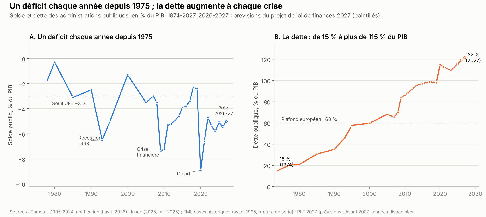
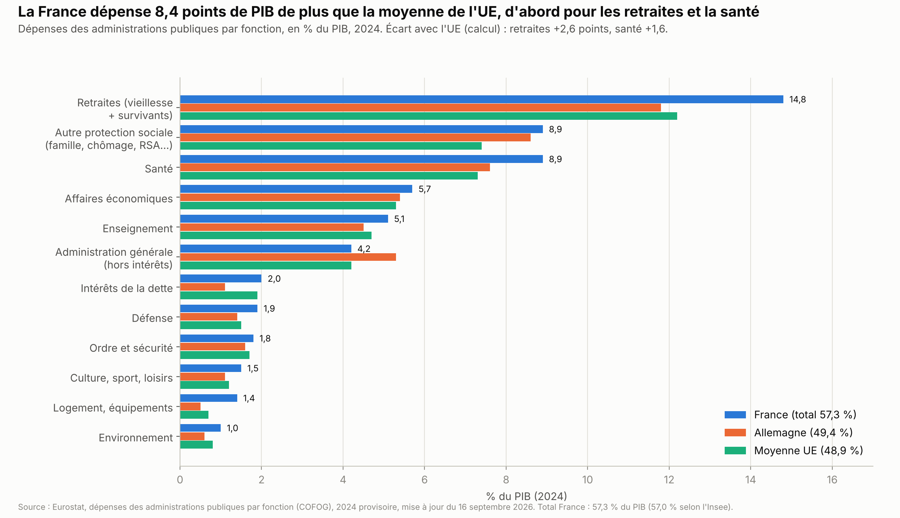
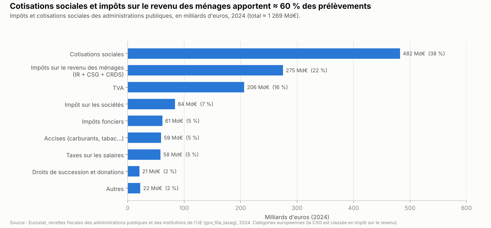
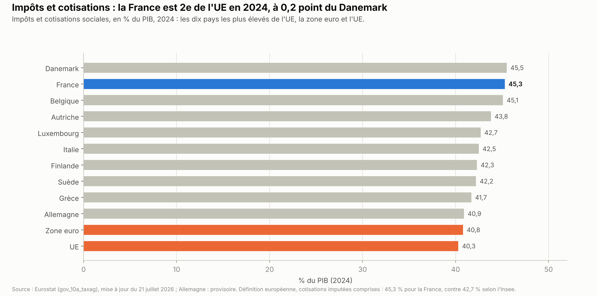
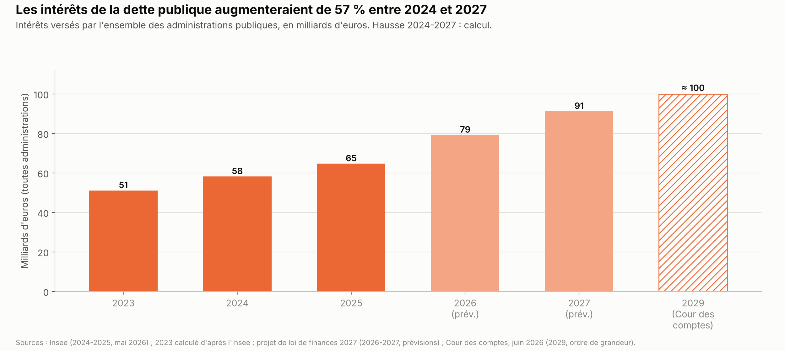

# Finances publiques : dépenses, recettes, déficit, dette

*Version de travail du 7 octobre 2026. Les chiffres seront mis à jour à la date d'arrêt des données de l'édition 1.*

Ce chapitre explique où va l'argent public, d'où il vient, pourquoi la France est en déficit depuis 1975 et ce que coûte sa dette. Il présente le budget 2027 en discussion, les propositions des partis et ce que disent les évaluations des grandes décisions passées.

**Voir aussi :**
- l'annexe [Étude de cas : TotalEnergies, profits et impôts](encadre_totalenergies.md), sur l'impôt payé par une multinationale et les taxes sur les « superprofits » ;
- [Retraites et productivité](../retraites-productivite/retraites_productivite.md), pour le système de retraite, son déficit et l'âge de départ ;
- [Santé et assurance maladie](../sante/sante_assurance_maladie.md), pour le déficit de l'assurance maladie et les dépenses de santé ;
- [Pouvoir d'achat, salaires et inégalités](../pouvoir-achat/pouvoir_achat.md), pour la redistribution et l'imposition des plus aisés ;
- [Travail et emploi](../travail-emploi/travail_emploi.md), pour l'assurance chômage, les baisses de cotisations, l'apprentissage et le budget de l'emploi ;
- [Éducation](../education/remuneration_enseignants.md), pour le salaire des enseignants et le budget de l'école ;
- [Énergie](../energie/energie_france_europe_allemagne.md), pour le coût des aides à l'énergie et la TVA sur l'électricité ;
- [Logement](../logement/logement.md), pour les aides personnalisées au logement et la taxe foncière ;
- [Défense et Europe](../defense-europe/defense_europe.md), sections 1.1 et 1.8, pour le budget des armées et la contribution de la France au budget de l'UE ;
- [Sécurité et justice](../securite-justice/securite_justice.md), pour le budget de la justice, de la police et des prisons ;
- [Présidentielle 2027 : ce que proposent les partis](../partis/programmes_partis_2027.md), pour les programmes complets.

> **Repères.**
> - **Les administrations publiques** regroupent l'État et les organismes qui lui sont rattachés, les collectivités locales (communes, départements, régions) et la Sécurité sociale au sens large : retraites de base et complémentaires, assurance maladie, hôpitaux, assurance chômage[^an-placss-2024].
> - **Le déficit public** est l'écart, sur une année, entre leurs dépenses et leurs recettes. **La dette publique** est le total de ce qu'elles doivent. Les deux sont mesurés selon des règles européennes, dites « au sens de Maastricht ».
> - **Les prélèvements obligatoires** sont l'ensemble des impôts et des cotisations sociales obligatoires.
> - **Un point de PIB** représente ≈ 30 Md€ en 2025 *(calcul)*.
> - **Les lois de budget.** Chaque automne, le gouvernement présente le projet de loi de finances (PLF), pour l'État, et le projet de loi de financement de la Sécurité sociale (PLFSS). Le Parlement les vote avant la fin de l'année.
> - **Les acteurs.**
>   - L'Institut national de la statistique et des études économiques (Insee) établit les comptes publics.
>   - La Cour des comptes contrôle l'usage de l'argent public.
>   - Le Haut Conseil des finances publiques (HCFP), placé auprès de la Cour, juge le réalisme des prévisions du gouvernement.
>   - L'Agence France Trésor emprunte pour l'État.
>   - La Commission européenne surveille le respect des règles budgétaires de l'UE.
> - **Les impôts de production** sont payés par les entreprises quel que soit leur bénéfice, par exemple sur leur valeur ajoutée ou sur leurs locaux.

---

## L'essentiel

1. **Un déficit chaque année depuis 1975.** Le déficit public a atteint 5,1 % du PIB en 2025, soit 152,5 Md€. Le gouvernement prévoit 5,4 % en 2026 et vise 5,0 % en 2027. Dans l'UE, trois pays avaient un déficit plus élevé en 2025 : la Roumanie, la Pologne et la Belgique.
2. **Une dette de 115,7 % du PIB fin 2025**, soit 3 460,5 Md€, ou ≈ 50 000 € par habitant *(calcul)*. Elle atteint 119,0 % fin juin 2026. Le projet de budget prévoit 121,7 % fin 2027.
3. **Des intérêts en forte hausse.** L'ensemble des administrations a payé 58,2 Md€ d'intérêts en 2024 ; le projet de budget en prévoit 91,2 Md€ en 2027, soit +57 % *(calcul)*. L'État emprunte à 10 ans à ≈ 4,9 %, le taux le plus haut depuis l'été 2002.
4. **La dépense publique représente 57,3 % du PIB en 2025.** En 2024, elle dépassait de 8,4 points la moyenne de l'UE *(calcul)*, surtout pour les retraites (+2,6 points) et la santé (+1,6 point) (Eurostat). Les prélèvements obligatoires atteignent 43,6 % du PIB ; selon la définition européenne, la France est 2e de l'UE en 2024, derrière le Danemark.
5. **Des baisses d'impôts non compensées.** Selon la Cour des comptes, celles décidées de 2018 à 2023 représentent 62 Md€ en 2023, « non compensées par des économies en dépenses ». En 2024, les recettes ont été inférieures de 41,5 Md€ à la prévision du budget (Sénat).
6. **Sous surveillance européenne.** La France doit ramener son déficit sous 3 % du PIB en 2029. Le Haut Conseil des finances publiques juge cet objectif « très peu vraisemblable », selon la presse. Deux agences de notation ont abaissé la note de la France à A+ en 2025.
7. **Deux familles de réponses pour 2027** : d'abord des économies (Renaissance, Horizons, LR, RN, Reconquête), ou d'abord de nouveaux impôts sur les hauts patrimoines et les grandes entreprises (LFI, Les Écologistes, PS-Place publique). Au 7 octobre 2026, aucun programme n'a de chiffrage indépendant.

**Les grandes options en débat.**
- **Le rythme** : sous 3 % en 2029 (gouvernement), en 2030 (RN), avant 2032 (Renaissance) ; 2 % en 2032 (Horizons) ; « au bout de cinq ans » (LFI).
- **Économies d'abord** : 120 à 150 Md€ (Renaissance), 120 Md€ (LR), 140 Md€ nets (RN).
- **Recettes d'abord** : taxe Zucman, impôt sur la fortune, héritages (LFI, Les Écologistes, PS-Place publique).
- **Les entreprises** : moins d'impôts de production (Renaissance, Horizons, LR, RN), ou plus d'impôts sur les grandes entreprises (gauche).

---

## 1. La situation

### 1.1 Le déficit et la dette

**Les chiffres de 2025.** Selon l'Insee (mai 2026)[^insee-2106] :
- le déficit public atteint 152,5 Md€, soit 5,1 % du PIB, contre 5,8 % en 2024 ;
- la dette publique atteint 3 460,5 Md€, soit 115,7 % du PIB, contre 112,6 % fin 2024 ;
- les dépenses publiques représentent 57,3 % du PIB et les recettes 52,2 % ;
- les intérêts versés par l'ensemble des administrations atteignent 64,7 Md€, contre 58,2 Md€ en 2024.

Fin juin 2026, la dette atteint 3 595,5 Md€, soit 119,0 % du PIB (Insee, 29 septembre 2026)[^insee-dette-t2-2026]. Elle a augmenté de 135 Md€ en six mois *(calcul)*. Le projet de budget 2027 prévoit 119,3 % fin 2026 et 121,7 % fin 2027[^cm-2026-10-01].

**Les comptes de 2024 à 2027**

| | 2024 | 2025 | 2026 (prévision) | 2027 (projet de budget) |
|---|---|---|---|---|
| Déficit public, Md€ | 169,1 | **152,5** | — (5,4 % du PIB) | — (5,0 % du PIB) |
| Dette publique, Md€ (fin d'année) | 3 306,1 | **3 460,5** | — (3 595,5 fin juin) | — |
| Dépenses publiques, % du PIB | 57,0 | **57,3** | 57,1 | 56,9 |
| Prélèvements obligatoires, % du PIB | 42,7 | **43,6** | 43,9 | 44,2 |
| Intérêts, toutes administrations, Md€ | 58,2 | **64,7** | 79,2 | 91,2 |
| Croissance du PIB en volume, % | — | 0,9 | 0,5 | 1,0 |

*Sources : Insee, comptes 2024-2025 (mai 2026)[^insee-2106] ; projet de loi de finances (PLF) 2027, 1er octobre 2026[^cm-2026-10-01], pour 2026-2027[^legifiscal-plf2027] ; prélèvements obligatoires 2026-2027 d'après Légifiscal (source secondaire)[^legifiscal-po].*

**Depuis quand ?** Les administrations publiques sont en déficit chaque année depuis 1975[^ifrap-50-ans]. La dette augmente fortement à chaque crise ; entre deux crises, elle ne revient pas à son niveau d'avant :
- récession de 1993 : déficit d'≈ 6,5 % du PIB ;
- crise financière : 7,4 % en 2009, 7,2 % en 2010[^eurostat-edp] ;
- Covid : 8,9 % en 2020 ; la dette passe de 98,2 % à 114,9 % du PIB, puis redescend à 109,5 % en 2023 avant de remonter[^eurostat-edp].

La dette représentait ≈ 15 % du PIB en 1974[^fmi-dette-historique], 62,0 % en 1997 et 65,5 % en 2007[^eurostat-edp]. L'économiste François Ecalle, qui anime le site d'analyse Fipeco, est un ancien magistrat de la Cour des comptes. Selon lui, « si la dette publique de la France a toujours augmenté lorsque la conjoncture était mauvaise, elle n'a jamais été réduite significativement lorsque l'activité économique y était favorable » (*Acteurs publics*, 20 juin 2024)[^fipeco-acteurs-publics].

### 1.2 Qui porte le déficit ?

En 2025, l'État porte ≈ 84 % du déficit public *(calcul)*[^insee-2106].

| Administration | Solde 2025 | Dette fin 2025 | Dette fin juin 2026 |
|---|---|---|---|
| État | −128,1 Md€ | 2 822,7 Md€ | 2 942,1 Md€ |
| Organismes rattachés à l'État (universités, agences…) | −2,2 Md€ | 69,0 Md€ | 69,2 Md€ |
| Collectivités locales | −15,6 Md€ | 275,7 Md€ | 274,9 Md€ |
| Sécurité sociale (au sens large) | −6,7 Md€ | 293,1 Md€ | 309,4 Md€ |
| **Ensemble** | **−152,5 Md€** | **3 460,5 Md€** | **3 595,5 Md€** |

*Source : Insee, comptes 2025 (mai 2026)[^insee-2106] et dette au 2e trimestre 2026 (29 septembre 2026)[^insee-dette-t2-2026].*

- **L'État** verse chaque année de l'argent aux collectivités et à la Sécurité sociale : une partie de leurs dépenses apparaît donc dans son déficit.
- **Les collectivités** ont le droit d'emprunter pour investir, pas pour payer leurs dépenses courantes. Leur dette est stable depuis fin 2025[^insee-dette-t2-2026].
- **La Sécurité sociale** est en déficit en 2025 pour la première fois depuis 2021[^insee-2106].

> **Plusieurs façons de compter un déficit.** Les chiffres diffèrent selon le périmètre, ce qui peut faire croire à une erreur.
> - **Déficit public** (toutes administrations, notifié à l'UE) : 152,5 Md€ en 2025[^insee-2106].
> - **Déficit de l'État** : 128,1 Md€ en comptabilité nationale (Insee)[^insee-2106]. Dans le budget voté par le Parlement, qui compte surtout les encaissements et les décaissements de l'année, il atteint 124,2 Md€ (Sénat, juin 2026)[^senat-husson-2026].
> - **Sécurité sociale** : −6,7 Md€ pour l'ensemble des organismes de sécurité sociale en comptabilité nationale (Insee)[^insee-2106]. Le chapitre Santé donne −21,6 Md€ : c'est le solde du régime général et du fonds de solidarité vieillesse, le périmètre voté dans la loi de financement de la Sécurité sociale (Sénat, juin 2026)[^senat-delahaye-2026]. L'écart vient surtout de la Caisse d'amortissement de la dette sociale (CADES). Elle rembourse chaque année une partie de la dette sociale passée, grâce à des impôts affectés, ce qui apparaît comme un excédent de 15,4 Md€ en 2025. Selon le rapport du Sénat, le déficit des organismes sociaux « reste toutefois en trompe-l'oeil puisqu'il est largement contenu par les excédents de la CADES »[^senat-delahaye-2026].
> - **Dette sociale** : la dette de tous les organismes de sécurité sociale atteint 293,1 Md€ fin 2025 (Insee)[^insee-2106]. La partie héritée des déficits passés et en cours de remboursement par la CADES atteint 121,7 Md€ ; l'Urssaf Caisse nationale, qui gère la trésorerie de la Sécurité sociale, porte 59,4 Md€ de déficits récents (Sénat, juin 2026)[^senat-delahaye-2026].

### 1.3 Où va l'argent ?

**La dépense publique par fonction en 2024**

| Fonction | Md€ | Sur 100 € de dépense publique *(calcul)* |
|---|---|---|
| Retraites (vieillesse et survivants) | 432,6 | 25,8 € |
| Santé | 261,2 | 15,5 € |
| Autre protection sociale (famille, chômage, invalidité, logement, revenu de solidarité active…) | ≈ 260 | 15,5 € |
| Affaires économiques (aides aux entreprises, transports, énergie) | 166,1 | 9,9 € |
| Enseignement | 148,6 | 8,9 € |
| Intérêts et autres opérations de la dette (l'Insee compte 58,2 Md€ d'intérêts) | 58,9 | 3,5 € |
| Défense | 54,2 | 3,3 € |
| Ordre et sécurité (police, justice, prisons) | 52,1 | 3,1 € |
| Autres (administration générale, logement, culture, environnement…) | ≈ 245 *(calcul)* | 14,3 € |

*Source : Eurostat, dépenses des administrations publiques par fonction (classification des fonctions des administrations publiques, COFOG), 2024, données mises à jour le 16 septembre 2026[^eurostat-cofog]. Selon cette source, la dépense totale atteint 57,3 % du PIB en 2024 ; l'Insee donne 57,0 %, soit 1 671,3 Md€[^insee-2106]. L'écart tient à la présentation statistique ; sa cause exacte n'est pas établie (section 6).*

- **La protection sociale**, santé comprise, représente ≈ 57 € sur 100 € de dépense publique *(calcul)*[^eurostat-cofog].
- **Pourquoi la France dépense plus que ses voisins.** Selon la Banque de France (juillet 2025), la France dépensait en 2023 ≈ 7,5 points de PIB de plus que la moyenne de la zone euro[^bdf-depenses-2025]. Les deux tiers de cet écart viennent de la protection sociale, dont +2,2 points pour les retraites et +1,5 point pour la santé. Les auteurs l'expliquent surtout par des retraites largement publiques et une assurance maladie étendue.
- **Deux mesures des retraites.** Ce chapitre utilise la mesure d'Eurostat par fonction (vieillesse et survivants : 14,8 % du PIB en 2024, contre 12,2 % dans l'UE)[^eurostat-cofog]. Le chapitre Retraites utilise celle du Conseil d'orientation des retraites, qui se limite au système de retraite. Elle donne 14,1 % du PIB en 2025, contre 9,9 % dans l'UE selon l'Organisation de coopération et de développement économiques (OCDE)[^ch-retraites].

**Le budget de l'État : quelques « missions »**, c'est-à-dire les grands postes du budget voté par le Parlement

| Mission (crédits de l'État) | 2026 | 2027 (projet de budget ou plafonds de juillet) |
|---|---|---|
| Défense (hors pensions)[^ch-defense-europe] | 57,1 Md€ | 63,4 Md€ (+6,4 Md€ selon le gouvernement ; écart d'arrondi ou de périmètre) |
| Charge de la dette de l'État | 65 Md€ exécutés en 2025 | 72,9 Md€ *(source secondaire)* |
| Enseignement scolaire | 64,5 Md€ hors pensions (89,6 Md€ avec) | ≈ 65,3 Md€ hors pensions, soit +0,8 Md€ *(source secondaire ; calcul)* |
| Concours aux collectivités | — | 53,9 Md€ *(source secondaire)* |
| Solidarité | — | 32,4 Md€ *(source secondaire)* |
| Travail et emploi | — | 18,7 Md€ pour le ministère du Travail (plafond), soit −2,5 Md€ *(source secondaire)* |
| Justice | — | 11,0 Md€ *(source secondaire)* |

*Sources : Sénat (loi de finances 2026[^senat-enseignement-plf2026], et résultats 2025 pour la charge de la dette[^senat-husson-2026]) ; compte rendu du Conseil des ministres du 1er octobre 2026[^cm-2026-10-01] ; presse pour la charge de la dette 2027[^ideal-investisseur-taux]. Pour l'enseignement scolaire, les collectivités, la solidarité et la justice, les montants de 2027 sont les plafonds de crédits annoncés en juillet 2026, avant le dépôt du projet de budget[^bdt-plafonds-2027]. La mission « Enseignement scolaire » comprend aussi l'enseignement technique agricole[^senat-avis-143-plf2026]. Sur le périmètre plus étroit du ministère de l'Éducation nationale, le projet de budget 2027 prévoit 64 Md€ hors pensions, et 89,1 Md€ avec (chapitre Éducation, section 1.1)[^men-budget-2027]. Pour le travail, le plafond de 18,7 Md€ porte sur le ministère (Public Sénat)[^publicsenat-budget-travail-2027] ; les 29,4 Md€ annoncés en juillet portent sur un périmètre non précisé[^bdt-plafonds-2027]. Selon la Banque des Territoires, le projet de budget réduit de « près de 2 milliards d'euros » les crédits de la mission « Travail et emploi »[^bdt-plf2027-emploi].*

Dans le budget de l'État, la charge de la dette dépasse en 2027 les crédits de l'enseignement scolaire hors pensions. Pensions comprises, l'enseignement scolaire reste devant. Pour l'ensemble des administrations, les dépenses d'enseignement (148,6 Md€ en 2024)[^eurostat-cofog] restent supérieures aux intérêts prévus en 2027 (91,2 Md€)[^legifiscal-plf2027].

**Les salaires publics.** La fonction publique compte ≈ 5,8 millions d'agents fin 2023, dans l'État, les collectivités et les hôpitaux (Sénat)[^senat-difolco-plf2026]. Leur salaire de base dépend du « point d'indice », gelé depuis sa dernière hausse, de 1,5 % au 1er juillet 2023. Cette hausse coûtait 3,4 Md€ par an (Sénat)[^senat-difolco-plf2026] : une hausse de 1 % coûte donc ≈ 2,3 Md€ par an *(calcul)*. Le projet de budget 2027 gèle le point d'indice pour la quatrième année consécutive[^afp-moneyvox-mesures] (voir le chapitre [Éducation](../education/remuneration_enseignants.md)).

### 1.4 D'où vient l'argent ?

**Les prélèvements obligatoires** représentent 43,6 % du PIB en 2025 (Insee)[^insee-2106], soit ≈ 1 300 Md€ *(calcul)*. Les cotisations sociales et la contribution sociale généralisée (CSG), prélevée sur presque tous les revenus, financent surtout la Sécurité sociale.

**Rendements de quelques impôts en 2025** *(source secondaire, d'après la direction générale des finances publiques)* :
- impôt sur le revenu : ≈ 95 Md€[^bdt-recettes-2025], soit ≈ 7 % des prélèvements obligatoires *(calcul)* ;
- TVA : ≈ 212 Md€[^legifiscal-recettes-2025], dont la plus grande partie va à la Sécurité sociale et aux collectivités[^senat-husson-2026] ;
- impôt sur les sociétés : ≈ 70,7 Md€ nets, dont 7,5 Md€ de contribution exceptionnelle sur les bénéfices des grandes entreprises[^legifiscal-is-2025] ;
- taxes foncières : ≈ 55 Md€[^bdt-recettes-2025] ;
- droits de mutation sur les ventes immobilières : plus de 19 Md€[^bdt-recettes-2025] ;
- CSG : ≈ 154 Md€ (2024)[^meilleurtaux-csg].

**Comparaison européenne.**

- En 2024, les impôts et cotisations représentent 45,3 % du PIB en France selon Eurostat[^eurostat-taxag]. C'est le 2e niveau de l'UE, après le Danemark (45,5 %) et devant la Belgique (45,1 %). La moyenne de l'UE est de 40,3 %.
- Eurostat compte des cotisations « imputées », par exemple la contribution de l'État employeur aux pensions de ses fonctionnaires. Le taux de l'Insee les exclut et se calcule après crédits d'impôt : il donne 42,7 % pour 2024[^insee-2106]. On compare donc les pays avec le chiffre d'Eurostat, et on décrit la France seule avec celui de l'Insee.

### 1.5 La dette et ce qu'elle coûte

**Le coût des intérêts.**
- Les intérêts versés par l'ensemble des administrations passent de ≈ 51 Md€ en 2023 *(calcul)* à 64,7 Md€ en 2025[^insee-2106]. Le projet de budget en prévoit 91,2 Md€ en 2027[^legifiscal-plf2027].
- Selon la Cour des comptes (25 juin 2026), ils atteindraient ≈ 100 Md€ en 2029, soit ≈ 3 % du PIB[^bdt-cour-comptes-2026]. En présentant ce rapport, Carine Camby, présidente de la première chambre, a dit que « tous les signaux sont au rouge »[^bdt-cour-comptes-2026].

**Les taux.**
- Le 1er octobre 2026, l'État empruntait à 10 ans à 4,908 %, « au plus haut depuis l'été 2002 » *(source secondaire)*[^boursedirect-taux].
- L'écart avec le taux de l'Allemagne atteignait 131 points de base (1,31 point), un niveau inédit depuis 2012 *(source secondaire)*[^boursedirect-taux]. Le 29 septembre, la France empruntait plus cher que l'Italie : 113 points d'écart avec l'Allemagne, contre 96 pour l'Italie[^quifinanza-spread].
- L'État prévoit d'emprunter 340 Md€ à moyen et long terme en 2027, contre 310 Md€ en 2026 *(source secondaire)*[^ideal-investisseur-taux]. Ces emprunts servent surtout à rembourser les titres qui arrivent à échéance.

**Les agences de notation.** Ces entreprises privées évaluent le risque qu'un emprunteur ne rembourse pas. Trois d'entre elles notent la France : S&P (S&P Global Ratings), Fitch Ratings et Moody's. La meilleure note est AAA (Aaa chez Moody's). Viennent ensuite les notes AA (AA+, AA, AA−), puis A+, la 5e de l'échelle ; chez Moody's, Aa3 est la 4e.

| Agence | Note actuelle | Évolution |
|---|---|---|
| S&P Global Ratings | A+, perspective stable | AA → AA− (31 mai 2024)[^aft-notes] → A+ (17 octobre 2025, hors calendrier prévu)[^tradingsat-sp] ; confirmée le 29 mai 2026[^econostrum-sp] ; prochaine revue annoncée en novembre 2026[^dettedelafrance-notes] |
| Fitch Ratings | A+, perspective stable | AA → AA− (avril 2023)[^lalibre-fitch-2023] → A+ (12 septembre 2025)[^lafinancepourtous-fitch] ; confirmée en mars[^econostrum-sp] et le 28 août 2026[^dettedelafrance-notes] |
| Moody's | Aa3, perspective négative | Aa2 → Aa3 (13 décembre 2024)[^aft-notes] ; perspective négative depuis le 24 octobre 2025[^seneweb-moodys], confirmée le 10 avril 2026[^allnews-moodys] ; revue attendue en octobre 2026[^dettedelafrance-notes], pas de décision au 7 octobre |

### 1.6 Les règles européennes

**Les plafonds.** Le traité de Maastricht (1992) fixe deux plafonds : un déficit de 3 % du PIB et une dette de 60 % du PIB.

**La procédure pour déficit excessif.** L'UE l'ouvre contre un pays dont le déficit dépasse 3 % du PIB. Elle fixe une date de retour sous ce seuil et un plafond de dépenses, sous peine de sanctions.
- Elle a été ouverte contre la France le 26 juillet 2024[^commission-pde]. C'est la troisième, après celles de 2003-2007 et de 2009-2018.
- La recommandation du Conseil de l'UE du 21 janvier 2025 dit : « La France devrait donc mettre un terme à sa situation de déficit excessif d'ici 2029. »[^conseil-recommandation-2025]
- Les « dépenses nettes » ne doivent pas augmenter de plus de 0,8 % en 2025, 1,2 % par an de 2026 à 2028 et 1,1 % en 2029[^conseil-recommandation-2025]. Cette mesure exclut les intérêts de la dette et tient compte des hausses ou baisses d'impôts décidées.

**Comparaison européenne en 2025** (% du PIB)

| Pays | Dépenses | Solde | Dette |
|---|---|---|---|
| **France** | **57,2** | **−5,1** | **115,6** |
| Allemagne | 50,5 | −2,7 | 63,5 |
| Italie | 51,2 | −3,1 | 137,1 |
| Espagne | 45,3 | −2,4 | 100,7 |
| Pays-Bas | 44,9 | −1,6 | 44,4 |
| Belgique | 54,2 | −5,2 | 107,9 |
| Suède | 49,9 | −1,3 | 35,1 |
| Zone euro | 49,8 | −2,9 | 87,8 |
| UE | 49,5 | −3,1 | 81,7 |

*Source : Eurostat, notification d'avril 2026[^eurostat-communique-2026-04]. Pour la France, l'Insee a révisé en mai la dépense à 57,3 % et la dette à 115,7 %[^insee-2106]. La notification d'octobre 2026 mettra à jour tous les pays.*

Eurostat : « The highest deficits were recorded in Romania (‑7.9%), Poland (-7.3%), Belgium (-5.2%) and France (‑5.1%). »[^eurostat-communique-2026-04]

### 1.7 Cinquante ans de déficits : les grandes étapes

Les évaluations de ces décisions sont présentées en section 4.
- **1974** : dernier excédent des administrations publiques[^ifrap-50-ans].
- **1981-1983** : relance, retraite à 60 ans et nationalisations ; en mars 1983, « tournant de la rigueur » pour maintenir le franc dans le système monétaire européen, qui limitait les variations entre monnaies européennes.
- **1992** : traité de Maastricht et ses deux plafonds.
- **1998-2002** : passage aux 35 heures (lois Aubry de juin 1998 et du 19 janvier 2000)[^eurofound-35h], avec des allègements de cotisations.
- **1999-2000** : la « cagnotte », un surplus de recettes plus élevé que prévu ; le Sénat reproche au gouvernement d'avoir sous-estimé les recettes.
- **2007** : loi en faveur du travail, de l'emploi et du pouvoir d'achat (TEPA) : heures supplémentaires exonérées d'impôt et de cotisations salariales, avec une réduction des cotisations patronales[^an-tepa-2011] ; « bouclier fiscal ».
- **2007-2012** : révision générale des politiques publiques (RGPP) ; un départ à la retraite sur deux non remplacé dans l'État.
- **2009-2010** : crise financière et plan de relance de 26 Md€.
- **2011-2013** : hausses d'impôts.
- **2013-2018** : crédit d'impôt pour la compétitivité et l'emploi (CICE) et Pacte de responsabilité, qui baissent le coût du travail.
- **2010, 2014 et 2023** : réformes des retraites (âge légal porté de 60 à 62 ans, puis 43 années de cotisation pour le taux plein, puis 64 ans).
- **2017-2023** : baisses d'impôts (impôt sur la fortune, impôt sur les sociétés, taxe d'habitation, impôts de production).
- **2020-2022** : Covid, aides d'urgence (« quoi qu'il en coûte »), plan France Relance, boucliers sur les prix de l'énergie.
- **2023-2024** : déficits plus élevés que prévu (section 4.6).
- **Depuis 2024** : procédure européenne ; instabilité politique ; contributions exceptionnelles des grandes entreprises et des hauts revenus (section 1.8).

### 1.8 Le budget 2027 en discussion

*État au 7 octobre 2026. Le texte évoluera pendant l'examen au Parlement.*

**Le contexte politique.**
- Le gouvernement de Michel Barnier a été renversé par une motion de censure le 4 décembre 2024. François Bayrou a perdu un vote de confiance le 8 septembre 2025. Sébastien Lecornu est Premier ministre depuis septembre 2025.
- Faute de budget voté à temps, une « loi spéciale » a permis de lever les impôts et de payer les dépenses courantes en début d'année, fin 2024 puis fin 2025[^legifiscal-lf2026].
- Les lois de finances 2025[^legifiscal-lf2025] et 2026[^legifiscal-lf2026] ont été adoptées après un recours à l'article 49, alinéa 3, de la Constitution (« 49.3 »). Il permet de faire adopter un texte sans vote, sauf si une motion de censure est votée[^constitution]. La loi de financement de la Sécurité sociale pour 2026 a été votée le 16 décembre 2025, sans 49.3 ; elle suspend la réforme des retraites de 2023[^euronews-lfss2026].
- Ces budgets ont créé deux contributions exceptionnelles. Celle sur les bénéfices des grandes entreprises a rapporté 7,5 Md€ en 2025[^senat-husson-2026], pour ≈ 8 Md€ prévus[^previssima-contributions]. Celle sur les hauts revenus, un impôt minimal de 20 % sur les revenus de plus de 250 000 € pour une personne seule[^previssima-contributions], a rapporté ≈ 0,4 Md€ pour ≈ 2 Md€ prévus *(source secondaire)*[^moneyvox-cdhr].
- Le déficit de 2025 (5,1 %)[^insee-2106] est inférieur à la cible de 5,4 %[^economie-gouv-deficit-2025]. Celui de 2026 est prévu à 5,4 %[^cm-2026-10-01], pour une cible votée de 5,0 %[^legifiscal-lf2026].

**Le projet de budget 2027.** Le PLF et le PLFSS ont été présentés en Conseil des ministres le 1er octobre 2026[^cm-2026-10-01].
- **Hypothèses** : croissance de 1,0 % en 2027, après 0,5 % en 2026[^cm-2026-10-01] ; inflation de 1,8 % *(source secondaire)*[^legifiscal-plf2027].
- **Objectif** : déficit de 5,0 % du PIB en 2027, et 4,8 % « hors marge de défense » ; retour sous 3 % en 2029[^cm-2026-10-01].
- **L'« effort » de 54 Md€**, c'est-à-dire les économies et les recettes nouvelles prévues pour 2027. Le gouvernement le décompose en « 43 milliards de mesures nouvelles qui s'ajoutent à 11 milliards de mesures que je qualifierais d'embarquées »[^cm-2026-10-01], c'est-à-dire déjà décidées. Selon lui, « 60 % de l'effort pour l'année prochaine, c'est un effort sur les dépenses »[^cm-2026-10-01]. Les collectivités, qui font 20 % de la dépense publique, en porteraient ≈ 10 %, soit 5,4 Md€.
- **Sécurité sociale** : déficit ramené de 21,8 Md€ en 2026 à 12,7 Md€ en 2027 ; objectif national des dépenses d'assurance maladie (Ondam) en hausse de 2,0 %[^cm-2026-10-01].

**Les principales mesures** *(source secondaire, d'après l'Agence France-Presse, sauf mention)* :
- point d'indice des fonctionnaires gelé pour la quatrième année ; 1 076 emplois d'État en moins[^afp-moneyvox-mesures] ;
- aides personnalisées au logement (APL)[^afp-moneyvox-mesures] et allocations familiales[^afp-moneyvox-plfss] non revalorisées ;
- arrêts maladie : 2 Md€ d'économies, dont la moitié renvoyée à une négociation avec les syndicats et le patronat[^afp-moneyvox-mesures]. D'après le projet de budget de la Sécurité sociale, Caducée en compte 1,0 Md€ sur les indemnités journalières *(source secondaire, à vérifier)*[^caducee-plfss-2027] (chapitre [Santé](../sante/sante_assurance_maladie.md)) ;
- retraités : 5,5 Md€ d'effort (compte rendu du Conseil des ministres)[^cm-2026-10-01]. Les pensions jusqu'à 1 260 € par mois suivraient toute la hausse des prix[^afp-moneyvox-plfss] ; au-delà, le gouvernement fixerait par décret un taux inférieur à l'inflation (chapitre Retraites)[^ch-retraites]. La réduction de 10 % appliquée aux pensions pour calculer l'impôt serait limitée à 3 000 €, au lieu de 4 439 €[^afp-moneyvox-mesures] ;
- contribution sur les hauts revenus prolongée (≈ 0,6 Md€) ; contribution des grandes entreprises réduite de 7,3 à 5 Md€[^afp-moneyvox-mesures] ;
- nouvelles taxes sur les concessionnaires d'autoroutes et sur le kérosène ; taxe sur les boissons sucrées élargie[^afp-moneyvox-mesures] ;
- crédits de la Défense en hausse de 6,4 Md€ (compte rendu du Conseil des ministres)[^cm-2026-10-01].

**L'avis du Haut Conseil des finances publiques** (avis n° 2026-5, 1er octobre 2026)[^hcfp-avis-2026-5]. Selon Europe 1, il juge le retour sous 3 % en 2029 « très peu vraisemblable »[^europe1-hcfp] ; la presse qualifie d'optimiste la prévision de croissance retenue[^euronews-croissance]. Toujours selon Europe 1, l'avis écrit que « la situation très dégradée des finances publiques françaises, avec la conjonction d'un endettement élevé et d'un déficit très creusé, appelle un effort de consolidation important et soutenu dans la durée »[^europe1-hcfp]. Sa présidente, Amélie de Montchalin, qui préside aussi la Cour des comptes, a ajouté en conférence de presse : « Nous avons au fond un déficit de crise alors que nous ne sommes pas en crise. »[^europe1-hcfp]

Si le budget est voté avec un déficit de 5,0 %[^cm-2026-10-01], 2027 serait la cinquième année de suite avec un déficit d'au moins 5 % du PIB *(calcul)*[^eurostat-edp].

**Le calendrier.**
- La commission des finances de l'Assemblée examine le texte depuis le 7 octobre ; la séance publique commence le 13 octobre[^afp-moneyvox-examen].
- La Constitution donne au Parlement 70 jours pour le budget de l'État et 50 jours pour celui de la Sécurité sociale (articles 47 et 47-1). Au-delà, le gouvernement peut les appliquer par ordonnance *(lecture du texte)*[^constitution]. Selon l'Agence France-Presse, il n'y a pas de précédent sous la Ve République[^afp-moneyvox-lescure].
- Le 17 septembre, selon l'Agence France-Presse, le Premier ministre s'est engagé à n'utiliser ni le 49.3 ni les ordonnances, s'il n'y a pas d'« obstruction parlementaire » *(source secondaire)*[^sudradio-lecornu]. Le ministre de l'Économie, Roland Lescure, a dit le 4 octobre sur LCI (La Chaîne Info) : « Tous les outils sont à disposition. Mais moi je souhaite qu'on puisse le débattre et j'espère le voter. Peut-être par 49.3, on verra. »[^afp-moneyvox-lescure]

**Les premières réactions** (partis dans l'ordre de l'hémicycle, voir section 3)

| Parti | Réaction |
|---|---|
| LFI | « Nous censurerons quoi qu'il arrive » (Mathilde Panot, présidente du groupe, franceinfo, 15 septembre 2026)[^lcp-panot] |
| Les Écologistes | « nous le censurerons » ; un budget « insupportable, inadmissible » (communiqué du groupe, début octobre 2026)[^afp-moneyvox-reactions] |
| PS-Place publique | « il n'y a aucune main tendue, il n'y a absolument rien qui nous permette d'aller chercher un compromis » (Estelle Mercier, députée, cheffe de file de son groupe sur le budget de l'État, début octobre 2026)[^afp-moneyvox-reactions] |
| Renaissance | Pas de réaction publiée trouvée |
| Horizons | Pas de réaction publiée trouvée |
| LR | « Il est hors de question de voter un appauvrissement des retraités si le gouvernement n'est pas à l'heure et au rendez-vous de sa propre responsabilité » (Bruno Retailleau, franceinfo, 16 septembre 2026), qui demande aussi le retour de la réforme des retraites de 2023[^publicsenat-retailleau-retraites] ; « il faut absolument baisser la dépense » (Philippe Juvin, député LR, rapporteur général du budget à l'Assemblée)[^afp-moneyvox-reactions] |
| RN | « Cette copie est très mauvaise et n'est pas capable de rétablir les finances publiques » ; « on est au bord de la crise obligataire, donc c'est sûr que censurer cette année est plus difficile que d'habitude » (Jean-Philippe Tanguy, député, début octobre 2026)[^afp-moneyvox-reactions] |

*Les citations de début octobre sont rapportées par l'Agence France-Presse (source secondaire) ; celles de septembre viennent de franceinfo.*

---

## 2. Ce qui fait débat

### Question 1. Réduire le déficit vite ou progressivement ?

**Pour aller vite.**
- La charge d'intérêts augmente : 91,2 Md€ prévus en 2027[^legifiscal-plf2027], ≈ 100 Md€ en 2029 selon la Cour des comptes[^bdt-cour-comptes-2026]. En présentant le rapport, Carine Camby, présidente de la première chambre de la Cour, a averti que cette charge risquait de consommer « toutes nos marges de manoeuvre » (25 juin 2026, *source secondaire*)[^bdt-cour-comptes-2026].
- Selon Europe 1, le Haut Conseil des finances publiques demande un « effort de consolidation important et soutenu dans la durée »[^europe1-hcfp]. Sa présidente parle d'« un déficit de crise alors que nous ne sommes pas en crise » (1er octobre 2026)[^europe1-hcfp].
- La France emprunte plus cher que l'Allemagne et, fin septembre 2026, que l'Italie (section 1.5).
- La procédure européenne fixe 2029 pour revenir sous 3 %[^conseil-recommandation-2025].

**Pour aller progressivement.**
- Une baisse rapide des dépenses ou une hausse d'impôts freine l'activité à court terme. Selon une étude du Fonds monétaire international (FMI) (Olivier Blanchard et Daniel Leigh, 2013), dans les pays avancés, les plans de réduction du déficit les plus forts de 2010-2011 ont été suivis d'une croissance plus faible que prévu[^fmi-blanchard-leigh].
- Selon des modélisations de l'Observatoire français des conjonctures économiques (OFCE, souvent classé keynésien, c'est-à-dire attaché au soutien de l'activité par la dépense publique), la rigueur budgétaire européenne de 2011-2012 a réduit la croissance française[^ofce-heyer].
- La croissance est faible : 0,5 % prévus en 2026[^cm-2026-10-01]. Le président du groupe PS à l'Assemblée, Boris Vallaud, juge que le budget 2027 risque de « nous enfoncer dans la crise » (22 septembre 2026)[^publicsenat-vallaud].

**Ce que proposent les partis** : retour sous 3 % en 2029 (gouvernement)[^cm-2026-10-01], en 2030 (RN)[^publicsenat-rn-plan], avant 2032 (Renaissance)[^jdd-attal] ; 2 % en 2032 (Horizons)[^ifrap-comparateur] ; « au bout de cinq ans » (LFI)[^insoumission-contre-budget]. Les Écologistes veulent « renégocier la trajectoire » *(source secondaire)*[^ifrap-comparateur]. Toute date après 2029 suppose de modifier le calendrier fixé par le Conseil de l'UE (section 1.6).

### Question 2. Économies ou impôts : sur quoi faire porter l'effort ?

**Arguments pour les économies.**
- La France a déjà le 2e niveau d'impôts et de cotisations de l'UE (section 1.4), et une dépense supérieure de 8,4 points de PIB à la moyenne (section 1.3).
- Selon les économistes Alberto Alesina, Carlo Favero et Francesco Giavazzi (*Austerity*, 2019), les plans fondés sur la baisse des dépenses coûtent moins de croissance que ceux fondés sur les hausses d'impôts[^cdhowe-austerity]. Leur méthode est discutée.

**Arguments pour les recettes.**
- Selon la Cour des comptes, les baisses d'impôts de 2018 à 2023 représentent 62 Md€ en 2023, « non compensées par des économies en dépenses »[^cour-comptes-2024] (section 4.1).
- Selon Mathieu Plane (OFCE), la France a fait ses efforts de 2010-2013 aux deux tiers par l'impôt, ce qui aurait limité leur effet sur la croissance à court terme[^ofce-plane].
- Une hausse d'impôts peut viser les ménages les plus aisés ; une baisse des prestations touche aussi les ménages modestes (question 4).

**Le choix du gouvernement** : 60 % de l'effort de 2027 sur les dépenses, selon lui[^cm-2026-10-01] (section 1.8).

### Question 3. Taxer davantage les très hauts patrimoines et les héritages ?

**Ce qui est proposé.** La « taxe Zucman », du nom de l'économiste Gabriel Zucman, est un impôt plancher de 2 % sur les patrimoines de plus de 100 M€ (≈ 1 800 foyers)[^publicsenat-zucman-arguments]. La gauche propose aussi un impôt sur la fortune (ISF) et des hausses d'impôt sur les grands héritages.

**Les estimations du rendement vont de 2 à 25 Md€ par an.**

| Estimation de la taxe Zucman | Rendement par an |
|---|---|
| Gabriel Zucman, cité par le Sénat (juin 2025) | « environ 20 milliards d'euros, avec une marge d'erreur de 5 milliards »[^senat-capus-zucman] |
| Conseil d'analyse économique, rattaché au Premier ministre (2025), en tenant compte des réactions des contribuables | Moins de 7,5 Md€ : « pour chaque euro prélevé, 54 centimes disparaissent »[^cae-focus-118] |
| P. Andrews, pour l'Institut de l'entreprise (think tank d'entreprises), étude commandée par un collectif d'entrepreneurs (juin 2026) | ≈ 5,5 Md€, puis moins de 4 Md€ à long terme[^institut-entreprise-andrews] |
| Fondation pour la recherche sur les administrations et les politiques publiques (IFRAP, libérale), d'après le rapport d'Emmanuel Capus (Les Indépendants) au Sénat, pour la version modifiée par le Sénat *(attribution à préciser)* | 2 à 3 Md€[^ifrap-fiscalite-riches] |

**Arguments pour.**
- Les très grandes fortunes paient proportionnellement moins d'impôt que le reste des contribuables, selon les promoteurs de la taxe[^ch-pouvoir-achat] (chapitre [Pouvoir d'achat](../pouvoir-achat/pouvoir_achat.md)).
- Après la réforme de 2018, les dividendes reçus par les ménages sont passés de 14 à ≈ 23 Md€ par an. « Aucun effet n'a été détecté sur l'investissement et les salaires » selon le comité d'évaluation de France Stratégie, organisme public d'études (2023, section 4.1)[^france-strategie-capital-2023].
- Les départs à l'étranger de contribuables aisés ont été de 950 par an de 2011 à 2016, sous l'impôt sur la fortune, et de 260 par an de 2018 à 2021 (France Stratégie)[^france-strategie-capital-2023].

**Arguments contre.**
- Le rendement attendu baisse quand on tient compte des déménagements et de l'optimisation (tableau ci-dessus). En Suisse, une baisse d'un point de l'impôt sur la fortune d'un canton augmente le patrimoine déclaré d'au moins 43 % en six ans, surtout par moins de dissimulation et par des déménagements entre cantons (Brülhart et coauteurs, 2022)[^bruelhart-2022].
- Le Conseil constitutionnel a exigé un plafonnement pour un impôt sur la fortune allant jusqu'à 1,8 %[^senat-capus-zucman]. Le taux de 2 % ne paraît pas au rapporteur du Sénat « suffisamment protecteur du principe d'égalité devant les charges publiques » (juin 2025)[^senat-capus-zucman].
- La contribution sur les hauts revenus a rapporté ≈ 0,4 Md€ en 2025, pour ≈ 2 Md€ prévus *(source secondaire)*[^moneyvox-cdhr].

**Les votes.** La taxe Zucman a été adoptée à l'Assemblée le 20 février 2025 (116 voix contre 39)[^lcp-zucman-fevrier], puis rejetée au Sénat le 12 juin 2025 (188 voix contre 129)[^publicsenat-zucman-arguments]. Elle a de nouveau été rejetée à l'Assemblée le 31 octobre 2025 (228 voix contre 172 ; LFI, PS, Écologistes et communistes pour ; bloc central, LR et RN contre)[^lcp-zucman-octobre], puis au Sénat en novembre 2025[^publicsenat-zucman-novembre].

### Question 4. Quelles dépenses réduire ?

- **La protection sociale** représente ≈ 57 € sur 100 € de dépense publique et explique les deux tiers de l'écart avec la zone euro (section 1.3). Geler toutes les pensions une année rapporterait ≈ 5,2 Md€, surtout à la charge des retraités modestes, selon l'Institut des politiques publiques (IPP, centre de recherche lié à l'École d'économie de Paris, septembre 2026)[^ipp-note-129].
- **L'emploi public.** Renaissance, Horizons, LR, le RN et Reconquête veulent moins de postes. ≈ 113 000 à 137 000 agents partent à la retraite chaque année, selon le périmètre retenu (2024)[^dgafp-retraites-2024]. La RGPP a supprimé des postes d'État de 2009 à 2012, mais la moitié des économies sur les effectifs a été rendue aux agents (section 4.3). Selon François Ecalle (2024), 150 000 postes en moins en cinq ans rapporteraient ≈ 2 Md€ par an[^weka-ecalle].
- **Les aides aux entreprises.** Une commission d'enquête du Sénat les évalue à « au moins 211 milliards d'euros en 2023 » au sens large, et à 108 Md€ au sens étroit (juillet 2025)[^senat-aides-entreprises]. Le total large comprend 75 à 80 Md€ d'allègements de cotisations, selon les sources[^publicsenat-211-milliards]. Selon le rapport Bozio-Wasmer (2024), les allègements ont un effet sur l'emploi près du SMIC, plus faible au-delà[^bozio-wasmer-2024] (section 4.2).
- **Les collectivités** font ≈ 20 % de la dépense publique. Le projet de budget 2027 leur demande ≈ 10 % de l'effort[^cm-2026-10-01]. Elles décident elles-mêmes de leurs recrutements.
- **La contribution au budget de l'UE** atteindrait ≈ 31 Md€ en 2027[^ch-defense-europe]. La réduire suppose un accord unanime des États (section 3, RN).

---

## 3. Ce que proposent les partis

*Les partis sont présentés dans l'ordre où leurs groupes siègent à l'Assemblée nationale, de gauche à droite ; Reconquête, qui n'a pas de groupe, vient en dernier. Les positions sont celles connues au 7 octobre 2026. Le programme de LFI sera publié le 6 novembre 2026[^lcp-lfi-programme-2026] ; le candidat du PS et de Place publique sera désigné par une primaire les 9-10 et 16-17 octobre[^gazette-primaire]. Les retraites sont détaillées dans le chapitre [Retraites](../retraites-productivite/retraites_productivite.md) : on donne ici leur coût ou leur gain.*

### Vue d'ensemble

| Parti | Déficit visé | Économies annoncées | Impôts | Emploi public |
|---|---|---|---|---|
| **LFI** | Sous 3 % « au bout de cinq ans » | Pas d'objectif ; recettes d'abord | Taxe Zucman, ISF climatique, 14 tranches d'impôt sur le revenu | Point d'indice +10 % ; recrutements |
| **Les Écologistes** | Pas de cible ; « renégocier la trajectoire » | Pas d'économies chiffrées | Héritages au-delà de 4 M€ ; ISF climatique ; taxe Zucman | Non chiffré |
| **PS-Place publique** | Déficit réduit de 24 Md€ en 2027 | 17,5 Md€, lutte contre la fraude comprise | Taxe Zucman, grandes successions, géants du numérique | Pas de position trouvée |
| **Renaissance** | Sous 3 % avant 2032 ; 0 % en 2037 | 120 à 150 Md€, surtout sur le social | Pas de hausse ; baisses ciblées | 100 000 postes d'État en moins |
| **Horizons** | 2 % du PIB en 2032 | Total non publié ; 50 Md€ d'aides supprimées | −50 Md€ d'impôts de production ; pas de nouvel impôt | 250 000 postes en moins en cinq ans |
| **LR** | Déficit réduit de 120 Md€ d'ici 2032 | 120 Md€, par les dépenses | Aucun nouvel impôt ; 40 Md€ d'allègements | 300 000 postes en moins par quinquennat |
| **RN** | Sous 3 % en 2030 | 140 Md€ nets en 2032 | −30 Md€ nets ; TVA à 5,5 % sur l'énergie | Au moins 200 000 postes en moins |
| **Reconquête** | Non publié | ≈ 130 Md€ par an (Sarah Knafo) | Fin de la CSG sur le travail (S. Knafo) | Plus de 800 000 postes en moins (S. Knafo) |

**Ce qui rapproche et ce qui sépare.**
- **Tous les partis retenus** qui fixent une date visent un déficit sous 3 % entre 2030 et 2032. LFI le place « au bout de cinq ans », avec « les effets macroéconomiques de la relance »[^insoumission-contre-budget]. Ces dates sont postérieures à 2029, l'échéance fixée par le Conseil de l'UE (section 1.6) : les tenir supposerait de modifier ce calendrier.
- **À droite et au centre**, l'effort porte sur les dépenses : prestations, emploi public, agences. Quatre partis veulent baisser les impôts de production : Renaissance, Horizons, LR et le RN (chapitre Partis).
- **À gauche**, l'effort porte sur de nouveaux impôts sur les hauts patrimoines, les héritages et les grandes entreprises. La taxe Zucman est commune à LFI, aux Écologistes et au PS.
- **Au 7 octobre 2026**, aucun programme n'a de chiffrage indépendant. Le comparateur de la Fondation IFRAP (libérale) chiffre quelques mesures, sans total[^ifrap-comparateur].

### Le tableau standard

*Partis dans l'ordre de l'hémicycle, comme ci-dessus. Levier : ce qu'il faut pour appliquer la mesure (liste dans le mode d'emploi) ; le premier cité est le plus décisif. Les coûts et obstacles sont attribués à leur source. Quand une proposition est connue par la presse et non par un document du parti, la case le signale.*

| Parti | Propositions | Levier | Obstacles et coût |
|---|---|---|---|
| **LFI** | Contre-budget 2026 (budget alternatif présenté par un parti d'opposition) : 183 Md€ de recettes nouvelles pour 168 Md€ de dépenses nouvelles[^insoumission-contre-budget]. Recettes : taxe Zucman sur les patrimoines (20 Md€) et sur les multinationales (26 Md€), impôt sur la fortune (ISF) « climatique » (15 Md€), héritages (10 Md€). Dépenses : salaires des fonctionnaires (22 Md€), énergies renouvelables (10,6 Md€) (chapitre Partis). Déficit « en dessous des 3 % » « au bout de cinq ans », selon Éric Coquerel[^insoumission-contre-budget] | Budget | Pas de chiffrage indépendant du contre-budget. Retour sous 3 % après 2029, l'échéance européenne (section 1.6). Le programme du Nouveau Front populaire (2024) aurait creusé le déficit de 179 Md€ par an selon l'Institut Montaigne (libéral)[^montaigne-nfp], de ≈ 160 Md€ selon l'IFRAP (libérale)[^ifrap-nfp]. Taxe Zucman : de 2 à 25 Md€ selon les estimations (section 2, question 3). |
| | Impôt sur le revenu à 14 tranches ; CSG progressive ; fin du prélèvement forfaitaire unique de 30 % sur les revenus du capital[^nfp-programme] ; héritage plafonné à 12 M€, en comptant « l'ensemble des dons et héritages reçus tout au long de la vie »[^lfi-aec-2025] | Budget ; Constitution (si censure) | Selon le Conseil constitutionnel, l'égalité devant les charges publiques n'est pas respectée si l'impôt revêt « un caractère confiscatoire » (décision sur la loi de finances pour 2013) *(lecture du texte)*[^cc-2012-662]. L'Institut Montaigne voyait en 2022 un « risque très important d'inconstitutionnalité » pour l'héritage plafonné[^montaigne-heritage-2022]. En 2000, le Conseil a censuré une baisse de CSG sur les bas salaires qui ne tenait compte ni des autres revenus ni des charges de famille (décision n° 2000-437 DC) *(lecture du texte)*[^cc-2000-437]. |
| | SMIC à 1 600 € net ; point d'indice des fonctionnaires +10 %[^nfp-programme] | Décret ; Budget | +10 % de point d'indice : ≈ 23 Md€ par an *(calcul, avec ≈ 2,3 Md€ par point de pourcentage)*[^senat-difolco-plf2026]. SMIC : chapitre [Pouvoir d'achat](../pouvoir-achat/pouvoir_achat.md). |
| | Demander à la Banque centrale européenne (BCE) de racheter ou de « geler » les dettes publiques de la période Covid[^sudradio-melenchon] | UE | Le traité sur le fonctionnement de l'UE interdit à la BCE de financer les États (article 123)[^tfue-123] et garantit son indépendance (article 130) *(lecture du texte)*[^tfue-130]. La présidente de la BCE a jugé en 2021 une annulation de dette « inenvisageable »[^bce-lagarde-2021] (section 5). |
| | Retraite à 60 ans | Loi ; Budget | 58 Md€ par an selon l'Institut Montaigne (2024)[^montaigne-retraites-2024] ; ≈ 50 Md€ en 2027 selon l'IFRAP et selon LFI (chapitre Retraites)[^ch-retraites]. |
| **Les Écologistes** | Dossier « Budget 2027 » (26 août 2026) : +10 points d'impôt sur les héritages au-delà de 4 M€, et 10 points de plus au-delà de 13 M€ ; exonération des transmissions d'entreprises (« pacte Dutreil ») réduite de 75 % à 50 % ; imposition des plus-values latentes (gains sur des placements pas encore vendus) ; 15 Md€ par an à terme[^ecologistes-budget2027] | Budget | Aucun chiffrage indépendant. Taux de 65 % sur la part d'héritage au-delà de 13 M€ *(calcul : 45 % + 20 points)* ; aucune décision du Conseil constitutionnel sur un tel taux n'a été trouvée. |
| | ISF dès 1,3 M€ de patrimoine, modulé selon l'empreinte carbone ; taxe Zucman[^ecologistes-budget2027] | Budget | Rendements non publiés. Plafonnement exigé par le Conseil constitutionnel pour un barème allant jusqu'à 1,8 % (section 2, question 3). |
| | 10 Md€ de dépenses pour le climat en 2027 : rénovation des écoles (2 Md€), fonds d'adaptation (1,9 Md€), aides à la rénovation des logements (1,4 Md€), rail (1 Md€)…[^ecologistes-budget2027] | Budget | Financées par les recettes ci-dessus, selon le parti[^ecologistes-budget2027]. |
| | « Renégocier la trajectoire de diminution des déficits publics » *(source secondaire)*[^ifrap-comparateur] | UE ; Budget | Comme pour les autres partis qui visent une date après 2029, il faudrait modifier le calendrier fixé par le Conseil de l'UE en janvier 2025 (section 1.6). Aucune date de retour sous 3 % n'est publiée. |
| **PS-Place publique** | Contre-budget 2027 du groupe PS (16 septembre 2026) : ≈ 39,5 Md€ de recettes nouvelles, dont taxe Zucman (15 Md€), CSG sur les grandes successions (10 Md€), géants du numérique (10 Md€) *(source secondaire)*[^lcp-contre-budget-ps] ; 22 Md€ de dépenses nouvelles (climat, hôpital, établissements pour personnes âgées, lutte contre les violences sexuelles) et 17,5 Md€ d'économies *(source secondaire)*[^jdn-contre-budget-ps] ; déficit réduit de 24 Md€ en 2027 selon le PS (document du 24 septembre 2026)[^ps-7-priorites] | Budget | Pas de chiffrage indépendant. Les ventilations publiées diffèrent. Selon LCP (La Chaîne parlementaire), les recettes comprennent 4 Md€ de « reconfiguration des exonérations de cotisations fiscales », et les économies atteignent 12,1 Md€[^lcp-contre-budget-ps]. Selon le Journal du Net, les 17,5 Md€ d'économies réunissent 12,1 Md€ sur les niches fiscales (réductions d'impôt accordées pour certaines dépenses) et 5,5 Md€ contre la fraude[^jdn-contre-budget-ps]. Selon le PS, les recettes nettes atteignent 28,5 Md€, après 11 Md€ de soutien aux travailleurs et aux entreprises[^ps-7-priorites]. Taxe Zucman : section 2, question 3. |
| | CSG ramenée de 9,2 % à 0,85 % au niveau du SMIC (+125 € par mois) ; SMIC à 1 700 € net[^ps-7-priorites][^jdn-contre-budget-ps] | Budget ; Décret | Même risque constitutionnel qu'une CSG dégressive (voir LFI). La baisse de CSG porterait le SMIC net à ≈ 1 603 € *(calcul)*[^jdn-contre-budget-ps] : les 1 700 € supposent aussi une hausse du SMIC. |
| | Abroger la réforme des retraites de 2023 | Loi ; Budget | 8,2 Md€ en 2027 selon l'Institut Montaigne ; 14,1 Md€ en 2030 selon l'étude d'impact du gouvernement de 2023 *(source secondaire)*. La Cour des comptes estime l'effet de la réforme « autour de 10 Md€ » en 2030, sans chiffrer son abrogation (chapitre Retraites)[^ch-retraites]. |
| | Candidats à la primaire : Raphaël Glucksmann veut taxer les « méga-héritages » (le 1 % le plus élevé) pour ≈ 15 Md€, reversés par une baisse de CSG ; Olivier Faure : « Oui il y aura une taxe Zucman » ; Ségolène Royal et Jérôme Guedj veulent rétablir l'ISF ; J. Guedj veut baisser les taxes sur les carburants ; Emmanuel Maurel propose un « grand emprunt national » et une TVA réduite sur l'électricité[^lcp-primaire][^lcp-debat-primaire] | Budget | Aucun chiffrage indépendant des 15 Md€. Si la baisse de CSG est dégressive, même risque constitutionnel que ci-dessus. Le droit européen permet une TVA à 5,5 % sur l'électricité (voir RN). Le programme du candidat désigné sera à reprendre après le 17 octobre. |
| **Renaissance** | Plan de Gabriel Attal (juillet 2026) : « entre 120 et 150 milliards d'euros d'économies », principalement sur les dépenses sociales, « sans augmenter les impôts » ; déficit sous 3 % « avant 2032 », à 0 % en 2037, dans une loi de programmation sur 10 ans *(source secondaire)*[^jdd-attal] | Budget ; Loi | Ventilation non publiée ; aucun chiffrage indépendant. Retour sous 3 % après 2029, l'échéance européenne (section 1.6). |
| | « Année blanche » sur les prestations sociales en 2028, sans hausse au rythme des prix, petites retraites épargnées *(source secondaire)*[^jdd-attal] | Budget | Un gel complet des pensions rapporterait ≈ 5,2 Md€ par an et pèserait surtout sur les retraités modestes (IPP, septembre 2026)[^ipp-note-129]. La variante de G. Attal n'est pas chiffrée. |
| | 100 000 postes d'État en moins, par départs volontaires et non-remplacements, hors Éducation, Défense, Justice et Intérieur[^moneyvox-attal] | Budget ; Décret | Plus de 7 Md€ d'économies selon l'IFRAP[^ifrap-comparateur]. Les ministères épargnés emploient ≈ deux tiers des agents de l'État[^publicsenat-attal-postes] ; ailleurs, ≈ 65 000 départs à la retraite sont attendus en cinq ans *(calcul, à partir des départs de 2024)*[^dgafp-retraites-2024] : le reste suppose des départs volontaires. |
| | 2 Md€ de baisse d'impôts pour les classes moyennes ; baisse des impôts de production[^ifrap-comparateur] | Budget | Non chiffré pour les impôts de production. |
| | Règle d'or par référendum ; principe d'« impunité zéro » : démission du ministre responsable, puis du gouvernement, en cas de dépassement *(source secondaire)*[^jdd-attal] | Constitution | Une règle d'or dans la Constitution passe par l'article 89 : vote des deux assemblées, puis référendum ou Congrès *(lecture du texte)*[^constitution]. Une démission obligatoire n'a pas de base juridique sans révision *(lecture du texte)*. |
| | Retraite sans âge légal : la durée de cotisation décide, avec décote et surcote *(source secondaire)*[^publicsenat-candidats-retraites] | Loi ; Budget | Non chiffré. |
| **Horizons** | Déficit ramené « à 2 % du PIB en fin de quinquennat soit en 2032 » ; règle d'or dans la Constitution[^ifrap-comparateur] | Budget ; Constitution | Aucun chiffrage indépendant ; trajectoire annuelle et date de retour sous 3 % non publiées. Règle d'or : article 89, accord du Sénat *(lecture du texte)*[^constitution]. |
| | « Pacte fiscal » avec les entreprises : −50 Md€ par an d'impôts de production, compensés par la suppression de 50 Md€ par an d'aides publiques jugées « improductives » (novembre 2025) *(source secondaire)*[^publicsenat-pacte-philippe] | Budget | Liste des aides non publiée. Le Sénat évalue les aides aux entreprises à 211 Md€ au sens large et 108 Md€ au sens étroit (2023)[^senat-aides-entreprises] : 50 Md€ en représentent 24 % ou 46 % *(calcul)*. Selon Public Sénat, les impôts de production pèsent 75 Md€ en France contre ≈ 23 Md€ en Allemagne ; selon Rexecode (proche des milieux patronaux), 5,4 % de la valeur ajoutée contre 1 % (2023)[^publicsenat-pacte-philippe]. |
| | Ne pas remplacer « un fonctionnaire sur trois partant à la retraite », soit 250 000 postes supprimés sur cinq ans ; effort porté « pour 50% sur les dépenses sociales et à 25% sur les collectivités » (France 2, 8 octobre 2026) *(source secondaire)*[^sudradio-philippe-heure-verite] | Budget ; Loi ; Collectivités | ≈ 113 000 à 137 000 agents partent à la retraite chaque année selon le périmètre (2024)[^dgafp-retraites-2024] ; un sur trois non remplacé pendant cinq ans ferait ≈ 190 000 à 230 000 postes *(calcul)*. Répartition entre État, collectivités et hôpitaux non précisée. |
| | « pas de nouvelle norme et de nouvel impôt sur le quinquennat »[^philippe-prospere] ; retraités et plus aisés appelés à contribuer davantage (meeting du 5 juillet 2026) *(source secondaire)*[^publicsenat-philippe-meeting] | Budget | L'articulation entre les deux n'est pas précisée. |
| | Retraite à 65 ans et 45 années de cotisation ; capitalisation collective (retraite financée en partie par une épargne placée)[^jdn-retraites-philippe] | Loi ; Budget ; Négociation | Gain annoncé : 30 Md€ par an, dont 20 Md€ pour les finances publiques[^jdn-retraites-philippe] (chapitre Partis) ; pas d'évaluation indépendante. |
| **LR** | Déficit réduit de 120 Md€ d'ici 2032, par la baisse des dépenses *(source secondaire)*[^contrepoints-retailleau] ; Europe 1 parle de 120 Md€ d'économies « sur cinq ans » (1er juillet 2026)[^europe1-retailleau-2026] | Budget | Aucun chiffrage indépendant ; trajectoire annuelle non publiée. |
| | 300 000 postes publics en moins par quinquennat : un départ à la retraite sur deux non remplacé, infirmiers et policiers épargnés, agences supprimées par défaut, temps de travail public aligné sur le privé[^capital-emploi-public] | Loi ; Budget ; Collectivités | ≈ 113 000 à 137 000 agents partent à la retraite chaque année selon le périmètre (2024)[^dgafp-retraites-2024] ; un sur deux non remplacé pendant cinq ans ferait ≈ 285 000 à 340 000 postes avant exemptions *(calcul)*. Ce total inclut collectivités et hôpitaux : l'État ne décide pas des recrutements des collectivités. Rendement : voir section 2, question 4. |
| | « Aucun nouvel impôt » *(à vérifier)* ; 40 Md€ d'allègements pour les entreprises à l'été 2027 : cotisations (15 Md€), heures supplémentaires exonérées (10 Md€), impôts de production (15 Md€) *(source secondaire)*[^contrepoints-retailleau] | Budget | Pas de tableau de financement publié. |
| | Règle d'or dans la Constitution[^ifrap-comparateur] | Constitution | Article 89 : accord du Sénat *(lecture du texte)*[^constitution]. |
| | Retraite : 63 ans minimum, taux plein (pension sans réduction) à 65 ans ; capitalisation[^jdd-retailleau-retraites] | Loi ; Budget | Gain annoncé : 40 Md€ cumulés sur cinq ans, non évalué. Selon la Cour des comptes (2025), un âge de 63 ans plutôt que 64 coûterait 5,8 Md€ au système de retraite en 2035, et 13 Md€ à l'ensemble des finances publiques (chapitre Retraites)[^ch-retraites]. |
| **RN** | Plan du 6 octobre 2026 : « 140 milliards d'euros net d'économies d'ici 2032 » ; équilibre hors intérêts en 18 mois ; déficit « inférieur à 3% en 2030 » ; dette ramenée à 112 % du PIB en 2032 *(source secondaire)*[^publicsenat-rn-plan][^gazette-rn-plan] | Budget | Pas de document du RN trouvé ; aucun chiffrage indépendant. Retour sous 3 % après 2029, l'échéance européenne (section 1.6). Postes d'économies annoncés pour 2027, selon Public Sénat : immigration 15 Md€ (29 Md€ en année pleine), réorganisation de l'État 20,7 Md€, contribution à l'UE 9 Md€, agences 3,4 Md€, collectivités 8,2 Md€[^publicsenat-rn-plan]. |
| | Économies sur l'immigration et « priorité nationale »[^publicsenat-rn-plan] | Constitution ; Référendum | Une partie suppose une révision de la Constitution[^cc-2024-6-rip] (chapitre Partis, section 3.2 ; chapitre [Immigration](../immigration/immigration.md)). |
| | Contribution au budget de l'UE réduite de 9 Md€[^publicsenat-rn-plan] | UE | Les ressources et le cadre financier pluriannuel de l'UE sont adoptés à l'unanimité des États (articles 311 et 312 du traité sur le fonctionnement de l'UE) *(lecture du texte)*[^tfue-311-312] : la baisse passe par la négociation du cadre 2028-2034. Contribution brute prévue en 2027 : ≈ 31 Md€ ; solde net : ≈ 9,3 Md€ en 2023[^ch-defense-europe] (chapitre [Défense et Europe](../defense-europe/defense_europe.md)). |
| | Au moins 200 000 postes en moins en cinq ans *(source secondaire)*[^gazette-rn-plan] | Budget ; Loi ; Collectivités | Même contrainte que pour LR : le rythme des départs à la retraite et les recrutements des collectivités. |
| | 30 Md€ de baisses d'impôts nettes ; plus de 120 petites taxes supprimées ; TVA à 5,5 % sur l'électricité, le gaz et les carburants ; impôt sur la fortune financière à la place de l'impôt sur la fortune immobilière (IFI)[^europe1-rn-plan] ; taxe sur les rachats d'actions et baisse des impôts de production (contre-budget 2026)[^rn-contre-budget-2026] ; 15 Md€ de « droits nouveaux »[^gazette-rn-plan] | Budget ; UE (carburants) | TVA sur l'énergie : 11 Md€ selon le RN, 16,8 Md€ selon le ministère de l'Économie[^ch-energie] (chapitre Énergie). Le droit européen permet un taux de 5,5 % sur l'électricité, et sur le gaz jusqu'au 1er janvier 2030, mais pas sur les carburants (directive (UE) 2022/542, annexe III, point 22) *(lecture du texte)*[^directive-2022-542]. Taux de l'impôt sur la fortune financière non publié ; au-delà de 1,8 %, le Conseil constitutionnel exige un plafonnement (section 2, question 3). |
| | Retraite à 62 ans ; 60 ans pour les carrières longues ; « pilier de capitalisation » ; 15 à 20 Md€ d'économies visées à terme[^europe1-rn-plan] | Loi ; Budget | Programme de 2024 : 34,7 Md€ à l'horizon 2027 selon l'Institut Montaigne[^montaigne-retraites-rn]. Version actuelle : 9 Md€ « en année pleine » selon Marine Le Pen, d'après Public Sénat (chapitre Retraites)[^ch-retraites]. |
| | Règle d'or par référendum, pour « imposer chaque année une diminution de la dette »[^europe1-rn-plan] | Constitution ; Référendum | L'article 11 permet un référendum sur un projet de loi ; une révision de la Constitution relève de l'article 89, qui passe par le Sénat *(lecture du texte)*[^constitution]. L'usage de l'article 11 pour réviser la Constitution est contesté[^sudradio-referendum] (chapitre Partis, section 3.2). |
| **Reconquête** | ≈ 130 Md€ d'économies par an (Sarah Knafo, eurodéputée, livre *Le Casse du siècle*) *(source secondaire)*[^jdd-knafo] | Budget | Pas de ventilation ni de chiffrage indépendant. D'autres montants circulent dans la presse (63, 80 ou 170 Md€). |
| | Supprimer la CSG sur les revenus du travail, « 10% de salaire net en plus » (S. Knafo)[^jdd-knafo] ; baisser la CSG des travailleurs modestes et créer une « prime zéro charge » (Éric Zemmour)[^ifrap-comparateur] | Budget | La CSG rapporte ≈ 154 Md€ (2024, tous revenus)[^meilleurtaux-csg] ; la part prélevée sur le travail n'a pas été vérifiée. Financement non précisé. Une CSG dégressive pose le même risque constitutionnel que pour LFI et le PS. |
| | Plus de 800 000 postes publics en moins (S. Knafo) *(source secondaire)*[^capital-emploi-public] | Loi ; Collectivités ; Budget | ≈ 6 à 7 années de départs à la retraite de toute la fonction publique *(calcul)*[^dgafp-retraites-2024]. |
| | Aides sociales « réservées aux nationaux » (programme de 2022) *(à vérifier)* | Constitution ; Traité | Le Conseil constitutionnel et la Convention européenne des droits de l'homme limitent les différences de traitement fondées sur la nationalité (chapitre Partis, section 3) *(à vérifier)*. |

**Autres.**
- Le Parti communiste français (PCF), de Fabien Roussel, proposait en 2022 de tripler l'ISF, un impôt sur le revenu à 15 tranches et 500 000 emplois publics de plus[^ifrap-comparateur]. Rien de nouveau n'a été trouvé pour 2027.
- Éric Ciotti (Union des droites pour la République, allié du RN) propose de baisser les droits de succession (5 septembre 2026)[^gazette-ciotti].
- Aucune proposition budgétaire chiffrée n'a été trouvée pour David Lisnard, Xavier Bertrand et Nicolas Dupont-Aignan.

**Le gouvernement en place** (Sébastien Lecornu), pour contexte : son projet de budget 2027 est présenté en section 1.8.

### Comment ils le mettraient en place : ce qui reste sans réponse

**LFI.**
- *Sans réponse* : la trajectoire annuelle du déficit ; le rendement de l'ISF climatique et de l'héritage plafonné ; le contenu du programme du 6 novembre 2026.
- *Critiques* :
  - Libérales : l'Institut Montaigne jugeait le programme du Nouveau Front populaire « difficilement soutenable » (2024)[^montaigne-nfp] ; selon l'IFRAP, les ≈ 30,8 Md€ de recettes que le Nouveau Front populaire attendait de la relance « ne sont pas vérifiables » (juin 2024)[^ifrap-nfp-relance]. En septembre 2026, Agnès Verdier-Molinié (IFRAP) vise l'héritage plafonné dans un article intitulé « Tout prendre : l'arme fiscale de ceux qui ne savent pas créer de richesses »[^ifrap-verdier-molinie].
  - Centre droit : le sénateur Emmanuel Capus (Les Indépendants) voit dans la taxe Zucman « beaucoup trop de faiblesses – d'ordre constitutionnel, opérationnel ou économique »[^publicsenat-zucman-arguments].
  - Aucune critique venue d'un autre parti de gauche n'a été trouvée.
- *Réponses* : Éric Coquerel, président de la commission des finances, disait en octobre 2025 : « avec les effets macroéconomiques de la relance, au bout de cinq ans, on sera en dessous des 3 % de déficit »[^insoumission-contre-budget].

**Les Écologistes.**
- *Sans réponse* : un objectif de déficit et une date ; les rendements de l'ISF climatique et de la taxe Zucman ; les dépenses après 2027.
- *Critiques* :
  - Libérale : selon Agnès Verdier-Molinié (IFRAP, septembre 2026), la France taxe déjà les successions et donations à « 0,7 % du PIB », contre « 0,2 % » en Europe[^ifrap-verdier-molinie].
  - Droite et centre droit : Bruno Retailleau veut au contraire baisser les droits de succession ; Édouard Philippe s'oppose à toute hausse *(paraphrase de la presse)*[^lcp-heritages]. Ces critiques visent toutes les hausses, pas les seuls Écologistes.
- *Réponses* : « La grande transmission doit financer la grande transition » (titre du dossier du 26 août 2026)[^ecologistes-budget2027].

**PS-Place publique.**
- *Sans réponse* : la trajectoire après 2027 ; le seuil de la CSG sur les grandes successions ; le programme du candidat désigné.
- *Critiques* :
  - À gauche, pendant la primaire : sur la baisse de CSG de Raphaël Glucksmann, Ségolène Royal juge le dispositif « dangereux », Olivier Faure la qualifie de « droite » (1er octobre 2026) *(source secondaire)*[^lcp-debat-primaire].
  - Libérale : Agnès Verdier-Molinié (IFRAP, septembre 2026) critique les 15 Md€ attendus des « méga-héritages »[^ifrap-verdier-molinie].
  - Centre droit et Conseil d'analyse économique, sur la taxe Zucman : voir LFI et section 2.
- *Réponses* : « On pense que l'argent est ailleurs » (Sandrine Runel, députée PS, 16 septembre 2026)[^lcp-contre-budget-ps]. Selon R. Glucksmann, 99 % des héritages seraient épargnés *(paraphrase de la presse)*[^lcp-heritages].

**Renaissance.**
- *Sans réponse* : la ventilation des 120 à 150 Md€ ; le rendement de l'« année blanche » ; le seuil des « petites retraites » ; le financement des baisses d'impôts.
- *Critiques* :
  - Académique : l'IPP sur le gel des pensions (septembre 2026, voir le tableau)[^ipp-note-129].
  - Centre droit : sans nommer Gabriel Attal, Édouard Philippe juge qu'un système sans âge légal serait « financièrement intenable » (chapitre Retraites)[^ch-retraites].
  - Aucune critique nommée du plan de juillet 2026 venue de la gauche ou du RN n'a été trouvée.
- *Réponses* : selon G. Attal, « il ne s'agit pas d'austérité mais d'être rigoureux et sérieux » *(source secondaire)*[^moneyvox-attal] ; selon lui, « sur 100 € d'argent public dépensé, 57 € financent le modèle social »[^attal-site] (section 5).

**Horizons.**
- *Sans réponse* : la liste des 50 Md€ d'aides ; le total des économies ; la trajectoire annuelle.
- *Critiques* : Olivier Redoulès (Rexecode) : « La question que pose Édouard Philippe est une question d'efficience fiscale [...] Cela dépend de vers où l'on veut diriger l'outil productif » (6 novembre 2025)[^publicsenat-pacte-philippe]. C'est une réserve, pas un rejet. Aucune autre critique nommée n'a été trouvée.
- *Réponses* : Édouard Philippe dit ne pas promettre « du sang et des larmes » *(source secondaire, date à vérifier)*[^gazette-philippe].

**LR.**
- *Sans réponse* : la trajectoire du déficit ; la ventilation des 120 Md€ ; la répartition des 300 000 postes entre État, collectivités et hôpitaux ; le financement des 40 Md€ d'allègements.
- *Critiques* :
  - François Ecalle (Fipeco, 2024) sur le rendement des suppressions de postes[^weka-ecalle] (section 2, question 4).
  - Selon l'IFRAP (libérale), les économies de la RGPP ont été réduites par les mesures rendues aux agents[^ifrap-non-remplacement].
  - Aucune critique nommée venue de la gauche, du centre ou du RN n'a été trouvée.
- *Réponses* : « Je ne les mets pas au chômage » : selon B. Retailleau, les départs à la retraite suffiraient (*Capital*, 23 septembre 2026)[^capital-emploi-public].

**RN.**
- *Sans réponse* :
  - un document complet et la trajectoire annuelle ;
  - la liste des impôts baissés et le rendement de l'impôt sur la fortune financière ;
  - la combinaison entre retraite à 62 ans et 15 à 20 Md€ d'économies ;
  - l'issue en cas de refus des autres États de l'UE.
- *Critiques* (6 octobre 2026) :
  - Centre droit : pour Édouard Philippe, c'est « un plan d'une désinvolture spectaculaire » qui « ne tient pas la route » (Agence France-Presse)[^gazette-rn-plan].
  - Centre : Paul Midy, député Renaissance : « J'ai compté au moins 125 milliards d'euros d'économies complètement fantaisistes » (Public Sénat)[^publicsenat-rn-plan].
  - Gauche : selon Jean-Luc Mélenchon, ce plan va « condamner la France à faire des coupes budgétaires et de la récession pendant 120 ans » (Public Sénat)[^publicsenat-rn-plan].
  - Économistes, sur le contre-budget 2026 : François Ecalle parlait de « baguettes magiques » (*Le Monde*, cité par Public Sénat)[^publicsenat-contre-budget-rn]. Selon Éric Delannoy, président du cabinet de conseil Tenzing, « si ces propositions attrape-tout manquent de crédibilité économique, elles trahissent une véritable cohérence doctrinale » (Public Sénat, 24 octobre 2025)[^publicsenat-contre-budget-rn]. Rien n'a été trouvé sur le plan du 6 octobre.
- *Réponses* : « C'est une révolution du bon sens et du retour du sérieux budgétaire » (Franck Allisio, député RN, Europe 1, 6 octobre 2026)[^europe1-allisio]. Selon Marine Le Pen, « sans rupture politique, la France court vers le défaut »[^europe1-rn-plan].

**Reconquête.**
- *Sans réponse* : un objectif de déficit ; la ventilation des économies ; le remplacement des recettes de la CSG ; le programme d'Éric Zemmour lui-même, candidat depuis le 17 septembre 2026[^lcp-zemmour].
- *Critiques* : aucune critique nommée n'a été trouvée.

---

## 4. Ce que disent les évaluations

*Effets mesurés après coup, sauf mention contraire : une modélisation est signalée comme telle.*

### 4.1 Les baisses d'impôts

**De 2000 à 2010.** Selon le rapport de Gilles Carrez, rapporteur général du budget à l'Assemblée et membre de l'Union pour un mouvement populaire (UMP, devenue Les Républicains), l'État a perdu ≈ 100 Md€ de recettes entre 2000 et 2010[^an-carrez-2010]. Les deux tiers viennent de baisses d'impôts « non compensées par une baisse des dépenses »[^an-carrez-2010].
- Loi TEPA (2007) : l'exonération d'impôt et de cotisations des heures supplémentaires coûtait ≈ 4,5 Md€ par an. Selon l'évaluation de l'Assemblée (janvier 2012), l'aide a en partie profité à des heures qui auraient été faites de toute façon (« effet d'aubaine »)[^an-tepa-2011].
- Le « bouclier fiscal » plafonnait les impôts à 50 % des revenus (2007). Selon la même évaluation, plus de 70 % des remboursements sont allés aux 10 % les plus aisés[^an-tepa-2011].

**De 2018 à 2023.** Selon la Cour des comptes (juillet 2024), « la période 2018-2023 a été marquée par d'importantes baisses d'impôts, dont l'impact est estimé à 62 Md€ en 2023, soit 2,2 pts de PIB »[^cour-comptes-2024]. Selon elle, ces baisses, « non compensées par des économies en dépenses, ont creusé le déficit de l'État et accru sa dette »[^cour-comptes-2024]. Les 62 Md€ sont le coût de la seule année 2023, pas un cumul.

**Coût en 2022 des principales réformes de 2017 à 2022**

| Mesure | Coût en 2022 |
|---|---|
| Suppression de la taxe d'habitation sur les résidences principales | 15,7 Md€ |
| Impôt sur les sociétés ramené de 33,3 % à 25 % | 11,1 Md€ |
| Baisse des impôts de production (2021) | 10,6 Md€ |
| Barème de l'impôt sur le revenu (2020) | 5,4 Md€ |
| ISF remplacé par l'IFI | 3,2 Md€ |
| CICE transformé en baisse de cotisations | 3,0 Md€ |
| Prélèvement forfaitaire unique de 30 % sur les revenus du capital | 1,8 Md€ |
| **Total, y compris d'autres mesures non détaillées et la hausse de la fiscalité de l'énergie (+2,4 Md€)** | **50,0 Md€** |

*Source : rapport économique, social et financier du projet de loi de finances 2022, repris par Fipeco[^fipeco-mesures-fiscales]. Périmètre différent des 62 Md€ de la Cour des comptes. Les mesures prises après le mouvement des « gilets jaunes » (≈ 17 Md€, en partie des dépenses) ont un financement « incertain » selon la Cour des comptes. La suppression de la cotisation sur la valeur ajoutée des entreprises (CVAE), l'un des impôts de production, a été reportée à 2030.*

**Ce qu'on en sait.**
- **Impôt sur les sociétés.** Ses recettes ont augmenté après la baisse du taux : 33,5 Md€ en 2019 dans le budget de l'État[^fipeco-is], ≈ 70,7 Md€ nets en 2025, contribution exceptionnelle comprise *(source secondaire)*[^legifiscal-is-2025]. Les deux montants ne sont pas calculés de la même façon. Une partie de la hausse vient de la fin du CICE, qui était déduit de cet impôt (≈ 19 Md€ en 2019 *(calcul)*)[^fipeco-is], et de la hausse des bénéfices. Aucune étude trouvée n'isole l'effet du taux.
- **Fiscalité du capital** (comité d'évaluation de France Stratégie, 2023) :
  - les dividendes reçus par les ménages passent de 14 Md€ par an (2013-2017) à « environ 23 milliards d'euros » (2018-2020)[^france-strategie-capital-2023] ;
  - « 0,1 % des foyers fiscaux (soit 40 000 foyers) concentrent 62 % des dividendes »[^france-strategie-capital-2023] ;
  - « aucun effet n'a été détecté sur l'investissement et les salaires » des entreprises détenues par des particuliers[^france-strategie-capital-2023] ;
  - départs à l'étranger de contribuables aisés : 950 par an de 2011 à 2016, 260 par an de 2018 à 2021 ; retours : 370, puis 380 par an[^france-strategie-capital-2023] ;
  - coût de l'IFI : « vraisemblablement supérieur à 4 milliards d'euros » ; le prélèvement forfaitaire unique s'est « autofinancé » les premières années[^france-strategie-capital-2023].
- **Taxe d'habitation** (IPP, 2023) : les prix des logements ont augmenté davantage dans les communes les plus concernées ; l'effet sur les loyers est « positif et croissant »[^ipp-taxe-habitation]. Pour la mobilité, « nos estimations […] ne nous permettent pas de conclure à un effet clair »[^ipp-taxe-habitation].
- **Qui a gagné** (IPP) : les mesures de 2017 à 2022 ont augmenté le niveau de vie moyen de 1,9 %. Le gain atteint 3,3 % pour le 1 % le plus aisé et 0,8 % pour les 5 % les plus modestes[^ipp-redistribution].

### 4.2 Les baisses de cotisations sur le travail

- **Les 35 heures (lois de 1998 et de 2000).** Le rapport de la commission d'enquête de l'Assemblée (2014), dont la rapporteure était Barbara Romagnan (PS), retient ≈ 350 000 emplois créés. Selon l'Institut Montaigne (libéral), ces emplois sont dus aux allègements de cotisations qui accompagnaient la réforme, pour un coût d'≈ 12 Md€ par an dans le privé et d'≈ 2,5 Md€ dans le public[^montaigne-35h].
- **Le CICE (2013-2018).** Selon France Stratégie (2020), « un effet total reste estimé à 100 000 emplois environ » par l'analyse des entreprises, et « de l'ordre de 160 000 » en tenant compte de son financement[^france-strategie-cice-2020]. Elle précise : « Ces estimations macroéconomiques ne sont pas à prendre au pied de la lettre, car elles s'accompagnent d'une grande incertitude statistique. »[^france-strategie-cice-2020]
- **L'ensemble des allègements** coûte 75 Md€ en 2023, selon le rapport d'Antoine Bozio et d'Étienne Wasmer, commandé par le gouvernement (octobre 2024)[^bozio-wasmer-2024], et 77 Md€ en 2024 selon une note du Conseil d'analyse économique (juin 2026)[^cae-91]. Les effets sur l'emploi sont nets près du SMIC et plus faibles pour les salaires plus élevés.
- **L'emploi et l'attractivité.**
  - Le chômage est passé de 10,5 % en 2015 à ≈ 7,2 % en 2022-2023, puis à 8,3 % au 2e trimestre 2026 (Insee)[^insee-chomage-t2-2026].
  - Selon le baromètre du cabinet EY (Ernst & Young), la France est 1re en Europe pour le nombre de projets d'investissement étrangers depuis 7 ans ; ce nombre recule de 17 % en 2025[^ey-barometre-2026].
  - Fin 2024, 1 048 800 contrats d'apprentissage sont en cours (Dares, service statistique du ministère du Travail)[^dares-apprentissage-2024]. Selon l'OFCE, le coût public de l'apprentissage, aides, exonérations et coûts de formation compris, atteint 24,1 Md€ en 2024 et 22,2 Md€ en 2025. L'auteur de l'étude, Bruno Coquet, conclut : « Le quoi qu'il en coûte pour l'apprentissage a échoué à réduire le chômage des jeunes » (2026)[^ofce-apprentissage]. D'autres estimations retiennent un périmètre plus étroit (chapitre [Travail et emploi](../travail-emploi/travail_emploi.md)).

### 4.3 Les économies sur les dépenses

- **La RGPP (2007-2012).** Selon le bilan des inspections générales de l'État (2012) :
  - 11,9 Md€ d'économies fin 2012, pour 15 Md€ visés ; « l'impact financier est réel mais difficile à évaluer »[^rgpp-bilan-2012] ;
  - effectifs de l'État en baisse de 5,4 % de 2009 à 2012, dont 3 points attribuables directement à la RGPP ; la moitié des économies sur les effectifs a été rendue aux agents (primes, carrières)[^rgpp-bilan-2012] ;
  - « La RGPP a été novatrice par sa volonté de s'interroger sur la pertinence des politiques publiques », mais « l'ambition initiale a été compromise par la méthode retenue »[^rgpp-bilan-2012].
- **La réforme des retraites de 2023** (âge légal porté de 62 à 64 ans). Gain attendu en 2030 : ≈ 18 Md€ selon le gouvernement (janvier 2023), dont un tiers pour des mesures d'accompagnement ; selon Rexecode, le solde des retraites s'améliorerait de 0,4 point de PIB[^rexecode-retraites]. Le taux d'emploi des 60-64 ans atteint 44,4 % en 2025, contre 55,0 % dans l'UE (Eurostat)[^eurostat-emploi]. Sa suspension jusqu'au 1er janvier 2028, votée dans la loi de financement de la Sécurité sociale pour 2026, coûte 0,1 Md€ en 2026 et 1,4 Md€ en 2027 selon la lettre rectificative[^cms-suspension]. Selon le Conseil d'orientation des retraites, elle coûterait 1,8 Md€ par an en moyenne jusqu'en 2032 (détail : chapitre [Retraites](../retraites-productivite/retraites_productivite.md)).
- **L'assurance chômage.** La réforme de 2019-2021 économise 2,8 Md€ par an ; les allocations ont baissé de 16 % pour ≈ 1,1 million de personnes (Unédic, organisme paritaire qui gère l'assurance chômage)[^unedic-2019-2021]. La durée d'indemnisation modulée selon la conjoncture (2023) économiserait ≈ 4,5 Md€ par an en 2027.

### 4.4 Les hausses d'impôts de 2011-2013 et leur effet sur la croissance

- **Les montants.** Selon l'OFCE, « l'ajustement a été réparti de façon relativement équilibrée entre les entreprises (+31 milliards) et les ménages (+39 milliards) » de 2011 à 2013[^ofce-sampognaro]. De 2014 à 2017, les impôts des entreprises ont baissé de 30,8 Md€ et ceux des ménages augmenté de 13,4 Md€.
- **L'effet sur la croissance** n'est pas mesuré directement. Selon des modélisations de l'OFCE, la rigueur budgétaire européenne de 2011-2012 a réduit la croissance française[^ofce-heyer].
- **Un « multiplicateur » plus fort que prévu.** Le multiplicateur budgétaire mesure l'effet sur le PIB d'un euro d'économie ou d'impôt en plus. Selon Olivier Blanchard et Daniel Leigh (FMI, 2013), « stronger planned fiscal consolidation has been associated with lower growth than expected »[^fmi-blanchard-leigh] : les multiplicateurs étaient plus élevés que ce que supposaient les prévisionnistes.
- **Impôts ou dépenses ?** Les travaux divergent (section 2, question 2). Selon Mathieu Plane (OFCE), l'effort par l'impôt a limité les dégâts à court terme en France[^ofce-plane]. Alberto Alesina et ses coauteurs concluent que les baisses de dépenses coûtent moins de croissance[^cdhowe-austerity].

### 4.5 Les crises : Covid, relance, énergie

- **Covid.** Les dépenses liées à la crise dépassent 80 Md€ en 2020, soit 86 % de la hausse des dépenses, selon la Cour des comptes *(source secondaire)*[^bdt-aides-crise]. Le gouvernement prévoyait en avril 2021 un coût total de 424 Md€ sur 2020-2022, pertes de recettes comprises[^journal-economie-covid]. La dette passe de 98,2 % du PIB en 2019 à 114,9 % en 2020[^eurostat-edp].
- **France Relance** (100 Md€). Selon son comité d'évaluation (France Stratégie, 2024), le plan aurait ajouté 1,4 point au PIB en 2022, d'après une modélisation de l'OFCE[^france-strategie-relance-2024]. Le PIB d'avant-crise a été retrouvé fin 2021 ; selon le comité, la contribution du plan est restée minoritaire face au rebond dû à la levée des restrictions.
- **Boucliers sur les prix de l'énergie (2021-2024).** « Près de 72 Md€ » bruts, 36 Md€ nets[^cour-comptes-boucliers]. Selon la Cour des comptes (mars 2024), les aides étaient « pour l'essentiel (à 90 %) non ciblées en fonction des revenus »[^cour-comptes-boucliers] (chapitre [Énergie](../energie/energie_france_europe_allemagne.md), section 4).

### 4.6 Les déficits plus élevés que prévu en 2023-2024

En 2023, le déficit était prévu à 4,9 % du PIB[^senat-degradation-2024] ; il a atteint 5,4 %[^eurostat-edp]. En 2024, il était prévu à 4,4 % ; il a atteint 5,8 %[^insee-2106].
- **Le Sénat** (rapport du 19 novembre 2024) titre une partie : « Octobre 2023 – septembre 2024 : une irresponsabilité budgétaire assumée, un Parlement ignoré »[^senat-degradation-2024]. Il relève 41,5 Md€ de recettes en moins que prévu en 2024, « dont 22,6 milliards d'euros proviennent d'un point de départ plus dégradé que prévu du fait des résultats 2023 »[^senat-degradation-2024]. Il cite des alertes du Trésor dès le 30 octobre 2023.
- **L'ancien ministre de l'Économie Bruno Le Maire** a répondu au Sénat le 7 novembre 2024. « Il n'y a eu ni faute, ni dissimulation, ni volonté de tromperie », a-t-il dit[^publicsenat-le-maire]. Il évoque des « modèles de prévision de recettes qui se sont plantés » et des chocs extérieurs[^publicsenat-le-maire].
- **La Cour des comptes** cite des recettes peu dynamiques, plus de 10 Md€ de baisses d'impôts en 2023 et l'absence d'économies structurelles[^cour-comptes-2024]. Le résultat de 2023 rend « de fait caduque la trajectoire » de la loi de programmation des finances publiques 2023-2027[^cour-comptes-2024].

### 4.7 Les contributions exceptionnelles de 2025

- La contribution sur les bénéfices des grandes entreprises a rapporté 7,5 Md€[^legifiscal-is-2025], pour ≈ 8 Md€ prévus[^previssima-contributions], soit ≈ 94 % *(calcul)*.
- La contribution sur les hauts revenus a rapporté ≈ 0,4 Md€, pour ≈ 2 Md€ prévus *(source secondaire)*. La presse cite des dividendes versés avant le 31 décembre 2024 et des optimisations[^moneyvox-cdhr].
- **Avant 2025, la contribution sur les « superprofits » des énergies fossiles** a rapporté moins de 100 M€ en 2022-2023, tous redevables confondus, faute de bénéfices imposables en France. Le cas de TotalEnergies l'illustre. Dans le monde, sa charge d'impôt sur les résultats est de 9 à 22 Md$ par an depuis 2021. En France, son impôt sur les sociétés est quasi nul, parce que ses bénéfices français sont nuls ou négatifs[^annexe-totalenergies]. Le détail est dans l'annexe [Étude de cas : TotalEnergies, profits et impôts](encadre_totalenergies.md).

### 4.8 Ailleurs

| Pays | Ce qui a été fait | Résultat | Lecture critique |
|---|---|---|---|
| **Suède**, années 1990 | Après une crise bancaire, ajustement dès fin 1992[^tresor-suede] ; plafond de dépenses (1997) ; objectif d'excédent | Excédents la plupart des années ; dépense publique de 69,5 % du PIB (1993) à 49,1 % (2007) ; dette sous 60 % en 2002 (IFRAP, libérale)[^ifrap-six-pays] | Part des règles, de la dévaluation, des taux bas et des exportations discutée (direction générale du Trésor, 2012)[^tresor-suede] |
| **Canada**, 1994-1998 | « Revue des programmes » : dépenses fédérales hors dette −9,7 % en deux ans ; 25,3 milliards de dollars canadiens d'économies contre 3,7 de hausses d'impôts | Excédent dès 1997-1998, puis dix ans d'excédents ; dette fédérale de 66,8 % (1995-1996) à 32,7 % du PIB (2007-2008) | Source : Fraser Institute (libéral)[^fraser-canada]. Une partie de l'effort a pesé sur les provinces (santé, éducation) ; croissance américaine et baisse des taux favorables |
| **Portugal**, 2015-2019 | Gouvernement socialiste d'António Costa | Premier excédent de la démocratie en 2019[^econews-excedent] ; dette de 122 % (2018) à 117,7 % du PIB (2019)[^econews-dette], 99,1 % en 2023 *(source secondaire)*[^essential-business-portugal] | Investissement public au plus bas[^edjn-portugal] ; crédits gelés en cours d'année *(source secondaire)*[^catolica-portugal] |
| **Italie**, 2023-2025 | Baisse du déficit à 3,1 % du PIB en 2025[^eurostat-communique-2026-04] | Reste sous procédure européenne[^ansa-italie] ; sortie en 2027 au plus tôt *(source secondaire)*[^ilsole-italie] | — |
| **Allemagne** | « Frein à l'endettement » inscrit dans la Constitution (2009) : déficit « structurel » (hors effets de la conjoncture) de l'État fédéral limité à 0,35 % du PIB[^bpb-frein] | Dette de 63,5 % du PIB en 2025[^eurostat-communique-2026-04]. Réforme de mars 2025 : défense au-delà de 1 % du PIB hors règle, fonds de 500 Md€ sur 12 ans[^bpb-frein] | Pour la réforme : infrastructures dégradées, sécurité. Contre : charge pour les générations futures[^bpb-frein] |
| **Grèce**, 2010-2013 | Programme d'aide de l'UE et du FMI, en échange d'une baisse du déficit | PIB 2012 inférieur de 17 % *(base à préciser)*, pour −5,5 % prévus ; chômage de 25 % pour 15 % prévus[^npr-grece] | Selon le FMI lui-même (2013), « Market confidence was not restored » ; la dette a dû être restructurée *(source secondaire)*[^npr-grece] |

**Impôts sur la fortune ailleurs.** Les études mesurent surtout des déménagements à l'intérieur d'un pays et de la dissimulation.
- En Suisse, une baisse d'un point du taux d'un canton augmente le patrimoine déclaré d'au moins 43 % en six ans ; les déménagements entre cantons en expliquent 24 % (Brülhart et coauteurs, 2022)[^bruelhart-2022].
- En Espagne, Madrid, seule région sans impôt sur la fortune, compte 10 % de contribuables fortunés de plus que les autres régions cinq ans après 2011 (Agrawal et coauteurs, 2020)[^agrawal-2020].
- En Norvège, aucune étude publiée sur les départs vers la Suisse après la hausse de 2022 n'a été trouvée.

### 4.9 Les leçons tirées par les institutions

- **La dette baisse peu en période favorable** : selon François Ecalle, elle n'a « jamais été réduite significativement lorsque l'activité économique y était favorable »[^fipeco-acteurs-publics] (section 1.1).
- **Des baisses d'impôts non financées** : relevées par le rapport Carrez (2010)[^an-carrez-2010] et par la Cour des comptes (2024)[^cour-comptes-2024].
- **Des prévisions de recettes erronées** : trop prudentes en 1999-2000 (la « cagnotte »), trop optimistes en 2023 et en 2024.
- **Des aides de crise peu ciblées** : boucliers énergétiques, mesures « gilets jaunes ».
- **Les contrepoints.**
  - Le système redistribue. Selon l'Insee (novembre 2025), avant impôts et prestations, le niveau de vie moyen des 10 % les plus aisés est 21,1 fois celui des 10 % les plus modestes ; après, ce rapport est de 6,2[^insee-redistribution]. Le chapitre [Pouvoir d'achat](../pouvoir-achat/pouvoir_achat.md) donne une autre mesure, qui compte aussi les services publics.
  - Selon le comité d'évaluation, la relance a soutenu l'activité à court terme[^france-strategie-relance-2024].
  - Selon l'OFCE, des économies trop rapides coûtent de la croissance[^ofce-heyer].

---

## 5. Pour débattre : affirmations vérifiées

*Chaque affirmation est attribuée à un exemple daté. Quand aucun auteur n'a été identifié, elle est notée « idée répandue ». Les affirmations sur le coût de l'immigration sont testées dans le chapitre [Immigration](../immigration/immigration.md) ; les positions de chaque parti sont résumées dans les [fiches des partis](../partis/programmes_partis_2027.md).*

| Affirmation (qui, quand) | Verdict | Ce que disent les données |
|---|---|---|
| « Une commission d'enquête du Sénat vient d'évaluer à 211 milliards d'euros le coût annuel des aides publiques aux entreprises » (Marianne Maximi, LFI, proposition de loi déposée le 14 octobre 2025)[^an-maximi-ppl1955] | **Plutôt vrai** pour le chiffre ; **À nuancer** pour le mot « coût » | La commission écrit : « Au sens large, les aides publiques aux entreprises atteignent au moins 211 milliards d'euros en 2023 »[^senat-aides-entreprises], un ordre de grandeur. Ce total additionne des dispositifs différents : 75 à 80 Md€ d'allègements de cotisations selon les sources, et 41 Md€ d'interventions de la banque publique Bpifrance, dont la part de prêts et de garanties reste à établir *(source secondaire, à vérifier)*[^publicsenat-211-milliards]. Au sens étroit, la commission retient 108 Md€[^senat-aides-entreprises]. |
| À propos des dettes publiques détenues par la banque centrale : il « suffit d'y aller, de les prendre et de les foutre au feu » ; « personne ne s'apercevra jamais que ça a disparu » (Jean-Luc Mélenchon, LFI, fin juin 2026, cité par l'Agence France-Presse)[^sudradio-melenchon] | **Plutôt faux** | La Banque de France détient ≈ 18 % de la dette publique *(source secondaire)*[^sudradio-melenchon], achetée sur les marchés. Le traité sur le fonctionnement de l'UE interdit aux banques centrales de financer directement les États (article 123) *(lecture du texte)*[^tfue-123]. Une annulation demanderait une décision de la BCE, qui serait publique. En février 2021, sa présidente, Christine Lagarde, disait : « L'annulation de cette dette est inenvisageable. Ce serait une violation du traité européen qui interdit strictement le financement monétaire des Etats » (*Le Journal du Dimanche*, 7 février 2021)[^bce-lagarde-2021]. |
| La taxe Zucman rapporterait « environ 20 milliards d'euros, avec une marge d'erreur de 5 milliards » (Gabriel Zucman, économiste, cité par le rapport du Sénat du 4 juin 2025 ; chiffre repris par LFI, Les Écologistes et le PS)[^senat-capus-zucman] | **Non démontré** | La taxe n'a pas été appliquée : aucun rendement n'est mesuré. L'estimation de son auteur ne tient pas compte des réactions des contribuables. Les estimations qui en tiennent compte vont de moins de 4 à 7,5 Md€, et 2 à 3 Md€ pour la version modifiée par le Sénat (section 2, question 3). |
| « Ce gouvernement qui nous a infligé la diminution de 220 milliards des recettes publiques par rapport à 2017, en allégeant la fiscalité des plus riches et des grandes entreprises » (Stéphane Delautrette, PS, Assemblée nationale, 27 mars 2024)[^an-delautrette-2024] | **Non démontré** pour 220 Md€ ; **À nuancer** pour la cause | Aucun montant annuel publié ne correspond à 220 Md€, et le député ne cite pas de source ; un cumul sur plusieurs années pourrait l'atteindre *(à vérifier)*. La Cour des comptes chiffre les baisses d'impôts à 62 Md€ pour la seule année 2023[^cour-comptes-2024] (section 4.1). Sur ≈ 50 Md€ de baisses décidées de 2017 à 2022, ≈ 30 Md€ ont porté sur les entreprises et le capital *(calcul)*[^fipeco-mesures-fiscales]. Mais la plus grosse mesure, la suppression de la taxe d'habitation, concernait tous les ménages. Selon l'IPP, le niveau de vie du 1 % le plus aisé a augmenté de 3,3 %, celui des 5 % les plus modestes de 0,8 %[^ipp-redistribution]. |
| « Sur 100 € d'argent public dépensé, 57 € financent le modèle social et seulement 9 € l'éducation et 3 € la défense » ; « Deux tiers de notre dette proviennent de l'absence de contrôle de notre modèle social » (Gabriel Attal, Renaissance, site de campagne, consulté le 7 octobre 2026)[^attal-site] | **Vrai** pour « 57 € sur 100 € » ; **Non démontré** pour « deux tiers de notre dette » | Selon Eurostat (2024), la protection sociale et la santé représentent ≈ 57 % de la dépense publique, l'enseignement ≈ 9 % et la défense ≈ 3 % *(calcul, section 1.3)*[^eurostat-cofog]. Aucune source trouvée n'attribue deux tiers de la dette au modèle social. Le chiffre proche de la Banque de France porte sur l'écart de dépense avec la zone euro, pas sur la dette[^bdf-depenses-2025]. |
| « Ce que je vois, c'est que quand vous baissez le taux d'impôt sur les sociétés, les recettes augmentent, preuve de l'efficacité de notre politique fiscale » (Bruno Le Maire, ministre de l'Économie, 30 août 2022)[^europe1-le-maire-2022] | **Plutôt vrai** pour la hausse des recettes ; **Non démontré** pour la cause | Les recettes de l'impôt sur les sociétés ont augmenté après la baisse du taux (section 4.1), même si les montants de 2019 et de 2025 ne sont pas calculés de la même façon. Une partie de la hausse vient de la fin du CICE et de la hausse des bénéfices ; aucune étude trouvée n'isole l'effet du taux. La Cour des comptes compte cette baisse parmi celles « non compensées par des économies en dépenses »[^cour-comptes-2024]. |
| Supprimer 50 Md€ par an d'aides publiques aux entreprises jugées « improductives » (Édouard Philippe, Horizons, novembre 2025, *source secondaire*)[^publicsenat-pacte-philippe] | **Non démontré** | Aucune évaluation publiée n'établit 50 Md€ d'aides sans effet, et le parti n'a pas publié de liste. La commission du Sénat mesure des montants (108 à 211 Md€)[^senat-aides-entreprises], pas l'efficacité de chaque aide. |
| « On lève plus de 30 milliards d'euros d'emprunts par mois pour faire face à la dette. Un jour, on va avoir un pépin » (Bruno Retailleau, LR, Europe 1-CNews, 1er juillet 2026)[^europe1-retailleau-2026] | **À nuancer** | L'État prévoit 310 Md€ d'emprunts à moyen et long terme en 2026, soit ≈ 26 Md€ par mois, et 340 Md€ en 2027, soit ≈ 28 Md€ par mois *(calcul, source secondaire)*[^ideal-investisseur-taux]. Dépasser 30 Md€ suppose de compter aussi les emprunts à moins d'un an, ce que la phrase ne précise pas. |
| La France s'approche d'un « scénario à la grecque » (Bruno Retailleau, LR, 1er juillet 2026, selon Europe 1)[^europe1-retailleau-2026] ; « sans rupture politique, la France court vers le défaut » (Marine Le Pen, RN, 6 octobre 2026)[^europe1-rn-plan] | **À nuancer** | La situation de 2026 diffère de celle de la Grèce en 2010, qui a eu besoin d'un programme d'aide de l'UE et du FMI[^npr-grece] : la France emprunte sans difficulté signalée, avec une note A+ ou Aa3, et ses intérêts représentent ≈ 2,2 % du PIB en 2025 *(calcul)*[^insee-2106]. Mais les signaux d'alerte sont documentés : taux le plus haut depuis 2002[^boursedirect-taux], charge d'intérêts d'≈ 100 Md€ en 2029 selon la Cour des comptes[^bdt-cour-comptes-2026], avis du Haut Conseil des finances publiques[^europe1-hcfp]. |
| « La France devient l'objet de toutes les inquiétudes des investisseurs internationaux » (Marine Le Pen, RN, 6 octobre 2026)[^lalibre-le-pen] | **Plutôt vrai** | Le 29 septembre 2026, l'écart de taux à 10 ans avec l'Allemagne atteignait 113 points de base pour la France, contre 96 pour l'Italie[^quifinanza-spread] ; il atteint 131 points le 1er octobre[^boursedirect-taux]. Deux agences ont abaissé la note de la France en 2025[^lafinancepourtous-fitch][^tradingsat-sp]. « Toutes les inquiétudes » est une formule : l'État continue de placer ses emprunts. |
| « Il y a 5,7 millions de fonctionnaires » (Sarah Knafo, Reconquête, Sud Radio, 12 décembre 2024)[^sudradio-knafo] | **Plutôt vrai** pour le nombre d'agents ; **À nuancer** pour le mot « fonctionnaires » | La fonction publique compte 5,84 millions d'agents fin 2023 et ≈ 5,9 millions fin 2024 (Insee)[^insee-2094]. Mais 24 % sont contractuels : les fonctionnaires au sens strict sont moins de 4,5 millions *(calcul)*. |
| Le déficit public « s'établit à -5,1 % du PIB en 2025, soit une amélioration par rapport au déficit prévu en loi de finances initiale pour 2025 » (ministère de l'Économie et des Finances, 27 mars 2026)[^economie-gouv-deficit-2025] | **Vrai** | L'Insee a confirmé 5,1 % en mai 2026[^insee-2106], pour une cible de 5,4 %[^economie-gouv-deficit-2025], soit ≈ 9 Md€ de moins *(calcul)*. Pour 2026, la prévision (5,4 %)[^cm-2026-10-01] dépasse la cible votée (5,0 %)[^legifiscal-lf2026]. |
| « Total ne paie pas d'impôt sur les sociétés en France » (l'économiste Gabriel Zucman, titre d'une note du 30 juillet 2026)[^annexe-totalenergies] | **Plutôt vrai** | Selon son président-directeur général, le groupe a payé l'impôt sur les sociétés en France 6 fois depuis 2015 : ses bénéfices français sont négatifs ou faibles, selon des règles légales. Il verse en revanche ≈ 2 Md$ par an en France en autres impôts et cotisations. Dans le monde, sa charge d'impôt sur les résultats est de 9 à 22 Md$ par an. Détail : annexe TotalEnergies, section 8[^annexe-totalenergies]. |
| La France est championne d'Europe des impôts (idée répandue) | **À nuancer** | En 2024, selon Eurostat, les impôts et cotisations représentent 45,3 % du PIB en France, contre 45,5 % au Danemark et 45,1 % en Belgique ; la moyenne de l'UE est de 40,3 %[^eurostat-taxag]. La France est 2e, à 0,2 point du 1er. Le rang dépend de l'année et de la définition. |
| La France a plus de fonctionnaires que ses voisins (idée répandue) | **À nuancer** | Selon France Stratégie (2017, données de 2015), la France compte 89 emplois publics pour 1 000 habitants, contre 80 au Royaume-Uni, 75 en Belgique et 159 en Norvège ; la moyenne des 19 pays comparés est de 83[^france-strategie-emploi-public]. Selon cette étude, la France emploie davantage directement et sous-traite moins ; l'écart « se resserre » en comptant toutes les dépenses de fonctionnement[^france-strategie-emploi-public-cp]. Ces données ont dix ans. |
| La charge de la dette devient le premier poste du budget (idée répandue) | **Vrai** pour le budget de l'État, hors pensions ; **Faux** pensions comprises et pour l'ensemble des administrations | En 2027, la charge de la dette de l'État (72,9 Md€)[^ideal-investisseur-taux] dépasserait les crédits de l'enseignement scolaire hors pensions (≈ 65,3 Md€ *(calcul)*)[^bdt-plafonds-2027]. Pensions comprises, l'enseignement scolaire reste devant (89,6 Md€ en 2026)[^senat-enseignement-plf2026]. Pour toutes les administrations, les dépenses d'enseignement (148,6 Md€ en 2024)[^eurostat-cofog] restent supérieures aux intérêts prévus en 2027 (91,2 Md€)[^legifiscal-plf2027]. |

---

## 6. Points incertains

*Une passe de vérification a eu lieu le 7 octobre 2026. Les points qu'elle a confirmés ou corrigés ne figurent plus dans cette liste.*

- **Budget 2027.**
  - Le texte évolue pendant l'examen au Parlement ; son état sera repris à la date d'arrêt des données.
  - Les documents détaillés du projet de budget n'ont pas été lus. Plusieurs chiffres viennent donc de la presse : la charge de la dette de l'État (72,9 Md€), le programme d'emprunt (340 Md€), les prélèvements obligatoires 2026-2027, l'inflation, et les crédits des missions autres que la Défense.
  - Le texte de l'avis du Haut Conseil des finances publiques n'a pas été lu : « très peu vraisemblable » lui est attribué par Europe 1[^europe1-hcfp] ; « optimiste » est un mot de la presse[^euronews-croissance].
  - La phrase de Carine Camby sur les « marges de manoeuvre » est connue par la presse, sans relecture mot à mot[^bdt-cour-comptes-2026].
  - Le périmètre exact du déficit de la Sécurité sociale du projet de budget (21,8 et 12,7 Md€) et le maintien de la suspension de la réforme des retraites dans ce texte n'ont pas été vérifiés.
  - Le partage officiel de l'effort de 54 Md€ entre économies et recettes n'a pas été publié en milliards ; seul le chiffre de « 60 % » sur les dépenses est donné[^cm-2026-10-01].
  - Les économies sur les arrêts maladie : 2 Md€ selon l'Agence France-Presse, dont la moitié renvoyée à une négociation avec les syndicats et le patronat ; 1,0 Md€ d'indemnités journalières selon Caducée (chapitre Santé). L'écart n'est pas expliqué.
  - Le budget du travail et de l'emploi : 18,7 Md€ pour le ministère selon Public Sénat, 29,4 Md€ sur un périmètre non précisé selon la Banque des Territoires (juillet 2026). Le montant de la mission dans le projet de budget n'a pas été lu.
- **Chiffres.**
  - Les valeurs d'avant 1995 (dette de 1974, déficit de 1993) viennent de la base historique du FMI, avec une rupture de série ; la série de dette de l'Insee commence en 1978.
  - L'écart entre 57,0 % (Insee) et 57,3 % (Eurostat) de dépense publique en 2024 n'est pas une révision ; sa cause n'est pas établie. Les montants en milliards par fonction n'ont pas été relus.
  - Le rendement de l'impôt sur le revenu, de la TVA et de l'impôt sur les sociétés en 2025, et celui de la contribution sur les hauts revenus, viennent de la presse spécialisée.
  - Le rang de la France pour les prélèvements dans l'OCDE n'a pas été vérifié.
  - Les départs à la retraite des agents publics : 113 400 pour les trois fonctions publiques et les militaires, 136 700 au total, qui inclut d'autres régimes (2024) ; le périmètre exact reste à préciser.
  - Les aides aux entreprises : la composition des 211 Md€ diffère selon les sources (75 ou 80 Md€ d'allègements de cotisations) ; la part de prêts et de garanties dans les 41 Md€ de Bpifrance reste à établir.
  - L'estimation de 2 à 3 Md€ pour la taxe Zucman est attribuée au rapporteur du Sénat par une source et à l'IFRAP par une autre.
  - Le coût des allègements de cotisations : 75 Md€ en 2023 (rapport Bozio-Wasmer), 77 Md€ en 2024 (Conseil d'analyse économique) ; 75 à 80 Md€ dans le décompte des 211 Md€, selon les sources.
  - Le coût de la loi TEPA : le rapport de l'Assemblée écrit « plus de 4,5 milliards d'euros », sans préciser s'il s'agit d'un coût annuel[^an-tepa-2011].
  - Le coût après coup des mesures d'urgence du Covid n'a pas été trouvé. La base du recul de 17 % du PIB grec n'est pas précisée.
  - Repris de la version précédente du chapitre, et non revérifiés lors de cette passe :
    - la « cagnotte » et le plan de relance de 26 Md€ ;
    - le rapport Carrez, l'effet d'aubaine de la loi TEPA et le « bouclier fiscal » (plus de 70 % des remboursements aux 10 % les plus aisés) ;
    - le coût des mesures « gilets jaunes », et les emplois et le coût des 35 heures ;
    - le chômage et le baromètre EY ;
    - les gains de la réforme des retraites de 2023 et les chiffres de l'Unédic ;
    - la prévision de déficit de 4,4 % pour 2024.
- **Partis.**
  - LFI publiera son programme le 6 novembre 2026 ; le candidat du PS et de Place publique sera désigné le 17 octobre.
  - Le plan du RN du 6 octobre 2026 est connu par la presse ; aucun document du parti n'a été trouvé. Le chapitre Partis donne une autre ventilation (24, 20, 12 et 9 Md€) que Public Sénat.
  - La ventilation du contre-budget du PS diffère selon les sources (LCP, Journal du Net). Le document du PS du 24 septembre 2026 donne 39,5 Md€ de recettes nouvelles (28,5 Md€ nets), 17,5 Md€ d'économies et de lutte contre la fraude, et 22 Md€ de dépenses nouvelles.
  - La formule « aucun nouvel impôt » de LR, reprise de l'ancien chapitre Partis, n'a pas été retrouvée dans une déclaration datée. Dans l'entretien à Contrepoints, Bruno Retailleau promet aux entreprises « aucune hausse compensatoire » pendant cinq ans[^contrepoints-retailleau].
  - Les 120 Md€ de LR : « à l'horizon 2032 » selon l'entretien à Contrepoints (avril 2026)[^contrepoints-retailleau], « sur cinq ans » selon Europe 1 (juillet 2026)[^europe1-retailleau-2026].
  - Les chiffres de Reconquête viennent de Sarah Knafo et varient selon les sources (63 à 170 Md€). Les aides « réservées aux nationaux » viennent du programme de 2022 et n'ont pas été vérifiées pour 2027, pas plus que leurs obstacles juridiques.
  - Aucune critique nommée n'a été trouvée pour Reconquête, ni, venue de la gauche, pour LFI, Renaissance, Horizons et LR.
  - Le « cumul sur plusieurs années » qui pourrait expliquer les 220 Md€ de S. Delautrette n'a pas été calculé.
  - La date de la déclaration d'Édouard Philippe sur « du sang et des larmes »[^gazette-philippe] et le lieu de la phrase de Jean-Luc Mélenchon (« fin juin » 2026, selon l'Agence France-Presse)[^sudradio-melenchon] ne sont pas établis.
- **Droit.** Les articles 47 et 47-1 de la Constitution (délais de 70 et 50 jours) n'ont pas été relus en ligne lors de cette passe.
- **Dette et notes.**
  - La revue de la note par Moody's est attendue en octobre 2026 ; celle de S&P en novembre.
  - La structure de la dette (part détenue par des non-résidents, durée moyenne) et la sensibilité de la charge d'intérêts aux taux n'ont pas été vérifiées.
  - La conclusion de l'évaluation de la Commission européenne de juin 2026 sur la trajectoire de la France n'a pas été lue.
  - Les comparaisons européennes de 2025 seront mises à jour par la notification d'Eurostat d'octobre 2026.
- **Comparaisons internationales.** Les cas du Canada (une seule source, de tendance libérale), du Portugal (titres de presse) et de la Grèce (rapport du FMI connu par la presse) restent à confirmer par des sources officielles.

---

## Sources

**Comptes publics et périmètres**
- Insee : [comptes des administrations publiques 2025, Insee Première n° 2106 (29 mai 2026)](https://www.insee.fr/fr/statistiques/8997691) · [dette au 2e trimestre 2026 (29 septembre 2026)](https://www.insee.fr/fr/statistiques/9053525) · [série de la dette depuis 1978](https://www.insee.fr/fr/statistiques/2830192) · [série du déficit depuis 1949](https://www.insee.fr/fr/statistiques/2381402) · [fonction publique, Insee Première n° 2094](https://www.insee.fr/fr/statistiques/8732435) · [redistribution monétaire (18 novembre 2025)](https://www.insee.fr/fr/statistiques/8612544)
- [FMI, séries historiques de la dette](https://www.imf.org/external/datamapper/api/v1/d/FRA) · [Sénat, Enseignement scolaire, PLF 2026](https://www.senat.fr/fileadmin/cru-1762483659/Commissions/Finances/2025-2026/PLF_2026/Essentiel/Enseignement_scolaire_Essentiel_post-commission_PLF_2026.pdf)
- Sénat : [J.-F. Husson, résultats de la gestion 2025 (24 juin 2026)](https://www.senat.fr/fileadmin/cru-1781387320/Commissions/Finances/2025-2026/Textes_legislatifs/Intervention_-_PLRG_2025.pdf) · [présentation des résultats 2025 (17 juin 2026)](https://www.senat.fr/fileadmin/cru-1781387320/Commissions/Finances/2025-2026/Textes_legislatifs/Presentation_PLRG_2025.pdf) · [V. Delahaye, comptes de la Sécurité sociale 2025 (16 juin 2026)](https://www.senat.fr/rap/a25-747/a25-747_mono.html) · [C. Di Folco, fonction publique, PLF 2026](https://www.senat.fr/rap/a25-145-5/a25-145-5-syn.pdf)
- [Assemblée nationale, projet de loi d'approbation des comptes de la Sécurité sociale 2024 (périmètre des organismes sociaux)](https://www.assemblee-nationale.fr/17/pdf/projets/pl1456.pdf) · [IFRAP, 50 ans de déficit public](https://www.ifrap.org/data/retour-sur-50-ans-de-deficit-public) · [Banque de France, *Eco Bref* dette publique (juin 2025)](https://www.banque-france.fr/system/files/2025-06/Eco-Bref_Dette-publique.%20DEFpdf.pdf)

**Dépenses, recettes et comparaisons européennes**
- Eurostat : [déficit et dette (notification d'avril 2026)](https://ec.europa.eu/eurostat/api/dissemination/statistics/1.0/data/gov_10dd_edpt1?geo=FR&unit=PC_GDP&na_item=B9&sector=S13) · [dépenses par fonction](https://ec.europa.eu/eurostat/api/dissemination/statistics/1.0/data/gov_10a_exp?geo=FR&unit=MIO_EUR&sector=S13&na_item=TE&time=2024) · [impôts et cotisations, % du PIB, 2024](https://ec.europa.eu/eurostat/api/dissemination/statistics/1.0/data/gov_10a_taxag?unit=PC_GDP&sector=S13_S212&na_item=D2_D5_D91_D61_M_D995&time=2024) · [recettes par impôt](https://ec.europa.eu/eurostat/api/dissemination/statistics/1.0/data/gov_10a_taxag?geo=FR&unit=MIO_EUR&sector=S13_S212&time=2024) · [communiqué du 22 avril 2026 (copie de l'office statistique hongrois)](https://www.ksh.hu/en/first-releases/krm/eurostat_press_release_2026_04_22.pdf)
- [Banque de France, où la France dépense-t-elle davantage que ses voisins (juillet 2025)](https://www.banque-france.fr/fr/publications-et-statistiques/publications/ou-la-france-depense-t-elle-davantage-que-ses-voisins-de-la-zone-euro) · [OCDE, Statistiques des recettes publiques 2025](https://www.oecd.org/fr/publications/statistiques-des-recettes-publiques-2025_f7a1e5e4-fr.html)
- Rendements 2025 : [Banque des Territoires, recettes fiscales 2025](https://www.banquedesterritoires.fr/les-recettes-fiscales-de-letat-et-des-collectivites-ont-rebondi-en-2025) · [Légifiscal, impôt sur les bénéfices 2025](https://www.legifiscal.fr/actualites-fiscales/4654-recettes-impot-benefices-hausse-4-relativiser.html)

**Budget 2027, taux et notes**
- [Compte rendu du Conseil des ministres du 1er octobre 2026](https://www.info.gouv.fr/conseil-des-ministres/compte-rendu-du-conseil-des-ministres-du-01-10-2026) · [Légifiscal, présentation du PLF 2027](https://www.legifiscal.fr/actualites-fiscales/4656-presentation-plf-2027.html) · [Légifiscal, prélèvements obligatoires](https://www.legifiscal.fr/actualites-fiscales/4641-plf-2027-03-point-prelevements-obligatoires.html) · [IFRAP, les 54 milliards au scanner](https://www.ifrap.org/budget-et-fiscalite/les-54-milliards-deuros-du-premier-ministre-au-scanner) · [Banque des Territoires, effort de 54 milliards](https://www.banquedesterritoires.fr/budget-2027-le-gouvernement-prevoit-un-effort-inedit-de-54-milliards-deuros)
- Mesures et réactions (Agence France-Presse) : [Moneyvox, principales mesures](https://www.moneyvox.fr/actu/110613/retraites-mis-a-contribution-arrets-maladie-les-principaux-points-du-projet-de-budget-2027) · [Moneyvox, budget de la Sécurité sociale](https://www.moneyvox.fr/votre-argent/actualites/110612/budget-de-la-securite-sociale-retraites-caf-les-principales-mesures-du-projet) · [Moneyvox, réactions politiques](https://www.moneyvox.fr/votre-argent/actualites/110634/budget-2027-toutes-les-reactions-politiques) · [Moneyvox, R. Lescure et le 49.3](https://www.moneyvox.fr/impot/actualites/110656/peut-etre-par-493-on-verra-tous-les-outils-sont-a-disposition-pour-faire-passer-le-budget-2027) · [Moneyvox, début de l'examen](https://www.moneyvox.fr/impot/actualites/110682/budget-2027-coup-envoi-des-debats-ce-mercredi-7-octobre-a-assemblee-nationale) · [Sud Radio, annonces du 17 septembre](https://www.sudradio.fr/societe/lecornu-presente-un-budget-offensif-avec-54-milliards-deconomies) · [LCP, M. Panot](https://lcp.fr/actualites/budget-lfi-n-a-rien-a-negocier-avec-le-gouvernement-et-le-censurera-quoi-qu-il-arrive) · [Public Sénat, B. Retailleau](https://www.publicsenat.fr/actualites/politique/budget-bruno-retailleau-demande-au-gouvernement-le-retour-de-la-reforme-des-retraites) · [Public Sénat, B. Vallaud](https://www.publicsenat.fr/actualites/politique/budget-2027-boris-vallaud-ps-denonce-un-budget-qui-risque-de-nous-enfoncer-dans-la-crise)
- Missions et périmètres : [Sénat, enseignement technique agricole, PLF 2026](https://www.senat.fr/rap/a25-144-32/a25-144-32_mono.html) · [ministère de l'Éducation nationale, budget 2027](https://www.education.gouv.fr/sites/default/files/document/budget-2027-pour-l-cole-le-dossier-de-presse-521314.pdf) · [Public Sénat, budget du ministère du Travail](https://www.publicsenat.fr/actualites/politique/compte-personnel-de-formation-france-travail-dans-le-viseur-du-budget-2027-le-ministere-du-travail-est-a-la-veille-de-nouvelles-economies-drastiques) · [Banque des Territoires, emploi et formation dans le PLF 2027](https://www.banquedesterritoires.fr/emploi-formation-le-plf-2027-epargne-les-jeunes-mais-pas-les-chomeurs) · [Caducée, économies sur la santé](https://www.caducee.net/actualite-medicale/16984/plfss-2027-ou-le-gouvernement-veut-trouver-5-1-milliards-d-euros-d-economies-sur-la-sante.html)
- Haut Conseil des finances publiques et Cour des comptes : [avis n° 2026-5](https://www.hcfp.fr/liste-avis/avis-ndeg2026-5-lois-de-finances-2027) · [Europe 1, avis du HCFP](https://www.europe1.fr/politique/budget-2027-le-haut-conseil-des-finances-publiques-appelle-a-reprendre-le-controle-de-la-dette-francaise-1116182) · [Euronews, croissance](https://fr.euronews.com/2026/10/02/le-gouvernement-francais-prevoit-1-de-croissance-en-2027-quen-pensent-les-experts) · [Banque des Territoires, Cour des comptes (25 juin 2026)](https://www.banquedesterritoires.fr/finances-publiques-tous-les-signaux-sont-au-rouge-en-2026-alerte-la-cour-des-comptes)
- Adoption des budgets 2025 et 2026 : [Légifiscal, loi de finances 2026](https://www.legifiscal.fr/actualites-fiscales/4433-publication-loi-finances-2026.html) · [Légifiscal, loi de finances 2025](https://www.legifiscal.fr/actualites-fiscales/4039-promulgation-loi-finances-2025.html) · [Euronews, loi de financement de la Sécurité sociale 2026](https://fr.euronews.com/2025/12/16/budget-de-la-securite-sociale-le-parlement-adopte-definitivement-le-texte-pour-2026) · [Previssima, contributions exceptionnelles](https://www.previssima.fr/actualite/entreprises-tres-beneficiaires-et-hauts-revenus-les-surtaxes-temporaires-prolongees-en-2026.html) · [Moneyvox, rendement de la contribution sur les hauts revenus](https://www.moneyvox.fr/impot/actualites/107233/impots-la-contribution-sur-les-hauts-revenus-rapportera-un-milliard-euros-de-moins-que-prevu-en-2026)
- Taux, emprunt et notes : [Bourse Direct, taux du 1er octobre 2026](https://www.boursedirect.fr/fr/actualites/categorie/divers/taux-nouvelles-tensions-sur-la-dette-francaise-l-oat-a-flirte-avec-les-5-boursier-98ae502c5a6652b84951f721ac906635f2edcce3) · [Idéal Investisseur, budget et taux](https://www.ideal-investisseur.fr/eco-politique/budget-2027-le-deficit-maintenu-a-5-loat-10-ans-au-plus-haut-depuis-2002-33951.html) · [Le Petit Journal (AFP), notes](https://lepetitjournal.com/fil-afp/dette-france-mansuetude-attendue-sp-444730) · [Econostrum, S&P](https://econostrum.info/dette-sp-global-note-france-perspective/) · [Allnews (AFP), Moody's](https://allnews.ch/node/152441) · [Agence France Trésor, notes de la France](https://applis.finances.gouv.fr/en/node/3618) · [Tradingsat, S&P (17 octobre 2025)](https://www.tradingsat.com/actualites/informations-societes/marche-sp-abaisse-la-note-souveraine-de-la-france-a-a-a-1-1148641.html) · [La finance pour tous, Fitch (septembre 2025)](https://www.lafinancepourtous.com/2025/09/17/agences-de-notation-la-degradation-de-la-note-de-la-france-par-fitch-a-t-elle-un-impact/) · [Seneweb (AFP), Moody's (24 octobre 2025)](https://www.seneweb.com/fr/news/International/lagence-de-notation-moodys-maintient-la-note-de-la-france-mais-abaisse-sa-perspective_n_472198.html)
- Procédure européenne : [Commission européenne, procédures concernant la France](https://economy-finance.ec.europa.eu/economic-governance-framework/stability-and-growth-pact/corrective-arm-excessive-deficit-procedure/excessive-deficit-procedures-overview/france_en) · [recommandation du Conseil du 21 janvier 2025](https://data.consilium.europa.eu/doc/document/ST-5033-2025-REV-1/fr/pdf)

**Partis**
- Documents et déclarations : [programme du Nouveau Front populaire](https://melenchon2027.fr/wp-content/uploads/2026/04/PROGRAMME-FRONT-POPULAIRE.pdf) · [L'insoumission, contre-budget LFI 2026](https://linsoumission.fr/2025/10/23/contre-budget-lfi-2026/) · [*L'Avenir en commun* (2025)](https://melenchon2027.fr/wp-content/uploads/2025/02/A5-PROGRAMME-SITE.pdf) · [LCP, programme de LFI du 6 novembre](https://lcp.fr/actualites/presidentielle-le-programme-remanie-de-la-nouvelle-france-de-jean-luc-melenchon-sera) · [IFRAP, chiffrage du Nouveau Front populaire et effets de relance](https://www.ifrap.org/budget-et-fiscalite/nouveau-front-populaire-pourquoi-le-chiffrage-du-programme-par-la-fondation-ifrap-differe-de-celui-du-parti) · [PS, « Les 7 priorités budgétaires »](https://parti-socialiste.fr/wp-content/uploads/2026/10/7-priorites-budgetaires_SYNTHESE-V3.pdf) · [Les Écologistes, dossier Budget 2027](https://lesecologistes.fr/document/3uFsOCRc1JbiqUtDqkoLVd/dossierpresse-budget2027.pdf) · [LCP, contre-budget du PS](https://lcp.fr/actualites/budget-a-l-assemblee-les-socialistes-presentent-leurs-propositions-et-previennent-qu-ils) · [Journal du Net, contre-budget du PS](https://www.journaldunet.com/business/action-publique/1554951-le-parti-socialiste-propose-un-contre-budget-pour-2027-a-l-assemblee-nationale/) · [LCP, candidats de la primaire](https://lcp.fr/actualites/primaire-de-gauche-ce-qui-oppose-glucksmann-faure-royal-guedj-et-maurel-442266) · [LCP, débat du 1er octobre](https://lcp.fr/actualites/mobilisation-lyceenne-budget-situation-internationale-ce-qu-il-faut-retenir-du-deuxieme) · [La Gazette France (AFP), primaire](https://www.lagazettefrance.fr/article/presidentielle-un-dernier-debat-pour-departager-les-candidats-de-la-primaire-de-la-gauche)
- [JDD, plan Attal](https://www.lejdd.fr/politique/presidentielle-le-plan-de-gabriel-attal-pour-redresser-les-finances-publiques-177987) · [Moneyvox, plan Attal](https://www.moneyvox.fr/impot/actualites/109548/attal-veut-100-000-departs-volontaires-de-fonctionnaires-et-impunite-budgetaire-zero) · [G. Attal, site de campagne](https://attalpresident.fr/programme/dette-de-letat) · [Public Sénat, retraites des candidats](https://www.publicsenat.fr/actualites/politique/reculer-ou-avancer-lage-legal-avec-ou-sans-capitalisation-ce-que-proposent-les-principaux-candidats-a-lelection-presidentielle-sur-les-retraites) · [É. Philippe, « Pour une France plus prospère »](https://www.edouardphilippe.fr/priorites/pour-une-france-plus-prospere) · [Public Sénat, meeting d'É. Philippe](https://www.publicsenat.fr/actualites/politique/presidentielle-pour-son-premier-meeting-edouard-philippe-joue-la-carte-du-bon-pere-de-famille-qui-veut-preparer-lavenir-de-nos-enfants) · [Sud Radio (AFP), É. Philippe sur France 2](https://www.sudradio.fr/societe/a-lheure-de-verite-philippe-ebauche-une-france-a-nouveau-commandee-et-gouvernee) · [Contrepoints, entretien de B. Retailleau](https://contrepoints.org/flat-tax-aides-aux-entreprises-assurances-sociales-calendrier-des-reformes-bruno-retailleau-repond-a-nos-questions/) · [Public Sénat, pacte fiscal d'É. Philippe](https://www.publicsenat.fr/actualites/economie/entreprises-un-deal-a-250-milliards-deuros-sur-un-quinquennat-que-represente-la-proposition-dedouard-philippe) · [Journal du Net, retraites d'É. Philippe](https://www.journaldunet.com/business/action-publique/1555605-edouard-philippe-devoile-son-projet-de-reforme-des-retraites-pour-la-presidentielle-2027-prevoyant-un-depart-a-65-ans-et-45-annuites/) · [JDD, retraites de B. Retailleau](https://www.lejdd.fr/politique/presidentielle-bruno-retailleau-devoile-sa-reforme-choc-des-retraites-184203) · [Capital, B. Retailleau et l'emploi public](https://fr.finance.yahoo.com/actualites/sattaquer-a-l-administration-administrante-133129037.html) · [JDD, S. Knafo](https://www.lejdd.fr/politique/exclusif-le-casse-du-siecle-sarah-knafo-fait-le-proces-de-letat-depensier-182118) · [comparateur de l'IFRAP](https://www.ifrap.org/comparateurs/presidentielles-2027)
- Plan du RN : [Public Sénat](https://www.publicsenat.fr/actualites/politique/140-milliards-deuros-deconomies-dici-2032-leffort-radical-propose-par-marine-le-pen-pour-redresser-les-f) · [La Gazette France (AFP)](https://www.lagazettefrance.fr/article/presidentielle-en-quete-de-credibilite-budgetaire-le-pen-promet-un-effort-radical-de-140-milliards-net) · [Europe 1](https://www.europe1.fr/politique/budget-2027-marine-le-pen-promet-140-milliards-deuros-nets-deconomies-dici-2032-pour-eviter-a-la-france-le-defaut-de-paiement-1126400) · [Moneyvox](https://www.moneyvox.fr/impot/actualites/110673/140-milliards-economies-ce-quil-faut-retenir-de-intervention-de-marine-le-pen-a-assemblee-nationale) · [Europe 1, F. Allisio](https://www.europe1.fr/economie/140-milliards-deuros-deconomies-le-contre-budget-du-rn-est-une-revolution-du-bon-sens-pour-franck-allisio-1126823) · [Public Sénat, contre-budget RN 2026](https://www.publicsenat.fr/actualites/economie/contre-budget-du-rn-des-propositions-qui-manquent-de-credibilite-economique-mais-trahissent-une-veritable-coherence-doctrinale)
- Critiques : [IFRAP, A. Verdier-Molinié (8 septembre 2026)](https://www.ifrap.org/budget-et-fiscalite/tout-prendre-larme-fiscale-de-ceux-qui-ne-savent-pas-creer-de-richesses) · [LCP, héritages et candidats](https://lcp.fr/actualites/heritages-et-droits-de-succession-que-proposent-les-candidats-a-l-election)
- Droit : [Constitution](https://www.conseil-constitutionnel.fr/le-bloc-de-constitutionnalite/texte-integral-de-la-constitution-du-4-octobre-1958-en-vigueur) · [Conseil constitutionnel, décision n° 2000-437 DC](https://www.conseil-constitutionnel.fr/decision/2000/2000437DC.htm) · [décision n° 2012-662 DC](https://www.conseil-constitutionnel.fr/decision/2012/2012662DC.htm) · [traité sur le fonctionnement de l'UE, article 311](https://eur-lex.europa.eu/legal-content/FR/TXT/HTML/?uri=CELEX:12016E311) · [article 312](https://eur-lex.europa.eu/legal-content/FR/TXT/HTML/?uri=CELEX:12016E312) · [directive (UE) 2022/542 sur les taux de TVA](https://eur-lex.europa.eu/legal-content/FR/TXT/HTML/?uri=CELEX:32022L0542) · [traité sur le fonctionnement de l'UE, article 123](https://eur-lex.europa.eu/legal-content/FR/TXT/?uri=CELEX:12016E123) · [DGAFP, départs à la retraite 2024](https://www.fonction-publique.gouv.fr/files/files/publications/vue-rapport-annuel/ra_2025_vue_flux_de_personnels_retraites.pdf)

**Taxe Zucman et aides aux entreprises**
- [Sénat, rapport d'E. Capus sur la taxe Zucman (juin 2025)](https://www.senat.fr/lessentiel/ppl24-380.pdf) · [Public Sénat, arguments pour et contre](https://www.publicsenat.fr/actualites/economie/taxe-zucman-quels-sont-les-arguments-pour-et-les-arguments-contre) · [Conseil d'analyse économique, Focus n° 118](https://cae-eco.fr/static/pdf/Communique_de_presse_F118_V2.pdf) · [Institut de l'entreprise, étude Andrews](https://www.institut-entreprise.fr/wp-content/uploads/2026/06/TCT_Taxe-Zucman-2026.pdf) · [IFRAP, fiscalité des plus riches](https://www.ifrap.org/sites/default/files/documents/2025-09/ifrap270_etude_fiscalite_des_plus_riches.pdf) · [LCP, vote de février 2025](https://lcp.fr/actualites/fiscalite-en-premiere-lecture-l-assemblee-adopte-un-impot-plancher-de-2-sur-le) · [LCP, rejet d'octobre 2025](https://lcp.fr/actualites/budget-2026-la-taxe-zucman-rejetee-par-l-assemblee-nationale-413632) · [Public Sénat, rejet de novembre 2025](https://www.publicsenat.fr/actualites/parlementaire/budget-2026-le-senat-rejette-a-nouveau-la-taxe-zucman)
- [Sénat, commission d'enquête sur les aides aux entreprises (juillet 2025)](https://www.senat.fr/rap/r24-808-1/r24-808-1-syn.pdf) · [Public Sénat, composition des 211 milliards](https://www.publicsenat.fr/actualites/economie/211-milliards-deuros-daides-publiques-aux-entreprises-sur-quoi-repose-le-calcul-de-la-commission-denquete-du-senat)

**Évaluations : France**
- [Cour des comptes, situation et perspectives des finances publiques (juillet 2024, via vie-publique.fr)](https://www.vie-publique.fr/files/rapport/pdf/294882.pdf) · [Fipeco, coût des mesures fiscales 2017-2022](https://www.fipeco.fr/pdf/Mesures%20fiscales.pdf) · [Fipeco, impôt sur les sociétés](https://www.fipeco.fr/pdf/IS.pdf) · [Fipeco, F. Ecalle dans *Acteurs publics*](https://fipeco.fr/pdf/Acteurs%20Publics%2020.06.2024.pdf)
- [France Stratégie, fiscalité du capital (2023)](https://www.strategie.gouv.fr/sites/strategie.gouv.fr/files/atoms/files/fs-2023-rapport-isf-quatrieme_rapport_complet_17octobre_avis.pdf) · [France Stratégie, CICE (2020)](https://www.strategie-plan.gouv.fr/files/files/Presse/CP%202020/2020-09-01_Evaluation%20du%20CICE%20%3B%20France%20Strat%C3%A9gie%20publie%20une%20synth%C3%A8se%20des%20travaux%20d%27approfondissement.pdf) · [rapport Bozio-Wasmer (2024)](https://vie-publique.fr/files/rapport/pdf/295596.pdf) · [IPP, taxe d'habitation (2023)](https://www.ipp.eu/wp-content/uploads/2023/12/TH_CPO_vIPP_synthese.pdf) · [IPP, effets redistributifs 2017-2022](https://www.ipp.eu/en/publication/redistributive-effects-of-the-socio-fiscal-measures-implemented-during-the-2017-2022-five-year-term-aimed-at-households/) · [France Stratégie, emploi public (2017)](https://www.strategie-plan.gouv.fr/files/files/Publications/2017%20SP/2017-12-21%20-%20Tableau%20de%20bord%20de%20l%E2%80%99emploi%20public/ns-emploi_public-22decembre2017-14h_0.pdf)
- [Assemblée nationale, rapport Carrez (2010)](https://www.assemblee-nationale.fr/13/pdf/rap-info/i2689.pdf) · [Assemblée nationale, évaluation de la loi TEPA (2011)](https://www.assemblee-nationale.fr/13/pdf/rap-info/i4220.pdf) · [Institut Montaigne, 35 heures](https://institutmontaigne.org/expressions/les-35-heures-efficaces-et-peu-couteuses-notre-reaction-en-quatre-points) · [bilan de la RGPP (2012)](https://www.fonction-publique.gouv.fr/files/files/ArchivePortailFP/www.fonction-publique.gouv.fr/files/files/publications/hors_collections/20120925-rapport-bilan-RGPP_sans-annexes.pdf)
- [OFCE, choc fiscal 2010-2017](https://ofce.sciences-po.fr/blog/2010-2017-un-choc-fiscal-concentre-sur-les-menages/) · [OFCE, impact de la politique budgétaire](https://ofce.sciences-po.fr/blog/quel-impact-de-la-politique-budgetaire-sur-la-croissance-francaise/?print=pdf) · [OFCE, M. Plane](https://ofce.sciences-po.fr/blog/et-si-lausterite-budgetaire-avait-mieux-reussi-en-france-quailleurs-1/?print=pdf) · [FMI, Blanchard et Leigh (2013)](https://www.imf.org/en/Publications/WP/Issues/2016/12/31/Growth-Forecast-Errors-and-Fiscal-Multipliers-40200) · [C.D. Howe, résumé d'*Austerity*](https://cdhowe.org/publication/alesina-favero-giavazzi-austerity-and-economy-spending-cuts-versus-tax-increases/)
- [Sénat, rapport sur la dégradation des finances publiques (novembre 2024)](https://www.senat.fr/rap/r24-153/r24-153-syn.pdf) · [Public Sénat, audition de B. Le Maire](https://www.publicsenat.fr/actualites/economie/degradation-du-deficit-public-suivez-en-direct-laudition-de-bruno-le-maire-au-senat) · [France Stratégie, France Relance (2024)](https://www.strategie.gouv.fr/sites/strategie.gouv.fr/files/atoms/files/fs-2024-rapport-france_relance_volume_i_avis-synthese.pdf) · [Cour des comptes, boucliers énergétiques (2024)](https://www.ccomptes.fr/sites/default/files/2024-03/20240315_Mesures-exceptionnelles-lutte-contre-hausse-prix-energie.pdf) · [Banque des Territoires, aides pendant la crise](https://www.banquedesterritoires.fr/la-cour-des-comptes-appelle-controler-davantage-les-aides-versees-pendant-la-crise)
- [Rexecode, réforme des retraites](https://www.rexecode.fr/media/documents/document-de-travail/reperes/reperes-5-impact-de-la-reforme-des-retraites-sur-le-deficit-avril-2023) · [Unédic, réforme 2019-2021](https://www.unedic.org/publications/evaluation-de-la-reforme-d-assurance-chomage-2019-2021) · [CMS, suspension de la réforme des retraites](https://cms.law/fr/fra/legal-updates/plfss-pour-2026-une-lettre-rectificative-pour-suspendre-la-reforme-des-retraites) · [OFCE, apprentissage](https://ofce.sciences-po.fr/pdf/pbrief/2026/OFCEpbrief157.pdf) · [Dares, l'apprentissage en 2024](https://www.bollettinoadapt.it/wp-content/uploads/2026/01/DR_Apprentissage_2024.pdf) · [Conseil d'analyse économique, note n° 91](https://cae-eco.fr/quelles-strategies-pour-lemploi-et-les-salaires) · [Eurofound, lois sur les 35 heures](https://www.eurofound.europa.eu/en/publications/all/law-35-hour-week-force) · [EY, baromètre 2026](https://www.ey.com/fr_fr/newsroom/2026/05/barometre-ey-de-l-attractivite-de-la-france-2026)

**Évaluations : ailleurs**
- [Direction générale du Trésor, Suède (2012)](https://www.tresor.economie.gouv.fr/Articles/2012/09/18/tresor-eco-n-105-quelles-lecons-tirer-aujourd-hui-de-la-crise-des-annees-1990-en-suede) · [IFRAP, six pays européens](https://www.ifrap.org/la-revue/redresser-nos-finances-publiques-lexemple-de-6-pays-en-europe) · [Fraser Institute, Canada](https://www.fraserinstitute.org:443/sites/default/files/budget-that-changed-canada.pdf) · [Bundeszentrale für politische Bildung, frein à l'endettement](https://www.bpb.de/kurz-knapp/hintergrund-aktuell/560839/grundgesetzaenderung-fuer-verteidigung-und-sondervermoegen/) · [NPR, bilan du FMI sur la Grèce](https://www.npr.org/sections/thetwo-way/2013/06/05/189005580/imf-admits-notable-failures-in-greek-bailout) · [ECO News, Portugal](https://econews.pt/?p=19109) · [ANSA, Italie](https://www.ansa.it/english/news/politics/2026/04/22/italys-infringement-procedure-to-remain-after-2025-deficit-comes-in-at-3.1_891d71a6-f9e1-418e-8cb6-c7ad9aabd171.html)
- Impôts sur la fortune : [Brülhart et coauteurs, Suisse (2022)](https://edoc.unibas.ch/90165/1/pol.20200258.pdf) · [Agrawal et coauteurs, Madrid (2020)](https://www.parisschoolofeconomics.eu/en/publications-hal/paraisos-fiscales-wealth-taxation-and-mobility) · [Iacono et Smedsvik, Norvège (2023)](https://wid.world/document/behavioral-responses-to-wealth-taxation-evidence-from-a-norwegian-reform-wid-world-working-paper-2023-30/)

**Affirmations testées**
- [M. Maximi, proposition de loi n° 1955](https://www.assemblee-nationale.fr/dyn/17/textes/l17b1955_proposition-loi.pdf) · [Sud Radio, J.-L. Mélenchon et la dette](https://www.sudradio.fr/societe/annuler-une-partie-de-la-dette-la-proposition-de-melenchon-sous-le-feu-des-critiques) · [BCE, entretien de C. Lagarde au *Journal du Dimanche* (7 février 2021)](https://www.ecb.europa.eu/press/inter/date/2021/html/ecb.in210207~f6e34f3b90.fr.html) · [S. Delautrette, question du 27 mars 2024](https://www.assemblee-nationale.fr/dyn/16/questions/QANR5L16QG1720.pdf) · [Europe 1, B. Le Maire (30 août 2022)](https://www.europe1.fr/node/79485) · [Europe 1, B. Retailleau (1er juillet 2026)](https://www.europe1.fr/node/963669) · [La Libre (AFP), M. Le Pen](https://www.lalibre.be/dernieres-depeches/2026/10/06/140-milliards-deconomies-ce-quil-faut-retenir-de-lintervention-de-marine-le-pen-ASYLNEWWL5DUJBSY6JRCGB2NQU/) · [Sud Radio, S. Knafo](https://www.sudradio.fr/bercoff-dans-tous-ses-etats/sarah-knafo-bureaucratie-aide-publique-developpement-depenses-france) · [ministère de l'Économie, déficit 2025](https://www.economie.gouv.fr/node/3239857) · [QuiFinanza, écarts de taux du 29 septembre 2026](https://quifinanza.it/economia/finanza/spread-btp-bund-29-settembre-2026/1017348/)

*Notes de recherche détaillées, dans `edition/recherche/finances-publiques/` : `fp_situation_comptes.md`, `fp_budget_2027.md`, `fp_partis.md`, `fp_evaluations.md` et `fp_affirmations.md` ; vérification du 7 octobre 2026 : `fp_verification.md`.*

[^an-placss-2024]: Assemblée nationale, [projet de loi d'approbation des comptes de la Sécurité sociale de l'année 2024](https://www.assemblee-nationale.fr/17/pdf/projets/pl1456.pdf), 23 mai 2025.
[^insee-2106]: Insee, [« Comptes de la Nation 2025 : les administrations publiques », *Insee Première* n° 2106](https://www.insee.fr/fr/statistiques/8997691), 29 mai 2026.
[^insee-dette-t2-2026]: Insee, [« À la fin du deuxième trimestre 2026, le ratio de dette publique s'établit à 119,0 % du PIB », *Informations rapides*](https://www.insee.fr/fr/statistiques/9053525), 29 septembre 2026.
[^cm-2026-10-01]: Gouvernement, [compte rendu du Conseil des ministres du 1er octobre 2026](https://www.info.gouv.fr/conseil-des-ministres/compte-rendu-du-conseil-des-ministres-du-01-10-2026), 1er octobre 2026.
[^legifiscal-plf2027]: Légifiscal, [présentation du projet de loi de finances pour 2027](https://www.legifiscal.fr/actualites-fiscales/4656-presentation-plf-2027.html), 1er octobre 2026 *(source secondaire)*.
[^legifiscal-po]: Légifiscal, [PLF 2027 : point sur les prélèvements obligatoires](https://www.legifiscal.fr/actualites-fiscales/4641-plf-2027-03-point-prelevements-obligatoires.html), 20 septembre 2026 *(source secondaire)*.
[^ifrap-50-ans]: Fondation IFRAP (libérale), [« Retour sur 50 ans de déficit public », d'après l'Insee](https://www.ifrap.org/data/retour-sur-50-ans-de-deficit-public), 30 janvier 2024, mis à jour le 23 juillet 2024.
[^eurostat-edp]: Eurostat, [déficit et dette des administrations publiques, France, tableau gov_10dd_edpt1](https://ec.europa.eu/eurostat/api/dissemination/statistics/1.0/data/gov_10dd_edpt1?geo=FR&unit=PC_GDP&na_item=B9&sector=S13), notification d'avril 2026.
[^fmi-dette-historique]: FMI, [séries historiques de la dette publique, France](https://www.imf.org/external/datamapper/api/v1/d/FRA), date de mise à jour non précisée.
[^fipeco-acteurs-publics]: François Ecalle, entretien à *Acteurs publics*, [copie sur Fipeco](https://fipeco.fr/pdf/Acteurs%20Publics%2020.06.2024.pdf), 20 juin 2024.
[^senat-husson-2026]: Sénat, J.-F. Husson, rapporteur général, [intervention sur la loi relative aux résultats de la gestion 2025](https://www.senat.fr/fileadmin/cru-1781387320/Commissions/Finances/2025-2026/Textes_legislatifs/Intervention_-_PLRG_2025.pdf), 24 juin 2026.
[^senat-delahaye-2026]: Sénat, V. Delahaye, [avis sur le projet de loi d'approbation des comptes de la Sécurité sociale 2025](https://www.senat.fr/rap/a25-747/a25-747_mono.html), 16 juin 2026.
[^eurostat-cofog]: Eurostat, [dépenses des administrations publiques par fonction (COFOG), tableau gov_10a_exp](https://ec.europa.eu/eurostat/api/dissemination/statistics/1.0/data/gov_10a_exp?geo=FR&unit=MIO_EUR&sector=S13&na_item=TE&time=2024), données 2024 mises à jour le 16 septembre 2026.
[^bdf-depenses-2025]: Banque de France, M. Cochard et C. Deredec, [« Où la France dépense-t-elle davantage que ses voisins de la zone euro ? », *Bulletin de la Banque de France* n° 259](https://www.banque-france.fr/fr/publications-et-statistiques/publications/ou-la-france-depense-t-elle-davantage-que-ses-voisins-de-la-zone-euro), 25 juillet 2025.
[^ch-retraites]: Chapitre [Retraites et productivité](../retraites-productivite/retraites_productivite.md), qui donne les sources d'origine.
[^ch-defense-europe]: Chapitre [Défense et Europe](../defense-europe/defense_europe.md), qui donne les sources d'origine.
[^senat-enseignement-plf2026]: Sénat, commission des finances, [« L'essentiel » sur la mission Enseignement scolaire, projet de loi de finances pour 2026](https://www.senat.fr/fileadmin/cru-1762483659/Commissions/Finances/2025-2026/PLF_2026/Essentiel/Enseignement_scolaire_Essentiel_post-commission_PLF_2026.pdf), 2025.
[^ideal-investisseur-taux]: Idéal Investisseur, [budget 2027, charge de la dette et programme d'emprunt de l'État](https://www.ideal-investisseur.fr/eco-politique/budget-2027-le-deficit-maintenu-a-5-loat-10-ans-au-plus-haut-depuis-2002-33951.html), 2 octobre 2026 *(source secondaire)*.
[^bdt-plafonds-2027]: Banque des Territoires, [« Projet de budget 2027 : l'État va se serrer la ceinture »](https://www.banquedesterritoires.fr/projet-de-budget-2027-letat-va-se-serrer-la-ceinture), 16 juillet 2026, plafonds de crédits annoncés avant le dépôt du projet de budget *(source secondaire)*.
[^senat-avis-143-plf2026]: Sénat, [avis n° 144 (2025-2026), tome III, fascicule 2, « Enseignement technique agricole », projet de loi de finances pour 2026](https://www.senat.fr/rap/a25-144-32/a25-144-32_mono.html), 24 novembre 2025.
[^men-budget-2027]: Ministère de l'Éducation nationale, [« Budget 2027 pour l'École », dossier de presse](https://www.education.gouv.fr/sites/default/files/document/budget-2027-pour-l-cole-le-dossier-de-presse-521314.pdf), octobre 2026.
[^publicsenat-budget-travail-2027]: Public Sénat, [budget 2027 du ministère du Travail](https://www.publicsenat.fr/actualites/politique/compte-personnel-de-formation-france-travail-dans-le-viseur-du-budget-2027-le-ministere-du-travail-est-a-la-veille-de-nouvelles-economies-drastiques), 23 septembre 2026 *(source secondaire)*.
[^bdt-plf2027-emploi]: Banque des Territoires, [« Emploi-formation : le PLF 2027 épargne les jeunes mais pas les chômeurs »](https://www.banquedesterritoires.fr/emploi-formation-le-plf-2027-epargne-les-jeunes-mais-pas-les-chomeurs), 8 octobre 2026 *(source secondaire)*.
[^senat-difolco-plf2026]: Sénat, commission des lois, C. Di Folco, [« L'essentiel » sur la fonction publique, projet de loi de finances pour 2026](https://www.senat.fr/rap/a25-145-5/a25-145-5-syn.pdf), 25 novembre 2025.
[^afp-moneyvox-mesures]: Moneyvox (AFP), [principaux points du projet de budget 2027](https://www.moneyvox.fr/actu/110613/retraites-mis-a-contribution-arrets-maladie-les-principaux-points-du-projet-de-budget-2027), 1er octobre 2026 *(source secondaire)*.
[^bdt-recettes-2025]: Banque des Territoires, [« Les recettes fiscales de l'État et des collectivités ont rebondi en 2025 »](https://www.banquedesterritoires.fr/les-recettes-fiscales-de-letat-et-des-collectivites-ont-rebondi-en-2025), 11 mars 2026, d'après la DGFiP *(source secondaire)*.
[^legifiscal-recettes-2025]: Légifiscal, [« Classement 2025 des principales recettes fiscales : la TVA devant l'IR et l'IS »](https://www.legifiscal.fr/actualites-fiscales/4454-classement-2025-principales-recettes-fiscales-tva-devant-ir-is.html), 20 mars 2026, d'après la DGFiP *(source secondaire)*.
[^legifiscal-is-2025]: Légifiscal, [recettes de l'impôt sur les bénéfices en 2025](https://www.legifiscal.fr/actualites-fiscales/4654-recettes-impot-benefices-hausse-4-relativiser.html), 30 septembre 2026, d'après *DGFiP Statistiques* n° 51 *(source secondaire)*.
[^meilleurtaux-csg]: Meilleurtaux Placement, [« CSG : définition, montants 2024 et différences avec l'IR »](https://placement.meilleurtaux.com/placement-financier/actualites/2025-decembre/csg-definition-montants-2024-differences-ir.html), mis à jour le 5 décembre 2025, d'après la Commission des comptes de la Sécurité sociale *(source secondaire)*.
[^eurostat-taxag]: Eurostat, [impôts et cotisations sociales en % du PIB, 2024, tableau gov_10a_taxag](https://ec.europa.eu/eurostat/api/dissemination/statistics/1.0/data/gov_10a_taxag?unit=PC_GDP&sector=S13_S212&na_item=D2_D5_D91_D61_M_D995&time=2024), mise à jour du 21 juillet 2026.
[^bdt-cour-comptes-2026]: Banque des Territoires, [présentation du rapport de la Cour des comptes sur la situation et les perspectives des finances publiques](https://www.banquedesterritoires.fr/finances-publiques-tous-les-signaux-sont-au-rouge-en-2026-alerte-la-cour-des-comptes), 25 juin 2026 *(source secondaire)*.
[^boursedirect-taux]: Bourse Direct (Boursier.com), [tensions sur la dette française et taux de l'OAT à 10 ans](https://www.boursedirect.fr/fr/actualites/categorie/divers/taux-nouvelles-tensions-sur-la-dette-francaise-l-oat-a-flirte-avec-les-5-boursier-98ae502c5a6652b84951f721ac906635f2edcce3), 1er octobre 2026 *(source secondaire)*.
[^quifinanza-spread]: QuiFinanza, [écarts de taux avec l'Allemagne au 29 septembre 2026 (en italien)](https://quifinanza.it/economia/finanza/spread-btp-bund-29-settembre-2026/1017348/), 29 septembre 2026 *(source secondaire)*.
[^aft-notes]: Agence France Trésor, [notes de la France (en anglais)](https://applis.finances.gouv.fr/en/node/3618), page consultée le 7 octobre 2026.
[^tradingsat-sp]: Tradingsat, [S&P abaisse la note de la France à A+](https://www.tradingsat.com/actualites/informations-societes/marche-sp-abaisse-la-note-souveraine-de-la-france-a-a-a-1-1148641.html), 17 octobre 2025 *(source secondaire)*.
[^econostrum-sp]: Econostrum, [S&P Global et la note de la France](https://econostrum.info/dette-sp-global-note-france-perspective/), 30 mai 2026 *(source secondaire)*.
[^dettedelafrance-notes]: Dettedelafrance.fr, [statu quo de Fitch sur la note de la France et calendrier des agences](https://dettedelafrance.fr/actualites/la-france-garde-sa-note-a-que-signifie-reellement-le-statu-quo-de-fitch), 29 août 2026 *(source secondaire)*.
[^lalibre-fitch-2023]: La Libre Belgique, [Fitch abaisse la note de la France à AA−](https://www.lalibre.be/economie/conjoncture/2023/04/29/avertissement-fitch-abaisse-la-note-de-la-france-a-aa--PLZPR4OTJZA63DXHVZ6HJVUP2M/), 29 avril 2023 *(source secondaire)*.
[^lafinancepourtous-fitch]: La finance pour tous, [dégradation de la note de la France par Fitch](https://www.lafinancepourtous.com/2025/09/17/agences-de-notation-la-degradation-de-la-note-de-la-france-par-fitch-a-t-elle-un-impact/), 17 septembre 2025.
[^seneweb-moodys]: Seneweb (AFP), [Moody's maintient la note de la France mais abaisse sa perspective](https://www.seneweb.com/fr/news/International/lagence-de-notation-moodys-maintient-la-note-de-la-france-mais-abaisse-sa-perspective_n_472198.html), 24 octobre 2025 *(source secondaire)*.
[^allnews-moodys]: Allnews (AFP), [Moody's maintient la note de la France](https://allnews.ch/node/152441), 10 avril 2026 *(source secondaire)*.
[^commission-pde]: Commission européenne, [procédures pour déficit excessif concernant la France (en anglais)](https://economy-finance.ec.europa.eu/economic-governance-framework/stability-and-growth-pact/corrective-arm-excessive-deficit-procedure/excessive-deficit-procedures-overview/france_en), page consultée le 7 octobre 2026.
[^conseil-recommandation-2025]: Conseil de l'UE, [recommandation visant à mettre fin à la situation de déficit public excessif en France](https://data.consilium.europa.eu/doc/document/ST-5033-2025-REV-1/fr/pdf), 21 janvier 2025.
[^eurostat-communique-2026-04]: Eurostat, [communiqué « Provision of deficit and debt data for 2025 – first notification » (copie de l'office statistique hongrois)](https://www.ksh.hu/en/first-releases/krm/eurostat_press_release_2026_04_22.pdf), 22 avril 2026.
[^eurofound-35h]: Eurofound, [« Law on the 35-hour week is in force »](https://www.eurofound.europa.eu/en/publications/all/law-35-hour-week-force), 27 janvier 2000.
[^legifiscal-lf2026]: Légifiscal, [publication de la loi de finances pour 2026](https://www.legifiscal.fr/actualites-fiscales/4433-publication-loi-finances-2026.html), février 2026 *(source secondaire)*.
[^legifiscal-lf2025]: Légifiscal, [promulgation de la loi de finances pour 2025](https://www.legifiscal.fr/actualites-fiscales/4039-promulgation-loi-finances-2025.html), février 2025 *(source secondaire)*.
[^constitution]: Conseil constitutionnel, [Constitution du 4 octobre 1958, texte intégral en vigueur](https://www.conseil-constitutionnel.fr/le-bloc-de-constitutionnalite/texte-integral-de-la-constitution-du-4-octobre-1958-en-vigueur).
[^euronews-lfss2026]: Euronews, [adoption définitive de la loi de financement de la Sécurité sociale pour 2026](https://fr.euronews.com/2025/12/16/budget-de-la-securite-sociale-le-parlement-adopte-definitivement-le-texte-pour-2026), 16 décembre 2025 *(source secondaire)*.
[^previssima-contributions]: Previssima, [surtaxes temporaires sur les entreprises très bénéficiaires et les hauts revenus prolongées en 2026](https://www.previssima.fr/actualite/entreprises-tres-beneficiaires-et-hauts-revenus-les-surtaxes-temporaires-prolongees-en-2026.html), 17 octobre 2025 *(source secondaire)*.
[^moneyvox-cdhr]: Moneyvox, [rendement de la contribution sur les hauts revenus, inférieur à la prévision](https://www.moneyvox.fr/impot/actualites/107233/impots-la-contribution-sur-les-hauts-revenus-rapportera-un-milliard-euros-de-moins-que-prevu-en-2026), 22 janvier 2026 *(source secondaire)*.
[^economie-gouv-deficit-2025]: Ministère de l'Économie et des Finances, [communiqué sur le déficit public de 2025](https://www.economie.gouv.fr/node/3239857), 27 mars 2026.
[^afp-moneyvox-plfss]: Moneyvox (AFP), [principales mesures du projet de budget de la Sécurité sociale pour 2027](https://www.moneyvox.fr/votre-argent/actualites/110612/budget-de-la-securite-sociale-retraites-caf-les-principales-mesures-du-projet), 1er octobre 2026 *(source secondaire)*.
[^caducee-plfss-2027]: Caducée, [« PLFSS 2027 : où le gouvernement veut trouver 5,1 milliards d'euros d'économies sur la santé »](https://www.caducee.net/actualite-medicale/16984/plfss-2027-ou-le-gouvernement-veut-trouver-5-1-milliards-d-euros-d-economies-sur-la-sante.html), 1er octobre 2026 *(source secondaire)*.
[^hcfp-avis-2026-5]: Haut Conseil des finances publiques, [avis n° 2026-5 sur les projets de lois de finances et de financement de la Sécurité sociale pour 2027](https://www.hcfp.fr/liste-avis/avis-ndeg2026-5-lois-de-finances-2027), 1er octobre 2026.
[^europe1-hcfp]: Europe 1, [« Budget 2027 : le Haut Conseil des finances publiques appelle à reprendre le contrôle de la dette française »](https://www.europe1.fr/politique/budget-2027-le-haut-conseil-des-finances-publiques-appelle-a-reprendre-le-controle-de-la-dette-francaise-1116182), 1er octobre 2026 *(source secondaire)*.
[^euronews-croissance]: Euronews, [prévision de 1 % de croissance en 2027 : l'avis des experts](https://fr.euronews.com/2026/10/02/le-gouvernement-francais-prevoit-1-de-croissance-en-2027-quen-pensent-les-experts), 2 octobre 2026 *(source secondaire)*.
[^afp-moneyvox-examen]: Moneyvox (AFP), [début de l'examen du budget 2027 à l'Assemblée nationale](https://www.moneyvox.fr/impot/actualites/110682/budget-2027-coup-envoi-des-debats-ce-mercredi-7-octobre-a-assemblee-nationale), 7 octobre 2026 *(source secondaire)*.
[^afp-moneyvox-lescure]: Moneyvox (AFP), [R. Lescure et le recours au 49.3 pour le budget 2027](https://www.moneyvox.fr/impot/actualites/110656/peut-etre-par-493-on-verra-tous-les-outils-sont-a-disposition-pour-faire-passer-le-budget-2027), 4 octobre 2026 *(source secondaire)*.
[^sudradio-lecornu]: Sud Radio (AFP), [annonces de S. Lecornu sur le budget 2027](https://www.sudradio.fr/societe/lecornu-presente-un-budget-offensif-avec-54-milliards-deconomies), 17 septembre 2026 *(source secondaire)*.
[^lcp-panot]: Mathilde Panot sur franceinfo, propos rapportés par [LCP](https://lcp.fr/actualites/budget-lfi-n-a-rien-a-negocier-avec-le-gouvernement-et-le-censurera-quoi-qu-il-arrive), 15 septembre 2026 *(source secondaire)*.
[^afp-moneyvox-reactions]: Moneyvox (AFP), [réactions politiques au projet de budget 2027](https://www.moneyvox.fr/votre-argent/actualites/110634/budget-2027-toutes-les-reactions-politiques), 2 octobre 2026 *(source secondaire)*.
[^publicsenat-retailleau-retraites]: Bruno Retailleau sur franceinfo, propos rapportés par [Public Sénat](https://www.publicsenat.fr/actualites/politique/budget-bruno-retailleau-demande-au-gouvernement-le-retour-de-la-reforme-des-retraites), 16 septembre 2026 *(source secondaire)*.
[^fmi-blanchard-leigh]: FMI, O. Blanchard et D. Leigh, [« Growth Forecast Errors and Fiscal Multipliers », document de travail WP/13/01](https://www.imf.org/en/Publications/WP/Issues/2016/12/31/Growth-Forecast-Errors-and-Fiscal-Multipliers-40200), 3 janvier 2013.
[^ofce-heyer]: OFCE (souvent classé keynésien), É. Heyer, [impact de la politique budgétaire sur la croissance française](https://ofce.sciences-po.fr/blog/quel-impact-de-la-politique-budgetaire-sur-la-croissance-francaise/?print=pdf), date non précisée.
[^publicsenat-vallaud]: Boris Vallaud, propos rapportés par [Public Sénat](https://www.publicsenat.fr/actualites/politique/budget-2027-boris-vallaud-ps-denonce-un-budget-qui-risque-de-nous-enfoncer-dans-la-crise), 22 septembre 2026 *(source secondaire)*.
[^publicsenat-rn-plan]: Public Sénat, [plan de 140 milliards d'euros d'économies d'ici 2032 présenté par M. Le Pen](https://www.publicsenat.fr/actualites/politique/140-milliards-deuros-deconomies-dici-2032-leffort-radical-propose-par-marine-le-pen-pour-redresser-les-f), 6 octobre 2026 *(source secondaire)*.
[^jdd-attal]: *Le Journal du Dimanche*, [plan de Gabriel Attal pour redresser les finances publiques](https://www.lejdd.fr/politique/presidentielle-le-plan-de-gabriel-attal-pour-redresser-les-finances-publiques-177987), juillet 2026 *(source secondaire)*.
[^ifrap-comparateur]: Fondation IFRAP (libérale), [comparateur des propositions pour la présidentielle 2027](https://www.ifrap.org/comparateurs/presidentielles-2027), consulté le 7 octobre 2026.
[^cdhowe-austerity]: C.D. Howe Institute, [résumé de *Austerity* d'A. Alesina, C. Favero et F. Giavazzi (en anglais)](https://cdhowe.org/publication/alesina-favero-giavazzi-austerity-and-economy-spending-cuts-versus-tax-increases/), 2019.
[^cour-comptes-2024]: Cour des comptes, [*La situation et les perspectives des finances publiques* (copie sur vie-publique.fr)](https://www.vie-publique.fr/files/rapport/pdf/294882.pdf), juillet 2024.
[^ofce-plane]: OFCE (souvent classé keynésien), M. Plane, [austérité budgétaire en France et ailleurs](https://ofce.sciences-po.fr/blog/et-si-lausterite-budgetaire-avait-mieux-reussi-en-france-quailleurs-1/?print=pdf), date non précisée.
[^publicsenat-zucman-arguments]: Public Sénat, [taxe Zucman : arguments pour et contre](https://www.publicsenat.fr/actualites/economie/taxe-zucman-quels-sont-les-arguments-pour-et-les-arguments-contre), 2025 *(source secondaire)*.
[^senat-capus-zucman]: Sénat, E. Capus, [rapport sur la proposition de loi relative à la taxe Zucman, « L'essentiel »](https://www.senat.fr/lessentiel/ppl24-380.pdf), 4 juin 2025.
[^cae-focus-118]: Conseil d'analyse économique, [communiqué de presse du *Focus* n° 118](https://cae-eco.fr/static/pdf/Communique_de_presse_F118_V2.pdf), 2025.
[^institut-entreprise-andrews]: Institut de l'entreprise (think tank d'entreprises), P. Andrews, [étude sur la taxe Zucman](https://www.institut-entreprise.fr/wp-content/uploads/2026/06/TCT_Taxe-Zucman-2026.pdf), juin 2026.
[^ifrap-fiscalite-riches]: Fondation IFRAP (libérale), [étude sur la fiscalité des plus riches](https://www.ifrap.org/sites/default/files/documents/2025-09/ifrap270_etude_fiscalite_des_plus_riches.pdf), septembre 2025.
[^ch-pouvoir-achat]: Chapitre [Pouvoir d'achat, salaires et inégalités](../pouvoir-achat/pouvoir_achat.md), qui donne les sources d'origine.
[^france-strategie-capital-2023]: France Stratégie, comité d'évaluation des réformes de la fiscalité du capital, [quatrième rapport](https://www.strategie.gouv.fr/sites/strategie.gouv.fr/files/atoms/files/fs-2023-rapport-isf-quatrieme_rapport_complet_17octobre_avis.pdf), octobre 2023.
[^bruelhart-2022]: M. Brülhart, J. Gruber, M. Krapf et K. Schmidheiny, [« Behavioral Responses to Wealth Taxes: Evidence from Switzerland », *American Economic Journal: Economic Policy*](https://edoc.unibas.ch/90165/1/pol.20200258.pdf), 2022.
[^lcp-zucman-fevrier]: LCP, [adoption en première lecture d'un impôt plancher de 2 % sur les très hauts patrimoines](https://lcp.fr/actualites/fiscalite-en-premiere-lecture-l-assemblee-adopte-un-impot-plancher-de-2-sur-le), 20 février 2025 *(source secondaire)*.
[^lcp-zucman-octobre]: LCP, [rejet de la taxe Zucman par l'Assemblée nationale](https://lcp.fr/actualites/budget-2026-la-taxe-zucman-rejetee-par-l-assemblee-nationale-413632), 31 octobre 2025 *(source secondaire)*.
[^publicsenat-zucman-novembre]: Public Sénat, [nouveau rejet de la taxe Zucman par le Sénat](https://www.publicsenat.fr/actualites/parlementaire/budget-2026-le-senat-rejette-a-nouveau-la-taxe-zucman), novembre 2025 *(source secondaire)*.
[^ipp-note-129]: Institut des politiques publiques, [note n° 129 sur la mise à contribution des retraites](https://www.ipp.eu/publication/comment-mettre-a-contribution-les-retraites-pour-le-redressement-des-finances-publiques/), septembre 2026.
[^dgafp-retraites-2024]: DGAFP, [rapport annuel sur l'état de la fonction publique 2025, départs à la retraite](https://www.fonction-publique.gouv.fr/files/files/publications/vue-rapport-annuel/ra_2025_vue_flux_de_personnels_retraites.pdf), 23 octobre 2025.
[^weka-ecalle]: Weka, [F. Ecalle sur les effectifs de la fonction publique](https://www.weka.fr/actualite/?p=186874), 2024 *(source secondaire)*.
[^senat-aides-entreprises]: Sénat, commission d'enquête sur les aides publiques aux entreprises, [synthèse du rapport n° 808](https://www.senat.fr/rap/r24-808-1/r24-808-1-syn.pdf), 1er juillet 2025.
[^publicsenat-211-milliards]: Public Sénat, [composition des 211 milliards d'euros d'aides publiques aux entreprises](https://www.publicsenat.fr/actualites/economie/211-milliards-deuros-daides-publiques-aux-entreprises-sur-quoi-repose-le-calcul-de-la-commission-denquete-du-senat), 15 septembre 2025 *(source secondaire)*.
[^bozio-wasmer-2024]: A. Bozio et É. Wasmer, [*Les politiques d'exonérations de cotisations sociales : une inflexion nécessaire*](https://vie-publique.fr/files/rapport/pdf/295596.pdf), octobre 2024.
[^lcp-lfi-programme-2026]: LCP, [« Présidentielle : le programme remanié de Jean-Luc Mélenchon »](https://lcp.fr/actualites/presidentielle-le-programme-remanie-de-la-nouvelle-france-de-jean-luc-melenchon-sera), 23 septembre 2026 *(source secondaire)*.
[^gazette-primaire]: La Gazette France (AFP), [dernier débat avant le vote de la primaire de la gauche](https://www.lagazettefrance.fr/article/presidentielle-un-dernier-debat-pour-departager-les-candidats-de-la-primaire-de-la-gauche), 5 octobre 2026 *(source secondaire)*.
[^insoumission-contre-budget]: L'insoumission, [contre-budget de LFI pour 2026](https://linsoumission.fr/2025/10/23/contre-budget-lfi-2026/), 23 octobre 2025 *(source secondaire)*.
[^montaigne-nfp]: Institut Montaigne (libéral), [synthèse du chiffrage du programme du Nouveau Front populaire, législatives 2024](https://www.institutmontaigne.org/legislatives-2024/nouveau-front-populaire/synthese), 2024.
[^ifrap-nfp]: Fondation IFRAP (libérale), [coût du programme du Nouveau Front populaire](https://www.ifrap.org/budget-et-fiscalite/le-vrai-cout-du-programme-du-nouveau-front-populaire), 2024.
[^nfp-programme]: Nouveau Front populaire, [programme de 2024, republié par la campagne de J.-L. Mélenchon](https://melenchon2027.fr/wp-content/uploads/2026/04/PROGRAMME-FRONT-POPULAIRE.pdf), avril 2026.
[^lfi-aec-2025]: La France insoumise, [*L'Avenir en commun*, édition mise à jour](https://melenchon2027.fr/wp-content/uploads/2025/02/A5-PROGRAMME-SITE.pdf), 2025.
[^cc-2012-662]: Conseil constitutionnel, [décision n° 2012-662 DC, loi de finances pour 2013](https://www.conseil-constitutionnel.fr/decision/2012/2012662DC.htm), 29 décembre 2012.
[^montaigne-heritage-2022]: Institut Montaigne (libéral), [chiffrage de l'héritage maximal de 12 M€, présidentielle 2022](https://www.institutmontaigne.org/presidentielle-2022/jean-luc-melenchon/augmenter-les-droits-de-succession-sur-les-plus-hauts-patrimoines-et-creer-un-heritage-maximal-de-12-me/), 2022.
[^cc-2000-437]: Conseil constitutionnel, [décision n° 2000-437 DC, loi de financement de la sécurité sociale pour 2001](https://www.conseil-constitutionnel.fr/decision/2000/2000437DC.htm), 19 décembre 2000.
[^sudradio-melenchon]: Sud Radio (AFP), [proposition de J.-L. Mélenchon d'annuler une partie de la dette](https://www.sudradio.fr/societe/annuler-une-partie-de-la-dette-la-proposition-de-melenchon-sous-le-feu-des-critiques), 24 août 2026 *(source secondaire)*.
[^tfue-123]: Union européenne, [traité sur le fonctionnement de l'UE, article 123](https://eur-lex.europa.eu/legal-content/FR/TXT/?uri=CELEX:12016E123), version consolidée de 2016.
[^tfue-130]: Union européenne, [traité sur le fonctionnement de l'UE, article 130](https://eur-lex.europa.eu/legal-content/FR/TXT/HTML/?uri=CELEX:12016E130), version consolidée de 2016.
[^bce-lagarde-2021]: BCE, [entretien de Christine Lagarde au *Journal du Dimanche*](https://www.ecb.europa.eu/press/inter/date/2021/html/ecb.in210207~f6e34f3b90.fr.html), 7 février 2021.
[^montaigne-retraites-2024]: Institut Montaigne (libéral), [chiffrages des programmes des législatives 2024 : retraites et fiscalité](https://institutmontaigne.org/communiques-de-presse/legislatives-2024-chiffrages-retraites-et-fiscalite), 2024.
[^ecologistes-budget2027]: Les Écologistes, [dossier de presse « Budget 2027 : la grande transmission doit financer la grande transition »](https://lesecologistes.fr/document/3uFsOCRc1JbiqUtDqkoLVd/dossierpresse-budget2027.pdf), 26 août 2026.
[^lcp-contre-budget-ps]: LCP, [présentation du contre-budget 2027 du groupe PS](https://lcp.fr/actualites/budget-a-l-assemblee-les-socialistes-presentent-leurs-propositions-et-previennent-qu-ils), 16 septembre 2026 *(source secondaire)*.
[^jdn-contre-budget-ps]: Journal du Net, [contre-budget 2027 du Parti socialiste](https://www.journaldunet.com/business/action-publique/1554951-le-parti-socialiste-propose-un-contre-budget-pour-2027-a-l-assemblee-nationale/), 16 septembre 2026 *(source secondaire)*.
[^ps-7-priorites]: Parti socialiste, [« Les 7 priorités budgétaires »](https://parti-socialiste.fr/wp-content/uploads/2026/10/7-priorites-budgetaires_SYNTHESE-V3.pdf), septembre 2026.
[^lcp-primaire]: LCP, [ce qui oppose les candidats de la primaire de la gauche](https://lcp.fr/actualites/primaire-de-gauche-ce-qui-oppose-glucksmann-faure-royal-guedj-et-maurel-442266), 23 septembre 2026 *(source secondaire)*.
[^lcp-debat-primaire]: LCP, [deuxième débat de la primaire de la gauche](https://lcp.fr/actualites/mobilisation-lyceenne-budget-situation-internationale-ce-qu-il-faut-retenir-du-deuxieme), 1er octobre 2026 *(source secondaire)*.
[^moneyvox-attal]: Moneyvox, [plan de G. Attal : départs volontaires de fonctionnaires et « impunité budgétaire zéro »](https://www.moneyvox.fr/impot/actualites/109548/attal-veut-100-000-departs-volontaires-de-fonctionnaires-et-impunite-budgetaire-zero), juillet 2026 *(source secondaire)*.
[^publicsenat-attal-postes]: Public Sénat, [G. Attal et la réduction du nombre de fonctionnaires](https://www.publicsenat.fr/actualites/politique/reduction-de-nombre-de-fonctionnaires-le-virage-a-180-degres-de-gabriel-attal), 2026 *(source secondaire)*.
[^publicsenat-candidats-retraites]: Public Sénat, G. Jacquot, [« Reculer ou avancer l'âge légal, avec ou sans capitalisation : ce que proposent les principaux candidats à l'élection présidentielle sur les retraites »](https://www.publicsenat.fr/actualites/politique/reculer-ou-avancer-lage-legal-avec-ou-sans-capitalisation-ce-que-proposent-les-principaux-candidats-a-lelection-presidentielle-sur-les-retraites), 30 septembre 2026 *(source secondaire)*.
[^publicsenat-pacte-philippe]: Public Sénat, [« pacte fiscal » d'É. Philippe : 250 milliards d'euros sur un quinquennat](https://www.publicsenat.fr/actualites/economie/entreprises-un-deal-a-250-milliards-deuros-sur-un-quinquennat-que-represente-la-proposition-dedouard-philippe), 6 novembre 2025 *(source secondaire)*.
[^sudradio-philippe-heure-verite]: Sud Radio, d'après l'AFP (B. Pace), [Édouard Philippe invité de « L'Heure de vérité » sur France 2](https://www.sudradio.fr/societe/a-lheure-de-verite-philippe-ebauche-une-france-a-nouveau-commandee-et-gouvernee), 8 octobre 2026 *(source secondaire)*.
[^philippe-prospere]: Édouard Philippe, site de campagne, [« Pour une France plus prospère »](https://www.edouardphilippe.fr/priorites/pour-une-france-plus-prospere), consulté le 9 octobre 2026.
[^publicsenat-philippe-meeting]: Public Sénat, F. Vignal, [premier meeting de campagne d'Édouard Philippe](https://www.publicsenat.fr/actualites/politique/presidentielle-pour-son-premier-meeting-edouard-philippe-joue-la-carte-du-bon-pere-de-famille-qui-veut-preparer-lavenir-de-nos-enfants), 5 juillet 2026 *(source secondaire)*.
[^jdn-retraites-philippe]: Journal du Net, [projet de réforme des retraites d'É. Philippe](https://www.journaldunet.com/business/action-publique/1555605-edouard-philippe-devoile-son-projet-de-reforme-des-retraites-pour-la-presidentielle-2027-prevoyant-un-depart-a-65-ans-et-45-annuites/), 2026 *(source secondaire)*.
[^contrepoints-retailleau]: Contrepoints (site libéral), [entretien de Bruno Retailleau avec l'IREF sur le calendrier de ses réformes](https://contrepoints.org/flat-tax-aides-aux-entreprises-assurances-sociales-calendrier-des-reformes-bruno-retailleau-repond-a-nos-questions/), 15 avril 2026 *(source secondaire)*.
[^europe1-retailleau-2026]: Bruno Retailleau, « La Grande interview Europe 1-CNews », [Europe 1](https://www.europe1.fr/node/963669), 1er juillet 2026 *(source secondaire)*.
[^capital-emploi-public]: *Capital* (via Yahoo Finance), [propositions sur l'emploi public](https://fr.finance.yahoo.com/actualites/sattaquer-a-l-administration-administrante-133129037.html), 23 septembre 2026 *(source secondaire)*.
[^jdd-retailleau-retraites]: *Le Journal du Dimanche*, [réforme des retraites proposée par B. Retailleau](https://www.lejdd.fr/politique/presidentielle-bruno-retailleau-devoile-sa-reforme-choc-des-retraites-184203), 2026 *(source secondaire)*.
[^gazette-rn-plan]: La Gazette France (AFP), [plan de 140 milliards d'euros d'économies nettes de M. Le Pen](https://www.lagazettefrance.fr/article/presidentielle-en-quete-de-credibilite-budgetaire-le-pen-promet-un-effort-radical-de-140-milliards-net), 6 octobre 2026 *(source secondaire)*.
[^cc-2024-6-rip]: Conseil constitutionnel, [décision n° 2024-6 RIP](https://www.conseil-constitutionnel.fr/decision/2024/20246RIP.htm), 11 avril 2024.
[^tfue-311-312]: Union européenne, traité sur le fonctionnement de l'UE, [article 311](https://eur-lex.europa.eu/legal-content/FR/TXT/HTML/?uri=CELEX:12016E311) et [article 312](https://eur-lex.europa.eu/legal-content/FR/TXT/HTML/?uri=CELEX:12016E312), version consolidée de 2016.
[^europe1-rn-plan]: Europe 1, [promesse de M. Le Pen de 140 milliards d'euros d'économies nettes d'ici 2032](https://www.europe1.fr/politique/budget-2027-marine-le-pen-promet-140-milliards-deuros-nets-deconomies-dici-2032-pour-eviter-a-la-france-le-defaut-de-paiement-1126400), 6 octobre 2026 *(source secondaire)*.
[^rn-contre-budget-2026]: Rassemblement national, [contre-budget 2026](https://rassemblementnational.fr/documents/GRN-CONTRE-BUDGET-2026.pdf), 2025.
[^ch-energie]: Chapitre [Énergie](../energie/energie_france_europe_allemagne.md), qui donne les sources d'origine.
[^directive-2022-542]: Conseil de l'UE, [directive (UE) 2022/542 sur les taux de TVA](https://eur-lex.europa.eu/legal-content/FR/TXT/HTML/?uri=CELEX:32022L0542), 5 avril 2022.
[^montaigne-retraites-rn]: Institut Montaigne (libéral), [chiffrage du programme de retraites du RN, législatives 2024](https://www.institutmontaigne.org/legislatives-2024/rassemblement-national/abroger-la-reforme-des-retraites-et-pour-ceux-ayant-commence-a-travailler-avant-20-ans-partir-a-40-annuites-de-cotisations), 2024.
[^sudradio-referendum]: Sud Radio (AFP), [réviser la Constitution par référendum : l'avis de constitutionnalistes](https://www.sudradio.fr/societe/en-revisant-la-constitution-par-referendum-le-rn-au-pouvoir-ouvrirait-une-crise-majeure), septembre 2026 *(source secondaire)*.
[^jdd-knafo]: *Le Journal du Dimanche*, [entretien de S. Knafo sur son livre *Le Casse du siècle*](https://www.lejdd.fr/politique/exclusif-le-casse-du-siecle-sarah-knafo-fait-le-proces-de-letat-depensier-182118), 2026 *(source secondaire)*.
[^gazette-ciotti]: La Gazette France (AFP), [pacte d'alliance proposé par É. Ciotti à M. Le Pen](https://www.lagazettefrance.fr/article/eric-ciotti-propose-a-marine-le-pen-un-pacte-d-alliance-pour-la-presidentielle), septembre 2026 *(source secondaire)*.
[^ifrap-nfp-relance]: Fondation IFRAP (libérale), [« Nouveau Front Populaire : pourquoi le chiffrage du programme par la Fondation IFRAP diffère-t-il de celui du parti ? »](https://www.ifrap.org/budget-et-fiscalite/nouveau-front-populaire-pourquoi-le-chiffrage-du-programme-par-la-fondation-ifrap-differe-de-celui-du-parti), 24 juin 2024.
[^ifrap-verdier-molinie]: Fondation IFRAP (libérale), A. Verdier-Molinié, [« Tout prendre : l'arme fiscale de ceux qui ne savent pas créer de richesses »](https://www.ifrap.org/budget-et-fiscalite/tout-prendre-larme-fiscale-de-ceux-qui-ne-savent-pas-creer-de-richesses), 8 septembre 2026.
[^lcp-heritages]: LCP, [héritages et droits de succession : les propositions des candidats](https://lcp.fr/actualites/heritages-et-droits-de-succession-que-proposent-les-candidats-a-l-election), 2026 *(source secondaire)*.
[^attal-site]: Gabriel Attal, [site de campagne, page « Dette de l'État »](https://attalpresident.fr/programme/dette-de-letat), consulté le 7 octobre 2026.
[^gazette-philippe]: La Gazette France (AFP), [É. Philippe et « du sang et des larmes »](https://www.lagazettefrance.fr/article/edouard-philippe-refute-promettre-aux-francais-du-sang-et-des-larmes), date non vérifiée *(source secondaire)*.
[^ifrap-non-remplacement]: Fondation IFRAP (libérale), [non-remplacement d'un fonctionnaire sur deux et économies](https://www.ifrap.org/etat-et-collectivites/ne-pas-remplacer-un-fonctionnaire-sur-deux-ne-suffira-pas-realiser-les-economies-necessaires), date non précisée.
[^publicsenat-contre-budget-rn]: Public Sénat, [contre-budget 2026 du RN vu par des économistes](https://www.publicsenat.fr/actualites/economie/contre-budget-du-rn-des-propositions-qui-manquent-de-credibilite-economique-mais-trahissent-une-veritable-coherence-doctrinale), 24 octobre 2025 *(source secondaire)*.
[^europe1-allisio]: Franck Allisio, propos rapportés par [Europe 1](https://www.europe1.fr/economie/140-milliards-deuros-deconomies-le-contre-budget-du-rn-est-une-revolution-du-bon-sens-pour-franck-allisio-1126823), 6 octobre 2026 *(source secondaire)*.
[^lcp-zemmour]: LCP, [É. Zemmour officialise sa candidature](https://lcp.fr/actualites/presidentielle-2027-eric-zemmour-officialise-sa-candidature-441871), septembre 2026 *(source secondaire)*.
[^an-carrez-2010]: Assemblée nationale, G. Carrez, [rapport d'information n° 2689](https://www.assemblee-nationale.fr/13/pdf/rap-info/i2689.pdf), 2010.
[^an-tepa-2011]: Assemblée nationale, [rapport d'information n° 4220 sur l'évaluation de la loi TEPA](https://www.assemblee-nationale.fr/13/pdf/rap-info/i4220.pdf), janvier 2012.
[^fipeco-mesures-fiscales]: Fipeco (F. Ecalle), [coût des mesures fiscales de 2017 à 2022, d'après le rapport économique, social et financier du PLF 2022](https://www.fipeco.fr/pdf/Mesures%20fiscales.pdf), janvier 2022.
[^fipeco-is]: Fipeco (F. Ecalle), [fiche sur l'impôt sur les sociétés](https://www.fipeco.fr/pdf/IS.pdf), 2021.
[^ipp-taxe-habitation]: Institut des politiques publiques, [rapport n° 48 sur la suppression de la taxe d'habitation, synthèse](https://www.ipp.eu/wp-content/uploads/2023/12/TH_CPO_vIPP_synthese.pdf), décembre 2023.
[^ipp-redistribution]: Institut des politiques publiques, [effets redistributifs des mesures socio-fiscales du quinquennat 2017-2022 (en anglais)](https://www.ipp.eu/en/publication/redistributive-effects-of-the-socio-fiscal-measures-implemented-during-the-2017-2022-five-year-term-aimed-at-households/), 2022.
[^montaigne-35h]: Institut Montaigne (libéral), [réaction au rapport sur les 35 heures](https://institutmontaigne.org/expressions/les-35-heures-efficaces-et-peu-couteuses-notre-reaction-en-quatre-points), date non précisée.
[^france-strategie-cice-2020]: France Stratégie, [communiqué sur l'évaluation du CICE](https://www.strategie-plan.gouv.fr/files/files/Presse/CP%202020/2020-09-01_Evaluation%20du%20CICE%20%3B%20France%20Strat%C3%A9gie%20publie%20une%20synth%C3%A8se%20des%20travaux%20d%27approfondissement.pdf), 1er septembre 2020.
[^cae-91]: Conseil d'analyse économique, A. Bozio et É. Wasmer, [note n° 91, « Quelles stratégies pour l'emploi et les salaires ? »](https://cae-eco.fr/quelles-strategies-pour-lemploi-et-les-salaires), 16 juin 2026.
[^insee-chomage-t2-2026]: Insee, [*Informations rapides* sur le chômage au 2e trimestre 2026](https://www.insee.fr/fr/statistiques/9032359), 7 août 2026.
[^ey-barometre-2026]: EY, [baromètre de l'attractivité de la France 2026](https://www.ey.com/fr_fr/newsroom/2026/05/barometre-ey-de-l-attractivite-de-la-france-2026), mai 2026.
[^dares-apprentissage-2024]: Dares, [« L'apprentissage en 2024 », *Dares Résultats*, copie hébergée par un tiers](https://www.bollettinoadapt.it/wp-content/uploads/2026/01/DR_Apprentissage_2024.pdf), janvier 2026.
[^ofce-apprentissage]: OFCE, [*Policy brief* n° 157 sur l'apprentissage](https://ofce.sciences-po.fr/pdf/pbrief/2026/OFCEpbrief157.pdf), 2026.
[^rgpp-bilan-2012]: IGA, IGF et IGAS, [*Rapport bilan de la RGPP et conditions de réussite d'une nouvelle politique de réforme de l'État*](https://www.fonction-publique.gouv.fr/files/files/ArchivePortailFP/www.fonction-publique.gouv.fr/files/files/publications/hors_collections/20120925-rapport-bilan-RGPP_sans-annexes.pdf), septembre 2012.
[^rexecode-retraites]: Rexecode (proche des milieux patronaux), [*Repères* n° 5, impact de la réforme des retraites sur le déficit](https://www.rexecode.fr/media/documents/document-de-travail/reperes/reperes-5-impact-de-la-reforme-des-retraites-sur-le-deficit-avril-2023), avril 2023.
[^eurostat-emploi]: Eurostat, [taux d'emploi par âge, tableau lfsi_emp_a](https://ec.europa.eu/eurostat/databrowser/view/lfsi_emp_a/default/table), données 2025.
[^cms-suspension]: CMS, [PLFSS pour 2026 : une lettre rectificative pour suspendre la réforme des retraites](https://cms.law/fr/fra/legal-updates/plfss-pour-2026-une-lettre-rectificative-pour-suspendre-la-reforme-des-retraites), 2025.
[^unedic-2019-2021]: Unédic, [évaluation de la réforme de l'assurance chômage 2019-2021](https://www.unedic.org/publications/evaluation-de-la-reforme-d-assurance-chomage-2019-2021), date non précisée.
[^ofce-sampognaro]: OFCE (souvent classé keynésien), R. Sampognaro, [choc fiscal de 2010-2017 concentré sur les ménages](https://ofce.sciences-po.fr/blog/2010-2017-un-choc-fiscal-concentre-sur-les-menages/), date non précisée.
[^bdt-aides-crise]: Banque des Territoires, [la Cour des comptes et le contrôle des aides versées pendant la crise](https://www.banquedesterritoires.fr/la-cour-des-comptes-appelle-controler-davantage-les-aides-versees-pendant-la-crise), septembre 2021 *(source secondaire)*.
[^journal-economie-covid]: Olivier Dussopt, ministre des Comptes publics, propos rapportés par le [Journal de l'économie](https://www.journaldeleconomie.fr/?p=23821), 15 avril 2021 *(source secondaire)*.
[^france-strategie-relance-2024]: France Stratégie, comité d'évaluation du plan France Relance, [rapport final, avis et synthèse](https://www.strategie.gouv.fr/sites/strategie.gouv.fr/files/atoms/files/fs-2024-rapport-france_relance_volume_i_avis-synthese.pdf), janvier 2024.
[^cour-comptes-boucliers]: Cour des comptes, [mesures exceptionnelles de lutte contre la hausse des prix de l'énergie](https://www.ccomptes.fr/sites/default/files/2024-03/20240315_Mesures-exceptionnelles-lutte-contre-hausse-prix-energie.pdf), 15 mars 2024.
[^senat-degradation-2024]: Sénat, mission d'information sur la dégradation des finances publiques, [« L'essentiel »](https://www.senat.fr/rap/r24-153/r24-153-syn.pdf), 19 novembre 2024.
[^publicsenat-le-maire]: Public Sénat, [audition de Bruno Le Maire au Sénat](https://www.publicsenat.fr/actualites/economie/degradation-du-deficit-public-suivez-en-direct-laudition-de-bruno-le-maire-au-senat), 7 novembre 2024 *(source secondaire)*.
[^annexe-totalenergies]: Annexe [Étude de cas : TotalEnergies, profits et impôts](encadre_totalenergies.md), qui donne les sources d'origine.
[^tresor-suede]: Direction générale du Trésor, [*Trésor-Éco* n° 105 sur les leçons de la crise des années 1990 en Suède](https://www.tresor.economie.gouv.fr/Articles/2012/09/18/tresor-eco-n-105-quelles-lecons-tirer-aujourd-hui-de-la-crise-des-annees-1990-en-suede), 18 septembre 2012.
[^ifrap-six-pays]: Fondation IFRAP (libérale), [redresser les finances publiques : l'exemple de six pays européens, *Société civile* n° 262](https://www.ifrap.org/la-revue/redresser-nos-finances-publiques-lexemple-de-6-pays-en-europe), décembre 2024.
[^fraser-canada]: Fraser Institute (libéral), Watson et Clemens (dir.), [*The Budget That Changed Canada*](https://www.fraserinstitute.org:443/sites/default/files/budget-that-changed-canada.pdf), 2020.
[^econews-excedent]: ECO News, [premier excédent budgétaire de la démocratie portugaise (en anglais)](https://econews.pt/?p=19109), 2020 *(source secondaire)*.
[^econews-dette]: ECO News, [dette publique portugaise fin 2019 (en anglais)](https://econews.pt/?p=19126), 2020 *(source secondaire)*.
[^essential-business-portugal]: Essential Business, [excédent et dette du Portugal en 2023 (en anglais)](https://www.essential-business.pt/2024/03/25/portugals-surplus-1-2-of-gdp-in-2023-with-debt-down-to-99-1-of-gdp/), 25 mars 2024 *(source secondaire)*.
[^edjn-portugal]: European Data Journalism Network, [baisse de l'investissement public au Portugal (en anglais)](https://www.europeandatajournalism.eu/cp_data_news/public-investment-dries-up-in-portugal/), date non précisée *(source secondaire)*.
[^catolica-portugal]: Católica Lisbon, [gels de crédits en cours d'année (« cativações »)](https://www.clsbe.lisboa.ucp.pt/node/54765), date non précisée *(source secondaire)*.
[^ansa-italie]: ANSA, [l'Italie reste sous procédure après un déficit de 3,1 % en 2025 (en anglais)](https://www.ansa.it/english/news/politics/2026/04/22/italys-infringement-procedure-to-remain-after-2025-deficit-comes-in-at-3.1_891d71a6-f9e1-418e-8cb6-c7ad9aabd171.html), 22 avril 2026 *(source secondaire)*.
[^ilsole-italie]: *Il Sole 24 Ore*, [sortie de l'Italie de la procédure européenne en 2027 au plus tôt (en anglais)](https://en.ilsole24ore.com/art/deficit-2025-31-per-cent-out-of-eu-procedure-only-2027-AIS4OucC), avril 2026 *(source secondaire)*.
[^bpb-frein]: Bundeszentrale für politische Bildung, [révision de la Loi fondamentale pour la défense et le fonds spécial (en allemand)](https://www.bpb.de/kurz-knapp/hintergrund-aktuell/560839/grundgesetzaenderung-fuer-verteidigung-und-sondervermoegen/), mars 2025.
[^npr-grece]: NPR, [le FMI reconnaît des échecs dans le plan d'aide à la Grèce (en anglais)](https://www.npr.org/sections/thetwo-way/2013/06/05/189005580/imf-admits-notable-failures-in-greek-bailout), 5 juin 2013 *(source secondaire)*.
[^agrawal-2020]: D. Agrawal, D. Foremny et C. Martínez-Toledano, [« Paraísos fiscales, Wealth Taxation, and Mobility »](https://www.parisschoolofeconomics.eu/en/publications-hal/paraisos-fiscales-wealth-taxation-and-mobility), 2020.
[^insee-redistribution]: Insee, [« Redistribution monétaire »](https://www.insee.fr/fr/statistiques/8612544), 18 novembre 2025.
[^an-maximi-ppl1955]: Assemblée nationale, M. Maximi et autres, [proposition de loi n° 1955, exposé des motifs](https://www.assemblee-nationale.fr/dyn/17/textes/l17b1955_proposition-loi.pdf), 14 octobre 2025.
[^an-delautrette-2024]: Assemblée nationale, S. Delautrette, [question au gouvernement](https://www.assemblee-nationale.fr/dyn/16/questions/QANR5L16QG1720.pdf), 27 mars 2024.
[^europe1-le-maire-2022]: Bruno Le Maire, propos rapportés par [Europe 1](https://www.europe1.fr/node/79485), 30 août 2022 *(source secondaire)*.
[^lalibre-le-pen]: Marine Le Pen, propos rapportés par [La Libre Belgique (AFP)](https://www.lalibre.be/dernieres-depeches/2026/10/06/140-milliards-deconomies-ce-quil-faut-retenir-de-lintervention-de-marine-le-pen-ASYLNEWWL5DUJBSY6JRCGB2NQU/), 6 octobre 2026 *(source secondaire)*.
[^sudradio-knafo]: Sarah Knafo, « Bercoff dans tous ses états », [Sud Radio](https://www.sudradio.fr/bercoff-dans-tous-ses-etats/sarah-knafo-bureaucratie-aide-publique-developpement-depenses-france), 12 décembre 2024 *(source secondaire)*.
[^insee-2094]: Insee, [« L'emploi dans la fonction publique en 2024 », *Insee Première* n° 2094](https://www.insee.fr/fr/statistiques/8732435), 10 février 2026.
[^france-strategie-emploi-public]: France Stratégie, [tableau de bord de l'emploi public](https://www.strategie-plan.gouv.fr/files/files/Publications/2017%20SP/2017-12-21%20-%20Tableau%20de%20bord%20de%20l%E2%80%99emploi%20public/ns-emploi_public-22decembre2017-14h_0.pdf), décembre 2017.
[^france-strategie-emploi-public-cp]: France Stratégie, [communiqué sur la comparaison internationale de l'emploi public](https://www.strategie-plan.gouv.fr/files/files/Presse/CP%202017/2017-12-19_Comment%20la%20France%20se%20compare-t-elle%20en%20mati%C3%A8re%20d%E2%80%99emploi%20public.pdf), 19 décembre 2017.
