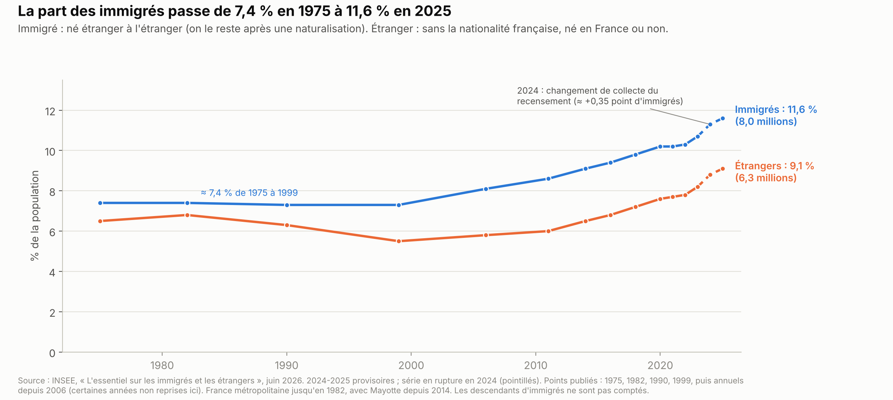
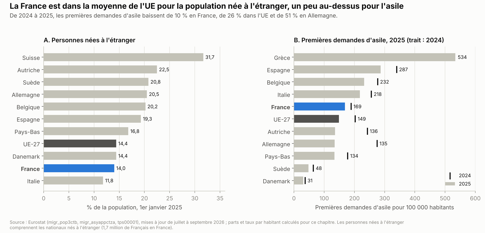
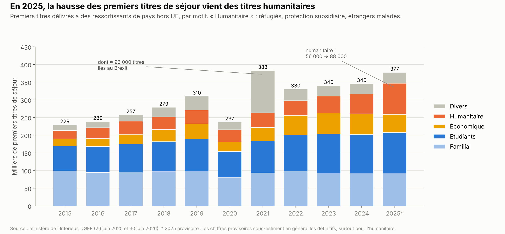
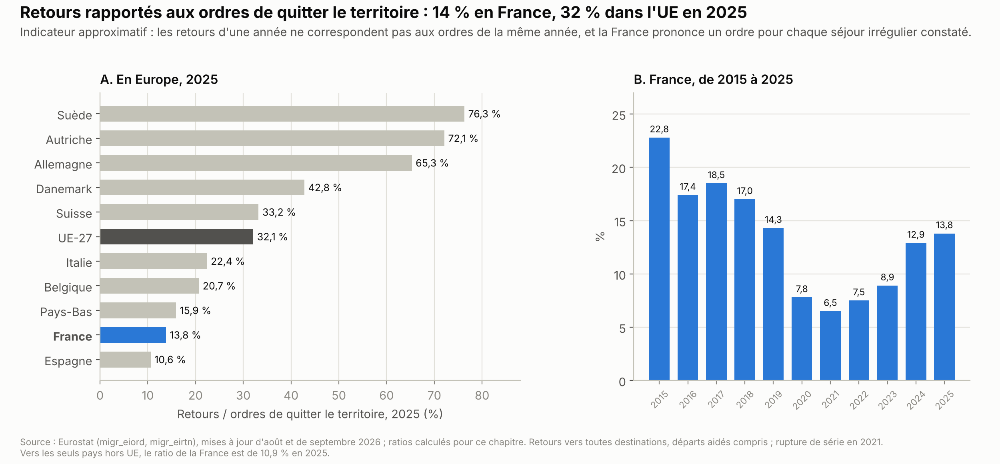
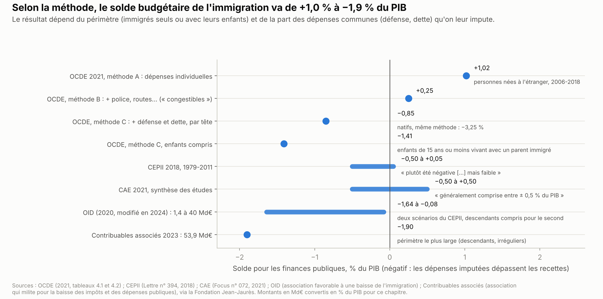
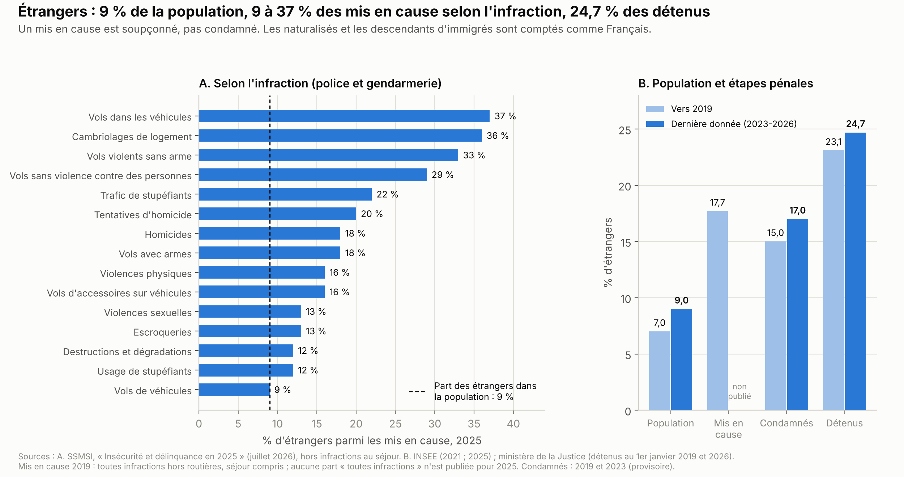

# Immigration : chiffres, coût, délinquance, comparaisons européennes

*Version de travail du 11 octobre 2026. Les chiffres seront mis à jour à la date d'arrêt des données de l'édition 1.*

Ce chapitre présente l'immigration en France : combien d'immigrés et d'étrangers vivent en France, qui arrive et pourquoi, l'asile, l'immigration irrégulière et les éloignements. Il décrit aussi l'emploi des immigrés, ce que l'immigration coûte et rapporte aux finances publiques, et ce que l'on sait de son lien avec la délinquance. Il expose ensuite le cadre juridique, les propositions des partis et ce qu'on sait des mesures déjà essayées, en France et ailleurs.

**Voir aussi :**
- [Institutions](../institutions/institutions.md), pour la révision de la Constitution et le référendum (sections 1.5 et 1.6), le Conseil constitutionnel (1.7) et le droit européen (1.8) ;
- [Sécurité et justice](../securite-justice/securite_justice.md), pour la mesure de la délinquance, la police, la justice et les prisons ;
- [Santé et assurance maladie](../sante/sante_assurance_maladie.md), pour l'aide médicale de l'État dans les dépenses de santé (section 1.1) ;
- [Logement](../logement/logement.md), pour le logement social (section 1.7) et la « priorité nationale » dans les habitations à loyer modéré (HLM) (section 2, question 4, et section 3) ;
- [Travail et emploi](../travail-emploi/travail_emploi.md) et [Pouvoir d'achat](../pouvoir-achat/pouvoir_achat.md), pour le chômage et les aides réservées aux Français ou aux étrangers installés depuis longtemps ;
- [Retraites et productivité](../retraites-productivite/retraites_productivite.md), pour le solde migratoire retenu dans les projections des retraites ;
- [Finances publiques](../finances-publiques/finances_publiques.md), pour le budget de l'État et les plans d'économies des partis ;
- [Présidentielle 2027 : ce que proposent les partis](../partis/programmes_partis_2027.md), pour les programmes complets.

> **Repères.**
> - **Immigré, étranger.** Un **immigré** est né étranger à l'étranger et vit en France ; il le reste s'il devient français. Un **étranger** n'a pas la nationalité française ; il peut être né en France. Les statistiques de police, de justice et de prison comptent les étrangers.
> - **Descendant d'immigré, né à l'étranger.** Un **descendant d'immigré** est né en France d'au moins un parent immigré. Pour comparer les pays, Eurostat compte les personnes **nées à l'étranger**, Français de naissance compris.
> - **Titre de séjour.** Les ressortissants de pays hors de l'Union européenne (UE) ont besoin d'un titre pour vivre en France. Le **premier titre** mesure les nouvelles admissions, par motif : études, famille, travail, protection (« humanitaire »).
> - **Asile.** Un **demandeur d'asile** demande une protection. Il devient **réfugié** s'il est persécuté au sens de la Convention de Genève, la convention des Nations unies de 1951 sur les réfugiés. La **protection subsidiaire** protège d'autres menaces graves, comme une guerre.
> - **Obligation de quitter le territoire français (OQTF).** C'est une décision du préfet. Un **éloignement** est un départ constaté : forcé, aidé ou spontané. Un renvoi forcé suppose un **laissez-passer consulaire**, document de voyage délivré par le pays d'origine.
> - **Aide médicale de l'État (AME).** Elle paie les soins des étrangers en situation irrégulière depuis plus de trois mois, sous condition de ressources.
> - **Droit du sol.** Un enfant né en France de parents étrangers devient français à 18 ans s'il y a vécu au moins cinq ans depuis ses 11 ans, ou plus tôt par déclaration.
> - **Mis en cause.** Personne soupçonnée par la police ou la gendarmerie d'avoir commis une infraction. Ce n'est pas une condamnation.

---

## L'essentiel

1. **Plus d'un habitant sur neuf est immigré.** En 2025, 8,0 millions d'immigrés vivent en France (11,6 %) et 6,3 millions d'étrangers (9,1 %). Stable de 1975 à 1999, la part des immigrés augmente depuis. Une nouvelle collecte du recensement explique ≈ 0,35 point de la hausse de 2024.
2. **Les études, premier motif d'entrée.** En 2025, 377 000 premiers titres de séjour ont été délivrés : 117 000 pour études, 91 000 pour la famille, 88 000 pour protection (+57 %), 51 000 pour le travail. Le regroupement familial au sens strict représente ≈ 13 000 titres en 2023.
3. **L'asile, un peu au-dessus de la moyenne de l'UE.** En 2025, 145 000 demandes d'asile ont été déposées ; 52 % des décisions accordent une protection, recours compris. La France reçoit 169 premières demandes pour 100 000 habitants, contre 149 dans l'UE.
4. **Environ une obligation de quitter le territoire français (OQTF) sur dix est exécutée.** Sur ≈ 130 000 prononcées par an, 11 % sont exécutées (2024). 24 985 étrangers ont été éloignés en 2025. En 2023, les pays d'origine ont délivré à temps 30 % des laissez-passer consulaires demandés.
5. **Le coût dépend de l'emploi et de la méthode.** Les hommes immigrés ont presque le même taux d'emploi que les autres (71-72 %), mais pas les femmes (54 % contre 69 %). Selon la méthode, l'Organisation de coopération et de développement économiques (OCDE) trouve un solde budgétaire de +1,0 % à −0,85 % du PIB ; −1,4 % avec leurs enfants.
6. **Délinquance : une surreprésentation, surtout pour les vols.** Les étrangers, 9 % de la population, sont 9 à 37 % des mis en cause selon l'infraction et 24,7 % des détenus. L'âge, le sexe, la précarité et le traitement pénal en expliquent une partie, non chiffrée en France.
7. **Un cadre juridique étroit.** La Constitution, le droit de l'UE et la Convention européenne des droits de l'homme encadrent l'asile, la vie familiale et les prestations. Le pacte européen s'applique depuis le 12 juin 2026. Plusieurs propositions supposent de réviser la Constitution ou le droit européen.

**Les grandes options en débat.**
- **Volume** : réduire fortement les entrées, ou choisir l'immigration de travail (quotas, points).
- **Régularisations** : régulariser les travailleurs sans papiers, ou supprimer les régularisations.
- **Asile** : l'examiner aux frontières de l'Europe, le demander à l'étranger, ou ouvrir des voies légales.
- **Nationalité** : supprimer le droit du sol, ou l'accorder quelle que soit la situation des parents.
- **Prestations** : réserver des aides aux Français (« priorité nationale »), ou garder l'égalité de traitement.
- **Soins** : remplacer l'aide médicale de l'État par une aide d'urgence, ou la garantir.
- **Europe** : appliquer le pacte européen, le réviser, ou faire primer le droit national.

---

## 1. La situation

### 1.1 Combien d'immigrés et d'étrangers

**La population en 2025.**
- 8,0 millions d'immigrés vivent en France en 2025 (chiffre provisoire), soit 11,6 % de la population. Un tiers d'entre eux (2,6 millions) sont devenus français[^insee-essentiel-2026].
- 6,3 millions d'étrangers y vivent (9,1 %), dont 1,0 million nés en France. 9,6 millions de personnes sont nées à l'étranger (14,0 %), dont 1,7 million de Français de naissance[^insee-essentiel-2026].
- Les descendants d'immigrés sont 8,0 millions en 2024, soit 12 % de la population[^insee-frps-2025-immigres]. 55 % d'entre eux ont un seul parent immigré[^insee-frps-2025-immigres]. Une autre enquête, menée en 2019-2020, en comptait 7,5 millions[^insee-essentiel-2026].
- En 2019-2020, parmi les moins de 60 ans, 4,8 millions de personnes étaient des petits-enfants d'immigrés (10 %)[^insee-ip-1910]. Neuf sur dix avaient un ou deux grands-parents immigrés, sur quatre grands-parents[^insee-ip-1910].

**L'évolution.** La part des immigrés était stable de 1975 à 1999 : 7,4 % puis 7,3 %. Elle passe à 8,1 % en 2006, 9,1 % en 2014, 10,7 % en 2023 et 11,6 % en 2025 (graphique de « L'essentiel »)[^insee-essentiel-2026]. Celle des étrangers est passée de 5,5 % en 1999 à 9,1 % en 2025[^insee-essentiel-2026].

**La rupture de série de 2024.** En 2024, le recensement a changé sa façon de collecter les réponses, avec un questionnaire utilisable sur téléphone. Selon l'Institut national de la statistique et des études économiques (Insee), les données d'avant 2024 « ne sont pas directement comparables à celles relatives à 2024 et 2025 »[^insee-essentiel-2026]. Le nouveau protocole ajoute ≈ 242 000 immigrés et ≈ 165 000 étrangers[^insee-rupture-2024]. Cela fait ≈ 0,35 et ≈ 0,24 point de population *(calcul)*. De 2014 à 2024, la population immigrée a augmenté de 2,5 % par an selon l'Insee[^insee-frps-2025-immigres] ; ≈ 2,2 % sans l'effet de la rupture *(calcul)*.

**Les origines.**
- En 2025, 49 % des immigrés sont nés en Afrique, 30 % en Europe, 14 % en Asie et 6 % en Amérique ou en Océanie[^insee-essentiel-2026].
- Les principaux pays de naissance sont l'Algérie (12,6 %), le Maroc (11,7 %), le Portugal (7,2 %), la Tunisie (4,9 %), l'Italie et la Turquie (3,5 % chacune)[^insee-essentiel-2026].
- 52 % des immigrés sont des femmes, contre 44 % en 1975[^insee-essentiel-2026]. Leur âge médian est de 46 ans en 2024[^insee-frps-2025-immigres].
- Selon les estimations de l'Insee, ≈ 313 000 immigrés sont arrivés en France en 2024, contre 347 000 en 2023[^insee-essentiel-2026].

**Le solde migratoire.** Le solde migratoire est la différence entre les entrées et les sorties du territoire, Français compris. Il est estimé à +176 000 personnes pour 2025[^insee-demographie-2025]. Ce chiffre provisoire est une convention : la moyenne des trois derniers soldes connus[^insee-demographie-2025]. En 2025, pour la première fois depuis la fin de la Seconde Guerre mondiale, les décès dépassent les naissances (−6 000)[^insee-demographie-2025]. Les projections de l'Insee et le Conseil d'orientation des retraites (COR) retiennent +150 000 personnes par an à partir de 2026[^insee-projections-2026][^cor-synthese-2026].

**En Europe.** Au 1er janvier 2025, 14,0 % des habitants de la France sont nés à l'étranger, contre 14,4 % dans l'UE *(calcul)*[^eurostat-pop3ctb][^eurostat-diversity]. La part est plus forte en Autriche (22,5 %), en Suède (20,8 %), en Allemagne (20,5 %) et en Espagne (19,3 %), plus faible en Italie (11,8 %) (graphique ci-dessous)[^eurostat-pop3ctb]. Pour les étrangers, Eurostat compte 6,47 millions de personnes en France, soit 9,4 %[^eurostat-pop1ctz] ; l'écart avec l'Insee (6,30 millions) n'est expliqué dans aucune source lue.

### 1.2 Qui arrive, et pourquoi

**Les premiers titres de séjour.** Ils concernent les ressortissants de pays hors de l'UE, de l'Espace économique européen et de la Suisse : les Européens circulent librement.
- En 2025, 377 462 premiers titres ont été délivrés, soit +9,2 % en un an (chiffre provisoire)[^dgef-titres-2025].
- Les études en sont le premier motif depuis 2022 : 116 835 titres en 2025 (+5,3 %)[^dgef-titres-2025].
- Le motif familial est stable : 90 959 titres (−0,1 %)[^dgef-titres-2025].
- Les titres humanitaires augmentent de 56,8 %, à 88 001 : 52 191 titres de réfugié (+39 %) et 32 466 titres de protection subsidiaire (+115,8 %)[^dgef-titres-2025].
- Le motif économique baisse de 13,2 %, à 50 848 titres, dont 32 287 salariés (−12,1 %) et 8 506 saisonniers (−28,2 %)[^dgef-titres-2025].
- Les « motifs divers » (visiteurs, étrangers entrés mineurs…) représentent 30 819 titres[^dgef-titres-2025]. Le pic de 2021 tient à ≈ 96 000 titres délivrés à des Britanniques déjà installés, après le Brexit[^dgef-titres-2025].
- Selon le ministère de l'Intérieur, les chiffres provisoires « sous-estiment généralement les données définitives », surtout pour l'humanitaire[^dgef-titres-2025].

**Les nationalités.** En 2025, les premiers titres vont d'abord à des Marocains (35 585), des Algériens (28 531), des Tunisiens (20 598), des Afghans (17 531, +42 %) et des Chinois (15 899)[^dgef-titres-2025].

**La famille.**
- La « famille de Français » (conjoints, parents d'enfants français) représente 40 536 titres en 2025, soit 45 % du motif familial *(calcul)*[^dgef-titres-2025].
- Le **regroupement familial** au sens strict est la procédure par laquelle un étranger installé fait venir son conjoint et ses enfants. Il représente 12 885 titres en 2023, soit 5 % des premiers titres d'au moins un an et 16 % des titres familiaux, contre 23 % en 2000, sur le champ de l'étude, qui exclut les mineurs[^ined-643]. De 2000 à 2023, il a donné ≈ 11 000 premiers titres par an[^ined-643].

**Les régularisations.** Un préfet peut admettre au séjour un étranger en situation irrégulière, à titre exceptionnel ou pour ses liens personnels et familiaux.
- Elles passent de 31 252 en 2024 à 27 819 en 2025 (−11 %)[^dgef-titres-2025].
- Le ministère de l'Intérieur relie cette baisse à la loi de 2024 et à la circulaire du 23 janvier 2025 de Bruno Retailleau, alors ministre[^dgef-titres-2025]. Cette circulaire fait de sept ans de présence, au lieu de cinq, un indicateur d'intégration *(source secondaire)*[^cdj-circulaire-retailleau]. Le Conseil d'État a rejeté le recours de six associations contre elle le 21 novembre 2025[^ce-502722].
- La loi de 2024 a créé un titre pour les « métiers en tension »[^gouv-cm-20231220]. Il a été délivré 1 655 fois en 2025, selon un télégramme du ministre aux préfets cité par l'Agence France-Presse (AFP) *(source secondaire)*[^europe1-metiers-tension].

**Les naturalisations.** En 2025, 98 139 personnes ont acquis la nationalité française, soit −5,3 % en un an[^dgef-nationalite-2025].
- 42 246 l'ont obtenue par décret (−13,5 %) ; le ministère relie cette baisse à une circulaire du 2 mai 2025[^dgef-nationalite-2025].
- 17 579 l'ont acquise par mariage, et 32 923 jeunes nés en France par déclaration anticipée[^dgef-nationalite-2025].
- La partie instruite par le ministère de l'Intérieur (décrets, mariages, ascendants et fratries) concerne 62 235 personnes (−6,8 %)[^dgef-nationalite-2025]. Le total de 2024 était de 103 661[^insee-acquisitions].

### 1.3 L'asile

**Les demandes.** En 2025, l'Office français de protection des réfugiés et apatrides (OFPRA) a reçu 145 270 demandes, soit −5,5 % en un an[^ofpra-ra-2025]. Elles comprennent 111 343 premières demandes (−14,4 %), 33 713 réexamens (+43 %) et 214 réouvertures de dossiers[^ofpra-ra-2025]. Les premiers pays d'origine sont l'Ukraine (11 989 premières demandes), la République démocratique du Congo (11 338) et l'Afghanistan (10 822)[^ofpra-ra-2025].

**Les décisions.**
- L'OFPRA a pris 156 509 décisions en 2025 et accordé une protection dans 41,2 % des cas[^ofpra-ra-2025].
- En comptant les recours devant la Cour nationale du droit d'asile (CNDA), le taux de protection atteint 52,1 % en 2025, en hausse de 13 points depuis 2021[^senat-asile-2026]. La CNDA a enregistré 60 065 recours en 2025 (+6 %)[^ce-chiffres-2025].
- 78 783 personnes ont été protégées en 2025. Au 31 décembre 2025, ≈ 736 500 personnes bénéficient d'une protection en France, selon une estimation de l'OFPRA[^ofpra-ra-2025].

**La série d'Eurostat.** Eurostat compte les premiers demandeurs et les décisions de première instance, hors recours.

| Année | Premières demandes | Taux de protection en première instance |
|---|---|---|
| 2015 | 70 570 | 26,5 % |
| 2019 | 138 290 | 24,7 % |
| 2022 | 137 605 | 27,5 % |
| 2023 | 145 160 | 31,4 % |
| 2024 | 129 910 | 37,8 % |
| 2025 | 116 475 | 40,0 % |

*Sources : Eurostat[^eurostat-asyappctza][^eurostat-asydcfsta]. Taux : décisions positives rapportées à l'ensemble des décisions (calcul).*

- Trois compteurs coexistent pour les premières demandes de 2025 : 123 499 aux guichets d'accueil des préfectures[^pjl-526-ei], 116 475 chez Eurostat, 111 343 à l'OFPRA. Aucune source lue n'explique l'écart.

**En Europe.**
- En 2025, la France est le troisième pays de l'UE pour les premières demandes, derrière l'Espagne (141 055) et l'Italie (128 655), devant l'Allemagne (113 235)[^eurostat-asyappctza]. Toutes demandes comprises, réexamens inclus, elle est deuxième, avec ≈ 152 000 demandes, selon l'agence de l'UE pour l'asile[^euaa-trends-2025].
- Par habitant, elle reçoit 169 premières demandes pour 100 000 habitants, contre 149 dans l'UE *(calcul)* (graphique de la section 1.1)[^eurostat-asyappctza].
- De 2024 à 2025, les premières demandes baissent de 26 % dans l'UE, de 51 % en Allemagne et de 10 % en France *(calcul)*[^eurostat-asyappctza]. Au premier semestre 2026, elles baissent de 14 % en France et de 21 % dans l'UE, avec des données espagnoles incomplètes pour juin *(calcul)*[^eurostat-asyappctzm].

**L'accueil.** L'État finance 113 555 places d'hébergement pour les demandeurs d'asile ; 72 % d'entre eux étaient hébergés en 2025[^pap-2027-iai]. Un adulte seul reçoit une allocation de 206 € par mois s'il est hébergé, 432 € s'il ne l'est pas[^senat-asile-2026].

### 1.4 L'immigration irrégulière et les éloignements

**Aucune mesure directe.** Le nombre d'étrangers en situation irrégulière n'est pas mesuré. Un rapport du Sénat le dit « par définition très difficile » à estimer[^senat-ame-2025-iii]. On dispose d'indices :
- 458 681 personnes bénéficiaient de l'AME au 30 septembre 2025[^senat-ame-comptes-2025] ; leur nombre a doublé de 2011 à 2024[^senat-ame-2025] ;
- 159 460 étrangers ont été trouvés en séjour irrégulier en 2025, contre 142 190 en 2024[^eurostat-eipre] ;
- les interpellations d'étrangers en situation irrégulière étaient 147 154 en 2024 (+18,9 %)[^senat-ame-2025-iii], et ont augmenté de 30 % en 2025 *(source secondaire)*[^publicsenat-dgef-2025].

**Les estimations.**
- Selon le rapport du Sénat de 2025, leur nombre « pourrait être de 900 000 personnes, dont la moitié aurait recours à l'AME »[^senat-ame-2025]. Le rapport ne détaille pas son calcul : son chiffre revient à doubler le nombre de bénéficiaires de l'AME, parce qu'environ la moitié des personnes qui y ont droit la demandent *(calcul)*[^senat-ame-2025-iii].
- Le même rapport cite une estimation de 800 000 personnes de Gérald Darmanin, ancien ministre de l'Intérieur, sans en donner la source[^senat-ame-2025-iii].
- Le Pew Research Center, centre de recherche américain, estimait leur nombre entre 300 000 et 400 000 en 2017[^pew-2019].

**Les OQTF.**
- La France prononce ≈ 130 000 OQTF par an, « contre 60 000 en Allemagne, 50 000 en Espagne ou 30 000 en Italie »[^an-oqtf-2025]. Selon un rapport de l'Assemblée nationale, c'est parce que la loi impose une OQTF pour chaque séjour irrégulier constaté : entrée illégale, refus de titre, refus d'asile[^an-oqtf-2025].
- Selon le Sénat, 11,4 % des OQTF ont été exécutées en 2024, et 10,6 à 10,9 % en 2025 (chiffre partiel)[^senat-iai-plf2026][^senat-lois-plf2026]. Le Sénat précise que des OQTF ne sont pas notifiées, sont annulées ou visent plusieurs fois la même personne[^senat-lois-plf2026]. 18 % des OQTF ont été annulées en première instance en 2023[^an-oqtf-2025].
- Deux autres chiffres circulent. Le taux de 6,8 % en 2022 est un calcul « brut » de la Fondation pour la recherche sur les administrations et les politiques publiques (IFRAP), un institut libéral[^ifrap-cour-2024]. Celui de 12 % est une estimation du ministère de l'Intérieur pour les OQTF « réputées exécutoires », reprise par la Cour des comptes[^ifrap-cour-2024][^ccomptes-lcii-2024].
- Pour les déboutés de l'asile, le taux d'exécution est de 5,5 % en moyenne de 2019 à 2025, selon le Sénat[^senat-asile-2026].

**Les éloignements.**
- En 2025, 24 985 étrangers ont été éloignés, soit +15,7 % *(source secondaire)*[^publicsenat-dgef-2025]. Parmi eux, 15 569 retours forcés (+21 %) et 4 564 départs aidés[^pap-2027-iai]. Les retours forcés étaient 18 906 en 2019[^senat-lois-plf2026].
- Le gouvernement vise 17 000 retours forcés et 10 000 départs aidés en 2027[^pap-2027-iai].
- En 2023, 30 % des laissez-passer consulaires demandés aux pays d'origine ont été délivrés à temps, ≈ 10 % pour l'Algérie[^an-oqtf-2025]. L'Algérie a cessé de coopérer en mars 2025[^senat-lois-plf2026]. Après une visite à Alger, Laurent Nuñez dit avoir obtenu plus de 140 laissez-passer au 6 mai 2026 *(source secondaire)*[^algerie360-lpc].

**La rétention.**
- La France compte ≈ 2 000 places dans 26 centres de rétention ; la durée maximale est de 90 jours, 210 en cas de terrorisme[^an-oqtf-2025]. Le gouvernement vise 3 000 places d'ici fin 2029[^pap-2027-iai].
- 36 % des personnes placées en rétention ont été éloignées en 2025, contre 38,75 % en 2024[^pap-2027-iai].
- Une journée de rétention coûte 602 € selon la Cour des comptes ; en 2019, deux députés estimaient un éloignement forcé à ≈ 14 000 € et un retour aidé à ≈ 3 000 €[^an-oqtf-2025].

**En Europe.** Eurostat rapporte les retours d'une année aux ordres de quitter le territoire de la même année. En 2025, ce rapport est de 13,8 % en France, contre 32,1 % dans l'UE et 65,3 % en Allemagne *(calcul)*[^eurostat-eiord][^eurostat-eirtn]. L'indicateur est approximatif : les retours ne correspondent pas aux ordres de la même année, et le nombre d'ordres dépend du droit national. Au quatrième trimestre 2025, la France est le deuxième pays de l'UE, après l'Allemagne, pour les renvois vers des pays hors UE (3 800 personnes)[^eurostat-q4-2025].

### 1.5 Emploi, logement et intégration

**L'emploi.** Le tableau compare les personnes sans ascendance migratoire (ni immigrées ni descendantes d'immigrés), les immigrés et les descendants d'immigrés.

| 15-64 ans, 2025 | Taux d'emploi | Taux de chômage |
|---|---|---|
| Sans ascendance migratoire | 71,9 % | 6,5 % |
| **Immigrés** | **61,9 %** | **12,4 %** |
| – nés en Europe | 65,8 % | 10,4 % |
| – nés au Maghreb | 59,6 % | 12,9 % |
| – nés dans un autre pays d'Afrique | 62,0 % | 14,7 % |
| – nés en Asie | 59,1 % | 11,1 % |
| **Descendants d'immigrés** | **59,5 %** | **11,7 %** |
| – d'origine européenne | 70,8 % | 6,7 % |
| – d'origine maghrébine | 54,4 % | 15,1 % |
| – d'une autre origine africaine | 46,7 % | 18,6 % |
| Ensemble | 69,3 % | 7,7 % |

*Source : Insee, enquête Emploi[^insee-activite-immigres-2025]. Pour un descendant de deux parents immigrés, l'origine retenue est celle du père.*

- **Les hommes et les femmes.** « La proportion d'hommes occupant un emploi est très proche parmi les immigrés et les non-immigrés (71-72 %) »[^insee-essentiel-2026]. Les femmes immigrées sont 54 % en emploi, contre 69 % des autres femmes[^insee-essentiel-2026]. Le chômage des immigrés est de 12 % chez les hommes et 13 % chez les femmes, contre 7 % pour les non-immigrés[^insee-essentiel-2026].
- **Les métiers.** Les immigrés sont plus souvent ouvriers : 26 %, contre 18 % de l'ensemble des personnes en emploi[^insee-essentiel-2026]. En 2017, ils occupaient 10,2 % des emplois, mais 38,8 % des postes d'employés de maison *(source secondaire)*[^legisocial-dares]. Ils occupaient aussi 27,0 % des postes d'ouvriers non qualifiés du gros œuvre du bâtiment et des travaux publics, du béton et de l'extraction[^legisocial-dares]. Ils étaient 23 % des agents de nettoyage et des aides à domicile, et 17 % des médecins hospitaliers[^cepii-424].
- **Les diplômes.** En 2021, 38 % des immigrés de 30 à 64 ans n'avaient aucun diplôme ou au plus le brevet, contre 16 % des non-immigrés du même âge. Ils étaient 24 % à avoir un diplôme de niveau bac + 3 ou plus, contre 25 %[^insee-ref-2023-diplome]. Parmi les immigrés de 25 ans ou plus arrivés en 2024, 51 % sont diplômés du supérieur[^insee-essentiel-2026].
- **La langue.** En 2019-2020, 90 % des immigrés de 18 à 59 ans comprennent bien le français ; à leur arrivée, 51 % le comprenaient bien[^insee-ref-2023-langues].
- **Le logement.** En 2022, 30 % des immigrés vivent en HLM, contre 11 % des non-immigrés ; 27,8 % vivent dans un logement surpeuplé, contre 11,2 %[^dgef-logement-immigres-2022]. Le ministère de l'Intérieur l'explique par « leurs plus faibles revenus » et la taille de leur ménage[^dgef-logement-immigres-2022]. Le chapitre [Logement](../logement/logement.md) (section 1.7) détaille l'accès au logement social.

### 1.6 Ce que l'immigration coûte et rapporte

**Le principe.** On compare ce que les immigrés paient (impôts, cotisations) à ce que l'État dépense pour eux (prestations, santé, éducation…). Les résultats divergent pour trois raisons :
- le **périmètre** : les immigrés seuls, ou aussi leurs enfants, voire leurs petits-enfants ;
- les **dépenses communes**, comme la défense ou les intérêts de la dette : faut-il en imputer une part aux immigrés, et laquelle ?
- la **période** : une année donnée, ou toute la vie.

**Les estimations.**
- **OCDE (2021).** De 2006 à 2018, le solde des personnes nées à l'étranger est de +1,02 % du PIB si l'on compte les dépenses individuelles. Il est de +0,25 % avec les services dont le coût croît avec le nombre d'usagers (police, routes)[^ocde-imo-2021]. Il est de −0,85 % si l'on impute aussi aux immigrés, par tête, la défense et les intérêts de la dette ; avec cette méthode, celui des natifs est de −3,25 %[^ocde-imo-2021]. En comptant les enfants nés en France, les trois résultats deviennent +0,46 %, −0,31 % et −1,41 %[^ocde-imo-2021].
- Selon l'OCDE, « Immigrants' lower employment rates are key in explaining the gap in contributions » (le taux d'emploi plus faible des immigrés est la clé de l'écart, *traduction*)[^ocde-imo-2021]. Avec la méthode la plus large, la France (−0,85 %) est sous la moyenne des pays étudiés (−0,16 %). La Suisse (+0,84 %) et l'Italie (+0,57 %) ont un solde positif ; l'Allemagne (−0,28 %) et la Belgique (−1,28 %), un solde négatif[^ocde-imo-2021].
- **Centre d'études prospectives et d'informations internationales (CEPII, 2018).** Ce centre de recherche public trouve une contribution « comprise entre - 0,5 % et + 0,05 % du PIB » de 1979 à 2011 ; en 2011, elle est de −8,8 Md€, soit −0,49 % du PIB[^cepii-394]. Il conclut que « la contribution de l'immigration aux finances publiques a plutôt été négative sur la période évaluée mais faible »[^cepii-394].
- **Conseil d'analyse économique (CAE, 2021).** Ce conseil d'économistes placé auprès du Premier ministre juge la contribution nette « généralement comprise entre ± 0,5 % du PIB »[^cae-focus-072]. Cette synthèse est signée par un coauteur de l'étude du CEPII.
- **Observatoire de l'immigration et de la démographie (OID).** Cette association, favorable à une baisse de l'immigration, cite des estimations « entre 1,4 et 40 milliards d'euros par an »[^oid-cout-2020]. Les deux bornes viennent de deux scénarios du CEPII ; la seconde compte aussi les descendants[^oid-cout-2020]. En 2025, l'OID estime que, si les immigrés et leurs descendants avaient le taux d'emploi des autres, le PIB serait plus élevé de 3,4 % et les recettes publiques de 45 Md€[^oid-economie-2025]. C'est un manque à gagner dans un scénario, pas un coût mesuré.
- **Contribuables associés.** Cette association, qui milite pour la baisse des impôts et des dépenses publiques, estime le coût net à 53,9 Md€ en 2023[^jean-jaures-cout]. Son auteur, Jean-Paul Gourévitch, compte les immigrés, leurs descendants et les étrangers en situation irrégulière[^oid-gourevitch-2020]. Cela fait ≈ 1,9 % du PIB *(calcul)*. L'étude n'a pas été lue ; elle est connue par la Fondation Jean-Jaurès, proche du PS, qui la critique[^jean-jaures-cout]. Aucune critique d'un organisme public n'a été trouvée.

**Les dépenses propres à l'immigration dans le budget.**
- **L'asile** a coûté 1,85 Md€ en 2025 selon le Sénat, qui parle d'un « coût minimum » : les dépenses de santé n'y sont pas comptées[^senat-asile-2026]. L'hébergement des demandeurs d'asile a coûté 1,1 Md€ en 2024[^senat-asile-2026].
- **La lutte contre l'immigration irrégulière** coûte ≈ 1,8 Md€ par an et mobilise près de 16 000 agents à temps plein, selon la Cour des comptes[^ccomptes-lcii-2024].
- **L'AME** a coûté 1 470 M€ en 2025[^senat-ame-comptes-2025]. Le Sénat donne +64 % de 2014 à 2024 dans le corps de son rapport, et +68 % dans sa synthèse[^senat-ame-2025-ii][^senat-ame-2025].
- Ces trois postes font ≈ 5,1 Md€, avec des chevauchements *(calcul)*. Ce n'est pas un coût total : les immigrés paient aussi des impôts et reçoivent d'autres dépenses.
- **Le budget de 2027.** La mission « Immigration, asile et intégration » passe de 2,13 Md€ de crédits en 2026 à 2,09 Md€ dans le projet pour 2027[^pap-2027-iai]. Les crédits de l'AME restent à 1 208 M€[^pap-2027-sante]. Pour 2026, le Sénat jugeait l'action consacrée à l'AME « largement sous-budgétisée »[^senat-sante-plf2026].

**L'AME en détail.** En 2024, l'AME (1 387 M€) représente ≈ 0,54 % de la consommation de soins (254,8 Md€) *(calcul)*[^senat-ame-2025][^drees-cns-2025-csbm] ; le chapitre [Santé](../sante/sante_assurance_maladie.md) (section 1.1) la situe dans les dépenses de santé.
- Le rapport demandé en 2023 par le gouvernement à Claude Évin et Patrick Stefanini y voit « un dispositif sanitaire utile, maîtrisé pour l'essentiel mais exposé à l'augmentation récente du nombre de ses bénéficiaires »[^evin-stefanini-2023]. Selon lui, 51 % des personnes éligibles en bénéficient[^evin-stefanini-2023], d'après une enquête de l'Institut de recherche et documentation en économie de la santé (IRDES)[^irdes-qes-245].
- La Fondation IFRAP souligne la hausse de 38,8 % du nombre de bénéficiaires de fin 2015 à mi-2023, et une concentration en Île-de-France : « plus de 55% » des bénéficiaires de métropole[^ifrap-ame-2023].
- Deux décrets du 6 février 2026 changent les justificatifs demandés[^pap-2027-sante]. Les soins couverts ne changent pas ; le gouvernement en attend ≈ 180 M€ d'économies *(source secondaire)*[^publicsenat-ame-2026].

**Les retraites.** Selon le COR, un solde migratoire plus élevé aurait « rapidement » un effet favorable sur les finances des retraites, mais « Cet effet positif tendrait toutefois à s'estomper progressivement à plus long terme »[^cor-synthese-2026]. Les arrivants cotisent d'abord, puis touchent à leur tour une pension. Le chapitre [Retraites et productivité](../retraites-productivite/retraites_productivite.md) détaille ces projections.

### 1.7 Immigration et délinquance

**Ce que mesurent les chiffres.**
- Les statistiques de police, de justice et de prison comptent les **étrangers**, pas les immigrés. Les immigrés devenus français et les descendants d'immigrés y sont comptés comme Français.
- Un **mis en cause** est soupçonné, sur « des indices graves ou concordants », d'avoir commis une infraction : ce n'est pas un condamné[^ssmsi-chiffres-cles-2025]. Les chiffres portent sur les affaires élucidées, c'est-à-dire celles où un auteur présumé a été identifié : c'est le cas de ≈ 7 cambriolages sur 100 en 2024 (chapitre Sécurité et justice)[^ssmsi-bilan-2025].
- La nationalité est celle que la personne déclare. Selon l'Insee, elle « ne peut systématiquement être vérifiée par les services de sécurité, faute de disposer de pièces d'identité »[^insee-auteurs-nationalite].
- Pour l'Insee, un étranger peut « ou non résider en France (cas des touristes, voyageurs d'affaires, etc.) »[^insee-auteurs-nationalite]. Comparer les mis en cause à la seule population résidente est donc une approximation. Aucune source lue n'en mesure l'effet.

**Les mis en cause en 2025.** Selon le Service statistique ministériel de la sécurité intérieure (SSMSI), les étrangers représentent 9 % de la population résidente[^ssmsi-bilan-2025-pdf].
- Ils sont « plus fréquemment mis en cause pour des atteintes aux biens » : 37 % des mis en cause pour les vols dans les véhicules, 36 % pour les cambriolages, 33 % pour les vols violents sans arme[^ssmsi-bilan-2025-pdf].
- Leur part est de 9 % pour les vols de véhicules et de 12 % pour l'usage de stupéfiants[^ssmsi-bilan-2025-pdf].
- Pour les atteintes aux personnes, elle est « légèrement supérieure à leur part dans la population » : 18 % pour les homicides, 16 % pour les violences physiques, 13 % pour les violences sexuelles[^ssmsi-bilan-2025-pdf].
- Ils sont aussi plus souvent victimes : 23 % des victimes d'homicide ou de tentative et 21 % des victimes de vols avec armes, touristes compris[^ssmsi-bilan-2025-pdf].
- Leur part parmi les mis en cause augmente de 2016 à 2025 pour 13 indicateurs sur 18, mais elle baisse depuis 2022 pour la plupart[^ssmsi-bilan-2025-pdf].
- Le bilan ne publie ni part « toutes infractions », ni nationalités des mis en cause.

**La dernière vue d'ensemble (2019).** En 2019, les étrangers représentaient 17,7 % des mis en cause, toutes infractions comprises sauf les infractions routières, pour ≈ 7 % de la population[^insee-auteurs-nationalite].
- Ce total comprend les infractions au séjour et au travail des étrangers, que seuls des étrangers peuvent commettre[^insee-auteurs-nationalite].
- Leur part atteignait 45,8 % pour les atteintes économiques et financières, comme la contrefaçon ou la vente à la sauvette, et 26,6 % pour les vols[^insee-auteurs-nationalite].
- 58 % des mis en cause étrangers étaient originaires d'Afrique, qui représente 43 % des étrangers résidant en France[^insee-auteurs-nationalite].

**Le long de la chaîne pénale.**
- Les étrangers sont 17 % des condamnés en 2023 (provisoire), contre 15 % en 2019[^insee-frps-2025-justice].
- Au 1er janvier 2026, ils sont 24,7 % des détenus et 21,9 % des écroués, qui comprennent les personnes sous bracelet électronique[^justice-series-ppsmj]. Au 1er janvier 2015, ils étaient 20,9 % des détenus[^justice-series-ppsmj].
- Au 1er janvier 2025, leur part est plus forte parmi les détenus en attente de jugement (≈ 29 %) que parmi les condamnés détenus (≈ 23 %) *(calcul)*[^justice-key-figures-2025].
- À infraction, antécédents, âge et procédure comparables, un étranger a une probabilité de prison ferme plus forte « de 5 points de pourcentage » qu'un Français, et une peine « plus longue, de 22 jours », selon le CEPII[^cepii-436].

**Les mineurs non accompagnés.**
- Il n'existe pas de statistique nationale de leur délinquance[^senat-mna-2021]. Selon le Sénat, 5 à 10 % des mineurs non accompagnés pris en charge par les départements font l'objet de mesures pénales, 15 % à Paris[^senat-mna-2021].
- À Paris, les « jeunes en errance » représentaient 7 % des mis en cause en 2020, contre 3 % en 2016, et 27 % des mis en cause pour vols avec violence[^senat-mna-2021]. Selon le Sénat, la plupart ne sont pas pris en charge par l'aide sociale à l'enfance, et une « proportion importante » sont majeurs[^senat-mna-2021].
- Les sénateurs n'ont « pas mis en évidence » l'emprise de filières internationales ; ils relèvent « la mainmise de délinquants plus expérimentés sur les plus jeunes »[^senat-mna-2021].
- Les décisions de placement de mineurs non accompagnés sont passées de 19 370 en 2023 à 13 554 en 2024[^justice-mna-2024]. Fin 2024, ils représentaient 8,1 % des mineurs incarcérés, une part en baisse depuis 2022[^justice-mna-2024].

**Ce qui explique l'écart.** Plusieurs facteurs sont cités :
- l'âge et le sexe : les auteurs d'infractions sont surtout de jeunes hommes ;
- la précarité : selon le CEPII, « la précarité économique reste un des principaux déterminants de la délinquance »[^cepii-436] ;
- le lieu de vie : en Allemagne, l'institut de recherche économique ifo (Munich) explique l'écart surtout par la concentration des étrangers dans les grandes villes, où la délinquance est plus dense[^ifo-2025] ;
- les infractions propres aux étrangers, et le traitement par la police et la justice ;
- les contrôles d'identité : en 2023, le Conseil d'État a jugé établie une pratique de contrôles fondés sur l'apparence physique, qui ne se réduit pas à « des cas isolés »[^ce-454836].

**Ce qui reste.** En France, aucune statistique officielle ne corrige l'écart de l'âge, du sexe ou du revenu, et les descendants d'immigrés ne sont pas identifiables. Chez les voisins :
- **Suède** : les personnes nées à l'étranger ont 2,5 fois plus de risques d'être enregistrées comme suspectes, celles nées en Suède de deux parents nés à l'étranger un peu plus de 3 fois[^bra-2021]. Après prise en compte de l'âge, du sexe, du revenu, du niveau d'études et du type de commune, les écarts sont fortement réduits, mais « une part importante » subsiste *(traduction)*[^bra-2021].
- **Danemark** : corrigé de l'âge, l'indice de condamnation des hommes descendants d'immigrés de pays « non occidentaux » est de 262, pour 100 en moyenne chez les hommes[^dk-justice-2023]. Les immigrés de ces pays sont à 131 *(lecture d'une figure, à vérifier)*[^dk-justice-2023].
- **Pays-Bas** : en 2023, sans correction de l'âge, 0,6 % des personnes d'origine néerlandaise sont enregistrées comme suspectes. C'est 1,1 % pour les personnes nées à l'étranger et 2,8 % pour celles nées aux Pays-Bas de deux parents nés à l'étranger[^cbs-2024].
- **Allemagne** : en 2024, 35,4 % des suspects sont étrangers, hors infractions au droit des étrangers, pour ≈ 15 % de la population ; ces suspects comprennent des personnes qui ne vivent pas en Allemagne[^mediendienst-2025].

**Les détenus en Europe.** En 2024, les étrangers représentent 71 % des détenus en Suisse, 53 % en Autriche, 45 % en Belgique, 33 % en Espagne, 32 % en Italie et 25 % en France *(calcul)*[^eurostat-crim-pris]. Ces parts dépendent de la proportion d'étrangers dans chaque pays. Le Conseil de l'Europe juge toute comparaison de niveaux entre pays « always problematic » (toujours délicate, *traduction*)[^space-2025]. Les études qui cherchent un effet de cause à effet sont présentées en section 4.

### 1.8 Le cadre juridique et européen

**La loi du 26 janvier 2024.** Elle facilite l'expulsion des étrangers jugés menaçants[^cc-2023-863]. Elle crée aussi un titre de séjour pour les travailleurs sans papiers des « métiers en tension »[^gouv-cm-20231220]. Le Conseil constitutionnel en a censuré 35 articles sur 86, dont 32 comme « cavaliers », sans lien avec le projet initial[^cc-2023-863-cp]. Parmi eux : le durcissement du regroupement familial, une condition de cinq ans de résidence pour des prestations, et des règles sur la nationalité[^cc-2023-863-cp]. Il a aussi censuré l'obligation faite au Parlement de fixer des « objectifs chiffrés » d'immigration[^cc-2023-863]. Le chapitre [Institutions](../institutions/institutions.md) (section 1.7) détaille cette décision.

**Les décisions suivantes.**
- **Prestations (2024).** Saisi d'une proposition de loi référendaire déposée par des parlementaires, le Conseil constitutionnel a jugé qu'exiger cinq ans de résidence, ou 30 mois d'activité, porte « une atteinte disproportionnée » au droit à la protection sociale[^cc-2024-6-rip].
- **Rétention (2025).** Il a censuré l'allongement de la durée maximale de rétention à 180 ou 210 jours pour de nouvelles catégories d'étrangers[^cc-2025-895].
- **Droit du sol (2025).** Il a validé la loi qui durcit le droit du sol à Mayotte, où les deux parents doivent désormais résider régulièrement en France depuis plus d'un an[^cc-2025-881]. Il a jugé que les lois de 1889 et de 1927 « ne sauraient avoir donné naissance à un principe fondamental reconnu par les lois de la République », c'est-à-dire à une règle de valeur constitutionnelle[^cc-2025-881]. Selon la Constitution, la loi fixe les règles de la nationalité (article 34) *(lecture du texte)*[^constitution]. Pour la juriste Hélène Raspail, une suppression totale du droit du sol « pourrait encore être jugée contraire à la Constitution » *(source secondaire)*[^cdj-raspail-2026].

**Le pacte européen sur la migration et l'asile.** Adopté en mai 2024, il s'applique depuis le 12 juin 2026[^consilium-pacte-2024][^senat-rapport-617].
- **Le filtrage** : contrôle d'identité, de santé et de sécurité des personnes arrivées irrégulièrement, en 7 jours au plus aux frontières extérieures[^senat-rapport-617].
- **La procédure à la frontière** : obligatoire, notamment, pour les nationalités dont le taux de protection est inférieur à 20 % dans l'UE ; elle dure 12 semaines au plus[^senat-rapport-617][^consilium-frontiere]. La France doit y consacrer 615 places[^senat-rapport-617].
- **La solidarité** : chaque État aide ceux qui sont sous pression, en accueillant des demandeurs ou en payant ≈ 20 000 € par personne non accueillie[^ep-train-gestion-asile]. Pour 2026, la réserve commune est de 21 000 relocalisations ou 420 M€ ; la part de la France est de 3 361 relocalisations[^consilium-solidarite-2025][^senat-rapport-617].
- **Les pays sûrs** : une liste européenne de pays d'origine sûrs a été adoptée le 23 février 2026 (Bangladesh, Colombie, Égypte, Inde, Kosovo, Maroc, Tunisie, ainsi que, sous conditions, les pays candidats à l'UE)[^consilium-pays-surs-2026].
- **Les retours** : un règlement adopté le 1er octobre 2026 permettra, dès son entrée en vigueur, de créer des « centres de retour » dans des pays hors de l'UE, par accord avec eux[^consilium-retours-2026].

**L'application en France.** Le gouvernement a demandé au Parlement l'autorisation d'adapter la loi par ordonnances, c'est-à-dire par des textes du gouvernement qui prennent la place de la loi (projet de loi n° 526). Le Sénat l'a adopté le 20 mai 2026 ; la commission des lois de l'Assemblée l'a rejeté le 22 juillet[^senat-pjl-526]. Une circulaire du 10 juin 2026 désigne les articles du code des étrangers qui ne doivent plus être appliqués[^interieur-circulaire-pacte]. Selon le Conseil d'État, cité par la presse, elle ne peut pas corriger « plusieurs incompatibilités » ; il demande une loi *(source secondaire)*[^bdt-circulaire-pacte].

**Le gouvernement.** Laurent Nuñez est ministre de l'Intérieur du gouvernement de Sébastien Lecornu[^info-gouv-composition]. Il a dit, en octobre 2025, qu'il ne remettrait en cause « aucune des mesures, circulaires, décrets » de son prédécesseur *(source secondaire)*[^publicsenat-nunez-fermete]. Le projet de budget de la Sécurité sociale pour 2027 exige un an de résidence des étrangers non européens pour certaines prestations familiales et aides au logement *(source secondaire)*[^afp-moneyvox-plfss].

**L'accord franco-algérien de 1968.** Les Algériens relèvent d'un régime propre : par exemple, un certificat de résidence de dix ans peut être obtenu après trois ans de séjour, contre cinq ans pour les autres étrangers[^interieur-accords-bilateraux]. À l'inverse, certains titres créés depuis 2003 ne leur sont pas ouverts[^interieur-accords-bilateraux].
- L'accord ne prévoit pas de procédure pour y mettre fin, selon la juriste Nathalie Clarenc *(source secondaire)*[^cdj-clarenc-1968].
- Le 30 octobre 2025, l'Assemblée a adopté par 185 voix contre 184 une résolution du RN demandant d'y mettre fin ; ce vote ne s'impose pas au gouvernement *(source secondaire)*[^lcp-1968-resolution].
- Le Premier ministre veut le « renégocier »[^europe1-lecornu-1968] ; en septembre 2026, le ministre de l'Intérieur fait état d'un travail engagé pour le « réviser » *(sources secondaires)*[^tsa-nunez-1968].

**Ce que le droit permet, proposition par proposition.** Le chapitre Institutions décrit les voies pour changer la Constitution ou s'écarter du droit européen. Voici l'obstacle propre à chaque type de proposition.

| Proposition | Texte en jeu | Obstacle principal | Ce qu'il faudrait changer |
|---|---|---|---|
| Supprimer le droit du sol | Code civil | Aucun principe constitutionnel reconnu (décision de 2025) ; doute des juristes sur une suppression totale ; risque d'enfants sans nationalité | Une loi ; une révision lèverait le doute *(lecture du texte)* |
| Réserver des prestations aux Français ou les soumettre à cinq ans de résidence | Préambule de 1946 ; directive 2003/109 | Égalité (1990) ; « atteinte disproportionnée » (2024) ; égalité de traitement des résidents de longue durée (étrangers en séjour légal depuis cinq ans) | La Constitution et le droit de l'UE *(lecture du texte)* |
| « Priorité nationale » en HLM | Code de la construction ; Préambule de 1946 ; règlement 492/2011 ; directive 2003/109 | Égalité (1990) ; mêmes droits au logement pour les travailleurs de l'UE et pour les résidents de longue durée (chapitre Logement) | La Constitution et le droit de l'UE *(lecture du texte)* |
| Restreindre le regroupement familial | Directive 2003/86 | Séjour préalable de deux ans au plus ; conditions de ressources et de logement permises | Une loi, dans ces limites |
| Supprimer le regroupement familial | Directive 2003/86 ; Préambule de 1946 ; Convention européenne des droits de l'homme (article 8) | Droit de faire venir conjoint et enfants mineurs (1993) | Le droit de l'UE, la Constitution et la Convention *(lecture du texte)* |
| Limiter l'asile aux demandes déposées à l'étranger | Préambule de 1946 ; Constitution, article 53-1 ; règlements du pacte | Droit de rester en France pendant l'examen (1993) | La Constitution, le droit de l'UE et la Convention de Genève *(lecture du texte)* |
| Remplacer l'AME par une aide d'urgence | Préambule de 1946 | Accès aux soins urgents retenu comme repère (2010) | Une loi et le budget *(lecture du texte)* |
| Quotas votés par le Parlement | Constitution, article 48 | Une loi ne peut imposer au Parlement de fixer des objectifs chiffrés (2024) ; pas de quota pour l'asile ni pour le regroupement des familles qui remplissent les conditions légales | Une loi organique ou une révision *(lecture du texte, à vérifier)* |

*Sources : Conseil constitutionnel, décisions de 1990[^cc-89-269], 1993[^cc-93-325], 2010[^cc-2010-622], 2024[^cc-2023-863][^cc-2024-6-rip] et 2025[^cc-2025-881] ; Préambule de 1946[^preambule-1946] ; Constitution[^constitution] ; directives 2003/86[^eurlex-2003-86] et 2003/109[^eurlex-2003-109] ; règlement 492/2011[^eurlex-492-2011]. Le référendum sur l'immigration et la Convention européenne des droits de l'homme sont traités dans le chapitre Institutions (sections 1.6 et 1.8).*

---

## 2. Ce qui fait débat

### Question 1. L'immigration coûte-t-elle ou rapporte-t-elle aux finances publiques ?

**Ceux qui y voient un coût** avancent le taux d'emploi plus faible des immigrés et leur recours aux prestations.
- Contribuables associés publie un coût de 53,9 Md€ en 2023 ; l'OID cite une fourchette de 1,4 à 40 Md€ par an, dont la borne haute compte les descendants (section 1.6).
- Le RN attend 15 Md€ d'économies la première année, puis 29 Md€, de la « reprise en main » de l'immigration et de la « priorité nationale » (section 3).
- Avec la méthode la plus large de l'OCDE, qui impute aux immigrés une part de la défense et de la dette, leur solde est négatif : −0,85 % du PIB, −1,41 % en comptant leurs enfants[^ocde-imo-2021].

**Ceux qui y voient une contribution** avancent l'âge des immigrés, plus souvent en âge de travailler.
- En 2025, une députée de LFI juge que les immigrés « rapportent davantage qu'ils ne coûtent » ; une députée écologiste, que « Le solde net de l'immigration est positif pour nos finances publiques » *(source secondaire)*[^lcp-commission-cout-2025].
- Avec les deux premières méthodes de l'OCDE, le solde est positif : +1,02 % et +0,25 % du PIB[^ocde-imo-2021].
- Le CAE relève « une structure par âge favorable à la population immigrée »[^cae-focus-072]. Selon le COR, plus d'immigration améliore d'abord le solde des retraites[^cor-synthese-2026].

**Ce que disent les données.** Le signe du résultat dépend de la méthode ; hors Contribuables associés, les estimations vont de +1,0 % à −1,6 % du PIB (graphique de la section 1.6). L'OCDE et le CAE désignent le même levier : le taux d'emploi des immigrés et leur niveau de qualification[^ocde-imo-2021][^cae-focus-072]. Les dépenses propres à l'immigration (asile, AME, lutte contre l'immigration irrégulière) font ≈ 5 Md€ par an *(calcul)* (section 1.6).

### Question 2. Quel lien entre immigration et délinquance ?

**Ceux qui insistent sur la surreprésentation** citent les chiffres de la police et des prisons : les étrangers sont 24,7 % des détenus (section 1.7). Éric Zemmour (Reconquête) veut renvoyer « tous les étrangers qui sont dans les prisons françaises » *(source secondaire)*[^gazette-zemmour-bfmtv]. Horizons, LR et le RN veulent faciliter l'expulsion des étrangers condamnés ou jugés menaçants (section 3).

**Ceux qui insistent sur les causes** avancent l'âge, le sexe et la pauvreté des personnes mises en cause. Pour des députés de LFI, « aucune étude sérieuse ne démontre qu'il existe un lien de causalité » entre immigration et délinquance[^an-amdt-75-lfi]. Selon le CEPII, « Ce n'est pas le fait d'être immigré en soi qui conduit à plus de délinquance »[^cepii-436].

**Ce que disent les données.**
- La surreprésentation est mesurée à toutes les étapes, et la plus forte pour les vols (section 1.7).
- Les études qui cherchent un effet de cause à effet ne trouvent pas, en moyenne, de hausse de la délinquance là où l'immigration augmente. Certaines trouvent des hausses ciblées après certaines vagues de demandeurs d'asile ; en Suisse, l'accès au travail supprime les deux tiers de l'effet mesuré (section 4).
- En Suède, l'âge, le revenu et le niveau d'études réduisent fortement l'écart, sans le faire disparaître[^bra-2021]. En France, aucune donnée ne permet ce calcul.

### Question 3. Faut-il plus d'immigration de travail ?

**Ceux qui en voient le besoin** citent le vieillissement et les métiers qui recrutent difficilement.
- Pour Édouard Philippe (Horizons), « on a besoin d'une immigration parce qu'on a une population active qui se contracte » *(source secondaire)*[^gazette-philippe-figaro]. Il propose aussi de diviser par deux l'immigration légale, avec des quotas pour l'immigration économique (section 3).
- Gabriel Attal (Renaissance) veut des quotas par métier et par secteur, définis avec les syndicats et le patronat *(source secondaire)*[^europe1-attal-2026]. Le PS veut un titre de séjour pour les étrangers qui ont un contrat de travail d'au moins six mois[^ps-projet].
- En 2017, les immigrés occupaient 10,5 % des « métiers essentiels », autant que leur part dans l'emploi[^cepii-424].

**Ceux qui veulent la réduire** citent le chômage des immigrés et la concurrence pour les moins qualifiés.
- Le RN veut « restreindre et contrôler l'immigration illégale mais aussi légale » et une « priorité nationale » dans l'emploi[^rn-programme-2024][^an-pplc-2120].
- Éric Zemmour propose de remplacer des emplois occupés par des immigrés par des robots *(source secondaire)*[^gazette-zemmour-bfmtv].
- Le chômage des immigrés est de 12,4 %, contre 6,5 % pour les personnes sans ascendance migratoire (section 1.5).

**Ce que disent les données.** En France, l'immigration n'a pas eu d'effet global sur les salaires de 1990 à 2010, mais elle a réduit l'emploi des natifs de même profil[^cepii-347]. Les systèmes à points attirent davantage de diplômés que les systèmes fondés sur une offre d'emploi[^czaika-parsons-2015]. Au Royaume-Uni, la contribution budgétaire d'un immigré dépend surtout de son salaire (section 4).

### Question 4. Peut-on réduire les entrées et augmenter les retours dans le cadre européen ?

**Ceux qui veulent agir dans le cadre actuel** misent sur le pacte européen, les accords avec les pays d'origine et les quotas de travail.
- Le gouvernement applique le pacte depuis juin 2026 (section 1.8). Le règlement européen sur les retours, adopté le 1er octobre 2026, permettra dès son entrée en vigueur des « centres de retour » hors de l'UE, par accord avec un pays tiers[^consilium-retours-2026].
- Le PS lie l'exécution des OQTF à des accords avec les pays qui retardent les laissez-passer[^ps-projet]. Horizons veut négocier un protocole à la Convention européenne des droits de l'homme sur la vie familiale *(source secondaire)*[^lcp-philippe-2026].

**Ceux qui veulent changer le cadre** passent par la Constitution ou par une révision du droit européen.
- Le RN propose un référendum par l'article 11, qui ferait primer le droit national sur le droit européen *(source secondaire)*[^sudradio-afp-rn-referendum].
- Bruno Retailleau (LR) veut un « bouclier constitutionnel » et un pacte constitutionnel soumis à référendum[^lr-retailleau-figaro][^publicsenat-retailleau-pacte].
- La gauche veut réviser le pacte pour ouvrir des voies légales d'entrée et répartir les demandeurs entre pays (section 3).

**Ce que disent les données.**
- Selon l'Assemblée nationale, la coopération des pays d'origine est l'obstacle principal dans de nombreux cas : 30 % des laissez-passer arrivaient à temps en 2023[^an-oqtf-2025].
- Aucune mesure d'éloignement n'a été évaluée avec un groupe de comparaison (section 4).
- Selon la Cour de justice de l'UE, un État ne peut pas écarter le droit de l'Union au nom de sa Constitution (chapitre Institutions, sections 1.8 et 4.8)[^ch-institutions].

---

## 3. Ce que proposent les partis

*État au 11 octobre 2026. Aucun parti n'a publié de programme présidentiel complet sur l'immigration. LFI publiera son programme le 6 novembre 2026. Le premier tour de la primaire de la gauche socialiste s'achève le 11 octobre 2026 et le second tour est prévu les 16 et 17 octobre ; le candidat des Écologistes sera désigné du 10 au 13 décembre. Pour plusieurs positions, les seules sources trouvées sont la presse ou un site qui compile les programmes. L'astérisque (\*) signale une source qui compile les programmes, à vérifier. Une année entre parenthèses signale une position antérieure à 2026.*

### Vue d'ensemble

| Parti | Entrées et travail | Asile | Irréguliers et éloignements | Nationalité | Droits et prestations |
|---|---|---|---|---|---|
| **LFI** | Visas facilités ; carte de dix ans de référence\* | Règlement de Dublin suspendu\* ; droit de travailler | Régularisation des travailleurs, étudiants, parents\* | Droit du sol intégral | AME garantie ; vote local des étrangers |
| **Les Écologistes** | Voies légales par une révision du pacte\* | Frontex remplacée par une agence des droits\* | Fin des OQTF « automatiques »\* | Droit du sol quelle que soit la situation des parents\* | AME et protection maladie garanties\* |
| **PS-Place publique** | Titre de séjour avec un contrat de six mois | OFPRA aux Affaires étrangères ; travail dès la demande | Accords avec les pays d'origine | Rien trouvé | AME défendue ; vote local des étrangers |
| **Renaissance** | Quotas votés par le Parlement ; système à points | Rien trouvé | Rien trouvé | Rien trouvé | Regroupement familial réduit |
| **Horizons** | Immigration légale divisée par deux ; quotas | Pays sûrs votés chaque année | Expulsion des délinquants ; centres de retour | Droit du sol suspendu à Mayotte | Moratoire de cinq ans sur le regroupement familial |
| **LR** | Plafonds migratoires dans la Constitution | Rien trouvé pour 2026 | Pas de mariage sous OQTF ; éloignement des étrangers menaçants | Fin du droit du sol | Cinq ans de résidence et de travail pour des prestations ; AME remplacée par une aide d'urgence |
| **RN** | « Priorité nationale » dans l'emploi | Dépôt obligatoire dans les ambassades (2024) | Renvoi après un an sans emploi ; régularisations suspendues (2024) | Fin du droit du sol | Priorité nationale ; AME remplacée ; fin du regroupement familial |
| **Reconquête** | « Remigration » ; ministère dédié | ≈ 100 asiles par an (2022) | Renvoi des étrangers au chômage depuis un an | Fin du droit du sol ; naturalisation après dix ans | Aides non contributives retirées aux non-Européens |
| **Autres** | Debout la France : sortie de Schengen\* | Lutte ouvrière : liberté de circulation\* | Lutte ouvrière : régularisation de tous\* | UDR, Debout la France : fin du droit du sol | Debout la France : AME supprimée\* |
| **Gouvernement** (contexte) | Pacte européen appliqué depuis le 12 juin 2026 | Filtrage ; procédure à la frontière | Circulaire du 10 juin 2026 | — | Un an de résidence pour certaines prestations (budget 2027) |

**Ce qui rapproche et ce qui sépare.**
- **Le volume.** Horizons veut diviser par deux l'immigration légale ; LR veut des plafonds dans la Constitution ; le RN et Reconquête veulent réduire l'immigration légale et irrégulière. Renaissance et Horizons veulent des quotas de travail ; la gauche n'en propose pas.
- **Les régularisations.** LFI et le PS veulent régulariser des travailleurs sans papiers ; le RN veut suspendre les régularisations, Reconquête les interdire.
- **Le droit du sol.** LR, le RN, Reconquête et l'UDR veulent le supprimer ; Horizons veut le suspendre à Mayotte. LFI et Les Écologistes veulent l'accorder sans condition.
- **Les prestations et l'AME.** LR, le RN et Reconquête veulent réserver des aides aux Français ou les soumettre à une longue durée de résidence ou de travail, et remplacer l'AME par une aide d'urgence. La gauche veut garantir l'AME.
- **L'Europe et la Convention européenne des droits de l'homme.** Le RN et LR veulent faire primer la Constitution ; Horizons veut un protocole négocié ; la gauche veut réviser le pacte pour ouvrir des voies légales d'entrée et répartir les demandeurs entre pays. Renaissance, Horizons, le RN et Reconquête veulent revenir sur l'accord de 1968.

### Le tableau standard

*Les partis suivent l'ordre dans lequel les groupes siégeaient à l'Assemblée (législature 2022-2024), de gauche à droite. Cet ordre n'est pas un classement. Le levier indique ce qu'il faut pour appliquer la mesure. Les obstacles juridiques sont résumés en section 1.8 ; les voies pour réviser la Constitution sont décrites dans le chapitre Institutions.*

| Parti | Propositions | Levier | Obstacles et coût |
|---|---|---|---|
| **LFI** | Régulariser « les travailleurs, étudiants, parents d'enfants scolarisés » ; faciliter les visas ; carte de séjour de dix ans comme titre de référence (programme de 2025)\*[^votons-melenchon-immigration] ; mêmes orientations dans le programme du Nouveau Front populaire de 2024[^nfp-programme] | Loi ; Décret | 27 819 régularisations en 2025[^dgef-titres-2025]. Nombre visé et coût non publiés ; aucun chiffrage indépendant trouvé. |
| | « Suspendre le règlement Dublin » ; abroger les lois récentes sur l'asile et l'immigration ; droit au travail des demandeurs d'asile\*[^votons-melenchon-immigration][^nfp-programme] | UE ; Loi | Le règlement de Dublin désignait le pays de l'UE chargé d'une demande d'asile, souvent le premier pays d'entrée ; depuis le 12 juin 2026, un règlement du pacte le remplace[^senat-rapport-617]. Ne pas l'appliquer expose à une procédure devant la Cour de justice de l'UE (chapitre Institutions, sections 1.8 et 4.8)[^ch-institutions]. Une loi française ne peut pas écarter les règlements du pacte (article 88-1 de la Constitution) *(lecture du texte)*[^constitution]. |
| | « Garantir le droit du sol intégral » ; garantir et étendre l'AME ; droit de vote des étrangers aux élections locales[^nfp-programme]\*[^votons-melenchon-immigration] | Loi ; Budget ; Constitution | Droit du sol : une loi peut supprimer les règles propres à Mayotte, jugées conformes en 2018 et en 2025[^cc-2018-770][^cc-2025-881] *(lecture du texte)*. AME : 1 470 M€ en 2025[^senat-ame-comptes-2025] ; extension non chiffrée. Vote : la Constitution le réserve aux Français, et aux citoyens de l'UE pour les municipales (articles 3 et 88-3)[^constitution] ; une révision exige l'accord du Sénat. |
| **Les Écologistes** | « Créer des voies légales et sécurisées d'immigration par une révision du Pacte européen » ; « Démanteler l'agence Frontex » au profit d'une agence des droits fondamentaux ; supprimer les OQTF « automatiques ou inapplicables » (programme de juillet 2026)\*[^votons-tondelier-immigration][^ifrap-comparateur] | UE ; Loi | Réviser le pacte et remplacer l'agence européenne de garde-frontières et de garde-côtes (Frontex), créée par un règlement européen, demande un accord européen *(à vérifier)*. La loi impose aujourd'hui une OQTF pour chaque séjour irrégulier constaté ; selon l'Assemblée nationale, la Cour de justice de l'UE juge cette pratique conforme à la directive européenne « retour »[^an-oqtf-2025]. Coût non chiffré. |
| | « Garantir l'application du droit du sol pour les enfants nés en France indépendamment de la situation des parents » ; garantir l'accès à l'AME et à la protection maladie\*[^votons-tondelier-immigration] | Loi ; Budget | Mayotte : abroger les règles de 2018 et de 2025, par une loi *(lecture du texte)*[^cc-2018-770][^cc-2025-881]. Le chapitre du programme sur les migrations n'a pas pu être lu. |
| **PS-Place publique** | Projet du PS (avril 2026) : titre de séjour pour les étrangers ayant un contrat de travail d'au moins six mois ; loi pluriannuelle votée par le Parlement ; secrétariat d'État rattaché au Premier ministre *(paraphrase)*[^ps-projet][^lcp-projet-ps-2026] | Loi ; Décret | Nombre de régularisations attendu et coût non publiés. Le Conseil constitutionnel a censuré en 2024 l'obligation faite au Parlement de fixer des objectifs chiffrés ; une loi qui fixe elle-même des orientations n'est pas visée *(lecture du texte, à vérifier)*[^cc-2023-863]. |
| | OFPRA rattaché aux Affaires étrangères ; travail dès la demande d'asile ; 30 000 places d'accueil ; répartition obligatoire des demandeurs en Europe ; accords avec les pays qui retardent les laissez-passer ; AME défendue *(paraphrase)*[^ps-projet] | Décret ; Loi ; Budget ; UE ; Traité | Coût des 30 000 places non chiffré ; l'hébergement des demandeurs d'asile a coûté 1,1 Md€ en 2024[^senat-asile-2026]. Une répartition obligatoire va au-delà de la solidarité du pacte : accord européen. |
| | Vote des étrangers non européens aux élections locales[^ps-projet][^pp-acte-un]. Raphaël Glucksmann (Place publique) : une convention citoyenne sur l'immigration, dont les propositions seraient soumises au Parlement *(source secondaire)*[^publicsenat-glucksmann] | Constitution ; Loi ; Président | Vote : révision de la Constitution (articles 3 et 88-3)[^constitution], avec l'accord du Sénat. Une convention citoyenne n'a pas d'effet juridique : ses propositions passent ensuite par la loi. |
| **Renaissance** | Système « à points comme au Canada » (offre d'emploi, logement, français, respect des valeurs) ; regroupement familial réduit[^attal-frontieres]. Quotas votés tous les deux ans, « par métier, par secteur, et aussi […] par origine géographique » *(source secondaire)*[^jdd-attal-quotas] ; besoins définis avec les syndicats et le patronat *(source secondaire)*[^europe1-attal-2026] | Loi ; Négociation | Les quotas devraient figurer dans la loi elle-même[^cc-2023-863] *(lecture du texte, à vérifier)*. Pas de quota pour l'asile ni pour le regroupement des familles qui remplissent les conditions légales[^eurlex-2003-86][^cc-93-325]. Aucune décision sur des quotas par origine n'a été trouvée. Niveau des quotas non publié. |
| | Accord de 1968 : sa remise en cause est « une première urgence » (tribune de janvier 2025) *(source secondaire)*[^medias24-attal-1968] | Président ; Traité | L'accord ne prévoit pas de procédure de sortie *(source secondaire)*[^cdj-clarenc-1968]. Position du candidat en 2026 non trouvée. |
| **Horizons** | « diviser par deux l'immigration légale », avec des titres « largement inférieur[s] à 200.000 » par an *(source secondaire)*[^lcp-philippe-2026] ; quotas pour l'immigration économique[^philippe-france-plus-sure] | Loi ; Décret | 377 462 premiers titres en 2025[^dgef-titres-2025] : passer sous 200 000 suppose une baisse de 47 % *(calcul)*. Hors titres humanitaires, liés à des obligations de protection, la baisse porterait sur ≈ 61 % des autres titres *(calcul)*. Catégories visées non précisées. |
| | Moratoire de cinq ans sur le regroupement familial ; protocole additionnel à la Convention européenne des droits de l'homme sur la vie familiale *(source secondaire)*[^lcp-philippe-2026] ; en mars 2026, révision de la Constitution évoquée « pour dire : voilà comment on interprète l'article 8 » *(source secondaire)*[^beurfm-philippe] | Traité ; UE ; Constitution | La directive sur le regroupement familial autorise une attente de deux ans au plus[^eurlex-2003-86] : un moratoire de cinq ans y est contraire *(lecture du texte)*. Une disposition de la Constitution ne lie pas la Cour européenne des droits de l'homme ; un protocole se négocie entre les 46 États du Conseil de l'Europe *(à vérifier)*. |
| | Mettre fin à l'accord de 1968 ; liste de pays sûrs votée chaque année ; « expulsion immédiate » des étrangers délinquants et « fin des aides sociales » ; centres de retour du règlement européen[^philippe-france-plus-sure]. À Mayotte : suspendre le droit du sol, l'asile et le regroupement familial *(source secondaire)*[^gazette-philippe-mayotte] | Président ; Traité ; Loi ; UE ; Constitution | Accord de 1968 : pas de procédure de sortie *(source secondaire)*[^cdj-clarenc-1968]. Expulsion : contrôle du juge ; pour un résident de longue durée, elle suppose une « menace réelle et suffisamment grave pour l'ordre public ou la sécurité publique »[^eurlex-2003-109]. Aides : protection sociale des étrangers qui résident « de manière stable et régulière » (1993)[^cc-93-325]. Centres de retour : prévus par le règlement adopté le 1er octobre 2026, qui entre en vigueur après sa publication ; il faut un accord avec un pays d'accueil[^consilium-retours-2026]. Mayotte : en 2018, le Conseil constitutionnel a jugé que les règles propres à Mayotte « se bornent » à modifier certaines conditions d'acquisition de la nationalité[^cc-2018-770] ; l'asile impose d'examiner la demande sur le territoire[^cc-93-325] *(lecture du texte)*. |
| **LR** | Fin du droit du sol : la nationalité « doit être le fruit d'un choix et d'un mérite » *(source secondaire)*[^planet-retailleau] ; « plafonds migratoires » dans une « charte de l'ordre républicain » ; pacte constitutionnel soumis à référendum dès la rentrée 2027 *(source secondaire)*[^publicsenat-retailleau-pacte][^lr-retailleau-figaro] | Constitution ; Référendum ; Loi | Révision par l'article 89 : accord du Sénat, puis référendum (chapitre Institutions, section 1.5)[^ch-institutions]. Des plafonds inscrits dans la Constitution ne s'imposeraient pas au droit de l'UE (asile, regroupement familial, citoyens européens) *(lecture du texte)*[^constitution]. Niveau des plafonds non publié. |
| | Cinq années « de résidence en France et d'exercice d'une activité professionnelle » pour des prestations familiales\*[^votons-retailleau-immigration] ; « cinq ans de travail effectif » pour les aides au logement et les allocations familiales, selon la presse *(source secondaire)*[^planet-retailleau] ; AME transformée en aide médicale d'urgence, pour au moins 400 M€ d'économies selon l'exposé d'un amendement de Nicolas Ray (janvier 2026, non soutenu ; son texte retirait 200 M€)[^an-cf1816] ; regroupement familial réduit par des conditions de logement et de revenus plus strictes, « de moitié » selon la presse *(source secondaire)*[^planet-retailleau] | Constitution ; Loi ; Budget | En 2024, exiger cinq ans de résidence, ou 30 mois d'activité, a été jugé porter « une atteinte disproportionnée » au droit à la protection sociale ; la condition de LR est plus stricte[^cc-2024-6-rip]. Il faudrait une révision, puis respecter l'égalité de traitement des résidents de longue durée[^eurlex-2003-109]. Une aide d'urgence garde l'accès aux soins urgents, repère retenu en 2010[^cc-2010-622]. Regroupement : conditions de ressources et de logement permises[^eurlex-2003-86]. |
| | Expulser ceux qui n'ont pas de raison d'être en France ; interdire le mariage aux personnes visées par une OQTF ; « bouclier constitutionnel » face aux jurisprudences européennes *(paraphrase)*[^lr-retailleau-figaro] ; éloignement facilité des étrangers condamnés ou jugés menaçants (charte de l'ordre républicain) *(source secondaire)*[^publicsenat-retailleau-pacte] | Loi ; Constitution ; Traité | Expulsion : contrôle du juge ; pour un résident de longue durée, une « menace réelle et suffisamment grave pour l'ordre public ou la sécurité publique »[^eurlex-2003-109]. La liberté du mariage est protégée par la Constitution et par la Convention européenne des droits de l'homme *(à vérifier)*. La Cour de justice de l'UE n'admet pas qu'un État écarte le droit de l'Union au nom de sa Constitution (chapitre Institutions, sections 1.8 et 4.8)[^ch-institutions]. |
| **RN** | Référendum constitutionnel « dès notre victoire » : « fin du droit du sol et du regroupement familial », « priorité nationale », « droit d'asile durci » (Jordan Bardella, 3 septembre 2026) *(source secondaire)*[^sudradio-afp-rn-referendum] ; base : proposition de loi constitutionnelle de 2024, qui autorise la priorité nationale « notamment dans l'accès à l'emploi »[^an-pplc-2120] et, selon l'AFP, met fin à la primauté du droit européen *(source secondaire)*[^sudradio-afp-rn-referendum] | Référendum ; Constitution | Réviser la Constitution par l'article 11 est contesté (chapitre Institutions, section 1.6)[^ch-institutions]. Même révisée, la Constitution ne s'imposerait pas aux directives sur le regroupement familial et les résidents de longue durée[^eurlex-2003-86][^eurlex-2003-109] *(lecture du texte)*. |
| | Prestations de solidarité réservées aux étrangers ayant cinq ans de travail en France (6,1 Md€ d'économies) ; AME remplacée par une aide médicale d'urgence (1,3 Md€) ; fin de l'accord de 1968 (1,3 Md€) ; renvoi des étrangers sans emploi depuis un an (1,11 Md€) (contre-budget 2026)[^rn-contre-budget-2026] | Constitution ; Budget ; Loi ; UE ; Président ; Traité | Cinq ans de travail : une condition plus stricte que celle jugée porter « une atteinte disproportionnée » en 2024 (cinq ans de résidence ou 30 mois d'activité)[^cc-2024-6-rip]. AME : 1,3 Md€ font ≈ 94 % de son coût de 2024, alors qu'une aide d'urgence garde des soins *(calcul)* ; l'amendement du RN de janvier 2026 retirait 0,8 Md€[^an-amdt-3243]. L'expulsion d'un résident de longue durée « ne peut être justifiée par des raisons économiques »[^eurlex-2003-109]. Accord de 1968 : pas de procédure de sortie *(source secondaire)*[^cdj-clarenc-1968] ; gain non détaillé (section 5). |
| | Plan du 6 octobre 2026 : 15 Md€ d'économies la première année et 29 Md€ en année pleine sur l'immigration et la « priorité nationale » *(source secondaire)*[^gazette-rn-plan][^publicsenat-rn-plan] | Budget ; Constitution | Ventilation non publiée ; aucun chiffrage indépendant du plan. Pour le programme de 2024, l'Institut Montaigne (libéral) chiffrait à 8 Md€ les économies liées à l'immigration[^montaigne-rn-synthese-2024]. |
| | Obligation de déposer les demandes d'asile dans les ambassades et consulats ; suspension des régularisations par les préfets ; retour du délit de séjour irrégulier ; « Suppression de toutes les dérogations qui empêchent les expulsions d'étrangers » (programme de 2024)[^rn-programme-2024] | Constitution ; UE ; Loi | Celui qui demande l'asile doit pouvoir rester en France pendant l'examen (décision de 1993)[^cc-93-325]. Le délit de séjour irrégulier, voté en 2023, a été censuré comme « cavalier », sans examen du fond[^cc-2023-863-cp]. Expulsions : contrôle du juge ; règles protectrices des résidents de longue durée[^eurlex-2003-109]. |
| **Reconquête** | « remigration » : renvoyer les étrangers au chômage depuis un an, « tous ceux qui vivent uniquement des aides sociales » et « tous les étrangers qui sont dans les prisons françaises » (Éric Zemmour, 17 septembre 2026) *(source secondaire)*[^gazette-zemmour-bfmtv] ; ministère de la Remigration (programme de 2022)[^reconquete-programme] ; interdiction des régularisations\*[^ifrap-comparateur] | Loi ; Décret ; UE ; Traité | Résidents de longue durée : pas d'expulsion pour « raisons économiques »[^eurlex-2003-109]. Les expulsions collectives sont interdites par la Convention européenne des droits de l'homme *(à vérifier)*. Nombre de personnes visées et coût non publiés. |
| | Asile limité à « une centaine d'individus chaque année », demandes déposées dans les consulats ; fin du droit du sol et du regroupement familial ; naturalisation après dix ans de résidence ; AME réservée à l'aide médicale d'urgence ; aides non contributives supprimées pour les étrangers non européens (programme de 2022)[^reconquete-programme] | Constitution ; Référendum ; UE ; Traité | 100 asiles font ≈ 0,09 % des premières demandes de 2025 *(calcul)*. Mêmes obstacles que le RN pour l'asile, le regroupement familial et les prestations[^cc-93-325][^eurlex-2003-86][^cc-2024-6-rip]. Aucun programme de 2027 publié. |
| **Autres** | Éric Ciotti (UDR, allié du RN) : « la suppression du droit du sol », « l'abrogation du regroupement familial » *(source secondaire)*[^gazette-ciotti]. Nicolas Dupont-Aignan (Debout la France) : sortir de l'espace Schengen, où les contrôles aux frontières intérieures sont en principe supprimés, et supprimer le droit du sol par référendum\*[^votons-immigration] ; supprimer l'AME\*[^ifrap-comparateur]. Nathalie Arthaud (Lutte ouvrière) : « Régularisation de tous les sans-papiers, liberté de circulation et d'installation »\*[^votons-immigration] | Constitution ; UE ; Loi | Mêmes obstacles que le RN pour l'UDR. Sortir de Schengen suppose de modifier le droit de l'UE *(à vérifier)*. Non chiffré. |
| **Gouvernement** (contexte) | Pacte européen appliqué par une circulaire[^interieur-circulaire-pacte] ; projet de loi d'habilitation n° 526, rejeté en commission à l'Assemblée le 22 juillet 2026[^senat-pjl-526] ; un an de résidence pour certaines prestations familiales et aides au logement (projet de budget de la Sécurité sociale pour 2027) *(source secondaire)*[^afp-moneyvox-plfss] | Loi ; Décret ; Budget ; UE | Sans loi, le Conseil d'État relève des incompatibilités que la circulaire ne peut corriger *(source secondaire)*[^bdt-circulaire-pacte]. Une durée d'un an n'a pas été examinée par le Conseil constitutionnel ; en 2024, il a jugé que cinq ans de résidence, ou 30 mois d'activité, portaient « une atteinte disproportionnée »[^cc-2024-6-rip]. |

### Comment ils le mettraient en place : ce qui reste sans réponse

*Aucun chiffrage indépendant des propositions de 2027 sur l'immigration n'a été trouvé. Les critiques sont attribuées et datées ; quand aucune n'a été trouvée, le texte le dit.*

**LFI.**
- *Sans réponse* :
  - le programme de 2027, attendu le 6 novembre 2026 ;
  - le nombre de personnes régularisées, les critères et l'effet sur le budget ;
  - la réponse à une procédure de la Commission européenne si le règlement sur la répartition des demandes d'asile n'est pas appliqué ;
  - la façon d'obtenir l'accord du Sénat pour le vote des étrangers ;
  - les positions sur l'accord de 1968 et sur la Convention européenne des droits de l'homme.
- *Critiques* : aucune critique nommée et datée des propositions de LFI sur l'immigration n'a été trouvée.
- *Réponses* : sans objet.

**Les Écologistes.**
- *Sans réponse* :
  - le texte du chapitre du programme sur les migrations, qui n'a pas pu être lu ;
  - les positions sur les régularisations, le vote des étrangers et l'accord de 1968 ;
  - le coût, et la majorité européenne nécessaire pour réviser le pacte et remplacer Frontex.
- *Critiques* : aucune critique nommée n'a été trouvée.
- *Réponses* : sans objet.

**PS-Place publique.**
- Raphaël Glucksmann résume sa position : « Non, l'immigration zéro n'est ni souhaitable, ni possible. Et non, s'installer en France n'est pas un droit universel » *(source secondaire)*[^lcp-glucksmann-2026].
- *Sans réponse* :
  - le candidat désigné, et sa reprise du projet du PS ;
  - le nombre de régularisations attendu ; le coût des 30 000 places et du travail dès la demande ;
  - le mandat, le calendrier et la portée de la convention citoyenne ;
  - la façon d'obtenir l'accord du Sénat pour le vote des étrangers ;
  - les positions sur les quotas, l'accord de 1968 et la Convention européenne des droits de l'homme.
- *Critiques* : aucune critique nommée des propositions du PS ou de Raphaël Glucksmann sur l'immigration n'a été trouvée.
- *Réponses* : sans objet.

**Renaissance.**
- *Sans réponse* :
  - le niveau des quotas, leurs critères et la liste des « origines géographiques » ;
  - leur articulation avec l'asile, la famille et les études ;
  - la durée de séjour exigée pour le regroupement familial ;
  - les positions de 2026 sur l'accord de 1968, l'AME et le droit du sol.
- *Critiques* : Cyrielle Chatelain (Écologistes) reproche à Gabriel Attal son absence lors du vote du 30 octobre 2025 sur l'accord de 1968 : « Cette voix qui nous a manqué pour faire face au Rassemblement national, c'est celle de Gabriel Attal » *(source secondaire)*[^businessnews-1968]. Aucune critique nommée des quotas ou du système à points n'a été trouvée.
- *Réponses* : aucune trouvée.

**Horizons.**
- *Sans réponse* :
  - les catégories de titres réduites pour diviser par deux l'immigration légale, et la place de l'immigration de travail dans cette baisse ;
  - l'articulation du moratoire avec la directive européenne sur le regroupement familial ;
  - le contenu du protocole, les États prêts à le signer et le délai ;
  - le niveau des quotas ; le pays d'accueil et le coût des centres de retour ;
  - les positions sur l'AME et sur le droit du sol hors de Mayotte.
- *Critiques* :
  - Jean-Luc Mélenchon (LFI), en août 2026, sur les mesures pour Mayotte : « C'est aberrant, ridicule et provocateur » ; « Il ne faut pas dire des choses qui ne peuvent pas se faire » *(source secondaire)*[^sudradio-melenchon-philippe] ;
  - Olivier Faure (PS), le même mois, lui reproche de « courir après l'extrême droite » *(source secondaire)*[^sudradio-melenchon-philippe] ;
  - aucune critique venue de la droite, ni aucune critique des propositions du 8 octobre 2026, n'a été trouvée.
- *Réponses* : Édouard Philippe, le 22 août 2026 : « Je ne suis pas très surpris que M. Mélenchon ne soit pas d'accord avec moi » ; « J'aimerais qu'il vienne ici et qu'il constate que la crise migratoire, ici, elle est prégnante » *(source secondaire)*[^sudradio-melenchon-philippe].

**LR.**
- *Sans réponse* :
  - la position du candidat sur l'AME en 2026 ;
  - le niveau des plafonds migratoires ;
  - la condition exacte pour les prestations (résidence et travail, ou travail seul) et la liste des prestations visées ;
  - le sort des enfants nés avant la réforme du droit du sol ;
  - ce qui se passerait si le Sénat ou l'Assemblée refusaient le pacte constitutionnel ;
  - l'articulation avec les directives européennes sur le regroupement familial et les résidents de longue durée.
- *Critiques* :
  - juristes : pour Marie-Anne Cohendet (université Paris 1), en février 2026, « Bruno Retailleau n'est pas de Gaulle » *(source secondaire)*[^publicsenat-retailleau-faisable] ;
  - centre : pour Hervé Marseille, président du groupe centriste du Sénat, « un référendum sur l'immigration n'est pas constitutionnel » (septembre 2025) *(source secondaire)*[^publicsenat-referendum-immigration-2025] ;
  - aucune critique nommée venue de la gauche n'a été trouvée.
- *Réponses* : « Je veux changer la Constitution pour redonner la parole au peuple » (février 2026) *(source secondaire)*[^publicsenat-retailleau-faisable].

**RN.**
- *Sans réponse* :
  - la ventilation des 15 et 29 Md€ d'économies ;
  - le texte de la question soumise au référendum, et la réaction si le Conseil constitutionnel annule la convocation ;
  - l'articulation avec les directives européennes, le pacte et la Convention européenne des droits de l'homme ;
  - le dépôt de l'asile dans les ambassades, non repris en 2026 ;
  - le contenu de l'aide d'urgence qui remplacerait l'AME (« vitale » en 2024, « médicale » en 2025) ;
  - le regroupement familial : « fin » (2026) ou « restriction » (2024)[^rn-programme-2024].
- *Critiques* :
  - juristes : pour Serge Slama, en septembre 2026, le référendum créerait « une Ve République bis » *(source secondaire)*[^sudradio-afp-rn-referendum] ;
  - économistes : sur le contre-budget 2026, Éric Delannoy, consultant (Tenzing Conseil), juge en octobre 2025 qu'« il est impossible de monter au niveau d'économies revendiqué par le RN » sur les prestations *(source secondaire)*[^publicsenat-contre-budget-rn] ;
  - centre : Paul Midy (Renaissance), sur le plan d'octobre 2026 : « J'ai compté au moins 125 milliards d'euros d'économies complètement fantaisistes » *(source secondaire)*[^publicsenat-rn-plan] ;
  - gauche : Olivier Faure (PS) qualifie le 30 octobre 2025 la résolution sur l'accord de 1968 de « texte raciste » *(source secondaire)*[^businessnews-1968] ;
  - organisations : en septembre 2026, pour Emmanuelle Cosse, qui représente les bailleurs sociaux, la « priorité nationale » en HLM est « une lubie xénophobe » *(source secondaire)*[^sudradio-levee-boucliers]. Selon l'Union sociale pour l'habitat, qui regroupe les organismes HLM, « Les étrangers ne sont pas favorisés dans l'entrée dans le logement social » *(source secondaire)*[^sudradio-levee-boucliers].
- *Réponses* : Laurent Jacobelli (RN) défend en septembre 2026 la « priorité nationale » en HLM : « Ce n'est pas anticonstitutionnel » *(source secondaire)*[^publicsenat-jacobelli] (verdict en section 5).

**Reconquête.**
- *Sans réponse* :
  - le programme de 2027 ;
  - le nombre de personnes visées par la « remigration », la méthode et le coût ;
  - la voie juridique : révision de la Constitution, sortie ou non de la Convention européenne des droits de l'homme ;
  - la durée de chômage retenue : six mois en 2022, un an en 2026[^reconquete-programme][^gazette-zemmour-bfmtv].
- *Critiques* : aucune critique nommée et datée n'a été trouvée.
- *Réponses* : sans objet.

**Gouvernement.** Laurent Nuñez, ministre de l'Intérieur, a dit au Sénat en avril 2026 que, sans adaptation de la loi au pacte, « Il en résulterait une admission quasi-systématique sur le territoire des personnes se présentant à la frontière » *(source secondaire)*[^publicsenat-nunez-pacte].
- *Critiques* : en mai 2026, le rapporteur LR du Sénat, David Margueritte, parle d'« impréparation » *(source secondaire)*[^publicsenat-pacte-senat-2026]. Pour Corinne Narassiguin (PS), « La France ne sombrera pas dans le chaos migratoire » *(source secondaire)*[^publicsenat-pacte-senat-2026].

---

## 4. Ce que disent les évaluations

*Chaque évaluation précise ce qu'elle mesure. Un effet mesuré après coup compare la situation avec un groupe témoin ou un point de référence. Un constat décrit une évolution, sans dire ce qui se serait passé sans la mesure. Une modélisation estime un effet par un calcul ou une simulation. La plupart des études étrangères ont été lues dans leur résumé, pas dans l'article complet.*

**Les régularisations.**
- *Effet mesuré après coup* (Italie, 2007) : les titres étaient attribués dans l'ordre d'arrivée des demandes en ligne, jusqu'à épuisement des quotas. L'année suivante, le taux de délinquance des régularisés baisse de 0,6 point, sur un taux de référence de 1,1 %, soit ≈ −55 % *(calcul)*[^pinotti-2017]. La baisse porte sur les délits à motif économique ; les violences ne changent pas[^bocconi-2017].
- *Effet mesuré après coup* (Italie, 2007) : pour des étrangers sortis de prison, obtenir un séjour légal réduit la récidive de 50 %[^mastrobuoni-pinotti-2015].
- *Effet mesuré après coup* (Espagne, 2005) : les recettes fiscales augmentent d'≈ 4 000 € par régularisé ; l'emploi déclaré des natifs ne change pas ; les auteurs ne trouvent pas d'effet d'attraction[^elias-2025].
- *L'« appel d'air »* : aux États-Unis, les interpellations à la frontière baissent juste après la régularisation de 1986, puis reviennent à leur niveau, sans changement durable des flux[^orrenius-zavodny-2003]. Pour l'Espagne (2005), une autre étude ne trouve pas non plus d'effet[^larramona-2016]. Une étude de 2024 sur 32 pays de l'OCDE trouve en revanche un effet d'attraction vers les pays de l'OCDE aux revenus les plus bas (document de travail)[^elguezabal-2024].
- *France* : la circulaire de 2025 a donné lieu à un constat de volume (section 1.2). Aucune évaluation de son effet, ni de celui de la circulaire de 2012, sur l'emploi, les entrées ou la délinquance n'a été trouvée.

**Les salaires et l'emploi des natifs.**
- *Effet mesuré après coup* (France, 1990-2010) : l'immigration « n'a eu aucun effet global sur les salaires des natifs »[^cepii-347]. Une hausse de 10 % de la part des immigrés dans une classe de même diplôme et de même expérience réduit d'≈ 3 % le taux d'emploi des natifs de cette classe (étude limitée aux hommes)[^cepii-347].
- *Effet mesuré après coup* (France, 1962-1999) : +10 points de part d'immigrés sont associés à +3,3 % de salaire pour les natifs, qui changent de métier pour des emplois mieux payés[^ortega-verdugo-2014]. Pour les ouvriers natifs (1976-2007), les mêmes auteurs trouvent une baisse des salaires, surtout dans le bâtiment, sans effet négatif sur l'emploi[^ortega-verdugo-2015].
- *Effet mesuré après coup* (France, 1962-1976) : l'arrivée des rapatriés d'Algérie fait baisser les salaires régionaux jusqu'en 1968, puis ils reviennent à leur niveau d'avant[^edo-2020].
- *Le débat de Miami* : l'arrivée de Cubains en 1980 augmente la population active de la ville de 7 %, sans effet mesurable sur les salaires selon David Card[^card-1990]. George Borjas trouve une baisse de 10 à 30 % pour les non-diplômés[^borjas-2017] ; deux autres études attribuent cet écart à de petits sous-échantillons, très imprécis, dont la composition change après 1980[^peri-yasenov-2019][^clemens-hunt-2019].
- *Synthèse* : en moyenne, l'effet sur les salaires et l'emploi des natifs est « null or slightly positive » (nul ou légèrement positif, *traduction*) ; des arrivées imprévues peuvent avoir des effets négatifs à court terme[^edo-2019].

**Immigration et délinquance : les études de cause à effet.**
- *Effet mesuré après coup* (Royaume-Uni) : la vague de demandeurs d'asile de la fin des années 1990 a entraîné « a modest but significant rise in property crime » (une hausse faible mais significative des atteintes aux biens, *traduction*). L'arrivée de travailleurs d'Europe de l'Est après 2004 a été suivie d'une légère baisse. Aucun effet n'est mesuré sur les violences[^bell-2013].
- *Effet mesuré après coup* (Italie, 1990-2003) : l'immigration augmente les vols avec violence, et aucune autre catégorie ; l'effet sur la délinquance totale n'est pas significatif[^bianchi-2012].
- *Effet mesuré après coup* (Allemagne, réfugiés de 2015-2016) : pas d'effet l'année de l'arrivée. L'année suivante, la hausse est « small per refugee but large in absolute terms » (faible par réfugié, mais importante en valeur absolue, *traduction*), surtout pour les atteintes aux biens et les violences[^lange-sommerfeld-2024]. Une autre étude trouve une « hausse modérée » *(traduction)*[^gehrsitz-ungerer-2022].
- *Effet mesuré après coup* (Suisse) : les demandeurs d'asile exposés enfants à une guerre civile sont 35 % plus enclins aux violences que la moyenne des demandeurs ; leur donner accès au marché du travail supprime les deux tiers de cet écart[^couttenier-2019].
- *Constat* (Allemagne, 2018-2023) : aucun lien n'apparaît entre l'évolution locale de la part des étrangers et celle de la délinquance[^ifo-2025].
- *Synthèses* : une méta-analyse d'études surtout américaines trouve un lien « negative—but very weak » (négatif mais très faible, *traduction*)[^ousey-kubrin-2018]. Selon le CEPII, « les études concluent unanimement à l'absence d'impact de l'immigration sur la délinquance »[^cepii-436] ; deux des études qu'il cite trouvent des hausses ciblées[^bell-2013][^bianchi-2012].

**L'accès aux soins des sans-papiers.**
- *Effet mesuré après coup* (Espagne, 2012) : après l'exclusion des sans-papiers de la couverture maladie, leur mortalité augmente de 0,31 décès par mois pour 100 000 personnes, soit ≈ 82 décès de plus par an[^juanmarti-2021]. Dans les régions qui ont appliqué la mesure le plus strictement, leurs visites chez un spécialiste baissent de 25,7 %[^jimenez-rubio-2020].
- *Constat* (France) : aucune étude ne mesure l'effet de l'AME sur les arrivées. Le rapport Évin-Stefanini (2023) juge que « L'AME n'apparaît pas comme un facteur d'attractivité pour les candidats à l'immigration »[^evin-stefanini-2023]. En 2019, l'Inspection générale des finances et l'Inspection générale des affaires sociales jugeaient que la migration pour soins « n'est clairement pas un phénomène marginal »[^igf-igas-2019].
- *Constat* : les restrictions de l'AME de 2019-2021 n'ont pas d'évaluation chiffrée. De 2021 à 2024, « seulement 32 demandes d'accord préalable » ont été émises pour les soins soumis à un délai[^senat-ame-2025].

**Les durcissements de l'asile.**
- *Effet mesuré après coup* (pays développés, années 1980 à 2000) : la violence et la répression dans les pays d'origine expliquent l'essentiel des variations des demandes. Les durcissements expliquent « only about a third » de la baisse depuis 2001 (environ un tiers, *traduction*)[^hatton-2009].
- *Effet mesuré après coup* : un durcissement réduit les demandes dans le pays qui l'adopte et en reporte une partie vers les voisins[^brekke-2017].
- *Effet mesuré après coup* (Danemark, 2002) : les aides aux réfugiés baissent d'≈ 40 %. Leur taux d'emploi la première année passe de 10,3 % à 19,5 %, mais l'effet s'efface en quelques années ; la pauvreté et les vols de subsistance augmentent[^dustmann-2024]. Les enfants exposés ont de moins bons résultats scolaires et, adolescents, plus de condamnations[^dustmann-2024-enfants].
- *Constat* : le Danemark a reçu 1 865 premières demandes en 2025[^eurostat-asyappctza] ; les demandes ont baissé de 96 % en Suède depuis 2015 *(calcul)*[^scb-asyl]. Ces baisses ne disent pas ce qui se serait passé sans les durcissements.

**L'intégration.**
- *Effet mesuré après coup* (France, 2010-2013) : 100 heures de cours de français en plus augmentent de 14,5 à 26,6 points la probabilité d'être actif, mais pas la probabilité d'avoir un emploi[^lochmann-2019].
- *Constat* (France) : en 2023, 68 % des personnes orientées vers une formation linguistique ont atteint le niveau visé (A1, le premier niveau du cadre européen des langues) ; selon le Sénat, aucune évaluation ne mesure l'effet du parcours d'intégration sur l'emploi[^senat-cir-2024].
- *Constat* (Allemagne) : neuf ans après leur arrivée, 64 % des réfugiés de 2015 ont un emploi, contre 70 % de la population : 76 % des hommes, mais 35 % des femmes[^iab-2025].
- *Effet mesuré après coup* (Allemagne) : les réfugiés soumis à une obligation de résidence ont une probabilité d'emploi plus faible de 6 à 12 points[^iab-2020].
- *Effet mesuré après coup* (Suisse, Allemagne) : la naturalisation améliore l'intégration sociale à long terme[^hainmueller-2017], et les revenus des femmes[^gathmann-keller-2018].

**Choisir l'immigration de travail.**
- *Effet mesuré après coup* (10 pays de l'OCDE, 2000-2012) : les systèmes à points attirent davantage de diplômés que ceux fondés sur une offre d'emploi ou une liste de métiers[^czaika-parsons-2015].
- *Modélisation* (Royaume-Uni, 2025) : sur toute sa vie, un travailleur qualifié hors santé et soins rapporte +689 000 £ aux finances publiques. Le titulaire d'un visa santé et soins rapporte +54 000 £ en moyenne : −36 000 £ pour une aide à domicile, +166 000 £ pour les autres métiers de ce visa, surtout infirmiers et médecins. Le résident moyen, tous âges, coûte 39 000 £ sur le reste de sa vie[^mac-2025]. Le salaire est le premier facteur[^mac-2025].
- *Constat* (France) : le titre « métiers en tension » a été délivré 1 655 fois en 2025, sans évaluation *(source secondaire)*[^europe1-metiers-tension].

**Les éloignements.**
- *Constat* : aucune mesure d'éloignement n'a été évaluée avec un groupe de comparaison dans les sources lues. Les bilans comptent des actes : OQTF exécutées, laissez-passer obtenus, transferts.
- *Constat* (France) : 40 % des OQTF visant des personnes placées en rétention sont exécutées, « quatre fois le taux général »[^an-oqtf-2025]. Aucune mesure de l'effet de l'allongement de la rétention à 90 jours (2018) n'a été trouvée. Selon l'Assemblée nationale, la réduction des visas accordés à l'Algérie, au Maroc et à la Tunisie (2021-2022) a eu des effets pendant la crise sanitaire, et ce levier « pourrait par ailleurs faire l'objet d'une évaluation approfondie »[^an-oqtf-2025].
- *Constat* (Italie) : ≈ 1 000 personnes sont passées par les centres ouverts en Albanie depuis octobre 2024 ; ≈ 40 y étaient présentes en novembre 2025 ; le coût prévu est d'≈ 650 M€ sur cinq ans *(source secondaire)*[^ilsole-albanie].

> **Encadré. Le Royaume-Uni : ce que le Brexit a changé**
>
> Depuis la sortie de l'UE, les citoyens européens n'ont plus la libre circulation au Royaume-Uni. Leur solde migratoire est négatif depuis 2022 : −42 000 en 2025[^ons-2025]. Celui des non-Européens a dépassé un million en 2023 *(source secondaire)*[^statista-uk], avant de redescendre à 350 000 en 2025[^ons-2025].
>
> Au total, le solde migratoire a atteint 944 000 sur l'année à mars 2023, un record. Il est tombé à 331 000 en 2024, puis à 171 000 en 2025 (provisoire)[^ons-2025]. Les arrivées de non-Européens pour le travail ont baissé de 47 % en 2025[^ons-2025]. Cette baisse suit des restrictions : niveau licence exigé pour le visa de travailleur qualifié, fin du recrutement d'aides à domicile à l'étranger, séjour après les études ramené à 18 mois[^gov-white-paper-2025]. Depuis mars 2026, les réfugiés reçoivent une protection de 30 mois renouvelable, sur le modèle danois[^gov-30-mois].
>
> La Manche est devenue la principale voie d'entrée irrégulière : ≈ 193 000 traversées de 2018 à 2025, dont ≈ 46 000 en 2022 et ≈ 41 500 en 2025[^migobs-channel]. Selon le Migration Observatory (université d'Oxford), le renforcement des contrôles sur les camions et les trains y a probablement contribué[^migobs-channel]. Avant le Brexit, les renvois vers d'autres pays européens (règlement de Dublin) étaient ≈ 560 par an[^migobs-channel]. Le plan Rwanda n'a conduit à aucun renvoi forcé[^hcl-rwanda]. L'accord « un pour un » avec la France avait permis 951 renvois selon Laurent Nuñez (juin 2026) ; le projet pilote expirait le 1er octobre 2026, et Paris ne voulait pas le prolonger *(source secondaire)*[^reuters-un-pour-un].
>
> Selon l'organisme public de prévision budgétaire, la sortie de l'UE réduit de 4 % la productivité à long terme[^obr-brexit]. Selon une étude publiée par le National Bureau of Economic Research, le PIB par habitant était en 2025 inférieur de 6 à 8 % à ce qu'il aurait été[^nber-brexit]. Ces estimations portent sur toute la sortie de l'UE, pas sur la seule immigration. Andy Burnham (travailliste) est Premier ministre depuis le 20 juillet 2026[^gov-burnham].

---

## 5. Pour débattre : affirmations vérifiées

*Chaque affirmation est attribuée à un exemple daté. Quand aucun auteur n'a été identifié, elle est notée « idée répandue ». Le verdict porte sur l'affirmation, pas sur la personne. D'autres affirmations sont testées dans les chapitres liés : l'AME dans Santé, le référendum et la Convention européenne des droits de l'homme dans Institutions, les étrangers en HLM dans Logement.*

| Affirmation (qui, quand) | Verdict | Ce que disent les données |
|---|---|---|
| « le coût de l'immigration explose : 100 milliards d'euros par an » (Jordan Guitton, RN, question au gouvernement, Journal officiel du 25 juin 2025)[^an-qg-832] | **Faux** | Les ≈ 100 Md€ viennent d'une note de l'OID : c'est le PIB qui serait produit en plus si les immigrés et leurs descendants avaient le taux d'emploi des autres, pas un coût[^oid-economie-2025]. Selon la méthode, l'OCDE donne un solde de ≈ +30 à ≈ −41 Md€ *(calcul)*[^ocde-imo-2021] ; l'estimation la plus haute publiée est de 54 Md€ (section 1.6). Aucune série lue ne montre une « explosion ». |
| « L'OCDE évalue le coût annuel de l'immigration à 41 milliards d'euros » (Antoine Valentin, UDR, question au gouvernement, Journal officiel du 30 avril 2026)[^an-qg-1491] | **À nuancer** | 41 Md€ correspondent au résultat le moins favorable des six de l'OCDE (enfants compris, défense et dette imputées), converti en euros *(calcul)*[^ocde-imo-2021]. L'OCDE ne donne pas de montant unique ; ses autres résultats vont de −0,85 % à +1,02 % du PIB. Le chiffre existe donc dans l'étude, mais comme le moins favorable de six, pas comme son évaluation. |
| Les immigrés « rapportent davantage qu'ils ne coûtent » (Élisa Martin, LFI) ; « Le solde net de l'immigration est positif pour nos finances publiques » (Léa Balage El Mariky, Écologistes), commission des lois de l'Assemblée, 9 juillet 2025 *(source secondaire)*[^lcp-commission-cout-2025] | **À nuancer** | C'est le cas avec les deux premières méthodes de l'OCDE (+1,02 % et +0,25 % du PIB), pas avec la troisième, qui impute aux immigrés une part de la défense et de la dette (−0,85 %)[^ocde-imo-2021]. Selon le CEPII, leur contribution « a plutôt été négative sur la période évaluée mais faible »[^cepii-394]. |
| « l'immigration coûte bien plus qu'elle ne rapporte » (Edwige Diaz, RN, même réunion) *(source secondaire)*[^lcp-commission-cout-2025] | **Plutôt faux** | Avec la méthode la plus large de l'OCDE, les immigrés paient 88 % des dépenses qu'on leur impute, contre 93 % pour les natifs : l'État étant en déficit, les deux soldes sont négatifs[^ocde-imo-2021]. Avec les deux autres méthodes, le solde des immigrés est positif. Aucune estimation publique ou universitaire lue ne fonde « bien plus ». |
| Immigration et « priorité nationale » : 15 Md€ d'économies la première année, 29 Md€ en année pleine (Marine Le Pen, RN, plan du 6 octobre 2026) *(source secondaire)*[^gazette-rn-plan] | **Non démontré** | Aucun document détaillant ces montants n'a été trouvé, ni aucun chiffrage indépendant. Le contre-budget 2026 du RN donnait 11,9 Md€[^rn-contre-budget-2026]. Son premier poste (6,1 Md€) exige cinq ans de travail, une condition plus stricte que celle que le Conseil constitutionnel a jugée disproportionnée en 2024 (cinq ans de résidence ou 30 mois d'activité)[^cc-2024-6-rip]. |
| L'accord franco-algérien de 1968 : un surcoût d'« au moins 2 milliards d'euros » par an (Charles Rodwell, député du groupe Ensemble pour la République, commission des finances, 15 octobre 2025)[^an-cr-cion-fin-5] | **Non démontré** | Selon les auteurs du rapport, « l'estimation de ces surcoûts pour les finances publiques est imprécise » *(source secondaire)*[^lcp-rapport-1968]. En commission, des députés de quatre groupes ont mis en doute ce chiffre[^an-cr-cion-fin-5]. Le RN chiffre à 1,3 Md€ l'économie de la fin de l'accord, sans détail publié[^rn-contre-budget-2026]. |
| L'immigration finance nos retraites (idée répandue) | **À nuancer** | Selon le COR, un solde migratoire plus élevé améliore « rapidement » le solde des retraites, mais l'effet « tendrait toutefois à s'estomper progressivement à plus long terme »[^cor-synthese-2026]. Les arrivants cotisent, puis acquièrent des droits. L'immigration contribue au financement, assuré par tous les actifs. |
| Remplacer l'AME par une aide médicale d'urgence : 1,3 Md€ d'économies (RN, contre-budget 2026, 23 octobre 2025)[^rn-contre-budget-2026] | **Plutôt faux** | 1,3 Md€ font ≈ 94 % du coût de l'AME en 2024 (1 387 M€) *(calcul)*[^senat-ame-2025], alors qu'une aide d'urgence paie encore des soins. En 2024, l'Institut Montaigne chiffrait à 0,7 Md€ l'économie du remplacement de l'AME par une « aide d'urgence vitale » proposé par le RN[^montaigne-rn-synthese-2024]. L'amendement du RN de janvier 2026 retirait 0,8 Md€[^an-amdt-3243]. |
| Une réforme de l'AME rendrait les prises en charge « plus graves et plus coûteuses » (huit anciens ministres de la Santé, tribune, *Le Monde*, 26 septembre 2024) *(source secondaire)*[^europe1-ministres-ame-2024] | **Non démontré** | Aucune étude française ne mesure le surcoût de soins retardés. En Espagne, l'exclusion des sans-papiers en 2012 a été suivie d'une hausse de leur mortalité ; les coûts n'ont pas été mesurés (section 4). |
| L'AME crée un « appel d'air » (idée répandue, prêtée à « la droite sénatoriale » en 2023) *(source secondaire)*[^publicsenat-evin-2023] | **Non démontré** | Aucune étude ne mesure l'effet de l'AME sur les arrivées. Le rapport Évin-Stefanini juge qu'elle « n'apparaît pas comme un facteur d'attractivité »[^evin-stefanini-2023] ; un rapport de deux inspections, en 2019, jugeait la migration pour soins non marginale[^igf-igas-2019]. |
| « 39 % des personnes interpellées à Lyon sont des étrangers » ; 48 % à Paris, 55 % à Marseille (Gérald Darmanin, ministre de l'Intérieur, *Le Journal du Dimanche*, 21 août 2022) *(source secondaire)*[^lyonmag-darmanin-2022] | **Non démontré** | Ces chiffres n'ont été publiés ni par le SSMSI ni par le ministère, qui ne les reprend pas dans une réponse écrite de 2023[^an-qe-2956]. Leur période et leur définition ne sont pas connues. Au niveau national, la part des étrangers atteint 41 % des mis en cause pour les cambriolages en 2022[^an-qe-2956]. |
| Les étrangers commettent la majorité des délits (idée répandue) | **Faux** | En 2019, 82 % des mis en cause se déclaraient français[^insee-auteurs-nationalite]. Au niveau national, aucune catégorie d'infraction n'atteint la moitié : 45,8 % au plus, pour les atteintes économiques et financières[^insee-auteurs-nationalite]. Les étrangers sont en revanche surreprésentés : 17,7 % des mis en cause pour ≈ 7 % de la population. |
| Les étrangers : « Ça fait 25% des prisons » (Éric Zemmour, Reconquête, BFMTV (chaîne d'information), 17 septembre 2026) *(source secondaire)*[^gazette-zemmour-bfmtv] | **Vrai** | Au 1er janvier 2026, les étrangers sont 24,7 % des détenus[^justice-series-ppsmj]. Leur part est plus faible parmi les condamnés : 17 % en 2023[^insee-frps-2025-justice]. |
| « aucune étude sérieuse ne démontre qu'il existe un lien de causalité » entre immigration et délinquance, « que ce soit en France, ou ailleurs dans le monde » (députés LFI, amendement n° 75, 27 octobre 2025)[^an-amdt-75-lfi] | **Plutôt faux** | Les synthèses lues ne trouvent pas d'effet moyen de l'immigration sur les taux d'infraction[^cepii-436][^ousey-kubrin-2018]. Mais plusieurs études causales publiées trouvent un lien pour certaines vagues ou certaines infractions : atteintes aux biens après une vague d'asile au Royaume-Uni, vols avec violence en Italie, hausse l'année suivant l'arrivée de réfugiés en Allemagne (section 4). |
| Pour un même délit, un étranger a « 8 fois plus de risques d'être condamné à de la prison ferme » (députés LFI, même amendement, d'après la chercheuse Virginie Gautron)[^an-amdt-75-lfi] | **Plutôt faux** | L'étude citée n'a pas été identifiée. Le CEPII trouve, à caractéristiques comparables, une probabilité de prison ferme plus forte de 5 points de pourcentage[^cepii-436]. Les chiffres bruts de l'Insee donnent 31 % contre 23 %[^insee-auteurs-nationalite]. Avec un taux d'environ 23 % pour les Français, un taux huit fois plus élevé dépasserait 100 % *(calcul)*. |
| La surreprésentation s'explique entièrement par la pauvreté et l'âge (idée répandue) | **Plutôt faux** | En France, aucune donnée ne permet ce calcul. En Suède, l'âge, le sexe, le revenu, le niveau d'études et le type de commune réduisent fortement l'écart, mais « une part importante » subsiste *(traduction)*[^bra-2021]. |
| Régulariser fait baisser la délinquance (idée répandue) | **Plutôt vrai** | En Italie, les régularisés de 2007 ont, l'année suivante, un taux de délinquance plus bas d'environ moitié que des demandeurs comparables non retenus[^pinotti-2017]. L'effet porte sur les délits à motif économique, pas sur les violences[^bocconi-2017]. Il ne dit rien d'un effet sur les arrivées (section 4). |
| « dès l'instant que vous avez le sentiment d'une submersion, il y a rejet » (François Bayrou, Premier ministre, LCI (chaîne d'information), 27 janvier 2025) *(source secondaire)*[^publicsenat-bayrou-2025] | **À nuancer** | « Submersion » est une image, pas une mesure. Au niveau national, la part des immigrés a augmenté de 4,3 points de 1999 à 2025, dont ≈ 0,35 point dû à la rupture de série[^insee-essentiel-2026][^insee-rupture-2024]. À Mayotte, 48 % des habitants étaient étrangers en 2017[^insee-ip-1737]. |
| L'immigration est stable depuis des décennies (idée répandue) | **Plutôt faux** | La part des immigrés était stable de 1975 à 1999 (7,4 % puis 7,3 %). Elle a augmenté depuis : 10,7 % en 2023, avant la rupture de série, et 11,6 % en 2025[^insee-essentiel-2026]. |
| La France accueille plus, ou moins, de demandeurs d'asile que ses voisins (idées répandues) | **À nuancer** | En 2025, la France est troisième de l'UE pour les premières demandes, et un peu au-dessus de la moyenne par habitant (169 contre 149 pour 100 000 habitants) *(calcul)*[^eurostat-asyappctza]. Elle en reçoit plus que l'Allemagne et les pays nordiques, moins que l'Espagne, l'Italie et la Belgique par habitant. |
| La hausse des titres de séjour vient surtout des étudiants (idée répandue) | **Plutôt faux** | Les études sont le premier motif. Mais de 2015 à 2025, la hausse vient d'abord des titres humanitaires (≈ 43 % de la hausse), puis des études (≈ 31 %) *(calcul)*[^dgef-titres-2024][^dgef-titres-2025]. En 2025, elle vient presque entièrement des titres humanitaires. De 2007 à 2019, en revanche, les études en étaient la première source[^insee-admission-sejour]. |
| « diviser par deux l'immigration légale » : moins de 200 000 titres par an, le niveau d'avant 2010 (Édouard Philippe, Horizons, France 2, 8 octobre 2026) *(source secondaire)*[^lcp-philippe-2026] | **Vrai** | Les premiers titres sont restés sous 200 000 jusqu'en 2012 (196 535 en 2010)[^insee-admission-sejour]. La moitié des 377 462 titres de 2025 fait ≈ 188 700 *(calcul)*[^dgef-titres-2025]. Les deux séries n'ont pas exactement le même champ. La proposition elle-même n'est pas testée. |
| « on a besoin d'une immigration parce qu'on a une population active qui se contracte » (Édouard Philippe, Horizons, *Le Figaro*, 30 mars 2026) *(source secondaire)*[^gazette-philippe-figaro] | **À nuancer** | Le vieillissement est établi : la part des 20-64 ans dans la population passe de 58,5 % en 2006 à 55,3 % en 2026[^insee-demographie-2025]. Mais aucune donnée lue ne montre une baisse du nombre d'actifs aujourd'hui ; le COR décrit un effet futur de la baisse de la fécondité[^cor-synthese-2026]. |
| Le droit d'asile « tend à devenir une voie d'immigration comme une autre » (Marie-Carole Ciuntu, sénatrice LR, rapport du 8 juillet 2026)[^senat-asile-2026] | **À nuancer** | 52 % des décisions accordent une protection, recours compris : pour ces demandeurs, l'asile n'est pas une voie comme une autre[^senat-asile-2026]. Mais, en moyenne de 2019 à 2025, 5,5 % des OQTF visant des déboutés ont été exécutées[^senat-asile-2026]. Les départs sans intervention de l'État n'y sont pas comptés, et aucune source lue ne dit combien de déboutés restent en France. |
| Durcir l'asile fait baisser les demandes (idée répandue) | **À nuancer** | Le Danemark et la Suède, qui ont durci leur politique, ont reçu 1 865 et 5 100 premières demandes en 2025[^eurostat-asyappctza] (section 4). Mais les conflits et la répression dans les pays d'origine expliquent l'essentiel des variations ; les durcissements, environ un tiers de la baisse des années 2000[^hatton-2009]. Une partie de l'effet est un report vers les pays voisins[^brekke-2017]. |
| « en 2023, seulement 6,9 % des OQTF ont été exécutées » (Julien Rancoule, RN, question écrite, Journal officiel du 8 avril 2025)[^an-qe-5743] ; « l'incapacité de notre État à appliquer » les OQTF (Raphaël Glucksmann, Place publique, août 2026) *(source secondaire)*[^publicsenat-glucksmann] | **Plutôt vrai** | Avec ≈ 10 000 OQTF exécutées pour 138 882 prononcées, le taux de 2023 est d'≈ 7 % *(calcul)*[^an-oqtf-2025][^an-qe-5743]. Selon le Sénat, il est de 11,4 % en 2024[^senat-iai-plf2026]. Le rapport entre retours et ordres de quitter le territoire place la France sous la moyenne de l'UE (section 1.4). |
| « de nombreux pays d'origine rechignent à délivrer des laissez-passer consulaires » (Julien Rancoule, même question)[^an-qe-5743] | **Plutôt vrai** | En 2023, 30 % des laissez-passer demandés ont été délivrés à temps, ≈ 10 % pour l'Algérie[^an-oqtf-2025]. De 2016 à 2022, 2 217 éloignements forcés ont été annulés parce que le laissez-passer était arrivé trop tard, selon la Cour des comptes citée par l'IFRAP[^ifrap-cour-2024]. « Rechigner » suppose une intention que les chiffres ne mesurent pas. |
| On n'expulse personne (idée répandue) | **Faux** | 24 985 étrangers ont été éloignés en 2025, dont 15 569 par un retour forcé (section 1.4). Le taux d'exécution des OQTF reste d'environ un sur dix. |
| « le nombre de régularisations a diminué de 24 % », éloignements forcés +14 %, naturalisations −14 %, « depuis le début de l'année » (Bruno Retailleau, ministre de l'Intérieur, Journal officiel du 25 juin 2025)[^an-qg-832] | **Plutôt vrai** | Sur toute l'année 2025, les régularisations baissent de 11 %, les naturalisations par décret de 13,5 % et les retours forcés augmentent de 21 % (sections 1.2 et 1.4). Les chiffres des premiers mois n'ont pas été publiés à part. |
| Les immigrés ne travaillent pas (idée répandue) | **Faux** | Le taux d'emploi des hommes immigrés est très proche de celui des autres hommes (71-72 %)[^insee-essentiel-2026]. L'écart d'ensemble vient des femmes immigrées (54 % contre 69 %) et d'un chômage près de deux fois plus élevé. |
| L'immigration fait baisser les salaires et prend le travail des Français (idée répandue) ; les immigrés font les « travaux dont les Français ne veulent pas » (Éric Zemmour, Reconquête, BFMTV, 17 septembre 2026) *(source secondaire)*[^publicsenat-zemmour-2026] | **À nuancer** | La principale étude française ne trouve pas d'effet global sur les salaires de 1990 à 2010, mais une baisse de l'emploi des natifs de même profil[^cepii-347]. Une autre trouve une baisse des salaires des ouvriers du bâtiment[^ortega-verdugo-2015]. Les immigrés sont 23 % des agents de nettoyage et des aides à domicile, mais aussi 17 % des médecins hospitaliers[^cepii-424]. |
| « Ce n'est pas anticonstitutionnel, nous mettrons simplement une condition supplémentaire sur la nationalité » (Laurent Jacobelli, RN, Public Sénat, 14 septembre 2026, sur la « priorité nationale » en HLM) *(source secondaire)*[^publicsenat-jacobelli] | **Plutôt faux** | Aucune décision ne porte sur une priorité nationale en HLM. Mais le Conseil constitutionnel a censuré en 1990 l'exclusion des étrangers en séjour régulier d'une prestation de solidarité[^cc-89-269]. En 2024, il a jugé disproportionnée une condition de cinq ans de résidence, notamment pour le « droit au logement » *(lecture du texte)*[^cc-2024-6-rip]. Pour les résidents de longue durée, une directive européenne vise l'accès au logement[^eurlex-2003-109]. |
| Le Brexit a permis de reprendre le contrôle de l'immigration (idée répandue) | **À nuancer** | Le Royaume-Uni contrôle désormais l'entrée des Européens, dont le solde est négatif depuis 2022[^ons-2025]. Mais le solde total a d'abord atteint un record, 944 000 sur un an à mars 2023, avant de baisser après des restrictions décidées à partir de 2024[^ons-2025]. La Manche est devenue la principale voie d'entrée irrégulière : ≈ 193 000 traversées de 2018 à 2025[^migobs-channel] (encadré, section 4). |

*Équilibre : chaque parti retenu a au moins une affirmation testée ici ; pour Renaissance, c'est celle d'un député de son groupe à l'Assemblée, Ensemble pour la République. Le gouvernement en a trois (Gérald Darmanin, François Bayrou, Bruno Retailleau, alors ministres) ; l'UDR, alliée du RN, une. Le RN en a sept, dont deux tirées de la même question écrite ; la gauche en a cinq. Les verdicts « Non démontré » signalent des données qui n'ont pas été lues ou pas publiées ; ils ne jugent pas le fond.*

---

## 6. Points incertains

*La recherche date du 11 octobre 2026 (notes dans `edition/recherche/immigration/`). Les pages ont été lues avec un outil qui résume : les citations sont à relire mot pour mot avant impression. Plusieurs sites ont refusé l'outil : Cour des comptes (rapport de 2024), Légifrance, Défenseur des droits, Contribuables associés, Direction de l'animation de la recherche, des études et des statistiques (DARES), Office français de l'immigration et de l'intégration (OFII). Aucun blocage n'a été contourné.*

- **Population.** Les données de 2024 et 2025 sont provisoires, et la série est en rupture en 2024. Deux valeurs coexistent pour les descendants d'immigrés (8,0 ou 7,5 millions, selon l'enquête) et pour les étrangers (6,30 millions pour l'Insee, 6,47 millions pour Eurostat), sans explication de l'écart.
- **Entrées et asile.** Les titres de séjour de 2025 sont provisoires ; le dernier chiffre du regroupement familial au sens strict date de 2023. Trois compteurs de premières demandes d'asile coexistent (123 499, 116 475 et 111 343).
- **Irrégularité et éloignements.** Le nombre d'étrangers en situation irrégulière n'est pas mesuré : 900 000 est une extrapolation. Les OQTF prononcées en 2025 et les interpellations de 2025 n'ont pas été trouvées dans une source du ministère ; le chiffre de 2023 (138 882) vient de sa réponse à une question écrite (section 5).
- **Coût.** Les résultats de l'OCDE portent sur 2006-2018. L'étude de Contribuables associés n'a pas été lue. Les conversions en % du PIB sont faites pour ce chapitre.
- **Délinquance.** Aucune part des étrangers « toutes infractions » n'a été publiée depuis 2019. Pour les écroués au 1er janvier 2025, l'Insee donne 23 % d'étrangers et le ministère de la Justice 22,1 %. L'indice danois de 131 a été lu sur une figure. L'étude de Virginie Gautron citée par LFI n'a pas été identifiée.
- **Droit.** Restent à vérifier par un juriste : les quotas votés par le Parlement (loi organique ou révision), la loi pluriannuelle du PS et les quotas fixés par la loi (Renaissance). Il en va de même pour le remplacement de Frontex, la sortie de Schengen, le protocole à la Convention européenne des droits de l'homme, le mariage sous OQTF et les expulsions collectives.
- **Partis.** Les propositions marquées d'un astérisque (LFI, Les Écologistes, LR pour les prestations familiales, Reconquête pour les régularisations, Debout la France, Lutte ouvrière) viennent d'un site qui compile les programmes. Les chapitres de LFI et des Écologistes sur l'immigration n'ont pas pu être lus. Le programme de LR annoncé pour le 28 mai 2026, le détail du plan du RN du 6 octobre 2026 et la « réforme de Schengen » attribuée à Renaissance n'ont pas été trouvés. L'entretien d'Édouard Philippe au *Figaro* est daté du 30 mars 2026 par la presse qui le cite. Aucune critique nommée des propositions de LFI, des Écologistes, du PS et de Reconquête n'a été trouvée.
- **Royaume-Uni.** Le solde des non-Européens en 2023 vient d'une compilation privée des chiffres officiels. Les suites de l'accord « un pour un » après le 1er octobre 2026 ne sont pas connues.

---

## Sources

**Population, entrées et naturalisations**
- Insee, [« L'essentiel sur… les immigrés et les étrangers »](https://www.insee.fr/fr/statistiques/3633212), 25 juin 2026 · [« Population immigrée et étrangère en France »](https://www.insee.fr/fr/statistiques/2381757), 4 juin 2026 · [note sur la rupture de série](https://www.insee.fr/fr/statistiques/fichier/2383177/Note_methodo_rupture_serie_immigration.pdf), 4 juin 2026
- Insee, [« Immigrés et descendants d'immigrés », *France, portrait social*](https://www.insee.fr/fr/statistiques/8612512), 18 novembre 2025 · [*Insee Première* n° 1910](https://www.insee.fr/fr/statistiques/6468640), 2022 · [bilan démographique 2025](https://www.insee.fr/fr/statistiques/8719824) · [projections de population 2026](https://www.insee.fr/fr/statistiques/8991068) · [acquisitions de la nationalité](https://www.insee.fr/fr/statistiques/2381644), 9 juillet 2026 · [« L'admission au séjour en France »](https://www.insee.fr/fr/statistiques/6793250), 2023
- Ministère de l'Intérieur, [titres de séjour en 2025](https://www.immigration.interieur.gouv.fr/documentation/etudes-et-statistiques/titres-de-sejour-en-2025-protections-subsidiaires-ont-plus-que-double.html) · [titres de séjour en 2024](https://www.immigration.interieur.gouv.fr/documentation/etudes-et-statistiques/titres-de-sejour-en-2024.html) · [accès à la nationalité en 2025](https://www.immigration.interieur.gouv.fr/chiffres-de-limmigration-en-france/lacces-a-nationalite-francaise-pour-lannee-2025-moins-dacquisitions-de-nationalite-francaise-par)
- Ined, [*Population & Sociétés* n° 643, regroupement familial](https://www.ined.fr/sites/default/files/2026-04/643F.pdf), avril 2026
- Eurostat, séries [`migr_pop3ctb`](https://ec.europa.eu/eurostat/api/dissemination/statistics/1.0/data/migr_pop3ctb?time=2025&c_birth=FOR&age=TOTAL&sex=T) et [`migr_pop1ctz`](https://ec.europa.eu/eurostat/api/dissemination/statistics/1.0/data/migr_pop1ctz?time=2025&citizen=FOR_STLS&age=TOTAL&sex=T) · [diversité de la population de l'UE](https://ec.europa.eu/eurostat/statistics-explained/index.php?title=EU_population_diversity_by_citizenship_and_country_of_birth)

**Asile**
- OFPRA, [*Rapport d'activité 2025*](https://www.ofpra.gouv.fr/sites/default/files/2026-07/Rapport%20d%27activit%C3%A9%202025%20Ofpra.pdf) · Conseil d'État, [chiffres clés de la justice administrative 2025](https://conseil-etat.fr/publications-colloques/rapports-d-activite/les-chiffres-cles-de-la-justice-administrative-pour-l-annee-2025)
- Sénat, M.-C. Ciuntu, [coûts de l'asile](https://www.senat.fr/fileadmin/cru-1783325159/Commissions/Finances/2025-2026/Controles/Essentiel_post-commission_couts_de_l_asile.pdf), 8 juillet 2026 · [étude d'impact du projet de loi n° 526](https://www.senat.fr/leg/etudes-impact/pjl25-526-ei/pjl25-526-ei.pdf)
- Eurostat, séries [`migr_asyappctza`](https://ec.europa.eu/eurostat/api/dissemination/statistics/1.0/data/migr_asyappctza?sinceTimePeriod=2024&citizen=TOTAL&sex=T&age=TOTAL&applicant=FRST), [`migr_asydcfsta`](https://ec.europa.eu/eurostat/api/dissemination/statistics/1.0/data/migr_asydcfsta?sinceTimePeriod=2025&citizen=TOTAL&sex=T&age=TOTAL) et [`migr_asyappctzm`](https://ec.europa.eu/eurostat/api/dissemination/statistics/1.0/data/migr_asyappctzm?sinceTimePeriod=2025-01&citizen=TOTAL&sex=T&age=TOTAL&applicant=FRST&geo=FR) · EUAA, [*Latest Asylum Trends* 2025](https://www.euaa.europa.eu/latest-asylum-trends-annual-analysis/applications)

**Irrégularité, éloignements et budget**
- Sénat, V. Delahaye, [rapport sur l'AME, synthèse](https://www.senat.fr/rap/r24-841/r24-841-syn.pdf), [partie II](https://www.senat.fr/rap/r24-841/r24-8414.html) et [partie III](https://www.senat.fr/rap/r24-841/r24-8417.html), 2025 · [comptes 2025, Santé](https://www.senat.fr/rap/l25-736-228/l25-736-2281.pdf) · [budget 2026, Santé](https://www.senat.fr/rap/l25-139-327/l25-139-327_mono.html)
- Sénat, [budget 2026, mission « Immigration, asile et intégration » (finances)](https://www.senat.fr/rap/l25-139-315/l25-139-315-syn.pdf) et [(lois)](https://www.senat.fr/rap/a25-145-2/a25-145-2-syn.pdf) · Assemblée nationale, [rapport sur les OQTF](https://www.assemblee-nationale.fr/dyn/17/documents/cion_lois/l17n813203444_document), juin 2025
- Projets annuels de performances 2027 : [« Immigration, asile et intégration »](https://www.assemblee-nationale.fr/dyn/contenu/visualisation/1128237/file/PAP%202027%20-%20Immigration%20asile%20et%20int%C3%A9gration.pdf) · [« Santé »](https://www.assemblee-nationale.fr/dyn/contenu/visualisation/1128269/file/PAP%202027%20-%20Sant%C3%A9.pdf)
- Cour des comptes, [lutte contre l'immigration irrégulière](https://www.ccomptes.fr/fr/publications/la-politique-de-lutte-contre-limmigration-irreguliere), 2024 · Fondation IFRAP (libérale), [lecture du rapport](https://www.ifrap.org/etat-et-collectivites/lutte-contre-limmigration-illegale-18-milliard-de-budget-pour-des-resultats-mediocres) · Pew Research Center, [estimation 2017](https://www.pewresearch.org/global/2019/11/13/europes-unauthorized-immigrant-population-peaks-in-2016-then-levels-off/)
- Eurostat, séries [`migr_eipre`](https://ec.europa.eu/eurostat/api/dissemination/statistics/1.0/data/migr_eipre), [`migr_eiord`](https://ec.europa.eu/eurostat/api/dissemination/statistics/1.0/data/migr_eiord) et [`migr_eirtn`](https://ec.europa.eu/eurostat/api/dissemination/statistics/1.0/data/migr_eirtn) · [retours au 4e trimestre 2025](https://ec.europa.eu/eurostat/web/products-eurostat-news/w/ddn-20260331-1)
- Public Sénat, [bilan 2025 du ministère de l'Intérieur](https://www.publicsenat.fr/actualites/societe/immigration-titres-de-sejour-en-nette-hausse-et-regularisations-en-baisse-sur-lannee-2025), 27 janvier 2026 *(source secondaire)*

**Emploi, logement et intégration**
- Insee, [emploi des immigrés et des descendants d'immigrés](https://www.insee.fr/fr/statistiques/4195420), 22 juin 2026 · [niveau de diplôme](https://www.insee.fr/fr/statistiques/6793262?sommaire=6793391) et [maîtrise des langues](https://www.insee.fr/fr/statistiques/6793258?sommaire=6793391), 2023
- CEPII, [Lettre n° 424, métiers essentiels](https://imap.cepii.fr/PDF_PUB/lettre/2022/let424.pdf), 2022 · LégiSocial, [métiers des immigrés (DARES)](https://www.legisocial.fr/actualites-sociales/4691-sont-metiers-immigres.html), 2021 *(source secondaire)* · Ministère de l'Intérieur, [logement des immigrés en 2022](https://www.immigration.interieur.gouv.fr/documentation/etudes-et-statistiques/logement-des-immigres-vivant-en-france-en-2022.html)

**Coût et contribution**
- OCDE, [*Perspectives des migrations internationales 2021*, chapitre 4](https://oecd.org/en/publications/international-migration-outlook-2021_29f23e9d-en/full-report/component-8) · CEPII, [Lettre n° 394](https://imap.cepii.fr/PDF_PUB/lettre/2018/let394.pdf), 2018 · CAE, [*Focus* n° 072](https://cae-eco.fr/static/pdf/cae-focus072.pdf), 2021
- OID (favorable à une baisse de l'immigration), [coût pour les finances publiques](https://observatoire-immigration.fr/le-cout-de-l-immigration-pour-les-finances-publiques-partie-1/) et [impact sur l'économie](https://observatoire-immigration.fr/limpact-de-limmigration-sur-leconomie-francaise/) · [entretien avec J.-P. Gourévitch](https://observatoire-immigration.fr/jean-paul-gourevitch-la-mesure-des-couts-de-l-immigration/), 2020 · Fondation Jean-Jaurès (proche du PS), [critique des estimations](https://www.jean-jaures.org/publication/le-cout-de-limmigration-en-france-une-fake-news-a-lepreuve-de-la-verite/)
- C. Évin et P. Stefanini, [rapport sur l'AME](https://www.vie-publique.fr/files/rapport/pdf/292122.pdf), 2023 · IGF et IGAS, [rapport sur l'AME](https://www.vie-publique.fr/files/rapport/pdf/271649.pdf), 2019 · IRDES, [enquête « Premiers pas »](https://www.IRDES.fr/recherche/questions-d-economie-de-la-sante/245-le-recours-a-l-aide-medicale-de-l-etat-des-personnes-en-situation-irreguliere-en-france-enquete-premiers-pas.pdf), 2019 · Fondation IFRAP, [sur l'AME](https://www.ifrap.org/emploi-et-politiques-sociales/une-ame-globalement-maitrisee-vraiment), 2023
- COR, [synthèse du rapport annuel](https://www.cor-retraites.fr/sites/default/files/2026-06/Synth%C3%A8se_RA_2026.pdf), juin 2026

**Délinquance**
- SSMSI, [bilan 2025](https://statistiques.interieur.gouv.fr/ssmsi/publications/insecurite-et-delinquance-en-2025-bilan-statistique-et-atlas-departemental) · Insee, [auteurs selon la nationalité](https://www.insee.fr/fr/statistiques/5763585), 2021 · [« Justice », *France, portrait social*](https://www.insee.fr/fr/statistiques/8612554), 2025
- Ministère de la Justice, [séries statistiques des personnes placées sous main de justice](https://www.justice.gouv.fr/sites/default/files/2026-03/series_statistiques_ppsmj.pdf) · [*Key Figures of Justice 2025*](https://www.justice.gouv.fr/sites/default/files/2026-03/Chiffres%20Cles%202025_UK_corr.pdf) · [rapport 2024 de la mission mineurs non accompagnés](https://www.justice.gouv.fr/sites/default/files/2026-06/DPJJ_Rapport_MMNA_2024.pdf)
- CEPII, [Lettre n° 436](https://imap.cepii.fr/PDF_PUB/lettre/2023/let436.pdf), 2023 · Sénat, [mineurs non accompagnés](https://www.senat.fr/rap/r20-854/r20-854-syn.pdf), 2021 · Conseil d'État, [décision n° 454836](https://www.conseil-etat.fr/fr/arianeweb/CE/decision/2023-10-11/454836), 2023
- Voisins : [Brå (Suède)](https://bra.se/publikationer/arkiv/publikationer/2021-08-25-misstankta-for-brott-bland-personer-med-inrikes-respektive-utrikes-bakgrund.html) · [ministère de la Justice danois](https://www.justitsministeriet.dk/wp-content/uploads/2025/05/Kriminalitet-og-herkomst-2023-WT.pdf) · [CBS (Pays-Bas)](https://longreads.cbs.nl/integratie-en-samenleven-2024/criminaliteit/) · [Mediendienst Integration (Allemagne)](https://mediendienst-integration.de/artikel/migration-und-kriminalitaet.html) · [Eurostat, `crim_pris_ctz`](https://ec.europa.eu/eurostat/api/dissemination/statistics/1.0/data/crim_pris_ctz?lang=EN&sinceTimePeriod=2023) · [Conseil de l'Europe, SPACE I 2025](https://wp.unil.ch/space/files/2026/05/260518_rapport-space-i-2025.pdf)

**Droit et Europe**
- Conseil constitutionnel : décisions [89-269 DC](https://www.conseil-constitutionnel.fr/decision/1990/89269DC.htm), [93-325 DC](https://www.conseil-constitutionnel.fr/decision/1993/93325DC.htm), [2010-622 DC](https://www.conseil-constitutionnel.fr/decision/2010/2010622DC.htm), [2018-770 DC](https://www.conseil-constitutionnel.fr/decision/2018/2018770DC.htm), [2023-863 DC](https://www.conseil-constitutionnel.fr/decision/2024/2023863DC.htm), [2024-6 RIP](https://www.conseil-constitutionnel.fr/decision/2024/20246RIP.htm), [2025-881 DC](https://www.conseil-constitutionnel.fr/decision/2025/2025881DC.htm), [2025-895 DC](https://www.conseil-constitutionnel.fr/decision/2025/2025895DC.htm) · Conseil d'État, [décision n° 502722](https://www.conseil-etat.fr/fr/arianeweb/CE/decision/2025-11-21/502722), 2025
- EUR-Lex : directives [2003/86](https://eur-lex.europa.eu/legal-content/FR/TXT/HTML/?uri=CELEX:32003L0086) et [2003/109](https://eur-lex.europa.eu/legal-content/FR/TXT/HTML/?uri=CELEX:32003L0109), règlement [492/2011](https://eur-lex.europa.eu/legal-content/FR/TXT/HTML/?uri=CELEX:32011R0492)
- Conseil de l'UE : [adoption du pacte](https://www.consilium.europa.eu/en/press/press-releases/2024/05/14/the-council-adopts-the-eu-s-pact-on-migration-and-asylum/pdf/) · [réserve de solidarité 2026](https://www.consilium.europa.eu/en/press/press-releases/2025/12/08/migration-and-asylum-member-states-agree-on-solidarity-pool/) · [pays sûrs](https://www.consilium.europa.eu/en/press/press-releases/2026/02/23/council-gives-final-greenlight-to-measures-to-make-the-eu-s-asylum-system-more-efficient-and-robust/) · [règlement retours](https://www.consilium.europa.eu/en/press/press-releases/2026/10/01/council-adopts-new-rules-on-return-for-those-with-no-right-to-stay-in-the-eu/) · Parlement européen, [règlement 2024/1351](https://www.europarl.europa.eu/legislative-train/theme-promoting-our-european-way-of-life/file-asylum-and-migration-management-regulation)
- Sénat, [rapport n° 617 sur le projet de loi n° 526](https://www.senat.fr/rap/l25-617/l25-6171.pdf) et [dossier législatif](https://www.senat.fr/dossier-legislatif/pjl25-526.html) · Ministère de l'Intérieur, [circulaire sur le pacte](https://www.immigration.interieur.gouv.fr/documentation/guides-textes-et-brochures/circulaire-intv2615721c-relative-au-pacte-europeen-sur-migration-et-lasile.html) · [accords bilatéraux](https://www.immigration.interieur.gouv.fr/limmigration-en-france/accords-internationaux/accords-bilateraux-en-matiere-de-circulation-de-sejour-et-demploi)
- Le Club des juristes : [N. Clarenc, accord de 1968](https://www.leclubdesjuristes.com/politique/peut-on-vraiment-denoncer-le-traite-franco-algerien-du-27-decembre-1968-8973/) · [H. Raspail, droit du sol](https://www.leclubdesjuristes.com/?p=17542) · [circulaire de 2025](https://www.leclubdesjuristes.com/societe/circulaire-retailleau-sur-ladmission-exceptionnelle-au-sejour-une-infra-reforme-9248/)

**Partis**
- Programmes et sites : [programme du Nouveau Front populaire](https://melenchon2027.fr/wp-content/uploads/2026/04/PROGRAMME-FRONT-POPULAIRE.pdf) · [projet du PS](https://projet-socialiste.fr/projet/refaire-societe/) · [Place publique](https://place-publique.eu/document/3Ari5O0s5O1L4iK1uyUhI0/pp-acte-un.pdf) · [Gabriel Attal, « Frontières »](https://attalpresident.fr/programme/frontieres) · [Édouard Philippe, « Pour une France plus sûre »](https://www.edouardphilippe.fr/priorites/pour-une-france-plus-sure) · [RN, programme 2024](https://rassemblementnational.fr/documents/202406-programme.pdf) et [contre-budget 2026](https://rassemblementnational.fr/documents/GRN-CONTRE-BUDGET-2026.pdf) · [proposition de loi constitutionnelle n° 2120](https://www.assemblee-nationale.fr/dyn/16/textes/l16b2120_proposition-loi.pdf) · [Reconquête](https://www.parti-reconquete.fr/programme) · Institut Montaigne, [chiffrage du programme du RN](https://www.institutmontaigne.org/legislatives-2024/rassemblement-national/synthese), 2024
- Sites qui compilent les programmes : [Votons 2027, thème « Immigration »](https://votons-2027.fr/themes/immigration) · [Fondation IFRAP, comparateur](https://www.ifrap.org/comparateurs/presidentielles-2027)
- Presse *(sources secondaires)* : LCP ([Philippe](https://lcp.fr/actualites/edouard-philippe-veut-diviser-par-deux-l-immigration-legale-et-propose-un-moratoire-sur), [Glucksmann](https://lcp.fr/actualites/presidentielle-raphael-glucksmann-devoile-les-premieres-lignes-de-son-possible-programme)) · Public Sénat ([plan du RN](https://www.publicsenat.fr/actualites/politique/140-milliards-deuros-deconomies-dici-2032-leffort-radical-propose-par-marine-le-pen-pour-redresser-les-f), [B. Retailleau](https://www.publicsenat.fr/actualites/politique/presidentielle-2027-bruno-retailleau-veut-renverser-la-table-avec-une-profonde-reforme-constitutionnelle)) · Sud Radio ([référendum du RN](https://www.sudradio.fr/societe/en-revisant-la-constitution-par-referendum-le-rn-au-pouvoir-ouvrirait-une-crise-majeure)) · *Le Journal du Dimanche* ([G. Attal](https://www.lejdd.fr/politique/immigration-gabriel-attal-propose-des-quotas-par-metier-et-par-origine-geographique-180879)) · La Gazette France ([É. Zemmour](https://www.lagazettefrance.fr/article/zemmour-confirme-qu-il-sera-candidat-durcit-encore-son-discours-sur-l-immigration))

**Évaluations**
- Régularisations : [Pinotti (2017)](https://www.aeaweb.org/articles?id=10.1257/aer.20150355) · [Mastrobuoni et Pinotti (2015)](https://www.aeaweb.org/research/are-immigrants-less-likely-to-commit-crime-legal-status) · [Elias, Monras et Vázquez-Grenno (2025)](https://ideas.repec.org/a/ucp/jlabec/doi10.1086-730122.html) · [Orrenius et Zavodny](https://www.dallasfed.org/~/media/documents/research/papers/2001/wp0103.pdf) · [Elguezabal et Martínez-Zarzoso (2024)](https://ideas.repec.org/p/inf/wpaper/2024.14.html)
- Salaires : [CEPII, Lettre n° 347](https://www.cepii.fr/PDF_PUB/lettre/2014/let347.pdf) · [Ortega et Verdugo (2014)](https://ideas.repec.org/p/hal/journl/hal-01296787.html) et [(2015)](https://eprints.lse.ac.uk/61073) · [Edo (2020)](https://ideas.repec.org/a/oup/jeurec/v18y2020i6p3210-3260..html) et [(2019)](https://ideas.repec.org/a/bla/jecsur/v33y2019i3p922-948.html) · [Card](https://www.nber.org/papers/w3069) · [Borjas](https://www.nber.org/papers/w21588)
- Délinquance : [Bell, Fasani et Machin](https://researchonline.lse.ac.uk/id/eprint/59323) · [Lange et Sommerfeld](https://www.zew.de/PU94877) · [Couttenier et al.](https://www.aeaweb.org/articles?id=10.1257/aer.20170263) · [Alipour et Adema](https://ideas.repec.org/a/ces/ifosdd/v6y2025i3p01-10.html) · [Ousey et Kubrin](https://www.annualreviews.org/content/journals/10.1146/annurev-criminol-032317-092026)
- Asile et intégration : [Hatton](https://econpapers.repec.org/RePEc:auu:dpaper:577) · [Dustmann, Landersø et Andersen](https://www.aeaweb.org/articles?id=10.1257/pol.20220062) · [Lochmann, Rapoport et Speciale](https://docs.iza.org/dp11331.pdf) · [IAB (2025)](https://doku.iab.de/kurzber/2025/kb2025-17.pdf) · [Sénat, contrat d'intégration](https://www.senat.fr/rap/r23-772/r23-772-syn.pdf)
- Sélection : [Czaika et Parsons](https://econpapers.repec.org/paper/uwawpaper/15-32.htm) · [Migration Advisory Committee (2025)](https://assets.publishing.service.gov.uk/media/6938108633c7ace9c4a41e42/The_Fiscal_Impact_of_Immigration_Final__1_.pdf)

**Royaume-Uni**
- [ONS, solde migratoire 2025](https://www.ons.gov.uk/peoplepopulationandcommunity/populationandmigration/internationalmigration/bulletins/longterminternationalmigrationprovisional/yearendingdecember2025) · [Migration Observatory, la Manche](https://migrationobservatory.ox.ac.uk/resources/briefings/people-crossing-the-english-channel-in-small-boats/) · [livre blanc de mai 2025](https://www.gov.uk/government/publications/restoring-control-over-the-immigration-system-white-paper/restoring-control-over-the-immigration-system-accessible) · [protection de 30 mois](https://www.gov.uk/government/news/refugee-protection-to-be-reviewed-every-30-months) · [OBR](https://obr.uk/forecasts-in-depth/the-economy-forecast/brexit-analysis/) · [NBER](https://www.nber.org/digest/202602/measuring-brexits-economic-toll-united-kingdom)

**Autres chapitres du livre** : [Institutions](../institutions/institutions.md) · [Sécurité et justice](../securite-justice/securite_justice.md) · [Santé et assurance maladie](../sante/sante_assurance_maladie.md) · [Logement](../logement/logement.md) · [Travail et emploi](../travail-emploi/travail_emploi.md) · [Pouvoir d'achat](../pouvoir-achat/pouvoir_achat.md) · [Retraites et productivité](../retraites-productivite/retraites_productivite.md) · [Finances publiques](../finances-publiques/finances_publiques.md) · [Ce que proposent les partis](../partis/programmes_partis_2027.md)

[^insee-essentiel-2026]: Insee, [« L'essentiel sur… les immigrés et les étrangers »](https://www.insee.fr/fr/statistiques/3633212), 25 juin 2026.
[^insee-frps-2025-immigres]: Insee, [« Immigrés et descendants d'immigrés », *France, portrait social*, édition 2025](https://www.insee.fr/fr/statistiques/8612512), 18 novembre 2025.
[^insee-ip-1910]: Insee et Ined, [« La diversité des origines et la mixité des unions progressent au fil des générations », *Insee Première* n° 1910](https://www.insee.fr/fr/statistiques/6468640), 5 juillet 2022, révisé le 23 février 2023.
[^insee-rupture-2024]: Insee, [« Rupture de série dans la mesure des populations immigrées dans les enquêtes annuelles de recensement récentes », note méthodologique](https://www.insee.fr/fr/statistiques/fichier/2383177/Note_methodo_rupture_serie_immigration.pdf), 4 juin 2026.
[^insee-demographie-2025]: Insee, [bilan démographique 2025](https://www.insee.fr/fr/statistiques/8719824).
[^insee-projections-2026]: Insee, [« Projections de population 2026 pour la France », *Insee Résultats*](https://www.insee.fr/fr/statistiques/8991068), 8 juin 2026.
[^cor-synthese-2026]: Conseil d'orientation des retraites, [*Évolutions et perspectives des retraites en France*, synthèse du rapport annuel](https://www.cor-retraites.fr/sites/default/files/2026-06/Synth%C3%A8se_RA_2026.pdf), juin 2026.
[^eurostat-pop3ctb]: Eurostat, [population par pays de naissance, série `migr_pop3ctb`](https://ec.europa.eu/eurostat/api/dissemination/statistics/1.0/data/migr_pop3ctb?time=2025&c_birth=FOR&age=TOTAL&sex=T), mise à jour du 25 septembre 2026.
[^eurostat-diversity]: Eurostat, Statistics Explained, [« EU population diversity by citizenship and country of birth »](https://ec.europa.eu/eurostat/statistics-explained/index.php?title=EU_population_diversity_by_citizenship_and_country_of_birth), données extraites le 2 février 2026.
[^eurostat-pop1ctz]: Eurostat, [population par nationalité, série `migr_pop1ctz`](https://ec.europa.eu/eurostat/api/dissemination/statistics/1.0/data/migr_pop1ctz?time=2025&citizen=FOR_STLS&age=TOTAL&sex=T), mise à jour du 25 septembre 2026.
[^dgef-titres-2025]: Ministère de l'Intérieur, Direction générale des étrangers en France, [« Les titres de séjour en 2025 : les protections subsidiaires ont plus que doublé », *Essentiels de l'immigration* n° 144](https://www.immigration.interieur.gouv.fr/documentation/etudes-et-statistiques/titres-de-sejour-en-2025-protections-subsidiaires-ont-plus-que-double.html), 30 juin 2026.
[^ined-643]: Ined, J. Descamps, [« Cinquante ans de regroupement familial : une voie d'entrée sur le territoire désormais plus rare », *Population & Sociétés* n° 643](https://www.ined.fr/sites/default/files/2026-04/643F.pdf), avril 2026.
[^cdj-circulaire-retailleau]: Le Club des juristes, S. Gerry-Vernières, [« Circulaire Retailleau sur l'admission exceptionnelle au séjour : une infra-réforme »](https://www.leclubdesjuristes.com/societe/circulaire-retailleau-sur-ladmission-exceptionnelle-au-sejour-une-infra-reforme-9248/), 12 février 2025 *(source secondaire)*.
[^ce-502722]: Conseil d'État, [décision n° 502722](https://www.conseil-etat.fr/fr/arianeweb/CE/decision/2025-11-21/502722), 21 novembre 2025.
[^gouv-cm-20231220]: Gouvernement, [compte rendu du Conseil des ministres du 20 décembre 2023](https://www.info.gouv.fr/conseil-des-ministres/compte-rendu-du-conseil-des-ministres-du-20-12-2023), 20 décembre 2023.
[^europe1-metiers-tension]: Europe 1, [article sur le titre de séjour « métiers en tension » (télégramme du ministre de l'Intérieur, d'après l'AFP)](https://www.europe1.fr/node/924763), 15 avril 2026 *(source secondaire)*.
[^dgef-nationalite-2025]: Ministère de l'Intérieur, Direction générale des étrangers en France, [« L'accès à la nationalité française pour l'année 2025 », *Essentiels de l'immigration* n° 147](https://www.immigration.interieur.gouv.fr/chiffres-de-limmigration-en-france/lacces-a-nationalite-francaise-pour-lannee-2025-moins-dacquisitions-de-nationalite-francaise-par), juin 2026.
[^insee-acquisitions]: Insee, [« Acquisitions de la nationalité française, données annuelles de 2008 à 2025 »](https://www.insee.fr/fr/statistiques/2381644), 9 juillet 2026.
[^ofpra-ra-2025]: Office français de protection des réfugiés et apatrides, [*Rapport d'activité 2025*](https://www.ofpra.gouv.fr/sites/default/files/2026-07/Rapport%20d%27activit%C3%A9%202025%20Ofpra.pdf), juillet 2026.
[^senat-asile-2026]: Sénat, commission des finances, M.-C. Ciuntu, [« Asile : faire la lumière sur les coûts, redéfinir les protections », *L'essentiel*](https://www.senat.fr/fileadmin/cru-1783325159/Commissions/Finances/2025-2026/Controles/Essentiel_post-commission_couts_de_l_asile.pdf), 8 juillet 2026.
[^ce-chiffres-2025]: Conseil d'État, [« Les chiffres clés de la justice administrative pour l'année 2025 »](https://conseil-etat.fr/publications-colloques/rapports-d-activite/les-chiffres-cles-de-la-justice-administrative-pour-l-annee-2025), 2 février 2026.
[^eurostat-asyappctza]: Eurostat, [premiers demandeurs d'asile, série `migr_asyappctza`](https://ec.europa.eu/eurostat/api/dissemination/statistics/1.0/data/migr_asyappctza?sinceTimePeriod=2024&citizen=TOTAL&sex=T&age=TOTAL&applicant=FRST), mise à jour du 3 septembre 2026.
[^eurostat-asydcfsta]: Eurostat, [décisions d'asile en première instance, série `migr_asydcfsta`](https://ec.europa.eu/eurostat/api/dissemination/statistics/1.0/data/migr_asydcfsta?sinceTimePeriod=2025&citizen=TOTAL&sex=T&age=TOTAL), mise à jour du 24 août 2026.
[^pjl-526-ei]: Gouvernement, [étude d'impact du projet de loi n° 526 sur la mise en œuvre du pacte sur la migration et l'asile](https://www.senat.fr/leg/etudes-impact/pjl25-526-ei/pjl25-526-ei.pdf), 7 avril 2026.
[^euaa-trends-2025]: Agence de l'Union européenne pour l'asile, [*Latest Asylum Trends*, analyse annuelle 2025, demandes](https://www.euaa.europa.eu/latest-asylum-trends-annual-analysis/applications), date non indiquée.
[^eurostat-asyappctzm]: Eurostat, [premières demandes d'asile mensuelles, série `migr_asyappctzm`](https://ec.europa.eu/eurostat/api/dissemination/statistics/1.0/data/migr_asyappctzm?sinceTimePeriod=2025-01&citizen=TOTAL&sex=T&age=TOTAL&applicant=FRST&geo=FR), mise à jour du 8 octobre 2026.
[^pap-2027-iai]: Assemblée nationale, [projet annuel de performances 2027, mission « Immigration, asile et intégration »](https://www.assemblee-nationale.fr/dyn/contenu/visualisation/1128237/file/PAP%202027%20-%20Immigration%20asile%20et%20int%C3%A9gration.pdf), 1er octobre 2026.
[^senat-ame-2025-iii]: Sénat, V. Delahaye, [rapport d'information n° 841 (2024-2025) sur l'aide médicale de l'État, partie III](https://www.senat.fr/rap/r24-841/r24-8417.html), 9 juillet 2025.
[^senat-ame-comptes-2025]: Sénat, V. Delahaye, [rapport n° 736 (2025-2026), approbation des comptes de 2025, mission « Santé »](https://www.senat.fr/rap/l25-736-228/l25-736-2281.pdf), 17 juin 2026.
[^senat-ame-2025]: Sénat, V. Delahaye, [rapport d'information sur l'aide médicale de l'État, synthèse](https://www.senat.fr/rap/r24-841/r24-841-syn.pdf), 9 juillet 2025.
[^eurostat-eipre]: Eurostat, [étrangers trouvés en séjour irrégulier, série `migr_eipre`](https://ec.europa.eu/eurostat/api/dissemination/statistics/1.0/data/migr_eipre), mise à jour du 12 mai 2026.
[^publicsenat-dgef-2025]: Public Sénat, R. David, [« Immigration : titres de séjour en nette hausse et régularisations en baisse sur l'année 2025 »](https://www.publicsenat.fr/actualites/societe/immigration-titres-de-sejour-en-nette-hausse-et-regularisations-en-baisse-sur-lannee-2025), 27 janvier 2026 *(source secondaire)*.
[^pew-2019]: Pew Research Center (centre de recherche américain, non partisan), [« Europe's Unauthorized Immigrant Population Peaks in 2016, Then Levels Off »](https://www.pewresearch.org/global/2019/11/13/europes-unauthorized-immigrant-population-peaks-in-2016-then-levels-off/), 13 novembre 2019.
[^an-oqtf-2025]: Assemblée nationale, commission des lois, A. Bergantz, É. Pauget et S. Ricourt Vaginay, [« Les résultats de la politique d'éloignement des personnes sous OQTF »](https://www.assemblee-nationale.fr/dyn/17/documents/cion_lois/l17n813203444_document), juin 2025.
[^senat-iai-plf2026]: Sénat, commission des finances, M.-C. Ciuntu, [*L'essentiel* sur la mission « Immigration, asile et intégration », projet de loi de finances pour 2026](https://www.senat.fr/rap/l25-139-315/l25-139-315-syn.pdf), novembre 2025.
[^senat-lois-plf2026]: Sénat, commission des lois, D. Margueritte et O. Bitz, [avis sur la mission « Immigration, asile et intégration », projet de loi de finances pour 2026, *L'essentiel*](https://www.senat.fr/rap/a25-145-2/a25-145-2-syn.pdf), 5 décembre 2025.
[^ifrap-cour-2024]: Fondation IFRAP (libérale), [« Lutte contre l'immigration illégale : 1,8 milliard de budget pour des résultats médiocres »](https://www.ifrap.org/etat-et-collectivites/lutte-contre-limmigration-illegale-18-milliard-de-budget-pour-des-resultats-mediocres), 16 janvier 2024.
[^ccomptes-lcii-2024]: Cour des comptes, [page de présentation du rapport « La politique de lutte contre l'immigration irrégulière »](https://www.ccomptes.fr/fr/publications/la-politique-de-lutte-contre-limmigration-irreguliere), janvier 2024 *(seule la page de présentation a été lue)*.
[^algerie360-lpc]: Algérie 360, [« Après sa visite à Alger, Laurent Nuñez affirme avoir obtenu plus de 140 laissez-passer »](https://www.algerie360.com/apres-sa-visite-a-alger-laurent-nunez-affirme-avoir-obtenu-plus-de-140-laissez-passer), 7 mai 2026 *(source secondaire)*.
[^eurostat-eiord]: Eurostat, [ressortissants de pays tiers ayant reçu l'ordre de quitter le territoire, série `migr_eiord`](https://ec.europa.eu/eurostat/api/dissemination/statistics/1.0/data/migr_eiord), mise à jour du 30 septembre 2026.
[^eurostat-eirtn]: Eurostat, [ressortissants de pays tiers renvoyés après un ordre de quitter le territoire, série `migr_eirtn`](https://ec.europa.eu/eurostat/api/dissemination/statistics/1.0/data/migr_eirtn), mise à jour du 25 septembre 2026.
[^eurostat-q4-2025]: Eurostat, [« Returns to third countries up by 13% in Q4 2025 » (en anglais)](https://ec.europa.eu/eurostat/web/products-eurostat-news/w/ddn-20260331-1), 31 mars 2026.
[^insee-activite-immigres-2025]: Insee, [« Inactivité, chômage et emploi des immigrés et des descendants d'immigrés par origine géographique »](https://www.insee.fr/fr/statistiques/4195420), 22 juin 2026.
[^legisocial-dares]: LégiSocial, P.-J. Fabas, [« Quels sont les métiers des immigrés ? », d'après la DARES (*Analyses* n° 36, juillet 2021)](https://www.legisocial.fr/actualites-sociales/4691-sont-metiers-immigres.html), 30 juillet 2021 *(source secondaire)*.
[^cepii-424]: CEPII, A. Edo, Y. Louhab et L. Ragot, [« Métiers essentiels : quelle contribution des travailleurs immigrés ? », *La Lettre du CEPII* n° 424](https://imap.cepii.fr/PDF_PUB/lettre/2022/let424.pdf), février 2022.
[^insee-ref-2023-diplome]: Insee, [« Niveau de diplôme », *Immigrés et descendants d'immigrés*, Insee Références](https://www.insee.fr/fr/statistiques/6793262?sommaire=6793391), 30 mars 2023.
[^insee-ref-2023-langues]: Insee, [« Maîtrise des langues », *Immigrés et descendants d'immigrés*, Insee Références](https://www.insee.fr/fr/statistiques/6793258?sommaire=6793391), 30 mars 2023.
[^dgef-logement-immigres-2022]: Ministère de l'Intérieur, DGEF, [« Le logement des immigrés vivant en France en 2022 »](https://www.immigration.interieur.gouv.fr/documentation/etudes-et-statistiques/logement-des-immigres-vivant-en-france-en-2022.html), 22 octobre 2025.
[^ocde-imo-2021]: OCDE, [*Perspectives des migrations internationales 2021*, chapitre 4, « The fiscal impact of immigration in OECD countries since the mid-2000s » (en anglais)](https://oecd.org/en/publications/international-migration-outlook-2021_29f23e9d-en/full-report/component-8), 2021.
[^cepii-394]: CEPII, X. Chojnicki, L. Ragot et N. Sokhna, [« L'impact sur les finances publiques de 30 ans d'immigration en France », *La Lettre du CEPII* n° 394](https://imap.cepii.fr/PDF_PUB/lettre/2018/let394.pdf), décembre 2018.
[^cae-focus-072]: Conseil d'analyse économique, L. Ragot, [« L'impact de l'immigration sur les finances publiques », *Focus du CAE* n° 072-2021](https://cae-eco.fr/static/pdf/cae-focus072.pdf), novembre 2021.
[^oid-cout-2020]: Observatoire de l'immigration et de la démographie (association favorable à une baisse de l'immigration), [« Le coût de l'immigration pour les finances publiques – Partie I »](https://observatoire-immigration.fr/le-cout-de-l-immigration-pour-les-finances-publiques-partie-1/), 23 juillet 2020, modifié le 2 décembre 2024.
[^oid-economie-2025]: Observatoire de l'immigration et de la démographie (association favorable à une baisse de l'immigration), [« L'impact de l'immigration sur l'économie française »](https://observatoire-immigration.fr/limpact-de-limmigration-sur-leconomie-francaise/), 23 juin 2025, modifié le 2 octobre 2025.
[^jean-jaures-cout]: Fondation Jean-Jaurès (proche du PS), C. Salkazanov, [« Le coût de l'immigration en France : une "fake news" à l'épreuve de la vérité »](https://www.jean-jaures.org/publication/le-cout-de-limmigration-en-france-une-fake-news-a-lepreuve-de-la-verite/), non daté (sources citées jusqu'en juin 2024).
[^oid-gourevitch-2020]: Observatoire de l'immigration et de la démographie (favorable à une baisse de l'immigration), [entretien avec Jean-Paul Gourévitch sur la mesure des coûts de l'immigration](https://observatoire-immigration.fr/jean-paul-gourevitch-la-mesure-des-couts-de-l-immigration/), 15 décembre 2020, modifié le 16 septembre 2024.
[^senat-ame-2025-ii]: Sénat, V. Delahaye, [rapport d'information n° 841 (2024-2025) sur l'aide médicale de l'État, partie II](https://www.senat.fr/rap/r24-841/r24-8414.html), 9 juillet 2025.
[^pap-2027-sante]: Assemblée nationale, [projet annuel de performances 2027, mission « Santé »](https://www.assemblee-nationale.fr/dyn/contenu/visualisation/1128269/file/PAP%202027%20-%20Sant%C3%A9.pdf), 1er octobre 2026.
[^senat-sante-plf2026]: Sénat, V. Delahaye, [rapport général n° 139 (2025-2026), projet de loi de finances pour 2026, mission « Santé »](https://www.senat.fr/rap/l25-139-327/l25-139-327_mono.html), 24 novembre 2025.
[^drees-cns-2025-csbm]: DREES, [*Les dépenses de santé en 2024*, édition 2025, fiche 01, « La consommation de soins et de biens médicaux »](https://www.drees.solidarites-sante.gouv.fr/sites/default/files/2025-09/CNS%20-%20Fiche%2001%20-%20La%20consommation%20de%20soins%20et%20de%20biens%20m%C3%A9dicaux.pdf), septembre 2025.
[^evin-stefanini-2023]: C. Évin et P. Stefanini, [*Rapport sur l'aide médicale de l'État*](https://www.vie-publique.fr/files/rapport/pdf/292122.pdf), décembre 2023.
[^irdes-qes-245]: IRDES, F. Jusot, P. Dourgnon, J. Wittwer et J. Sarhiri, [« Le recours à l'aide médicale de l'État des personnes en situation irrégulière en France : premiers enseignements de l'enquête Premiers pas », *Questions d'économie de la santé* n° 245](https://www.IRDES.fr/recherche/questions-d-economie-de-la-sante/245-le-recours-a-l-aide-medicale-de-l-etat-des-personnes-en-situation-irreguliere-en-france-enquete-premiers-pas.pdf), novembre 2019.
[^ifrap-ame-2023]: Fondation IFRAP (libérale), S.-F. Servière, [« Une AME globalement maîtrisée, vraiment ? »](https://www.ifrap.org/emploi-et-politiques-sociales/une-ame-globalement-maitrisee-vraiment), 12 décembre 2023.
[^publicsenat-ame-2026]: Public Sénat, R. David, [« Réforme de l'AME pour les étrangers en situation irrégulière : la majorité sénatoriale regrette des mesures "anecdotiques" »](https://www.publicsenat.fr/actualites/sante/reforme-de-lame-pour-les-etrangers-en-situation-irreguliere-la-majorite-senatoriale-regrette-des-mesures-anecdotiques), 9 février 2026 *(source secondaire)*.
[^ssmsi-chiffres-cles-2025]: SSMSI, [*Chiffres clés Insécurité et délinquance*, édition 2025](https://statistiques.interieur.gouv.fr/ssmsi/files/ssmsi/2026-10/SSMSI-Chiffres%20cle%CC%81s%202025.pdf), 27 novembre 2025.
[^ssmsi-bilan-2025]: SSMSI, [« Insécurité et délinquance en 2025 : bilan statistique et atlas départemental »](https://statistiques.interieur.gouv.fr/ssmsi/publications/insecurite-et-delinquance-en-2025-bilan-statistique-et-atlas-departemental), 9 juillet 2026.
[^insee-auteurs-nationalite]: Insee, [« Auteurs selon la nationalité », *Insee Références Sécurité et société*](https://www.insee.fr/fr/statistiques/5763585), 9 décembre 2021.
[^ssmsi-bilan-2025-pdf]: SSMSI, [*Insécurité et délinquance en 2025 : bilan statistique*, document complet](https://statistiques.interieur.gouv.fr/ssmsi/files/ssmsi/2026-07/Ins%C3%A9curit%C3%A9%20et%20d%C3%A9linquance%20en%202025%20-%20Bilan%20statistique%20-%20%C3%A9dition%202026%20-%20SSMSI.pdf), juillet 2026.
[^insee-frps-2025-justice]: Insee, [« Justice », *France, portrait social*, édition 2025](https://www.insee.fr/fr/statistiques/8612554), 18 novembre 2025.
[^justice-series-ppsmj]: Ministère de la Justice, [séries statistiques des personnes placées sous main de justice, données au 1er janvier 2026](https://www.justice.gouv.fr/sites/default/files/2026-03/series_statistiques_ppsmj.pdf), mars 2026.
[^justice-key-figures-2025]: Ministère de la Justice, [*Key Figures of Justice 2025* (en anglais)](https://www.justice.gouv.fr/sites/default/files/2026-03/Chiffres%20Cles%202025_UK_corr.pdf), 23 décembre 2025.
[^cepii-436]: CEPII, A. Philippe et J. Valette, [« Immigration et délinquance : réalités et perceptions », *La Lettre du CEPII* n° 436](https://imap.cepii.fr/PDF_PUB/lettre/2023/let436.pdf), avril 2023.
[^senat-mna-2021]: Sénat, H. Bourgi, L. Burgoa, X. Iacovelli et H. Leroy, [*Mineurs non accompagnés, jeunes en errance : 40 propositions pour une politique nationale*, synthèse](https://www.senat.fr/rap/r20-854/r20-854-syn.pdf), 29 septembre 2021.
[^justice-mna-2024]: Ministère de la Justice, mission nationale mineurs non accompagnés, [*Rapport annuel d'activité 2024*](https://www.justice.gouv.fr/sites/default/files/2026-06/DPJJ_Rapport_MMNA_2024.pdf), publié le 23 octobre 2025.
[^ifo-2025]: J.-V. Alipour et J. Adema (institut ifo), [« Steigert Migration die Kriminalität? Ein datenbasierter Blick », *ifo Schnelldienst Digital*, vol. 6, n° 3 (en allemand)](https://ideas.repec.org/a/ces/ifosdd/v6y2025i3p01-10.html), février 2025.
[^ce-454836]: Conseil d'État, [décision n° 454836 sur les contrôles d'identité](https://www.conseil-etat.fr/fr/arianeweb/CE/decision/2023-10-11/454836), 11 octobre 2023.
[^bra-2021]: Brå (Conseil national suédois pour la prévention de la délinquance), [*Misstänkta för brott bland personer med inrikes respektive utrikes bakgrund*, rapport 2021:9 (en suédois)](https://bra.se/publikationer/arkiv/publikationer/2021-08-25-misstankta-for-brott-bland-personer-med-inrikes-respektive-utrikes-bakgrund.html), 25 août 2021.
[^dk-justice-2023]: Ministère de la Justice danois, unité de recherche, [*Kriminalitet og herkomst 2023* (en danois)](https://www.justitsministeriet.dk/wp-content/uploads/2025/05/Kriminalitet-og-herkomst-2023-WT.pdf), avril 2025.
[^cbs-2024]: CBS (office statistique néerlandais), [*Integratie en samenleven 2024*, « Criminaliteit » (en néerlandais)](https://longreads.cbs.nl/integratie-en-samenleven-2024/criminaliteit/), 22 novembre 2024.
[^mediendienst-2025]: Mediendienst Integration (service d'information sur les migrations pour les journalistes, à but non lucratif), [« Migration und Kriminalität » (en allemand)](https://mediendienst-integration.de/artikel/migration-und-kriminalitaet.html), état du 23 mai 2025.
[^eurostat-crim-pris]: Eurostat, [détenus par nationalité, série `crim_pris_ctz`](https://ec.europa.eu/eurostat/api/dissemination/statistics/1.0/data/crim_pris_ctz?lang=EN&sinceTimePeriod=2023), mise à jour du 29 avril 2026.
[^space-2025]: Conseil de l'Europe, M. F. Aebi et E. Cocco, [*SPACE I – 2025*, statistiques pénales annuelles (en anglais)](https://wp.unil.ch/space/files/2026/05/260518_rapport-space-i-2025.pdf), mai 2026.
[^cc-2023-863]: Conseil constitutionnel, [décision n° 2023-863 DC, loi pour contrôler l'immigration, améliorer l'intégration](https://www.conseil-constitutionnel.fr/decision/2024/2023863DC.htm), 25 janvier 2024.
[^cc-2023-863-cp]: Conseil constitutionnel, [communiqué de presse sur la décision n° 2023-863 DC](https://www.conseil-constitutionnel.fr/actualites/communique/decision-n-2023-863-dc-du-25-janvier-2024-communique-de-presse), 25 janvier 2024.
[^cc-2024-6-rip]: Conseil constitutionnel, [décision n° 2024-6 RIP](https://www.conseil-constitutionnel.fr/decision/2024/20246RIP.htm), 11 avril 2024.
[^cc-2025-895]: Conseil constitutionnel, [décision n° 2025-895 DC, loi visant à faciliter le maintien en rétention des personnes condamnées pour des faits d'une particulière gravité](https://www.conseil-constitutionnel.fr/decision/2025/2025895DC.htm), 7 août 2025.
[^cc-2025-881]: Conseil constitutionnel, [décision n° 2025-881 DC, loi visant à renforcer les conditions d'accès à la nationalité française à Mayotte](https://www.conseil-constitutionnel.fr/decision/2025/2025881DC.htm), 7 mai 2025.
[^constitution]: Conseil constitutionnel, [Constitution du 4 octobre 1958, texte intégral en vigueur](https://www.conseil-constitutionnel.fr/le-bloc-de-constitutionnalite/texte-integral-de-la-constitution-du-4-octobre-1958-en-vigueur).
[^cdj-raspail-2026]: Le Club des juristes, H. Raspail, [article sur la suppression du droit du sol](https://www.leclubdesjuristes.com/?p=17542), 30 septembre 2026 *(source secondaire)*.
[^consilium-pacte-2024]: Conseil de l'UE, [adoption du pacte sur la migration et l'asile (en anglais)](https://www.consilium.europa.eu/en/press/press-releases/2024/05/14/the-council-adopts-the-eu-s-pact-on-migration-and-asylum/pdf/), 14 mai 2024.
[^senat-rapport-617]: Sénat, commission des lois, D. Margueritte et O. Bitz, [rapport n° 617 (2025-2026) sur le projet de loi n° 526 relatif à la mise en œuvre du pacte sur la migration et l'asile](https://www.senat.fr/rap/l25-617/l25-6171.pdf), 13 mai 2026.
[^consilium-frontiere]: Conseil de l'UE, [« Asylum border procedures » (en anglais)](https://www.consilium.europa.eu/en/policies/asylum-border-procedures/), page revue le 25 septembre 2026.
[^ep-train-gestion-asile]: Parlement européen, [*Legislative Train Schedule*, règlement 2024/1351 sur la gestion de l'asile et de la migration (en anglais)](https://www.europarl.europa.eu/legislative-train/theme-promoting-our-european-way-of-life/file-asylum-and-migration-management-regulation), consulté en octobre 2026.
[^consilium-solidarite-2025]: Conseil de l'UE, [accord sur la réserve de solidarité pour 2026 (en anglais)](https://www.consilium.europa.eu/en/press/press-releases/2025/12/08/migration-and-asylum-member-states-agree-on-solidarity-pool/), 8 décembre 2025, mis à jour.
[^consilium-pays-surs-2026]: Conseil de l'UE, [feu vert final aux pays d'origine sûrs et aux pays tiers sûrs (en anglais)](https://www.consilium.europa.eu/en/press/press-releases/2026/02/23/council-gives-final-greenlight-to-measures-to-make-the-eu-s-asylum-system-more-efficient-and-robust/), 23 février 2026.
[^consilium-retours-2026]: Conseil de l'UE, [adoption des nouvelles règles sur le retour (en anglais)](https://www.consilium.europa.eu/en/press/press-releases/2026/10/01/council-adopts-new-rules-on-return-for-those-with-no-right-to-stay-in-the-eu/), 1er octobre 2026.
[^senat-pjl-526]: Sénat, [dossier législatif du projet de loi n° 526 relatif à la mise en œuvre du pacte sur la migration et l'asile](https://www.senat.fr/dossier-legislatif/pjl25-526.html), page mise à jour le 10 octobre 2026.
[^interieur-circulaire-pacte]: Ministère de l'Intérieur, [circulaire INTV2615721C relative au pacte européen sur la migration et l'asile](https://www.immigration.interieur.gouv.fr/documentation/guides-textes-et-brochures/circulaire-intv2615721c-relative-au-pacte-europeen-sur-migration-et-lasile.html), 11 juin 2026.
[^bdt-circulaire-pacte]: Banque des Territoires, [« Pacte européen sur la migration et l'asile : une circulaire faute de mieux »](https://www.banquedesterritoires.fr/pacte-europeen-sur-la-migration-et-lasile-une-circulaire-faute-de-mieux), 17 juin 2026 *(source secondaire)*.
[^info-gouv-composition]: Gouvernement, [composition du gouvernement](https://www.info.gouv.fr/composition-du-gouvernement), consultée le 7 octobre 2026.
[^publicsenat-nunez-fermete]: Public Sénat, [« "Je poursuivrai la politique de fermeté qui a été menée par Bruno Retailleau", promet Laurent Nuñez »](https://www.publicsenat.fr/actualites/politique/je-poursuivrai-la-politique-de-fermete-qui-a-ete-menee-par-bruno-retailleau-promet-laurent-nunez), 22 octobre 2025 *(source secondaire)*.
[^afp-moneyvox-plfss]: Moneyvox (AFP), [principales mesures du projet de budget de la Sécurité sociale pour 2027](https://www.moneyvox.fr/votre-argent/actualites/110612/budget-de-la-securite-sociale-retraites-caf-les-principales-mesures-du-projet), 1er octobre 2026 *(source secondaire)*.
[^interieur-accords-bilateraux]: Ministère de l'Intérieur, [« Les accords bilatéraux en matière de circulation, de séjour et d'emploi »](https://www.immigration.interieur.gouv.fr/limmigration-en-france/accords-internationaux/accords-bilateraux-en-matiere-de-circulation-de-sejour-et-demploi), consulté le 11 octobre 2026.
[^cdj-clarenc-1968]: Le Club des juristes, N. Clarenc, [« Peut-on vraiment dénoncer le traité franco-algérien du 27 décembre 1968 ? »](https://www.leclubdesjuristes.com/politique/peut-on-vraiment-denoncer-le-traite-franco-algerien-du-27-decembre-1968-8973/), 27 janvier 2025, mis à jour le 30 octobre 2025 *(source secondaire)*.
[^lcp-1968-resolution]: LCP, [« Dénonciation des accords franco-algériens de 1968 : un texte du RN adopté à une voix près »](https://lcp.fr/actualites/denonciation-des-accords-franco-algeriens-de-1968-un-texte-du-rn-adopte-a-une-voix-pres), 30 octobre 2025 *(source secondaire)*.
[^europe1-lecornu-1968]: Europe 1, [déclaration de Sébastien Lecornu sur l'accord de 1968](https://www.europe1.fr/node/869463), 30 octobre 2025 *(source secondaire)*.
[^tsa-nunez-1968]: TSA, [« France-Algérie : Laurent Nuñez s'exprime sur l'accord de 1968 »](https://tsa-algerie.com/france-algerie-laurent-nunez-sexprime-sur-laccord-de-1968/), 6 septembre 2026 *(source secondaire)*.
[^cc-89-269]: Conseil constitutionnel, [décision n° 89-269 DC](https://www.conseil-constitutionnel.fr/decision/1990/89269DC.htm), 22 janvier 1990.
[^cc-93-325]: Conseil constitutionnel, [décision n° 93-325 DC](https://www.conseil-constitutionnel.fr/decision/1993/93325DC.htm), 13 août 1993.
[^cc-2010-622]: Conseil constitutionnel, [décision n° 2010-622 DC, loi de finances pour 2011](https://www.conseil-constitutionnel.fr/decision/2010/2010622DC.htm), 28 décembre 2010.
[^preambule-1946]: Conseil constitutionnel, [Préambule de la Constitution du 27 octobre 1946](https://www.conseil-constitutionnel.fr/le-bloc-de-constitutionnalite/preambule-de-la-constitution-du-27-octobre-1946).
[^eurlex-2003-86]: EUR-Lex, [directive 2003/86/CE relative au droit au regroupement familial](https://eur-lex.europa.eu/legal-content/FR/TXT/HTML/?uri=CELEX:32003L0086), 22 septembre 2003.
[^eurlex-2003-109]: EUR-Lex, [directive 2003/109/CE relative au statut des ressortissants de pays tiers résidents de longue durée](https://eur-lex.europa.eu/legal-content/FR/TXT/HTML/?uri=CELEX:32003L0109), 25 novembre 2003.
[^eurlex-492-2011]: EUR-Lex, [règlement (UE) n° 492/2011 relatif à la libre circulation des travailleurs à l'intérieur de l'Union](https://eur-lex.europa.eu/legal-content/FR/TXT/HTML/?uri=CELEX:32011R0492), 5 avril 2011.
[^lcp-commission-cout-2025]: LCP, A.-C. Dusseaulx, [« Coût de l'immigration : la commission d'enquête voulue par Éric Ciotti jugée recevable »](https://lcp.fr/actualites/cout-de-l-immigration-la-commission-d-enquete-voulue-par-eric-ciotti-jugee-recevable), 9 juillet 2025 *(source secondaire)*.
[^gazette-zemmour-bfmtv]: La Gazette France avec l'AFP, [Éric Zemmour confirme sa candidature](https://www.lagazettefrance.fr/article/zemmour-confirme-qu-il-sera-candidat-durcit-encore-son-discours-sur-l-immigration), septembre 2026 *(source secondaire)*.
[^an-amdt-75-lfi]: Assemblée nationale, [amendement n° 75 de députés LFI à la proposition de loi n° 1839](https://www.assemblee-nationale.fr/dyn/17/amendements/1839/AN/75.pdf), 27 octobre 2025.
[^gazette-philippe-figaro]: La Gazette France (AFP), [« L'immigration est nécessaire mais doit être contrôlée, dit Édouard Philippe »](https://www.lagazettefrance.fr/article/l-immigration-est-necessaire-mais-doit-etre-controlee-dit-edouard-philippe), 31 mars 2026 *(source secondaire)*.
[^europe1-attal-2026]: Europe 1, [« "Aujourd'hui, on ne choisit pas notre immigration", estime Gabriel Attal »](https://www.europe1.fr/societe/aujourdhui-on-ne-choisit-pas-notre-immigration-estime-gabriel-attal-928691), 27 avril 2026 *(source secondaire)*.
[^ps-projet]: Parti socialiste, [projet, chapitre « La République démocratique du 21e siècle »](https://projet-socialiste.fr/projet/refaire-societe/), 2026.
[^rn-programme-2024]: Rassemblement national, [programme des élections législatives](https://rassemblementnational.fr/documents/202406-programme.pdf), juin 2024.
[^an-pplc-2120]: Assemblée nationale, M. Le Pen et le groupe RN, [proposition de loi constitutionnelle n° 2120 « Citoyenneté-Identité-Immigration »](https://www.assemblee-nationale.fr/dyn/16/textes/l16b2120_proposition-loi.pdf), 25 janvier 2024.
[^cepii-347]: CEPII, A. Edo et F. Toubal, [« L'immigration en France, quelles réactions des salaires et de l'emploi ? », *La Lettre du CEPII* n° 347](https://www.cepii.fr/PDF_PUB/lettre/2014/let347.pdf), septembre 2014.
[^czaika-parsons-2015]: M. Czaika et C. Parsons, [« The Gravity of High-Skilled Migration Policies », document de travail (en anglais)](https://econpapers.repec.org/paper/uwawpaper/15-32.htm), 2015 ; publié dans *Demography*, 2017.
[^lcp-philippe-2026]: LCP, S. Bonvarlet, [« Édouard Philippe veut diviser par deux l'immigration légale et propose un moratoire sur… »](https://lcp.fr/actualites/edouard-philippe-veut-diviser-par-deux-l-immigration-legale-et-propose-un-moratoire-sur), 9 octobre 2026 *(source secondaire)*.
[^sudradio-afp-rn-referendum]: Sud Radio, d'après l'AFP, [« En révisant la Constitution par référendum, le RN au pouvoir ouvrirait une crise majeure »](https://www.sudradio.fr/societe/en-revisant-la-constitution-par-referendum-le-rn-au-pouvoir-ouvrirait-une-crise-majeure), 5 septembre 2026 *(source secondaire)*.
[^lr-retailleau-figaro]: Les Républicains, [« En France, la seule cour suprême, c'est le peuple. Je lui donnerai le dernier mot », entretien de Bruno Retailleau au *Figaro*](https://republicains.fr/actualites/2026/09/02/en-france-la-seule-cour-supreme-cest-le-peuple-je-lui-donnerai-le-dernier-mot/), 2 septembre 2026.
[^publicsenat-retailleau-pacte]: Public Sénat, [« Présidentielle 2027 : Bruno Retailleau veut renverser la table avec une profonde réforme constitutionnelle »](https://www.publicsenat.fr/actualites/politique/presidentielle-2027-bruno-retailleau-veut-renverser-la-table-avec-une-profonde-reforme-constitutionnelle), 3 septembre 2026 *(source secondaire)*.
[^ch-institutions]: Chapitre [Institutions : comment la France est gouvernée](../institutions/institutions.md), qui donne les sources d'origine.
[^votons-melenchon-immigration]: Votons 2027, [« Immigration », Jean-Luc Mélenchon (d'après *L'Avenir en commun*, édition 2025)](https://votons-2027.fr/candidats/melenchon/programme/immigration), consulté le 11 octobre 2026 *(site compilateur)*.
[^nfp-programme]: Nouveau Front populaire, [programme de 2024, republié par la campagne de J.-L. Mélenchon](https://melenchon2027.fr/wp-content/uploads/2026/04/PROGRAMME-FRONT-POPULAIRE.pdf), avril 2026.
[^cc-2018-770]: Conseil constitutionnel, [décision n° 2018-770 DC, loi pour une immigration maîtrisée, un droit d'asile effectif et une intégration réussie](https://www.conseil-constitutionnel.fr/decision/2018/2018770DC.htm), 6 septembre 2018.
[^votons-tondelier-immigration]: Votons 2027, [« Immigration », Marine Tondelier (d'après le programme des Écologistes)](https://votons-2027.fr/candidats/tondelier/programme/immigration), consulté le 11 octobre 2026 *(site compilateur)*.
[^ifrap-comparateur]: Fondation IFRAP (libérale), [comparateur des propositions pour la présidentielle 2027](https://www.ifrap.org/comparateurs/presidentielles-2027), consulté le 7 octobre 2026.
[^lcp-projet-ps-2026]: LCP, [« Smic, retraites, immigration : le PS présente un projet de 144 pages pour préparer 2027 »](https://lcp.fr/actualites/smic-retraites-immigration-le-ps-presente-un-projet-de-144-pages-pour-preparer-2027), 22 avril 2026 *(source secondaire)*.
[^pp-acte-un]: Place publique, [« Notre vision pour la France », Acte I, section « Régénérer la démocratie »](https://place-publique.eu/document/3Ari5O0s5O1L4iK1uyUhI0/pp-acte-un.pdf), 2025-2026.
[^publicsenat-glucksmann]: Public Sénat, [Raphaël Glucksmann sur la fiscalité, l'école et l'immigration](https://www.publicsenat.fr/actualites/politique/fiscalite-ecole-immigration-ce-que-propose-raphael-glucksmann), 24 août 2026 *(source secondaire)*.
[^attal-frontieres]: Gabriel Attal, site de campagne, [page « Frontières »](https://attalpresident.fr/programme/frontieres), consultée le 11 octobre 2026.
[^jdd-attal-quotas]: *Le Journal du Dimanche*, [« Immigration : Gabriel Attal propose des quotas par métier et par origine géographique »](https://www.lejdd.fr/politique/immigration-gabriel-attal-propose-des-quotas-par-metier-et-par-origine-geographique-180879), 10 août 2026 *(source secondaire)*.
[^medias24-attal-1968]: Médias24 (AFP), [« Gabriel Attal appelle à dénoncer l'accord franco-algérien de 1968 »](https://medias24.com/agence-presse/gabriel-attal-appelle-a-denoncer-laccord-franco-algerien-de-1968/), 10 janvier 2025 *(source secondaire)*.
[^philippe-france-plus-sure]: Édouard Philippe, [« Pour une France plus sûre »](https://www.edouardphilippe.fr/priorites/pour-une-france-plus-sure), page de campagne non datée, lue le 10 octobre 2026.
[^beurfm-philippe]: Beur FM, [« Édouard Philippe durcit sa ligne sur l'immigration et vise une normalisation avec l'Algérie »](https://www.beurfm.net/edouard-philippe-durcit-sa-ligne-sur-l-immigration-et-vise-une-normalisation-avec-l-algerie), 31 mars 2026 *(source secondaire)*.
[^gazette-philippe-mayotte]: La Gazette France (AFP), [« À Mayotte, Édouard Philippe promet de mettre fin à l'"appel d'air" de l'immigration »](https://www.lagazettefrance.fr/article/a-mayotte-edouard-philippe-promet-de-mettre-fin-a-l-appel-d-air-de-l-immigration), 21 août 2026 *(source secondaire)*.
[^planet-retailleau]: Planet, [« Présidentielle 2027 : Bruno Retailleau durcit sa ligne et prône la fin du droit du sol »](https://www.planet.fr/politique-presidentielle-2027-bruno-retailleau-durcit-sa-ligne-et-prone-la-fin-du-droit-du-sol.2997878.29334.html), 1er juillet 2026 *(source secondaire)*.
[^votons-retailleau-immigration]: Votons 2027, [« Immigration », Bruno Retailleau](https://votons-2027.fr/candidats/retailleau/programme/immigration), consulté le 11 octobre 2026 *(site compilateur)*.
[^an-cf1816]: Assemblée nationale, [amendement n° CF1816 de N. Ray au projet de loi de finances pour 2026](https://www.assemblee-nationale.fr/dyn/17/amendements/2247/CION_FIN/CF1816.pdf), 6 janvier 2026.
[^rn-contre-budget-2026]: Rassemblement national, [contre-budget 2026](https://rassemblementnational.fr/documents/GRN-CONTRE-BUDGET-2026.pdf), 2025.
[^an-amdt-3243]: Assemblée nationale, [amendement n° 3243 du groupe RN au projet de loi de finances pour 2026](https://www.assemblee-nationale.fr/dyn/17/amendements/2247/AN/3243.pdf), 10 janvier 2026.
[^gazette-rn-plan]: La Gazette France (AFP), [plan de 140 milliards d'euros d'économies nettes de M. Le Pen](https://www.lagazettefrance.fr/article/presidentielle-en-quete-de-credibilite-budgetaire-le-pen-promet-un-effort-radical-de-140-milliards-net), 6 octobre 2026 *(source secondaire)*.
[^publicsenat-rn-plan]: Public Sénat, [plan de 140 milliards d'euros d'économies d'ici 2032 présenté par M. Le Pen](https://www.publicsenat.fr/actualites/politique/140-milliards-deuros-deconomies-dici-2032-leffort-radical-propose-par-marine-le-pen-pour-redresser-les-f), 6 octobre 2026 *(source secondaire)*.
[^montaigne-rn-synthese-2024]: Institut Montaigne (libéral), [synthèse du chiffrage du programme du RN, législatives 2024](https://www.institutmontaigne.org/legislatives-2024/rassemblement-national/synthese), juin 2024.
[^reconquete-programme]: Reconquête, [programme](https://www.parti-reconquete.fr/programme), consulté le 9 octobre 2026 (programme de la campagne de 2022).
[^gazette-ciotti]: La Gazette France (AFP), [pacte d'alliance proposé par É. Ciotti à M. Le Pen](https://www.lagazettefrance.fr/article/eric-ciotti-propose-a-marine-le-pen-un-pacte-d-alliance-pour-la-presidentielle), septembre 2026 *(source secondaire)*.
[^votons-immigration]: Votons 2027, [thème « Immigration », tous candidats](https://votons-2027.fr/themes/immigration), mis à jour le 5 octobre 2026 *(site compilateur)*.
[^lcp-glucksmann-2026]: LCP, [« Présidentielle : Raphaël Glucksmann dévoile les premières lignes de son possible programme »](https://lcp.fr/actualites/presidentielle-raphael-glucksmann-devoile-les-premieres-lignes-de-son-possible-programme), 26 mai 2026 *(source secondaire)*.
[^businessnews-1968]: Businessnews (presse tunisienne), [« Coup de tonnerre à Paris : le RN fait voter la fin de l'accord franco-algérien de 1968 »](https://businessnews.com.tn/2025/10/30/coup-de-tonnerre-a-paris-le-rn-fait-voter-la-fin-de-laccord-franco-algerien-de-1968/1370529/), 30 octobre 2025 *(source secondaire)*.
[^sudradio-melenchon-philippe]: Sud Radio (AFP), [« Critiqué par Mélenchon, Philippe l'encourage à venir à Mayotte constater la crise migratoire »](https://www.sudradio.fr/societe/critique-par-melenchon-philippe-lencourage-a-venir-a-mayotte-constater-la-crise-migratoire), 22 août 2026 *(source secondaire)*.
[^publicsenat-retailleau-faisable]: Public Sénat, [« Référendum sur l'immigration, primauté du droit national : le projet de Bruno Retailleau est-il faisable ? »](https://www.publicsenat.fr/actualites/politique/referendum-sur-limmigration-primaute-du-droit-national-le-projet-de-bruno-retailleau-est-il-faisable), 13 février 2026 *(source secondaire)*.
[^publicsenat-referendum-immigration-2025]: Public Sénat, [« Référendum sur l'immigration : une pétition controversée relance le débat enterré au Sénat en 2023 »](https://www.publicsenat.fr/actualites/politique/referendum-sur-limmigration-une-petition-controversee-relance-le-debat-enterre-au-senat-en-2023), 16 septembre 2025 *(source secondaire)*.
[^publicsenat-contre-budget-rn]: Public Sénat, [contre-budget 2026 du RN vu par des économistes](https://www.publicsenat.fr/actualites/economie/contre-budget-du-rn-des-propositions-qui-manquent-de-credibilite-economique-mais-trahissent-une-veritable-coherence-doctrinale), 24 octobre 2025 *(source secondaire)*.
[^sudradio-levee-boucliers]: Sud Radio, d'après l'AFP, [« Levée de boucliers contre les propositions logement de Marine Le Pen »](https://www.sudradio.fr/societe/levee-de-boucliers-contre-les-propositions-logement-de-marine-le-pen), 14 septembre 2026 *(source secondaire)*.
[^publicsenat-jacobelli]: Public Sénat, [« La première mesure sociale sera de garantir à tous les Français d'être prioritaires chez eux », défend Laurent Jacobelli](https://www.publicsenat.fr/actualites/politique/la-premiere-mesure-sociale-sera-de-garantir-a-tous-les-francais-detre-prioritaires-chez-eux-defend-laurent-jacobelli), 14 septembre 2026 *(source secondaire)*.
[^publicsenat-nunez-pacte]: Public Sénat, [« Pacte européen sur migration et asile : "sans transposition dans le droit français, il y aurait une admission quasi-systématique des personnes se présentant à la frontière" »](https://www.publicsenat.fr/actualites/parlementaire/pacte-europeen-sur-migration-et-asile-sans-transposition-dans-le-droit-francais-il-y-aurait-une-admission-quasi-systematique-des-personnes-se-presentant-a-la-frontiere-alerte-la), 29 avril 2026 *(source secondaire)*.
[^publicsenat-pacte-senat-2026]: Public Sénat, [« Pacte européen sur la migration et l'asile : le Sénat habilite le gouvernement à avoir recours aux ordonnances »](https://www.publicsenat.fr/actualites/politique/pacte-europeen-sur-la-migration-et-lasile-le-senat-habilite-le-gouvernement-a-avoir-recours-aux-ordonnances), 21 mai 2026 *(source secondaire)*.
[^pinotti-2017]: P. Pinotti, [« Clicking on Heaven's Door: The Effect of Immigrant Legalization on Crime », *American Economic Review*, vol. 107, n° 1 (en anglais)](https://www.aeaweb.org/articles?id=10.1257/aer.20150355), janvier 2017.
[^bocconi-2017]: Université Bocconi, [présentation de l'étude de P. Pinotti (en anglais)](https://www.unibocconi.it/en/news/not-all-immigrants-are-equal-when-legalized-they-commit-half-crimes), 22 février 2017.
[^mastrobuoni-pinotti-2015]: G. Mastrobuoni et P. Pinotti, [« Legal Status and the Criminal Activity of Immigrants », *American Economic Journal: Applied Economics*, vol. 7, n° 2 (en anglais)](https://www.aeaweb.org/articles?id=10.1257/app.20140039), 2015.
[^elias-2025]: F. Elias, J. Monras et J. Vázquez-Grenno, [« Understanding the Effects of Granting Work Permits to Undocumented Immigrants », *Journal of Labor Economics*, vol. 43, n° 3 (en anglais)](https://ideas.repec.org/a/ucp/jlabec/doi10.1086-730122.html), 2025.
[^orrenius-zavodny-2003]: P. Orrenius et M. Zavodny, [« Do amnesty programs reduce undocumented immigration? Evidence from IRCA », document de travail de la Réserve fédérale de Dallas (en anglais)](https://www.dallasfed.org/~/media/documents/research/papers/2001/wp0103.pdf), 2001 ; publié dans *Demography*, 2003.
[^larramona-2016]: [« Do Regularization Programs for Illegal Immigrants Have a Magnet Effect? Evidence from Spain », *The Manchester School*, vol. 84, n° 2 (en anglais)](https://zaguan.unizar.es/record/153035?ln=en), 2016.
[^elguezabal-2024]: P. Elguezabal et I. Martínez-Zarzoso, [« Are Immigration Regularization Programs a Pull Factor? Evidence for OECD Countries », document de travail INFER 2024.14 (en anglais)](https://ideas.repec.org/p/inf/wpaper/2024.14.html), 2024.
[^ortega-verdugo-2014]: J. Ortega et G. Verdugo, [« The impact of immigration on the French labor market: Why so different? », *Labour Economics*, vol. 29 (en anglais)](https://ideas.repec.org/p/hal/journl/hal-01296787.html), 2014.
[^ortega-verdugo-2015]: J. Ortega et G. Verdugo, [« The impact of immigration on the local labor market outcomes of blue collar workers: panel data evidence », document de travail du CEP n° 1333 (en anglais)](https://eprints.lse.ac.uk/61073), 2015.
[^edo-2020]: A. Edo, [« The Impact of Immigration on Wage Dynamics: Evidence from the Algerian Independence War », *Journal of the European Economic Association*, vol. 18, n° 6 (en anglais)](https://ideas.repec.org/a/oup/jeurec/v18y2020i6p3210-3260..html), 2020.
[^card-1990]: D. Card, [« The Impact of the Mariel Boatlift on the Miami Labor Market », document de travail du NBER n° 3069 (en anglais)](https://www.nber.org/papers/w3069), 1989 ; publié en 1990.
[^borjas-2017]: G. J. Borjas, [« The Wage Impact of the Marielitos: A Reappraisal », document de travail du NBER n° 21588 (en anglais)](https://www.nber.org/papers/w21588), 2015 ; publié en 2017.
[^peri-yasenov-2019]: G. Peri et V. Yasenov, [« The Labor Market Effects of a Refugee Wave: Synthetic Control Method Meets the Mariel Boatlift », document de travail du NBER n° 21801 (en anglais)](https://nber.org/papers/21801), 2015 ; publié en 2019.
[^clemens-hunt-2019]: M. A. Clemens et J. Hunt, [« The Labor Market Effects of Refugee Waves: Reconciling Conflicting Results », document de travail du NBER n° 23433 (en anglais)](https://nber.org/papers/w23433), 2017 ; publié en 2019.
[^edo-2019]: A. Edo, [« The Impact of Immigration on the Labor Market », *Journal of Economic Surveys*, vol. 33, n° 3 (en anglais)](https://ideas.repec.org/a/bla/jecsur/v33y2019i3p922-948.html), juillet 2019.
[^bell-2013]: B. Bell, F. Fasani et S. Machin, [étude sur deux vagues d'immigration au Royaume-Uni et la délinquance, *Review of Economics and Statistics*, vol. 95, n° 4 (en anglais)](https://researchonline.lse.ac.uk/id/eprint/59323), 2013.
[^bianchi-2012]: M. Bianchi, P. Buonanno et P. Pinotti, [« Do Immigrants Cause Crime? », document de travail du CEPREMAP n° 1023 (en anglais)](https://econpapers.repec.org/paper/cpmdocweb/1023.htm), 2010 ; publié dans le *Journal of the European Economic Association* en 2012.
[^lange-sommerfeld-2024]: M. Lange et K. Sommerfeld, [étude sur les réfugiés et la délinquance en Allemagne, *Labour Economics*, vol. 86 (en anglais)](https://www.zew.de/PU94877), 2024.
[^gehrsitz-ungerer-2022]: M. Gehrsitz et M. Ungerer, [étude sur l'arrivée des réfugiés en Allemagne, *Economica*, vol. 89, n° 355 (en anglais)](https://strathprints.strath.ac.uk/79867), 2022.
[^couttenier-2019]: M. Couttenier, V. Petrencu, D. Rohner et M. Thoenig, [étude sur les demandeurs d'asile et la délinquance en Suisse, *American Economic Review*, vol. 109, n° 12 (en anglais)](https://www.aeaweb.org/articles?id=10.1257/aer.20170263), 2019.
[^ousey-kubrin-2018]: G. C. Ousey et C. E. Kubrin, [« Immigration and Crime: Assessing a Contentious Issue », *Annual Review of Criminology*, vol. 1 (en anglais)](https://www.annualreviews.org/content/journals/10.1146/annurev-criminol-032317-092026), 2018.
[^juanmarti-2021]: J. Juanmartí Mestres, G. López Casasnovas et J. Vall Castelló, [« The deadly effects of losing health insurance », *European Economic Review*, vol. 131](https://diposit.ub.edu/dspace/handle/2445/176492) (en anglais), 2021.
[^jimenez-rubio-2020]: D. Jiménez-Rubio et J. Vall Castelló, [« Limiting health-care access to undocumented immigrants: A wise option? », *Health Economics*, vol. 29, n° 8 (en anglais)](https://recercat.cat/handle/2445/178356?show=full), 2020.
[^igf-igas-2019]: Inspection générale des finances et Inspection générale des affaires sociales, [*L'aide médicale d'État : diagnostic et propositions*](https://www.vie-publique.fr/files/rapport/pdf/271649.pdf), octobre 2019.
[^hatton-2009]: T. J. Hatton, [« The Rise and Fall of Asylum: What Happened and Why? », document de travail (en anglais)](https://econpapers.repec.org/RePEc:auu:dpaper:577), 2008 ; publié dans *The Economic Journal* en 2009.
[^brekke-2017]: J.-P. Brekke, M. Røed et P. Schøne, [« Reduction or deflection? The effect of asylum policy on interconnected asylum flows », *Migration Studies*, vol. 5, n° 1 (en anglais)](https://samfunnsforskning.brage.unit.no/samfunnsforskning-xmlui/handle/11250/2478065), 2017.
[^dustmann-2024]: C. Dustmann, R. Landersø et L. H. Andersen, [« Refugee Benefit Cuts », *American Economic Journal: Economic Policy*, vol. 16, n° 2 (en anglais)](https://www.aeaweb.org/articles?id=10.1257/pol.20220062), 2024.
[^dustmann-2024-enfants]: C. Dustmann, R. Landersø et L. H. Andersen, [« Unintended Consequences of Welfare Cuts on Children and Adolescents », *American Economic Journal: Applied Economics*, vol. 16, n° 4 (en anglais)](https://discovery.ucl.ac.uk/id/eprint/10188800), 2024.
[^scb-asyl]: SCB (office statistique suédois), [« Asylsökande i Sverige » (en suédois)](https://www.scb.se/hitta-statistik/sverige-i-siffror/manniskorna-i-sverige/asylsokande-i-sverige/), mise à jour du 25 février 2026.
[^lochmann-2019]: A. Lochmann, H. Rapoport et B. Speciale, [« The effect of language training on immigrants' economic integration: Empirical evidence from France », *European Economic Review*, vol. 113 (en anglais)](https://ideas.repec.org/a/eee/eecrev/v113y2019icp265-296.html), 2019.
[^senat-cir-2024]: Sénat, commission des finances, M.-C. Ciuntu, [« Apprentissage du français et des valeurs civiques : davantage de moyens et toujours pas davantage de réussite », synthèse](https://www.senat.fr/rap/r23-772/r23-772-syn.pdf), 24 septembre 2024.
[^iab-2025]: IAB (institut de recherche de l'Agence fédérale allemande pour l'emploi), H. Brücker, P. Jaschke et Y. Kosyakova, [« 10 Jahre Fluchtmigration 2015: Haben wir es geschafft? », *IAB-Kurzbericht* 17/2025 (en allemand)](https://doku.iab.de/kurzber/2025/kb2025-17.pdf), 25 août 2025.
[^iab-2020]: IAB, H. Brücker, A. Hauptmann et P. Jaschke, [*IAB-Kurzbericht* 3/2020 sur l'obligation de résidence des réfugiés (en allemand)](https://doku.iab.de/kurzber/2020/kb0320.pdf), 21 janvier 2020.
[^hainmueller-2017]: J. Hainmueller, D. Hangartner et G. Pietrantuono, [« Catalyst or Crown: Does Naturalization Promote the Long-Term Social Integration of Immigrants? », *American Political Science Review*, vol. 111, n° 2 (en anglais)](https://ideas.repec.org/a/cup/apsrev/v111y2017i02p256-276_00.html), 2017.
[^gathmann-keller-2018]: C. Gathmann et N. Keller, [« Access to Citizenship and the Economic Assimilation of Immigrants », document de travail de l'IZA n° 8064 (en anglais)](https://iza.org/publications/dp/8064), publié dans *Economic Journal* en 2018.
[^mac-2025]: Migration Advisory Committee (organisme public consultatif britannique), [*The fiscal impact of immigration in the UK* (en anglais)](https://assets.publishing.service.gov.uk/media/6938108633c7ace9c4a41e42/The_Fiscal_Impact_of_Immigration_Final__1_.pdf), 11 décembre 2025.
[^ilsole-albanie]: *Il Sole 24 Ore*, [« Centres in Albania: two years without peace and its dark actual costs » (en anglais)](https://en.ilsole24ore.com/art/centres-albania-two-years-without-peace-and-its-dark-actual-costs-AHg29UZD), 6 novembre 2025 *(source secondaire)*.
[^ons-2025]: Office for National Statistics (office statistique britannique), [« Long-term international migration, provisional: year ending December 2025 » (en anglais)](https://www.ons.gov.uk/peoplepopulationandcommunity/populationandmigration/internationalmigration/bulletins/longterminternationalmigrationprovisional/yearendingdecember2025), 21 mai 2026.
[^statista-uk]: Statista, [solde migratoire du Royaume-Uni par nationalité, d'après l'ONS (en anglais)](https://www.statista.com/statistics/946736/net-migration-to-the-uk-by-citizenship/), 21 mai 2026 *(source secondaire)*.
[^gov-white-paper-2025]: Gouvernement britannique, [*Restoring control over the immigration system*, livre blanc (en anglais)](https://www.gov.uk/government/publications/restoring-control-over-the-immigration-system-white-paper/restoring-control-over-the-immigration-system-accessible), mai 2025.
[^gov-30-mois]: Gouvernement britannique, [« Refugee protection to be reviewed every 30 months » (en anglais)](https://www.gov.uk/government/news/refugee-protection-to-be-reviewed-every-30-months), 2 mars 2026.
[^migobs-channel]: Migration Observatory (université d'Oxford), [« People crossing the English Channel in small boats » (en anglais)](https://migrationobservatory.ox.ac.uk/resources/briefings/people-crossing-the-english-channel-in-small-boats/), 5 juin 2026.
[^hcl-rwanda]: House of Commons Library, [note sur le partenariat avec le Rwanda (en anglais)](https://commonslibrary.parliament.uk/research-briefings/cbp-9568/), 29 mai 2024.
[^reuters-un-pour-un]: ThePrint (Reuters), [« France and Britain in talks to end one-in-one-out migrant deal » (en anglais)](https://theprint.in/world/france-and-britain-in-talks-to-end-one-in-one-out-migrant-deal/3058447/), 30 septembre 2026 *(source secondaire)*.
[^obr-brexit]: Office for Budget Responsibility (organisme public britannique de prévision budgétaire), [« Brexit analysis » (en anglais)](https://obr.uk/forecasts-in-depth/the-economy-forecast/brexit-analysis/), page mise à jour le 20 juillet 2026.
[^nber-brexit]: *NBER Digest*, [« Measuring Brexit's Economic Toll on the United Kingdom » (en anglais)](https://www.nber.org/digest/202602/measuring-brexits-economic-toll-united-kingdom), février 2026.
[^gov-burnham]: Gouvernement britannique, [page d'Andy Burnham, Premier ministre (en anglais)](https://www.gov.uk/government/people/andy-burnham), consultée le 11 octobre 2026.
[^an-qg-832]: Assemblée nationale, [question au gouvernement n° 832 de J. Guitton et réponse de B. Retailleau](https://questions.assemblee-nationale.fr/dyn/17/questions/QANR5L17QG832.pdf), JO du 25 juin 2025.
[^an-qg-1491]: Assemblée nationale, [question au gouvernement n° 1491 d'A. Valentin et réponse de L. Nuñez](https://questions.assemblee-nationale.fr/dyn/17/questions/QANR5L17QG1491.pdf), JO du 30 avril 2026.
[^an-cr-cion-fin-5]: Assemblée nationale, commission des finances, [compte rendu n° 5 (rapport de C. Rodwell et M. Lefèvre sur l'accord de 1968)](https://www.assemblee-nationale.fr/dyn/17/comptes-rendus/cion_fin/l17cion_fin2526005_compte-rendu.pdf), 15 octobre 2025.
[^lcp-rapport-1968]: LCP, M. Kagni, [« Accord franco-algérien de 1968 : un rapport parlementaire propose la dénonciation de l'accord »](https://lcp.fr/actualites/accord-franco-algerien-de-1968-un-rapport-parlementaire-propose-la-denonciation-de-l), 15 octobre 2025 *(source secondaire)*.
[^europe1-ministres-ame-2024]: Europe 1, [« Aide médicale d'État : huit ex-ministres de la Santé alertent sur les conséquences "inacceptables" d'une réforme »](https://www.europe1.fr/politique/aide-medicale-detat-huit-ex-ministres-de-la-sante-alertent-sur-les-consequences-inacceptables-dune-reforme-4269753), 26 septembre 2024 *(source secondaire)*.
[^publicsenat-evin-2023]: Public Sénat, S. Barbarit, [« L'aide médicale de l'État n'apparaît pas comme un facteur d'attractivité pour l'immigration, selon un rapport commandé par le gouvernement »](https://www.publicsenat.fr/actualites/politique/laide-medicale-detat-napparait-pas-comme-un-facteur-dattractivite-pour-limmigration-selon-un-rapport-commande-par-le-gouvernement), 4 décembre 2023 *(source secondaire)*.
[^lyonmag-darmanin-2022]: Lyon Mag, [« À Lyon, 39 % des interpellés sont étrangers d'après le ministère de l'Intérieur »](https://www.lyonmag.com/article/125257/a-lyon-39-des-interpelles-sont-etrangers-d-apres-le-ministere-de-l-interieur), 22 août 2022 *(source secondaire)*.
[^an-qe-2956]: Assemblée nationale, [question écrite n° 2956 d'E. Diaz et réponse du ministère de l'Intérieur](https://questions.assemblee-nationale.fr/dyn/16/questions/QANR5L16QE2956.pdf), JO du 18 avril 2023.
[^publicsenat-bayrou-2025]: Public Sénat, [« "Submersion migratoire" : le PS suspend ses négociations sur le budget après les propos de François Bayrou »](https://www.publicsenat.fr/actualites/politique/submersion-migratoire-le-ps-suspend-ses-negociations-sur-le-budget-apres-les-propos-de-francois-bayrou), 28 janvier 2025 *(source secondaire)*.
[^insee-ip-1737]: Insee, [*Insee Première* n° 1737 sur la population de Mayotte](https://www.insee.fr/fr/statistiques/3713016), 7 février 2019.
[^dgef-titres-2024]: Ministère de l'Intérieur, Direction générale des étrangers en France, [« Les titres de séjour en 2024 »](https://www.immigration.interieur.gouv.fr/documentation/etudes-et-statistiques/titres-de-sejour-en-2024.html), 26 juin 2025.
[^insee-admission-sejour]: Insee, [« L'admission au séjour en France », Insee Références](https://www.insee.fr/fr/statistiques/6793250), 30 mars 2023.
[^an-qe-5743]: Assemblée nationale, [question écrite n° 5743 de J. Rancoule et réponse du ministère de l'Intérieur](https://questions.assemblee-nationale.fr/dyn/17/questions/QANR5L17QE5743.pdf), JO du 8 avril 2025 et du 10 juin 2025.
[^publicsenat-zemmour-2026]: Public Sénat, E. Bador-Fritche, [« Éric Zemmour officialise sa candidature à la présidentielle 2027 »](https://www.publicsenat.fr/actualites/politique/eric-zemmour-officialise-sa-candidature-a-la-presidentielle-2027), 18 septembre 2026 *(source secondaire)*.
