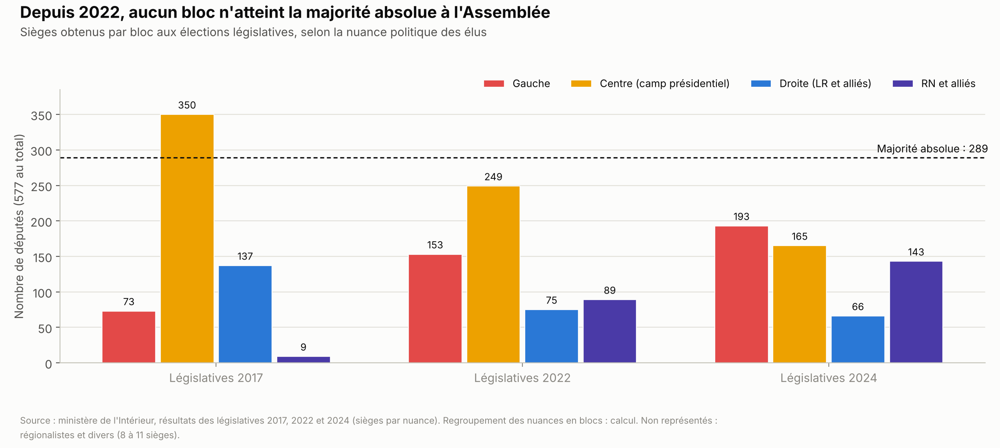
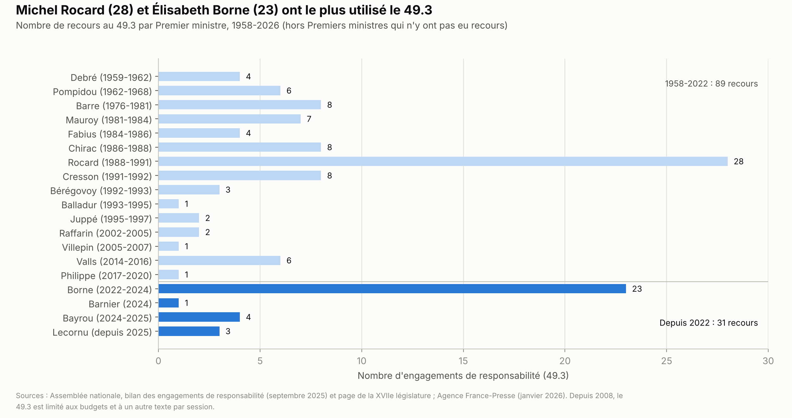
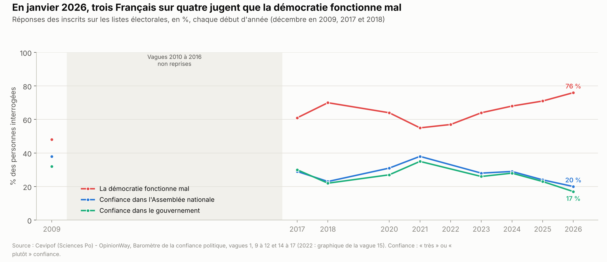
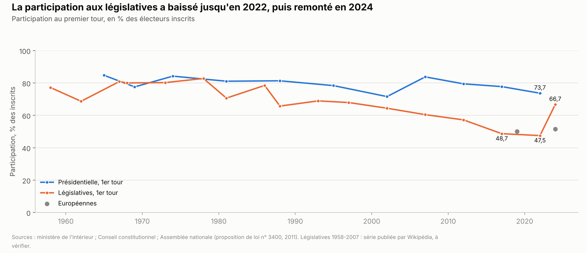

# Institutions : comment la France est gouvernée

*Version de travail du 9 octobre 2026, corrigée le 21 octobre 2026. Les chiffres seront mis à jour à la date d'arrêt des données de l'édition 1.*

Ce chapitre explique qui décide en France : le président, le gouvernement, le Parlement et les juges. Il décrit ce qui a changé depuis que l'Assemblée nationale n'a plus de majorité absolue, puis ce que les partis veulent modifier : la Constitution, le mode de scrutin, le référendum, la place des juges. L'organisation des collectivités locales n'y est pas détaillée.

**Voir aussi :**
- [Présidentielle 2027 : ce que proposent les partis](../partis/programmes_partis_2027.md), pour le calendrier de 2027, les candidats, les sondages et les programmes complets ;
- [Immigration](../immigration/immigration.md), pour le contenu des propositions sur le droit du sol, la « priorité nationale » et l'asile ; ce chapitre-ci décrit la voie juridique pour les adopter ;
- [Finances publiques](../finances-publiques/finances_publiques.md), pour le budget 2027 : ce chapitre-ci décrit la procédure budgétaire (49.3, loi spéciale) ;
- [Défense et Europe](../defense-europe/defense_europe.md), sections 1.7 et 1.8, pour l'Union européenne comme politique et la contribution de la France à son budget ;
- [Sécurité et justice](../securite-justice/securite_justice.md), pour l'organisation de la justice.

> **Repères.**
> - **Le président de la République** est élu pour cinq ans au suffrage universel direct. Il nomme le Premier ministre, peut dissoudre l'Assemblée nationale et soumettre certains projets de loi au référendum[^an-constitution].
> - **Le gouvernement** (le Premier ministre et les ministres) conduit la politique de la nation. Il est responsable devant l'Assemblée nationale, qui peut le renverser. Il n'a pas besoin d'un vote de l'Assemblée pour entrer en fonctions.
> - **Le Parlement** réunit l'Assemblée nationale (577 députés élus pour cinq ans) et le Sénat (348 sénateurs élus pour six ans par des élus locaux)[^an-constitution]. Un projet de loi vient du gouvernement, une proposition de loi d'un parlementaire.
> - **Majorité absolue, majorité relative.** La majorité absolue est la moitié des sièges plus un : 289 députés sur 577. Un camp a une majorité relative quand il est le plus nombreux sans l'atteindre. Les « suffrages exprimés » sont les bulletins valables, hors blancs et nuls.
> - **Loi, décret, ordonnance.** La loi est votée par le Parlement. Le décret est pris par le gouvernement seul. L'ordonnance est un texte du gouvernement qui intervient dans le domaine de la loi, avec l'autorisation du Parlement.
> - **Les juges.**
>   - Le Conseil constitutionnel vérifie que les lois respectent la Constitution.
>   - Le Conseil d'État conseille le gouvernement sur ses projets de loi et juge l'administration.
>   - La Cour de justice de l'Union européenne (CJUE) fait respecter le droit de l'UE.
>   - La Cour européenne des droits de l'homme veille au respect de la Convention européenne des droits de l'homme (CEDH), un traité du Conseil de l'Europe, organisation distincte de l'UE.

---

## L'essentiel

1. **Un président fort quand il a une majorité.** La Constitution de 1958 donne au président des pouvoirs propres : nommer le Premier ministre, dissoudre l'Assemblée, proposer un référendum. Mais gouverner suppose une majorité à l'Assemblée. Sans elle, le pouvoir passe au Premier ministre (cohabitation) ou se négocie texte par texte.
2. **Plus de majorité absolue depuis 2022.** Le camp présidentiel et ses alliés avaient 350 sièges en 2017, 249 en 2022, dont 245 pour la coalition Ensemble. Depuis la dissolution de 2024, aucun bloc n'approche les 289 sièges : en octobre 2026, la gauche en compte 193, le centre 162, le RN et ses alliés 138.
3. **Cinq Premiers ministres depuis les législatives de 2022.** En décembre 2024, un gouvernement a été renversé par une motion de censure, une première depuis 1962. En septembre 2025, un autre est tombé sur un vote de confiance, une première.
4. **Le 49.3 et la loi spéciale.** Le 49.3 fait adopter un texte sans vote, sauf si l'Assemblée renverse le gouvernement. Il a servi 31 fois depuis 2022, surtout pour les budgets. En 2025 et en 2026, l'État a commencé l'année sans budget voté ; une « loi spéciale » lui a permis de lever l'impôt et de payer les dépenses courantes.
5. **Peu de référendums.** La France en a organisé dix depuis 1958, dont celui qui a approuvé la Constitution, et aucun depuis 2005. Le référendum d'initiative partagée, qui suppose 185 parlementaires et ≈ 4,9 millions de soutiens, n'a abouti à aucun vote depuis 2015.
6. **Des règles qui encadrent toute majorité.** Le Conseil constitutionnel censure tout ou partie d'environ une loi sur deux dont il est saisi. Le droit de l'UE prime sur la loi française. Réviser la Constitution suppose l'accord du Sénat, à majorité de droite et du centre, sauf à passer directement par un référendum (article 11), une voie contestée par la plupart des juristes.
7. **Une confiance au plus bas depuis 2017.** En janvier 2026, 20 % des Français disent avoir confiance dans l'Assemblée nationale et 17 % dans le gouvernement. 76 % jugent que la démocratie fonctionne mal.

**Les grandes options en débat.**
- **Le régime** : une VIe République écrite par une constituante (LFI), une « Première République écologique et citoyenne » (Les Écologistes), un Premier ministre investi par l'Assemblée (PS-Place publique), ou la Ve République révisée sur d'autres points (autres partis).
- **Le mode de scrutin** : la proportionnelle (LFI, Les Écologistes, PS-Place publique), avec une prime à la liste en tête (RN), ou le scrutin majoritaire (LR ; Horizons en 2025).
- **Le référendum** : d'initiative citoyenne (LFI, Les Écologistes, PS-Place publique, RN), élargi à tout le domaine de la loi (LR), sur l'immigration (LR, RN, Reconquête) ou sur une règle d'or budgétaire (Renaissance, RN).
- **Les juges et l'Europe** : le dernier mot au peuple ou au Parlement face au Conseil constitutionnel (LR, Reconquête), ou une autre nomination de ses membres (PS-Place publique). Face au droit européen : le droit français d'abord (LR, RN, Reconquête) ou la « désobéissance » à certaines règles (LFI).

---

## 1. La situation

### 1.1 Qui fait quoi : la Ve République

**La Constitution du 4 octobre 1958** a été approuvée par référendum le 28 septembre 1958, avec 82,6 % de oui[^cc-referendums]. Elle a été révisée 25 fois, la dernière le 8 mars 2024 pour inscrire la liberté de recourir à l'interruption volontaire de grossesse[^an-fiche-revision]. Vingt-deux révisions sont passées par le Congrès (les deux assemblées réunies), deux par référendum, et une, en 1960, par une procédure propre à la Communauté française, supprimée depuis *(calcul)*[^senat-revisions].

**Le président de la République** dispose de pouvoirs qu'il exerce seul, sans la signature du Premier ministre (article 19)[^an-constitution] :
- nommer le Premier ministre (article 8) ;
- soumettre un projet de loi au référendum, sur proposition du gouvernement ou des deux assemblées (article 11) ;
- dissoudre l'Assemblée nationale (article 12) ;
- prendre les « pouvoirs exceptionnels » en cas de menace « grave et immédiate » (article 16). Le Conseil constitutionnel recense un seul avis rendu au titre de cet article[^cc-stats] ;
- nommer trois des neuf membres du Conseil constitutionnel, et le saisir.

Il préside le Conseil des ministres, est le chef des armées et négocie les traités (articles 9, 15 et 52)[^an-constitution].

**Le gouvernement** « détermine et conduit la politique de la nation » (article 20). Le Premier ministre dirige son action et prend les décrets (article 21). Le gouvernement est responsable devant l'Assemblée nationale (articles 49 et 50)[^an-constitution]. Le Premier ministre n'a pas besoin d'un vote de l'Assemblée pour entrer en fonctions : il gouverne tant qu'aucune motion de censure n'est adoptée *(lecture du texte)*.

**Le Parlement** vote la loi, contrôle le gouvernement et évalue les politiques publiques (article 24). Un texte passe d'une assemblée à l'autre jusqu'à un accord : c'est la « navette ». En cas de désaccord persistant, le gouvernement peut demander à l'Assemblée de statuer définitivement (article 45). Le Sénat ne peut donc pas bloquer une loi ordinaire. Il a en revanche un droit de veto sur toute révision de la Constitution (article 89) et sur les lois organiques qui le concernent (article 46)[^an-constitution].

**Les textes viennent surtout du gouvernement.** Depuis 1959, 76,5 % des lois promulguées, hors traités, viennent de projets du gouvernement *(calcul)*[^senat-stats-lois]. De 2017 à 2022, le gouvernement a publié 350 ordonnances : elles représentent 58,5 % des textes qui relèvent du domaine de la loi[^senat-ordonnances]. Depuis 2022, il en a publié 73, au 9 octobre 2026[^senat-suivi-ordonnances].

**Les outils du pouvoir, en pratique.** Le tableau ci-dessous détaille les procédures qui se trouvent derrière les leviers « Loi », « Décret », « Budget », « Référendum », « Constitution » et « Président » des tableaux des partis (liste dans le mode d'emploi).

| Levier | Qui décide | Ce qu'il faut | Exemple récent |
|---|---|---|---|
| **Loi ordinaire** | Le Parlement | Un vote de l'Assemblée et du Sénat ; en cas de désaccord, le gouvernement peut donner le dernier mot à l'Assemblée (article 45) | Loi du 11 août 2025 sur l'élection des conseils de Paris, Lyon et Marseille : rejetée deux fois par le Sénat, adoptée par un dernier vote de l'Assemblée[^senat-plm] |
| **Loi organique** | Le Parlement | Un texte qui précise la Constitution ; sans accord, la majorité absolue des députés ; l'accord du Sénat pour les lois qui le concernent ; un contrôle obligatoire du Conseil constitutionnel (article 46) | Loi organique du 28 mai 2026 sur le corps électoral de Nouvelle-Calédonie[^senat-nc-loi-organique] |
| **Décret** | Le gouvernement | Une matière hors du domaine de la loi (article 37), ou l'application d'une loi | Programmation pluriannuelle de l'énergie, février 2026[^bdt-ppe-censure] |
| **Ordonnance** | Le gouvernement | Une autorisation du Parlement (loi d'habilitation) ; l'ordonnance s'applique dès sa publication, devient caduque si le projet de ratification n'est pas déposé à temps, et prend valeur de loi après une ratification expresse (article 38) | 73 ordonnances publiées depuis 2022, dont 11 ratifiées[^senat-suivi-ordonnances] |
| **Budget** | Le Parlement | Un vote dans les délais : 70 jours pour la loi de finances, 50 jours pour la Sécurité sociale ; au-delà, le gouvernement peut appliquer son projet par ordonnance (articles 47 et 47-1) ; à défaut de budget au 1er janvier, une « loi spéciale » autorise à lever l'impôt | Lois spéciales de décembre 2024 et de décembre 2025[^legifiscal-lf2025][^legifiscal-lf2026] |
| **49.3** | Le Premier ministre, après délibération du Conseil des ministres | Le texte est adopté sans vote, sauf si une motion de censure réunit la majorité absolue des députés ; depuis 2008, il est limité aux budgets et à un autre texte par session (article 49, alinéa 3) | Budget 2026, trois recours en janvier 2026[^an-49-3-xviie] |
| **Référendum** | Le président, sur proposition du gouvernement ou des deux assemblées | Un projet de loi sur l'organisation des pouvoirs publics, une réforme de politique économique, sociale ou environnementale, ou la ratification de certains traités (article 11) | Le dernier date du 29 mai 2005[^cc-referendums] |
| **Constitution** | Le président (projet) ou les parlementaires (proposition) | Un vote dans les mêmes termes par l'Assemblée et le Sénat, puis un référendum, ou, pour un projet, un vote du Congrès aux trois cinquièmes des suffrages exprimés (article 89) | Révision du 8 mars 2024 sur l'interruption volontaire de grossesse[^an-fiche-revision] |
| **Dissolution** | Le président seul | Une consultation du Premier ministre et des présidents des assemblées ; pas de nouvelle dissolution dans l'année qui suit les élections (article 12) | 9 juin 2024 |
| **Motion de censure** | Les députés | Une motion signée par un dixième des députés, votée par la majorité absolue des membres de l'Assemblée (article 49, alinéa 2) | Gouvernement Barnier, 4 décembre 2024[^an-scrutin-519] |

*Source des règles : Constitution du 4 octobre 1958, texte en vigueur*[^an-constitution] *(lecture du texte).*

### 1.2 Élire le président, les députés et les sénateurs

**L'élection présidentielle.** Le calendrier de 2027 et les candidats sont présentés dans le chapitre [Partis](../partis/programmes_partis_2027.md), section 1.
- **Les parrainages.** Un candidat doit réunir 500 « présentations » d'élus, venant d'au moins 30 départements ou collectivités d'outre-mer, sans plus de 50 venant d'un même département[^cc-etre-candidat]. Depuis 2016, les noms de tous les parrains sont publiés. En 2022, 13 437 élus ont parrainé un candidat, soit ≈ 32 % des quelque 42 000 élus habilités[^senat-qe-parrainages].
- **Deux tours.** Est élu le candidat qui obtient la majorité absolue des suffrages exprimés. Sinon, un second tour oppose les deux premiers, quatorze jours plus tard (article 7)[^an-constitution].
- **Un mandat de cinq ans.** Le quinquennat a été adopté par le référendum du 24 septembre 2000 : 73,2 % de oui, avec une participation d'≈ 30 % *(calcul)*[^cc-referendums]. Depuis la révision de 2008, « nul ne peut exercer plus de deux mandats consécutifs » (article 6)[^an-constitution].
- **Le financement.** Pour 2027, comme en 2022, les dépenses de campagne sont plafonnées à 16,851 M€ au premier tour et 22,509 M€ au second. L'État rembourse jusqu'à 47,5 % du plafond aux candidats qui obtiennent au moins 5 % des suffrages exprimés (≈ 8 M€ *(calcul)*), et jusqu'à 4,75 % aux autres. Un particulier peut donner au plus 4 600 € ; les dons des entreprises sont interdits[^cnccfp-2027].
- **Le temps de parole.** L'Autorité de régulation de la communication audiovisuelle et numérique (Arcom) impose aux radios et aux télévisions l'équité entre les candidats, puis l'égalité stricte pendant la campagne officielle[^arcom-2022].
- **Le contrôle.** Le Conseil constitutionnel reçoit les parrainages, publie la liste des candidats (loi du 6 novembre 1962) et proclame les résultats (article 58)[^cc-etre-candidat][^an-constitution].

**Les élections législatives** désignent les 577 députés au scrutin uninominal majoritaire à deux tours, dans 577 circonscriptions[^an-fiche-election-deputes].
- Un candidat est élu au premier tour s'il obtient la majorité absolue des voix et au moins un quart des inscrits.
- Pour se maintenir au second tour, il faut au moins 12,5 % des inscrits. Ce seuil a été relevé en 1966, puis fixé à ce niveau en 1976[^an-connaissance-8].
- **L'exception de 1986.** Les législatives de 1986 ont eu lieu à la proportionnelle, par département, avec un seuil de 5 % des voix. La nouvelle majorité est revenue au scrutin majoritaire dès juillet 1986[^an-connaissance-8].

**Voix et sièges.** Le scrutin majoritaire donne au premier parti une part des sièges qui peut s'écarter de sa part des voix, dans un sens ou dans l'autre.

| Élection | Nuance des candidats | Voix au premier tour | Part des 577 sièges *(calcul)* |
|---|---|---|---|
| 2017 | La République en marche et MoDem | 32,3 % | 60,7 % |
| 2017 | La France insoumise | 11,0 % | 2,9 % |
| 2017 | Front national | 13,2 % | 1,4 % |
| 2022 | Ensemble (majorité présidentielle) | 25,8 % | 42,5 % |
| 2022 | Nouvelle union populaire écologique et sociale | 25,7 % | 22,7 % |
| 2022 | RN | 18,7 % | 15,4 % |
| 2024 | Union de la gauche | 28,1 % | 30,8 % |
| 2024 | Ensemble | 20,0 % | 26,0 % |
| 2024 | RN et Union de l'extrême droite (alliés d'Éric Ciotti) | 33,2 % | 24,6 % |

*Sources : ministère de l'Intérieur, résultats des législatives 2017*[^interieur-lg2017]*, 2022*[^interieur-lg2022] *et 2024*[^interieur-lg2024]*. Les nuances sont attribuées aux candidats par les préfectures.*

**Le Sénat** compte 348 sénateurs, élus pour six ans et renouvelés par moitié tous les trois ans[^senat-mode-election]. Ils sont élus par ≈ 172 600 « grands électeurs » : députés, sénateurs, élus régionaux et départementaux, et surtout délégués des conseils municipaux (≈ 95 %)[^senatoriales-2026]. Les départements qui élisent au moins trois sénateurs votent à la proportionnelle ; les autres, au scrutin majoritaire[^senat-mode-election].

### 1.3 La majorité, de 1958 à 2022

**Le « fait majoritaire ».** Pendant l'essentiel de la Ve République, une majorité stable a soutenu le gouvernement. Avant décembre 2024, une seule motion de censure avait été adoptée : le 4 octobre 1962, contre le gouvernement de Georges Pompidou, par 280 voix pour 241 requises[^an-motions-49-2].

**Depuis 2002, les législatives suivent la présidentielle.** Le quinquennat et l'« inversion du calendrier » placent les législatives quelques semaines après la présidentielle. Selon le comité présidé par Édouard Balladur, ils « ont accentué la présidentialisation du régime » (2007)[^rapport-balladur]. De 2002 à 2017, le camp du président a chaque fois obtenu la majorité absolue :
- 2002 : 365 députés pour le groupe de l'Union pour la majorité présidentielle (UMP)[^an-legislatures] ;
- 2007 : 320 pour l'UMP, 343 avec le Nouveau Centre[^an-legislatures] ;
- 2012 : 280 élus socialistes, 314 avec les radicaux et divers gauche *(calcul)*[^interieur-lg2012] ;
- 2017 : 350 pour La République en marche et le MoDem[^interieur-lg2017].

**Les cohabitations.** Quand la majorité de l'Assemblée s'oppose au président, celui-ci nomme un Premier ministre issu de cette majorité. Il garde ses pouvoirs propres (article 19), mais la politique est conduite par le gouvernement. C'est arrivé trois fois : de 1986 à 1988 (François Mitterrand et Jacques Chirac), de 1993 à 1995 (François Mitterrand et Édouard Balladur), de 1997 à 2002 (Jacques Chirac et Lionel Jospin)[^an-49-1].

**Les six dissolutions**

| Date | Président | Contexte | Résultat |
|---|---|---|---|
| Octobre 1962 | Charles de Gaulle | Après la censure du gouvernement Pompidou | Majorité absolue pour l'Union pour la nouvelle République (UNR) et ses alliés : 268 sièges sur 482 *(calcul)* |
| Mai 1968 | Charles de Gaulle | Événements de mai 1968 | Majorité absolue pour le parti gaulliste (Union des démocrates pour la République) seul : 293 sièges sur 487 |
| Mai 1981 | François Mitterrand | Après son élection | Majorité absolue pour le groupe socialiste seul : 285 sièges sur 491 |
| Mai 1988 | François Mitterrand | Après sa réélection | Majorité relative : 275 sièges socialistes pour 289 requis |
| Avril 1997 | Jacques Chirac | Un an avant l'échéance normale | Victoire de la gauche, troisième cohabitation |
| Juin 2024 | Emmanuel Macron | Après les élections européennes | Aucune majorité (section 1.4) |

*Source : Assemblée nationale, effectifs des groupes à l'ouverture de chaque législature*[^an-legislatures]*.*

**Un précédent de gouvernement sans majorité absolue : Michel Rocard (1988-1991).** Les socialistes avaient 275 sièges. Michel Rocard a engagé 28 fois la responsabilité de son gouvernement par le 49.3, sur 13 textes, dont la création de la contribution sociale généralisée (CSG). Cinq motions de censure ont été déposées ; la plus proche de l'adoption a réuni 284 voix pour 289 requises, le 19 novembre 1990[^an-49-3]. Avant 2008, le 49.3 pouvait servir pour n'importe quel texte, sans limite de nombre.

### 1.4 Depuis 2022 : gouverner sans majorité absolue

**2022 : une majorité relative.** Aux législatives de juin 2022, la coalition présidentielle Ensemble obtient 245 sièges, 44 de moins que la majorité absolue *(calcul)*[^interieur-lg2022]. Le gouvernement d'Élisabeth Borne fait adopter par 23 recours au 49.3 les budgets 2023 et 2024, la réforme des retraites de 2023 et la programmation des finances publiques. Le 20 mars 2023, la motion de censure déposée contre la réforme des retraites réunit 278 voix, 9 de moins que la majorité requise ce jour-là (287)[^an-bilan-xvie].

**2024 : la dissolution.** Le 9 juin 2024, après les élections européennes, Emmanuel Macron dissout l'Assemblée[^an-bilan-xvie]. Les législatives des 30 juin et 7 juillet 2024 attirent 66,7 % des inscrits au premier tour, contre 47,5 % en 2022[^interieur-lg2024]. Aucun bloc n'obtient la majorité (graphique de « L'essentiel »).

**L'Assemblée en octobre 2026**

| Groupe | Sièges |
|---|---|
| La France insoumise – Nouveau Front populaire | 70 |
| Écologiste et social | 38 |
| Socialistes et apparentés | 68 |
| Gauche démocrate et républicaine (communistes et ultramarins) | 17 |
| Ensemble pour la République (Renaissance) | 90 |
| Les Démocrates (MoDem) | 37 |
| Horizons & Indépendants | 35 |
| Libertés, indépendants, outre-mer et territoires (LIOT) | 23 |
| Droite républicaine (LR) | 47 |
| Union des droites pour la République (UDR, alliés d'Éric Ciotti) | 17 |
| Rassemblement national | 121 |
| Non-inscrits | 11 |
| Sièges vacants | 3 |

*Source : Assemblée nationale, effectif des groupes politiques, consulté le 9 octobre 2026*[^an-effectifs]*. Groupes regroupés par bloc, comme dans le graphique de « L'essentiel ».*

Les quatre groupes de gauche comptent 193 sièges, les trois groupes du centre 162, le RN et l'UDR 138 *(calcul)*. Aucun ensemble n'atteint 289.

**Les gouvernements depuis 2017**

| Premier ministre | Nomination | Fin | Cause de la fin | Durée *(calcul)* |
|---|---|---|---|---|
| Édouard Philippe | 15 mai 2017 | 3 juillet 2020 | Démission, après les municipales | 1 145 jours |
| Jean Castex | 3 juillet 2020 | 16 mai 2022 | Démission, après la présidentielle | 682 jours |
| Élisabeth Borne | 16 mai 2022 | 9 janvier 2024 | Démission | 603 jours |
| Gabriel Attal | 9 janvier 2024 | 5 septembre 2024 | Démission acceptée le 16 juillet, après les législatives[^jorf-attal] | 240 jours |
| Michel Barnier | 5 septembre 2024 | 13 décembre 2024 | Censure du 4 décembre 2024[^an-scrutin-519] | 99 jours |
| François Bayrou | 13 décembre 2024[^jorf-bayrou] | 9 septembre 2025 | Confiance refusée le 8 septembre 2025[^an-scrutin-3054] | 270 jours |
| Sébastien Lecornu | 9 septembre 2025 ; de nouveau le 10 octobre 2025[^gouv-lecornu-nomme] | En fonctions au 9 octobre 2026 | Démission le 6 octobre 2025, puis nouvelle nomination | 395 jours depuis la première nomination |

*Sources : Assemblée nationale, bilan des engagements de responsabilité*[^an-49-3] *; Journal officiel et site du gouvernement pour les dates signalées.*

**Des périodes d'« affaires courantes ».** Un gouvernement démissionnaire se limite aux affaires courantes jusqu'à la formation du suivant. À l'été 2024, cette période a duré ≈ 51 jours, « le plus long » interrègne depuis 1945 selon Le Club des juristes[^cdj-affaires-courantes]. Du 9 septembre au 12 octobre 2025, la France a eu un gouvernement de plein exercice pendant moins de 24 heures *(calcul)*.

**Une censure, puis une confiance refusée.**
- **Le 4 décembre 2024**, l'Assemblée adopte une motion de censure contre le gouvernement de Michel Barnier, par 331 voix, après un 49.3 sur le budget de la Sécurité sociale[^an-scrutin-519]. C'est la deuxième censure de la Ve République.
- **Le 8 septembre 2025**, François Bayrou engage la responsabilité de son gouvernement sur une déclaration de politique générale (article 49, alinéa 1). L'Assemblée la rejette par 364 voix contre 194[^an-scrutin-3054]. Les 41 votes de confiance précédents, depuis 1958, avaient tous été gagnés[^an-49-1].

**Le gouvernement Lecornu.** Sébastien Lecornu est nommé le 9 septembre 2025. Son premier gouvernement, annoncé le 5 octobre, démissionne le lendemain. Renommé le 10 octobre, il forme un nouveau gouvernement le 12 octobre, remanié le 26 février 2026[^gouv-composition]. Dans sa déclaration de politique générale du 14 octobre 2025, il ne demande pas de vote de confiance et dit : « J'avais renoncé à utiliser l'article 49 alinéa 3 de la Constitution. » ; « Le Gouvernement proposera, nous débattrons, vous voterez. »[^gouv-dpg-lecornu]
- Au 9 octobre 2026, au moins 13 motions de censure ont été déposées contre ses gouvernements, toutes rejetées. La plus suivie a réuni 271 voix, le 16 octobre 2025[^an-scrutin-3058].
- Le groupe socialiste ne les a pas votées en tant que groupe. En juillet 2026, 20 socialistes ont voté une motion des Écologistes qui reprochait au gouvernement son inaction pour le climat *(source secondaire)*[^lcp-censure-juillet-2026].

**Le 49.3 depuis 2022** (graphique ci-dessous) : 23 recours pour Élisabeth Borne, aucun pour Gabriel Attal, 1 pour Michel Barnier, 4 pour François Bayrou et 3 pour Sébastien Lecornu, soit 31[^an-49-3][^an-49-3-xviie]. Le 19 janvier 2026, le gouvernement Lecornu décide d'y recourir pour le budget 2026, rejeté en première lecture *(source secondaire)*[^lcp-49-3-janvier]. Le 23 janvier, Sébastien Lecornu le présente comme « un instrument de dernier recours, pour ne pas dire de dernier secours » *(source secondaire)*[^publicsenat-49-3-janvier].

**Les budgets.**
- **2023 et 2024** : les budgets de l'État et de la Sécurité sociale ont été adoptés par le 49.3, avec cinq recours chaque année pour chacun[^an-bilan-xvie].
- **2025** : le gouvernement Barnier est censuré avant l'adoption. Une loi spéciale est votée le 20 décembre 2024 ; le budget de l'État est adopté par le 49.3 et promulgué le 14 février 2025 *(source secondaire)*[^legifiscal-lf2025]. François Bayrou a engagé quatre fois sa responsabilité, les 3, 5 et 10 février 2025[^an-49-3-xviie].
- **2026** : le projet est rejeté en première lecture le 22 novembre 2025. Une loi spéciale est votée le 27 décembre 2025, puis le budget est adopté après trois 49.3, par la loi du 19 février 2026 *(source secondaire)*[^legifiscal-lf2026]. Le budget de la Sécurité sociale, lui, est adopté par un vote, sans 49.3 : 247 voix contre 232, le 16 décembre 2025 *(source secondaire)*[^euronews-lfss2026].
- **2027** : le projet a été présenté en Conseil des ministres le 1er octobre 2026[^cm-2026-10-01] ; la commission des finances l'examine depuis le 7 octobre *(source secondaire)*[^moneyvox-debats-2027]. Le 17 septembre, Sébastien Lecornu s'est engagé, selon l'Agence France-Presse (AFP), à n'utiliser ni le 49.3 ni les ordonnances budgétaires, s'il n'y a pas d'« obstruction parlementaire » *(source secondaire)*[^sudradio-lecornu-budget]. Interrogé le 4 octobre sur un recours aux ordonnances, le ministre de l'Économie, Roland Lescure, répond : « Peut-être par 49.3, on verra » *(source secondaire)*[^moneyvox-lescure]. Selon l'AFP, aucune ordonnance budgétaire n'a été prise sous la Ve République *(paraphrase)*[^moneyvox-debats-2027]. Le 12 octobre, selon Le Club des juristes, le Premier ministre a annoncé qu'il pourrait recourir au 49.3 *(paraphrase, source secondaire)*[^cdj-budget-2027-1310]. Le vote de l'Assemblée sur la partie « recettes », prévu le 20 octobre, est reporté *(source secondaire)*[^lcp-vote-recettes-reporte]. Le détail est dans le chapitre [Finances publiques](../finances-publiques/finances_publiques.md), section 1.8.

**Des lois continuent d'être votées.** La loi créant une aide à mourir a été adoptée définitivement le 15 juillet 2026 *(source secondaire)*[^lcp-aide-a-mourir]. En revanche, les révisions de la Constitution n'aboutissent pas :
- **Nouvelle-Calédonie.** Le projet issu de l'accord de Bougival (juillet 2025), adopté par le Sénat, a été rejeté par l'Assemblée le 2 avril 2026[^senat-rapport-630]. Selon une analyse universitaire, une motion de rejet préalable a été adoptée par 190 voix contre 107 *(source secondaire)*[^devpolicy-bougival].
- **Corse.** Le projet « pour une Corse autonome au sein de la République », adopté par l'Assemblée le 23 juin 2026, doit être examiné par le Sénat à partir du 26 octobre[^senat-corse].
- **La procédure budgétaire.** Une proposition de révision adoptée par le Sénat le 26 février 2026 n'a pas été examinée par l'Assemblée au 9 octobre 2026[^senat-ppl-doineau].

**Après l'élection de 2027.** Le président élu pourra dissoudre l'Assemblée dès son entrée en fonctions : le délai d'un an qui suivait les législatives de 2024 a pris fin en juillet 2025 (article 12) *(lecture du texte)*[^an-constitution]. Les élections auraient lieu 20 à 40 jours plus tard. Sans dissolution, l'Assemblée élue en 2024 siège jusqu'en 2029. Si les électeurs donnent la majorité aux opposants du président, une cohabitation s'ouvre (section 1.3).

### 1.5 Le Sénat et la révision de la Constitution

**Le renouvellement du 27 septembre 2026** a porté sur 178 sièges[^senat-renouvellement-2026]. Après l'élection :
- Les Républicains (124 sénateurs) et l'Union centriste et indépendants (63) détiennent ensemble 187 sièges sur 348, au-dessus de la majorité absolue de 175 *(calcul)*. Avec Les Indépendants (15), la droite et le centre en comptent 202[^senat-groupes].
- La gauche (socialistes, communistes, écologistes) compte 95 sièges *(calcul)*[^senat-groupes].
- Un groupe lié au RN et à l'UDR, l'Union nationale pour les territoires, est créé avec 15 sénateurs[^senat-groupes] ; le lien avec ces partis est rapporté par la presse *(source secondaire)*[^publicsenat-groupes-2026].
- Gérard Larcher (LR) est réélu président du Sénat le 1er octobre 2026, avec 203 voix sur 302 suffrages exprimés[^senat-renouvellement-2026].

**Pourquoi c'est important.** Toute révision par l'article 89 doit être votée dans les mêmes termes par le Sénat. Puis il faut un référendum ou, pour un projet du président, les trois cinquièmes des suffrages exprimés au Congrès : si les 925 parlementaires votent, 555 voix *(calcul)*[^an-constitution]. En 2023, une proposition de révision de Bruno Retailleau sur l'immigration a été retirée faute du soutien des sénateurs centristes *(source secondaire)*[^publicsenat-retailleau-faisable].

### 1.6 Le référendum

**Trois voies existent dans la Constitution**[^an-constitution].
- **L'article 11** permet au président de soumettre un projet de loi au peuple, sur proposition du gouvernement ou des deux assemblées. Le champ est limité : l'organisation des pouvoirs publics ; les « réformes relatives à la politique économique, sociale ou environnementale de la nation » ; certains traités. La politique économique et sociale a été ajoutée en 1995, l'environnement en 2008[^senat-revisions]. Selon la lecture dominante chez les juristes, l'immigration n'entre pas, en tant que telle, dans ce champ ; le Conseil constitutionnel a en revanche admis en 2024 que les prestations sociales des étrangers relevaient de la « politique sociale » (voir plus bas)[^cdj-referendum-2025].
- **L'article 89** prévoit un référendum pour approuver une révision de la Constitution, après le vote des deux assemblées.
- **Le référendum d'initiative partagée** (RIP, article 11, depuis 2008, appliqué depuis 2015) part d'une proposition de loi d'un cinquième des parlementaires (185), soutenue par un dixième des électeurs inscrits, soit ≈ 4,9 millions de personnes en 2023. La collecte dure neuf mois. Si le Parlement n'examine pas le texte dans les six mois, le président doit le soumettre au référendum[^senat-rapport-99].

**Les référendums nationaux depuis 1958**

| Date | Objet | Oui (% des exprimés) | Participation *(calcul)* |
|---|---|---|---|
| 28 septembre 1958 | Constitution de la Ve République | 82,6 | 80,6 % |
| 8 janvier 1961 | Autodétermination de l'Algérie | 75,0 | 73,8 % |
| 8 avril 1962 | Accords d'Évian | 90,8 | 75,3 % |
| 28 octobre 1962 | Élection du président au suffrage universel direct | 62,3 | 77,0 % |
| 27 avril 1969 | Réforme du Sénat et régionalisation | 47,6 (**rejet**) | 80,1 % |
| 23 avril 1972 | Élargissement de la Communauté économique européenne | 68,3 | 60,2 % |
| 6 novembre 1988 | Statut de la Nouvelle-Calédonie | 80,0 | 36,9 % |
| 20 septembre 1992 | Traité de Maastricht | 51,0 | 69,7 % |
| 24 septembre 2000 | Quinquennat (article 89) | 73,2 | 30,2 % |
| 29 mai 2005 | Traité établissant une Constitution pour l'Europe | 45,3 (**rejet**) | 69,4 % |

*Source : Conseil constitutionnel*[^cc-referendums]*. De 1961 à 2005, tous ont été organisés sur la base de l'article 11, sauf celui de 2000*[^interieur-referendum]*. Les consultations de Nouvelle-Calédonie de 2018, 2020 et 2021 étaient locales.*

**L'article 11 pour réviser la Constitution : une voie contestée.**
- En 1962, le général de Gaulle a fait réviser la Constitution par l'article 11, malgré un avis défavorable du Conseil d'État[^senat-rapport-91]. Le Conseil constitutionnel s'est déclaré incompétent pour contrôler la loi adoptée, « expression directe de la souveraineté nationale »[^cc-62-20]. La tentative de 1969 a été rejetée par les électeurs.
- Depuis la décision « Hauchemaille » de 2000, le Conseil constitutionnel accepte d'examiner, avant le vote, les recours contre les décrets qui organisent un référendum[^cc-2000-21-ref]. Le Conseil d'État, lui, s'estime incompétent[^ce-larrouturou]. Le Conseil constitutionnel n'a annulé aucun décret de convocation sur le fond[^cdj-referendum-2025].
- Selon un rapport du Sénat d'octobre 2025, la thèse selon laquelle l'article 11 ne permet pas de réviser la Constitution reste « majoritaire dans la doctrine », c'est-à-dire chez les juristes universitaires[^senat-rapport-91]. Le 6 novembre 2025, le Sénat a rejeté, par 213 voix contre 131, une proposition socialiste qui réservait la révision à l'article 89 ; le gouvernement estimait que la jurisprudence l'impose déjà *(paraphrase)*[^senat-rapport-91][^senat-cra-2025-11-06].

**Le référendum d'initiative partagée : aucun vote en onze ans.** Sept propositions ont été soumises au Conseil constitutionnel depuis 2019 ; six ont été jugées non conformes[^cdj-rip-fin-de-vie].
- **Aéroports de Paris (2019-2020).** Seule proposition validée, elle a recueilli 1 093 030 soutiens pour 4 717 396 requis, soit ≈ 23 % *(calcul)*[^cc-2019-1-rip][^an-rapport-tavel].
- **Retraites (2023) et fin de vie (2026).** Les deux propositions sur l'âge de départ à 62 ans ont été rejetées : elles ne changeaient pas l'état du droit à la date de leur dépôt[^cdj-rip-retraites]. En juin 2026, le Conseil a jugé que « les questions, d'ordre éthique, relatives à la fin de vie » n'entrent pas dans le champ de l'article 11 *(source secondaire)*[^lcp-rip-fin-de-vie].
- **Prestations sociales des étrangers (2024).** Le Conseil a admis que le sujet relevait de la « politique sociale », mais a jugé qu'exiger cinq ans de résidence portait « une atteinte disproportionnée » aux droits garantis par le préambule de 1946[^cc-2024-6-rip].

### 1.7 La Constitution et ses juges

**Le Conseil constitutionnel** compte neuf membres, nommés pour neuf ans : trois par le président de la République, trois par le président de l'Assemblée, trois par celui du Sénat. Depuis 2008, les commissions parlementaires peuvent bloquer une nomination aux trois cinquièmes des voix. Les anciens présidents de la République en sont membres de droit. Le président du Conseil est nommé par le président de la République (article 56)[^an-constitution]. En octobre 2026, c'est Richard Ferrand[^cc-2026-335-l].

**Comment il est saisi.**
- **Avant la promulgation d'une loi** : par le président, le Premier ministre, les présidents des assemblées, ou 60 députés ou 60 sénateurs depuis 1974 (article 61)[^an-constitution].
- **Après la promulgation** : depuis le 1er mars 2010, tout justiciable peut contester une loi déjà en vigueur, par une question prioritaire de constitutionnalité (QPC), transmise par le Conseil d'État ou la Cour de cassation (article 61-1)[^cc-bilan-stat].

**Ce qu'il décide**

| | Lois examinées avant promulgation (depuis 1959) | Questions prioritaires de constitutionnalité (depuis 2010) |
|---|---|---|
| Nombre de décisions | 901 | 1 091 |
| Conformes | 51,5 % | 63,9 % |
| Censure partielle | 45,2 % | 7,2 % |
| Censure totale | 2,2 % | 24,7 % |

*Source : Conseil constitutionnel, bilan statistique au 30 juin 2026*[^cc-bilan-stat]*. Pourcentages : calcul. Les décisions restantes (≈ 1 % et 4 %) ont une autre issue.*

**Deux exemples sur l'immigration.**
- **La loi immigration de janvier 2024.** Sur 86 articles, le Conseil en a censuré 35, en tout ou partie. Trente-deux l'ont été comme « cavaliers législatifs » : des amendements sans lien avec le projet initial. Trois l'ont été sur le fond[^cc-2023-863-cp]. Une censure pour cavalier ne dit rien de la conformité du contenu à la Constitution.
- **Une jurisprudence ancienne.** En 1993, le Conseil a jugé qu'aucun principe constitutionnel n'assure aux étrangers « des droits de caractère général et absolu d'accès et de séjour ». Il a ajouté qu'ils ont droit à la protection sociale « dès lors qu'ils résident de manière stable et régulière » en France[^cc-93-325].

**Le Conseil d'État** donne un avis sur chaque projet de loi avant son adoption en Conseil des ministres (article 39)[^an-constitution]. Cet avis ne lie pas le gouvernement ; beaucoup de ces avis sont rendus publics[^ce-avis-liste]. En juillet 2025, par exemple, il a émis de nombreuses réserves sur le projet de révision pour la Corse *(paraphrase)*[^ce-avis-corse]. Il juge aussi l'administration et peut annuler un décret.

### 1.8 Le droit européen et la Convention européenne des droits de l'homme

**Le droit de l'Union européenne prime sur la loi française.**
- La Cour de justice l'a posé en 1964 : le droit issu des traités ne peut « se voir judiciairement opposer un texte interne quel qu'il soit »[^eurlex-costa]. La Constitution prévoit, de son côté, que les traités ont « une autorité supérieure à celle des lois » (article 55) et que la France participe à l'Union (article 88-1)[^an-constitution].
- **La réserve française.** Une directive est un texte européen que chaque État doit reprendre dans son droit (la « transposer »). Le Conseil constitutionnel admet qu'une loi qui transpose une directive ne peut aller contre un principe « inhérent à l'identité constitutionnelle de la France ». Il en a reconnu un seul, en 2021 : l'interdiction de confier à des personnes privées des pouvoirs de police administrative générale[^rgd-air-france]. En 2025, il a jugé que le droit d'asile n'en faisait pas partie, parce que le droit de l'UE le protège aussi *(source secondaire)*[^landot-2025].
- **Le Conseil d'État** place la Constitution au sommet de l'ordre juridique français. Il refuse de vérifier si la Cour de justice a dépassé ses compétences[^ce-fdn].
- **Les sanctions.** Si un État ne respecte pas un arrêt de la Cour de justice, la Commission peut demander une amende et une astreinte (articles 258 à 260 du traité sur le fonctionnement de l'UE) *(lecture du texte)*[^tfue-260]. L'astreinte est une pénalité par période de retard. La France a ainsi été condamnée en 2005 à payer 20 M€, plus 57,8 M€ par semestre de retard, pour des contrôles de pêche insuffisants[^cjue-merluchons].
- **Un exemple de contrainte.** La directive de 2003 sur les résidents de longue durée leur garantit l'égalité de traitement avec les nationaux pour la sécurité sociale et l'aide sociale. Elle permet de la limiter aux « prestations essentielles » pour l'aide et la protection sociales (article 11)[^eurlex-2003-109] *(lecture du texte)*.

**La Convention européenne des droits de l'homme** est un traité du Conseil de l'Europe (46 États), distinct de l'UE. La France l'a ratifiée en 1974[^echr-france-fiche].
- **Les condamnations.** En 2025, la Cour européenne des droits de l'homme a rendu 20 arrêts concernant la France, dont 10 constatent au moins une violation. La même année, elle en a rendu 160 constatant une violation contre l'Ukraine, 153 contre la Russie et 66 contre la Turquie[^echr-france-fiche][^echr-violations-2025]. Au 1er juillet 2026, 681 requêtes contre la France étaient en attente[^echr-france-fiche].
- **Rapporté à la population**, la France reçoit 0,13 requête pour 10 000 habitants en 2025, contre 0,43 en moyenne[^echr-annual-2025].
- **Les expulsions.** En 2025, la Cour a reçu 50 demandes de mesures urgentes contre la France liées à une expulsion ou une extradition ; elle en a accordé 4[^echr-art39].
- **Sortir de la Convention** est possible avec un préavis de six mois (article 58)[^echr-convention]. La Russie a cessé d'y être partie le 16 septembre 2022, après son exclusion du Conseil de l'Europe[^echr-russie].
- **Le débat de 2025-2026.** Le 15 mai 2026, les 46 États du Conseil de l'Europe, dont la France, ont adopté par consensus une déclaration sur la Convention et la migration. Elle affirme leur « droit souverain indéniable de contrôler l'entrée et le séjour des ressortissants étrangers » *(traduction)*. Elle ne modifie pas la Convention[^coe-chisinau].

### 1.9 Confiance et participation

**La confiance** (graphique ci-dessous). Le baromètre du Centre de recherches politiques de Sciences Po (Cevipof) interroge chaque début d'année des électeurs inscrits. En janvier 2026[^cevipof-v17] :
- 22 % des Français disent avoir confiance dans « la politique », contre 45 % des Allemands et 40 % des Italiens ;
- 76 % jugent que la démocratie fonctionne mal en France, contre 47 % en Allemagne et 59 % en Italie ;
- la confiance varie selon les institutions : 58 % pour le conseil municipal, 36 % pour le Conseil constitutionnel, 26 % pour le Sénat, 20 % pour l'Assemblée nationale, 17 % pour le gouvernement, 15 % pour les partis ;
- 58 % se disent d'accord pour changer de Constitution, 65 % pour renforcer le Parlement face au gouvernement, 81 % pour associer davantage les citoyens aux grandes décisions *(paraphrase)*.

Selon Public Sénat, la même enquête trouve 79 % de Français favorables à un recours plus fréquent au référendum *(source secondaire)*[^publicsenat-cevipof-2026]. Elle trouve aussi 36 % de Français qui jugent bonne l'idée d'« un homme fort qui n'a pas à se préoccuper du Parlement ni des élections »[^publicsenat-cevipof-2026]. Ce dernier chiffre était de 41 % en 2025[^cevipof-v16].

**Les réponses dépendent de la question posée.**
- **Changer de République.** 56 % des Français se disent favorables à une « VIe République » (Odoxa, décembre 2024)[^odoxa-vi-republique]. Mais plus de sept sur dix se disent attachés aux institutions de la Ve République ; 59 % veulent les adapter, 36 % les réformer en profondeur (Ipsos, mars 2025)[^ipsos-2025].
- **La proportionnelle.** 75 % y sont favorables (Odoxa, mai 2025) *(source secondaire)*[^odoxa-proportionnelle-2025]. Quand on propose trois systèmes, 37 % préfèrent le scrutin actuel, 35 % une proportionnelle nationale et 26 % un système mixte (Elabe, juillet 2024)[^elabe-montaigne-2024].
- **Le 49.3.** 69 % s'opposent à ce que le Premier ministre puisse faire adopter un texte sans vote (même enquête Elabe)[^elabe-montaigne-2024].

**La participation** (graphique ci-dessous).
- **La présidentielle** mobilise le plus : 73,7 % des inscrits ont voté au premier tour de 2022[^cc-2022-195-pdr].
- **Les législatives** ont attiré moins de la moitié des inscrits en 2017 et en 2022 (47,5 % au premier tour, un plus bas). La participation est remontée à 66,7 % en 2024, après la dissolution[^interieur-lg2022][^interieur-lg2024].
- **Les européennes** : 50,1 % en 2019, 51,5 % en 2024[^interieur-eu2019][^interieur-eu2024].

### 1.10 Ailleurs en Europe

**Le mode de scrutin.** Selon la classification reprise par Wikipédia, la France est le seul pays de l'UE à élire toute sa chambre basse au scrutin majoritaire. Vingt-deux pays utilisent la proportionnelle et quatre un système mixte : l'Allemagne, la Hongrie, l'Italie et la Lituanie *(à vérifier)*[^wiki-systemes-electoraux]. Hors de l'UE, le Royaume-Uni élit ses députés au scrutin majoritaire à un tour.

**Le chef de l'État.** Quatorze pays de l'UE élisent leur président au suffrage universel direct *(à vérifier)*[^wiki-systemes-electoraux]. Dans la plupart, comme en Autriche ou en Irlande, il a peu de pouvoirs. Le politiste Maurice Duverger a appelé « semi-présidentiel » le régime où un président élu, doté de pouvoirs importants, coexiste avec un gouvernement responsable devant le Parlement *(paraphrase)*[^wiki-semi-presidentiel].

**Le nombre de parlementaires**

| Pays | Députés (chambre basse) | Députés par million d'habitants *(calcul)* | Parlementaires des deux chambres par million *(calcul)* |
|---|---|---|---|
| France | 577 | 8,4 | 13,5 |
| Allemagne | 630 | 7,5 | 7,5 (le Bundesrat réunit des membres des gouvernements régionaux) |
| Italie | 400 (630 avant 2022) | 6,8 | 10,3 |
| Espagne | 350 | 7,1 | ≈ 12,5 |
| Pays-Bas | 150 | 8,3 | 12,5 |
| Pologne | 460 | 12,6 | 15,3 |

*Sources : nombre de sièges, Wikipédia*[^wiki-legislatures] *(à vérifier) ; population au 1er janvier 2025, Eurostat*[^eurostat-pop-ue]*.*

**Lier un texte à la confiance.** D'autres pays permettent au gouvernement d'engager son existence sur un texte. En Italie, la « question de confiance » fait voter un texte sans amendements ; si elle est refusée, le gouvernement démissionne. À la différence du 49.3, les députés doivent alors voter pour le texte *(source secondaire, à vérifier)*[^wiki-questione-fiducia].

---

## 2. Ce qui fait débat

### Question 1. Changer de République ou corriger la Ve ?

**Pour un changement de régime**, plusieurs partis de gauche décrivent un pouvoir trop concentré :
- LFI veut « passer à une 6e République qui soit un régime parlementaire stable »[^lfi-aec-2025] ;
- le projet du PS juge la Ve République « à bout de souffle » et parle d'« hyper-présidentialisme »[^ps-projet] ;
- Les Écologistes critiquent des « institutions monarchiques d'un autre âge »[^ecologistes-projet].

Le comité Balladur relevait dès 2007 que le quinquennat et le calendrier électoral avaient renforcé le rôle du président (section 1.3). En janvier 2026, 58 % des Français se disent d'accord pour changer de Constitution (section 1.9).

**Pour garder la Ve République**, ses défenseurs mettent en avant sa stabilité de 1962 à 2022 et sa capacité à s'adapter : elle a fonctionné avec une majorité absolue, une majorité relative et trois cohabitations. Bruno Retailleau (LR) estime : « Les institutions de la Ve République sont bonnes, c'est leur dévoiement qui a conduit à cette situation »[^lr-retailleau-figaro]. Plus de sept Français sur dix se disent attachés à ces institutions, tout en souhaitant les adapter (section 1.9).

**Entre les deux**, certains proposent de rééquilibrer les pouvoirs sans tout réécrire. Boris Vallaud, président du groupe socialiste à l'Assemblée, veut un régime « authentiquement primo-ministériel » ; selon lui, la VIe République « ne naîtra pas d'un coup de force ou d'un rêve constitutionnel » *(source secondaire)*[^lcp-vallaud-note].

**La contrainte de procédure** est la même pour tous : une révision par l'article 89 exige l'accord du Sénat, et l'article 11 est une voie contestée (sections 1.5 et 1.6).

### Question 2. Faut-il élire les députés à la proportionnelle ?

**Les arguments pour.**
- **La représentativité.** Le scrutin majoritaire peut donner au premier parti une part des sièges éloignée de sa part des voix : 60,7 % des sièges pour 32,3 % des voix en 2017 (section 1.2). Pour Raphaël Glucksmann (Place publique), la proportionnelle offre « une représentativité infiniment plus démocratique que le système actuel » *(source secondaire)*[^gazette-glucksmann-proportionnelle].
- **Le compromis.** Selon lui, « la proportionnelle, c'est la clarification, c'est l'esprit de compromis »[^gazette-glucksmann-proportionnelle]. Boris Vallaud estime que le scrutin proportionnel « porte en lui la nécessité du compromis » *(source secondaire)*[^lcp-vallaud-note].
- **La pratique européenne.** La plupart des pays de l'UE élisent leurs députés à la proportionnelle (section 1.10).

**Les arguments contre.**
- **L'instabilité.** Pour Bruno Retailleau (LR), la proportionnelle risque d'« enkyster de façon définitive l'instabilité parlementaire et gouvernementale ». Pour Paul Christophe, président du groupe Horizons, « on observe les effets sans majorité, avec une difficulté à faire passer des textes » *(source secondaire)*[^publicsenat-bayrou-proportionnelle].
- **L'éparpillement.** En 1986, le rapporteur du Sénat reprenait l'argument voté par le Sénat en 1985 : la proportionnelle favorise « la dispersion des suffrages et l'émiettement de la représentation nationale ». Il rappelait l'engagement de la nouvelle majorité de dégager « une majorité claire et connue de tous »[^senat-larche-1986].
- **Les coalitions longues à former.** En Belgique ou aux Pays-Bas, former un gouvernement a pris plusieurs mois, parfois plus d'un an (section 4.6).

**Ce que montrent les faits.** De 2002 à 2017, le scrutin majoritaire a donné chaque fois la majorité absolue au camp du président (section 1.3). L'Assemblée actuelle, sans majorité absolue, a aussi été élue au scrutin majoritaire. Les systèmes proposés diffèrent :
- proportionnelle par département, comme en 1986, que François Bayrou préférait en 2025 *(source secondaire)*[^lcp-bayrou-proportionnelle] ;
- par région (Les Écologistes, Place publique) ;
- nationale, avec des sections départementales (LFI, selon Manuel Bompard) ;
- système mixte, avec des députés de circonscription et des sièges de compensation (PS, MoDem) ;
- avec une prime de sièges pour la liste arrivée en tête (RN).

Le mode d'élection des députés relève d'une loi ordinaire (article 34)[^an-constitution] : une majorité à l'Assemblée suffit, si le gouvernement lui donne le dernier mot.

### Question 3. Faut-il plus de référendums, ou un référendum d'initiative citoyenne ?

**Les arguments pour.**
- **Une demande dans les sondages.** En mai 2025, 83 % des Français se disaient favorables « sur le principe » à un référendum (Elabe)[^elabe-referendum-2025]. En janvier 2026, 79 % souhaitaient un recours plus fréquent au référendum *(source secondaire)*[^publicsenat-cevipof-2026].
- **Aucun vote depuis 2005.** Aucun référendum national depuis 2005 ; aucun référendum d'initiative partagée organisé en onze ans (section 1.6). Le groupe Écologiste et social écrit : « Il n'y a pas eu de référendum national en France depuis 20 ans. »[^ecolo-groupe-ric]

**Les arguments contre, ou les précautions.**
- **La Constitution.** Pour Guillaume Gouffier Valente (Ensemble pour la République), « la Constitution ne doit être modifiée que la main tremblante » ; Agnès Firmin Le Bodo (Horizons) emploie la même image[^an-cr-lois-2026-02-04].
- **La démocratie représentative.** Élisabeth de Maistre (Droite républicaine) estime que le référendum d'initiative citoyenne contourne la démocratie représentative : « il la contourne, l'affaiblit et la marginalise »[^an-cr-lois-2026-02-04]. Éric Martineau (MoDem) craint « une procédure de contestation quasi systématique »[^an-cr-lois-2026-02-04].
- **Le référendum révocatoire.** En 2022, le même député, alors nommé Guillaume Gouffier-Cha, l'a jugé « juridiquement inopérant, politiquement irresponsable et philosophiquement contradictoire »[^an-rapport-corbiere-2022].

**Ce que montrent les expériences.** En Suisse, environ une initiative populaire sur dix est acceptée. En Italie, la plupart des référendums échouent faute d'atteindre la participation minimale de 50 % (section 4.7). En France, le Conseil constitutionnel a écarté six propositions de référendum d'initiative partagée sur sept, faute d'entrer dans le champ de l'article 11 ou pour atteinte à la Constitution (section 1.6).

### Question 4. Qui a le dernier mot : les juges, le Parlement ou le peuple ?

**Pour donner le dernier mot aux élus ou au peuple.**
- Bruno Retailleau (LR) : « Nous tombons dans le gouvernement des juges ! » ; selon lui, « le juge ne peut pas se substituer au législateur »[^lr-retailleau-figaro].
- Reconquête présente sa proposition sous le titre « Rétablir la démocratie contre le gouvernement des juges »[^reconquete-programme].
- Jordan Bardella (RN) juge qu'un blocage de son référendum par le Conseil constitutionnel serait « un coup de force extrêmement grave » *(source secondaire)*[^sudradio-afp-rn-referendum].
- Pour le droit européen, Bruno Retailleau exclut un « Frexit juridique », mais veut un « bouclier » contre les « interprétations abusives » des juges européens[^lr-retailleau-figaro].

**Pour préserver le rôle des juges.**
- Les Écologistes parlent de l'État de droit, principe qui soumet les gouvernants au droit et au contrôle des juges. Leur position : « Nous voulons au contraire le défendre car il est le fondement de notre capacité à tenir ensemble, à faire communauté. » *(source secondaire)*[^gazette-afp-ecologistes]
- Yaël Braun-Pivet (Renaissance), présidente de l'Assemblée : « Depuis des mois et des mois, certains hommes ou femmes politiques attaquent le Conseil constitutionnel » ; la Constitution est « notre bien le plus précieux » *(source secondaire)*[^publicsenat-retailleau-copernic].
- Le juriste Nicolas Hervieu (Sciences Po) craint que la Constitution ne soit plus un bouclier « contre les foucades de majorités ponctuelles » *(source secondaire)*[^publicsenat-retailleau-copernic].
- Selon le juriste Mathieu Carpentier, faire primer le droit national pourrait poser « la question de la sortie de la France de l'Union européenne » *(source secondaire)*[^publicsenat-retailleau-faisable].

**Ce que montrent les chiffres.** Le Conseil constitutionnel censure souvent une partie d'une loi, rarement une loi entière (2,2 % des décisions depuis 1959). Une partie des censures porte sur la procédure, comme les « cavaliers » de la loi immigration (section 1.7). Pour le droit européen, la Cour de justice juge qu'un État ne peut pas invoquer sa Constitution pour écarter les valeurs communes de l'Union. La Pologne, la Hongrie et l'Allemagne l'ont pourtant contestée, sans quitter l'Union (section 4.8).

---

## 3. Ce que proposent les partis

*Les partis sont présentés dans l'ordre où leurs groupes siègent à l'Assemblée nationale, de gauche à droite ; Reconquête, qui n'a pas de groupe, vient en dernier. Les positions sont celles connues au 9 octobre 2026, complétées le 12 octobre. LFI publie la nouvelle version de son programme le 6 novembre 2026, avec un chapitre sur la démocratie *(source secondaire)*[^lcp-lfi-programme-2026]. Le candidat du PS et de Place publique, Raphaël Glucksmann, a été désigné le 11 octobre (chapitre [Partis](../partis/programmes_partis_2027.md), section 1.2). Le contenu des propositions sur l'immigration est détaillé dans le chapitre [Immigration](../immigration/immigration.md) ; ce chapitre-ci en décrit la voie juridique.*

### Vue d'ensemble

| Parti | Régime | Mode de scrutin | Référendum | Juges et droit européen |
|---|---|---|---|---|
| **LFI** | VIe République par une constituante ; fin du 49.3 | Proportionnelle ; vote à 16 ans ; vote obligatoire | Référendum d'initiative citoyenne, y compris pour révoquer un élu | « Désobéir » aux règles européennes |
| **Les Écologistes** | « Première République écologique et citoyenne » | Proportionnelle par région | Référendum d'initiative citoyenne « délibératif » | Défendre l'État de droit |
| **PS-Place publique** | Premier ministre renforcé ; 49.3 limité ou supprimé | Proportionnelle (modèle allemand ; par région pour Place publique) | Initiative partagée à 1 million de signatures ; initiative citoyenne | Nominations au Conseil constitutionnel aux trois cinquièmes |
| **Renaissance** | Départ des ministres qui dépassent leur budget | Non précisé (groupe divisé en 2025) | Référendum sur une règle d'or budgétaire ; référendum européen | Non précisé |
| **Horizons** | Règle d'or dans la Constitution | Groupe opposé à la proportionnelle (2025) | Référendum pour autoriser des ordonnances, envisagé en mars 2025 (presse) | Non précisé |
| **LR** | « Pacte constitutionnel » soumis à référendum en 2027 | Contre la proportionnelle | Article 11 ouvert à tout le domaine de la loi | Référendum pour « censurer la censure » ; « bouclier » contre les juges européens |
| **RN** | Révision de la Constitution réservée au référendum | Proportionnelle avec prime à la liste en tête | Référendum sur l'immigration par l'article 11 ; initiative citoyenne | Fin de la primauté du droit de l'UE |
| **Reconquête** | Programme 2027 non publié | Non publié | Référendum obligatoire pour réviser la Constitution (2022) | Dernier mot au Congrès ; lois au-dessus des traités antérieurs (2022) |

**Ce qui rapproche et ce qui sépare.**
- **Le référendum** est mis en avant par presque tous : initiative citoyenne à gauche et au RN, référendum élargi pour LR, référendum sur la règle d'or budgétaire pour Renaissance et le RN.
- **Le régime** sépare la gauche, qui veut réduire les pouvoirs du président (VIe République, Premier ministre renforcé), des autres partis, qui gardent la Ve République et veulent la réviser sur d'autres points.
- **La proportionnelle** est défendue par la gauche et le RN, avec des modalités différentes ; LR et le groupe Horizons s'y opposaient en 2025.
- **Les juges et le droit européen** : LR, le RN et Reconquête veulent limiter l'effet des décisions du Conseil constitutionnel ou la primauté du droit européen. LFI veut pouvoir « désobéir » à certaines règles européennes. Le PS veut changer la nomination du Conseil constitutionnel, sans réduire ses pouvoirs.

### Le tableau standard

*Partis dans l'ordre de l'hémicycle, comme ci-dessus. Levier : ce qu'il faut pour appliquer la mesure (liste dans le mode d'emploi ; procédures en section 1.1) ; le premier cité est le plus décisif. Les obstacles sont attribués à leur source. Quand une proposition est connue par la presse et non par un document du parti, la case le signale. Aucune de ces propositions n'a de coût chiffré ; pour ordre de grandeur, les législatives de 2017 ont coûté 177,2 M€ (section 4.2), et le coût d'un référendum n'a pas été trouvé.*

| Parti | Propositions | Levier | Obstacles et coût |
|---|---|---|---|
| **LFI** | « Convoquer un référendum (article 11) pour engager le processus constituant » ; aucun parlementaire sortant ne siège dans la constituante ; le projet de Constitution est « soumis à référendum après deux ans de travaux »[^lfi-aec-2025] | Référendum (article 11) ; Constitution | Utiliser l'article 11 pour convoquer une constituante est contesté. Pour le constitutionnaliste Dominique Rousseau (2017), « l'article 11 ne permet pas de réviser la constitution ou de convoquer une constituante ». Selon Jean-Philippe Derosier, il faudrait passer par l'article 89, donc par le Sénat *(paraphrase)*[^publicsenat-constituante-2017]. Le Conseil constitutionnel peut examiner le décret de convocation (section 1.6). |
| | « Abolir les procédures de « votes forcés » du Parlement comme l'article 49.3 » ; « Élire l'Assemblée nationale au scrutin proportionnel »[^lfi-aec-2025] | Constitution (49.3) ; Loi (proportionnelle) | Supprimer le 49.3 suppose une révision, donc l'accord du Sénat. Le type de proportionnelle n'est pas précisé dans le programme ; en avril 2025, Manuel Bompard défendait un scrutin national, avec des sections départementales *(source secondaire)*[^publicsenat-bayrou-proportionnelle]. |
| | « Instaurer le Référendum d'initiative citoyenne (RIC) », qui permettrait aux citoyens de « révoquer des élus, proposer ou abroger une loi et modifier la Constitution »[^lfi-aec-2025] ; pour révoquer un élu, une pétition d'au plus 5 % des inscrits (proposition de loi constitutionnelle de 2024)[^lfi-ppl-revocatoire] | Constitution | Révision par l'article 89, donc accord du Sénat. Révoquer le président suppose de modifier son mandat de cinq ans (article 6) *(lecture du texte)*[^an-constitution]. Seuils non précisés pour les autres formes de référendum. |
| | Vote à 16 ans ; vote obligatoire ; reconnaissance du vote blanc[^lfi-aec-2025] | Loi ; Constitution | L'article 3 réserve le vote aux « nationaux français majeurs » : voter à 16 ans supposerait une révision *(lecture du texte, à vérifier)*[^an-constitution]. |
| | « Cesser d'appliquer unilatéralement les normes incompatibles avec nos engagements écologiques et sociaux » : travailleurs détachés, règles budgétaires, concurrence, circulation des capitaux *(source secondaire)*[^votons-melenchon-europe] ; droit de vote des étrangers aux élections locales (chapitre Immigration)[^ch-immigration] | UE ; Loi ; Constitution | Comme pour la primauté du droit national (LR, RN, Reconquête) : la Cour de justice juge qu'un État ne peut pas écarter le droit de l'Union, même au nom de sa Constitution (section 4.8). Ne pas appliquer une règle européenne expose à une procédure en manquement, à une amende et à une astreinte (section 1.8) *(lecture du texte)*[^tfue-260]. Le vote des étrangers suppose une révision (articles 3 et 88-3), donc l'accord du Sénat *(lecture du texte)*[^an-constitution]. |
| **Les Écologistes** | « Première République écologique et citoyenne » ; fin du « présidentialisme » ; « sacraliser l'indépendance de la justice » *(source secondaire)*[^gazette-afp-ecologistes] | Constitution | Voie d'adoption non trouvée dans les documents lus. Une révision par l'article 89 suppose l'accord du Sénat. |
| | Référendum d'initiative citoyenne « délibératif » (proposition de Marie Pochon, adoptée en commission le 4 février 2026) : des citoyens tirés au sort examinent chaque proposition, 150 pour une révision de la Constitution et 50 pour une loi ; une loi votée peut être soumise à référendum à la demande d'1 % des inscrits ; une révision d'initiative citoyenne doit obtenir la majorité des suffrages exprimés et au moins 35 % des inscrits[^an-rapport-2424] | Constitution ; Loi (loi organique) | Révision par l'article 89. Les autres seuils sont renvoyés à une loi organique. Le texte n'avait pas été voté en séance au 9 octobre 2026 *(à vérifier)*[^an-dossier-ric-pochon]. |
| | Proportionnelle par région (Mélanie Vogel, sénatrice, avril 2025) *(source secondaire)*[^publicsenat-bayrou-proportionnelle] | Loi | Loi ordinaire (section 2, question 2). |
| **PS-Place publique** | Projet du PS : « un mode de scrutin proportionnel pour les élections législatives, inspiré du modèle allemand » ; le Premier ministre « chef de la majorité », détenteur du pouvoir de dissolution ; 49.3 supprimé « en dehors de l'examen des lois de finances » ; législatives organisées avant la présidentielle[^ps-projet] | Loi (scrutin) ; Constitution | Donner la dissolution au Premier ministre et limiter le 49.3 supposent une révision (articles 12 et 49), donc l'accord du Sénat *(lecture du texte)*[^an-constitution]. |
| | Initiative partagée avec 1 million de signatures ; création d'un référendum d'initiative citoyenne ; un « Conseil de la Société Civile » qui sélectionne les propositions citoyennes ; révisions de la Constitution validées par référendum[^ps-projet] | Constitution ; Loi | Le seuil d'un dixième des électeurs figure dans l'article 11 : l'abaisser suppose une révision *(lecture du texte)*[^an-constitution]. |
| | Conseil constitutionnel : fin des anciens présidents membres de droit ; nominations confirmées aux trois cinquièmes ; président élu par les membres[^ps-projet] | Constitution (article 56) | Révision, accord du Sénat. |
| | Vote à 16 ans ; obligation de voter aux principaux scrutins ; vote des étrangers non européens aux élections locales[^ps-projet][^pp-acte-un] | Loi ; Constitution | Le vote des étrangers non européens suppose une révision : la Constitution réserve le vote aux nationaux, sauf pour les citoyens de l'UE aux municipales (articles 3 et 88-3) *(lecture du texte)*[^an-constitution]. Voter à 16 ans : même obstacle que pour LFI (article 3) *(lecture du texte, à vérifier)*. |
| | Place publique (Raphaël Glucksmann) : « Instaurer immédiatement la proportionnelle, de préférence par circonscriptions régionales » ; Premier ministre investi par un vote de confiance de l'Assemblée ; censure « constructive », qui « permettra de mettre fin au 49.3 » ; suppression de l'article 16 ; « une grande convention citoyenne qui jettera les bases d'une assemblée constituante »[^pp-acte-un] | Loi (scrutin) ; Constitution | Proportionnelle : loi ordinaire. Investiture, censure constructive (renverser un gouvernement en désignant son successeur) et article 16 : révision, accord du Sénat. Calendrier de la convention non précisé. |
| **Renaissance** | Gabriel Attal : référendum « en début de quinquennat » sur une règle d'or d'équilibre budgétaire, à atteindre en sept ans ; « impunité zéro » : les ministres et directeurs qui n'auront pas tenu leur budget « devront quitter leur fonction » *(source secondaire)*[^moneyvox-attal] | Référendum ; Constitution ; Président | Voie du référendum non précisée : l'article 89 suppose l'accord du Sénat ; l'article 11 est contesté pour réviser la Constitution (section 1.6). Une démission obligatoire n'a pas de base juridique sans révision : le président met fin aux fonctions des ministres sur proposition du Premier ministre (article 8) *(lecture du texte)*[^an-constitution]. |
| | « Le premier référendum européen », simultané dans 8 à 10 pays ; un président des « États-Unis d'Europe » élu au suffrage universel *(source secondaire)*[^publicsenat-attal-europe] | UE ; Référendum | Suppose un nouveau traité européen, ratifié par chaque État. S'il comporte une clause contraire à la Constitution, celle-ci doit d'abord être révisée (article 54) *(lecture du texte)*[^an-constitution]. |
| **Horizons** | Édouard Philippe : « Inscrire dans la Constitution une règle d'or de maîtrise des déficits »[^philippe-prospere] | Constitution | Révision par l'article 89, accord du Sénat ; voie non précisée. |
| | Dissolution après l'élection, puis « une vingtaine d'ordonnances » (8 octobre 2026) *(source secondaire)*[^sudradio-philippe-heure-verite] ; en mars 2025, il envisageait de faire autoriser des ordonnances par référendum *(source secondaire)*[^europe1-philippe-ordonnances-2025] | Président (dissolution) ; Loi ; Référendum | Voie d'autorisation des ordonnances non tranchée ; l'article 38 prévoit une autorisation du Parlement *(lecture du texte)*[^an-constitution]. |
| | Révision de la composition du Conseil supérieur de la magistrature, l'organe qui donne son avis sur la nomination des magistrats et les sanctionne ; possibilité pour le ministre de la Justice d'adresser des instructions individuelles aux procureurs[^philippe-sure] | Constitution ; Loi | Conseil supérieur de la magistrature : révision de l'article 65 *(lecture du texte)*[^an-constitution]. Instructions aux procureurs : loi ordinaire ; obstacles non examinés dans ce chapitre (chapitre [Sécurité et justice](../securite-justice/securite_justice.md)). |
| | Le groupe Horizons s'opposait à la proportionnelle en 2025 *(source secondaire)*[^lcp-bayrou-proportionnelle] ; position du candidat non précisée | — | — |
| **LR** | Bruno Retailleau : « pacte constitutionnel » soumis au Parlement « dès mon arrivée à l'Élysée », puis à référendum « dès la rentrée 2027 » ; il comprend une « charte de l'ordre républicain » : fin du droit du sol, « droit constitutionnel à la sécurité », peines minimales[^lr-retailleau-figaro][^publicsenat-retailleau-pacte] | Constitution (article 89) ; Référendum | Le texte doit d'abord être voté dans les mêmes termes par l'Assemblée et le Sénat. En 2023, une proposition comparable de Bruno Retailleau a été retirée faute du soutien des sénateurs centristes. Selon le politiste Benjamin Morel, le projet peut s'envisager si la droite et le RN obtiennent ensemble la majorité absolue à l'Assemblée *(paraphrase, source secondaire)*[^publicsenat-retailleau-faisable]. |
| | « Élargir le périmètre de l'article 11 de la Constitution » à toute question législative, y compris l'immigration et la justice ; pour l'initiative partagée, « plutôt que 5 millions de signatures, il en faudrait moitié moins »[^lr-retailleau-figaro][^publicsenat-retailleau-pacte] | Constitution | Même procédure. |
| | Après une censure du Conseil constitutionnel, le président pourrait « donner la parole au peuple français pour censurer la censure », par référendum ou au Congrès *(source secondaire)*[^publicsenat-retailleau-copernic] | Constitution ; Référendum | Le juriste Nicolas Hervieu y voit « une révolution copernicienne » ; Mathieu Carpentier juge l'appel à la souveraineté populaire « totalement fantasmé » *(source secondaire)*[^publicsenat-retailleau-copernic]. |
| | Droit de l'UE au-dessus de la loi à condition qu'il respecte la Constitution ; une loi organique pourrait « revenir sur une jurisprudence européenne » ; « bouclier » contre les « interprétations abusives » des juges européens ; pas de « Frexit juridique »[^lr-retailleau-figaro][^publicsenat-retailleau-copernic] | Constitution ; UE | La Cour de justice juge qu'un État ne peut pas invoquer sa Constitution pour écarter les valeurs communes de l'Union (section 4.8). Selon Mathieu Carpentier, la primauté du droit national pourrait poser « la question de la sortie de la France de l'Union européenne » *(source secondaire)*[^publicsenat-retailleau-faisable]. |
| | Contre la proportionnelle : « la proportionnelle est une mauvaise chose » (avril 2025) *(source secondaire)*[^publicsenat-bayrou-proportionnelle] | — | — |
| **RN** | Jordan Bardella : « Dès notre victoire, nous soumettrons aux Français un référendum constitutionnel sur l'immigration » : fin du droit du sol et du regroupement familial, « priorité nationale », « droit d'asile durci », fin de la primauté du droit de l'UE ; par l'article 11, sans passer par le Sénat *(source secondaire)*[^sudradio-afp-rn-referendum] | Référendum (article 11) ; Constitution | Voie contestée (section 1.6). Pour le juriste Serge Slama, ce serait « une Ve République bis » ; selon Anne-Charlène Bezzina, « on peut supposer que le Conseil constitutionnel annulera les opérations » *(source secondaire)*[^sudradio-afp-rn-referendum]. La « priorité nationale » devrait aussi respecter l'égalité de traitement que la directive de 2003 garantit aux résidents de longue durée ; la directive permet de la limiter aux « prestations essentielles » (section 1.8) *(lecture du texte)*[^eurlex-2003-109]. |
| | « Instaurer dans la Constitution un RIC législatif » ; « Réserver au peuple seul, par référendum, le pouvoir de modifier la Constitution » (programme de 2024)[^rn-programme-2024] | Constitution | Révision : accord du Sénat par l'article 89. Seuil de signatures non précisé. |
| | « Instaurer le Référendum d'Initiative Citoyenne et mettre en place la proportionnelle » (2022)[^rn-22-mesures] ; selon Public Sénat (avril 2025), avec une prime majoritaire pour la liste arrivée en tête *(source secondaire)*[^publicsenat-bayrou-proportionnelle] | Loi | Taille de la prime non publiée. |
| | Règle d'or « inscrite dans la Constitution par référendum », lancée dans la première année du mandat (Marine Le Pen, 6 octobre 2026) *(source secondaire)*[^lalibre-le-pen-regle-or] | Référendum ; Constitution | Même obstacle de procédure que pour Renaissance. |
| **Reconquête** | Programme en ligne, issu de la campagne de 2022 : « Permettre au Parlement d'avoir le dernier mot en cas d'inconstitutionnalité d'une loi », « par un vote du Parlement réuni en Congrès à la majorité des 3/5e » ; « Instaurer la supériorité des nouvelles lois nationales sur tout texte international antérieur »[^reconquete-programme] | Constitution | Révision : accord du Sénat. Faire primer une loi sur un traité antérieur contredirait l'article 55[^an-constitution] et, pour le droit de l'UE, la primauté reconnue par la Cour de justice (section 1.8) *(lecture du texte)*. |
| | « Instaurer un référendum obligatoire pour toute proposition de révision de la Constitution » ; référendum pour ratifier un traité européen ; référendum sur l'immigration, la sécurité et la justice[^reconquete-programme] | Constitution ; Référendum | Révision par l'article 89, donc accord du Sénat. L'immigration n'entre pas dans le champ de l'article 11 selon la lecture dominante (section 1.6). |
| **Autres** | Union populaire républicaine (François Asselineau) : sortie de l'UE, de l'euro et de l'Organisation du traité de l'Atlantique nord (OTAN), référendum d'initiative citoyenne, reconnaissance du vote blanc[^upr-accueil]. Debout la France (Nicolas Dupont-Aignan) : référendum sur l'appartenance à l'UE[^dlf-accueil]. MoDem (allié de Renaissance) : 347 députés de circonscription et 230 élus à la proportionnelle sur une liste nationale (proposition de loi d'octobre 2025)[^an-ppl-balanant]. Parti communiste français (PCF), François Hollande, Xavier Bertrand, Lutte ouvrière : aucune proposition institutionnelle trouvée. | UE (article 50 du traité sur l'UE) ; Traité (OTAN) ; Référendum ; Loi | Sortir de l'UE suppose de notifier un retrait et de négocier un accord (article 50 du traité sur l'UE) *(lecture du texte)*[^tue-50]. |
| **Gouvernement** | Sébastien Lecornu renonce au 49.3 en octobre 2025, puis y recourt trois fois en janvier 2026 (section 1.4). Pour le budget 2027, il s'engage à ne pas l'utiliser, s'il n'y a pas d'« obstruction parlementaire » *(source secondaire)*[^sudradio-lecornu-budget], puis, selon Le Club des juristes, envisage d'y recourir (12 octobre) *(source secondaire)*[^cdj-budget-2027-1310]. Révisions présentées : Nouvelle-Calédonie (rejetée par l'Assemblée en avril 2026), Corse (au Sénat en octobre 2026). En 2025, François Bayrou voulait présenter un texte sur la proportionnelle « après que nous aurons eu le travail budgétaire » *(source secondaire)*[^lcp-bayrou-proportionnelle] | Constitution ; Loi | Aucun texte sur la proportionnelle n'a été déposé par le gouvernement avant la chute de François Bayrou. |

### Comment ils le mettraient en place : ce qui reste sans réponse

**LFI.**
- *Sans réponse* :
  - la date du référendum qui convoquerait la constituante, le nombre et le mode d'élection des constituants ;
  - le fonctionnement des institutions pendant les deux ans de travaux ;
  - les seuils du référendum d'initiative citoyenne, sauf pour la révocation, et le type de proportionnelle ;
  - les règles européennes visées par la « désobéissance », et la réponse à une procédure en manquement.
- *Critiques* :
  - Constitutionnalistes, en 2017, sur le même projet de constituante : Dominique Rousseau parle d'« un coup d'Etat » ; Jean-Philippe Derosier estime qu'il faut passer par l'article 89 *(source secondaire)*[^publicsenat-constituante-2017].
  - Sur le référendum révocatoire, lors de son examen en commission en 2022[^an-rapport-corbiere-2022] :
    - Guillaume Gouffier-Cha (La République en marche) : voir section 2, question 3 ;
    - Raphaël Schellenberger (LR) estime que le mandat « n'est pas impératif ; il est bien représentatif » ;
    - Cécile Untermaier (PS) craint « le mandat interactif, ou impératif », c'est-à-dire un élu tenu d'obéir à ses électeurs.
  - Aucune critique datée de 2025-2026 visant le programme institutionnel de LFI, ni la « désobéissance » européenne, n'a été trouvée.
- *Réponses* : Charlotte Girard a rédigé cette partie du programme en 2017. Selon elle, « C'est un projet de loi référendaire qui a pour but de créer un nouveau corps mais pas une constitution ». Elle ajoute : « Depuis 1962, le Conseil Constitutionnel s'est déclaré incompétent pour un contrôle en matière de loi référendaire »[^publicsenat-constituante-2017].

**Les Écologistes.**
- *Sans réponse* : la voie d'adoption de la nouvelle Constitution ; la durée du mandat présidentiel ; le Sénat ; le 49.3 ; les seuils du référendum d'initiative citoyenne. Les deux chapitres du programme consacrés aux institutions n'ont pas pu être lus (section 6).
- *Critiques*, lors de l'examen du référendum « délibératif » en commission, le 4 février 2026 : Ensemble pour la République, Horizons, le MoDem et la Droite républicaine s'y opposent (section 2, question 3). Sophie Blanc (RN) annonce aussi un vote contre, tout en soutenant un référendum d'initiative citoyenne local *(paraphrase)*[^an-cr-lois-2026-02-04].
- *Réponses* : le groupe Écologiste et social écrit que « Les élu·es continuent de voter les lois » et qu'« une assemblée de 150 citoyen·nes tirés au sort est chargée d'examiner la proposition »[^ecolo-groupe-ric].
- *Soutien* : Marc Pena (PS) : « Faire confiance aux citoyens, ce n'est pas affaiblir la République »[^an-cr-lois-2026-02-04].

**PS-Place publique.**
- *Sans réponse* : les seuils et le type de référendum d'initiative citoyenne ; le nombre de députés ; le Sénat ; la façon d'obtenir l'accord du Sénat pour réviser la Constitution ; le programme du candidat, Raphaël Glucksmann, désigné le 11 octobre. Aucune proposition institutionnelle propre à Olivier Faure, Jérôme Guedj, Emmanuel Maurel ou Ségolène Royal n'a été trouvée.
- *Critiques* : sur la proportionnelle en général, voir LR et Horizons (section 2, question 2). Aucune critique visant les autres propositions institutionnelles du PS ou de Place publique n'a été trouvée.
- *Réponses* : « La proportionnelle, c'est la clarification, c'est l'esprit de compromis » (Raphaël Glucksmann, 23 mai 2025)[^gazette-glucksmann-proportionnelle].

**Renaissance.**
- *Sans réponse* : la voie du référendum sur la règle d'or et son contenu ; la nature juridique de l'« impunité zéro » ; la position sur la proportionnelle, le 49.3 et le nombre d'élus. En 2025, le groupe était divisé sur la proportionnelle *(source secondaire)*[^publicsenat-bayrou-proportionnelle].
- *Critiques* : aucune critique datée des propositions institutionnelles de Gabriel Attal n'a été trouvée.
- *Réponses* : sur les « États-Unis d'Europe » : « On me dira que c'est un risque. Oui, c'en est un » ; « Il faudra convaincre, négocier » *(source secondaire)*[^publicsenat-attal-europe].

**Horizons.**
- *Sans réponse* : la voie d'inscription de la règle d'or ; la position actuelle sur le 49.3 et le nombre d'élus. Trois référendums, mentionnés par des sites qui compilent les programmes, n'ont pas été retrouvés dans un document du candidat (section 6). La voie d'autorisation des ordonnances n'est pas tranchée.
- *Critiques* : aucune critique datée des propositions institutionnelles d'Édouard Philippe n'a été trouvée.
- *Réponses* : sans objet.
- *Méthode* : Édouard Philippe propose « un rassemblement de la droite et du centre » *(source secondaire)*[^publicsenat-philippe-rassemblement].

**LR.**
- *Sans réponse* : ce qui se passerait si l'Assemblée ou le Sénat refusaient le pacte ; l'articulation avec l'article 88-1 et la Cour de justice de l'UE ; la position sur le 49.3 et le nombre d'élus.
- *Critiques* :
  - Juristes : Nicolas Hervieu et Mathieu Carpentier (tableau) ; Marie-Anne Cohendet (Paris 1) : « Bruno Retailleau n'est pas de Gaulle » *(source secondaire)*[^publicsenat-retailleau-faisable].
  - Centre : Yaël Braun-Pivet (Renaissance) défend le Conseil constitutionnel (section 2, question 4).
  - Aucune critique venue de la gauche n'a été trouvée.
- *Réponses* : selon Bruno Retailleau, l'État de droit ne doit pas être « la démocratie sans le peuple »[^lr-retailleau-figaro].

**RN.**
- *Sans réponse* :
  - le seuil du référendum d'initiative citoyenne, le type de proportionnelle et la taille de la prime ;
  - la réaction si le Conseil constitutionnel annulait le décret de convocation ;
  - la position sur le 49.3, le nombre de parlementaires et la Convention européenne des droits de l'homme.
- *Critiques* :
  - Juristes : Serge Slama, Anne-Charlène Bezzina (tableau) ; selon Denys de Béchillon, organiser un tel référendum pourrait justifier une destitution *(paraphrase)*[^sudradio-afp-rn-referendum]. Jean-Éric Schoettl, ancien secrétaire général du Conseil constitutionnel : « L'article 11 de la Constitution ne peut servir à modifier la Constitution, ni à déroger à celle-ci. » *(source secondaire)*[^schoettl-2024]
  - Centre : en septembre 2025, Hervé Marseille (Union centriste) rappelait qu'« un référendum sur l'immigration n'est pas constitutionnel » *(source secondaire)*[^publicsenat-referendum-immigration-2025].
  - Gauche : les sénateurs socialistes ont proposé en 2025 de fermer cette voie en réservant toute révision à l'article 89 ; le Sénat a rejeté le texte (section 1.6)[^senat-rapport-91].
- *Réponses* : Marine Le Pen présente le référendum comme « la voie la plus démocratique qui soit » ; Jordan Bardella ne croit pas que le Conseil bloquerait un président élu *(paraphrase)*[^sudradio-afp-rn-referendum].

**Reconquête.**
- *Sans réponse* : le programme de 2027, non publié au 9 octobre 2026 ; Éric Zemmour a annoncé sa candidature le 17 septembre 2026[^lcp-zemmour-candidature]. La voie choisie pour réviser la Constitution et la position sur la Convention européenne des droits de l'homme ne sont pas précisées.
- *Critiques* : aucune critique visant spécifiquement Reconquête n'a été trouvée ; celles des juristes sur le « dernier mot » proposé par LR s'appliquent à une proposition proche.
- *Réponses* : non trouvées.

---

## 4. Ce que disent les évaluations

*Cette section distingue ce qui a été mesuré après coup et ce qui relève d'une estimation. Plusieurs comparaisons étrangères reposent sur des sources secondaires, signalées.*

### 4.1 Le quinquennat et l'ordre des élections (2000-2002)

**Ce qui a été fait.** Le référendum de 2000 a réduit le mandat présidentiel à cinq ans. Depuis 2002, les législatives suivent la présidentielle de quelques semaines.

**Ce qui a été mesuré.** De 2002 à 2017, chaque président a obtenu une majorité absolue aux législatives qui ont suivi son élection ; en 2022, la majorité était relative (section 1.3). La participation au premier tour des législatives est passée de 64,4 % en 2002 à 47,5 % en 2022, avant de remonter en 2024 (graphique de la section 1.9). Pour Jean-Louis Missika, dans une revue du think tank Terra Nova (centre gauche), les législatives sont devenues « un simple appendice de la présidentielle »[^terranova-missika].

**Les trois rapports officiels**

| Rapport | Constat | Principales recommandations | Suite |
|---|---|---|---|
| Comité Balladur (2007), 77 propositions | Le quinquennat et le calendrier « ont accentué la présidentialisation du régime »[^rapport-balladur] | Préciser le partage des rôles entre président et gouvernement (articles 5 et 20) ; une faible part de proportionnelle *(source secondaire)*[^acteurspublics-balladur] | Révision du 23 juillet 2008 (limite du 49.3, question prioritaire de constitutionnalité, deux mandats présidentiels) ; pas de proportionnelle |
| Commission Jospin (2012), 35 propositions | « La Commission n'est pas favorable à une nouvelle inversion du calendrier »[^rapport-jospin] | « 10 % au plus des députés – soit 58 députés – pourraient être élus à la proportionnelle » ; fin du cumul des mandats[^rapport-jospin] | Non-cumul adopté en 2014 ; pas de proportionnelle |
| Groupe de travail de l'Assemblée Bartolone-Winock (2015), 17 propositions | Rééquilibrer au profit du Parlement *(paraphrase)*[^aphp-bartolone] | « Le retour au septennat pour le président de la République avec un mandat unique » ; au moins la moitié des députés élus à la proportionnelle ; 400 députés et 200 sénateurs *(source secondaire)*[^sudradio-bartolone] | Aucune mise en œuvre |

### 4.2 La proportionnelle de 1986, et les « doses » proposées depuis

**1986.** Les législatives du 16 mars 1986, à la proportionnelle par département, ont fait entrer 35 députés du Front national à l'Assemblée *(source secondaire)*[^publicsenat-1986]. La droite parlementaire (Rassemblement pour la République, Union pour la démocratie française et divers droite) a obtenu la majorité absolue de justesse, ≈ 291 sièges sur 577 *(source secondaire, à vérifier)*[^wiki-1986]. Elle est revenue au scrutin majoritaire dès juillet 1986 (section 1.2).

**Depuis, plusieurs projets de « dose » de proportionnelle n'ont pas abouti**, en plus de ceux des rapports de 2007 et 2012 (section 4.1) :
- 2018 : le gouvernement présente une réforme qui ramène l'Assemblée à 404 députés, dont 15 % élus à la proportionnelle[^cm-2018-05-23]. Son examen est interrompu à l'été 2018.
- 2019 : un nouveau projet prévoit 433 députés, dont 87 (20 %) élus sur une liste nationale[^an-pjl-2205]. Il n'est pas examiné.
- 2025 : François Bayrou consulte les partis et annonce un texte « après que nous aurons eu le travail budgétaire » ; 245 parlementaires de sa coalition signent une tribune contre *(source secondaire)*[^lcp-bayrou-proportionnelle]. Aucun texte n'est déposé avant sa chute.
- 2025-2026 : des propositions de loi déposées à l'Assemblée (octobre 2025) et au Sénat (février 2026) n'ont pas été examinées au 9 octobre 2026[^an-dossier-proportionnelle].

**Le coût d'une élection.** Selon l'étude d'impact du projet de 2019, les législatives de 2017 ont coûté 177,2 M€[^an-pjl-2205]. Aucune estimation du coût d'un référendum national n'a été trouvée.

### 4.3 Gouverner sans majorité absolue : le 49.3

**Le précédent Rocard.** Le gouvernement de Michel Rocard (1988-1991), sans majorité absolue, a duré trois ans. Il a fait adopter 13 textes par le 49.3, dont la création de la contribution sociale généralisée ; aucune motion de censure n'a réuni la majorité absolue (section 1.3).

**Depuis 2024, la situation diffère** : les oppositions peuvent réunir la majorité absolue contre le gouvernement, comme le 4 décembre 2024 (331 voix). Le 49.3 reste utilisé pour les budgets. Selon l'AFP, un 49.3 sur le budget 2027 supposerait que le PS ou le RN renonce à censurer le gouvernement *(paraphrase)*[^moneyvox-debats-2027].

**Ce qu'en disent des juristes.** Jean-Jacques Urvoas est professeur de droit public et ancien ministre de la Justice (PS). Selon lui, la « vocation première » du 49.3 est d'« éviter les coalitions d'oppositions susceptibles de bloquer l'action gouvernementale » ; il est devenu « un instrument de confort pour les gouvernements successifs »[^cdj-urvoas-49-3]. La révision de 2008 a limité son usage (section 1.1).

### 4.4 La participation directe : initiative partagée, conventions citoyennes, grand débat

**Le référendum d'initiative partagée** n'a débouché sur aucun vote en onze ans (section 1.6). La seule collecte organisée, sur Aéroports de Paris, a réuni ≈ 23 % des soutiens requis.

**Le grand débat national (janvier-mars 2019).** Selon le gouvernement, ≈ 1,5 million de personnes y ont participé, et ≈ 10 000 réunions locales ont eu lieu. La présidente du collège des garants a parlé d'« une expérience démocratique réussie », dans ses limites, « notamment de temps » *(source secondaire)*[^publicsenat-grand-debat].

**La Convention citoyenne pour le climat (2019-2020)** a réuni 150 citoyens tirés au sort, qui ont fait 149 propositions *(source secondaire)*[^reporterre-ccc].
- **Le jugement des participants.** En février 2021, ils ont noté 3,3 sur 10 la prise en compte de leurs propositions et 7,7 sur 10 l'intérêt des conventions citoyennes pour la démocratie *(source secondaire)*[^bdt-ccc].
- **Les décomptes divergent.** Le média écologiste Reporterre compte 15 propositions reprises telles quelles, soit ≈ 10 % ; il indique que le site de suivi du gouvernement comptait alors 75 mesures mises en œuvre *(source secondaire)*[^reporterre-ccc].
- **Une étude de 30 chercheurs** (2022) conclut que le processus a créé du consensus entre les participants, mais peu de soutien dans l'opinion *(paraphrase)*[^giraudet-2022].

**La Convention citoyenne sur la fin de vie (2022-2023)** a réuni 184 citoyens. 76 % des votants se sont prononcés pour une aide active à mourir[^cese-fin-de-vie]. Une loi créant une aide à mourir a été adoptée définitivement le 15 juillet 2026, plus de trois ans après *(source secondaire)*[^lcp-aide-a-mourir].

### 4.5 Le non-cumul des mandats (2014)

Depuis 2017, un parlementaire ne peut plus être maire, adjoint ou président d'un conseil départemental ou régional *(source secondaire)*[^acteurspublics-cumul]. Aux municipales de 2026, 38 députés ont été élus maires, et au moins 27 ont choisi leur mairie *(source secondaire)*[^lcp-municipales-deputes]. **Aucune évaluation de l'effet de la réforme** sur le travail parlementaire ou l'ancrage local des élus n'a été trouvée. Le débat continue : en 2021, l'Assemblée a rejeté un retour du cumul pour les maires des petites communes, voté par le Sénat[^acteurspublics-cumul] ; une proposition dans le même sens a été déposée en janvier 2025[^an-ppl-cumul].

### 4.6 Ailleurs : la proportionnelle et les coalitions

**Former un gouvernement prend du temps dans plusieurs pays.**

| Pays | Élection | Jours jusqu'au nouveau gouvernement |
|---|---|---|
| Belgique | Juin 2010 | 541 |
| Belgique | Mai 2019 | 494 |
| Belgique | Juin 2024 | 239 |
| Pays-Bas | Mars 2021 | 299 |
| Pays-Bas | Octobre 2025 | 117 (gouvernement minoritaire) |
| Allemagne | Septembre 2017 | 171 |
| Allemagne | Février 2025 | 72 |
| Autriche | Septembre 2024 | 155 |
| Espagne | Décembre 2015 | 314 (après une nouvelle élection) |
| Espagne | Juillet 2023 | 116 |

*Sources : Wikipédia, pages consacrées à chaque formation de gouvernement*[^wiki-formations] *(à vérifier)*. *Pour comparaison, en France, Michel Barnier a été nommé 60 jours après les législatives de 2024* *(calcul)*.

**La recherche est partagée.** Le politiste Arend Lijphart (*Patterns of Democracy*, 1999, 2012) trouve que les démocraties « de consensus », souvent à la proportionnelle, font au moins aussi bien que les démocraties majoritaires sur de nombreux indicateurs *(paraphrase, source secondaire)*[^wiki-lijphart]. Ses critiques jugent une partie de ces résultats fragiles ; selon une revue de 2010, au seuil usuel de 5 %, « seule la moitié des résultats de Lijphart restent significatifs » *(traduction)*[^bormann-2010].

**L'Italie**, où le scrutin mêle proportionnelle et majoritaire, a connu 68 gouvernements depuis 1946. Le gouvernement de Giorgia Meloni, formé en octobre 2022, est devenu en septembre 2026 le plus long de l'histoire de la République italienne *(à vérifier)*[^wiki-meloni].

### 4.7 Ailleurs : les référendums d'initiative citoyenne et le vote obligatoire

- **Suisse.** Une initiative populaire fédérale exige 100 000 signatures[^bk-initiative]. De 1893 à 2014, 22 des 192 initiatives soumises au vote ont été acceptées, soit ≈ 11 % *(source secondaire, à vérifier)*[^wiki-initiative-suisse].
- **Italie.** Le référendum d'initiative citoyenne permet d'abroger une loi, pas d'en proposer une ; il est valable si la majorité des inscrits vote. Depuis 1997, ce seuil a été atteint une fois, en 2011. En juin 2025, cinq référendums ont été invalidés, avec ≈ 30 % de participation *(source secondaire, à vérifier)*[^wiki-referendums-italie].
- **Irlande.** Une assemblée de citoyens tirés au sort (2016-2017) a préparé le référendum de 2018 sur l'avortement : 66,4 % de oui, avec 64,1 % de participation. En revanche, deux révisions issues d'une autre assemblée citoyenne ont été rejetées en mars 2024 *(source secondaire, à vérifier)*[^wiki-irlande-2018][^wiki-irlande-2024].
- **Belgique.** Avec le vote obligatoire, la participation aux élections fédérales de 2024 a atteint 88,5 %. La Flandre a supprimé l'obligation pour les élections communales : la participation y a été de 63,6 % en 2024 *(source secondaire, à vérifier)*[^wiki-belgique-2024][^wiki-belgique-communales].
- **Italie, nombre d'élus.** Un référendum de 2020 a réduit le Parlement de 945 à 600 élus, avec 70,0 % de oui. Aucune évaluation de ses effets n'a été trouvée *(source secondaire)*[^wiki-referendum-italie-2020].

### 4.8 Contester les juges européens : trois précédents

**La Pologne.** En octobre 2021, son Tribunal constitutionnel juge une interprétation des traités par la Cour de justice contraire à la Constitution polonaise ; la Commission engage une procédure[^ce-ip-21-7070]. Pour une réforme de la discipline des juges, une astreinte de 1 M€ par jour, puis de 500 000 €, est imposée[^curia-astreinte-pologne] ; ≈ 320 M€ sont retenus sur les fonds dus à la Pologne[^cjue-cp-12-25]. Après un changement de gouvernement, ≈ 137 Md€ de fonds européens sont débloqués en février 2024 *(source secondaire)*[^euronews-pologne]. Le 18 décembre 2025, la Cour de justice juge que la Pologne ne peut pas invoquer son identité constitutionnelle pour écarter les valeurs communes de l'Union[^cjue-c448-23].

**La Hongrie.** En décembre 2022, l'UE suspend ≈ 6,3 Md€ de fonds pour des manquements à l'État de droit[^consilium-hongrie]. En juin 2024, la Cour de justice lui inflige 200 M€ d'amende et 1 M€ par jour de retard, pour ne pas avoir appliqué un arrêt sur le droit d'asile[^cjue-c123-22]. Après un changement de Premier ministre, un accord de mai 2026 prévoit de débloquer 16,4 Md€ en échange de réformes *(source secondaire)*[^euronews-hongrie].

**L'Allemagne.** En mai 2020, sa Cour constitutionnelle juge qu'un arrêt de la Cour de justice sur la Banque centrale européenne dépasse ses compétences[^bverfg-pspp]. La Commission ouvre une procédure en juin 2021 ; elle la clôt en décembre 2021, après des engagements du gouvernement allemand sur la primauté du droit de l'UE *(source secondaire)*[^jean-monnet-pspp].

**Les deux lectures.** Aucun de ces États n'a quitté l'UE. Les partisans d'une primauté du droit national citent des précédents étrangers : « Ce que je propose existe déjà en Allemagne, en République tchèque ou encore au Danemark », dit Bruno Retailleau (LR)[^lr-retailleau-figaro]. Pour le juriste Mathieu Carpentier, cette primauté poserait au contraire « la question de la sortie de la France de l'Union européenne » *(source secondaire)*[^publicsenat-retailleau-faisable]. Les conflits polonais et hongrois ont aussi entraîné des amendes et des fonds retenus (voir plus haut).

---

## 5. Pour débattre : affirmations vérifiées

*Chaque affirmation est attribuée à un exemple daté. Quand aucun auteur n'a été identifié, elle est notée « idée répandue ». Les affirmations sur le contenu des propositions sur l'immigration sont testées dans le chapitre [Immigration](../immigration/immigration.md).*

| Affirmation (qui, quand) | Verdict | Ce que disent les données |
|---|---|---|
| « Bâillonnés 24 fois par le 49.3 depuis 2022 » (LFI, *L'Avenir en commun*, édition de 2025)[^lfi-aec-2025] | **Vrai** à la date de rédaction | Élisabeth Borne y a eu recours 23 fois, Michel Barnier une fois, soit 24 avant février 2025[^an-49-3]. Le total atteint 31 en octobre 2026 (section 1.4). |
| « Élisabeth Borne détient le record du 49.3 » (idée répandue) | **Faux** | Michel Rocard l'a utilisé 28 fois, Élisabeth Borne 23 fois[^an-49-3]. Élisabeth Borne détient en revanche le record des motions de censure déposées en réponse au 49.3 (28). |
| « Il n'y a pas eu de référendum national en France depuis 20 ans » ; le référendum d'initiative partagée exige « près de 5 millions de signatures » et « aucune initiative n'a jamais abouti » (groupe Écologiste et social, Les Écologistes, 14 janvier 2026)[^ecolo-groupe-ric] ; « plutôt que 5 millions de signatures, il en faudrait moitié moins » (Bruno Retailleau, LR, 2 septembre 2026)[^lr-retailleau-figaro] | **Vrai** | Le dernier référendum national date du 29 mai 2005[^cc-referendums]. Le seuil d'initiative partagée était de 4 717 396 soutiens en 2019[^cc-2019-1-rip] et d'≈ 4,9 millions selon une estimation de 2023[^senat-rapport-99] ; aucune initiative n'a abouti à un vote (section 1.6). |
| La Convention citoyenne pour le climat « a vu ses mesures les plus ambitieuses édulcorées, repoussées ou enterrées » (groupe Écologiste et social, Les Écologistes, 14 janvier 2026)[^ecolo-groupe-ric] | **À nuancer** | Les participants ont noté 3,3 sur 10 la prise en compte de leurs propositions[^bdt-ccc]. Mais le taux de reprise varie selon la méthode : ≈ 10 % reprises telles quelles selon Reporterre, 75 mesures mises en œuvre selon le gouvernement (section 4.4). |
| La proportionnelle offre « une représentativité infiniment plus démocratique que le système actuel » (Raphaël Glucksmann, Place publique, 23 mai 2025)[^gazette-glucksmann-proportionnelle] | **À nuancer** | Sur la représentativité, les faits vont dans son sens : en 2017, 32,3 % des voix ont donné 60,7 % des sièges au camp présidentiel, et 13,2 % des voix 1,4 % des sièges au Front national (section 1.2). Une proportionnelle réduit cet écart, moins avec un seuil élevé ou une prime. « Plus démocratique » relève du jugement : le scrutin majoritaire est défendu pour sa capacité à dégager des majorités[^rapport-jospin]. |
| La proportionnelle risque d'« enkyster de façon définitive l'instabilité parlementaire et gouvernementale » (Bruno Retailleau, LR, avril 2025)[^publicsenat-bayrou-proportionnelle] | **À nuancer** | Des faits vont dans son sens : à la proportionnelle, former un gouvernement a pris 541 jours en Belgique en 2010-2011 et 299 jours aux Pays-Bas en 2021 (section 4.6). Mais d'autres pays y parviennent en quelques semaines, et l'Assemblée sans majorité de 2024 a été élue au scrutin majoritaire (section 1.4). « De façon définitive » n'est pas mesurable ; la recherche comparée ne tranche pas (section 4.6). |
| « On observe les effets sans majorité, avec une difficulté à faire passer des textes » (Paul Christophe, président du groupe Horizons, avril 2025)[^publicsenat-bayrou-proportionnelle] | **Plutôt vrai** | Depuis 2024, les budgets de l'État ont été adoptés par le 49.3, après une loi spéciale pour 2025 et 2026, et deux gouvernements sont tombés (section 1.4). Il en tire un argument contre la proportionnelle ; la situation actuelle est née du scrutin majoritaire. |
| « Il y a une majorité pour la proportionnelle à l'Assemblée nationale » (François Bayrou, Premier ministre, 29 juin 2025, *source secondaire*)[^lcp-bayrou-proportionnelle] | **Non démontré** | Aucun vote n'a eu lieu. Les groupes dont le parti défend la proportionnelle (LFI, écologistes, socialistes, RN, MoDem) comptent 334 sièges en octobre 2026 *(calcul)*[^an-effectifs], mais ils défendent des systèmes différents : le RN veut une prime pour la liste en tête, à laquelle LFI s'oppose[^publicsenat-bayrou-proportionnelle]. 245 parlementaires de la coalition gouvernementale ont signé une tribune contre[^lcp-bayrou-proportionnelle]. |
| « Aujourd'hui, il y a des questions interdites aux Français : la politique pénale, la politique migratoire » (Bruno Retailleau, LR, 2 septembre 2026)[^lr-retailleau-figaro] | **Plutôt vrai** pour le référendum ; **À nuancer** pour « interdites » | Ces sujets n'entrent pas, en tant que tels, dans le champ de l'article 11 selon la lecture dominante ; le Conseil constitutionnel a admis comme « politique sociale » les prestations sociales des étrangers, pas l'immigration elle-même (section 1.6). Le Parlement peut voter des lois dans ces domaines. |
| « La CEDH [la Cour] nous a interdit d'expulser des individus dangereux au motif qu'ils avaient une vie privée et familiale en France » (Bruno Retailleau, LR, septembre 2026)[^lr-retailleau-figaro] | **À nuancer** | La Cour a sanctionné ou empêché certains éloignements, au nom de l'interdiction des traitements inhumains (article 3) et parfois de la vie familiale (article 8)[^echr-france-fiche]. En 2025, elle a reçu 50 demandes de mesures urgentes contre une expulsion ou une extradition depuis la France, et en a accordé 4[^echr-art39]. |
| Le président peut soumettre aux Français, « dès notre victoire », « un référendum constitutionnel sur l'immigration » (Jordan Bardella, RN, septembre 2026, *source secondaire*)[^sudradio-afp-rn-referendum] | **À nuancer** | Le président peut soumettre un projet de loi au référendum de l'article 11, sur proposition du gouvernement. L'utiliser pour réviser la Constitution est contesté par la majorité des juristes, et le Conseil constitutionnel peut examiner le décret de convocation (section 1.6). L'immigration n'entre pas, en tant que telle, dans le champ de l'article 11 selon la lecture dominante[^cdj-referendum-2025]. |
| « Les traités et conventions internationales prévalent maintenant sur le droit produit par le législateur national » (Éric Zemmour, Reconquête, site de campagne de 2022)[^zemmour-independance] | **Vrai** | Selon l'article 55 de la Constitution, les traités ont « une autorité supérieure à celle des lois »[^an-constitution]. Les juges l'appliquent aussi aux lois votées après un traité, depuis 1975 pour la Cour de cassation *(à vérifier)* et 1989 pour le Conseil d'État[^ce-nicolo]. La Constitution reste au-dessus des traités : un traité contraire ne peut être ratifié qu'après sa révision (article 54). |
| « La Ve République garantit la stabilité » (idée répandue) | **À nuancer** | De 1962 à 2024, aucune motion de censure n'a été adoptée. Depuis 2024, un gouvernement a été censuré et un autre est tombé sur un vote de confiance (section 1.4). La stabilité de 1962 à 2022 a coïncidé avec l'existence d'une majorité à l'Assemblée, absolue ou proche (section 1.3). |
| « La France est l'un des pays les plus condamnés par la Cour européenne des droits de l'homme » (idée répandue) | **Plutôt faux** pour la période récente | En 2025, la Cour a constaté au moins une violation dans 10 arrêts concernant la France, contre 160 pour l'Ukraine, 153 pour la Russie, 66 pour la Turquie et 62 pour l'Italie[^echr-violations-2025]. Rapportée à la population, la France reçoit moins de requêtes que la moyenne (section 1.8). Le classement cumulé depuis 1959 n'a pas été vérifié. |
| « Le Conseil constitutionnel a censuré la moitié de la loi immigration » (idée répandue) | **À nuancer** | 35 articles sur 86 ont été censurés en tout ou partie, soit ≈ 41 % *(calcul)*. Trente-deux l'ont été comme « cavaliers », pour une raison de procédure, sans juger leur contenu[^cc-2023-863-cp]. |
| « Le Sénat peut bloquer les lois » (idée répandue) | **À nuancer** | Pour une loi ordinaire, le gouvernement peut donner le dernier mot à l'Assemblée, comme pour la loi sur Paris, Lyon et Marseille en 2025[^senat-plm]. Le Sénat a un veto sur les révisions de la Constitution et les lois organiques qui le concernent (section 1.1). |
| « L'abstention ne cesse d'augmenter » (idée répandue) | **À nuancer** | La participation a remonté aux législatives (47,5 % en 2022, 66,7 % en 2024)[^interieur-lg2024] et aux européennes (50,1 % en 2019, 51,5 % en 2024)[^interieur-eu2024]. Elle a baissé à la présidentielle, de 77,8 % en 2017 à 73,7 % en 2022 (graphique de la section 1.9). |
| « La France est le seul pays d'Europe sans proportionnelle » (idée répandue) | **À nuancer** | Dans l'UE, la France est le seul pays à élire toute sa chambre basse au scrutin majoritaire *(à vérifier)*[^wiki-systemes-electoraux]. En Europe, le Royaume-Uni élit aussi ses députés au scrutin majoritaire. La France utilise la proportionnelle pour d'autres élections, comme les européennes. |

*Couverture des partis : LFI, Les Écologistes, PS-Place publique, Horizons, LR, RN, Reconquête et le gouvernement ont au moins une affirmation testée ci-dessus. Les affirmations de Renaissance sont testées dans les chapitres [Finances publiques](../finances-publiques/finances_publiques.md) et [Partis](../partis/programmes_partis_2027.md).*

---

## 6. Points incertains

*Une passe de vérification a eu lieu le 9 octobre 2026. Les points qu'elle a confirmés ou corrigés ne figurent plus dans cette liste.*

- **Programmes encore incomplets.** LFI publie son programme le 6 novembre 2026 ; le PS et Place publique ont désigné leur candidat le 11 octobre ; Reconquête n'a pas publié de programme pour 2027. Ont été cherchés sans succès :
  - le chapitre européen du programme de LFI (« Désobéir à chaque fois que c'est nécessaire ») et les deux chapitres institutionnels du programme des Écologistes, que l'outil de lecture n'atteint pas. La position de LFI sur l'Europe vient donc d'un site qui compile les programmes ;
  - pour Horizons, trois référendums et l'encadrement de l'article 8 de la Convention européenne des droits de l'homme, cités par l'ancien chapitre Partis et par le chapitre Immigration. La dissolution après l'élection a en revanche été annoncée par Édouard Philippe le 8 octobre 2026 *(source secondaire)*[^sudradio-philippe-heure-verite] ;
  - pour Renaissance, une position sur la proportionnelle, le 49.3 ou le nombre d'élus. L'ancien chapitre Partis, remplacé le 12 octobre 2026, lui prêtait la proportionnelle, moins d'élus et plus de référendums, sans source retrouvée ; la fiche Renaissance ne reprend pas ces positions.
- **Les sources divergent** sur le type de proportionnelle défendu par LFI (nationale ou régionale) et sur la limite du 49.3 voulue par le PS (lois de finances, ou aussi lois de financement de la Sécurité sociale).
- **Le référendum d'initiative citoyenne « délibératif »** : son examen en séance après le 4 février 2026 n'a pas été vérifié.
- **Le décompte du 49.3.** Le bilan de l'Assemblée affiche 116 recours au 9 septembre 2025, avec 3 pour François Bayrou ; le détail de la même page en compte 4. Le total retenu, ≈ 120 depuis 1958, est un calcul.
- **Les motions de censure** depuis 2022 (au moins 58) et contre les gouvernements Lecornu (au moins 13) sont des minimums.
- **Le 49.3 sur le budget 2027.** L'annonce du 12 octobre 2026 est connue par une paraphrase du Club des juristes ; les propos d'origine du Premier ministre n'ont pas été retrouvés.
- **Le vote du 2 avril 2026 sur la Nouvelle-Calédonie** (190 voix contre 107) vient d'une analyse universitaire ; l'analyse du scrutin sur le site de l'Assemblée n'a pas été relue.
- **Les chiffres de confiance** de 79 % (référendum) et 36 % (« homme fort ») en 2026 viennent de la presse, pas du rapport publié du Cevipof.
- **Le vote à 16 ans** : l'idée qu'il suppose une révision de l'article 3 est une lecture du texte à confirmer.
- **Les comparaisons européennes** reposent souvent sur Wikipédia : modes de scrutin, élection directe des présidents, nombre de parlementaires, durées de formation des gouvernements. C'est aussi le cas du gouvernement Meloni et de la question de confiance en Italie, des référendums en Suisse, en Italie et en Irlande, et du vote obligatoire en Belgique. Ces points sont à recouper sur des sources officielles ou académiques.
- **La participation aux législatives de 1958 à 2007** (graphique de la section 1.9) vient d'une série publiée par Wikipédia, à recouper avec les archives du ministère de l'Intérieur.
- **La proportionnelle de 1986** : 35 députés du Front national selon Public Sénat, 32 selon le décompte du soir de l'élection ; la majorité de la droite (≈ 291 sièges) vient d'une source secondaire.
- **Le non-cumul des mandats** (section 4.5) : aucune évaluation de ses effets n'a été trouvée.
- **L'arrêt *Jacques Vabre* de la Cour de cassation (1975)**, cité en section 5, n'a pas pu être relu : les sites de la Cour et de Légifrance refusent l'outil de lecture.
- **La Cour européenne des droits de l'homme** : le classement cumulé des États depuis 1959 n'a pas été trouvé.
- **La décision 2024-6 RIP** n'a pas pu être relue lors de la vérification (page refusée aux robots) ; elle avait été lue pendant la recherche.

---

## Sources

**Constitution, procédures et histoire**
- [Constitution du 4 octobre 1958, texte en vigueur (Assemblée nationale)](https://www.assemblee-nationale.fr/dyn/17/divers/texte_reference/01_constitution.pdf) · [Sénat, révisions de la Constitution](https://www.senat.fr/connaitre-le-senat/evenements-et-manifestations-culturelles/les-revisions-de-la-constitution/les-revisions-de-la-constitution-de-1958-les-revisions-abouties.html) · [Assemblée nationale, fiche « La révision de la Constitution »](https://www.assemblee-nationale.fr/dyn/synthese/fonctionnement-assemblee-nationale/travail-legislatif/la-revision-de-la-constitution)
- Assemblée nationale : [législatures de la Ve République](https://www.assemblee-nationale.fr/histoire/leg5repnew.asp) · [engagements de responsabilité et motions de censure depuis 1958](https://www.assemblee-nationale.fr/dyn/engagements_responsabilite-motions_censures/engagements-de-responsabilite-du-gouvernement-et-motions-de-censure-depuis-1958) · [bilan de la XVIe législature](https://www2.assemblee-nationale.fr/content/download/839520/7991397/version/5/file/Bilan+de+la+XVIe+l%C3%A9gislature+%282%29.pdf) · [effectif des groupes](https://www2.assemblee-nationale.fr/instances/liste/groupes_politiques/effectif)
- Sénat : [statistiques pluriannuelles](https://www.senat.fr/fileadmin/cru-1790229872/Seance/Statistiques/Statistiques_pluriannuelles.pdf) · [suivi des ordonnances](https://www.senat.fr/travaux-parlementaires/controle-et-evaluation/suivi-des-ordonnances.html) · [renouvellement de 2026](https://www.senat.fr/connaitre-le-senat/renouvellement-des-instances-du-senat-2026.html) · [sénateurs par groupe](https://www.senat.fr/senateurs/grp.html)

**Élections et participation**
- Ministère de l'Intérieur : [législatives 2012](https://www.archives-resultats-elections.interieur.gouv.fr/resultats/LG2012/FE.php) · [2017](https://www.archives-resultats-elections.interieur.gouv.fr/resultats/legislatives-2017/FE.php) · [2022](https://www.archives-resultats-elections.interieur.gouv.fr/resultats/legislatives-2022/FE.php) · [2024](https://www.archives-resultats-elections.interieur.gouv.fr/resultats/legislatives2024/ensemble_geographique/index.php) · [le référendum](https://www.elections.interieur.gouv.fr/scrutins/consultations/referendum)
- [Conseil constitutionnel, référendums de la Ve République](https://www.conseil-constitutionnel.fr/referendum-sous-la-ve-republique/tableau-recapitulatif-des-referendums-de-la-veme-republique) · [CNCCFP, guide des candidats 2027](https://cnccfp.fr/wp-content/uploads/2026/04/Guide-a-lusage-des-candidats-a-lelection-du-President-de-la-Republique.pdf)

**Juges, droit européen et Convention européenne des droits de l'homme**
- Conseil constitutionnel : [bilan statistique](https://www.conseil-constitutionnel.fr/bilan-statistique) · [décision 2024-6 RIP](https://www.conseil-constitutionnel.fr/decision/2024/20246RIP.htm) · [décision 2023-863 DC, communiqué](https://www.conseil-constitutionnel.fr/actualites/communique/decision-n-2023-863-dc-du-25-janvier-2024-communique-de-presse) · [Sénat, rapport n° 91 sur la révision par l'article 11 (2025)](https://www.senat.fr/rap/l25-091/l25-0914.html)
- [Cour européenne des droits de l'homme, fiche France](https://www.echr.coe.int/documents/d/echr/CP_France_FRA) · [Conseil de l'Europe, déclaration de Chișinău (2026)](https://www.coe.int/en/web/portal/-/council-of-europe-foreign-ministers-adopt-political-declaration-on-the-echr-and-migration) · [Cour de justice, arrêt Commission contre Pologne (2025)](https://curia.europa.eu/site/upload/docs/application/pdf/2025-12/cp250157en.pdf)

**Opinion**
- [Cevipof, baromètre de la confiance politique, vague 17 (2026)](https://www.sciencespo.fr/cevipof/sites/sciencespo.fr.cevipof/files/Barometre_confiance_CEVIPOFVague17_fev2026_vd1.pdf) · [Elabe pour l'Institut Montaigne (2024)](https://www.institutmontaigne.org/ressources/pdfs/publications/sondage-mode-de-scrutin-constitution-role-du-parlement-lenvie-de-reformes.pdf) · [Ipsos (2025)](https://www.ipsos.com/fr-fr/les-francais-attaches-aux-institutions-et-la-constitution-de-la-ve-republique-mais-en-quete-de-changements)

**Partis**
- [LFI, *L'Avenir en commun* (2025)](https://melenchon2027.fr/wp-content/uploads/2025/02/A5-PROGRAMME-SITE.pdf) · [Votons 2027, « Europe », Jean-Luc Mélenchon (site qui compile les programmes)](https://votons-2027.fr/candidats/melenchon/programme/europe) · [Les Écologistes, programme (2026)](https://lesecologistes.fr/share/page/6ImK65GKUnvibm33WGkjkj/projet) · [PS, projet, chapitre « La République démocratique du 21e siècle »](https://projet-socialiste.fr/projet/refaire-societe/) · [Place publique, Acte I](https://place-publique.eu/document/3Ari5O0s5O1L4iK1uyUhI0/pp-acte-un.pdf) · [Édouard Philippe, priorités](https://www.edouardphilippe.fr/priorites/pour-une-france-plus-prospere) · [LR, entretien de Bruno Retailleau (2026)](https://republicains.fr/actualites/2026/09/02/en-france-la-seule-cour-supreme-cest-le-peuple-je-lui-donnerai-le-dernier-mot/) · [RN, programme 2024](https://rassemblementnational.fr/documents/202406-programme.pdf) · [Reconquête, programme](https://www.parti-reconquete.fr/programme)

**Évaluations**
- Rapports [Balladur (2007)](https://medias.vie-publique.fr/data_storage_s3/rapport/pdf/074000697.pdf) et [Jospin (2012)](https://www.vie-publique.fr/files/rapport/pdf/124000596.pdf) · [Projet de loi « pour un renouveau de la vie démocratique » (2019)](https://www.assemblee-nationale.fr/dyn/15/textes/l15b2205_projet-loi.pdf) · [CESE, convention sur la fin de vie](https://lecese.fr/print/pdf/node/17410)

[^an-constitution]: Assemblée nationale, [Constitution du 4 octobre 1958, texte en vigueur](https://www.assemblee-nationale.fr/dyn/17/divers/texte_reference/01_constitution.pdf), version postérieure au 8 mars 2024.
[^cc-referendums]: Conseil constitutionnel, [tableau récapitulatif des référendums de la Ve République](https://www.conseil-constitutionnel.fr/referendum-sous-la-ve-republique/tableau-recapitulatif-des-referendums-de-la-veme-republique), consulté le 9 octobre 2026.
[^an-fiche-revision]: Assemblée nationale, [fiche de synthèse n° 55, « La révision de la Constitution »](https://www.assemblee-nationale.fr/dyn/synthese/fonctionnement-assemblee-nationale/travail-legislatif/la-revision-de-la-constitution), mars 2024.
[^senat-revisions]: Sénat, [Les révisions de la Constitution de 1958 : les révisions abouties](https://www.senat.fr/connaitre-le-senat/evenements-et-manifestations-culturelles/les-revisions-de-la-constitution/les-revisions-de-la-constitution-de-1958-les-revisions-abouties.html), consulté le 9 octobre 2026.
[^cc-stats]: Conseil constitutionnel, [statistiques des décisions](https://www.conseil-constitutionnel.fr/les-decisions/statistiques), à jour au 30 juin 2026.
[^senat-stats-lois]: Sénat, [statistiques pluriannuelles de l'activité législative](https://www.senat.fr/fileadmin/cru-1790229872/Seance/Statistiques/Statistiques_pluriannuelles.pdf), données au 30 septembre 2025.
[^senat-ordonnances]: Sénat, [synthèse de l'étude sur les ordonnances, mai 2007-mai 2022](https://www.senat.fr/fileadmin/cru-1790229872/Seance/Controle/Suivi_des_ordonnances/synthese_etude_ordonnances_mai-2007_mai-2022.pdf).
[^senat-suivi-ordonnances]: Sénat, [suivi des ordonnances](https://www.senat.fr/travaux-parlementaires/controle-et-evaluation/suivi-des-ordonnances.html), actualisé le 9 octobre 2026.
[^senat-plm]: Sénat, [dossier législatif de la loi n° 2025-795 du 11 août 2025 sur l'élection à Paris, Lyon et Marseille](https://www.senat.fr/dossier-legislatif/ppl24-532.html).
[^senat-nc-loi-organique]: Sénat, [dossier législatif de la loi organique n° 2026-410 du 28 mai 2026](https://www.senat.fr/dossier-legislatif/ppl24-636.html).
[^bdt-ppe-censure]: Banque des Territoires, [« Programmation pluriannuelle de l'énergie : le gouvernement surmonte deux motions de censure »](https://www.banquedesterritoires.fr/programmation-pluriannuelle-de-lenergie-le-gouvernement-surmonte-deux-motions-de-censure), 26 février 2026 *(source secondaire)*.
[^legifiscal-lf2025]: Légifiscal, [promulgation de la loi de finances pour 2025](https://www.legifiscal.fr/actualites-fiscales/4039-promulgation-loi-finances-2025.html), février 2025 *(source secondaire)*.
[^legifiscal-lf2026]: Légifiscal, [publication de la loi de finances pour 2026](https://www.legifiscal.fr/actualites-fiscales/4433-publication-loi-finances-2026.html), février 2026 *(source secondaire)*.
[^an-49-3-xviie]: Assemblée nationale, [engagements de responsabilité du gouvernement sur le vote d'un texte, XVIIe législature](https://www.assemblee-nationale.fr/dyn/engagements_responsabilite-motions_censures/engagements-de-responsabilite-du-gouvernement-sur-le-vote-d-un-texte), consulté le 9 octobre 2026.
[^an-scrutin-519]: Assemblée nationale, [scrutin n° 519 sur la motion de censure](https://www.assemblee-nationale.fr/dyn/17/scrutins/519), 4 décembre 2024.
[^cc-etre-candidat]: Conseil constitutionnel, [« Être candidat à l'élection présidentielle »](https://presidentielle2022.conseil-constitutionnel.fr/les-candidats/etre-candidat/etre-candidat-e-a-lelection-presidentielle.html), site de l'élection de 2022.
[^senat-qe-parrainages]: Sénat, [question écrite n° 04471 de Daniel Gremillet et réponse du ministre de l'Intérieur](https://www.senat.fr/questions/base/2025/qSEQ250504471.html), réponse publiée le 18 décembre 2025.
[^cnccfp-2027]: Commission nationale des comptes de campagne et des financements politiques, [guide à l'usage des candidats à l'élection présidentielle, édition 2026-2027](https://cnccfp.fr/wp-content/uploads/2026/04/Guide-a-lusage-des-candidats-a-lelection-du-President-de-la-Republique.pdf), 26 mars 2026.
[^arcom-2022]: Arcom, [« Élection présidentielle 2022 : le rôle de l'Arcom »](https://www.arcom.fr/actualites/election-presidentielle-2022-le-role-de-larcom), 30 décembre 2021.
[^an-fiche-election-deputes]: Assemblée nationale, [fiche n° 3, « L'élection des députés »](https://www.assemblee-nationale.fr/dyn/contenu/telechargement/625543/file/Fiche%203%20-%20Election%20des%20d%C3%A9put%C3%A9s.pdf), septembre 2023.
[^an-connaissance-8]: Assemblée nationale, [collection « Connaissance de l'Assemblée » n° 8, *L'élection des députés*](https://www.assemblee-nationale.fr/connaissance/collection/8.asp), octobre 1997.
[^interieur-lg2017]: Ministère de l'Intérieur, [résultats des élections législatives de 2017, France entière](https://www.archives-resultats-elections.interieur.gouv.fr/resultats/legislatives-2017/FE.php).
[^interieur-lg2022]: Ministère de l'Intérieur, [résultats des élections législatives de 2022, France entière](https://www.archives-resultats-elections.interieur.gouv.fr/resultats/legislatives-2022/FE.php).
[^interieur-lg2024]: Ministère de l'Intérieur, [résultats des élections législatives de 2024, France entière](https://www.archives-resultats-elections.interieur.gouv.fr/resultats/legislatives2024/ensemble_geographique/index.php).
[^senat-mode-election]: Sénat, [« Mode d'élection des sénateurs »](https://www.senat.fr/connaitre-le-senat/role-et-fonctionnement/mode-delection-des-senateurs.html), consulté le 9 octobre 2026.
[^senatoriales-2026]: Sénat, [site des élections sénatoriales de 2026](https://senatoriales2026.senat.fr/), consulté le 9 octobre 2026.
[^an-motions-49-2]: Assemblée nationale, [motions de censure depuis 1958 (article 49, alinéa 2)](https://www.assemblee-nationale.fr/dyn/engagements_responsabilite-motions_censures/motions-de-censure-depuis-1958), mise à jour du 15 janvier 2026.
[^rapport-balladur]: Comité de réflexion et de proposition sur la modernisation et le rééquilibrage des institutions (comité Balladur), [*Une Ve République plus démocratique*](https://medias.vie-publique.fr/data_storage_s3/rapport/pdf/074000697.pdf), octobre 2007.
[^an-legislatures]: Assemblée nationale, [les législatures de la Ve République](https://www.assemblee-nationale.fr/histoire/leg5repnew.asp), consulté le 9 octobre 2026.
[^interieur-lg2012]: Ministère de l'Intérieur, [résultats des élections législatives de 2012, France entière](https://www.archives-resultats-elections.interieur.gouv.fr/resultats/LG2012/FE.php).
[^an-49-1]: Assemblée nationale, [engagements de responsabilité sur un programme ou une déclaration de politique générale depuis 1958](https://www.assemblee-nationale.fr/dyn/engagements_responsabilite-motions_censures/engagements-de-responsabilite-du-gouvernement-sur-son-programme-ou-sur-une-declaration-de-politique-generale-depuis-1958), mise à jour du 15 septembre 2025.
[^an-49-3]: Assemblée nationale, [engagements de responsabilité du gouvernement et motions de censure depuis 1958](https://www.assemblee-nationale.fr/dyn/engagements_responsabilite-motions_censures/engagements-de-responsabilite-du-gouvernement-et-motions-de-censure-depuis-1958), mise à jour du 9 septembre 2025.
[^an-bilan-xvie]: Assemblée nationale, [*Bilan de la XVIe législature*](https://www2.assemblee-nationale.fr/content/download/839520/7991397/version/5/file/Bilan+de+la+XVIe+l%C3%A9gislature+%282%29.pdf), 2024.
[^an-effectifs]: Assemblée nationale, [effectif des groupes politiques, XVIIe législature](https://www2.assemblee-nationale.fr/instances/liste/groupes_politiques/effectif), consulté le 9 octobre 2026.
[^jorf-attal]: Ministère de la Fonction publique, [sélection du Journal officiel n° 169 du 17 juillet 2024 (décret relatif à la cessation des fonctions du gouvernement)](https://www.fonction-publique.gouv.fr/selection-du-jorf-ndeg0169-du-17-juillet-2024).
[^jorf-bayrou]: Ministère de la Fonction publique, [sélection du Journal officiel n° 295 du 14 décembre 2024 (décret de nomination du Premier ministre)](https://www.fonction-publique.gouv.fr/selection-du-jorf-ndeg0295-du-14-decembre-2024).
[^an-scrutin-3054]: Assemblée nationale, [scrutin n° 3054 sur la déclaration de politique générale du gouvernement de François Bayrou](https://www.assemblee-nationale.fr/dyn/17/scrutins/3054), 8 septembre 2025.
[^gouv-lecornu-nomme]: Gouvernement, [« Sébastien Lecornu est nommé Premier ministre »](https://www.info.gouv.fr/actualite/sebastien-lecornu-est-nomme-premier-ministre), 10 octobre 2025.
[^cdj-affaires-courantes]: Le Club des juristes, [« Quels sont les pouvoirs d'une équipe gouvernementale composée de Sébastien Lecornu et de ministres sortants ? »](https://www.leclubdesjuristes.com/politique/quels-sont-les-pouvoirs-dune-equipe-gouvernementale-composee-de-sebastien-lecornu-et-de-ministres-sortants-12096/), 22 septembre 2025.
[^gouv-composition]: Gouvernement, [« La nouvelle composition du gouvernement de Sébastien Lecornu »](https://www.info.gouv.fr/actualite/la-nouvelle-composition-du-gouvernement-de-sebastien-lecornu), 26 février 2026.
[^gouv-dpg-lecornu]: Gouvernement, [« Ce qu'il faut retenir de la déclaration de politique générale de Sébastien Lecornu »](https://www.info.gouv.fr/actualite/ce-qu-il-faut-retenir-de-la-declaration-de-politique-generale-de-sebastien-lecornu), 14 octobre 2025.
[^an-scrutin-3058]: Assemblée nationale, [scrutin n° 3058 sur la motion de censure](https://www.assemblee-nationale.fr/dyn/17/scrutins/3058), 16 octobre 2025.
[^lcp-censure-juillet-2026]: LCP, [« Canicule : la motion de censure des écologistes rejetée par l'Assemblée nationale »](https://lcp.fr/actualites/canicule-la-motion-de-censure-des-ecologistes-rejetee-par-l-assemblee-nationale-438799), 6 juillet 2026 *(source secondaire)*.
[^lcp-49-3-janvier]: LCP, [« Budget : Sébastien Lecornu a tranché, il aura recours au 49.3 »](https://lcp.fr/actualites/budget-sebastien-lecornu-a-tranche-il-aura-recours-au-493-429335), 19 janvier 2026 *(source secondaire)*.
[^publicsenat-49-3-janvier]: Public Sénat, [« Budget : Sébastien Lecornu déclenche un nouveau 49.3 après avoir surmonté deux motions de censure »](https://www.publicsenat.fr/actualites/politique/budget-sebastien-lecornu-declenche-un-nouveau-49-3-apres-avoir-surmonte-deux-motions-de-censure), 23 janvier 2026 *(source secondaire)*.
[^euronews-lfss2026]: Euronews, [adoption définitive de la loi de financement de la Sécurité sociale pour 2026](https://fr.euronews.com/2025/12/16/budget-de-la-securite-sociale-le-parlement-adopte-definitivement-le-texte-pour-2026), 16 décembre 2025 *(source secondaire)*.
[^cm-2026-10-01]: Gouvernement, [compte rendu du Conseil des ministres du 1er octobre 2026](https://www.info.gouv.fr/conseil-des-ministres/compte-rendu-du-conseil-des-ministres-du-01-10-2026), 1er octobre 2026.
[^moneyvox-debats-2027]: Moneyvox, d'après l'AFP, [« Budget 2027 : coup d'envoi des débats ce mercredi 7 octobre à l'Assemblée nationale »](https://www.moneyvox.fr/impot/actualites/110682/budget-2027-coup-envoi-des-debats-ce-mercredi-7-octobre-a-assemblee-nationale), 7 octobre 2026 *(source secondaire)*.
[^sudradio-lecornu-budget]: Sud Radio, d'après l'AFP, [« Lecornu présente un budget offensif avec 54 milliards d'économies »](https://www.sudradio.fr/societe/lecornu-presente-un-budget-offensif-avec-54-milliards-deconomies), 17 septembre 2026 *(source secondaire)*.
[^moneyvox-lescure]: Moneyvox, d'après l'AFP, [« Peut-être par 49.3, on verra » : « tous les outils sont à disposition » pour faire passer le budget 2027](https://www.moneyvox.fr/impot/actualites/110656/peut-etre-par-493-on-verra-tous-les-outils-sont-a-disposition-pour-faire-passer-le-budget-2027), octobre 2026 *(source secondaire)*.
[^cdj-budget-2027-1310]: Le Club des juristes, [« Budget 2027 : le projet arrive devant l'Assemblée nationale mardi 13 octobre »](https://www.leclubdesjuristes.com/?p=17773), 12 octobre 2026 *(source secondaire)*.
[^lcp-vote-recettes-reporte]: LCP, [« Budget 2027: le marathon de la partie "recettes" loin d'être terminé, le vote prévu demain à l'Assemblée va être reporté »](https://lcp.fr/actualites/budget-2027-le-marathon-de-la-partie-recettes-loin-d-etre-termine-le-vote-prevu-demain-a), 19 octobre 2026 *(source secondaire)*.
[^lcp-aide-a-mourir]: LCP, [« Aide à mourir : et maintenant, que va-t-il se passer après l'ultime vote de l'Assemblée ? »](https://lcp.fr/actualites/aide-a-mourir-et-maintenant-que-va-t-il-se-passer-apres-l-ultime-vote-de-l-assemblee), 15 juillet 2026 *(source secondaire)*.
[^senat-rapport-630]: Sénat, [rapport n° 630 (2025-2026) d'Agnès Canayer, commission des lois](https://www.senat.fr/rap/l25-630/l25-630_mono.html), 18 mai 2026.
[^devpolicy-bougival]: Nic Maclellan, Devpolicy Blog (Australian National University), [« After Bougival: New Caledonia's failed constitutional reform »](https://devpolicy.org/after-bougival-new-caledonias-failed-constitutional-reform-20260504/), 4 mai 2026 *(source secondaire)*.
[^senat-corse]: Sénat, [dossier législatif du projet de loi constitutionnelle « pour une Corse autonome au sein de la République »](https://www.senat.fr/dossier-legislatif/pjl24-869.html), consulté le 9 octobre 2026.
[^senat-ppl-doineau]: Sénat, [dossier législatif de la proposition de loi constitutionnelle sur la procédure budgétaire](https://www.senat.fr/dossier-legislatif/ppl25-242.html), consulté le 9 octobre 2026.
[^senat-renouvellement-2026]: Sénat, [« Renouvellement des instances du Sénat 2026 »](https://www.senat.fr/connaitre-le-senat/renouvellement-des-instances-du-senat-2026.html), octobre 2026.
[^senat-groupes]: Sénat, [liste des sénateurs par groupe politique](https://www.senat.fr/senateurs/grp.html), mise à jour le 9 octobre 2026.
[^publicsenat-groupes-2026]: Public Sénat, [« Le groupe Union centriste et indépendants devient le deuxième groupe du Sénat devant les socialistes »](https://www.publicsenat.fr/actualites/parlementaire/senatoriales-2027-le-groupe-union-centriste-et-independants-devient-le-deuxieme-groupe-du-senat-devant-les-socialistes), 5 octobre 2026 *(source secondaire)*.
[^publicsenat-retailleau-faisable]: Public Sénat, [« Référendum sur l'immigration, primauté du droit national : le projet de Bruno Retailleau est-il faisable ? »](https://www.publicsenat.fr/actualites/politique/referendum-sur-limmigration-primaute-du-droit-national-le-projet-de-bruno-retailleau-est-il-faisable), 13 février 2026 *(source secondaire)*.
[^cdj-referendum-2025]: Marthe Fatin-Rouge Stefanini (CNRS), Le Club des juristes, [« La piste du référendum : comment ça marche ? »](https://www.leclubdesjuristes.com/politique/la-piste-du-referendum-comment-ca-marche-8861/), 20 janvier 2025.
[^senat-rapport-99]: Sénat, [rapport n° 99 (2023-2024) de Philippe Bas sur la proposition de loi constitutionnelle visant à faciliter le déclenchement du référendum d'initiative partagée](https://www.senat.fr/rap/l23-099/l23-0996.html), 15 novembre 2023.
[^interieur-referendum]: Ministère de l'Intérieur, [« Le référendum »](https://www.elections.interieur.gouv.fr/scrutins/consultations/referendum), consulté le 9 octobre 2026.
[^senat-rapport-91]: Sénat, [rapport n° 91 (2025-2026) de Lauriane Josende sur la proposition de loi constitutionnelle limitant la révision à l'article 89](https://www.senat.fr/rap/l25-091/l25-0914.html), 29 octobre 2025.
[^cc-62-20]: Conseil constitutionnel, [décision n° 62-20 DC](https://www.conseil-constitutionnel.fr/decision/1962/6220DC.htm), 6 novembre 1962.
[^cc-2000-21-ref]: Conseil constitutionnel, [décision n° 2000-21 REF, « Hauchemaille »](https://www.conseil-constitutionnel.fr/decision/2000/200021REF.htm), 25 juillet 2000.
[^ce-larrouturou]: Conseil d'État, Assemblée, [*Larrouturou et autres*, n° 223890](https://www.revuegeneraledudroit.eu/blog/decisions/conseil-detat-assemblee-1-septembre-2000-larrouturou-et-a-requete-numero-223890-publie-au-recueil), 1er septembre 2000 (reproduction par la Revue générale du droit).
[^senat-cra-2025-11-06]: Sénat, [compte rendu analytique de la séance du 6 novembre 2025](https://www.senat.fr/cra/s20251106/s20251106_4.html).
[^cdj-rip-fin-de-vie]: Marthe Fatin-Rouge Stefanini, Le Club des juristes, [« Fin de vie : pourquoi la voie du référendum a été écartée par le Conseil constitutionnel »](https://www.leclubdesjuristes.com/societe/fin-de-vie-pourquoi-la-voie-du-referendum-a-ete-ecartee-par-le-conseil-constitutionnel-16726/), 3 juillet 2026.
[^cc-2019-1-rip]: Conseil constitutionnel, [décision n° 2019-1 RIP](https://www.conseil-constitutionnel.fr/decision/2019/20191RIP.htm), 9 mai 2019.
[^an-rapport-tavel]: Assemblée nationale, [rapport de Matthias Tavel sur la proposition de loi constitutionnelle n° 291](https://www.assemblee-nationale.fr/dyn/16/rapports/cion_lois/l16b0495_rapport-fond.pdf), 16 novembre 2022.
[^cdj-rip-retraites]: Le Club des juristes, [« Le Conseil constitutionnel rejette la seconde demande de référendum d'initiative partagée : quel avenir pour le RIP ? »](https://www.leclubdesjuristes.com/politique/le-conseil-constitutionnel-rejette-la-seconde-demande-de-referendum-dinitiative-partagee-quel-avenir-pour-le-rip-863/), mai 2023.
[^lcp-rip-fin-de-vie]: LCP, [« Fin de vie : le Conseil constitutionnel rejette la demande de référendum d'initiative partagée »](https://lcp.fr/actualites/fin-de-vie-le-conseil-constitutionnel-rejette-la-demande-de-referendum-d-initiative), 17 juin 2026 *(source secondaire)*.
[^cc-2024-6-rip]: Conseil constitutionnel, [décision n° 2024-6 RIP](https://www.conseil-constitutionnel.fr/decision/2024/20246RIP.htm), 11 avril 2024.
[^cc-2026-335-l]: Conseil constitutionnel, [décision n° 2026-335 L](https://www.conseil-constitutionnel.fr/decision/2026/2026335L.htm), 8 octobre 2026 (composition du Conseil).
[^cc-bilan-stat]: Conseil constitutionnel, [bilan statistique](https://www.conseil-constitutionnel.fr/bilan-statistique), mise à jour du 30 juin 2026.
[^cc-2023-863-cp]: Conseil constitutionnel, [communiqué de presse sur la décision n° 2023-863 DC](https://www.conseil-constitutionnel.fr/actualites/communique/decision-n-2023-863-dc-du-25-janvier-2024-communique-de-presse), 25 janvier 2024.
[^cc-93-325]: Conseil constitutionnel, [décision n° 93-325 DC](https://www.conseil-constitutionnel.fr/decision/1993/93325DC.htm), 13 août 1993.
[^ce-avis-liste]: Conseil d'État, [derniers avis rendus](https://www.conseil-etat.fr/avis-consultatifs/derniers-avis-rendus), consulté le 9 octobre 2026.
[^ce-avis-corse]: Conseil d'État, [avis sur le projet de loi constitutionnelle pour une Corse autonome au sein de la République](https://www.conseil-etat.fr/avis-consultatifs/derniers-avis-rendus/au-gouvernement/avis-relatif-au-projet-de-loi-constitutionnelle-pour-une-corse-autonome-au-sein-de-la-republique), 17 juillet 2025.
[^eurlex-costa]: Cour de justice des Communautés européennes, [arrêt *Costa contre ENEL*, affaire 6/64](https://eur-lex.europa.eu/legal-content/FR/TXT/HTML/?uri=CELEX:61964CJ0006), 15 juillet 1964.
[^rgd-air-france]: Conseil constitutionnel, [décision n° 2021-940 QPC, *Société Air France*](https://www.revuegeneraledudroit.eu/blog/decisions/conseil-constitutionnel-15-octobre-2021-societe-air-france-decision-numero-2021-940-qpc), 15 octobre 2021 (reproduction par la Revue générale du droit).
[^landot-2025]: Éric Landot, blog Landot & associés, [« Pas de PIIC pour le droit d'asile »](https://blog.landot-avocats.net/2025/06/27/pas-de-piic-pour-le-droit-dasile/), 27 juin 2025 (sur la décision n° 2025-1144 QPC) *(source secondaire)*.
[^ce-fdn]: Conseil d'État, Assemblée, [*French Data Network et autres*, n° 393099](https://www.conseil-etat.fr/fr/arianeweb/CE/decision/2021-04-21/393099), 21 avril 2021.
[^tfue-260]: Union européenne, [traité sur le fonctionnement de l'Union européenne, article 260](https://eur-lex.europa.eu/legal-content/FR/TXT/HTML/?uri=CELEX:12016E260), version consolidée publiée le 7 juin 2016.
[^cjue-merluchons]: Cour de justice des Communautés européennes, [communiqué n° 68/05 sur l'arrêt C-304/02, *Commission contre France*](https://curia.europa.eu/jcms/upload/docs/application/pdf/2009-02/cp050068fr.pdf), 12 juillet 2005.
[^eurlex-2003-109]: EUR-Lex, [directive 2003/109/CE relative au statut des ressortissants de pays tiers résidents de longue durée](https://eur-lex.europa.eu/legal-content/FR/TXT/HTML/?uri=CELEX:32003L0109), 25 novembre 2003.
[^echr-france-fiche]: Cour européenne des droits de l'homme, [fiche pays France](https://www.echr.coe.int/documents/d/echr/CP_France_FRA), juillet 2026.
[^echr-violations-2025]: Cour européenne des droits de l'homme, [*Violations by Article and by State 2025*](https://www.echr.coe.int/documents/d/echr/stats-violation-2025-eng), 2026.
[^echr-annual-2025]: Cour européenne des droits de l'homme, [rapport annuel 2025](https://www.echr.coe.int/documents/d/echr/annual-report-2025-eng), 2026.
[^echr-art39]: Cour européenne des droits de l'homme, [statistiques des mesures provisoires (article 39), 2025](https://www.echr.coe.int/documents/d/echr/stats_art_39_01_eng).
[^echr-convention]: Conseil de l'Europe, [Convention européenne des droits de l'homme](https://www.echr.coe.int/documents/d/echr/convention_fra), article 58.
[^echr-russie]: Cour européenne des droits de l'homme, [résolution sur les conséquences de la cessation de la qualité de membre de la Russie](https://www.echr.coe.int/documents/d/echr/Resolution_ECHR_cessation_membership_Russia_CoE_ENG), 22 mars 2022.
[^coe-chisinau]: Conseil de l'Europe, [« Council of Europe foreign ministers adopt political declaration on the ECHR and migration »](https://www.coe.int/en/web/portal/-/council-of-europe-foreign-ministers-adopt-political-declaration-on-the-echr-and-migration), 15 mai 2026.
[^cevipof-v17]: Cevipof (Sciences Po) et OpinionWay, [*Baromètre de la confiance politique*, vague 17](https://www.sciencespo.fr/cevipof/sites/sciencespo.fr.cevipof/files/Barometre_confiance_CEVIPOFVague17_fev2026_vd1.pdf), février 2026.
[^publicsenat-cevipof-2026]: Public Sénat, [« 78 % des Français n'ont pas confiance en la politique, selon le baromètre du Cevipof »](https://www.publicsenat.fr/actualites/politique/78-des-francais-nont-pas-confiance-en-la-politique-selon-le-barometre-de-cevipof), 10 février 2026 *(source secondaire)*.
[^cevipof-v16]: Cevipof (Sciences Po) et OpinionWay, [*Baromètre de la confiance politique*, vague 16](http://www.sciencespo.fr/cevipof/sites/sciencespo.fr.cevipof/files/Barometre%20confiance%20CEVIPOF%20Vague%2016%20fev%202025-v2_0.pdf), février 2025.
[^odoxa-vi-republique]: Public Sénat, [« Sondage : 56 % des Français veulent mettre fin à la Ve République »](https://www.publicsenat.fr/actualites/politique/sondage-56-des-francais-veulent-mettre-fin-a-la-ve-republique) (sondage Odoxa-Mascaret), 17 décembre 2024 *(source secondaire)*.
[^ipsos-2025]: Ipsos, [« Les Français attachés aux institutions et à la Constitution de la Ve République, mais en quête de changements »](https://www.ipsos.com/fr-fr/les-francais-attaches-aux-institutions-et-la-constitution-de-la-ve-republique-mais-en-quete-de-changements), 5 avril 2025.
[^odoxa-proportionnelle-2025]: Public Sénat, [« Sondage : 75 % des Français sont favorables à l'élection des députés à la proportionnelle »](https://www.publicsenat.fr/actualites/politique/sondage-75-des-francais-sont-favorables-a-lelection-des-deputes-a-la-proportionnelle) (sondage Odoxa-Mascaret), 31 mai 2025 *(source secondaire)*.
[^elabe-montaigne-2024]: Elabe pour *Les Échos* et l'Institut Montaigne (libéral), [sondage sur le mode de scrutin, la Constitution et le rôle du Parlement](https://www.institutmontaigne.org/ressources/pdfs/publications/sondage-mode-de-scrutin-constitution-role-du-parlement-lenvie-de-reformes.pdf), 11 juillet 2024.
[^cc-2022-195-pdr]: Conseil constitutionnel, [décision n° 2022-195 PDR, résultats du premier tour de l'élection présidentielle](https://www.conseil-constitutionnel.fr/decision/2022/2022195PDR.htm), 13 avril 2022.
[^interieur-eu2019]: Ministère de l'Intérieur, [résultats des élections européennes de 2019](https://www.archives-resultats-elections.interieur.gouv.fr/resultats/europeennes-2019/FE.php).
[^interieur-eu2024]: Ministère de l'Intérieur, [résultats des élections européennes de 2024](https://www.archives-resultats-elections.interieur.gouv.fr/resultats/europeennes2024/ensemble_geographique/index.php).
[^wiki-systemes-electoraux]: Wikipédia, [« List of electoral systems by country »](https://en.wikipedia.org/wiki/List_of_electoral_systems_by_country), consulté le 9 octobre 2026 *(source secondaire)*.
[^wiki-semi-presidentiel]: Wikipédia, [« Semi-presidential republic »](https://en.wikipedia.org/wiki/Semi-presidential_republic), consulté le 9 octobre 2026 *(source secondaire)*.
[^wiki-legislatures]: Wikipédia, [« List of legislatures by number of members »](https://en.wikipedia.org/wiki/List_of_legislatures_by_number_of_members), consulté le 9 octobre 2026 *(source secondaire)*.
[^eurostat-pop-ue]: Eurostat, [population au 1er janvier, tableau tps00001](https://ec.europa.eu/eurostat/databrowser/view/tps00001/default/table), données 2025 ; calculs du chapitre.
[^wiki-questione-fiducia]: Wikipédia (italien), [« Questione di fiducia »](https://it.wikipedia.org/wiki/Questione_di_fiducia), consulté le 9 octobre 2026 *(source secondaire)*.
[^lfi-aec-2025]: La France insoumise, [*L'Avenir en commun*, édition mise à jour](https://melenchon2027.fr/wp-content/uploads/2025/02/A5-PROGRAMME-SITE.pdf), 2025.
[^ps-projet]: Parti socialiste, [projet, chapitre « La République démocratique du 21e siècle »](https://projet-socialiste.fr/projet/refaire-societe/), 2026.
[^ecologistes-projet]: Les Écologistes, [programme (« 557 mesures »), avant-propos](https://lesecologistes.fr/document/3N4JsAEmq6vsx42IITGNZa/vdef-programme-1.pdf), juillet 2026.
[^lr-retailleau-figaro]: Les Républicains, [« En France, la seule cour suprême, c'est le peuple. Je lui donnerai le dernier mot », entretien de Bruno Retailleau au *Figaro*](https://republicains.fr/actualites/2026/09/02/en-france-la-seule-cour-supreme-cest-le-peuple-je-lui-donnerai-le-dernier-mot/), 2 septembre 2026.
[^lcp-vallaud-note]: LCP, [« Sixième République, proportionnelle, rôle du Premier ministre : les propositions de Boris Vallaud »](https://lcp.fr/actualites/sixieme-republique-proportionnelle-role-du-premier-ministre-les-propositions-de-boris), 3 juillet 2026 *(source secondaire)*.
[^gazette-glucksmann-proportionnelle]: La Gazette France, d'après l'AFP, [« La proportionnelle, c'est la clarification et l'esprit de compromis, selon Glucksmann »](https://www.lagazettefrance.fr/article/la-proportionnelle-c-est-la-clarification-et-l-esprit-de-compromis-selon-glucksmann), 23 mai 2025 *(source secondaire)*.
[^publicsenat-bayrou-proportionnelle]: Public Sénat, [« François Bayrou lance les consultations sur la proportionnelle : pourquoi cela va être compliqué »](https://www.publicsenat.fr/actualites/politique/francois-bayrou-lance-les-consultations-sur-la-proportionnelle-pourquoi-cela-va-etre-complique-0), 29 avril 2025 *(source secondaire)*.
[^senat-larche-1986]: Sénat, [rapport n° 391 (1985-1986) de Jacques Larché sur le retour au scrutin majoritaire](https://conferenceconsensuslogement.senat.fr/rap/1985-1986/i1985_1986_0391.pdf), 28 mai 1986 (copie hébergée sur un sous-domaine du Sénat).
[^lcp-bayrou-proportionnelle]: LCP, [« Proportionnelle : François Bayrou redit sa volonté de présenter un texte, mais après les budgets »](https://lcp.fr/actualites/proportionnelle-francois-bayrou-redit-sa-volonte-de-presenter-un-texte-mais-apres-les), 30 juin 2025 *(source secondaire)*.
[^elabe-referendum-2025]: Elabe pour BFMTV, [« Les Français et le référendum »](https://elabe.fr/wp-content/uploads/2025/05/11052025_elabe_bfmtv_les-francais-et-le-referendum.pdf), 11 mai 2025.
[^ecolo-groupe-ric]: Groupe Écologiste et social (Assemblée nationale), [« Référendum d'initiative citoyenne : redonner du souffle à notre démocratie »](https://ecologisteetsocial.fr/2026/01/14/referendum-dinitiative-citoyenne-redonner-du-souffle-a-notre-democratie/), 14 janvier 2026.
[^an-cr-lois-2026-02-04]: Assemblée nationale, [compte rendu n° 34 de la commission des lois](https://www.assemblee-nationale.fr/dyn/17/comptes-rendus/cion_lois/l17cion_lois2526034_compte-rendu.pdf), 4 février 2026.
[^an-rapport-corbiere-2022]: Assemblée nationale, [rapport sur la proposition de loi constitutionnelle n° 4751 visant à instaurer un référendum révocatoire](https://www.assemblee-nationale.fr/dyn/15/rapports/cion_lois/l15b4863_rapport-fond.pdf), janvier 2022.
[^reconquete-programme]: Reconquête, [programme](https://www.parti-reconquete.fr/programme), consulté le 9 octobre 2026 (programme de la campagne de 2022).
[^sudradio-afp-rn-referendum]: Sud Radio, d'après l'AFP, [« En révisant la Constitution par référendum, le RN au pouvoir ouvrirait une crise majeure »](https://www.sudradio.fr/societe/en-revisant-la-constitution-par-referendum-le-rn-au-pouvoir-ouvrirait-une-crise-majeure), 5 septembre 2026 *(source secondaire)*.
[^gazette-afp-ecologistes]: La Gazette France, d'après l'AFP, [« 2027 : les Écologistes veulent instaurer la Première République écologique et citoyenne »](https://www.lagazettefrance.fr/article/2027-les-ecologistes-veulent-instaurer-la-premiere-republique-ecologique-et-citoyenne), 13 juillet 2026 *(source secondaire)*.
[^publicsenat-retailleau-copernic]: Public Sénat, [« Présidentielle 2027 : Bruno Retailleau propose une "révolution copernicienne" »](https://www.publicsenat.fr/actualites/politique/presidentielle-2027-bruno-retailleau-propose-une-revolution-copernicienne-dans-laquelle-la-constitution-ne-serait-plus-le-bouclier-qui-prote), 3 septembre 2026 *(source secondaire)*.
[^lcp-lfi-programme-2026]: LCP, [« Présidentielle : le programme remanié de Jean-Luc Mélenchon »](https://lcp.fr/actualites/presidentielle-le-programme-remanie-de-la-nouvelle-france-de-jean-luc-melenchon-sera), 23 septembre 2026 *(source secondaire)*.
[^publicsenat-constituante-2017]: Public Sénat, [« L'Assemblée constituante voulue par Jean-Luc Mélenchon est-elle possible ? »](https://www.publicsenat.fr/actualites/non-classe/l-assemblee-constituante-voulue-par-jean-luc-melenchon-est-elle-possible-58777), 14 avril 2017 *(source secondaire)*.
[^lfi-ppl-revocatoire]: Assemblée nationale, [proposition de loi constitutionnelle visant à instaurer un référendum révocatoire (premier signataire : Bastien Lachaud)](https://questions.assemblee-nationale.fr/dyn/17/textes/l17b0313_proposition-loi.pdf), 7 octobre 2024.
[^votons-melenchon-europe]: Votons 2027, [« Europe », Jean-Luc Mélenchon (d'après *L'Avenir en commun*, édition 2025)](https://votons-2027.fr/candidats/melenchon/programme/europe), site qui compile les programmes, consulté le 12 octobre 2026 *(source secondaire)*.
[^ch-immigration]: Chapitre [Immigration : chiffres, coût, délinquance, comparaisons européennes](../immigration/immigration.md), qui donne les sources d'origine.
[^an-rapport-2424]: Assemblée nationale, [rapport n° 2424 sur la proposition de loi constitutionnelle instaurant un référendum d'initiative citoyenne délibératif](https://www.assemblee-nationale.fr/dyn/opendata/RAPPANR5L17B2424.html), 4 février 2026.
[^an-dossier-ric-pochon]: Assemblée nationale, [dossier législatif « Instaurer un référendum d'initiative citoyenne délibératif »](https://www.assemblee-nationale.fr/dyn/17/dossiers/instaurer_referendum_initiative_citoyenne_deliberatif_17e), consulté le 9 octobre 2026.
[^pp-acte-un]: Place publique, [« Notre vision pour la France », Acte I, section « Régénérer la démocratie »](https://place-publique.eu/document/3Ari5O0s5O1L4iK1uyUhI0/pp-acte-un.pdf), 2025-2026.
[^moneyvox-attal]: Moneyvox, [plan de G. Attal : départs volontaires de fonctionnaires et « impunité budgétaire zéro »](https://www.moneyvox.fr/impot/actualites/109548/attal-veut-100-000-departs-volontaires-de-fonctionnaires-et-impunite-budgetaire-zero), juillet 2026 *(source secondaire)*.
[^publicsenat-attal-europe]: Public Sénat, [« Gabriel Attal veut construire les États-Unis d'Europe »](https://www.publicsenat.fr/actualites/politique/gabriel-attal-veut-construire-les-etats-unis-deurope-proposition-choc-pour-relancer-lideal-europeen), 17 septembre 2026 *(source secondaire)*.
[^philippe-prospere]: Édouard Philippe, site de campagne, [« Pour une France plus prospère »](https://www.edouardphilippe.fr/priorites/pour-une-france-plus-prospere), consulté le 9 octobre 2026.
[^philippe-sure]: Édouard Philippe, site de campagne, [« Pour une France plus sûre »](https://www.edouardphilippe.fr/priorites/pour-une-france-plus-sure), consulté le 9 octobre 2026.
[^publicsenat-retailleau-pacte]: Public Sénat, [« Présidentielle 2027 : Bruno Retailleau veut renverser la table avec une profonde réforme constitutionnelle »](https://www.publicsenat.fr/actualites/politique/presidentielle-2027-bruno-retailleau-veut-renverser-la-table-avec-une-profonde-reforme-constitutionnelle), 3 septembre 2026 *(source secondaire)*.
[^rn-programme-2024]: Rassemblement national, [programme des élections législatives](https://rassemblementnational.fr/documents/202406-programme.pdf), juin 2024.
[^rn-22-mesures]: Rassemblement national, [« 22 mesures »](https://rassemblementnational.fr/22-mesures), 2022.
[^lalibre-le-pen-regle-or]: La Libre Belgique, d'après l'AFP, [« 140 milliards d'économies : ce qu'il faut retenir de l'intervention de Marine Le Pen »](https://www.lalibre.be/dernieres-depeches/2026/10/06/140-milliards-deconomies-ce-quil-faut-retenir-de-lintervention-de-marine-le-pen-ASYLNEWWL5DUJBSY6JRCGB2NQU/), 6 octobre 2026 *(source secondaire)*.
[^upr-accueil]: Union populaire républicaine, [page d'accueil](https://www.upr.fr/), consultée le 9 octobre 2026.
[^dlf-accueil]: Debout la France, [page d'accueil](https://www.debout-la-france.fr/), consultée le 9 octobre 2026.
[^an-ppl-balanant]: Assemblée nationale, [proposition de loi d'Erwan Balanant sur le mode de scrutin des législatives](https://www.assemblee-nationale.fr/dyn/opendata/PIONANR5L17B2010.pdf), 28 octobre 2025.
[^tue-50]: Union européenne, [traité sur l'Union européenne, article 50](https://eur-lex.europa.eu/legal-content/FR/TXT/HTML/?uri=CELEX:12016M050), version consolidée publiée le 7 juin 2016.
[^publicsenat-philippe-rassemblement]: Public Sénat, [« Présidentielle 2027 : la main tendue d'Édouard Philippe rejetée par Gabriel Attal »](https://www.publicsenat.fr/actualites/politique/presidentielle-2027-la-main-tendue-dedouard-philippe-rejetee-par-gabriel-attal-et-bruno-retailleau-relance-lidee-dune-primaire), 9 septembre 2026 *(source secondaire)*.
[^schoettl-2024]: Head Topics, reprise d'un entretien de Jean-Éric Schoettl à *Marianne*, [« Le RN doit comprendre que l'article 11… »](https://fr.headtopics.com/jean-eric-schoettl-le-rn-doit-comprendre-que-l-article-53823206), juin 2024 *(source secondaire)*.
[^publicsenat-referendum-immigration-2025]: Public Sénat, [« Référendum sur l'immigration : une pétition controversée relance le débat enterré au Sénat en 2023 »](https://www.publicsenat.fr/actualites/politique/referendum-sur-limmigration-une-petition-controversee-relance-le-debat-enterre-au-senat-en-2023), 16 septembre 2025 *(source secondaire)*.
[^lcp-zemmour-candidature]: LCP, [« Présidentielle 2027 : Éric Zemmour officialise sa candidature »](https://lcp.fr/actualites/presidentielle-2027-eric-zemmour-officialise-sa-candidature-441871), 17 septembre 2026 *(source secondaire)*.
[^terranova-missika]: Jean-Louis Missika, *La Grande Conversation* (Terra Nova, centre gauche), [« Une élection peut en gâcher une autre »](https://tnova.fr/site/assets/files/30579/terra-nova_la-grande-conversation-2022_une-election-peut-en-gacher-une-autre_050522.pdf), 5 mai 2022.
[^acteurspublics-balladur]: Acteurs publics, [« Le rapport Balladur dans le texte »](https://acteurspublics.fr/articles/le-rapport-balladur-dans-le-texte/), 7 novembre 2007 *(source secondaire)*.
[^rapport-jospin]: Commission de rénovation et de déontologie de la vie publique (commission Jospin), [*Pour un renouveau démocratique*](https://www.vie-publique.fr/files/rapport/pdf/124000596.pdf), novembre 2012.
[^aphp-bartolone]: AP-HP, affaires juridiques, [fiche sur le rapport du groupe de travail sur l'avenir des institutions, *Refaire la démocratie*](https://affairesjuridiques.aphp.fr/textes/rapport-du-groupe-de-travail-sur-lavenir-des-institutions-refaire-la-democratie/), octobre 2015 *(source secondaire)*.
[^sudradio-bartolone]: Sud Radio, [« Les propositions du rapport Bartolone pour réformer les institutions »](https://www.sudradio.fr/politique/les-propositions-du-rapport-bartolone-pour-reformer-les-institutions), 2 octobre 2015.
[^publicsenat-1986]: Public Sénat, [« Législatives : Marine Le Pen prête à défendre le retour à la proportionnelle intégrale de 1986 »](https://www.publicsenat.fr/actualites/politique/legislatives-marine-le-pen-prete-a-defendre-le-retour-la-proportionnelle-integrale-de-1986-0), 30 avril 2025 *(source secondaire)*.
[^wiki-1986]: Wikipédia, [« 1986 French legislative election »](https://en.wikipedia.org/wiki/1986_French_legislative_election), consulté le 9 octobre 2026 *(source secondaire)*.
[^cm-2018-05-23]: Gouvernement, [compte rendu du Conseil des ministres du 23 mai 2018](https://www.info.gouv.fr/conseil-des-ministres/compte-rendu-du-conseil-des-ministres-du-23-05-2018).
[^an-pjl-2205]: Assemblée nationale, [projet de loi n° 2205 « pour un renouveau de la vie démocratique » et son étude d'impact](https://www.assemblee-nationale.fr/dyn/15/textes/l15b2205_projet-loi.pdf), août 2019.
[^an-dossier-proportionnelle]: Assemblée nationale, dossiers législatifs [« Instaurer le scrutin proportionnel pour les élections législatives »](https://www.assemblee-nationale.fr/dyn/17/dossiers/instaurer_scrutin_proportionnel_elections_legislatives) et [proposition de loi n° 375 du Sénat](https://www.assemblee-nationale.fr/dyn/17/dossiers/DLR5L17N53758), consultés le 9 octobre 2026.
[^cdj-urvoas-49-3]: Jean-Jacques Urvoas, Le Club des juristes, [« Renoncer au 49.3 : qu'est-ce que ça change ? »](https://www.leclubdesjuristes.com/politique/renoncer-au-49-3-quest-ce-que-ca-change-12307/), 3 octobre 2025.
[^publicsenat-grand-debat]: Public Sénat, [« Grand débat : notre instance a réellement été indépendante, déclare Nadia Bellaoui »](https://www.publicsenat.fr/actualites/politique/grand-debat-notre-instance-a-reellement-ete-independante-declare-nadia-bellaoui), 9 avril 2019 *(source secondaire)*.
[^reporterre-ccc]: Reporterre (média écologiste), [« Convention pour le climat : seules 10 % des propositions ont été reprises par le gouvernement »](https://reporterre.net/Convention-pour-le-climat-seules-10-des-propositions-ont-ete-reprises-par-le-gouvernement), 2021 *(source secondaire)*.
[^bdt-ccc]: Banque des Territoires, [« Fin de la Convention citoyenne pour le climat : le gouvernement très mal noté »](https://www.banquedesterritoires.fr/fin-de-la-convention-citoyenne-pour-le-climat-le-gouvernement-tres-mal-note), 1er mars 2021 *(source secondaire)*.
[^giraudet-2022]: Louis-Gaëtan Giraudet et al., [« "Co-construction" in deliberative democracy: lessons from the French Citizens' Convention for Climate »](https://orca.cardiff.ac.uk/id/eprint/150742), *Humanities and Social Sciences Communications*, 22 juin 2022.
[^cese-fin-de-vie]: Conseil économique, social et environnemental, [Convention citoyenne sur la fin de vie](https://lecese.fr/print/pdf/node/17410), avril 2023.
[^acteurspublics-cumul]: Acteurs publics, [« Le non-cumul des mandats fait son retour dans le débat »](https://acteurspublics.fr/articles/le-non-cumul-des-mandats-fait-son-retour-dans-le-debat), 3 décembre 2021 *(source secondaire)*.
[^lcp-municipales-deputes]: LCP, [« Municipales : 38 députés élus, quelles conséquences à l'Assemblée nationale ? »](https://lcp.fr/actualites/municipales-38-deputes-elus-quelles-consequences-a-l-assemblee-nationale-434073), 23 mars 2026 *(source secondaire)*.
[^an-ppl-cumul]: Assemblée nationale, [proposition de loi organique n° 850 sur le cumul d'un mandat parlementaire et d'une fonction exécutive locale](https://questions.assemblee-nationale.fr/dyn/17/textes/l17b0850_proposition-loi.pdf), 23 janvier 2025.
[^wiki-formations]: Wikipédia, pages consacrées aux formations de gouvernement : [Belgique 2010-2011](https://en.wikipedia.org/wiki/2010%E2%80%932011_Belgian_government_formation), [Belgique 2019-2020](https://en.wikipedia.org/wiki/2019%E2%80%932020_Belgian_government_formation), [Belgique 2024-2025](https://en.wikipedia.org/wiki/2024%E2%80%932025_Belgian_government_formation), [Pays-Bas 2021-2022](https://en.wikipedia.org/wiki/2021%E2%80%932022_Dutch_cabinet_formation), [Pays-Bas 2025](https://en.wikipedia.org/wiki/2025_Dutch_general_election), [Allemagne 2017](https://en.wikipedia.org/wiki/Fourth_Merkel_cabinet), [Allemagne 2025](https://en.wikipedia.org/wiki/Merz_cabinet), [Autriche 2024](https://en.wikipedia.org/wiki/Stocker_government), [Espagne 2015-2016](https://en.wikipedia.org/wiki/2015%E2%80%932016_Spanish_government_formation), [Espagne 2023](https://en.wikipedia.org/wiki/2023_Spanish_government_formation), consultées le 9 octobre 2026 *(source secondaire)*.
[^wiki-lijphart]: Wikipédia, [« Arend Lijphart »](https://en.wikipedia.org/wiki/Arend_Lijphart), consulté le 9 octobre 2026 *(source secondaire)*.
[^bormann-2010]: Nils-Christian Bormann, [« Patterns of Democracy and Its Critics »](https://ethz.ch/content/dam/ethz/special-interest/gess/cis/cis-dam/CIS_DAM_2015/WorkingPapers/Living_Reviews_Democracy/Bormann.pdf), *Living Reviews in Democracy*, 2010.
[^wiki-meloni]: Wikipédia, [« Meloni government »](https://en.wikipedia.org/wiki/Meloni_government), consulté le 9 octobre 2026 *(source secondaire)*.
[^bk-initiative]: Chancellerie fédérale suisse, [conditions de l'initiative populaire fédérale](https://www.bk.admin.ch/ch/f/pore/vi/vis_2_2_5_9.html), consulté le 9 octobre 2026.
[^wiki-initiative-suisse]: Wikipédia, [« Popular initiative (Switzerland) »](https://en.wikipedia.org/wiki/Popular_initiative_(Switzerland)), consulté le 9 octobre 2026 *(source secondaire)*.
[^wiki-referendums-italie]: Wikipédia, [« Referendums in Italy »](https://en.wikipedia.org/wiki/Referendums_in_Italy), consulté le 9 octobre 2026 *(source secondaire)*.
[^wiki-irlande-2018]: Wikipédia, [« Thirty-sixth Amendment of the Constitution of Ireland »](https://en.wikipedia.org/wiki/Thirty-sixth_Amendment_of_the_Constitution_of_Ireland), consulté le 9 octobre 2026 *(source secondaire)*.
[^wiki-irlande-2024]: Wikipédia, [« 2024 Irish constitutional referendums »](https://en.wikipedia.org/wiki/2024_Irish_constitutional_referendums), consulté le 9 octobre 2026 *(source secondaire)*.
[^wiki-belgique-2024]: Wikipédia, [« 2024 Belgian federal election »](https://en.wikipedia.org/wiki/2024_Belgian_federal_election), consulté le 9 octobre 2026 *(source secondaire)*.
[^wiki-belgique-communales]: Wikipédia, [« 2024 Belgian local elections »](https://en.wikipedia.org/wiki/2024_Belgian_local_elections), consulté le 9 octobre 2026 *(source secondaire)*.
[^wiki-referendum-italie-2020]: Wikipédia, [« 2020 Italian constitutional referendum »](https://en.wikipedia.org/wiki/2020_Italian_constitutional_referendum), consulté le 9 octobre 2026 *(source secondaire)*.
[^ce-ip-21-7070]: Commission européenne, [communiqué IP/21/7070 : procédure d'infraction contre la Pologne](https://ec.europa.eu/commission/presscorner/api/files/document/print/en/ip_21_7070/IP_21_7070_EN.pdf), 22 décembre 2021.
[^curia-astreinte-pologne]: Cour de justice de l'UE, [réduction de l'astreinte infligée à la Pologne, affaire C-204/21](https://curia.europa.eu/jcms/jcms/p1_3932663/fr), 21 avril 2023.
[^cjue-cp-12-25]: Cour de justice de l'UE, [communiqué n° 12/25 : arrêts du Tribunal dans les affaires T-830/22, T-156/23 et T-1033/23, *Pologne contre Commission*](https://curia.europa.eu/jcms/upload/docs/application/pdf/2025-02/cp250012en.pdf), 5 février 2025.
[^euronews-pologne]: Euronews, [« Quels sont les 137 milliards d'euros que Bruxelles a dégelés pour la Pologne ? »](https://fr.euronews.com/2024/02/29/quels-sont-les-137-milliards-deuros-que-bruxelles-a-degeles-pour-la-pologne), 29 février 2024 *(source secondaire)*.
[^cjue-c448-23]: Cour de justice de l'UE, [communiqué n° 157/25 : arrêt C-448/23, *Commission contre Pologne*](https://curia.europa.eu/site/upload/docs/application/pdf/2025-12/cp250157en.pdf), 18 décembre 2025.
[^consilium-hongrie]: Conseil de l'UE, [mécanisme de conditionnalité liée à l'État de droit : Hongrie](https://www.consilium.europa.eu/en/press/press-releases/2022/12/12/rule-of-law-conditionality-mechanism/), 12 décembre 2022.
[^cjue-c123-22]: Cour de justice de l'UE, [communiqué n° 99/24 : arrêt C-123/22, *Commission contre Hongrie*](https://curia.europa.eu/jcms/upload/docs/application/pdf/2024-06/cp240099fr.pdf), 13 juin 2024.
[^euronews-hongrie]: Euronews, [« Hungary unlocks €16.4bn in EU funds after Magyar secures deal with Brussels »](https://www.euronews.com/my-europe/2026/05/29/hungary-unlocks-164bn-in-eu-funds-after-magyar-secures-deal-with-brussels), 29 mai 2026 *(source secondaire)*.
[^bverfg-pspp]: Cour constitutionnelle fédérale d'Allemagne, [communiqué n° 32/2020 sur l'arrêt PSPP](https://www.bundesverfassungsgericht.de/SharedDocs/Pressemitteilungen/EN/2020/bvg20-032.htm), 5 mai 2020.
[^jean-monnet-pspp]: Centre d'excellence Jean Monnet de la Sarre, [clôture de la procédure d'infraction contre l'Allemagne](https://jean-monnet-saar.eu/?p=125638), décembre 2021 *(source secondaire)*.
[^zemmour-independance]: Éric Zemmour, site de campagne, [« Indépendance »](https://www.ericzemmour.fr/independance), campagne de 2022.
[^ce-nicolo]: Conseil d'État, Assemblée, [*Nicolo*, n° 108243](https://www.conseil-etat.fr/fr/arianeweb/CE/decision/1989-10-20/108243), 20 octobre 1989.
[^sudradio-philippe-heure-verite]: Sud Radio, d'après l'AFP (B. Pace), [Édouard Philippe invité de « L'Heure de vérité » sur France 2](https://www.sudradio.fr/societe/a-lheure-de-verite-philippe-ebauche-une-france-a-nouveau-commandee-et-gouvernee), 8 octobre 2026 *(source secondaire)*.
[^europe1-philippe-ordonnances-2025]: Europe 1, d'après l'AFP, [méthode d'Édouard Philippe au congrès d'Horizons à Lille](https://www.europe1.fr/node/668233), 16 mars 2025 *(source secondaire)*.
