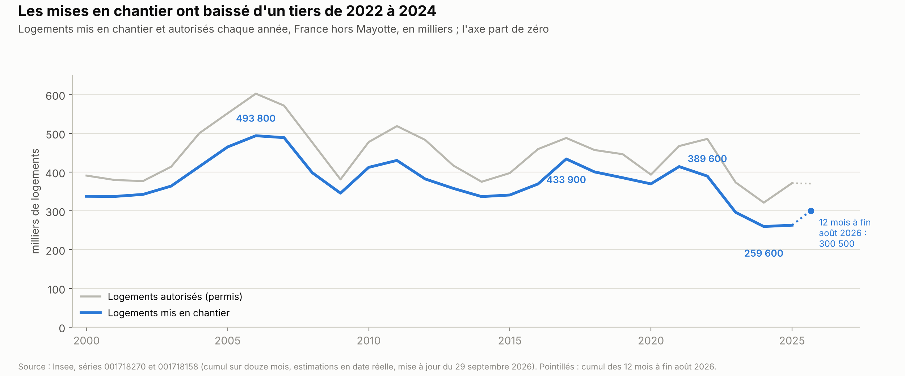
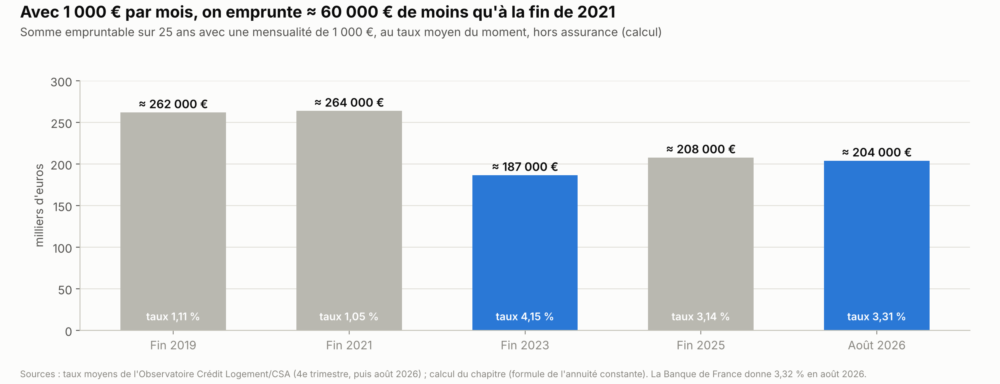
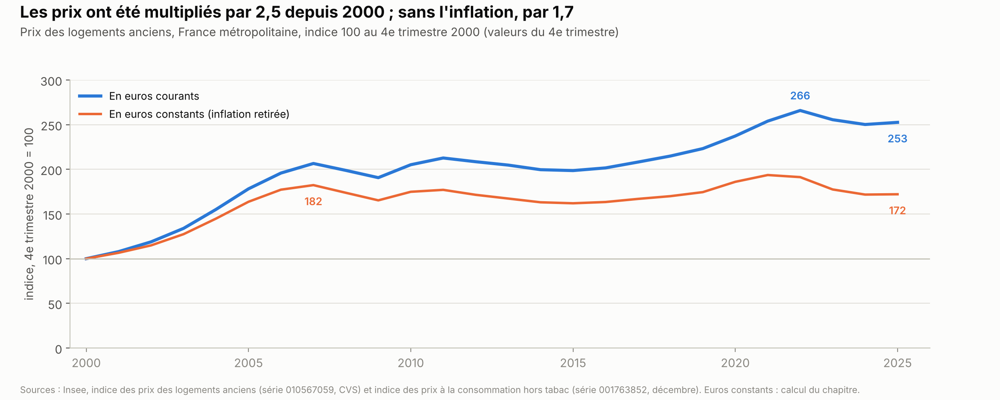
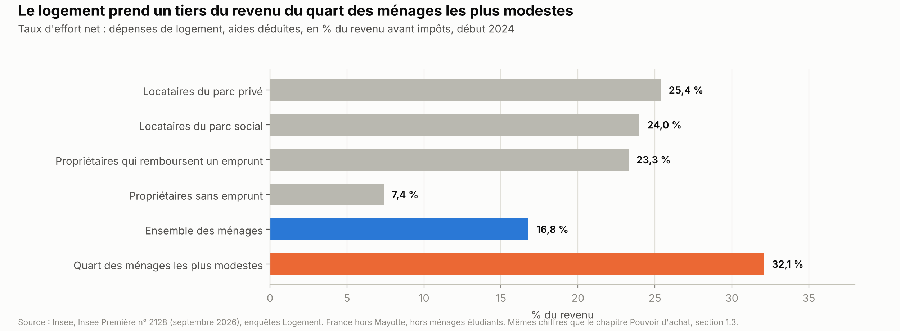
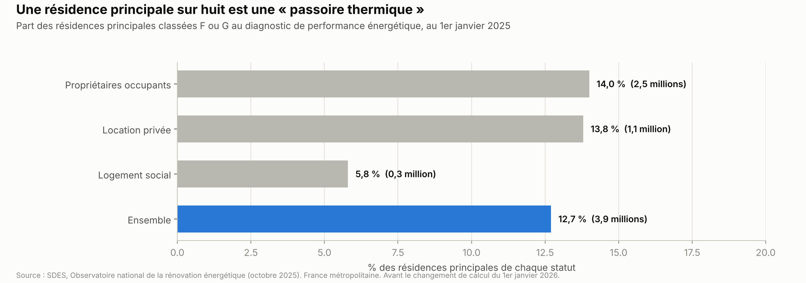
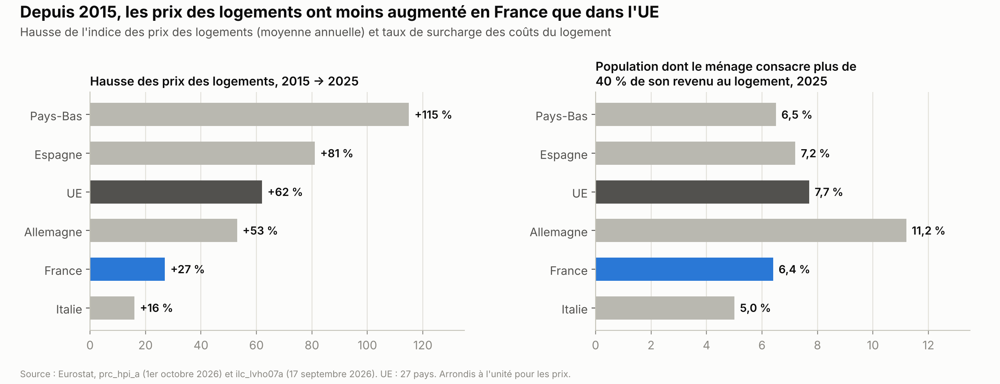

# Logement

*Version de travail du 10 octobre 2026, corrigée le 21 octobre 2026. Les chiffres seront mis à jour à la date d'arrêt des données de l'édition 1.*

Ce chapitre décrit le parc de logements, la baisse de la construction depuis 2022, le crédit, les prix et les loyers, l'accès à la propriété, le logement social, les logements mal isolés et le mal-logement. Il présente ensuite ce que dépense l'État, ce que proposent les partis et ce que montrent les évaluations des politiques déjà menées.

**Voir aussi :**
- [Pouvoir d'achat, salaires et inégalités](../pouvoir-achat/pouvoir_achat.md), section 1.3, pour le poids du logement dans le budget des ménages et le ressenti ;
- [Énergie](../energie/energie_france_europe_allemagne.md), pour le diagnostic de performance énergétique vu sous l'angle de l'énergie et l'évaluation de MaPrimeRénov' ;
- [Climat et environnement](../climat-environnement/climat_environnement.md), pour le « zéro artificialisation nette » ;
- [Immigration](../immigration/immigration.md) et [Institutions](../institutions/institutions.md), pour la « priorité nationale » et ses obstacles juridiques ;
- [Finances publiques](../finances-publiques/finances_publiques.md), pour le budget 2027 dans son ensemble ;
- [Sécurité et justice](../securite-justice/securite_justice.md), pour les squats ;
- [Présidentielle 2027 : ce que proposent les partis](../partis/programmes_partis_2027.md), pour les programmes complets.

> **Repères.**
> - **Une résidence principale** est le logement où vit un ménage la plus grande partie de l'année. Les autres logements sont des résidences secondaires, des logements occasionnels ou des logements vacants, c'est-à-dire inoccupés.
> - **Un logement social**, souvent appelé habitation à loyer modéré (HLM), est loué à un loyer plafonné à des ménages dont les revenus sont sous un plafond. Il appartient surtout à des organismes HLM.
> - **L'indice de référence des loyers (IRL)**, publié chaque trimestre, fixe la hausse maximale d'un loyer en cours de bail dans le parc privé.
> - **Le taux d'effort** est la part du revenu consacrée au logement : loyer ou remboursement d'emprunt, charges et énergie, aides au logement déduites.
> - **Le diagnostic de performance énergétique (DPE)** classe les logements de A (économe) à G (très énergivore). Les logements F et G sont appelés « passoires thermiques ».
> - **Une zone tendue** est une zone où la demande de logements dépasse nettement l'offre, surtout dans les grandes agglomérations.
> - **Un logement mis en chantier** est un logement dont les travaux ont commencé. **Un logement autorisé** a obtenu son permis de construire.

---

## L'essentiel

1. **La construction a baissé d'un tiers.** 389 600 logements ont été mis en chantier en 2022, 259 600 en 2024 (−33 %). Le plus haut depuis 2000 date de 2006 (493 800). Sur les 12 mois à fin août 2026, on en compte 300 500.
2. **Emprunter coûte plus cher.** Le taux moyen d'un crédit immobilier est passé de 1,05 % fin 2021 à 4,15 % fin 2023, puis 3,3 % en août 2026. Avec 1 000 € par mois sur 25 ans, on emprunte ≈ 204 000 €, contre ≈ 264 000 € fin 2021.
3. **Les prix ont été multipliés par 2,5 depuis 2000**, puis ont baissé de 6 % depuis fin 2022. De fin 2005 à fin 2025, la hausse autorisée des loyers en cours de bail (+31 %) a été proche de celle des prix à la consommation (+35 %).
4. **La part de propriétaires est stable (57 %), l'écart entre jeunes ménages s'est creusé.** Chez les 25-44 ans les plus modestes, elle est passée de 32 % à 16 % de 1973 à 2013. Le logement prend 32 % du revenu du quart des ménages les plus modestes, 17 % en moyenne.
5. **Le logement social ne suit pas la demande.** Selon l'Union sociale pour l'habitat, 2,9 millions de ménages attendent un logement social, pour ≈ 390 000 attributions par an. L'attente moyenne était de 19 mois en 2024.
6. **3,9 millions de résidences principales sont des passoires thermiques** (12,7 %). Les logements G ne peuvent plus être loués à un nouveau locataire depuis 2025, les F ne le pourront plus en 2028. Un projet de loi permettrait de continuer à les louer si des travaux sont engagés.
7. **L'aide publique au logement représente 45,9 Md€ en 2025, soit 1,5 % du PIB**, contre 2,2 % en 2010. Selon la Fondation pour le logement, 350 000 personnes sont sans domicile. Il n'existe pas de chiffre officiel récent.

**Les grandes options en débat.**
- **Construire** : des logements publics (LFI, Les Écologistes) ou des investisseurs privés et des règles allégées (Renaissance, Horizons, LR, RN).
- **Loyers** : encadrement étendu, voire gel (LFI, Les Écologistes), maintenu (PS-Place publique) ou supprimé (LR).
- **Passoires** : calendrier maintenu (Les Écologistes), assoupli (gouvernement) ou supprimé (LR, RN).
- **Accès au logement social** : priorité aux Français (RN), aides retirées aux non-Européens (Reconquête, 2022), maires renforcés (LR, gouvernement).
- **Quota de logements sociaux des communes** : porté à 30 % (LFI, Les Écologistes), adapté (Renaissance, LR) ou supprimé (RN, Reconquête).

---

## 1. La situation

### 1.1 Le parc de logements et qui l'occupe

**Au 1er janvier 2026, la France compte 38,6 millions de logements**, hors Mayotte[^insee-parc-2026] :
- 31,9 millions de résidences principales (82,7 %) ;
- 3,8 millions de résidences secondaires et de logements occasionnels (9,7 %) ;
- 2,9 millions de logements vacants (7,6 %).

**La vacance baisse depuis 2019.** La part des logements vacants était de 6,2 % en 2005 et de 8,1 % en 2019. Elle est de 7,6 % en 2026[^insee-parc-2026]. Un logement vacant peut être en vente, entre deux locations, en travaux ou inhabitable. Dans le parc privé, 1,1 million de logements sont vacants depuis au moins deux ans, dont 300 000 en zone tendue, selon le ministère du Logement[^ministere-logements-vacants].

**57,3 % des ménages sont propriétaires de leur résidence principale** en 2026[^insee-parc-2026] :
- 37,6 % n'ont plus d'emprunt et 19,8 % remboursent encore un emprunt, contre 21,4 % en 2020 ;
- 23,2 % sont locataires d'un bailleur privé et 17,3 % d'un bailleur social ;
- 2,3 % sont logés gratuitement.

La part des propriétaires a atteint son maximum, 57,7 %, de 2010 à 2013. Elle était de 50,6 % en 1982[^insee-parc-2026].

**Les meublés de tourisme ne sont pas comptés au niveau national.** Aucun chiffre officiel de leur nombre n'a été trouvé. Selon des données expérimentales d'Eurostat, 137 millions de nuitées ont été réservées en France en 2022 sur les plateformes en ligne (Airbnb, Booking, Expedia, Tripadvisor), hors hôtels et campings. C'est 60 % de plus qu'en 2018[^insee-plateformes-2022]. La loi dite « Le Meur » du 19 novembre 2024 les encadre davantage[^anil-le-meur] :
- une déclaration avec numéro d'enregistrement devient obligatoire, au plus tard le 20 mai 2026 ;
- la location de sa résidence principale reste plafonnée à 120 jours par an, et les communes peuvent abaisser ce plafond jusqu'à 90 jours ;
- l'avantage fiscal des meublés classés baisse : 50 % des recettes non imposées, dans la limite de 77 700 €, contre 71 % auparavant. Pour les meublés non classés, la loi confirme 30 % jusqu'à 15 000 €, fixés par la loi de finances pour 2024 ;
- les communes peuvent fixer des quotas, et les copropriétés interdire les meublés de tourisme.

### 1.2 La construction

**Les mises en chantier ont baissé d'un tiers de 2022 à 2024** (graphique de L'essentiel). Le chapitre retient la série de l'Institut national de la statistique et des études économiques (Insee) du 29 septembre 2026, France hors Mayotte[^insee-bdm-mec][^insee-bdm-aut].

- **De 2022 à 2024, les mises en chantier ont baissé de 33 %**, de 389 600 à 259 600. Elles remontent à 263 000 en 2025, et à 300 500 sur les 12 mois à fin août 2026. Par rapport à 2017 (433 900), la baisse de 2024 est de 40 % ; par rapport à 2006 (493 800, le plus haut depuis 2000), de 47 % *(calcul)*. La moyenne de 2010 à 2019 était d'≈ 385 000 par an *(calcul)*.
- **Les logements individuels ont le plus reculé** : 173 400 mises en chantier en 2017, 94 300 en 2025, soit −46 % *(calcul)*[^insee-mec-annuel].
- **Les autorisations ont remonté en 2025, puis se sont stabilisées.** De septembre 2025 à août 2026, 369 723 logements ont été autorisés, 9,7 % de moins que la moyenne des cinq années précédentes, selon le service statistique du ministère de la Transition écologique (SDES)[^sdes-construction-aout-2026].
- **Les séries ont été révisées en 2026**, avec le passage à une nouvelle base de données, Sitadel3[^sdes-construction-aout-2026]. Selon la date de publication, les mises en chantier de 2025 vont de 263 000 à 274 611[^sdes-construction-dec-2025]. Le chapitre retient la série de l'Insee du 29 septembre 2026.

**Les causes citées dans le débat** sont nombreuses. Leur poids respectif n'a pas été mesuré :
- la hausse des taux d'intérêt, la plus souvent citée (section 1.3) ;
- le coût de la construction et du foncier, et les normes : une mission sur la réglementation environnementale de 2020 (RE2020) estime qu'elle ferait perdre 15 000 à 16 000 logements par an *(source secondaire)*[^linfodurable-rivaton-2025] ;
- l'objectif de « zéro artificialisation nette » (ZAN), qui limite la consommation d'espaces naturels (chapitre Climat et environnement)[^ch-climat] ;
- la fin du dispositif fiscal Pinel, fin 2024, et la baisse des recettes des organismes HLM (section 1.7).

**Combien faudrait-il construire ?** Les estimations ne mesurent pas la même chose.
- **Le SDES (juin 2025)** estime le besoin à 208 000 résidences principales supplémentaires par an de 2020 à 2030, puis 139 000 de 2030 à 2040, dans son scénario central. Ses autres scénarios vont de 177 000 à 242 000 pour 2020-2030[^sdes-besoins-2025].
  - Ce chiffre suit la hausse du nombre de ménages. Il ne compte pas les logements qui remplacent des logements détruits, ni les résidences secondaires.
  - Le SDES chiffre ces autres besoins à part, sans total, car ses chiffrages « n'ont pas vocation à produire une estimation globale consolidée »[^sdes-besoins-2025].
- **L'Union sociale pour l'habitat (USH)** est la fédération des organismes HLM. Elle estime qu'il faut produire ou remettre sur le marché 518 000 logements par an de 2024 à 2040, dont 198 000 logements sociaux *(source secondaire)*[^bdt-ush-besoins-2023].
- **L'Union nationale des aménageurs**, fédération professionnelle, et une école de l'immobilier estiment le besoin à « près de 400.000 logements par an » jusqu'en 2030 *(source secondaire)*[^bdt-unam-espi-2023].

### 1.3 Le crédit

**Les taux ont été multipliés par quatre de 2021 à 2023, puis sont redescendus à 3,3 % en août 2026.** Selon l'observatoire de Crédit Logement, société de caution des prêts immobiliers, le taux moyen hors assurance était de 1,05 % fin 2021 et de 4,15 % fin 2023[^creditlogement-t4-2025]. Il est de 3,31 % en août 2026[^creditlogement-aout-2026]. La Banque de France donne 3,32 % pour le même mois, après 3,08 % en décembre 2025[^bdf-credits-aout-2026][^bdf-credits-janv-2026]. Selon Crédit Logement, il atteint 3,40 % en septembre 2026, et 3,32 % en moyenne au 3e trimestre *(source secondaire)*[^mysweetimmo-t3-2026].

**Ce que cela change pour un acheteur.** Avec 1 000 € par mois sur 25 ans, hors assurance, on pouvait emprunter ≈ 264 000 € fin 2021, ≈ 187 000 € fin 2023 et ≈ 204 000 € en août 2026 *(calcul)*. Pour une même mensualité, la somme empruntable a donc baissé d'≈ 23 % *(calcul)*.

**Les volumes de crédit ont remonté en 2025, puis reculent à l'été 2026.** Les banques ont prêté 147 Md€ aux particuliers pour l'habitat en 2025, hors renégociations, 33 % de plus qu'en 2024[^bdf-panorama-juil-2026][^acpr-habitat-2025]. Depuis fin 2024, elles prêtent 11 à 13 Md€ par mois[^bdf-panorama-juil-2026]. Selon Crédit Logement, le montant des crédits accordés au 3e trimestre 2026 est inférieur de 9,2 % à celui du 3e trimestre 2025, et le nombre de prêts de 8,1 % *(source secondaire)*[^mysweetimmo-t3-2026].

**Les règles d'octroi sont obligatoires depuis 2022.** Le Haut Conseil de stabilité financière (HCSF), qui surveille les risques financiers, limite les mensualités à 35 % des revenus et la durée à 25 ans[^hcsf-mesure].
- Les banques peuvent sortir de ces règles pour 20 % de leurs prêts chaque trimestre.
- Au moins 70 % de ces exceptions doivent aller à l'achat d'une résidence principale, et au moins 30 % à des primo-accédants, qui achètent leur premier logement[^hcsf-mesure].
- En 2025, 16,6 % des prêts dépassaient ces seuils[^acpr-habitat-2025].

**Le prêt à taux zéro (PTZ)** est un prêt sans intérêts, dont l'État paie le coût, réservé aux primo-accédants sous conditions de revenus.
- Depuis le 1er avril 2025, il est ouvert à tous les logements neufs, partout en France, jusqu'à fin 2027. ≈ 45 000 PTZ ont été accordés en 2024[^gouv-ptz-2025].
- Dans l'ancien, il est réservé aux zones peu tendues, avec des travaux d'au moins 25 % du coût total[^sp-ptz].
- Le projet de budget 2027 crée un « PTZ parentalité » pour les ménages qui attendent un enfant ou ont un enfant de moins de trois ans[^eco-plf-2027].

### 1.4 Les prix et les loyers

**Les prix des logements anciens ont été multipliés par 2,5 de fin 2000 à fin 2025**, en France métropolitaine[^insee-bdm-prix-anciens].
- La hausse a été la plus forte de 2000 à 2007 : +107 % en sept ans *(calcul)*.
- Après un sommet fin 2022, les prix ont baissé de 6,2 % jusqu'au 2e trimestre 2026 *(calcul)*[^insee-bdm-prix-anciens].
- Sur un an, au 2e trimestre 2026, ils reculent de 0,8 %. Les appartements parisiens font exception : +0,6 %[^insee-prix-t2-2026].
- Inflation retirée, les prix de 2025 sont 5,6 % sous ceux de 2007 *(calcul)*[^insee-bdm-ipc].

**Par rapport aux revenus, les logements coûtent plus cher qu'en 2000.** Jacques Friggit est économiste à l'Inspection générale de l'environnement et du développement durable (IGEDD). Selon lui, le rapport entre le prix des logements et le revenu par ménage est 1,55 fois plus élevé au 3e trimestre 2024 qu'en 2000 (chapitre Pouvoir d'achat, section 1.3)[^igedd-friggit-2025]. Pour les seuls emprunteurs, une opération immobilière coûte 4,2 années de revenus en août 2026, contre 4,8 au début de 2022, selon Crédit Logement[^creditlogement-aout-2026].

**Les loyers en cours de bail ont augmenté de 31 % en vingt ans, contre 35 % pour les prix à la consommation.** De fin 2005 à fin 2025 *(calcul)* :
- l'indice de référence des loyers a augmenté de 31,3 %[^insee-bdm-irl] ;
- les prix à la consommation hors tabac, sur lesquels il est calculé, de 34,8 %[^insee-bdm-ipc] ;
- les prix des logements anciens, de 41,8 %[^insee-bdm-prix-anciens].

**Le « bouclier loyers » a limité la hausse de 2022 à 2024.** La loi du 16 août 2022 a plafonné la hausse de l'indice à 3,5 % par an en métropole, jusqu'au 1er trimestre 2024. Le plafond était de 2,5 % outre-mer et de 2 % en Corse[^anil-bouclier-loyers]. Depuis le 2e trimestre 2022, l'indice a augmenté de 9,2 % *(calcul)*. Au 2e trimestre 2026, il progresse de 1,15 % sur un an[^insee-irl-t2-2026].

**Les loyers effectivement payés augmentent de 1,6 % sur un an** en juillet 2026 : +0,9 % dans le parc privé, +2,9 % dans le parc social[^insee-ilh-juil-2026]. Cet indice suit les loyers réellement payés pour les logements loués vides, en France métropolitaine[^insee-ilh-juil-2026]. Aucune statistique nationale publique sur les loyers des logements remis en location n'a été trouvée.

**L'encadrement des loyers** plafonne le loyer au mètre carré d'un nouveau bail dans les villes qui l'ont demandé : Paris, Lille, Lyon, Bordeaux, Montpellier, Grenoble et d'autres. Il est expérimental depuis la loi portant évolution du logement, de l'aménagement et du numérique (ELAN) de 2018 et prend fin le 24 novembre 2026, sauf prolongation *(source secondaire)*[^actujuridique-encadrement].
- L'Assemblée nationale a adopté, le 11 décembre 2025, par 105 voix contre 56, une proposition de loi qui le rend durable *(source secondaire)*[^lcp-encadrement-2025].
- Le gouvernement propose de le prolonger de deux ans au Sénat, sans nouvelles communes *(source secondaire)*[^bdt-encadrement-prolongation-2026]. Le 14 octobre 2026, la commission des affaires économiques du Sénat a voté une prolongation de deux ans « à périmètre constant » ; elle refuse de le rendre durable *(source secondaire)*[^weka-encadrement-1410]. Le Sénat devait l'examiner en séance le 21 octobre (résultat à vérifier).
- Ses effets mesurés sont présentés en section 4.4.

### 1.5 Devenir propriétaire

- **La part des propriétaires est stable depuis 2010**, autour de 57,5 % (section 1.1)[^insee-parc-2026].
- **L'écart s'est creusé entre jeunes ménages modestes et aisés.** Parmi les ménages de 25 à 44 ans, « 32 % des jeunes ménages modestes étaient propriétaires en 1973, ils ne sont plus que 16 % en 2013 », selon une étude de l'Insee. Chez les plus aisés, la part est passée de 45 % à 66 %[^insee-es-jeunes-2018]. Les modestes et les aisés sont ici le quart le plus pauvre et le quart le plus riche.
- **Par âge, la part des propriétaires a augmenté chez les moins de 40 ans depuis 1998, et baissé chez les 50-64 ans**, en France métropolitaine[^insee-detention-rp] :
  - chez les moins de 30 ans : 11,2 % en 1998, 16,7 % en 2021 ;
  - chez les 30-39 ans : 42,0 % en 1998, 47,3 % en 2021 ;
  - chez les 50-64 ans, elle a baissé, de 71,6 % à 62,6 %.
- **Les primo-accédants** font 43,9 % des nouveaux crédits en juillet 2026. Ils empruntent en moyenne 183 000 € sur 23 ans et 10 mois, avec un apport de 34 000 €[^bdf-panorama-juil-2026].
- **Les durées s'allongent** : 49,3 % des prêts ont une durée de 25 ans ou plus en août 2026, selon Crédit Logement[^creditlogement-aout-2026].

### 1.6 Le poids du logement dans le budget

**Le taux d'effort moyen a baissé en dix ans, sauf pour les ménages modestes.** Début 2024, les ménages consacrent 16,8 % de leur revenu à leur logement, aides déduites, contre 18,3 % en 2014. La suppression de la taxe d'habitation explique l'essentiel de la baisse[^insee-ip-2128].
- Pour le quart des ménages les plus modestes, le taux d'effort est de 32,1 %, 1,1 point de plus qu'en 2014[^insee-ip-2128].
- Il est de 25,4 % pour les locataires du privé, 24,0 % pour ceux du parc social et 23,3 % pour les propriétaires qui remboursent un emprunt (graphique)[^insee-ip-2128].
- Ces chiffres sont ceux du chapitre Pouvoir d'achat (section 1.3), qui les compare aux autres dépenses contraintes.

**La dépense totale de logement** atteint 620,7 Md€ en 2025, selon le compte du logement. Elle comprend les loyers, les charges, l'énergie et l'investissement. Les dépenses courantes des ménages représentent 470 Md€, dont 96 Md€ de loyers réellement payés[^sdes-compte-2025].

### 1.7 Le logement social

**Le parc compte 5,4 millions de logements sociaux** au 1er janvier 2025, 0,5 % de plus qu'un an plus tôt. 71 300 logements ont été mis en location pour la première fois en 2024. Le loyer moyen est de 6,76 € par mètre carré[^sdes-rpls-2025].

**La demande atteint un record.** Selon l'USH, 2,913 millions de ménages attendent un logement social au 30 juin 2026 *(source secondaire)*[^bdt-ush-demandeurs-2026].
- Selon la Cour des comptes, près de 2,8 millions de demandes étaient en attente fin 2024. Environ 900 000 venaient de ménages déjà logés en HLM, qui demandent à changer de logement[^cour-rpa-2026-hlm].
- 380 000 logements ont été attribués en 2024, avec une attente moyenne de 19 mois, et de 39,5 mois en Île-de-France[^cour-rpa-2026-hlm]. Il y en a eu ≈ 394 000 en 2025, selon l'Agence nationale de contrôle du logement social (Ancols) *(source secondaire)*[^bdt-ancols-attributions-2025].
- Selon l'Ancols, les attributions de 2025 représentent 9,5 % des 4,1 millions de demandes actives dans l'année : 5,0 % dans les zones les plus tendues, 14,9 % dans les moins tendues *(source secondaire)*[^bdt-ancols-attributions-2025].
- Selon la Cour des comptes, « seulement 7 % du parc offre les loyers les plus bas (PLAI) auxquels sont éligibles 60 % des demandeurs »[^cour-rpa-2026-hlm]. Le prêt locatif aidé d'intégration (PLAI) finance les logements sociaux aux loyers les plus bas.

**Qui peut obtenir un logement social ?** Il faut des revenus sous un plafond : en 2026, 30 424 € de revenu fiscal de référence pour une personne seule hors Île-de-France, 58 986 € pour quatre personnes[^sp-plafonds-hlm-2026]. Les deux tiers des demandes remplissent au moins un des 14 critères de priorité, dont le droit au logement opposable[^cour-rpa-2026-hlm].

**La production a baissé, puis a remonté en 2025.** On compte les logements sociaux « financés » ou « agréés » par l'État, c'est-à-dire ceux qui ont obtenu leur financement. Deux conventions coexistent.
- Pour 2024, le ministère compte 98 682 logements financés, dont 13 301 reconstructions de logements démolis dans les quartiers rénovés. Sans ces reconstructions, on obtient ≈ 85 400 *(calcul)*, proche des ≈ 85 300 de l'USH *(source secondaire)*[^bdt-financement-2024].
- Pour 2025, le bilan de l'État compte 102 022 agréments, pour un objectif de 100 000[^dreal-pdl-bilan-2025]. Le document ne dit pas si les reconstructions sont incluses.

**La réduction de loyer de solidarité (RLS)** pèse sur les recettes des organismes HLM.
- Depuis 2018, l'État verse moins d'aide personnalisée au logement (APL) aux locataires HLM. Pour qu'ils ne paient pas plus, les organismes HLM baissent leur loyer d'autant[^anil-rls-2026].
- L'économie pour l'État, et la perte pour les organismes, était de 0,8 Md€ par an en 2018 et 2019. Un accord de 2019 avec l'USH l'a fixée à 1,3 Md€ par an à partir de 2020[^senat-rapport-625-2019]. Elle est de 1,1 Md€ en 2025 et de 0,9 Md€ en 2026[^anil-rls-2026].
- Les organismes HLM y voient une cause de la baisse de leurs investissements. Aucune évaluation ne mesure cet effet (section 4.7).

**La loi relative à la solidarité et au renouvellement urbains (SRU)** de 2000 impose 20 % ou 25 % de logements sociaux à ≈ 2 100 communes *(source secondaire)*[^bdt-sru-2020-2022].
- Sur 2020-2022, 1 022 communes devaient rattraper leur retard. 711 n'ont pas atteint leur objectif, et 341 ont été déclarées « carencées » : c'est-à-dire sanctionnées par le préfet[^ministere-sru-2020-2022][^bdt-sru-2020-2022].
- Le bilan de 2023-2025 est en cours. 1 111 communes étaient en retard en 2023 *(source secondaire)*[^maireinfo-sru-2026].

**Qui vit en HLM ?**
- Selon le ministère de l'Intérieur, d'après le recensement de 2022, 30 % des immigrés vivent en HLM, contre 11 % des non-immigrés. Le ministère relie cet écart à « leurs plus faibles revenus, mais aussi à la plus grande taille de leur ménage »[^dgef-logement-immigres-2022].
- Selon l'USH, les étrangers sont 15 % des locataires HLM *(source secondaire)*[^sudradio-levee-boucliers]. La source et le champ de ce chiffre n'ont pas été trouvés. Les étrangers représentent 9,1 % de la population en 2025, selon l'Insee (chapitre Immigration)[^ch-immigration].
- Un immigré est né étranger à l'étranger, et peut être devenu français. Un étranger n'a pas la nationalité française. Les deux chiffres ne portent donc pas sur les mêmes personnes (chapitre Immigration)[^ch-immigration].
- La nationalité ne figure pas parmi les critères d'attribution décrits par la Cour des comptes[^cour-rpa-2026-hlm]. Le texte du code de la construction n'a pas pu être relu *(à vérifier)*. Aucune donnée publique sur les délais d'attribution selon la nationalité n'a été trouvée.

### 1.8 Les passoires thermiques

**3,9 millions de résidences principales sont classées F ou G au 1er janvier 2025**, soit 12,7 % des 30,9 millions de résidences principales de France métropolitaine (graphique)[^onre-dpe-2025][^onre-dpe-2025-page] :
- 2,5 millions chez les propriétaires occupants (14,0 %) ;
- 1,1 million dans la location privée (13,8 %) ;
- 0,3 million dans le logement social (5,8 %).

**Leur nombre baisse, en partie à cause des changements de calcul.**
- Un an plus tôt, on comptait ≈ 4,2 millions de passoires. Près de 40 % de la baisse vient d'un changement de calcul du DPE pour les petits logements, en juillet 2024, et non de travaux[^onre-dpe-2025-page].
- Depuis le 1er janvier 2026, le calcul du DPE pénalise moins le chauffage électrique. Le gouvernement annonçait ≈ 850 000 logements sortis des classes F et G, d'après le parc de 2023[^gouv-dpe-2026][^bercy-dpe-2026]. L'Observatoire national de la rénovation énergétique (ONRE) estime ≈ 700 000 résidences principales en moins, soit ≈ 3,2 millions de passoires[^onre-dpe-2025-page].

**Le calendrier d'interdiction de louer** vient de la loi Climat et résilience de 2021. Un logement G ne peut plus faire l'objet d'un nouveau bail, ni d'un renouvellement, depuis le 1er janvier 2025. Ce sera le cas des logements F en 2028 et E en 2034 (chapitre Énergie)[^ch-energie].

**Le projet de loi « visant la relance et la décentralisation du logement »** assouplirait ce calendrier.
- Présenté en Conseil des ministres le 24 juin 2026, il a été adopté par le Sénat le 8 juillet, puis par la commission des affaires économiques de l'Assemblée, dont le texte est daté du 23 septembre. Aucune date n'est fixée pour l'examen en séance au 10 octobre 2026, pas avant novembre selon la presse[^weka-relance-logement][^senat-pjl-logement-clair][^an-dossier-pjl-logement].
- Son article 6 permettrait de continuer à louer une passoire si le propriétaire a signé un contrat de travaux. Les travaux devraient être faits en trois ans, ou cinq ans en copropriété[^senat-834-synthese].
- Le ministre de la Ville et du Logement, Vincent Jeanbrun, dit vouloir éviter de « sortir encore 700.000 logements du parc » *(source secondaire)*[^lcp-pjl-logement-2026]. Ce chiffre est une crainte, pas une mesure : aucune donnée officielle sur les logements retirés de la location n'a été trouvée.

**Les aides à la rénovation.** L'Agence nationale de l'habitat (Anah) a accordé 4,39 Md€ d'aides en 2025, pour 379 428 logements[^anah-chiffres-cles-2025]. L'Agence France-Presse (AFP) avance pour 2025 « un montant total de 3,8 milliards d'aides distribuées » par l'Anah, sans le ventiler par dispositif *(source secondaire)*[^afp-mpr-reouverture-2026]. Elle a financé 120 305 rénovations d'ampleur, qui font gagner au moins deux classes de DPE[^anah-chiffres-cles-2025].
- Le guichet des rénovations d'ampleur a été suspendu de juillet à septembre 2025, à cause du nombre de demandes et de fraudes *(source secondaire)*[^lcp-maprimerenov-fraude].
- Il a rouvert le 23 février 2026, avec 3,6 Md€ de crédits de l'État *(source secondaire)*[^afp-mpr-reouverture-2026].
- Le projet de budget 2027 réduirait la dotation de l'État à l'Anah de 1,4 à 1,2 Md€ *(source secondaire)*[^batiweb-anah-2027].

### 1.9 Le mal-logement

**Il n'existe pas de chiffre officiel récent des personnes sans domicile.** La seule enquête de l'Insee publiée date de 2012. Une nouvelle enquête a été menée du 31 mars au 5 juillet 2025 ; ses résultats ne sont pas publiés[^insee-enquete-sd-2025].

**Les estimations de la Fondation pour le logement**, association de lutte contre le mal-logement (ex-Fondation Abbé Pierre), dans son rapport de 2026[^fpl-reml-2026] :
- 350 000 personnes sans domicile, contre 143 000 selon l'enquête de l'Insee de 2012. Les méthodes diffèrent : la comparaison est fragile ;
- « près d'un million » de personnes privées de logement personnel ;
- 912 personnes sans domicile mortes en 2024. Le Collectif Les Morts de la rue en compte au moins 929 en 2025, chiffre provisoire *(source secondaire)*[^bdt-morts-rue-2025] ;
- 93 100 ménages reconnus prioritaires au titre du droit au logement opposable (DALO), créé en 2007, attendent encore un logement, en cumul depuis 2008.

**L'hébergement généraliste, dont l'hébergement d'urgence,** compte ≈ 203 000 places, un nombre qui « stagne » depuis quatre ans selon la Fondation pour le logement[^fpl-reml-2026][^senat-essentiel-plf2026-logement]. Le comité français du Fonds des Nations unies pour l'enfance (UNICEF) et la Fédération des acteurs de la solidarité ont compté les enfants sans hébergement la nuit du 18 au 19 août 2026. Au moins 2 355 enfants, dont 514 de moins de trois ans, n'en ont pas trouvé après un appel au 115, le numéro d'urgence. C'est 42 % de plus qu'en 2022[^fas-unicef-enfants-2026].

**Les expulsions locatives augmentent.**
- Selon la Fondation pour le logement, 24 556 expulsions ont eu lieu avec le concours de la police en 2024, 29 % de plus qu'en 2023[^fpl-reml-2026].
- Selon la Chambre nationale des commissaires de justice, 30 500 ménages ont quitté leur logement après une décision de justice en 2025 *(source secondaire)*[^bdt-expulsions-2025].
- Les chiffres officiels de l'État pour 2025 n'ont pas été trouvés.

**Le froid.** 35 % des foyers disent avoir eu froid chez eux au moins 24 heures pendant l'hiver 2024-2025, contre 14 % en 2020. La première raison est financière ou l'isolation. Ce chiffre vient du baromètre du Médiateur national de l'énergie, qui interroge 2 000 foyers de métropole[^mne-barometre-2025].

### 1.10 Ce que dépense l'État, et ce que change le budget 2027

**Les aides publiques au logement atteignent 45,9 Md€ en 2025**, 5,5 % de plus qu'en 2024[^sdes-compte-2025-rapport] :
- 23 Md€ vont aux occupants, surtout les aides personnelles au logement (APL et allocations) : 16,4 Md€ ;
- 22,9 Md€ vont aux propriétaires et aux bailleurs, dont 13,5 Md€ d'avantages fiscaux et 2,1 Md€ de MaPrimeRénov' versés dans l'année.

Selon le SDES, c'est 1,5 % du PIB. Pour 69,1 millions d'habitants, cela fait ≈ 665 € par habitant *(calcul)*. Les aides ont atteint leur point haut en 2010, à 2,2 % du PIB[^sdes-compte-2025-rapport]. Le logement rapporte aussi 103,4 Md€ d'impôts et taxes, dont 31,6 Md€ de taxe foncière[^sdes-compte-2025].

**Le statut du bailleur privé.** La loi de finances pour 2026 a créé un nouvel avantage fiscal pour les particuliers qui louent un logement à loyer plafonné pendant neuf ans, dit « dispositif Jeanbrun » *(source secondaire)*[^actujuridique-jeanbrun]. Ils peuvent déduire chaque année de leurs revenus imposables 3 % à 5,5 % de 80 % du prix, dans la limite d'un plafond annuel, selon le logement et le niveau de loyer. Son coût n'a pas été publié.

**Le projet de budget 2027**, déposé le 1er octobre 2026, prévoit notamment[^eco-plf-2027] :
- pas de revalorisation des aides personnelles au logement en 2027, ce que le ministre résume par « elles ne seront pas revalorisées » *(source secondaire)*[^seloger-apl-2027] ;
- un choix, pour les étudiants des familles aisées, entre l'APL et l'avantage fiscal de leurs parents ;
- le « PTZ parentalité » (section 1.3) ;
- des amortissements plafonnés pour les loueurs en meublé, « à 2,5 %, dans la limite de 7 000 euros par an » ;
- une condition d'un an de résidence pour certaines prestations versées aux étrangers non européens (chapitre Pouvoir d'achat)[^ch-pouvoir-achat] ;
- une réduction de loyer de solidarité maintenue à 0,9 Md€ *(source secondaire)*[^batiweb-rls-2027].

### 1.11 La comparaison européenne

| Indicateur (Eurostat, 2025) | France | UE | Allemagne | Espagne | Italie | Pays-Bas |
|---|---|---|---|---|---|---|
| Personnes vivant dans un logement surpeuplé | 10,8 % | 16,8 % | 11,7 % | 9,5 % | 24,3 % | 4,1 % |
| Même indicateur chez les 15-29 ans | 18,5 % | 26,9 % | 21,0 % | 16,2 % | 41,9 % | 8,6 % |
| Personnes vivant dans un ménage propriétaire | 61,4 % | 68,5 % | 47,2 % | 73,6 % | 77,1 % | 68,8 % |
| Âge moyen de départ du domicile parental | 23,8 ans | 26,3 ans | 24,1 ans | 30,2 ans | 30,2 ans | 23,4 ans |

*Sources : Eurostat, surpeuplement[^eurostat-surpeuplement], statut d'occupation[^eurostat-statut] et départ du domicile parental[^eurostat-depart]. Un logement est surpeuplé quand il compte moins de pièces que la norme d'Eurostat pour la taille du ménage.*

- **Les prix ont moins augmenté en France** : +27 % de 2015 à 2025, contre +62 % dans l'UE, +81 % en Espagne et +115 % aux Pays-Bas (graphique)[^eurostat-hpi].
- **Une part plus faible de la population consacre plus de 40 % de son revenu au logement** : 6,4 % en France, 7,7 % dans l'UE et 11,2 % en Allemagne[^eurostat-surcharge]. Chez les 15-29 ans, la part française est de 7,4 %[^eurostat-surcharge].
- **Le surpeuplement des jeunes** est de 18,5 % en France en 2025, contre 16,6 % en 2022. Eurostat signale deux ruptures de série, en 2020 et en 2022 : la comparaison avec 2015 (12,3 %) ne peut pas être lue comme une hausse continue[^eurostat-surpeuplement].
- **Les taux de propriétaires diffèrent selon la mesure** : Eurostat compte des personnes (61,4 %), l'Insee des ménages (57,3 %).
- **Le logement social** représente de 10 % à 19 % du parc en France, selon l'Organisation de coopération et de développement économiques (OCDE). C'est plus que la moyenne de l'UE (8 %) et moins qu'aux Pays-Bas (plus de 20 %)[^ocde-ph42].
- **Les aides au logement versées aux ménages** représentent 0,55 % du PIB en France en 2024, au 5e rang de l'UE, selon des données d'Eurostat reprises par la presse *(source secondaire)*[^euronews-housing-2026]. Ce chiffre compte les seules aides versées aux ménages ; l'ensemble des aides publiques au logement fait 1,5 % du PIB (section 1.10).

---

## 2. Ce qui fait débat

### Question 1. Construire plus : par les organismes publics ou par les investisseurs privés ?

**Le constat partagé.** Les mises en chantier ont baissé d'un tiers de 2022 à 2024 (section 1.2), et 2,9 millions de ménages attendent un logement social (section 1.7). Les besoins estimés vont de ≈ 180 000 à plus de 500 000 logements par an, selon ce qui est compté.

**Pour une construction portée par l'État et les organismes HLM.**
- LFI veut « Atteindre 400 000 nouveaux logements abordables par an dans les 5 prochaines années, dont 200 000 logements publics »[^lfi-plan-btp-logement]. L'USH estime le besoin à 198 000 logements sociaux par an *(source secondaire)*[^bdt-ush-besoins-2023].
- L'argument : le logement social répond à la demande des ménages modestes, que le marché privé loge mal. Selon la Cour des comptes, 60 % des demandeurs relèvent des loyers les plus bas, qui forment 7 % du parc[^cour-rpa-2026-hlm].
- L'objection : la capacité à construire. Pour 200 000 logements publics par an, l'Institut Montaigne (libéral) relevait en 2022 que la France produit « en moyenne seulement 65 000 logements sociaux par an »[^montaigne-melenchon-logements-2022]. En 2025, 102 022 logements sociaux ont été agréés, dont 62 894 hors prêt locatif social (PLS), aux loyers les plus élevés du parc social *(calcul)*[^dreal-pdl-bilan-2025].

**Pour une relance par les investisseurs privés et des règles allégées.**
- LR veut « Créer un véritable statut du bailleur privé » et « simplifier radicalement l'urbanisme »[^lr-propositions]. Horizons veut « pas de nouvelle norme » pendant le quinquennat[^philippe-prospere].
- L'argument : les particuliers possèdent l'essentiel du parc locatif privé. Les investisseurs aidés par l'État faisaient 48 % des réservations de logements neufs de 2014 à 2017 (section 4.1)[^igf-cgedd-pinel-2019].
- L'objection : les avantages fiscaux passés ont coûté cher pour un effet limité sur les loyers. Selon l'Inspection générale des finances (IGF), 9,3 % de l'avantage du Pinel se traduisait en baisse de loyer (section 4.1)[^igf-cgedd-pinel-2019].

**Ce que l'on ne sait pas.** Aucune étude ne mesure le poids respectif des taux, des coûts, des normes et des règles d'urbanisme dans la baisse de 2022-2024.

### Question 2. Encadrer ou geler les loyers, ou supprimer l'encadrement ?

**Pour encadrer, ou aller plus loin.**
- LFI propose de « geler les loyers des baux en cours dans les zones tendues sur une période de 4 ans » et de généraliser l'encadrement[^an-ppl-2225]. Les Écologistes veulent sa « généralisation, l'amélioration et la pérennisation »[^ecologistes-programme].
- L'argument : à Paris, l'encadrement a réduit les loyers d'≈ 5 %, sans effet durable mesuré sur l'offre, selon l'Atelier parisien d'urbanisme (Apur)[^apur-288].

**Pour supprimer l'encadrement.**
- Bruno Retailleau (LR) : « on ne fait pas baisser les loyers en décrétant leur montant » *(source secondaire)*[^europe1-retailleau-logement]. Édouard Philippe (Horizons) estime que, quand on empêche le prix de jouer son rôle, « vous créez des problèmes » *(source secondaire)*[^empruntis-philippe-fnaim].
- L'argument : des propriétaires se retirent de la location vide. Le rapport d'évaluation remis au gouvernement en mai 2026 constate qu'à Paris, la part des meublés parmi les nouveaux baux est passée de 30 % en 2020 à 62 % en 2024[^chapelle-fack-2026].

**Ce que l'on ne sait pas.** Le passage au meublé s'explique aussi par sa fiscalité plus favorable, selon le même rapport[^chapelle-fack-2026]. L'effet d'un gel des loyers en cours de bail n'a pas été évalué en France.

### Question 3. Les passoires thermiques : garder le calendrier, l'assouplir ou le supprimer ?

**Pour garder le calendrier.**
- Les Écologistes veulent « Maintenir l'interdiction de la remise en location des logements classés F en 2028 et E en 2034 »[^ecologistes-programme].
- L'argument : les occupants ont froid et paient cher leur énergie. 35 % des foyers ont eu froid chez eux au moins 24 heures pendant l'hiver 2024-2025[^mne-barometre-2025]. Le Collectif des associations pour le logement juge qu'un assouplissement « peut envoyer un signal contreproductif envers les propriétaires »[^cal-pjl-logement].

**Pour l'assouplir.**
- Le gouvernement veut laisser louer une passoire si des travaux sont engagés (section 1.8). Vincent Jeanbrun : « À la vague d'interdictions, je préfère une vague de rénovations » *(source secondaire)*[^bdt-senat-pjl-logement].

**Pour le supprimer.**
- LR veut « Mettre fin aux interdictions de louer liées au DPE »[^lr-propositions], pour remettre 450 000 logements sur le marché selon le parti *(source secondaire)*[^europe1-retailleau-logement]. Marine Le Pen (RN) veut faire « cesser (la) politique absurde » des DPE *(source secondaire)*[^sudradio-le-pen-logement].
- L'argument : les propriétaires n'ont pas toujours les moyens ni les artisans pour faire les travaux, et les interdictions réduiraient l'offre locative.

**Ce que l'on ne sait pas.** Aucune donnée officielle ne mesure le nombre de logements retirés de la location à cause des interdictions (section 4.9).

### Question 4. Qui doit passer en premier pour un logement social, et que faire de la loi SRU ?

**L'attribution.**
- Le RN veut « donner la priorité d'accès au logement social aux Français » *(source secondaire)*[^sudradio-le-pen-logement]. Pour le député Laurent Jacobelli, en cas de dossiers concurrents, « la famille française passe avant » *(source secondaire)*[^publicsenat-jacobelli].
- LR veut « Recentrer le logement social sur ceux qui travaillent et les familles »[^lr-propositions]. Le projet de loi du gouvernement donnerait aux maires plus de poids dans les attributions[^senat-834-synthese].
- Contre la priorité nationale, l'USH affirme : « Les étrangers ne sont pas favorisés dans l'entrée dans le logement social ». Pour la Confédération nationale du logement (CNL), association de locataires, « La préférence nationale ne résoudra rien à la pénurie » *(source secondaire)*[^sudradio-levee-boucliers].
- Les obstacles juridiques sont présentés en section 3.

**La loi SRU.**
- LFI veut porter le quota à 30 %[^lfi-plan-btp-logement], Les Écologistes à 30 % d'ici 2035 dans les communes les plus tendues[^ecologistes-programme].
- Gabriel Attal (Renaissance) veut compter les logements intermédiaires, aux loyers entre le social et le privé, dans le quota *(source secondaire)*[^afp-linfodurable-batimat]. LR veut « Adapter la loi SRU à la réalité du terrain »[^lr-propositions].
- Le RN et Reconquête veulent l'abroger. Pour Jacques Baudrier (Parti communiste français, PCF), adjoint au logement à Paris, ce « serait un recul gravissime » *(source secondaire)*[^sudradio-levee-boucliers].
- Ce que montrent les évaluations : la loi a fait construire des logements sociaux, mais a peu changé la répartition des ménages selon leurs revenus (section 4.6).

---

## 3. Ce que proposent les partis

*Les partis sont présentés dans l'ordre où leurs groupes siègent à l'Assemblée nationale, de gauche à droite ; Reconquête, qui n'a pas de groupe, vient en dernier. Les positions sont celles connues au 10 octobre 2026, complétées le 12 octobre. LFI publie la nouvelle version de son programme le 6 novembre 2026 *(source secondaire)*[^lcp-lfi-programme-2026]. Raphaël Glucksmann a été désigné candidat commun du PS et de Place publique le 11 octobre 2026, dès le premier tour de la primaire *(source secondaire)*[^publicsenat-primaire-resultats]. Ni Gabriel Attal ni Édouard Philippe n'ont de page consacrée au logement sur leur site de campagne au 10 octobre 2026[^attal-programme][^philippe-prospere].*

### Vue d'ensemble

| Parti | Construction | Loyers | Logement social et SRU | Passoires et rénovation | Accès et priorité |
|---|---|---|---|---|---|
| **LFI** | 400 000 abordables par an, dont 200 000 publics | Gel 4 ans en zone tendue ; encadrement partout | Quota SRU à 30 % | 700 000 isolations par an | Réquisitions ; meublés touristiques limités à 60 jours |
| **Les Écologistes** | Relance des HLM, sans chiffre | Encadrement généralisé et durable | 30 % d'ici 2035 en zone tendue | 500 000 rénovations par an ; calendrier maintenu | Réquisitions ; garantie des loyers pour tous |
| **PS-Place publique** | Prix du foncier régulé | « Bouclier » : 30 % des revenus au plus | Non précisé | Prêt à taux zéro pour rénover | Contre le gel des APL |
| **Renaissance** | ZAN simplifié | Non précisé | Logements intermédiaires dans le quota | Loi de programmation de la rénovation | Non précisé |
| **Horizons** | Aucune nouvelle norme | Critique de l'encadrement | Non précisé | Critique du mécanisme | Droits des propriétaires renforcés |
| **LR** | ZAN abrogé ; urbanisme simplifié | Fin de l'encadrement | SRU adaptée ; priorité à ceux qui travaillent | Fin des interdictions de louer | Squats : expulsion en 10 jours |
| **RN** | Terrains publics gratuits ; bureaux en logements | Non précisé | SRU abrogée ; HLM vendus | Fin des contraintes du DPE ; prêt « 100 % rénov » | Priorité nationale ; APL réservées aux Français |
| **Reconquête** | Non publié | Non publié | SRU abrogée (2022) | Non publié | Aides retirées aux non-Européens (2022) |

**Ce qui rapproche et ce qui sépare.**
- **Simplifier les règles de construction** est proposé du centre à la droite : Renaissance, Horizons, LR et RN. La gauche met en avant la construction publique et le prix du foncier.
- **Les loyers** séparent la gauche, qui veut étendre l'encadrement, de LR, qui veut le supprimer. Le RN et Renaissance n'ont pas de position publiée trouvée.
- **Les passoires** : Les Écologistes défendent explicitement le calendrier actuel, sur lequel LFI ne s'est pas prononcée ; LR et le RN veulent supprimer les interdictions ; le gouvernement veut les assouplir.
- **L'accès au logement social** : le RN veut réserver les logements sociaux et les aides au logement aux Français. Reconquête voulait en 2022 retirer les aides au logement aux non-Européens. LR proposait en 2024 une durée de résidence pour ces aides *(source secondaire)*[^publicsenat-rip-lr-2024][^cc-2024-6-rip]. En juillet 2026, Bruno Retailleau demande « cinq ans de travail effectif » *(source secondaire)*[^planet-retailleau].

### Les obstacles communs

Ils s'appliquent à toutes les propositions du même type ; le tableau standard y renvoie.

- **Encadrement et gel des loyers.** En 2014, le Conseil constitutionnel a validé l'encadrement, qui ne porte pas « au droit de propriété et à la liberté contractuelle une atteinte disproportionnée »[^cc-2014-691]. Il s'est appuyé sur plusieurs éléments *(lecture du texte)* :
  - l'encadrement est limité aux zones où l'offre manque ;
  - les baux en cours ne sont pas concernés ;
  - les loyers de référence sont fixés par catégorie de logement et par quartier avec précision ;
  - un « complément de loyer » reste possible pour les logements dont la localisation ou le confort le justifient. Le Conseil a même censuré la condition de caractéristiques « exceptionnelles », jugée trop restrictive pour les propriétaires.

  Une généralisation à tout le territoire, un gel des baux en cours ou la suppression du complément de loyer s'écartent de ces éléments. Aucune décision ne tranche ces cas.
- **Réquisition des logements vacants.** La loi la permet depuis 1945, sur décision du préfet. Selon un rapport de l'Assemblée, il y a eu « seulement 48 réquisitions » en 2001, et « une dizaine d'immeubles » réquisitionnés en 2014. Il n'existe « aucune statistique officielle »[^an-rapport-2426].
- **Priorité nationale et aides réservées aux Français** *(lecture du texte)* :
  - en 2024, le Conseil constitutionnel a jugé « disproportionnée » une condition de cinq ans de résidence ou de 30 mois d'activité pour l'aide personnelle au logement[^cc-2024-6-rip] ;
  - une directive européenne impose l'égalité de traitement des résidents étrangers de longue durée, notamment pour « l'accès aux procédures d'attribution d'un logement »[^eurlex-2003-109] ;
  - un règlement européen donne aux travailleurs des autres pays de l'UE « de tous les droits et de tous les avantages accordés aux travailleurs nationaux en matière de logement »[^eurlex-492-2011] ;
  - le RN veut passer par un référendum, dont l'usage pour réviser la Constitution est contesté (chapitre Institutions)[^ch-institutions].
- **Loi SRU et ZAN.** Leur suppression, leur assouplissement ou leur renforcement relèvent d'une loi ordinaire. Aucun obstacle constitutionnel n'a été relevé dans les sources lues *(à vérifier)*.
- **Interdictions de louer les passoires.** Selon la Commission européenne, la directive européenne de 2024 sur la performance énergétique des bâtiments fixe des objectifs moyens au parc de logements : −16 % de consommation d'énergie en 2030 et −20 à −22 % en 2035[^ce-epbd]. Elle n'impose pas d'interdiction de louer. Supprimer les interdictions françaises suppose d'atteindre ces objectifs autrement. Les articles de la directive n'ont pas pu être relus.

### Le tableau standard

*Partis dans l'ordre de l'hémicycle, comme ci-dessus. Levier : ce qu'il faut pour appliquer la mesure (liste dans le mode d'emploi) ; le premier cité est le plus décisif. Les coûts sont annuels. Quand une proposition vient de la presse ou d'un site qui compile les programmes, la case le signale.*

| Parti | Propositions | Levier | Obstacles et coût |
|---|---|---|---|
| **LFI** | « Atteindre 400 000 nouveaux logements abordables par an dans les 5 prochaines années, dont 200 000 logements publics », dont 140 000 « très sociaux » ; « Refaire l'isolation d'au moins 700 000 logements par an »[^lfi-plan-btp-logement] | Budget ; Collectivités | 12 Md€ par an d'investissement de l'État selon LFI, plus ≈ 36 Md€ par an d'un « pôle public bancaire » *(calcul sur le tableau du plan)*[^lfi-plan-btp-logement]. Pour 200 000 logements publics par an : ≈ 2,1 Md€ par an pour les finances publiques (fourchette de 1,9 à 2,3 Md€) et 22 à 25,5 Md€ de financement net, selon l'Institut Montaigne (libéral, 2022, coûts de 2019)[^montaigne-melenchon-logements-2022]. Capacité du secteur à construire (question 1). |
| | Proposition de loi du groupe LFI (décembre 2025) : gel des loyers des baux en cours en zone tendue pendant 4 ans ; encadrement sur tout le territoire ; fin du complément de loyer[^an-ppl-2225] | Loi | Écart avec les éléments retenus par la décision de 2014 (obstacles communs)[^cc-2014-691]. Non chiffré. |
| | Quota SRU à 30 % ; « Utiliser la loi de réquisition des logements vides » ; taxe progressive sur la vacance ; meublés touristiques limités à 60 jours par an[^lfi-plan-btp-logement] ; APL +10 % (programme de 2024)[^nfp-programme] | Loi ; Décret ; Budget | Réquisitions rares depuis 1945 (obstacles communs)[^an-rapport-2426]. APL +10 % : 1,54 Md€ par an selon l'Institut Montaigne (2024)[^montaigne-nfp-apl]. |
| **Les Écologistes** | Encadrement des loyers généralisé et durable ; garantie des loyers pour tous ; quota SRU à 30 % d'ici 2035 dans les communes tendues ; fin de la réduction de loyer de solidarité ; réquisitions et surtaxe sur la vacance[^ecologistes-programme] | Loi ; Budget ; Collectivités | Même question constitutionnelle pour la généralisation, et réquisitions rares (obstacles communs). Fin de la RLS : ≈ 0,9 Md€ par an au niveau de 2026 *(calcul)*[^anil-rls-2026]. Le reste n'est pas chiffré. |
| | « 500 000 rénovations performantes par an via MaPrimeRénov' » ; « Maintenir l'interdiction de la remise en location des logements classés F en 2028 et E en 2034 », avec une exception possible pour les petits propriétaires contre une baisse de loyer de 30 %[^ecologistes-programme] | Budget ; Loi | 1,4 Md€ en 2027 pour la rénovation selon le parti[^ecologistes-budget2027]. 120 305 rénovations d'ampleur ont été aidées en 2025 (section 1.8). |
| **PS-Place publique** | Olivier Faure, congrès HLM de Bordeaux (22-24 septembre 2026) : « bouclier logement », pour qu'aucun ménage du parc privé ne consacre plus de 30 % de ses revenus au logement *(paraphrase, source secondaire)* ; encadrement maintenu ; prix du foncier régulé[^seloger-congres-hlm-ps] | Loi ; Budget | Mécanisme et coût non publiés. S'il plafonne les loyers selon le revenu du locataire, même question de droit de propriété que l'encadrement. |
| | « un prêt à taux zéro pour un véhicule électrique et la rénovation du logement »[^ps-7-priorites] | Budget | Inclus dans 2,5 Md€ avec les transports collectifs, selon le PS[^ps-7-priorites]. |
| **Renaissance** | Gabriel Attal, salon du bâtiment, 28 septembre 2026 : ZAN simplifié ; logements intermédiaires comptés dans le quota SRU ; loi de programmation pour cinq ans d'aides à la rénovation *(paraphrase, source secondaire)*[^afp-linfodurable-batimat] | Loi ; Budget | Non chiffré. |
| **Horizons** | « Sceller un moratoire normatif et fiscal : pas de nouvelle norme et de nouvel impôt sur le quinquennat »[^philippe-prospere] ; « renforcer les droits des propriétaires » (décembre 2025) *(source secondaire)*[^empruntis-philippe-fnaim] | Loi ; Décret | Non chiffré. |
| **LR** | Programme du 28 mai 2026 : fin de l'encadrement des loyers et des interdictions de louer liées au DPE ; ZAN abrogé par une « loi d'urgence » ; expulsion des squatteurs en 10 jours ; quota SRU fixé localement[^lr-propositions] *(détail : source secondaire)*[^europe1-retailleau-logement] | Loi | Non chiffré. Fin des interdictions : possible au regard de la directive de 2024 (obstacles communs)[^ce-epbd]. |
| | « Créer un véritable statut du bailleur privé » ; intérêts d'emprunt déductibles selon le nombre d'enfants[^lr-propositions][^europe1-retailleau-logement] ; cinq ans de résidence, ou 30 mois d'activité, pour les aides au logement (proposition de loi référendaire de 2024)[^publicsenat-rip-lr-2024][^cc-2024-6-rip] ; « cinq ans de travail effectif » pour les APL et les allocations familiales (Bruno Retailleau, juillet 2026) *(source secondaire)*[^planet-retailleau] | Budget ; Constitution | Un statut existe depuis 2026 (section 1.10) ; ce que LR ajouterait n'est pas précisé. Durée de résidence ou de travail : décision de 2024 (obstacles communs)[^cc-2024-6-rip]. |
| **RN** | Marine Le Pen, 13 septembre 2026 : « donner la priorité d'accès au logement social aux Français » ; aides au logement réservées aux Français *(source secondaire)*[^sudradio-le-pen-logement] | Constitution ; Référendum ; UE | Décision de 2024, directive de 2003 et règlement européen de 2011 (obstacles communs)[^cc-2024-6-rip][^eurlex-2003-109][^eurlex-492-2011]. Non chiffré. |
| | « abroger » la loi SRU ; ZAN supprimé ; fin des contraintes du DPE ; « 100% rénov », un prêt à taux zéro à la place de MaPrimeRénov' ; terrains publics « mis gratuitement à disposition des constructeurs » ; vente « d'un certain nombre de HLM aux Français » ; transformation de bureaux vides *(source secondaire)*[^sudradio-le-pen-logement][^batiweb-le-pen] | Loi ; Budget | Non chiffré : ni taux du prêt, ni nombre de logements attendus[^batiweb-le-pen]. Fin des interdictions de louer : possible au regard de la directive de 2024 (obstacles communs)[^ce-epbd]. Abrogation de la loi SRU : voir l'estimation de l'Institut Montaigne à la ligne Reconquête[^montaigne-zemmour-sru-2022]. |
| **Reconquête** | Programme de 2022, toujours en ligne : « expulser tous les squatteurs en moins de 72 heures » ; aides au logement retirées aux étrangers non européens[^reconquete-programme] ; loi SRU abrogée[^montaigne-zemmour-sru-2022] | Loi ; Constitution ; UE | Aides retirées : mêmes obstacles que le RN. SRU : ≈ 1,1 Md€ d'économies par an si la production de logements sociaux baisse de 20 %, effet « neutre » sur les finances publiques, et effets indirects « difficiles à apprécier », selon l'Institut Montaigne (2022)[^montaigne-zemmour-sru-2022]. Reprise pour 2027 non confirmée. |
| **Autres** | Fabien Roussel (PCF) : régler la pénurie « pour tous les ménages qui en ont besoin », sans tri selon la nationalité *(paraphrase, source secondaire)*[^seloger-roussel]. François Ruffin : abattement pour durée de détention supprimé sur les plus-values immobilières *(site compilateur)*[^ifrap-comparateur-pa]. Aucune proposition trouvée pour l'Union des droites pour la République (UDR, Éric Ciotti) | Loi ; Budget | Non chiffrés. |
| **Gouvernement** (contexte) | Projet de loi Relance logement : louer une passoire avec un contrat de travaux ; maires plus présents dans les attributions (section 1.8)[^senat-834-synthese]. Budget 2027 : APL non revalorisées, « PTZ parentalité » (section 1.10)[^eco-plf-2027]. Encadrement des loyers : prolongation de deux ans proposée, votée en commission au Sénat le 14 octobre 2026 *(source secondaire)*[^bdt-encadrement-prolongation-2026][^weka-encadrement-1410] | Loi ; Budget | Pas de majorité à l'Assemblée ; textes non votés au 10 octobre 2026. Économie du gel des APL non publiée. Condition d'un an de résidence (section 1.10) : la décision de 2024 portait sur cinq ans ; l'effet d'un an n'a pas été examiné *(à vérifier)*. |

### Comment ils le mettraient en place : ce qui reste sans réponse

**LFI.**
- *Sans réponse* :
  - le montage du « pôle public bancaire » et son effet sur la dette publique ;
  - le coût des logements tirés du parc existant, « plus de 35 % » des 400 000 selon le plan[^lfi-plan-btp-logement] ;
  - le coût d'un gel des loyers pour les bailleurs, et le calendrier du quota SRU à 30 %.
- *Critiques* :
  - Libérale : l'Institut Montaigne doute de « la capacité du secteur du bâtiment et des pouvoirs publics à absorber un tel rythme de construction » (2022)[^montaigne-melenchon-logements-2022].
  - Aucune critique de ce plan par un autre parti n'a été trouvée.
- *Réponses* : aucune réponse à cette critique n'a été trouvée. Devant les professionnels du bâtiment, Jean-Luc Mélenchon a dit : « On ne peut pas changer les règles tous les 10 jours » (28 septembre 2026) *(source secondaire)*[^batiweb-batimat].

**Les Écologistes.**
- *Sans réponse* : le coût des 500 000 rénovations par an ; le nombre de logements sociaux visés ; le financement de la garantie des loyers.
- *Critiques* : aucune critique attribuée et datée de leurs propositions logement n'a été trouvée. Les critiques du calendrier des passoires (gouvernement, LR, RN) figurent à la question 3.
- *Réponses* : sans objet. Marine Tondelier propose, pour les passoires louées, des loyers « 30 % moins chers » (26 avril 2026) *(source secondaire)*[^afp-tondelier-passoires].

**PS-Place publique.**
- *Sans réponse* :
  - le mécanisme et le coût du « bouclier logement », absent de la synthèse budgétaire du PS du 24 septembre 2026[^ps-7-priorites] ;
  - les propositions logement de Raphaël Glucksmann, désigné candidat le 11 octobre 2026[^publicsenat-primaire-resultats] : ni lui ni les autres candidats de la primaire n'ont parlé de logement dans les sources lues *(source secondaire)*[^lcp-primaire].
- *Critiques* : aucune critique du bouclier logement n'a été trouvée.
- *Réponses* : sans objet. Olivier Faure qualifie le gel des APL de « nouvel affront fait aux milieux populaires » *(source secondaire)*[^seloger-congres-hlm-ps].

**Renaissance.**
- *Sans réponse* : la part des logements intermédiaires comptée dans le quota SRU ; le montant de la loi de programmation ; l'avenir du calendrier des passoires.
- *Critiques* :
  - À gauche, en 2024, sur les logements intermédiaires dans le quota : Ian Brossat (PCF) y voyait « une déclaration de guerre contre la loi SRU » *(source secondaire)*[^publicsenat-attal-sru-2024].
  - Associations : le Collectif des associations pour le logement écrit : « Nous nous opposerons fermement à tout amendement visant à assouplir la loi SRU » (juillet 2026)[^cal-pjl-logement].
  - À droite, en 2024 : pour Dominique Estrosi Sassone (LR), sur la loi SRU, « on constate ses limites » *(source secondaire)*[^publicsenat-attal-sru-2024].
- *Réponses* : « Il faut une simplification d'un certain nombre de règles » (Gabriel Attal, 28 septembre 2026) *(source secondaire)*[^batiweb-batimat].

**Horizons.**
- *Sans réponse* : l'avenir de l'encadrement des loyers (critiqué, sans proposition explicite) et du calendrier des passoires ; le logement social et la loi SRU.
- *Critiques* : aucune critique attribuée et datée n'a été trouvée.
- *Réponses* : sans objet. Édouard Philippe estime qu'il manque « l'affirmation d'une priorité claire en matière de logement » (décembre 2025) *(source secondaire)*[^empruntis-philippe-fnaim].

**LR.**
- *Sans réponse* :
  - ce que le statut du bailleur privé ajouterait au dispositif voté en 2026, et son coût ;
  - le mode de calcul des quotas SRU fixés localement ;
  - la source des 450 000 logements remis sur le marché.
- *Critiques* : sur la levée des interdictions de louer, dans sa version plus limitée du projet du gouvernement :
  - le Collectif des associations pour le logement y voit un « signal contreproductif »[^cal-pjl-logement] ;
  - la sénatrice socialiste Viviane Artigalas y voit un « recul » pour les locataires (8 juillet 2026) *(source secondaire)*[^afp-senat-relance-logement].
  - Aucune critique visant nommément le programme de LR n'a été trouvée.
- *Réponses* : aucune réponse à ces critiques n'a été trouvée. Bruno Retailleau défend son programme : « on ne fait pas baisser les loyers en décrétant leur montant » (28 mai 2026) *(source secondaire)*[^europe1-retailleau-logement].

**RN.**
- *Sans réponse* :
  - les ménages concernés par la priorité nationale : nouveaux demandeurs ou locataires en place. Pour Laurent Jacobelli, « L'idée n'est pas d'interdire le logement social à d'autres que les citoyens français » *(source secondaire)*[^publicsenat-jacobelli] ;
  - le sort des citoyens européens et des résidents de longue durée ;
  - le taux et le coût du prêt « 100 % rénov », et le nombre de logements attendus des terrains gratuits.
- *Critiques* (14 au 24 septembre 2026, *source secondaire*) :
  - Organismes HLM : Emmanuelle Cosse, présidente de l'USH, parle d'une « lubie xénophobe et d'extrême droite »[^afp-fortuneo-congres-hlm].
  - Gauche : sur l'abrogation de la loi SRU, Jean-Luc Mélenchon (LFI) y voit « le projet de faire des ghettos de riches »[^lcp-levee-boucliers].
  - Centre : Prisca Thévenot (Ensemble pour la République) demande pourquoi une infirmière étrangère en situation régulière aurait « moins de droits »[^lcp-levee-boucliers].
  - Droite : un dirigeant de LR, anonyme, se dit « stupéfait par l'amateurisme du RN »[^sudradio-levee-boucliers].
- *Réponses* : Laurent Jacobelli : « Ce n'est pas anticonstitutionnel, nous mettrons simplement une condition supplémentaire sur la nationalité » *(source secondaire)*[^publicsenat-jacobelli].

**Reconquête.**
- *Sans réponse* : aucune proposition logement de 2026 n'a été trouvée ; la reprise du programme de 2022 n'est pas confirmée.
- *Critiques* : selon l'Institut Montaigne (2022), l'abrogation de la loi SRU ferait baisser la production de logements sociaux, et ses effets indirects seraient « difficiles à apprécier »[^montaigne-zemmour-sru-2022]. Aucune autre critique n'a été trouvée.
- *Réponses* : aucune trouvée.

---

## 4. Ce que disent les évaluations

*Cette section distingue ce qui a été mesuré après coup, en comparant avec une situation de référence, ce qui relève d'une simulation et ce qui est un simple constat. L'effet de MaPrimeRénov' sur la consommation d'énergie est évalué dans le chapitre [Énergie](../energie/energie_france_europe_allemagne.md) ; celui du ZAN, dans [Climat et environnement](../climat-environnement/climat_environnement.md).*

### 4.1 Les avantages fiscaux à l'investissement locatif (Scellier, Pinel)

- *Constat* : la Cour des comptes jugeait en 2018 ces dispositifs coûteux « au regard de leur faible efficacité mesurable ». Ils aidaient 30 000 à 50 000 logements par an *(source secondaire)*[^bdt-cour-comptes-pinel-2018].
- *Simulation* : en 2019, l'IGF et le Conseil général de l'environnement et du développement durable (CGEDD) estiment le coût du Pinel à 2,16 Md€ par an une fois le dispositif pleinement en place[^igf-cgedd-pinel-2019].
- *Constat* : « Seuls 9,3 % du montant accordé par l'État au titre de la réduction d'impôt se traduisent par des baisses de loyer »[^igf-cgedd-pinel-2019].
- *Constat* : les investisseurs aidés représentaient 48 % des réservations de logements neufs de 2014 à 2017. Pour la mission, « L'impact budgétaire net du dispositif est négatif pour l'État quelles que soient les hypothèses retenues »[^igf-cgedd-pinel-2019].
- *Limite* : l'effet net sur le nombre total de logements construits n'a pas été mesuré. Le Pinel a pris fin le 31 décembre 2024[^actujuridique-jeanbrun] ; le dispositif qui le remplace en 2026 n'a pas encore été évalué.

### 4.2 Le prêt à taux zéro

- *Mesuré après coup* : à ses débuts, le PTZ a déclenché l'achat pour ≈ 15 % des bénéficiaires. Les autres seraient devenus propriétaires sans lui. Selon les auteurs, « le PTZ souffre d'effets d'aubaine importants »[^gobillon-leblanc-2005].
- *Simulation* : en 2019, l'IGF et le CGEDD estiment que le PTZ a été décisif pour ≈ 15 500 primo-accédants en 2017, soit un dixième des bénéficiaires, pour 1,9 Md€ de coût *(source secondaire)*[^bdt-igf-ptz-2019].
- *Mesuré après coup* : selon une étude de l'Autorité de contrôle prudentiel et de résolution (ACPR), le crédit supplémentaire permis par le PTZ s'est en partie reporté sur les prix des logements *(traduction)*[^acpr-ptz].

### 4.3 Les aides personnelles et les loyers

- *Mesuré après coup* : au début des années 1990, les aides ont été étendues. Pour les ménages à bas revenus, la hausse des loyers en a absorbé « entre 50 % et 80 % »[^fack-2005].
- *Mesuré après coup* : une étude plus récente confirme que les aides ont fait monter les loyers à long terme, sans amélioration mesurée de la qualité des logements *(traduction)*[^bdf-wp886].
- *Simulation* : la réforme de 2021, qui calcule l'aide sur les revenus récents, aurait économisé 1,1 Md€ en 2021. En octobre 2021, 39 % des foyers y perdaient, en moyenne 83 € par mois, et 14 % y gagnaient[^cnaf-reforme-al-2021].

### 4.4 L'encadrement des loyers

**À Paris.**
- *Mesuré après coup* : « L'effet de modération de la hausse des loyers s'établit à -5 % » de juillet 2019 à juin 2025, soit 85 € par mois sur la dernière année, selon l'Apur[^apur-288].
- *Constat* : « 48,6 % des annonces proposent un loyer supérieur au seuil fixé par la réglementation » de juillet 2024 à juin 2025. C'est un maximum, car les données ne distinguent pas les compléments de loyer autorisés[^apur-288].
- *Mesuré après coup* : l'Apur ne trouve pas d'« effet durable et significatif de l'encadrement sur l'offre locative parisienne » de 2018 à 2025[^apur-288].

**Dans les autres villes.**
- *Mesuré après coup* : le rapport d'évaluation prévu par la loi ELAN a été remis en mai 2026 par les économistes Guillaume Chapelle et Gabrielle Fack. Il trouve « un effet […] sur le montant des loyers de l'ordre de 2 à 4 %, et croissant au cours du temps »[^chapelle-fack-2026].
- *Constat* : « Plus d'un tiers des baux récents présente un loyer hors charge supérieur au loyer plafond majoré »[^chapelle-fack-2026]. Selon la Fondation pour le logement, 32 % des annonces dépassent le plafond en 2025, de 12 % à Montpellier à 59 % à Plaine Commune[^fpl-barometre-encadrement-2025].
- *Constat* : la part des meublés dans les nouveaux baux a augmenté de 25 points dans les zones encadrées[^chapelle-fack-2026]. Le nombre d'annonces a baissé dans certaines zones, selon l'Institut des politiques publiques (IPP) *(traduction)*[^ipp-125].
- *Simulation* : l'encadrement transférerait ≈ 700 M€ par an des bailleurs et de l'État vers les locataires[^chapelle-fack-2026].
- *Constat* (Cour des comptes, 14 octobre 2026) : une « mise en œuvre complexe », qui « repose sur des fondements méthodologiques fragiles », aux « effets incertains et difficiles à mesurer » *(source secondaire)*[^weka-encadrement-1410]. La Cour propose de conditionner sa poursuite à une réforme, ou sinon d'y mettre fin.

**À l'étranger.** À Berlin, le gel des loyers de 2020-2021 a fait baisser les loyers affichés, mais aussi le nombre de logements proposés à la location *(traduction)*[^hahn-2024-berlin].

### 4.5 Le bouclier loyers (2022-2024)

- *Simulation* : sans plafond, l'indice de référence des loyers « aurait atteint plus de 6 % au premier trimestre 2023 ». Le plafond réduirait les hausses de loyers de 536 M€ par an dans le parc privé et de 248 M€ dans le parc social, selon un rapport de l'Assemblée[^an-rapport-1287].
- Aucune évaluation après coup n'a été trouvée.

### 4.6 La loi SRU

- *Mesuré après coup* : la loi a accéléré la construction de logements sociaux, surtout dans les communes qui en avaient moins de 5 % en 2000 *(paraphrase)*[^gobillon-vignolles-2016].
- *Mesuré après coup* : elle a peu augmenté la présence des ménages à bas revenus dans ces communes, car les nouveaux logements sociaux vont souvent à des ménages aux revenus moyens *(paraphrase)*[^chapelle-gobillon-vignolles-2025].
- *Constat* : selon le ministre du Logement en 2024, la loi a permis de produire « un million de logements sociaux » depuis 2000[^ministere-sru-2020-2022]. 711 communes n'ont pas atteint leur objectif en 2020-2022 (section 1.7).

### 4.7 La réduction de loyer de solidarité

- *Constat* : selon la Cour des comptes (juin 2025), l'administration n'a pas analysé l'effet de la RLS sur la capacité d'investissement des organismes HLM *(paraphrase, source secondaire)*[^bdt-cour-comptes-rls-2025].
- *Constat* : selon l'USH, « l'autofinancement des organismes est en baisse de 31 % » (septembre 2025, période non précisée) *(source secondaire)*[^maireinfo-congres-hlm-2025].
- Aucune évaluation ne mesure l'effet propre de la RLS sur la production de logements sociaux.

### 4.8 MaPrimeRénov'

- L'effet mesuré sur la consommation d'énergie est présenté dans le chapitre Énergie : l'isolation aidée réduit la consommation réelle de 5 % à 9 %, soit 36 % à 47 % des économies calculées[^ch-energie].
- *Constat* : en juin 2025, la ministre chargée des Comptes publics estimait la fraude « de manière extrêmement conservatoire, de 12 à 20 % » du volume des aides. Selon l'Anah, citée par la presse, 44 000 dossiers frauduleux ont été rejetés en 2024 *(source secondaire)*[^lcp-maprimerenov-fraude]. La méthode de l'estimation n'a pas été trouvée.

### 4.9 Les interdictions de louer les passoires

- Aucune mesure des logements retirés de la location n'a été trouvée, ni à l'Insee, ni au SDES, ni à l'ONRE.
- *Simulation* : en 2024, un rapport de l'Assemblée, écrit par un député RN, estimait que la règle retirerait « près de 600 000 logements du parc locatif dès le 1er janvier 2025 ». Dans le même rapport, un député du Mouvement démocrate (MoDem) relève que l'estimation date de début 2023[^an-rapport-478].
- *Constat* : les annonces de location longue durée des agences ont baissé de 36 % en deux ans, selon un site d'annonces cité par le Sénat en 2024[^an-rapport-478]. Cette baisse a plusieurs causes possibles : taux, meublés touristiques, locataires qui déménagent moins.

### 4.10 Les logements vacants : taxe et réquisition

- *Mesuré après coup* : la taxe sur les logements vacants, créée en 1999, a réduit la vacance de 13 % de 1997 à 2001 dans les communes concernées, surtout la vacance longue *(traduction)*[^segu-2020].
- *Constat* : réquisitions depuis les années 1990 : ≈ 800 logements en 1995-1996, 48 en 2001, une dizaine d'immeubles en 2014[^an-rapport-2426].

### 4.11 Les meublés de tourisme

- *Mesuré après coup* : sur huit villes françaises, la densité de logements Airbnb fait monter les loyers à Lyon, Montpellier et Paris, et pas de façon significative ailleurs *(traduction)*[^ayouba-2020]. L'effet est plus fort pour les loueurs professionnels.
- Aucun chiffre national du nombre de meublés de tourisme n'a été trouvé (section 1.1).

### 4.12 Les normes de construction

- *Simulation* : selon la mission de Robin Rivaton sur la RE2020 (juillet 2025), cette réglementation augmenterait les coûts d'≈ 11 % de 2022 à 2031. Elle ferait perdre 15 000 à 16 000 logements par an jusqu'en 2035 *(source secondaire)*[^linfodurable-rivaton-2025]. C'est ≈ 5 % des mises en chantier actuelles *(calcul)*.
- Aucune évaluation de l'effet de l'ensemble des normes n'a été trouvée. Pour le ZAN, aucune étude ne mesure son effet sur le prix des logements (chapitre Climat et environnement)[^ch-climat].

### 4.13 Ce qui revient dans plusieurs évaluations

- **Une aide versée pour se loger se retrouve en partie dans les prix.** Les aides au logement des ménages modestes passent pour 50 % à 80 % dans leurs loyers. L'avantage Pinel se traduit pour 9,3 % en baisse de loyer, et le PTZ pousse les prix.
- **Une partie des aides finance ce qui se serait fait sans elles** : le PTZ a été décisif pour 10 % à 15 % des bénéficiaires, selon les études.
- **Les règles sur les loyers ont un effet mesuré de 2 % à 5 %** sur les loyers. Leur effet sur l'offre n'est pas tranché en France : pas d'effet durable à Paris, moins d'annonces ailleurs, plus de meublés.
- **Plusieurs politiques n'ont pas été évaluées** : la RLS, le bouclier loyers après coup, les interdictions de louer, l'ensemble des normes et le ZAN.

---

## 5. Pour débattre : affirmations vérifiées

*Chaque affirmation est attribuée à un exemple daté. Quand aucun auteur n'a été identifié, elle est notée « idée répandue ». Le verdict porte sur l'affirmation, pas sur la personne. Reconquête n'a pas d'affirmation datée sur le logement : ses affirmations sont testées dans le chapitre [Pouvoir d'achat](../pouvoir-achat/pouvoir_achat.md). L'affirmation sur le ZAN est testée dans [Climat et environnement](../climat-environnement/climat_environnement.md).*

| Affirmation (qui, quand) | Verdict | Ce que disent les données |
|---|---|---|
| « 3,5 % des ménages possèdent plus de 5 logements et détiennent à eux seuls la moitié des logements en location. » (LFI, plan logement, septembre 2026)[^lfi-plan-btp-logement] | **Plutôt vrai** | Selon l'Insee, les ménages propriétaires d'au moins 5 logements « représentent 3,5 % des ménages, mais détiennent 50 % des logements » loués par des particuliers[^insee-fps-2021-multiproprietaires]. Le chiffre porte sur 2017 et exclut les logements sociaux et ceux des entreprises. |
| « la France compte désormais 350 000 personnes sans domicile fixe, un chiffre qui a plus que doublé en 10 ans. » (LFI, même plan)[^lfi-plan-btp-logement] | **À nuancer** | 350 000 est l'estimation de la Fondation pour le logement[^fpl-reml-2026]. Le chiffre de départ, 143 000, vient d'une enquête de l'Insee de 2012, avec une autre méthode. La hausse est probable, mais son ampleur n'est pas mesurée de la même façon. |
| « plus de 3 millions de logements étaient durablement vacants. » (Marie-Charlotte Garin, Les Écologistes, Assemblée nationale, 4 février 2026)[^an-cr-cion-eco-2026-02-04] | **Plutôt faux** | 2,9 millions de logements sont vacants au 1er janvier 2026, toutes durées confondues[^insee-parc-2026]. Dans le parc privé, 1,1 million le sont depuis au moins deux ans[^ministere-logements-vacants]. À la date de la déclaration, l'Insee comptait 2,96 millions de logements vacants au 1er janvier 2025, toutes durées confondues[^insee-parc-2025]. |
| « L'an dernier, 30 500 ménages ont été expulsés de leur domicile. » (Boris Tavernier, Les Écologistes, Assemblée nationale, 28 avril 2026)[^an-cr-2026-04-28] | **Vrai** | C'est le chiffre de 2025 de la Chambre nationale des commissaires de justice *(source secondaire)*[^bdt-expulsions-2025]. L'État n'a pas publié son chiffre de 2025 ; il comptait 24 556 expulsions avec le concours de la police en 2024, selon la Fondation pour le logement[^fpl-reml-2026]. |
| La RLS « a quand même ponctionné, depuis son instauration, près de 8 milliards d'euros sur le logement » (Yannick Jadot, Les Écologistes, Sénat, 5 décembre 2025) *(source secondaire)*[^publicsenat-rls-2025] | **Plutôt vrai** | 0,8 Md€ par an en 2018 et 2019, puis 1,3 Md€ par an prévus à partir de 2020, et 1,1 Md€ en 2025[^senat-rapport-625-2019][^anil-rls-2026]. Le total atteint ≈ 8,1 Md€ fin 2024 et ≈ 9,2 Md€ fin 2025 *(calcul)*. Les montants de 2023 et 2024 sont connus par des déclarations, sans document officiel. |
| Sur le gel des APL : un « nouvel affront fait aux milieux populaires » ; les allocataires « ont souvent des salaires inférieurs au SMIC » (Olivier Faure, PS, congrès HLM de Bordeaux, 22-24 septembre 2026) *(source secondaire)*[^seloger-congres-hlm-ps] | **Plutôt vrai** | En 2015, 54 % des personnes des ménages bénéficiaires faisaient partie des 20 % de personnes au niveau de vie le plus bas, et 40 % étaient pauvres[^drees-ms-2024-al]. Beaucoup d'allocataires n'ont pas de salaire : étudiants, retraités, chômeurs. |
| La construction de logements neufs « a chuté de 40 % entre 2021 et 2024 » (Danielle Brulebois, Renaissance, Assemblée nationale, 28 avril 2026)[^an-cr-2026-04-28] | **Plutôt vrai** | Les mises en chantier sont passées de 414 200 en 2021 à 259 600 en 2024, soit −37 % *(calcul)*[^insee-bdm-mec]. Les autorisations ont baissé de 31 %[^insee-bdm-aut]. |
| « Plus de 2 millions de logements du parc privé sont inoccupés, dont plus de 1 million depuis plus de deux ans. » (Thomas Lam, Horizons, Assemblée nationale, 4 février 2026)[^an-cr-cion-eco-2026-02-04] | **Plutôt vrai** | 1,1 million de logements du parc privé sont vacants depuis au moins deux ans[^ministere-logements-vacants]. Le total de 2 millions est cohérent avec les 2,9 millions de logements vacants, mais le nombre du seul parc privé n'a pas été trouvé[^insee-parc-2026]. Le ministère, cité par un rapport de l'Assemblée, compte « près de 2,4 millions » de logements vacants[^an-rapport-2426]. |
| « Se loger est un besoin fondamental, trop longtemps sacrifié par des années de normes paralysantes et de choix désastreux. » (LR, programme, mai 2026)[^lr-propositions] | **À nuancer** | La RE2020 ferait perdre 15 000 à 16 000 logements par an, selon une simulation, soit ≈ 5 % de la production *(source secondaire)*[^linfodurable-rivaton-2025]. La baisse de 2022-2024 coïncide d'abord avec la hausse des taux (section 1.3). Aucune évaluation ne mesure l'effet de l'ensemble des normes. |
| Sur l'encadrement des loyers : « aucune évaluation complète n'a été remise » (Philippe Gosselin, LR, Assemblée nationale, 11 décembre 2025) *(source secondaire)*[^lcp-encadrement-2025] | **Vrai** | À la date de la déclaration, le rapport d'évaluation prévu par la loi n'était pas remis ; il l'a été en mai 2026[^chapelle-fack-2026]. Des évaluations partielles existaient, pour Paris notamment[^apur-288]. |
| La règle du DPE retirerait « près de 600 000 logements du parc locatif dès le 1er janvier 2025 » (Frédéric Falcon, RN, rapport de l'Assemblée, 23 octobre 2024)[^an-rapport-478] | **Non démontré** | L'estimation date de début 2023[^an-rapport-478]. L'interdiction vise les nouveaux baux, pas les baux en cours. Aucune mesure des retraits n'a été trouvée (section 4.9). |
| Avec l'encadrement, « de nombreux propriétaires ont renoncé à louer ou se sont repliés vers des formes de location échappant au dispositif » ; « des prix qui continuent d'augmenter » (amendement de députés RN, 8 décembre 2025)[^an-amendement-2197-18] | **À nuancer** | Le passage au meublé est réel, en partie pour des raisons fiscales, et les annonces ont baissé dans certaines zones[^chapelle-fack-2026][^ipp-125]. Mais à Paris, aucun effet durable sur l'offre n'a été mesuré, et les loyers sont 2 % à 5 % plus bas qu'en l'absence d'encadrement[^apur-288]. |
| « près d'un ménage immigré algérien sur deux vive en logement social » (Jordan Bardella, RN, sur X, septembre 2026) *(source secondaire)*[^sudradio-levee-boucliers] | **Vrai** | 47,3 % des ménages originaires d'Algérie vivent en HLM en 2022. Le ministère de l'Intérieur relie cet écart aux revenus, à la taille des ménages et à leur arrivée dans les grandes villes dans les années 1970[^dgef-logement-immigres-2022]. Le chiffre ne dit rien des règles d'attribution. |
| La crise du logement est « la situation la pire qu'ait connu notre pays depuis la fin de la Seconde Guerre mondiale » (Vincent Jeanbrun, ministre de la Ville et du Logement, 16 septembre 2026) *(source secondaire)*[^lcp-jeanbrun-2026-09] | **À nuancer** | Certains indicateurs sont à des niveaux record : demande de logement social, expulsions (sections 1.7 et 1.9). Mais en 1978, 26,9 % des résidences principales n'avaient pas le confort sanitaire de base, et le surpeuplement touchait 16,5 % des ménages en 1984, contre 8,4 % en 2013[^insee-conditions-logement-2017]. |
| « Les étrangers sont favorisés dans l'attribution des logements sociaux » (idée répandue) | **Non démontré** | Aucune donnée publique ne compare les attributions selon la nationalité. L'USH annonce 13 % de demandes satisfaites pour les ménages étrangers hors UE et 14 % pour les ménages français, sans document publié trouvé *(source secondaire)*[^bourseinside-ush-2026]. La part plus élevée des immigrés dans le parc s'explique, selon le ministère de l'Intérieur, par les revenus et la taille des ménages[^dgef-logement-immigres-2022]. |
| « Il faut construire 500 000 logements par an » (idée répandue) | **Non démontré** | Aucune estimation ne donne un total de logements à construire comparable. Le SDES estime le besoin de résidences principales supplémentaires à 177 000 à 242 000 par an de 2020 à 2030, sans compter les remplacements ni les résidences secondaires[^sdes-besoins-2025]. L'USH arrive à 518 000 en comptant aussi les logements remis sur le marché *(source secondaire)*[^bdt-ush-besoins-2023]. Les besoins diffèrent d'une région à l'autre. |
| « Les loyers explosent » (idée répandue) | **À nuancer** | De fin 2005 à fin 2025, l'indice de référence des loyers a augmenté de 31 %, contre 35 % pour les prix à la consommation *(calcul)*[^insee-bdm-irl][^insee-bdm-ipc]. Les loyers payés augmentent de 1,6 % sur un an en juillet 2026[^insee-ilh-juil-2026]. Les loyers des nouveaux baux dans les grandes villes ne sont pas suivis par une statistique nationale. |
| « L'encadrement des loyers fait baisser les loyers » (idée répandue) | **Plutôt vrai** | −5 % à Paris de 2019 à 2025, −2 % à −4 % dans les autres villes[^apur-288][^chapelle-fack-2026]. Mais un tiers des baux récents dépasse le plafond[^chapelle-fack-2026]. |
| « Le Pinel a coûté cher pour peu de résultats » (idée répandue) | **Plutôt vrai** | 2,16 Md€ par an une fois le dispositif pleinement en place, et 9,3 % de l'avantage fiscal en baisse de loyer[^igf-cgedd-pinel-2019]. Il a soutenu la vente de logements neufs, mais son effet net sur la construction n'a pas été mesuré. |
| « La loi SRU ne sert à rien » (idée répandue) | **Plutôt faux** | Elle a accéléré la construction de logements sociaux dans les communes concernées[^gobillon-vignolles-2016]. Mais elle a peu changé la répartition des ménages selon leurs revenus, et 711 communes n'ont pas atteint leur objectif en 2020-2022[^chapelle-gobillon-vignolles-2025][^bdt-sru-2020-2022]. |

*Équilibre : chaque parti retenu a au moins une affirmation testée ici, sauf Reconquête, testé dans le chapitre Pouvoir d'achat. Camps : gauche 6 (LFI 2, Les Écologistes 3, PS 1), centre et gouvernement 3 (Renaissance, Horizons, gouvernement), droite 5 (LR 2, RN 3), idées répandues 6.*

---

## 6. Points incertains

- **Programmes encore incomplets.** LFI publie son programme le 6 novembre 2026, le PS et Place publique ont désigné Raphaël Glucksmann le 11 octobre, et Les Écologistes votent du 10 au 13 décembre. N'ont pas été trouvés :
  - un document du RN sur son « grand chantier » du logement, et le coût du prêt « 100 % rénov » ;
  - le document détaillé du programme logement de LR, et la source du taux d'amortissement de 4 % que l'ancienne version de ce chapitre lui prêtait ;
  - des propositions logement de Raphaël Glucksmann, de Reconquête en 2026 et de l'UDR.
- **Projet de loi Relance logement** : la date de l'examen en séance à l'Assemblée n'est pas connue. Le chiffre de 650 000 à 700 000 logements maintenus sur le marché, attribué au ministre par la presse, n'a pas été retrouvé dans une source directe.
- **Encadrement des loyers** : le vote du Sénat en séance sur sa prolongation (prévu le 21 octobre 2026), puis la suite du texte avant le 24 novembre 2026. Le rapport de la Cour des comptes du 14 octobre 2026 est connu par une dépêche de l'Agence France-Presse ; il n'a pas été lu. Les sections du rapport Chapelle-Fack sur l'offre locative n'ont pas pu être lues ; l'IPP donne 600 M€ de transferts, le rapport ≈ 700 M€.
- **Logement social** : aucune série officielle et lisible des logements financés depuis 2010 ; le bilan SRU 2023-2025 est attendu. La source statistique des 15 % d'étrangers parmi les locataires HLM, et les taux d'attribution selon la nationalité publiés par l'USH, n'ont pas été trouvés. Ces taux sont cités d'après un site financier, qui reprend une chaîne d'information économique ; une nouvelle recherche, le 21 octobre 2026, n'a pas trouvé de publication de l'USH.
- **Budget 2027** : la contribution des organismes HLM au Fonds national des aides à la pierre est de 275 M€ ou de 375 M€ selon la presse. Les crédits de MaPrimeRénov' et de l'hébergement d'urgence n'ont pas été trouvés.
- **Passoires** : l'ONRE n'a pas publié ses données au 1er janvier 2026. Le nombre de logements G dans la location privée n'a pas été trouvé.
- **Mal-logement** : les résultats de l'enquête Sans domicile de 2025 ne sont pas publiés. Le rapport de 2025 de la Fondation compte 4 173 000 personnes mal logées[^fpl-reml-2025-chiffres]. La presse attribue « plus de 4,2 millions » au rapport de 2026 *(source secondaire)*[^batiweb-mal-logement-2026]. La synthèse de 2026 ne donne pas de total, et ses 4,2 millions désignent des ménages en passoires thermiques. Ce total n'est pas repris dans le texte.
- **Critères d'attribution** : l'article L. 441-1 du code de la construction n'a pas pu être relu sur Légifrance ; l'absence de la nationalité parmi les critères est tirée de la Cour des comptes *(à vérifier)*.
- **Condition d'un an de résidence** prévue par le projet de budget 2027 pour certaines prestations : son effet juridique n'a pas été examiné, la décision de 2024 portant sur cinq ans *(à vérifier)*.
- **Loi SRU et ZAN** : aucun obstacle constitutionnel à leur suppression n'a été relevé dans les sources lues *(à vérifier)*.
- **Dispositif Jeanbrun** : ses taux viennent de la presse juridique ; l'article de la loi de finances pour 2026 n'a pas été relu.
- **Réduction de loyer de solidarité** : les montants de 2023 et 2024 (≈ 1,3 Md€) sont connus par des déclarations, sans document officiel.
- **Comparaison européenne** : les valeurs des pays autres que la France n'ont pas pu être relues lors de la vérification.
- **Taux de crédit** : la série annuelle de la Banque de France n'a pas pu être lue. Le chapitre cite Crédit Logement, source privée, pour l'historique.
- **Rapport entre prix et revenus** : la mise à jour de septembre 2026 des travaux de Jacques Friggit n'a pas pu être lue ; le chapitre garde la valeur de fin 2024.
- **Les sites de la Cour des comptes et de Légifrance n'ont pas pu être lus.** Le référé de 2018 sur le Pinel, le référé sur la RLS et les critères d'attribution du code de la construction sont cités d'après d'autres sources.
- **Données à paraître avant la date d'arrêt** : construction à fin octobre, prix du 3e trimestre (fin novembre), taux de crédit d'octobre et de novembre.

---

## Sources

**Parc, construction, crédit, prix et loyers**
- Insee, N. Charnacé, [« Parc de logements au 1er janvier 2026 : 7,6 % de logements vacants, la baisse se poursuit », *Insee Focus* n° 388](https://www.insee.fr/fr/statistiques/9055697), 30 septembre 2026
- Insee, É. Lenzi et C. Roche, [« Provence-Alpes-Côte d'Azur, première destination de France pour la location via ces plateformes en ligne », *Insee Analyses Provence-Alpes-Côte d'Azur* n° 131](https://www.insee.fr/fr/statistiques/8198762), 11 juin 2024 (données Eurostat expérimentales 2022)
- Agence nationale pour l'information sur le logement, [« Renforcer les outils de régulation des meublés de tourisme », analyse de la loi n° 2024-1039 du 19 novembre 2024](https://www.anil.org/aj-renforcer-outils-regulation-meubles-tourisme/), à jour au 18 décembre 2024
- Insee, [série « Nombre de logements commencés – Cumul sur douze mois – Total – France hors Mayotte – Estimations en date réelle » (001718270)](https://bdm.insee.fr/series/sdmx/data/SERIES_BDM/001718270), mise à jour du 29 septembre 2026
- Insee, [série « Nombre de logements autorisés – Cumul sur douze mois – Total – France hors Mayotte – Estimations en date réelle » (001718158)](https://bdm.insee.fr/series/sdmx/data/SERIES_BDM/001718158), mise à jour du 29 septembre 2026
- Insee, [« Logements mis en chantier, données annuelles de 2000 à 2025 »](https://www.insee.fr/fr/statistiques/2015606), 9 juillet 2026 (source SDES, Sitadel2, données arrêtées à fin mai 2026)
- SDES, [« Construction de logements, résultats à fin août 2026 (France entière) »](https://www.statistiques.developpement-durable.gouv.fr/construction-de-logements-resultats-fin-aout-2026-france-entiere), 29 septembre 2026
- SDES, [« Construction de logements, résultats à fin décembre 2025 (France entière) »](https://www.statistiques.developpement-durable.gouv.fr/construction-de-logements-resultats-fin-decembre-2025-france-entiere), 30 janvier 2026
- SDES, [« Besoins en logements à horizon 2030, 2040 et 2050 »](https://www.statistiques.developpement-durable.gouv.fr/besoins-en-logements-horizon-2030-2040-et-2050), 12 juin 2025
- Banque des Territoires (Localtis), [« L'USH évalue le besoin en nouveaux logements sociaux à 198.000 par an jusqu'en 2040 »](https://www.banquedesterritoires.fr/lush-evalue-le-besoin-en-nouveaux-logements-sociaux-198000-par-jusquen-2040), 26 septembre 2023, étude du cabinet HTC pour l'Union sociale pour l'habitat (fédération des organismes HLM) *(source secondaire)*
- Banque des Territoires (Localtis), [« 400.000 logements par an devraient être produits d'ici 2030 pour répondre aux besoins »](https://www.banquedesterritoires.fr/400000-logements-par-devraient-etre-produits-dici-2030-pour-repondre-aux-besoins), 29 novembre 2023, étude de l'Union nationale des aménageurs (fédération professionnelle) et de l'École supérieure des professions immobilières *(source secondaire)*
- Observatoire Crédit Logement/CSA (société de caution, source privée), [« Solvabilité des ménages, 4e trimestre 2025 »](https://lobservatoire.creditlogement.fr/wp-content/uploads/sites/2/2025/12/Solvabilite_Menages_L-Obs_Cred_Log_CSA_Trimestre_4_2025.pdf), date imprimée incohérente (« 20 janvier 2025 »)
- Observatoire Crédit Logement/CSA (société de caution, source privée), [tableau de bord d'août 2026](https://lobservatoire.creditlogement.fr/wp-content/uploads/sites/2/2026/09/TDB_L_Observatoire_Credit_Logement_CSA_aout2026.pdf), septembre 2026
- Banque de France, [crédits aux particuliers, août 2026](https://www.banque-france.fr/fr/statistiques/credit/credits-aux-particuliers-2026-08), 6 octobre 2026 (lu dans la version anglaise : [Loans to individuals, France – 2026-08](https://www.banque-france.fr/en/statistics/loans/loans-individuals-france-2026-08))
- Banque de France, [*Stat Info*, crédits aux particuliers, janvier 2026](https://www.banque-france.fr/system/files/webstats/Credit_particuliers_202601_20260309/FR_Stat_info_Credits_aux_particuliers_202601.pdf), 9 mars 2026
- Banque de France, [« Panorama des prêts à l'habitat des ménages », juillet 2026](https://www.banque-france.fr/fr/publications-et-statistiques/statistiques/panorama-des-prets-lhabitat-des-menages-juillet-2026), 10 septembre 2026 ([PDF](https://www.banque-france.fr/system/files/2026-09/Panorama-prets-immobiliers-menages_juillet_2026.pdf))
- Autorité de contrôle prudentiel et de résolution, [« Le financement de l'habitat en 2025 », *Analyses et synthèses* n° 183](https://acpr.banque-france.fr/system/files/2026-07/202607_AS183_Financement_habitat_2025.pdf), juillet 2026
- Haut Conseil de stabilité financière, [« Mesure relative à l'octroi de crédits immobiliers »](https://www.economie.gouv.fr/hcsf/mesures/mesure-relative-loctroi-de-credits-immobiliers), consulté le 10 octobre 2026
- Gouvernement, [« Le prêt à taux zéro élargi à tous les primo-accédants »](https://www.info.gouv.fr/actualite/le-pret-a-taux-zero-elargi-a-tous-les-primo-accedants), 27 mars 2025, modifié le 1er avril 2025
- Service public, [« Prêt à taux zéro (PTZ) »](https://www.service-public.gouv.fr/particuliers/vosdroits/F10871), consulté le 10 octobre 2026
- Insee, [série « Indice des prix des logements anciens – France métropolitaine – Ensemble – Base 100 en moyenne annuelle 2015 – Série CVS » (010567059)](https://bdm.insee.fr/series/sdmx/data/SERIES_BDM/010567059), mise à jour du 8 septembre 2026
- Insee, [*Informations rapides* n° 216, « Au deuxième trimestre 2026, les prix des logements anciens reculent de 1,0 % »](https://www.insee.fr/fr/statistiques/9040119), 8 septembre 2026
- Insee, [série « Indice des prix à la consommation – Base 2015 – Ensemble des ménages – France – Ensemble hors tabac » (001763852, série arrêtée)](https://bdm.insee.fr/series/sdmx/data/SERIES_BDM/001763852), dernière mise à jour du 15 janvier 2026
- Inspection générale de l'environnement et du développement durable, J. Friggit, [« Loyers, prix des logements, et revenu par ménage sur le long terme »](https://www.igedd.developpement-durable.gouv.fr/IMG/pdf/prix-immobilier-friggit-ceseridf-2025_cle2d7a8c-1.pdf), 18 février 2025
- Insee, [série « Indice de référence des loyers (IRL) » (001515333)](https://bdm.insee.fr/series/sdmx/data/SERIES_BDM/001515333), mise à jour du 10 juillet 2026
- Agence nationale pour l'information sur le logement, [« Plafonnement de l'évolution de l'IRL », analyse juridique n° 2023-09](https://www.anil.org/aj-plafonnement-evolution-indice-reference-loyer/), à jour au 11 juillet 2023
- Insee, [*Informations rapides* n° 167, « Au deuxième trimestre 2026, l'indice de référence des loyers augmente de 1,15 % sur un an »](https://www.insee.fr/fr/statistiques/9022797), 10 juillet 2026
- Insee, [*Informations rapides* n° 221, « Entre avril et juillet 2026, les loyers augmentent de 0,2 % »](https://www.insee.fr/fr/statistiques/9050041), 15 septembre 2026
- Insee, C. Bonnet, B. Garbinti et S. Grobon, [« Hausse des inégalités d'accès à la propriété entre jeunes ménages en France, 1973-2013 », *Economie et Statistique* n° 500-501-502](https://www.insee.fr/fr/statistiques/3621915), 29 octobre 2018
- Insee, [« Détention de la résidence principale », *Insee Références, Les revenus et le patrimoine des ménages*](https://www.insee.fr/fr/statistiques/7941429), 17 octobre 2024
- Insee, C. Dufour, T. Lartigau, E. Parizeau et P. Zedam, [« Le logement pèse moins sur le budget des ménages en 2024 qu'il y a dix ans, sauf pour les plus modestes », *Insee Première* n° 2128](https://www.insee.fr/fr/statistiques/9053584), 23 septembre 2026
- Ministère de la Transition écologique, [plan national de lutte contre les logements vacants](https://www.ecologie.gouv.fr/politiques-publiques/plan-national-lutte-contre-logements-vacants), mis à jour le 10 juin 2024

**Logement social, passoires thermiques, mal-logement**
- SDES, [« Le parc locatif social au 1er janvier 2025 » (RPLS)](https://www.statistiques.developpement-durable.gouv.fr/media/8939/download?inline), janvier 2026
- Banque des territoires (Localtis), [« Logement social : 2,9 millions de demandeurs… et 8,6 milliards d'euros nécessaires pour affronter les canicules »](https://www.banquedesterritoires.fr/logement-social-29-millions-de-demandeurs-et-86-milliards-deuros-necessaires-pour-affronter-les), 15 septembre 2026 *(source secondaire)*
- Cour des comptes, [« Faciliter le parcours d'accès au logement social », rapport public annuel 2026](https://medias.amf.asso.fr/upload/files/20260325-RPA-2026-I-4-Faciliter-le-parcours-d-acces-au-logement-social_0.pdf), 25 mars 2026 (copie hébergée par l'Association des maires de France ; page de la Cour : https://www.ccomptes.fr/fr/publications/le-rapport-public-annuel-2026, non lisible)
- Banque des territoires (Localtis), [« Logement social : plus d'attributions en 2025 mais des millions de demandeurs toujours en attente »](https://www.banquedesterritoires.fr/logement-social-plus-dattributions-en-2025-mais-des-millions-de-demandeurs-toujours-en-attente), 4 juin 2026, d'après l'Ancols *(source secondaire)*
- Service public, [« Logement social : quelles sont les conditions de ressources ? »](https://www.service-public.gouv.fr/particuliers/vosdroits/F869), vérifié le 11 septembre 2026
- Banque des territoires (Localtis), [« Près de 99.000 logements sociaux financés en 2024 »](https://www.banquedesterritoires.fr/pres-de-99000-logements-sociaux-finances-en-2024), 29 janvier 2025, d'après le ministère du Logement *(source secondaire)*
- DREAL Pays de la Loire, [« Bilan 2025 de la réalisation du parc public »](https://www.pays-de-la-loire.developpement-durable.gouv.fr/IMG/pdf/0486h26cb__bilan_2025_realisation_du_parc_public.pdf), 2026 (date exacte non indiquée ; données arrêtées au 23 janvier 2026)
- ANIL, [« Réduction de loyer de solidarité (RLS) et APL », analyse juridique n° 2018-05](https://www.anil.org/aj-reduction-loyer-solidarite-rls-apl/), à jour au 1er juin 2026
- Sénat, A. de Montgolfier, [rapport n° 625 (2018-2019), tome II, contributions des rapporteurs spéciaux, programme 109](https://www.senat.fr/rap/l18-625-2/l18-625-236.html), 3 juillet 2019
- Banque des territoires (Localtis), [« Loi SRU : devant un bilan triennal médiocre, Guillaume Kasbarian mise sur le logement intermédiaire »](https://www.banquedesterritoires.fr/loi-sru-devant-un-bilan-triennal-mediocre-guillaume-kasbarian-mise-sur-le-logement-intermediaire), 11 avril 2024 *(source secondaire)*
- Maire-info, [« Logements sociaux : plus de 1 100 communes toujours déficitaires »](https://www.maire-info.com/logement-social/logements-sociaux-plus-de-1-100-communes-toujours-deficitaires-art26-30793), 18 mai 2026 *(source secondaire)*
- Ministère de l'Intérieur, DGEF, [« Le logement des immigrés vivant en France en 2022 »](https://www.immigration.interieur.gouv.fr/documentation/etudes-et-statistiques/logement-des-immigres-vivant-en-france-en-2022.html), 22 octobre 2025
- SDES (ONRE), [« Le parc de logements par classe de performance énergétique au 1er janvier 2025 » (PDF)](https://www.statistiques.developpement-durable.gouv.fr/media/8808/download?inline), octobre 2025
- SDES (ONRE), [page « Le parc de logements par classe de performance énergétique au 1er janvier 2025 »](https://www.statistiques.developpement-durable.gouv.fr/le-parc-de-logements-par-classe-de-performance-energetique-au-1er-janvier-2025), 12 novembre 2025
- Gouvernement, [« Évolution du calcul du DPE au 1er janvier 2026 : un nouveau signal pour le logement et la transition énergétique »](https://info.gouv.fr/communique/evolution-du-calcul-du-dpe-au-1er-janvier-2026-un-nouveau-signal-pour-le-logement-et-la-transition-energetique), 9 juillet 2025
- Sénat, [« Projet de loi visant la relance et la décentralisation du logement », la loi en clair](https://www.senat.fr/travaux-parlementaires/textes-legislatifs/la-loi-en-clair/projet-de-loi-visant-la-relance-et-la-decentralisation-du-logement.html), juillet 2026
- Assemblée nationale, [dossier législatif « Relance et décentralisation du logement »](https://www.assemblee-nationale.fr/dyn/17/dossiers/PJL_relance_decentralisation_logement_2), consulté le 10 octobre 2026
- Sénat, [rapport n° 834 (2025-2026), synthèse, A. Gacquerre et D. Estrosi Sassone](https://www.senat.fr/rap/l25-834/l25-834-syn.pdf), 1er juillet 2026
- LCP, [« Logement : en pleine canicule, le gouvernement présente un projet de loi qui repousse l'interdiction de louer des passoires thermiques »](https://lcp.fr/actualites/logement-en-pleine-canicule-le-gouvernement-presente-un-projet-de-loi-qui-repousse-l), 24 juin 2026 *(source secondaire)*
- Banque des territoires (Localtis), [« Le Sénat adopte le projet de loi Logement et donne du pouvoir aux maires »](https://www.banquedesterritoires.fr/le-senat-adopte-le-projet-de-loi-logement-et-donne-du-pouvoir-aux-maires), 9 juillet 2026 *(source secondaire)*
- Anah, [« Les chiffres clés 2025 »](https://www.anah.gouv.fr/anatheque/les-chiffres-cles-2025), 20 février 2026
- AFP via Connaissance des énergies, [« Le guichet MaPrimeRénov' rouvre ce lundi avec une nouveauté »](https://www.connaissancedesenergies.org/afp/le-guichet-maprimerenov-rouvre-ce-lundi-avec-une-nouveaute-260220), 20 février 2026, mis à jour le 23 février *(source secondaire)*
- Insee, [« Lancement de la nouvelle enquête dite "Sans Domicile" »](https://www.insee.fr/fr/information/8545597), 31 mars 2025
- Fondation pour le logement des défavorisés, [*L'état du mal-logement en France 2026*, dossier de synthèse](https://www.fondationpourlelogement.fr/wp-content/uploads/2026/01/reml-2026-dossier-synthese.pdf), janvier 2026
- Banque des territoires (Localtis), [« Au moins 929 personnes mortes "sans chez-soi" en 2025 »](https://www.banquedesterritoires.fr/au-moins-929-personnes-mortes-sans-chez-soi-en-2025), 2 juin 2026, d'après le Collectif Les Morts de la rue *(source secondaire)*
- Sénat, commission des finances, J.-B. Blanc (LR), [« L'essentiel sur le projet de loi de finances pour 2026 : Cohésion des territoires, hébergement, logement et ville »](https://www.senat.fr/fileadmin/cru-1759398938/Commissions/Finances/2025-2026/PLF_2026/Essentiel/CT_-_Hebergement__logement_et_ville_-_Essentiel_post-commission_-_PLF_2026.pdf), 4 novembre 2025
- UNICEF France et Fédération des acteurs de la solidarité, [« Baromètre Enfants à la rue 2026 », synthèse](https://www.federationsolidarite.org/app/uploads/2026/08/SYNTHESE-Barometre-Enfants-a-la-rue-2026-BD.pdf), août 2026
- Banque des Territoires (Localtis), [« Logement : les expulsions ont atteint un niveau record en 2025 »](https://www.banquedesterritoires.fr/logement-les-expulsions-ont-atteint-un-niveau-record-en-2025-lie-la-reforme-kasbarian-berge), 17 mars 2026 *(source secondaire)*
- Médiateur national de l'énergie, [« Baromètre Énergie-Info 2025 », synthèse](https://www.precarite-energie.org/wp-content/uploads/2025/10/synthese-barometre-energie-info-2025.pdf), octobre 2025 (copie hébergée par l'Observatoire national de la précarité énergétique)

**Dépense publique et budget 2027**
- SDES, [« Rapport du compte du logement 2025 »](https://www.statistiques.developpement-durable.gouv.fr/rapport-du-compte-du-logement-2025), 14 septembre 2026
- SDES, [*Compte du logement 2025*, rapport complet (PDF)](https://www.statistiques.developpement-durable.gouv.fr/media/9740/download?inline), 14 septembre 2026
- Actu-Juridique, [« Location nue : le nouveau dispositif Jeanbrun en faveur des bailleurs »](https://www.actu-juridique.fr/fiscalite/fiscal-finances/location-nue-le-nouveau-dispositif-jeanbrun-en-faveur-des-bailleurs/), 2026 *(source secondaire)*
- Ministère de l'Économie, [« PLF 2027 : les principales mesures pour les particuliers et les entreprises »](https://www.economie.gouv.fr/actualites/plf-2027-les-principales-mesures-pour-les-particuliers-et-les-entreprises), 7 octobre 2026
- SeLoger, L. Navarra, [« APL gelées en 2027 : combien les bénéficiaires pourraient-ils perdre sur un an ? »](https://edito.seloger.com/node/23773), 30 septembre 2026 *(source secondaire)*
- Batiweb, N. Buchsbaum, d'après l'AFP, [« Budget 2027 : l'Anah en baisse de 200 millions, MaPrimeRénov' »](https://www.batiweb.com/actualites/legislation/budget-2027-anah-baisse-200-millions-maprimerenov-49378), 5 octobre 2026 *(source secondaire)*
- Batiweb, N. Buchsbaum, d'après *Sud-Ouest* et l'AFP, [« Budget 2027 : allègements pour les bailleurs sociaux (RLS) »](https://www.batiweb.com/actualites/legislation/budget-2027-allegements-bailleurs-sociaux-rls-49328), 23 septembre 2026 *(source secondaire)*

**Europe**
- Eurostat, [indice des prix des logements, moyennes annuelles, 2015 = 100 (prc_hpi_a)](https://ec.europa.eu/eurostat/api/dissemination/statistics/1.0/data/prc_hpi_a?purchase=TOTAL&unit=I15_A_AVG&time=2025), mise à jour du 1er octobre 2026
- Eurostat, [taux de surcharge des coûts du logement (ilc_lvho07a)](https://ec.europa.eu/eurostat/databrowser/view/ilc_lvho07a/default/table), mise à jour du 17 septembre 2026
- Eurostat, [taux de surpeuplement (ilc_lvho05a)](https://ec.europa.eu/eurostat/databrowser/view/ilc_lvho05a/default/table), mise à jour du 17 septembre 2026
- Eurostat, [répartition de la population par statut d'occupation (ilc_lvho02)](https://ec.europa.eu/eurostat/databrowser/view/ilc_lvho02/default/table), mise à jour du 17 septembre 2026
- Eurostat, [âge moyen estimé de départ du domicile parental (yth_demo_030)](https://ec.europa.eu/eurostat/databrowser/view/yth_demo_030/default/table), mise à jour du 16 avril 2026
- OCDE, [Affordable Housing Database, indicateur PH4.2 « Social rental housing stock »](https://webfs.oecd.org/Els-com/Affordable_Housing_Database/PH4-2-Social-rental-housing-stock.pdf), 24 novembre 2025
- Euronews, S. Yanatma, [« Social housing and rent aid: How much do governments spend per person? »](https://euronews.com/business/2026/02/20/social-housing-and-rent-aid-how-much-do-governments-spend-per-person), 20 février 2026, d'après Eurostat *(source secondaire)*

**Évaluations**
- IGF et CGEDD, F.-X. Deniau, D. Krieff, C. Maréchal-Dereu, A. Guillou et L. Bégassat, [*Évaluation du dispositif d'aide fiscale à l'investissement locatif Pinel*](https://vie-publique.fr/files/rapport/pdf/271773_0.pdf), novembre 2019
- Banque des Territoires (Localtis), [« Périssol, Besson, Robien, Borloo, Scellier, Duflot, Pinel : coûteux et inefficaces, tranche la Cour des comptes »](https://www.banquedesterritoires.fr/perissol-besson-robien-borloo-scellier-duflot-pinel-couteux-et-inefficaces-tranche-la-cour-des), avril 2018 *(source secondaire)*
- L. Gobillon et D. Le Blanc, [« Quelques effets économiques du prêt à taux zéro », *Économie et Statistique* n° 381-382](https://insee.fr/fr/statistiques/fichier/1376577/es381-382d.pdf), Insee, 2005
- Banque des Territoires (Localtis), [« Le rapport IGF-CGEDD crée la surprise et propose de supprimer complètement le PTZ »](https://www.banquedesterritoires.fr/le-rapport-igf-cgedd-cree-la-surprise-et-propose-de-supprimer-completement-le-ptz), novembre 2019 *(source secondaire)*
- ACPR, C. Labonne et C. Welter-Nicol, [« Cheap Credit, Unaffordable Houses? », *Débats économiques et financiers* n° 20](https://acpr.banque-france.fr/fr/node/30924), vers 2015 (date non affichée sur la page)
- G. Fack, [« Pourquoi les ménages à bas revenus paient-ils des loyers de plus en plus élevés ? », *Économie et Statistique* n° 381-382](https://www.insee.fr/fr/statistiques/fichier/1376573/es381-382b.pdf), Insee, 2005
- Banque de France, C. Grislain-Letrémy et C. Trevien, [« The Long-Term Impact of Housing Subsidies on the Rental Sector: the French Example », document de travail n° 886](https://www.banque-france.fr/en/publications-and-statistics/publications/long-term-impact-housing-subsidies-rental-sector-french-example), 23 septembre 2022
- Cnaf, [« Bilan économique et social de la réforme des aides au logement de 2021 », *L'e-ssentiel* n° 210](https://www.caf.fr/sites/default/files/medias/cnaf/Nous_connaitre/Recherche_et_statistiques/Essentiel/210_2022_ESSENTIEL_Bilan_eco_socialreforme_AL_CNAF.pdf), 2022
- DREES, [*Minima sociaux et prestations sociales*, édition 2024, fiche 35, « Les aides au logement »](https://www.drees.solidarites-sante.gouv.fr/sites/default/files/2024-10/MS24%20-%20Fiche%2035%20-%20Les%20aides%20au%20logement.pdf), octobre 2024
- Apur, [*Impact de l'encadrement des loyers à Paris en 2025*, note n° 288](https://www.apur.org/sites/default/files/2026-04/12p288_Encadrement_Loyers_Paris_2025.pdf), avril 2026
- G. Chapelle et G. Fack, [*L'encadrement des loyers : effets économiques et redistributifs*, rapport de la mission d'évaluation (copie hébergée par la CLCV)](https://www.clcv.org/storage/app/media/RAPPORT%20FACK%20CHAPELLE.pdf), mai 2026
- Institut des politiques publiques, G. Chapelle et G. Fack, [« Rent control: redistributive and economic effects », *Policy brief* n° 125](https://www.ipp.eu/en/publication/rent-control-redistributive-and-economic-effects/), 26 mai 2026
- Fondation pour le logement des défavorisés, [5e baromètre de l'encadrement des loyers](https://www.fondationpourlelogement.fr/wp-content/uploads/2025/09/5e-barometre-encadrement-des-loyers.pdf), septembre 2025
- A. M. Hahn, K. A. Kholodilin, S. R. Waltl et M. Fongoni, [« Forward to the Past: Short-Term Effects of the Rent Freeze in Berlin », *Management Science*, vol. 70, n° 3](https://www.diw.de/de/diw_01.c.873005.de/publikationen/externe_referierte_aufsaetze/2024_0003/forward_to_the_past__short-term_effects_of_the_rent_freeze_in_berlin.html), 2024
- Assemblée nationale, T. Cazenave, [rapport n° 1287 sur la proposition de loi prolongeant le plafonnement de l'IRL](https://www.assemblee-nationale.fr/dyn/16/rapports/cion-eco/l16b1287_rapport-fond.pdf), 30 mai 2023
- L. Gobillon et B. Vignolles, [« Évaluation de l'effet d'une politique spatialisée d'accès au logement. La loi SRU », *Revue économique*, vol. 67, n° 3](https://ideas.repec.org/a/cai/recosp/reco_673_0615.html), 2016
- G. Chapelle, L. Gobillon et B. Vignolles, [« Building without income mixing: Public housing quotas in France », PSE Working Paper 2025-18](https://www.parisschoolofeconomics.eu/en/publications-hal/building-without-income-mixing-public-housing-quotas-in-france), avril 2025
- Ministère de la Transition écologique, [bilan 2020-2022 de la loi SRU](https://www.ecologie.gouv.fr/ministre-delegue-au-logement-presente-bilan-2020-2022-loi-sru), 11 avril 2024
- Banque des Territoires (Localtis), [« Logement social : une véritable évaluation de la RLS s'impose, insiste la Cour des comptes »](https://www.banquedesterritoires.fr/logement-social-une-veritable-evaluation-de-la-rls-simpose-insiste-la-cour-des-comptes), 16 juin 2025 *(source secondaire)*
- Maire-info, [« Logement social : prônant eux aussi la rupture, les bailleurs sociaux réclament le retour d'un État fiable et financeur »](https://www.maire-info.com/logement-social/logement-social-pronant-eux-aussi-la-rupture-les-bailleurs-sociaux-reclament-le-retour-dun-etat-fiable-et-financeur-article-30017), 24 septembre 2025 *(source secondaire)*
- LCP, [« Suspension de MaPrimeRénov' : "12 à 20 %" de fraude, selon la ministre chargée des Comptes publics »](https://lcp.fr/actualites/suspension-de-maprimerenov-12-a-20-de-fraude-selon-la-ministre-chargee-des-comptes), 11 juin 2025 *(source secondaire)*
- Assemblée nationale, F. Falcon, [rapport n° 478 sur la proposition de loi visant à réduire les contraintes énergétiques pesant sur l'offre locative](https://www.assemblee-nationale.fr/dyn/17/rapports/cion-eco/l17b0478_rapport-fond.pdf), 23 octobre 2024
- M. Segú, [« The impact of taxing vacancy on housing markets: Evidence from France », *Journal of Public Economics*, vol. 185](https://ideas.repec.org/a/eee/pubeco/v185y2020ics0047272719301409.html), 2020
- K. Ayouba, M.-L. Breuillé, C. Grivault et J. Le Gallo, [« Does Airbnb Disrupt the Private Rental Market? An Empirical Analysis for French Cities », *International Regional Science Review*, vol. 43, n° 1-2](https://ideas.repec.org/a/sae/inrsre/v43y2020i1-2p76-104.html), 2020
- L'info durable (AFP), [« Logement neuf : un rapport préconise d'ajuster les normes de construction environnementales »](https://www.linfodurable.fr/logement-neuf-un-rapport-preconise-dajuster-les-normes-de-construction-environnementales-52110), 10 juillet 2025 *(source secondaire)*
- Insee, [« Confort, qualité et défauts du logement », fiche 6.1, *Les conditions de logement en France*, édition 2017](https://www.insee.fr/fr/statistiques/fichier/2586024/LOGFRA17k_FL6_confort.pdf), 2017
- Insee, M. André, C. Arnold et O. Meslin, [« 24 % des ménages détiennent 68 % des logements possédés par des particuliers », *France, portrait social*](https://www.insee.fr/fr/statistiques/5432517), 25 novembre 2021

**Textes juridiques**
- Conseil constitutionnel, [décision n° 2014-691 DC, loi pour l'accès au logement et un urbanisme rénové](https://www.conseil-constitutionnel.fr/decision/2014/2014691DC.htm), 20 mars 2014
- Conseil constitutionnel, [décision n° 2024-6 RIP](https://www.conseil-constitutionnel.fr/decision/2024/20246RIP.htm), 11 avril 2024
- EUR-Lex, [directive 2003/109/CE relative au statut des ressortissants de pays tiers résidents de longue durée](https://eur-lex.europa.eu/legal-content/FR/TXT/HTML/?uri=CELEX:32003L0109), 25 novembre 2003
- EUR-Lex, [règlement (UE) n° 492/2011 relatif à la libre circulation des travailleurs à l'intérieur de l'Union](https://eur-lex.europa.eu/legal-content/FR/TXT/HTML/?uri=CELEX:32011R0492), 5 avril 2011
- Commission européenne, [« Energy Performance of Buildings Directive »](https://energy.ec.europa.eu/topics/energy-efficiency/energy-performance-buildings-directive_en), consulté le 10 octobre 2026
- Assemblée nationale, D. Simonnet, [rapport n° 2426 sur la proposition de loi visant à permettre aux maires de loger les habitants en mobilisant les logements vacants](https://www.assemblee-nationale.fr/dyn/17/rapports/cion-eco/l17b2426_rapport-fond.pdf), 4 février 2026
- Assemblée nationale, [proposition de loi n° 2225 visant à généraliser et rendre effectif l'encadrement des loyers sur l'ensemble du territoire et à réduire les loyers dans les zones tendues (première signataire : A. Belouassa-Cherifi)](https://www.assemblee-nationale.fr/dyn/17/textes/l17b2225_proposition-loi.pdf), 9 décembre 2025
- Actu-Juridique, [« Pas de clap de fin pour l'encadrement des loyers ? »](https://www.actu-juridique.fr/fiscalite/fiscal-finances/pas-de-clap-de-fin-pour-lencadrement-des-loyers/), 24 septembre 2026 *(source secondaire)*
- LCP, [« Encadrement des loyers : l'Assemblée vote en faveur d'une pérennisation du dispositif »](https://lcp.fr/actualites/encadrement-des-loyers-l-assemblee-vote-en-faveur-d-une-perennisation-du-dispositif), 11 décembre 2025 *(source secondaire)*
- Banque des Territoires (Localtis), [« L'encadrement des loyers pourrait être prolongé pendant deux ans »](https://www.banquedesterritoires.fr/lencadrement-des-loyers-pourrait-etre-prolonge-pendant-deux-ans), 24 juin 2026 *(source secondaire)*

**Programmes, déclarations et réactions**
- Sud Radio, d'après l'AFP, [« Levée de boucliers contre les propositions logement de Marine Le Pen »](https://www.sudradio.fr/societe/levee-de-boucliers-contre-les-propositions-logement-de-marine-le-pen), 14 septembre 2026 *(source secondaire)*
- La France insoumise, [plan « BTP-logement », édition 2027](https://melenchon2027.fr/wp-content/uploads/2026/09/M-27-PLAN-BTP-LOGEMENT.pdf), septembre 2026
- Institut Montaigne (libéral), [« Construire 200 000 logements publics par an pendant cinq ans » (Jean-Luc Mélenchon)](https://www.institutmontaigne.org/presidentielle-2022/jean-luc-melenchon/construire-200-000-logements-publics-par-an-pendant-cinq-ans-aux-normes-ecologiques-les-plus-ambitieuses), présidentielle 2022
- Les Républicains, [« Nos propositions »](https://republicains.fr/nos-propositions/), page modifiée le 3 septembre 2026
- Édouard Philippe, site de campagne, [« Pour une France plus prospère »](https://www.edouardphilippe.fr/priorites/pour-une-france-plus-prospere), consulté le 9 octobre 2026
- Les Écologistes, [programme](https://lesecologistes.fr/document/3N4JsAEmq6vsx42IITGNZa/vdef-programme-1.pdf), juillet 2026
- Europe 1, [« Immobilier : Bruno Retailleau veut renverser la table en 2027 »](https://www.europe1.fr/immobilier/exclu-europe-1-immobilier-bruno-retailleau-veut-renverser-la-table-en-2027-939395), 28 mai 2026 *(source secondaire)*
- Empruntis, L. Delmet, [pistes d'Édouard Philippe pour sortir de la crise du logement (congrès de la FNAIM)](https://www.empruntis.com/financement/actualites/2025/logement-pistes-edouard-philippe-sortir-crise-20373/), 10 décembre 2025 *(source secondaire, site d'un courtier)*
- Collectif des associations pour le logement, [positionnement sur le projet de loi Logement avant l'examen à l'Assemblée](https://www.federationsolidarite.org/app/uploads/2026/07/PJL-Logement-positionnement-AN-CAL.pdf), juillet 2026
- Sud Radio, d'après l'AFP, [« Le Pen veut mettre la priorité nationale au centre d'un grand chantier sur le logement »](https://www.sudradio.fr/societe/le-pen-veut-mettre-la-priorite-nationale-au-centre-dun-grand-chantier-sur-le-logement), 13 septembre 2026 *(source secondaire)*
- Public Sénat, [« La première mesure sociale sera de garantir à tous les Français d'être prioritaires chez eux », défend Laurent Jacobelli](https://www.publicsenat.fr/actualites/politique/la-premiere-mesure-sociale-sera-de-garantir-a-tous-les-francais-detre-prioritaires-chez-eux-defend-laurent-jacobelli), 14 septembre 2026 *(source secondaire)*
- L'info durable, d'après l'AFP, [« Attal, Le Pen et Mélenchon interpelés sur la crise du logement et la "grande souffrance" du bâtiment »](https://www.linfodurable.fr/attal-le-pen-et-melenchon-interpeles-sur-la-crise-du-logement-et-la-grande-souffrance-du-batiment), 28 septembre 2026 *(source secondaire)*
- LCP, [« Présidentielle : le programme remanié de Jean-Luc Mélenchon »](https://lcp.fr/actualites/presidentielle-le-programme-remanie-de-la-nouvelle-france-de-jean-luc-melenchon-sera), 23 septembre 2026 *(source secondaire)*
- Gabriel Attal, site de campagne, [page « Programme »](https://attalpresident.fr/programme), consultée le 10 octobre 2026
- Nouveau Front populaire, [programme de 2024, republié par la campagne de J.-L. Mélenchon](https://melenchon2027.fr/wp-content/uploads/2026/04/PROGRAMME-FRONT-POPULAIRE.pdf), avril 2026
- Institut Montaigne (libéral), [« Revaloriser les APL de 10 % » (Nouveau Front populaire)](https://www.institutmontaigne.org/legislatives-2024/nouveau-front-populaire/revaloriser-les-apl-de-10), législatives 2024
- Les Écologistes, [dossier de presse « Budget 2027 : la grande transmission doit financer la grande transition »](https://lesecologistes.fr/document/3uFsOCRc1JbiqUtDqkoLVd/dossierpresse-budget2027.pdf), 26 août 2026
- SeLoger, [congrès HLM et propositions d'O. Faure et F. Hollande](https://edito.seloger.com/node/23779), 28 septembre 2026, d'après l'AFP *(source secondaire)*
- Parti socialiste, [« Les 7 priorités budgétaires »](https://parti-socialiste.fr/wp-content/uploads/2026/10/7-priorites-budgetaires_SYNTHESE-V3.pdf), septembre 2026
- Batiweb, N. Buchsbaum, [propositions de Marine Le Pen pour le logement](https://www.batiweb.com/actualites/legislation/marine-le-pen-propositions-logement-2027-49281), 14 septembre 2026 *(source secondaire)*
- Reconquête, [programme](https://www.parti-reconquete.fr/programme), consulté le 9 octobre 2026 (programme de la campagne de 2022)
- Institut Montaigne (libéral), [« Supprimer la loi Solidarité et renouvellement urbain (SRU) » (Éric Zemmour)](https://www.institutmontaigne.org/presidentielle-2022/eric-zemmour/supprimer-la-loi-solidarite-et-renouvellement-urbain-sru/), présidentielle 2022
- SeLoger, P. Anthonioz, [« Présidentielle 2027 : les propositions de Fabien Roussel sur le logement »](https://edito.seloger.com/node/23785), 28 septembre 2026 *(source secondaire)*
- Fondation IFRAP (libérale), [comparateur des propositions pour la présidentielle 2027](https://www.ifrap.org/comparateurs/presidentielles-2027), consulté le 10 octobre 2026 *(site compilateur)*
- Batiweb, V. Kroun, [candidats à la présidentielle au Paris Builders Show](https://www.batiweb.com/actualites/evenement-du-batiment/presidentielle-paris-builders-show-logement-batiment-49354), 28 septembre 2026 *(source secondaire)*
- Connaissance des énergies, d'après l'AFP, [« Location de passoires énergétiques : Marine Tondelier plaide pour des loyers 30 % moins chers »](https://www.connaissancedesenergies.org/afp/location-de-passoires-energetiques-marine-tondelier-plaide-pour-des-loyers-30-moins-chers-260426), 26 avril 2026 *(source secondaire)*
- LCP, [ce qui oppose les candidats de la primaire de la gauche](https://lcp.fr/actualites/primaire-de-gauche-ce-qui-oppose-glucksmann-faure-royal-guedj-et-maurel-442266), 23 septembre 2026 *(source secondaire)*
- Public Sénat, F. Vignal, [« Primaire de la gauche : Raphaël Glucksmann plie le match et remporte le scrutin dès le premier tour avec 66 % »](https://www.publicsenat.fr/actualites/politique/primaire-de-la-gauche-raphael-glucksmann-plie-le-match-et-remporte-le-scrutin-des-le-premier-tour-avec-66), 11 octobre 2026 *(source secondaire)*
- Public Sénat, S. Barbarit, [« RIP sur l'immigration : le Conseil constitutionnel rejette la demande des LR »](https://www.publicsenat.fr/actualites/politique/rip-sur-limmigration-le-conseil-constitutionnel-rejette-la-demande-des-lr), 11 avril 2024 *(source secondaire)*
- Planet, [« Présidentielle 2027 : Bruno Retailleau durcit sa ligne et prône la fin du droit du sol »](https://www.planet.fr/politique-presidentielle-2027-bruno-retailleau-durcit-sa-ligne-et-prone-la-fin-du-droit-du-sol.2997878.29334.html), 1er juillet 2026 *(source secondaire)*
- Public Sénat, [« Logement social : la droite salue les annonces de Gabriel Attal, la gauche dénonce une "déclaration de guerre contre la loi SRU" »](https://www.publicsenat.fr/actualites/politique/logement-social-la-droite-salue-les-annonces-de-gabriel-attal-la-gauche-denonce-une-declaration-de-guerre-contre-la-loi-sru), 31 janvier 2024 *(source secondaire)*
- Connaissance des énergies, d'après l'AFP, [« Passoires thermiques, adaptation aux canicules : le projet de loi logement adopté au Sénat »](https://www.connaissancedesenergies.org/afp/passoires-thermiques-adaptation-aux-canicules-le-projet-de-loi-logement-adopte-au-senat-260708), 8 juillet 2026 *(source secondaire)*
- Fortuneo, d'après l'AFP, [« En congrès à Bordeaux, le monde HLM veut placer le logement au cœur de la campagne présidentielle »](https://bourse.fortuneo.fr/actualites/en-congres-a-bordeaux-le-monde-hlm-veut-placer-le-logement-au-coeur-de-la-campagne-presidentielle-4069623), 20 septembre 2026 *(source secondaire)*
- LCP, [« Réserver les logements HLM aux Français : la proposition de Marine Le Pen provoque une levée de boucliers »](https://lcp.fr/actualites/reserver-les-logements-hlm-aux-francais-la-proposition-de-marine-le-pen-provoque-une), 14 septembre 2026 *(source secondaire)*
- Assemblée nationale, commission des affaires économiques, [compte rendu n° 55](https://www.assemblee-nationale.fr/dyn/17/comptes-rendus/cion-eco/l17cion-eco2526055_compte-rendu.pdf), 4 février 2026
- Assemblée nationale, [compte rendu de la 3e séance du 28 avril 2026, débat « La politique du logement »](https://www.assemblee-nationale.fr/dyn/17/comptes-rendus/seance/session-ordinaire-de-2025-2026/troisieme-seance-du-mardi-28-avril-2026), 28 avril 2026
- Public Sénat, [« Budget 2026 : le Sénat réduit le prélèvement sur les bailleurs HLM de 400 millions d'euros »](https://www.publicsenat.fr/actualites/territoires/budget-2026-le-senat-reduit-le-prelevement-sur-les-bailleurs-hlm-de-400-millions-deuros), 5 décembre 2025 *(source secondaire)*
- Assemblée nationale, [amendement n° 18 de F. Falcon, F. Allisio et autres, proposition de loi n° 2197](https://www.assemblee-nationale.fr/dyn/17/amendements/2197/AN/18.pdf), 8 décembre 2025
- LCP, [« Logement : le ministre Vincent Jeanbrun veut mettre en œuvre "les Jeux olympiques du logement" »](https://lcp.fr/actualites/logement-le-ministre-vincent-jeanbrun-veut-mettre-en-oeuvre-des-jeux-olympiques-du), 16 septembre 2026 *(source secondaire)*
- Bourse Inside, d'après BFM Business, [« Logement social : le mythe des étrangers favorisés démonté par un chiffre que le monde HLM vient de révéler »](https://bourseinside.fr/immobilier/logement-social-le-mythe-des-etrangers-favorises-demonte-par-un-chiffre-que-le-monde-hlm-vient-de-reveler/), 15 septembre 2026 *(source secondaire, site financier)*
- Ministère de l'Économie, [« Un nouveau DPE au 1er janvier 2026 pour favoriser le chauffage électrique »](https://economie.gouv.fr/actualites/un-nouveau-dpe-au-1er-janvier-2026-pour-favoriser-le-chauffage-electrique), 2025 (date exacte non relevée)
- Weka, [« Relance et décentralisation du logement : le projet de loi arrive à l'Assemblée nationale »](https://www.weka.fr/actualite/?p=219222), 28 septembre 2026 *(source secondaire)*
- Insee, [« Parc de logements au 1er janvier 2025 », *Insee Focus* n° 359](https://insee.fr/fr/statistiques/8640662), 17 septembre 2025

Les chapitres [Pouvoir d'achat](../pouvoir-achat/pouvoir_achat.md), [Énergie](../energie/energie_france_europe_allemagne.md), [Climat et environnement](../climat-environnement/climat_environnement.md), [Immigration](../immigration/immigration.md), [Institutions](../institutions/institutions.md) et [Partis](../partis/programmes_partis_2027.md) donnent les sources des chiffres qu'ils détaillent.

<!-- Notes de source -->

[^insee-parc-2026]: Insee, N. Charnacé, [« Parc de logements au 1er janvier 2026 : 7,6 % de logements vacants, la baisse se poursuit », *Insee Focus* n° 388](https://www.insee.fr/fr/statistiques/9055697), 30 septembre 2026.
[^ministere-logements-vacants]: Ministère de la Transition écologique, [plan national de lutte contre les logements vacants](https://www.ecologie.gouv.fr/politiques-publiques/plan-national-lutte-contre-logements-vacants), mis à jour le 10 juin 2024.
[^insee-plateformes-2022]: Insee, É. Lenzi et C. Roche, [« Provence-Alpes-Côte d'Azur, première destination de France pour la location via ces plateformes en ligne », *Insee Analyses Provence-Alpes-Côte d'Azur* n° 131](https://www.insee.fr/fr/statistiques/8198762), 11 juin 2024 (données Eurostat expérimentales 2022).
[^anil-le-meur]: Agence nationale pour l'information sur le logement, [« Renforcer les outils de régulation des meublés de tourisme », analyse de la loi n° 2024-1039 du 19 novembre 2024](https://www.anil.org/aj-renforcer-outils-regulation-meubles-tourisme/), à jour au 18 décembre 2024.
[^insee-bdm-mec]: Insee, [série « Nombre de logements commencés – Cumul sur douze mois – Total – France hors Mayotte – Estimations en date réelle » (001718270)](https://bdm.insee.fr/series/sdmx/data/SERIES_BDM/001718270), mise à jour du 29 septembre 2026.
[^insee-bdm-aut]: Insee, [série « Nombre de logements autorisés – Cumul sur douze mois – Total – France hors Mayotte – Estimations en date réelle » (001718158)](https://bdm.insee.fr/series/sdmx/data/SERIES_BDM/001718158), mise à jour du 29 septembre 2026.
[^insee-mec-annuel]: Insee, [« Logements mis en chantier, données annuelles de 2000 à 2025 »](https://www.insee.fr/fr/statistiques/2015606), 9 juillet 2026 (source SDES, Sitadel2, données arrêtées à fin mai 2026).
[^sdes-construction-aout-2026]: SDES, [« Construction de logements, résultats à fin août 2026 (France entière) »](https://www.statistiques.developpement-durable.gouv.fr/construction-de-logements-resultats-fin-aout-2026-france-entiere), 29 septembre 2026.
[^sdes-construction-dec-2025]: SDES, [« Construction de logements, résultats à fin décembre 2025 (France entière) »](https://www.statistiques.developpement-durable.gouv.fr/construction-de-logements-resultats-fin-decembre-2025-france-entiere), 30 janvier 2026.
[^linfodurable-rivaton-2025]: L'info durable (AFP), [« Logement neuf : un rapport préconise d'ajuster les normes de construction environnementales »](https://www.linfodurable.fr/logement-neuf-un-rapport-preconise-dajuster-les-normes-de-construction-environnementales-52110), 10 juillet 2025 *(source secondaire)*.
[^ch-climat]: Chapitre [Climat et environnement](../climat-environnement/climat_environnement.md), qui donne les sources d'origine.
[^sdes-besoins-2025]: SDES, [« Besoins en logements à horizon 2030, 2040 et 2050 »](https://www.statistiques.developpement-durable.gouv.fr/besoins-en-logements-horizon-2030-2040-et-2050), 12 juin 2025.
[^bdt-ush-besoins-2023]: Banque des Territoires (Localtis), [« L'USH évalue le besoin en nouveaux logements sociaux à 198.000 par an jusqu'en 2040 »](https://www.banquedesterritoires.fr/lush-evalue-le-besoin-en-nouveaux-logements-sociaux-198000-par-jusquen-2040), 26 septembre 2023, étude du cabinet HTC pour l'Union sociale pour l'habitat (fédération des organismes HLM) *(source secondaire)*.
[^bdt-unam-espi-2023]: Banque des Territoires (Localtis), [« 400.000 logements par an devraient être produits d'ici 2030 pour répondre aux besoins »](https://www.banquedesterritoires.fr/400000-logements-par-devraient-etre-produits-dici-2030-pour-repondre-aux-besoins), 29 novembre 2023, étude de l'Union nationale des aménageurs (fédération professionnelle) et de l'École supérieure des professions immobilières *(source secondaire)*.
[^creditlogement-t4-2025]: Observatoire Crédit Logement/CSA (société de caution, source privée), [« Solvabilité des ménages, 4e trimestre 2025 »](https://lobservatoire.creditlogement.fr/wp-content/uploads/sites/2/2025/12/Solvabilite_Menages_L-Obs_Cred_Log_CSA_Trimestre_4_2025.pdf), date imprimée incohérente (« 20 janvier 2025 »).
[^creditlogement-aout-2026]: Observatoire Crédit Logement/CSA (société de caution, source privée), [tableau de bord d'août 2026](https://lobservatoire.creditlogement.fr/wp-content/uploads/sites/2/2026/09/TDB_L_Observatoire_Credit_Logement_CSA_aout2026.pdf), septembre 2026.
[^bdf-credits-aout-2026]: Banque de France, [crédits aux particuliers, août 2026](https://www.banque-france.fr/fr/statistiques/credit/credits-aux-particuliers-2026-08), 6 octobre 2026 (lu dans la version anglaise : [Loans to individuals, France – 2026-08](https://www.banque-france.fr/en/statistics/loans/loans-individuals-france-2026-08)).
[^bdf-credits-janv-2026]: Banque de France, [*Stat Info*, crédits aux particuliers, janvier 2026](https://www.banque-france.fr/system/files/webstats/Credit_particuliers_202601_20260309/FR_Stat_info_Credits_aux_particuliers_202601.pdf), 9 mars 2026.
[^mysweetimmo-t3-2026]: MySweetImmo, d'après l'Observatoire Crédit Logement/CSA, [« Taux de crédit immobilier : 3,40 % en septembre, le marché en récession selon Crédit Logement »](https://www.mysweetimmo.com/2026/10/15/taux-credit-immobilier-septembre-2026/), 15 octobre 2026 *(source secondaire)*.
[^bdf-panorama-juil-2026]: Banque de France, [« Panorama des prêts à l'habitat des ménages », juillet 2026](https://www.banque-france.fr/fr/publications-et-statistiques/statistiques/panorama-des-prets-lhabitat-des-menages-juillet-2026), 10 septembre 2026 ([PDF](https://www.banque-france.fr/system/files/2026-09/Panorama-prets-immobiliers-menages_juillet_2026.pdf)).
[^acpr-habitat-2025]: Autorité de contrôle prudentiel et de résolution, [« Le financement de l'habitat en 2025 », *Analyses et synthèses* n° 183](https://acpr.banque-france.fr/system/files/2026-07/202607_AS183_Financement_habitat_2025.pdf), juillet 2026.
[^hcsf-mesure]: Haut Conseil de stabilité financière, [« Mesure relative à l'octroi de crédits immobiliers »](https://www.economie.gouv.fr/hcsf/mesures/mesure-relative-loctroi-de-credits-immobiliers), consulté le 10 octobre 2026.
[^gouv-ptz-2025]: Gouvernement, [« Le prêt à taux zéro élargi à tous les primo-accédants »](https://www.info.gouv.fr/actualite/le-pret-a-taux-zero-elargi-a-tous-les-primo-accedants), 27 mars 2025, modifié le 1er avril 2025.
[^sp-ptz]: Service public, [« Prêt à taux zéro (PTZ) »](https://www.service-public.gouv.fr/particuliers/vosdroits/F10871), consulté le 10 octobre 2026.
[^eco-plf-2027]: Ministère de l'Économie, [« PLF 2027 : les principales mesures pour les particuliers et les entreprises »](https://www.economie.gouv.fr/actualites/plf-2027-les-principales-mesures-pour-les-particuliers-et-les-entreprises), 7 octobre 2026.
[^insee-bdm-prix-anciens]: Insee, [série « Indice des prix des logements anciens – France métropolitaine – Ensemble – Base 100 en moyenne annuelle 2015 – Série CVS » (010567059)](https://bdm.insee.fr/series/sdmx/data/SERIES_BDM/010567059), mise à jour du 8 septembre 2026.
[^insee-prix-t2-2026]: Insee, [*Informations rapides* n° 216, « Au deuxième trimestre 2026, les prix des logements anciens reculent de 1,0 % »](https://www.insee.fr/fr/statistiques/9040119), 8 septembre 2026.
[^insee-bdm-ipc]: Insee, [série « Indice des prix à la consommation – Base 2015 – Ensemble des ménages – France – Ensemble hors tabac » (001763852, série arrêtée)](https://bdm.insee.fr/series/sdmx/data/SERIES_BDM/001763852), dernière mise à jour du 15 janvier 2026.
[^igedd-friggit-2025]: Inspection générale de l'environnement et du développement durable, J. Friggit, [« Loyers, prix des logements, et revenu par ménage sur le long terme »](https://www.igedd.developpement-durable.gouv.fr/IMG/pdf/prix-immobilier-friggit-ceseridf-2025_cle2d7a8c-1.pdf), 18 février 2025.
[^insee-bdm-irl]: Insee, [série « Indice de référence des loyers (IRL) » (001515333)](https://bdm.insee.fr/series/sdmx/data/SERIES_BDM/001515333), mise à jour du 10 juillet 2026.
[^anil-bouclier-loyers]: Agence nationale pour l'information sur le logement, [« Plafonnement de l'évolution de l'IRL », analyse juridique n° 2023-09](https://www.anil.org/aj-plafonnement-evolution-indice-reference-loyer/), à jour au 11 juillet 2023.
[^insee-irl-t2-2026]: Insee, [*Informations rapides* n° 167, « Au deuxième trimestre 2026, l'indice de référence des loyers augmente de 1,15 % sur un an »](https://www.insee.fr/fr/statistiques/9022797), 10 juillet 2026.
[^insee-ilh-juil-2026]: Insee, [*Informations rapides* n° 221, « Entre avril et juillet 2026, les loyers augmentent de 0,2 % »](https://www.insee.fr/fr/statistiques/9050041), 15 septembre 2026.
[^actujuridique-encadrement]: Actu-Juridique, [« Pas de clap de fin pour l'encadrement des loyers ? »](https://www.actu-juridique.fr/fiscalite/fiscal-finances/pas-de-clap-de-fin-pour-lencadrement-des-loyers/), 24 septembre 2026 *(source secondaire)*.
[^lcp-encadrement-2025]: LCP, [« Encadrement des loyers : l'Assemblée vote en faveur d'une pérennisation du dispositif »](https://lcp.fr/actualites/encadrement-des-loyers-l-assemblee-vote-en-faveur-d-une-perennisation-du-dispositif), 11 décembre 2025 *(source secondaire)*.
[^bdt-encadrement-prolongation-2026]: Banque des Territoires (Localtis), [« L'encadrement des loyers pourrait être prolongé pendant deux ans »](https://www.banquedesterritoires.fr/lencadrement-des-loyers-pourrait-etre-prolonge-pendant-deux-ans), 24 juin 2026 *(source secondaire)*.
[^weka-encadrement-1410]: Weka, d'après l'Agence France-Presse, [« Encadrement des loyers : la prolongation doit s'accompagner d'une réforme, juge la Cour des comptes »](https://www.weka.fr/actualite/?p=228146), 14 octobre 2026 *(source secondaire)*.
[^insee-es-jeunes-2018]: Insee, C. Bonnet, B. Garbinti et S. Grobon, [« Hausse des inégalités d'accès à la propriété entre jeunes ménages en France, 1973-2013 », *Economie et Statistique* n° 500-501-502](https://www.insee.fr/fr/statistiques/3621915), 29 octobre 2018.
[^insee-detention-rp]: Insee, [« Détention de la résidence principale », *Insee Références, Les revenus et le patrimoine des ménages*](https://www.insee.fr/fr/statistiques/7941429), 17 octobre 2024.
[^insee-ip-2128]: Insee, C. Dufour, T. Lartigau, E. Parizeau et P. Zedam, [« Le logement pèse moins sur le budget des ménages en 2024 qu'il y a dix ans, sauf pour les plus modestes », *Insee Première* n° 2128](https://www.insee.fr/fr/statistiques/9053584), 23 septembre 2026.
[^sdes-compte-2025]: SDES, [« Rapport du compte du logement 2025 »](https://www.statistiques.developpement-durable.gouv.fr/rapport-du-compte-du-logement-2025), 14 septembre 2026.
[^sdes-rpls-2025]: SDES, [« Le parc locatif social au 1er janvier 2025 » (RPLS)](https://www.statistiques.developpement-durable.gouv.fr/media/8939/download?inline), janvier 2026.
[^bdt-ush-demandeurs-2026]: Banque des territoires (Localtis), [« Logement social : 2,9 millions de demandeurs… et 8,6 milliards d'euros nécessaires pour affronter les canicules »](https://www.banquedesterritoires.fr/logement-social-29-millions-de-demandeurs-et-86-milliards-deuros-necessaires-pour-affronter-les), 15 septembre 2026 *(source secondaire)*.
[^cour-rpa-2026-hlm]: Cour des comptes, [« Faciliter le parcours d'accès au logement social », rapport public annuel 2026](https://medias.amf.asso.fr/upload/files/20260325-RPA-2026-I-4-Faciliter-le-parcours-d-acces-au-logement-social_0.pdf), 25 mars 2026 (copie hébergée par l'Association des maires de France ; page de la Cour : https://www.ccomptes.fr/fr/publications/le-rapport-public-annuel-2026, non lisible).
[^bdt-ancols-attributions-2025]: Banque des territoires (Localtis), [« Logement social : plus d'attributions en 2025 mais des millions de demandeurs toujours en attente »](https://www.banquedesterritoires.fr/logement-social-plus-dattributions-en-2025-mais-des-millions-de-demandeurs-toujours-en-attente), 4 juin 2026, d'après l'Ancols *(source secondaire)*.
[^sp-plafonds-hlm-2026]: Service public, [« Logement social : quelles sont les conditions de ressources ? »](https://www.service-public.gouv.fr/particuliers/vosdroits/F869), vérifié le 11 septembre 2026.
[^bdt-financement-2024]: Banque des territoires (Localtis), [« Près de 99.000 logements sociaux financés en 2024 »](https://www.banquedesterritoires.fr/pres-de-99000-logements-sociaux-finances-en-2024), 29 janvier 2025, d'après le ministère du Logement *(source secondaire)*.
[^dreal-pdl-bilan-2025]: DREAL Pays de la Loire, [« Bilan 2025 de la réalisation du parc public »](https://www.pays-de-la-loire.developpement-durable.gouv.fr/IMG/pdf/0486h26cb__bilan_2025_realisation_du_parc_public.pdf), 2026 (date exacte non indiquée ; données arrêtées au 23 janvier 2026).
[^anil-rls-2026]: ANIL, [« Réduction de loyer de solidarité (RLS) et APL », analyse juridique n° 2018-05](https://www.anil.org/aj-reduction-loyer-solidarite-rls-apl/), à jour au 1er juin 2026.
[^senat-rapport-625-2019]: Sénat, A. de Montgolfier, [rapport n° 625 (2018-2019), tome II, contributions des rapporteurs spéciaux, programme 109](https://www.senat.fr/rap/l18-625-2/l18-625-236.html), 3 juillet 2019.
[^bdt-sru-2020-2022]: Banque des territoires (Localtis), [« Loi SRU : devant un bilan triennal médiocre, Guillaume Kasbarian mise sur le logement intermédiaire »](https://www.banquedesterritoires.fr/loi-sru-devant-un-bilan-triennal-mediocre-guillaume-kasbarian-mise-sur-le-logement-intermediaire), 11 avril 2024 *(source secondaire)*.
[^ministere-sru-2020-2022]: Ministère de la Transition écologique, [bilan 2020-2022 de la loi SRU](https://www.ecologie.gouv.fr/ministre-delegue-au-logement-presente-bilan-2020-2022-loi-sru), 11 avril 2024.
[^maireinfo-sru-2026]: Maire-info, [« Logements sociaux : plus de 1 100 communes toujours déficitaires »](https://www.maire-info.com/logement-social/logements-sociaux-plus-de-1-100-communes-toujours-deficitaires-art26-30793), 18 mai 2026 *(source secondaire)*.
[^dgef-logement-immigres-2022]: Ministère de l'Intérieur, DGEF, [« Le logement des immigrés vivant en France en 2022 »](https://www.immigration.interieur.gouv.fr/documentation/etudes-et-statistiques/logement-des-immigres-vivant-en-france-en-2022.html), 22 octobre 2025.
[^sudradio-levee-boucliers]: Sud Radio, d'après l'AFP, [« Levée de boucliers contre les propositions logement de Marine Le Pen »](https://www.sudradio.fr/societe/levee-de-boucliers-contre-les-propositions-logement-de-marine-le-pen), 14 septembre 2026 *(source secondaire)*.
[^ch-immigration]: Chapitre [Immigration : chiffres, coût, délinquance, comparaisons européennes](../immigration/immigration.md), qui donne les sources d'origine.
[^onre-dpe-2025]: SDES (ONRE), [« Le parc de logements par classe de performance énergétique au 1er janvier 2025 » (PDF)](https://www.statistiques.developpement-durable.gouv.fr/media/8808/download?inline), octobre 2025.
[^onre-dpe-2025-page]: SDES (ONRE), [page « Le parc de logements par classe de performance énergétique au 1er janvier 2025 »](https://www.statistiques.developpement-durable.gouv.fr/le-parc-de-logements-par-classe-de-performance-energetique-au-1er-janvier-2025), 12 novembre 2025.
[^gouv-dpe-2026]: Gouvernement, [« Évolution du calcul du DPE au 1er janvier 2026 : un nouveau signal pour le logement et la transition énergétique »](https://info.gouv.fr/communique/evolution-du-calcul-du-dpe-au-1er-janvier-2026-un-nouveau-signal-pour-le-logement-et-la-transition-energetique), 9 juillet 2025.
[^bercy-dpe-2026]: Ministère de l'Économie, [« Un nouveau DPE au 1er janvier 2026 pour favoriser le chauffage électrique »](https://economie.gouv.fr/actualites/un-nouveau-dpe-au-1er-janvier-2026-pour-favoriser-le-chauffage-electrique), 2025 (date exacte non relevée).
[^ch-energie]: Chapitre [Énergie](../energie/energie_france_europe_allemagne.md), qui donne les sources d'origine.
[^weka-relance-logement]: Weka, [« Relance et décentralisation du logement : le projet de loi arrive à l'Assemblée nationale »](https://www.weka.fr/actualite/?p=219222), 28 septembre 2026 *(source secondaire)*.
[^senat-pjl-logement-clair]: Sénat, [« Projet de loi visant la relance et la décentralisation du logement », la loi en clair](https://www.senat.fr/travaux-parlementaires/textes-legislatifs/la-loi-en-clair/projet-de-loi-visant-la-relance-et-la-decentralisation-du-logement.html), juillet 2026.
[^an-dossier-pjl-logement]: Assemblée nationale, [dossier législatif « Relance et décentralisation du logement »](https://www.assemblee-nationale.fr/dyn/17/dossiers/PJL_relance_decentralisation_logement_2), consulté le 10 octobre 2026.
[^senat-834-synthese]: Sénat, [rapport n° 834 (2025-2026), synthèse, A. Gacquerre et D. Estrosi Sassone](https://www.senat.fr/rap/l25-834/l25-834-syn.pdf), 1er juillet 2026.
[^lcp-pjl-logement-2026]: LCP, [« Logement : en pleine canicule, le gouvernement présente un projet de loi qui repousse l'interdiction de louer des passoires thermiques »](https://lcp.fr/actualites/logement-en-pleine-canicule-le-gouvernement-presente-un-projet-de-loi-qui-repousse-l), 24 juin 2026 *(source secondaire)*.
[^anah-chiffres-cles-2025]: Anah, [« Les chiffres clés 2025 »](https://www.anah.gouv.fr/anatheque/les-chiffres-cles-2025), 20 février 2026.
[^afp-mpr-reouverture-2026]: AFP via Connaissance des énergies, [« Le guichet MaPrimeRénov' rouvre ce lundi avec une nouveauté »](https://www.connaissancedesenergies.org/afp/le-guichet-maprimerenov-rouvre-ce-lundi-avec-une-nouveaute-260220), 20 février 2026, mis à jour le 23 février *(source secondaire)*.
[^lcp-maprimerenov-fraude]: LCP, [« Suspension de MaPrimeRénov' : "12 à 20 %" de fraude, selon la ministre chargée des Comptes publics »](https://lcp.fr/actualites/suspension-de-maprimerenov-12-a-20-de-fraude-selon-la-ministre-chargee-des-comptes), 11 juin 2025 *(source secondaire)*.
[^batiweb-anah-2027]: Batiweb, N. Buchsbaum, d'après l'AFP, [« Budget 2027 : l'Anah en baisse de 200 millions, MaPrimeRénov' »](https://www.batiweb.com/actualites/legislation/budget-2027-anah-baisse-200-millions-maprimerenov-49378), 5 octobre 2026 *(source secondaire)*.
[^insee-enquete-sd-2025]: Insee, [« Lancement de la nouvelle enquête dite "Sans Domicile" »](https://www.insee.fr/fr/information/8545597), 31 mars 2025.
[^fpl-reml-2026]: Fondation pour le logement des défavorisés, [*L'état du mal-logement en France 2026*, dossier de synthèse](https://www.fondationpourlelogement.fr/wp-content/uploads/2026/01/reml-2026-dossier-synthese.pdf), janvier 2026.
[^bdt-morts-rue-2025]: Banque des territoires (Localtis), [« Au moins 929 personnes mortes "sans chez-soi" en 2025 »](https://www.banquedesterritoires.fr/au-moins-929-personnes-mortes-sans-chez-soi-en-2025), 2 juin 2026, d'après le Collectif Les Morts de la rue *(source secondaire)*.
[^senat-essentiel-plf2026-logement]: Sénat, commission des finances, J.-B. Blanc (LR), [« L'essentiel sur le projet de loi de finances pour 2026 : Cohésion des territoires, hébergement, logement et ville »](https://www.senat.fr/fileadmin/cru-1759398938/Commissions/Finances/2025-2026/PLF_2026/Essentiel/CT_-_Hebergement__logement_et_ville_-_Essentiel_post-commission_-_PLF_2026.pdf), 4 novembre 2025.
[^fas-unicef-enfants-2026]: UNICEF France et Fédération des acteurs de la solidarité, [« Baromètre Enfants à la rue 2026 », synthèse](https://www.federationsolidarite.org/app/uploads/2026/08/SYNTHESE-Barometre-Enfants-a-la-rue-2026-BD.pdf), août 2026.
[^bdt-expulsions-2025]: Banque des Territoires (Localtis), [« Logement : les expulsions ont atteint un niveau record en 2025 »](https://www.banquedesterritoires.fr/logement-les-expulsions-ont-atteint-un-niveau-record-en-2025-lie-la-reforme-kasbarian-berge), 17 mars 2026 *(source secondaire)*.
[^mne-barometre-2025]: Médiateur national de l'énergie, [« Baromètre Énergie-Info 2025 », synthèse](https://www.precarite-energie.org/wp-content/uploads/2025/10/synthese-barometre-energie-info-2025.pdf), octobre 2025 (copie hébergée par l'Observatoire national de la précarité énergétique).
[^sdes-compte-2025-rapport]: SDES, [*Compte du logement 2025*, rapport complet (PDF)](https://www.statistiques.developpement-durable.gouv.fr/media/9740/download?inline), 14 septembre 2026.
[^actujuridique-jeanbrun]: Actu-Juridique, [« Location nue : le nouveau dispositif Jeanbrun en faveur des bailleurs »](https://www.actu-juridique.fr/fiscalite/fiscal-finances/location-nue-le-nouveau-dispositif-jeanbrun-en-faveur-des-bailleurs/), 2026 *(source secondaire)*.
[^seloger-apl-2027]: SeLoger, L. Navarra, [« APL gelées en 2027 : combien les bénéficiaires pourraient-ils perdre sur un an ? »](https://edito.seloger.com/node/23773), 30 septembre 2026 *(source secondaire)*.
[^ch-pouvoir-achat]: Chapitre [Pouvoir d'achat, salaires et inégalités](../pouvoir-achat/pouvoir_achat.md), qui donne les sources d'origine.
[^batiweb-rls-2027]: Batiweb, N. Buchsbaum, d'après *Sud-Ouest* et l'AFP, [« Budget 2027 : allègements pour les bailleurs sociaux (RLS) »](https://www.batiweb.com/actualites/legislation/budget-2027-allegements-bailleurs-sociaux-rls-49328), 23 septembre 2026 *(source secondaire)*.
[^eurostat-surpeuplement]: Eurostat, [taux de surpeuplement (ilc_lvho05a)](https://ec.europa.eu/eurostat/databrowser/view/ilc_lvho05a/default/table), mise à jour du 17 septembre 2026.
[^eurostat-statut]: Eurostat, [répartition de la population par statut d'occupation (ilc_lvho02)](https://ec.europa.eu/eurostat/databrowser/view/ilc_lvho02/default/table), mise à jour du 17 septembre 2026.
[^eurostat-depart]: Eurostat, [âge moyen estimé de départ du domicile parental (yth_demo_030)](https://ec.europa.eu/eurostat/databrowser/view/yth_demo_030/default/table), mise à jour du 16 avril 2026.
[^eurostat-hpi]: Eurostat, [indice des prix des logements, moyennes annuelles, 2015 = 100 (prc_hpi_a)](https://ec.europa.eu/eurostat/api/dissemination/statistics/1.0/data/prc_hpi_a?purchase=TOTAL&unit=I15_A_AVG&time=2025), mise à jour du 1er octobre 2026.
[^eurostat-surcharge]: Eurostat, [taux de surcharge des coûts du logement (ilc_lvho07a)](https://ec.europa.eu/eurostat/databrowser/view/ilc_lvho07a/default/table), mise à jour du 17 septembre 2026.
[^ocde-ph42]: OCDE, [Affordable Housing Database, indicateur PH4.2 « Social rental housing stock »](https://webfs.oecd.org/Els-com/Affordable_Housing_Database/PH4-2-Social-rental-housing-stock.pdf), 24 novembre 2025.
[^euronews-housing-2026]: Euronews, S. Yanatma, [« Social housing and rent aid: How much do governments spend per person? »](https://euronews.com/business/2026/02/20/social-housing-and-rent-aid-how-much-do-governments-spend-per-person), 20 février 2026, d'après Eurostat *(source secondaire)*.
[^lfi-plan-btp-logement]: La France insoumise, [plan « BTP-logement », édition 2027](https://melenchon2027.fr/wp-content/uploads/2026/09/M-27-PLAN-BTP-LOGEMENT.pdf), septembre 2026.
[^montaigne-melenchon-logements-2022]: Institut Montaigne (libéral), [« Construire 200 000 logements publics par an pendant cinq ans » (Jean-Luc Mélenchon)](https://www.institutmontaigne.org/presidentielle-2022/jean-luc-melenchon/construire-200-000-logements-publics-par-an-pendant-cinq-ans-aux-normes-ecologiques-les-plus-ambitieuses), présidentielle 2022.
[^lr-propositions]: Les Républicains, [« Nos propositions »](https://republicains.fr/nos-propositions/), page modifiée le 3 septembre 2026.
[^philippe-prospere]: Édouard Philippe, site de campagne, [« Pour une France plus prospère »](https://www.edouardphilippe.fr/priorites/pour-une-france-plus-prospere), consulté le 9 octobre 2026.
[^igf-cgedd-pinel-2019]: IGF et CGEDD, F.-X. Deniau, D. Krieff, C. Maréchal-Dereu, A. Guillou et L. Bégassat, [*Évaluation du dispositif d'aide fiscale à l'investissement locatif Pinel*](https://vie-publique.fr/files/rapport/pdf/271773_0.pdf), novembre 2019.
[^an-ppl-2225]: Assemblée nationale, [proposition de loi n° 2225 visant à généraliser et rendre effectif l'encadrement des loyers sur l'ensemble du territoire et à réduire les loyers dans les zones tendues (première signataire : A. Belouassa-Cherifi)](https://www.assemblee-nationale.fr/dyn/17/textes/l17b2225_proposition-loi.pdf), 9 décembre 2025.
[^ecologistes-programme]: Les Écologistes, [programme](https://lesecologistes.fr/document/3N4JsAEmq6vsx42IITGNZa/vdef-programme-1.pdf), juillet 2026.
[^apur-288]: Apur, [*Impact de l'encadrement des loyers à Paris en 2025*, note n° 288](https://www.apur.org/sites/default/files/2026-04/12p288_Encadrement_Loyers_Paris_2025.pdf), avril 2026.
[^europe1-retailleau-logement]: Europe 1, [« Immobilier : Bruno Retailleau veut renverser la table en 2027 »](https://www.europe1.fr/immobilier/exclu-europe-1-immobilier-bruno-retailleau-veut-renverser-la-table-en-2027-939395), 28 mai 2026 *(source secondaire)*.
[^empruntis-philippe-fnaim]: Empruntis, L. Delmet, [pistes d'Édouard Philippe pour sortir de la crise du logement (congrès de la FNAIM)](https://www.empruntis.com/financement/actualites/2025/logement-pistes-edouard-philippe-sortir-crise-20373/), 10 décembre 2025 *(source secondaire, site d'un courtier)*.
[^chapelle-fack-2026]: G. Chapelle et G. Fack, [*L'encadrement des loyers : effets économiques et redistributifs*, rapport de la mission d'évaluation (copie hébergée par la CLCV)](https://www.clcv.org/storage/app/media/RAPPORT%20FACK%20CHAPELLE.pdf), mai 2026.
[^cal-pjl-logement]: Collectif des associations pour le logement, [positionnement sur le projet de loi Logement avant l'examen à l'Assemblée](https://www.federationsolidarite.org/app/uploads/2026/07/PJL-Logement-positionnement-AN-CAL.pdf), juillet 2026.
[^bdt-senat-pjl-logement]: Banque des territoires (Localtis), [« Le Sénat adopte le projet de loi Logement et donne du pouvoir aux maires »](https://www.banquedesterritoires.fr/le-senat-adopte-le-projet-de-loi-logement-et-donne-du-pouvoir-aux-maires), 9 juillet 2026 *(source secondaire)*.
[^sudradio-le-pen-logement]: Sud Radio, d'après l'AFP, [« Le Pen veut mettre la priorité nationale au centre d'un grand chantier sur le logement »](https://www.sudradio.fr/societe/le-pen-veut-mettre-la-priorite-nationale-au-centre-dun-grand-chantier-sur-le-logement), 13 septembre 2026 *(source secondaire)*.
[^publicsenat-jacobelli]: Public Sénat, [« La première mesure sociale sera de garantir à tous les Français d'être prioritaires chez eux », défend Laurent Jacobelli](https://www.publicsenat.fr/actualites/politique/la-premiere-mesure-sociale-sera-de-garantir-a-tous-les-francais-detre-prioritaires-chez-eux-defend-laurent-jacobelli), 14 septembre 2026 *(source secondaire)*.
[^afp-linfodurable-batimat]: L'info durable, d'après l'AFP, [« Attal, Le Pen et Mélenchon interpelés sur la crise du logement et la "grande souffrance" du bâtiment »](https://www.linfodurable.fr/attal-le-pen-et-melenchon-interpeles-sur-la-crise-du-logement-et-la-grande-souffrance-du-batiment), 28 septembre 2026 *(source secondaire)*.
[^lcp-lfi-programme-2026]: LCP, [« Présidentielle : le programme remanié de Jean-Luc Mélenchon »](https://lcp.fr/actualites/presidentielle-le-programme-remanie-de-la-nouvelle-france-de-jean-luc-melenchon-sera), 23 septembre 2026 *(source secondaire)*.
[^attal-programme]: Gabriel Attal, site de campagne, [page « Programme »](https://attalpresident.fr/programme), consultée le 10 octobre 2026.
[^cc-2014-691]: Conseil constitutionnel, [décision n° 2014-691 DC, loi pour l'accès au logement et un urbanisme rénové](https://www.conseil-constitutionnel.fr/decision/2014/2014691DC.htm), 20 mars 2014.
[^an-rapport-2426]: Assemblée nationale, D. Simonnet, [rapport n° 2426 sur la proposition de loi visant à permettre aux maires de loger les habitants en mobilisant les logements vacants](https://www.assemblee-nationale.fr/dyn/17/rapports/cion-eco/l17b2426_rapport-fond.pdf), 4 février 2026.
[^cc-2024-6-rip]: Conseil constitutionnel, [décision n° 2024-6 RIP](https://www.conseil-constitutionnel.fr/decision/2024/20246RIP.htm), 11 avril 2024.
[^eurlex-2003-109]: EUR-Lex, [directive 2003/109/CE relative au statut des ressortissants de pays tiers résidents de longue durée](https://eur-lex.europa.eu/legal-content/FR/TXT/HTML/?uri=CELEX:32003L0109), 25 novembre 2003.
[^eurlex-492-2011]: EUR-Lex, [règlement (UE) n° 492/2011 relatif à la libre circulation des travailleurs à l'intérieur de l'Union](https://eur-lex.europa.eu/legal-content/FR/TXT/HTML/?uri=CELEX:32011R0492), 5 avril 2011.
[^ch-institutions]: Chapitre [Institutions : comment la France est gouvernée](../institutions/institutions.md), qui donne les sources d'origine.
[^ce-epbd]: Commission européenne, [« Energy Performance of Buildings Directive »](https://energy.ec.europa.eu/topics/energy-efficiency/energy-performance-buildings-directive_en), consulté le 10 octobre 2026.
[^nfp-programme]: Nouveau Front populaire, [programme de 2024, republié par la campagne de J.-L. Mélenchon](https://melenchon2027.fr/wp-content/uploads/2026/04/PROGRAMME-FRONT-POPULAIRE.pdf), avril 2026.
[^montaigne-nfp-apl]: Institut Montaigne (libéral), [« Revaloriser les APL de 10 % » (Nouveau Front populaire)](https://www.institutmontaigne.org/legislatives-2024/nouveau-front-populaire/revaloriser-les-apl-de-10), législatives 2024.
[^ecologistes-budget2027]: Les Écologistes, [dossier de presse « Budget 2027 : la grande transmission doit financer la grande transition »](https://lesecologistes.fr/document/3uFsOCRc1JbiqUtDqkoLVd/dossierpresse-budget2027.pdf), 26 août 2026.
[^seloger-congres-hlm-ps]: SeLoger, [congrès HLM et propositions d'O. Faure et F. Hollande](https://edito.seloger.com/node/23779), 28 septembre 2026, d'après l'AFP *(source secondaire)*.
[^ps-7-priorites]: Parti socialiste, [« Les 7 priorités budgétaires »](https://parti-socialiste.fr/wp-content/uploads/2026/10/7-priorites-budgetaires_SYNTHESE-V3.pdf), septembre 2026.
[^batiweb-le-pen]: Batiweb, N. Buchsbaum, [propositions de Marine Le Pen pour le logement](https://www.batiweb.com/actualites/legislation/marine-le-pen-propositions-logement-2027-49281), 14 septembre 2026 *(source secondaire)*.
[^montaigne-zemmour-sru-2022]: Institut Montaigne (libéral), [« Supprimer la loi Solidarité et renouvellement urbain (SRU) » (Éric Zemmour)](https://www.institutmontaigne.org/presidentielle-2022/eric-zemmour/supprimer-la-loi-solidarite-et-renouvellement-urbain-sru/), présidentielle 2022.
[^reconquete-programme]: Reconquête, [programme](https://www.parti-reconquete.fr/programme), consulté le 9 octobre 2026 (programme de la campagne de 2022).
[^seloger-roussel]: SeLoger, P. Anthonioz, [« Présidentielle 2027 : les propositions de Fabien Roussel sur le logement »](https://edito.seloger.com/node/23785), 28 septembre 2026 *(source secondaire)*.
[^ifrap-comparateur-pa]: Fondation IFRAP (libérale), [comparateur des propositions pour la présidentielle 2027](https://www.ifrap.org/comparateurs/presidentielles-2027), consulté le 10 octobre 2026 *(site compilateur)*.
[^batiweb-batimat]: Batiweb, V. Kroun, [candidats à la présidentielle au Paris Builders Show](https://www.batiweb.com/actualites/evenement-du-batiment/presidentielle-paris-builders-show-logement-batiment-49354), 28 septembre 2026 *(source secondaire)*.
[^afp-tondelier-passoires]: Connaissance des énergies, d'après l'AFP, [« Location de passoires énergétiques : Marine Tondelier plaide pour des loyers 30 % moins chers »](https://www.connaissancedesenergies.org/afp/location-de-passoires-energetiques-marine-tondelier-plaide-pour-des-loyers-30-moins-chers-260426), 26 avril 2026 *(source secondaire)*.
[^lcp-primaire]: LCP, [ce qui oppose les candidats de la primaire de la gauche](https://lcp.fr/actualites/primaire-de-gauche-ce-qui-oppose-glucksmann-faure-royal-guedj-et-maurel-442266), 23 septembre 2026 *(source secondaire)*.
[^publicsenat-attal-sru-2024]: Public Sénat, [« Logement social : la droite salue les annonces de Gabriel Attal, la gauche dénonce une "déclaration de guerre contre la loi SRU" »](https://www.publicsenat.fr/actualites/politique/logement-social-la-droite-salue-les-annonces-de-gabriel-attal-la-gauche-denonce-une-declaration-de-guerre-contre-la-loi-sru), 31 janvier 2024 *(source secondaire)*.
[^afp-senat-relance-logement]: Connaissance des énergies, d'après l'AFP, [« Passoires thermiques, adaptation aux canicules : le projet de loi logement adopté au Sénat »](https://www.connaissancedesenergies.org/afp/passoires-thermiques-adaptation-aux-canicules-le-projet-de-loi-logement-adopte-au-senat-260708), 8 juillet 2026 *(source secondaire)*.
[^afp-fortuneo-congres-hlm]: Fortuneo, d'après l'AFP, [« En congrès à Bordeaux, le monde HLM veut placer le logement au cœur de la campagne présidentielle »](https://bourse.fortuneo.fr/actualites/en-congres-a-bordeaux-le-monde-hlm-veut-placer-le-logement-au-coeur-de-la-campagne-presidentielle-4069623), 20 septembre 2026 *(source secondaire)*.
[^lcp-levee-boucliers]: LCP, [« Réserver les logements HLM aux Français : la proposition de Marine Le Pen provoque une levée de boucliers »](https://lcp.fr/actualites/reserver-les-logements-hlm-aux-francais-la-proposition-de-marine-le-pen-provoque-une), 14 septembre 2026 *(source secondaire)*.
[^bdt-cour-comptes-pinel-2018]: Banque des Territoires (Localtis), [« Périssol, Besson, Robien, Borloo, Scellier, Duflot, Pinel : coûteux et inefficaces, tranche la Cour des comptes »](https://www.banquedesterritoires.fr/perissol-besson-robien-borloo-scellier-duflot-pinel-couteux-et-inefficaces-tranche-la-cour-des), avril 2018 *(source secondaire)*.
[^gobillon-leblanc-2005]: L. Gobillon et D. Le Blanc, [« Quelques effets économiques du prêt à taux zéro », *Économie et Statistique* n° 381-382](https://insee.fr/fr/statistiques/fichier/1376577/es381-382d.pdf), Insee, 2005.
[^bdt-igf-ptz-2019]: Banque des Territoires (Localtis), [« Le rapport IGF-CGEDD crée la surprise et propose de supprimer complètement le PTZ »](https://www.banquedesterritoires.fr/le-rapport-igf-cgedd-cree-la-surprise-et-propose-de-supprimer-completement-le-ptz), novembre 2019 *(source secondaire)*.
[^acpr-ptz]: ACPR, C. Labonne et C. Welter-Nicol, [« Cheap Credit, Unaffordable Houses? », *Débats économiques et financiers* n° 20](https://acpr.banque-france.fr/fr/node/30924), vers 2015 (date non affichée sur la page).
[^fack-2005]: G. Fack, [« Pourquoi les ménages à bas revenus paient-ils des loyers de plus en plus élevés ? », *Économie et Statistique* n° 381-382](https://www.insee.fr/fr/statistiques/fichier/1376573/es381-382b.pdf), Insee, 2005.
[^bdf-wp886]: Banque de France, C. Grislain-Letrémy et C. Trevien, [« The Long-Term Impact of Housing Subsidies on the Rental Sector: the French Example », document de travail n° 886](https://www.banque-france.fr/en/publications-and-statistics/publications/long-term-impact-housing-subsidies-rental-sector-french-example), 23 septembre 2022.
[^cnaf-reforme-al-2021]: Cnaf, [« Bilan économique et social de la réforme des aides au logement de 2021 », *L'e-ssentiel* n° 210](https://www.caf.fr/sites/default/files/medias/cnaf/Nous_connaitre/Recherche_et_statistiques/Essentiel/210_2022_ESSENTIEL_Bilan_eco_socialreforme_AL_CNAF.pdf), 2022.
[^fpl-barometre-encadrement-2025]: Fondation pour le logement des défavorisés, [5e baromètre de l'encadrement des loyers](https://www.fondationpourlelogement.fr/wp-content/uploads/2025/09/5e-barometre-encadrement-des-loyers.pdf), septembre 2025.
[^ipp-125]: Institut des politiques publiques, G. Chapelle et G. Fack, [« Rent control: redistributive and economic effects », *Policy brief* n° 125](https://www.ipp.eu/en/publication/rent-control-redistributive-and-economic-effects/), 26 mai 2026.
[^hahn-2024-berlin]: A. M. Hahn, K. A. Kholodilin, S. R. Waltl et M. Fongoni, [« Forward to the Past: Short-Term Effects of the Rent Freeze in Berlin », *Management Science*, vol. 70, n° 3](https://www.diw.de/de/diw_01.c.873005.de/publikationen/externe_referierte_aufsaetze/2024_0003/forward_to_the_past__short-term_effects_of_the_rent_freeze_in_berlin.html), 2024.
[^an-rapport-1287]: Assemblée nationale, T. Cazenave, [rapport n° 1287 sur la proposition de loi prolongeant le plafonnement de l'IRL](https://www.assemblee-nationale.fr/dyn/16/rapports/cion-eco/l16b1287_rapport-fond.pdf), 30 mai 2023.
[^gobillon-vignolles-2016]: L. Gobillon et B. Vignolles, [« Évaluation de l'effet d'une politique spatialisée d'accès au logement. La loi SRU », *Revue économique*, vol. 67, n° 3](https://ideas.repec.org/a/cai/recosp/reco_673_0615.html), 2016.
[^chapelle-gobillon-vignolles-2025]: G. Chapelle, L. Gobillon et B. Vignolles, [« Building without income mixing: Public housing quotas in France », PSE Working Paper 2025-18](https://www.parisschoolofeconomics.eu/en/publications-hal/building-without-income-mixing-public-housing-quotas-in-france), avril 2025.
[^bdt-cour-comptes-rls-2025]: Banque des Territoires (Localtis), [« Logement social : une véritable évaluation de la RLS s'impose, insiste la Cour des comptes »](https://www.banquedesterritoires.fr/logement-social-une-veritable-evaluation-de-la-rls-simpose-insiste-la-cour-des-comptes), 16 juin 2025 *(source secondaire)*.
[^maireinfo-congres-hlm-2025]: Maire-info, [« Logement social : prônant eux aussi la rupture, les bailleurs sociaux réclament le retour d'un État fiable et financeur »](https://www.maire-info.com/logement-social/logement-social-pronant-eux-aussi-la-rupture-les-bailleurs-sociaux-reclament-le-retour-dun-etat-fiable-et-financeur-article-30017), 24 septembre 2025 *(source secondaire)*.
[^an-rapport-478]: Assemblée nationale, F. Falcon, [rapport n° 478 sur la proposition de loi visant à réduire les contraintes énergétiques pesant sur l'offre locative](https://www.assemblee-nationale.fr/dyn/17/rapports/cion-eco/l17b0478_rapport-fond.pdf), 23 octobre 2024.
[^segu-2020]: M. Segú, [« The impact of taxing vacancy on housing markets: Evidence from France », *Journal of Public Economics*, vol. 185](https://ideas.repec.org/a/eee/pubeco/v185y2020ics0047272719301409.html), 2020.
[^ayouba-2020]: K. Ayouba, M.-L. Breuillé, C. Grivault et J. Le Gallo, [« Does Airbnb Disrupt the Private Rental Market? An Empirical Analysis for French Cities », *International Regional Science Review*, vol. 43, n° 1-2](https://ideas.repec.org/a/sae/inrsre/v43y2020i1-2p76-104.html), 2020.
[^insee-fps-2021-multiproprietaires]: Insee, M. André, C. Arnold et O. Meslin, [« 24 % des ménages détiennent 68 % des logements possédés par des particuliers », *France, portrait social*](https://www.insee.fr/fr/statistiques/5432517), 25 novembre 2021.
[^an-cr-cion-eco-2026-02-04]: Assemblée nationale, commission des affaires économiques, [compte rendu n° 55](https://www.assemblee-nationale.fr/dyn/17/comptes-rendus/cion-eco/l17cion-eco2526055_compte-rendu.pdf), 4 février 2026.
[^insee-parc-2025]: Insee, [« Parc de logements au 1er janvier 2025 », *Insee Focus* n° 359](https://insee.fr/fr/statistiques/8640662), 17 septembre 2025.
[^an-cr-2026-04-28]: Assemblée nationale, [compte rendu de la 3e séance du 28 avril 2026, débat « La politique du logement »](https://www.assemblee-nationale.fr/dyn/17/comptes-rendus/seance/session-ordinaire-de-2025-2026/troisieme-seance-du-mardi-28-avril-2026), 28 avril 2026.
[^publicsenat-rls-2025]: Public Sénat, [« Budget 2026 : le Sénat réduit le prélèvement sur les bailleurs HLM de 400 millions d'euros »](https://www.publicsenat.fr/actualites/territoires/budget-2026-le-senat-reduit-le-prelevement-sur-les-bailleurs-hlm-de-400-millions-deuros), 5 décembre 2025 *(source secondaire)*.
[^drees-ms-2024-al]: DREES, [*Minima sociaux et prestations sociales*, édition 2024, fiche 35, « Les aides au logement »](https://www.drees.solidarites-sante.gouv.fr/sites/default/files/2024-10/MS24%20-%20Fiche%2035%20-%20Les%20aides%20au%20logement.pdf), octobre 2024.
[^an-amendement-2197-18]: Assemblée nationale, [amendement n° 18 de F. Falcon, F. Allisio et autres, proposition de loi n° 2197](https://www.assemblee-nationale.fr/dyn/17/amendements/2197/AN/18.pdf), 8 décembre 2025.
[^lcp-jeanbrun-2026-09]: LCP, [« Logement : le ministre Vincent Jeanbrun veut mettre en œuvre "les Jeux olympiques du logement" »](https://lcp.fr/actualites/logement-le-ministre-vincent-jeanbrun-veut-mettre-en-oeuvre-des-jeux-olympiques-du), 16 septembre 2026 *(source secondaire)*.
[^insee-conditions-logement-2017]: Insee, [« Confort, qualité et défauts du logement », fiche 6.1, *Les conditions de logement en France*, édition 2017](https://www.insee.fr/fr/statistiques/fichier/2586024/LOGFRA17k_FL6_confort.pdf), 2017.
[^bourseinside-ush-2026]: Bourse Inside, d'après BFM Business, [« Logement social : le mythe des étrangers favorisés démonté par un chiffre que le monde HLM vient de révéler »](https://bourseinside.fr/immobilier/logement-social-le-mythe-des-etrangers-favorises-demonte-par-un-chiffre-que-le-monde-hlm-vient-de-reveler/), 15 septembre 2026 *(source secondaire, site financier)*.
[^publicsenat-primaire-resultats]: Public Sénat, F. Vignal, [« Primaire de la gauche : Raphaël Glucksmann plie le match et remporte le scrutin dès le premier tour avec 66 % »](https://www.publicsenat.fr/actualites/politique/primaire-de-la-gauche-raphael-glucksmann-plie-le-match-et-remporte-le-scrutin-des-le-premier-tour-avec-66), 11 octobre 2026, mis à jour le même jour à 23 h 46 *(source secondaire)*.
[^publicsenat-rip-lr-2024]: Public Sénat, S. Barbarit, [« RIP sur l'immigration : le Conseil constitutionnel rejette la demande des LR »](https://www.publicsenat.fr/actualites/politique/rip-sur-limmigration-le-conseil-constitutionnel-rejette-la-demande-des-lr), 11 avril 2024 *(source secondaire)*.
[^planet-retailleau]: Planet, [« Présidentielle 2027 : Bruno Retailleau durcit sa ligne et prône la fin du droit du sol »](https://www.planet.fr/politique-presidentielle-2027-bruno-retailleau-durcit-sa-ligne-et-prone-la-fin-du-droit-du-sol.2997878.29334.html), 1er juillet 2026 *(source secondaire)*.
[^fpl-reml-2025-chiffres]: Fondation Abbé Pierre (aujourd'hui Fondation pour le logement des défavorisés), [*L'état du mal-logement en France 2025*, cahier 4 « Les chiffres du mal-logement »](https://www.fondationpourlelogement.fr/wp-content/uploads/import/sites/default/files/2025-01/REML2025_CAHIER_4-Les_chiffres_du_mal_logement.pdf), janvier 2025.
[^batiweb-mal-logement-2026]: Batiweb, [« Plus de 4 millions de mal-logés en France, selon la Fondation pour le logement »](https://www.batiweb.com/actualites/etude/plus-de-4-millions-de-mal-loges-en-france-selon-la-fondation-pour-le-logement-48166), 3 février 2026 *(source secondaire)*.
