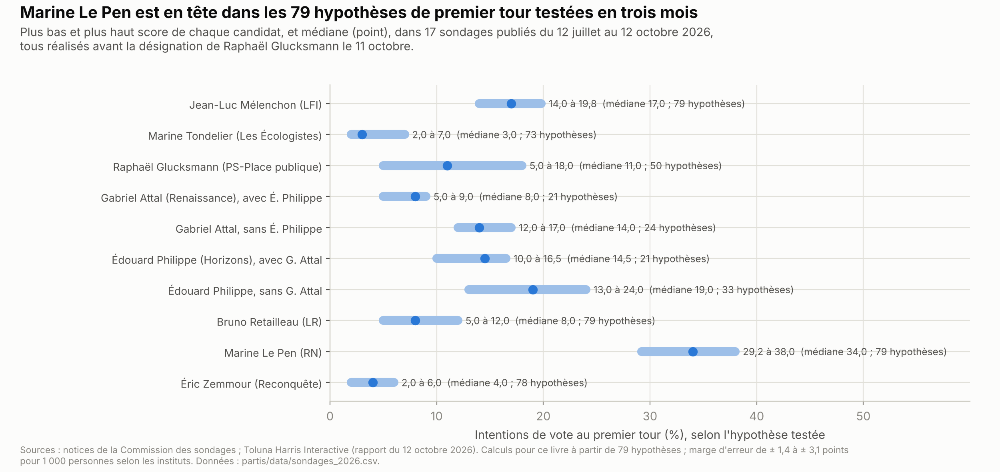
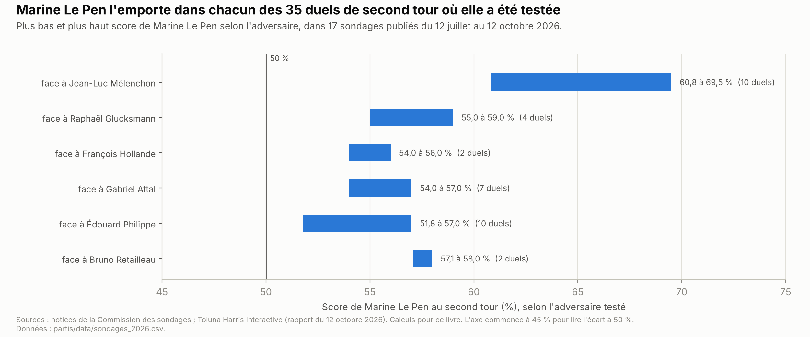

# Présidentielle 2027 : ce que proposent les partis

*Version de travail du 12 octobre 2026. Les chiffres seront mis à jour à la date d'arrêt des données de l'édition 1. Chaque fiche indique dans sa ligne de version ce qui entraînera sa révision : programme, désignation ou décision de justice.*

Cette partie présente les huit partis dont le candidat atteint au moins 5 % des intentions de vote dans plusieurs sondages de premier tour des trois derniers mois. L'introduction donne le calendrier, les candidats, les sondages et l'état des programmes. Elle résume ensuite les propositions dans un tableau croisé, puis rappelle ce que deviennent les promesses électorales. Chaque parti a ensuite sa fiche, sur le même plan. Les positions sont reprises des chapitres thématiques, qui donnent le détail, les chiffrages et les critiques.

**Les fiches des partis :**
- [La France insoumise (LFI)](lfi.md) : Jean-Luc Mélenchon ;
- [Les Écologistes](ecologistes.md) : Marine Tondelier, jusqu'au vote des adhérents de décembre 2026 ;
- [Parti socialiste et Place publique (PS-Place publique)](ps_place_publique.md) : Raphaël Glucksmann ; une candidature de François Hollande serait rattachée à cette fiche ;
- [Renaissance](renaissance.md) : Gabriel Attal ;
- [Horizons](horizons.md) : Édouard Philippe ;
- [Les Républicains (LR)](lr.md) : Bruno Retailleau ;
- [Rassemblement national (RN)](rn.md) : Marine Le Pen, avec ses alliés de l'Union des droites pour la République (UDR) ;
- [Reconquête](reconquete.md) : Éric Zemmour.

**Voir aussi :**
- [Institutions](../institutions/institutions.md), pour la majorité à l'Assemblée, la dissolution, le référendum et la révision de la Constitution ;
- [Finances publiques](../finances-publiques/finances_publiques.md), pour le budget de l'État, la dette et les plans d'économies des partis ;
- les treize chapitres thématiques, cités ligne par ligne dans le tableau de la section 3 de chaque fiche.

**Comment lire les fiches.**
- **Un même plan pour tous** : en bref, qui, la vision du parti, les propositions, la méthode de gouvernement, le coût, les critiques, l'expérience du pouvoir et ce qui reste à préciser.
- **Quatorze thèmes, dans le même ordre**, des institutions à l'Europe. Pour chaque thème, la fiche donne la position, le levier (loi, budget, Constitution, référendum, UE…) et l'obstacle ou le coût principal, puis renvoie au chapitre.
- **Des positions datées.** Une position de 2022 ou de 2024 est signalée comme telle. Une case vide indique qu'aucune position n'a été trouvée au 12 octobre 2026.
- **Des critiques d'orientations différentes**, trois au plus par fiche, avec la réponse du parti quand elle existe.
- **Les procédures judiciaires** listées visent le candidat et sont en cours. Les condamnations définitives sont citées quand elles touchent l'éligibilité. Toute personne est présumée innocente tant qu'elle n'a pas été définitivement condamnée.

> **Repères.**
> - **Premier et second tour.** Un candidat est élu au premier tour s'il obtient la majorité absolue des suffrages exprimés. Sinon, les deux candidats arrivés en tête s'affrontent au second tour, deux semaines plus tard.
> - **Parrainages.** Pour être candidat, il faut 500 signatures d'élus (maires, parlementaires, conseillers départementaux et régionaux…), venant d'au moins 30 départements ou collectivités d'outre-mer, sans dépasser un dixième dans l'un d'eux. Le Conseil constitutionnel arrête la liste des candidats.
> - **Intention de vote, hypothèse.** Un sondage demande pour qui la personne voterait si l'élection avait lieu maintenant. Il le demande pour une **hypothèse**, c'est-à-dire une liste de candidats choisie par l'institut.
> - **Marge d'erreur.** C'est l'écart possible, dû au hasard de l'échantillon, entre le score mesuré et le score dans toute la population. Pour 1 000 personnes, elle va de ± 1,4 à ± 3,1 points selon le score.
> - **Primaire.** Vote organisé par un ou plusieurs partis pour choisir leur candidat. Elle est « ouverte » quand des non-adhérents peuvent voter.
> - **Programme « publié ».** Document du parti ou du candidat, daté et accessible. Une déclaration n'est pas un programme.
> - **Chiffrage.** Estimation du coût ou du rendement d'une mesure, par le parti lui-même ou par un organisme extérieur.

---

## L'essentiel

1. **Deux tours, huit partis.** Le premier tour a lieu le 18 avril 2027, le second le 2 mai. Ce livre suit les huit partis dont le candidat atteint au moins 5 % dans plusieurs sondages récents.
2. **Marine Le Pen en tête.** Dans 17 sondages publiés de juillet à octobre 2026, elle obtient 29,2 à 38 % au premier tour. Elle l'emporte dans chacun des 35 duels de second tour où elle est testée. Jean-Luc Mélenchon et Édouard Philippe se disputent la deuxième place.
3. **Des candidatures encore ouvertes.** Raphaël Glucksmann a gagné la primaire de la gauche sociale-démocrate le 11 octobre 2026, avec 66 %. Les Écologistes votent en décembre. Le bloc central n'a pas de candidat commun. La Cour de cassation doit encore juger le pourvoi de Marine Le Pen.
4. **Peu de programmes complets.** La plupart des partis ont publié des documents partiels : contre-budgets, plans, sites de campagne. LFI publie son programme le 6 novembre. Aucun chiffrage indépendant d'un programme de 2027 n'a été trouvé.
5. **Gouverner sans majorité.** L'Assemblée élue en 2024 n'a pas de majorité absolue ; le président élu pourra la dissoudre. Plusieurs candidats prévoient des référendums ou des ordonnances.
6. **Des promesses souvent tenues, en partie.** Dans 12 pays étudiés, 59 % des promesses des partis au gouvernement ont été tenues au moins en partie. En France, un projet de recherche mesure plus de 60 % depuis 1995.

**Les grandes lignes de partage.**
- **Budget** : de nouvelles dépenses financées par les plus aisés (LFI, Les Écologistes, PS-Place publique), ou des économies sur les dépenses (Renaissance, Horizons, LR, RN, Reconquête).
- **Retraites** : un âge légal de 60 ou 62 ans (LFI, Les Écologistes, PS-Place publique, RN), de 63 ans avec décote (LR) ou de 65 ans (Horizons), ou plus d'âge légal (Renaissance).
- **Immigration** : régulariser et ouvrir des voies légales (LFI, Les Écologistes), choisir selon le travail (PS-Place publique, Renaissance), ou réduire les entrées (Horizons, LR, RN, Reconquête).
- **Énergie** : sortir du nucléaire (LFI, Les Écologistes) ou le garder ; freiner l'éolien et le solaire (LR, RN, Reconquête) ou les développer.
- **Europe** : aller vers une Europe fédérale (Les Écologistes, PS-Place publique, Renaissance), désobéir à certaines règles (LFI), ou faire primer le droit national (LR, RN, Reconquête).
- **Institutions** : une nouvelle Constitution (LFI, Les Écologistes), la proportionnelle (PS-Place publique), ou des référendums et des ordonnances (Renaissance, Horizons, LR, RN, Reconquête).

---

## 1. Le paysage

### 1.1 Le calendrier

| Date | Étape |
|---|---|
| 9 au 11 octobre 2026 | Primaire de la gauche sociale-démocrate (Parti socialiste, Place publique, Gauche républicaine et socialiste) : Raphaël Glucksmann est désigné dès le premier tour, avec 66,17 % |
| 6 novembre 2026 | Nouvelle édition du programme de LFI, présentée le 7 novembre au Bourget |
| 10 au 13 décembre 2026 | Vote des adhérents des Écologistes : candidature de Marine Tondelier ou soutien à un candidat d'une autre force de gauche |
| Fin 2026 ou début 2027 | « Rassemblement » annoncé par Gabriel Attal et Édouard Philippe ; décision attendue de François Hollande |
| ≈ 26 janvier 2027 (estimation du ministère de l'Intérieur) | Décret de convocation des électeurs ; les parrainages s'ouvrent le lendemain |
| 12 mars 2027 | Fin du dépôt des 500 parrainages (sixième vendredi avant le premier tour) |
| 26 mars 2027 au plus tard *(date calculée)* | Liste officielle des candidats, arrêtée par le Conseil constitutionnel (quatrième vendredi avant le premier tour) |
| D'ici début avril 2027 (annonce de la Cour de cassation) | Décision possible de la Cour de cassation sur le pourvoi de Marine Le Pen |
| **Dimanche 18 avril 2027** | **Premier tour** (samedi 17 avril dans sept territoires d'outre-mer) |
| **Dimanche 2 mai 2027** | **Second tour** (samedi 1er mai dans les mêmes territoires) |
| Après le 2 mai 2027 | Législatives anticipées si le président élu dissout l'Assemblée nationale (section 1.5) |

*Sources : compte rendu du Conseil des ministres du 1er juillet 2026*[^cm-2026-07-01-calendrier]*. Date estimée du décret et fin des parrainages : Maire-info*[^maireinfo-presidentielle-2027]*. Publication de la liste : Weka*[^weka-parrainages-2027]*. Primaire : Public Sénat*[^publicsenat-primaire-resultats]*. LFI, Écologistes et bloc central : La Chaîne parlementaire (LCP)*[^lcp-lfi-programme-2026][^lcp-ecologistes-decembre][^lcp-bloc-central-2026]*. Cour de cassation : Le Club des juristes*[^cdj-le-pen-cassation]*.*

**Les dates officielles.** Le gouvernement a fixé les deux tours le 1er juillet 2026, après une consultation des partis[^cm-2026-07-01-calendrier]. Le décret de convocation n'était pas publié au 12 octobre 2026. Le premier tour tombe pendant les vacances de printemps des trois zones *(source secondaire)*[^lcp-dates-2027].

**Les désignations.**
- **La gauche sociale-démocrate** a voté du 9 au 11 octobre 2026, avec une prolongation d'un jour après une attaque informatique *(source secondaire)*[^afp-primaire-2026]. Sur 120 787 votants, Raphaël Glucksmann (Place publique) obtient 66,17 %. Suivent Olivier Faure (14,46 %), Ségolène Royal (7,62 %), Emmanuel Maurel (5,92 %) et Jérôme Guedj (5,83 %) *(source secondaire)*[^publicsenat-primaire-resultats].
- **Les Écologistes** choisiront du 10 au 13 décembre 2026 entre une candidature de Marine Tondelier et le soutien à un candidat d'une autre force de gauche *(source secondaire)*[^lcp-ecologistes-decembre].
- **LR** a désigné Bruno Retailleau par un vote des adhérents, avec 73,8 % ; le résultat a été publié le 19 avril 2026 *(source secondaire)*[^publicsenat-retailleau-designe].
- **Le centre et la droite** n'ont pas fixé de procédure commune. Un « comité de liaison » réunit Renaissance, Horizons, le Mouvement démocrate (MoDem) et l'Union des démocrates et indépendants (UDI). David Lisnard (Nouvelle Énergie) demande « une grande primaire ouverte à tous » *(source secondaire)*[^lcp-bloc-central-2026]. Xavier Bertrand n'en voit pas la nécessité *(source secondaire)*[^lcp-bertrand-2026].

### 1.2 Les candidats

| Parti | Candidat | Statut au 12 octobre 2026 | Désignation |
|---|---|---|---|
| LFI | Jean-Luc Mélenchon | Déclaré | Annonce le 3 mai 2026, au journal de 20 heures de TF1 |
| Les Écologistes | Marine Tondelier | Candidate jusqu'au vote des adhérents | Vote du 10 au 13 décembre 2026, qui peut conduire à un ralliement |
| PS-Place publique | Raphaël Glucksmann | Désigné | Primaire ouverte du 9 au 11 octobre 2026 (66,17 %) |
| Renaissance | Gabriel Attal | Déclaré | Annonce le 22 mai 2026 ; motion du conseil national du 12 mai (91 %) ; vote des adhérents annoncé, résultat non trouvé |
| Horizons | Édouard Philippe | Déclaré | Annonce le 3 septembre 2024, dans un entretien au *Point* |
| LR | Bruno Retailleau | Désigné | Vote des adhérents, résultat publié le 19 avril 2026 (73,8 %) |
| RN | Marine Le Pen | Déclarée | Annonce le 7 juillet 2026, le soir de l'arrêt d'appel ; pourvoi en cassation en cours |
| Reconquête | Éric Zemmour | Déclaré | Annonce le 17 septembre 2026 sur BFMTV ; déclaration formelle annoncée pour l'automne |

*Partis dans l'ordre de l'hémicycle. Sources : LCP pour J.-L. Mélenchon*[^lcp-candidature-melenchon]*, G. Attal*[^lcp-attal-candidature]*, M. Le Pen*[^lcp-le-pen-eligible] *et É. Zemmour*[^lcp-zemmour-candidature] *; Agence France-Presse (AFP) pour le conseil national de Renaissance*[^afp-renaissance-attal] *; Public Sénat pour R. Glucksmann*[^publicsenat-primaire-resultats]*, É. Philippe*[^publicsenat-philippe-2024]*, B. Retailleau*[^publicsenat-retailleau-designe] *et la date de la déclaration formelle d'É. Zemmour*[^publicsenat-zemmour-2026] *; LCP pour M. Tondelier*[^lcp-ecologistes-decembre]*. Toutes ces sources sont des sources secondaires.*

**La situation judiciaire de Marine Le Pen.** Le 7 juillet 2026, la cour d'appel de Paris l'a condamnée à 45 mois d'inéligibilité, dont 30 avec sursis. La cour a tenu compte de l'inéligibilité exécutée depuis le 31 mars 2025 *(source secondaire)*[^lcp-le-pen-eligible]. Marine Le Pen s'est pourvue en cassation. Selon Le Club des juristes, la Cour de cassation a annoncé qu'elle pourrait statuer « d'ici début avril 2027 », un calendrier « susceptible d'évoluer »[^cdj-le-pen-cassation]. Le parquet général ne s'est pas pourvu[^cdj-parquet-2026]. Le détail est dans la [fiche RN](rn.md).

### 1.3 Les sondages

**Dix-sept sondages en trois mois.** Du 12 juillet au 12 octobre 2026, sept instituts ont publié 17 sondages d'intentions de vote. Ils testent 79 hypothèses de premier tour et 36 duels de second tour, dont 35 avec Marine Le Pen[^commission-sondages-2027][^toluna-v7-2026]. Tous ont été réalisés avant la désignation de Raphaël Glucksmann.

| Institut | Commanditaire | Terrain | Personnes interrogées |
|---|---|---|---|
| Cluster17 | *Le Grand Continent* | 22-24 juillet | 1 506 |
| Toluna Harris Interactive | M6, RTL | 18-19 août | 2 114 |
| Ifop-Fiducial | LCI, *Le Figaro*, Sud Radio | 24-25 août | 1 800 |
| Elabe | BFMTV, *La Tribune Dimanche* | 26-28 août | 1 501 |
| Ipsos BVA | *Le Parisien* | 31 août-2 septembre | 1 500 inscrits |
| Cluster17 | *Le Point* | 31 août-1er septembre | 1 711 |
| OpinionWay | *Le Journal du dimanche* | 2-3 septembre | 1 003 |
| OpinionWay | Sébastien Bonnal (candidat) | 2-4 septembre | 1 034 |
| OpinionWay | *Les Echos*, Radio Classique | 8-9 septembre | 948 inscrits |
| Toluna Harris Interactive | M6, RTL | 8-10 septembre | 2 358 |
| OpinionWay | CNews | 9-10 septembre | 1 001 |
| Ipsos BVA | Centre de recherches politiques de Sciences Po (Cevipof), *Le Monde*, Fondation Jean-Jaurès, Institut Montaigne | 3-9 septembre | 13 060 inscrits |
| Cluster17 | *Politico* | 15-16 septembre | 2 045 |
| YouGov | *Le HuffPost* | 17-21 septembre | 1 103 |
| Toluna Harris Interactive | M6, RTL | 22-24 septembre | 2 334 |
| Ifop-Fiducial | LCI, *Le Figaro*, Sud Radio | 25-29 septembre | 1 527 |
| Toluna Harris Interactive | M6, RTL | 5-8 octobre | 2 348 |

*Sources : notices déposées à la Commission des sondages*[^commission-sondages-2027] *; rapport de Toluna Harris Interactive pour le sondage du 12 octobre*[^toluna-v7-2026]*. Les données complètes, hypothèse par hypothèse, sont dans le fichier des sondages de l'édition.*

**Ce que disent ces sondages** *(calcul sur les 79 hypothèses)*[^commission-sondages-2027][^toluna-v7-2026].
- **Marine Le Pen est en tête dans toutes les hypothèses**, avec 29,2 à 38 %. Son avance sur le deuxième va de 10,6 à 21 points.
- **La deuxième place se joue entre Jean-Luc Mélenchon et Édouard Philippe.** Jean-Luc Mélenchon obtient 14 à 19,8 %. Édouard Philippe obtient 10 à 16,5 % quand Gabriel Attal est aussi candidat, et 13 à 24 % quand Gabriel Attal n'est pas candidat.
- **Gabriel Attal** obtient 5 à 9 % quand Édouard Philippe est aussi candidat, 12 à 17 % sans lui.
- **Les autres candidats des huit partis** : Raphaël Glucksmann 5 à 18 % ; Bruno Retailleau 5 à 12 % ; Marine Tondelier 2 à 7 % ; Éric Zemmour 2 à 6 %.
- **Au second tour**, Marine Le Pen l'emporte dans les 35 duels testés contre elle, avec 51,8 à 69,5 %. Face à Édouard Philippe, elle obtient 51,8 à 57 % ; face à Jean-Luc Mélenchon, 60,8 à 69,5 %.

Chacun des huit candidats retenus atteint 5 % dans au moins quatre sondages de la période *(calcul)*. Les plus proches du seuil sont Marine Tondelier (7 % au plus, chez YouGov) et Éric Zemmour (6 % au plus, chez YouGov et Toluna Harris Interactive)[^cds-yougov-2026-09][^cds-harris-2026-09]. Deux autres candidats atteignent 5 % dans une seule hypothèse : François Ruffin (Debout !, 6 % chez Elabe) et David Lisnard (Nouvelle Énergie, 5,2 % chez Cluster17)[^commission-sondages-2027]. Le livre retient les partis dont le candidat atteint 5 % dans au moins deux sondages ; la liste est revue à chaque édition.

**Ce que les sondages ne disent pas.**
- **Une marge d'erreur.** Pour 1 000 personnes, les instituts l'estiment de ± 1,4 à ± 3,1 points selon le score[^cds-yougov-2026-09]. Elle atteint ± 3,8 points sur les 680 personnes certaines d'aller voter d'un sondage OpinionWay[^cds-opinionway-2026-09]. Ipsos BVA rappelle que ce calcul vaut strictement pour un tirage au hasard et reste approché pour un échantillon construit par quotas[^cds-ipsos-2026-09].
- **Une deuxième place incertaine.** Dans 52 hypothèses sur 79, l'écart entre le deuxième et le troisième est de 3 points ou moins *(calcul)*. Il reste souvent à l'intérieur de la marge d'erreur, surtout dans les sondages de 1 000 à 2 000 personnes.
- **Des hypothèses, pas des candidatures.** Chaque institut choisit les candidats testés : Gabriel Attal, Édouard Philippe ou les deux, Raphaël Glucksmann ou François Hollande, parfois Bruno Le Maire ou Dominique de Villepin. La liste officielle des candidats sera connue en mars 2027.
- **Les indécis.** Fin septembre, 26 à 33 % des inscrits interrogés par l'Ifop ne se prononcent pas au premier tour, selon l'hypothèse[^cds-ifop-2026-09]. Les instituts ne mesurent pas les indécis de la même façon. Les chiffres ne se comparent donc pas d'un institut à l'autre.
- **Une photographie.** Selon la notice de YouGov, les intentions de vote mesurent un rapport de force à un instant donné et ne prédisent pas le scrutin *(paraphrase)*[^cds-yougov-2026-09]. L'expérience de 2022 est rappelée en section 5.

### 1.4 Où en sont les programmes

| Parti | Documents publiés | Publication attendue |
|---|---|---|
| LFI | *L'Avenir en commun*, édition 2025 ; contre-budget 2026 (octobre 2025) | Nouvelle édition le 6 novembre 2026 |
| Les Écologistes | Programme de juillet 2026 | Choix du candidat du 10 au 13 décembre 2026 |
| PS-Place publique | Projet du PS de 144 pages (22 avril 2026) ; contre-budget 2027 du groupe socialiste (16 septembre 2026) ; « Notre vision pour la France », de Place publique | Programme du candidat désigné le 11 octobre : pas de date trouvée |
| Renaissance | Site de campagne de Gabriel Attal ; plan pour les finances publiques (juillet 2026) | Pas de date trouvée |
| Horizons | Site de campagne d'Édouard Philippe, page par page | Pas de date trouvée |
| LR | Plan « La fête est finie » (7 janvier 2026) ; propositions par thème en 2026 | Pas de date trouvée |
| RN | Programme des législatives (juin 2024) ; contre-budget 2026 ; plan budgétaire présenté le 6 octobre 2026 | Présentations par thème |
| Reconquête | Pas de programme pour 2027 | Déclaration formelle d'Éric Zemmour annoncée pour l'automne |

*Partis dans l'ordre de l'hémicycle. Sources : LFI*[^lfi-aec-2025]*, L'insoumission*[^insoumission-contre-budget] *et LCP*[^lcp-lfi-programme-2026] *; Les Écologistes*[^ecologistes-programme] *; LCP pour le projet*[^lcp-projet-ps-2026] *et le contre-budget du PS*[^lcp-contre-budget-ps] *; Place publique*[^pp-vision] *; site de G. Attal*[^attal-site] *et Journal du dimanche*[^jdd-attal] *; site d'É. Philippe*[^philippe-prospere] *; Public Sénat pour LR*[^publicsenat-lr-fete-finie] *; RN*[^rn-programme-2024][^rn-contre-budget-2026] *et Europe 1*[^europe1-rn-plan] *; Public Sénat pour Reconquête*[^publicsenat-zemmour-2026]*.*

Un programme « publié » désigne ici un document du parti ou du candidat, daté et accessible. Les positions qui viennent de déclarations sont reprises dans les chapitres avec leur date. Les fiches des partis détaillent ces documents.

### 1.5 Gouverner ensuite

- **Aucune majorité à l'Assemblée.** En octobre 2026, la gauche compte 193 sièges, le centre 162, le RN et ses alliés 138, la Droite républicaine (LR) 47, pour une majorité absolue de 289 *(calcul)*[^an-effectifs].
- **Une dissolution possible dès le début du mandat.** Le délai d'un an qui suivait les législatives de 2024 a pris fin en juillet 2025 (article 12) *(lecture du texte)*[^an-constitution]. Les élections auraient lieu 20 à 40 jours après la dissolution.
- **Sans dissolution**, l'Assemblée élue en 2024 siège jusqu'en 2029.
- **Une cohabitation est possible** si les législatives donnent la majorité aux opposants du président.
- Le chapitre [Institutions](../institutions/institutions.md) détaille ces règles, le référendum et la révision de la Constitution[^ch-institutions].

### 1.6 Qui chiffre les programmes

Les chapitres citent des organismes qui chiffrent des mesures. Le tableau donne leur statut, leur financement et leur orientation, dans leurs mots, puis la mention utilisée dans ce livre.

| Organisme | Statut et financement | Orientation, dans ses mots | Mention dans ce livre |
|---|---|---|---|
| Institut Montaigne | Association à but non lucratif ; financée par plus de 160 entreprises, aucune au-delà de 1,2 % d'un budget d'≈ 6,6 M€ | « Think tank indépendant » | Libéral |
| Fondation pour la recherche sur les administrations et les politiques publiques (IFRAP) | Fondation reconnue d'utilité publique depuis 2009 ; « intégralement financée par la générosité privée », sans subvention publique | Think tank « visant la performance des dépenses publiques » | Libérale |
| Observatoire français des conjonctures économiques (OFCE) | Centre de recherche de Sciences Po, créé en 1981 par une convention avec l'État ; financé par une subvention publique ; fusionné le 1er juillet 2026 avec le Centre d'études prospectives et d'informations internationales (CEPII) | Contribuer à « assurer, en France, le pluralisme dans l'analyse économique » | Souvent classé keynésien |
| Institut des politiques publiques (IPP) | Créé en 2011 par l'École d'économie de Paris et le Centre de recherche en économie et statistique ; financement non détaillé | Évaluer les politiques « en toute indépendance intellectuelle » *(traduction)* | Aucune |
| Rexecode | Centre de recherche fondé en 1957 ; financé par ses 60 adhérents ou partenaires | « premier centre de recherche macroéconomique français proche des entreprises » | Proche des milieux patronaux |
| Terra Nova | Association reconnue d'intérêt général ; sources de financement « suffisamment variées », sans détail ; appel aux mécènes, adhérents et donateurs ; 200 000 € de subvention publique en 2025 | « think tank progressiste indépendant » | Centre gauche |
| Fondation Jean-Jaurès | Fondation reconnue d'utilité publique, créée en 1992 à l'initiative de Pierre Mauroy ; 1 093 000 € de subvention publique en 2025 | Sociale-démocrate *(paraphrase)* | Proche du PS |
| Fondation pour l'innovation politique (Fondapol) | Fondation reconnue d'utilité publique, créée en 2004 ; ressources « publiques et privées » ; 969 000 € de subvention publique en 2025 | « Un Think Tank libéral, progressiste et européen » | Libérale |
| Institut Rousseau | Association créée en 2020 ; dons, adhésions, formations | « laboratoire d'idées indépendant, attaché à la reconstruction écologique, sociale et démocratique » | Non cité |
| Fondation Copernic | Cercle de réflexion créé en 1998 ; « cotisations de ses adhérents », selon Wikipédia citant *Télérama* (article non daté) | « ancrée à gauche et issue du mouvement social » | Non cité |
| Institut La Boétie | « Fondation insoumise », coprésidée par Jean-Luc Mélenchon ; financement non précisé | « humanisme global, planification écologique et critique du capitalisme » | Fondation de LFI |
| Haut Conseil des finances publiques (HCFP) | Organisme indépendant placé auprès de la Cour des comptes, créé par une loi organique de 2012 | Rend des avis sur les textes budgétaires du gouvernement | — |

*Sources : data.gouv.fr pour l'Institut Montaigne*[^datagouv-montaigne]*. Sites des organismes : IFRAP*[^ifrap-qui-sommes-nous]*, OFCE*[^ofce-statuts]*, IPP*[^ipp-creation]*, Rexecode*[^rexecode-presentation]*, Terra Nova*[^terranova-qui-sommes-nous]*, Fondapol*[^fondapol-presentation]*, Institut La Boétie*[^laboetie-qui-sommes-nous]*. Fondation Jean-Jaurès : page de collecte*[^helloasso-jean-jaures]*. Institut Rousseau : rapport d'activité*[^rousseau-rapport-2025]*. Fondation Copernic et HCFP : Wikipédia (sources secondaires)*[^wiki-copernic][^wiki-hcfp]*. Subventions de 2025 : Sénat, réponse du Premier ministre*[^senat-qe-05197]*.*

- **Les mentions de la dernière colonne** sont les mots employés dans les chapitres. Elles résument une orientation attribuée à ces organismes, sans source unique. Pour l'OFCE, aucune source de cette attribution n'a été trouvée (section 6).
- **Le HCFP ne chiffre pas les programmes des partis.** Ses avis portent sur les projets de loi du gouvernement *(lecture du texte)*[^wiki-hcfp]. Dans son avis du 1er octobre 2026 sur le budget 2027, il juge « optimiste » la prévision de croissance de 1,0 % *(source secondaire)*[^euronews-croissance][^hcfp-avis-2026-5].
- **Aucun chiffrage indépendant d'un programme de 2027** n'a été trouvé au 12 octobre 2026. Le comparateur de l'IFRAP liste les mesures de 17 candidats, sans coût total[^ifrap-comparateur]. Des simulateurs en ligne publient des chiffrages sans auteur identifié ; ce livre ne les cite pas.

---

## 2. Qui propose quoi

Ces trois tableaux résument, en quelques mots, la position de chaque parti sur treize questions. Ils ne portent pas de notes : chaque case reprend la fiche du parti, qui donne la source et la date, et le chapitre du thème, qui donne le détail, les chiffrages et les critiques.

- **Les montants ne se comparent pas directement.** Certains valent par an, d'autres d'ici 2032 ou sur cinq ans. Les fiches précisent la base de chaque montant.
- **Les termes techniques** (commandement intégré de l'Organisation du traité de l'Atlantique nord (OTAN), peines planchers, zéro artificialisation nette…) sont définis dans les fiches et dans le glossaire du livre.
- **Une position de 2022 ou de 2024** est signalée par sa date. Elle est reprise quand le parti n'a rien publié de plus récent sur le sujet.

### 2.1 Budget, salaires et retraites

| Parti | Déficit et dépenses | Impôts | Salaires et pouvoir d'achat | Retraites |
|---|---|---|---|---|
| **LFI** | Contre-budget 2026 : 168 Md€ de dépenses nouvelles ; déficit sous 3 % « au bout de cinq ans » | 183 Md€ de recettes nouvelles : taxe Zucman (2 % par an sur les patrimoines de plus de 100 M€), impôt sur la fortune « climatique »… | SMIC à 1 600 € net ; blocage des prix de première nécessité | 60 ans et 40 annuités ; abrogation de la réforme de 2023 |
| **Les Écologistes** | Pas d'objectif chiffré ; « renégocier » la trajectoire de baisse des déficits | +10 points d'impôt sur les héritages au-delà de 4 M€ ; taxe Zucman ; impôt sur la fortune selon l'empreinte carbone | SMIC à 2 000 € brut ; blocage des prix en cas d'inflation « anormale » | 60 ans après un début avant 20 ans ou un métier pénible, 62 ans pour les autres |
| **PS-Place publique** | Contre-budget 2027 du groupe PS : 22 Md€ de dépenses nouvelles, 17,5 Md€ d'économies | ≈ 39,5 Md€ de recettes nouvelles : taxe Zucman, contribution sociale généralisée (CSG) sur les grandes successions, taxe sur les géants du numérique | SMIC à 1 700 € net ; CSG réduite au niveau du SMIC | Abrogation de la réforme de 2023 ; 62 ans |
| **Renaissance** | 120 à 150 Md€ d'économies ; déficit sous 3 % avant 2032, nul en 2037 ; 100 000 postes d'État en moins | Pas de hausse d'impôts | Cotisations salariales réduites ; « année blanche » sur les prestations sociales en 2028, sauf les petites retraites | Plus d'âge légal : décote et surcote ; un pilier de capitalisation |
| **Horizons** | Déficit à 2 % du PIB en 2032 ; 250 000 postes en moins en cinq ans | 50 Md€ d'impôts de production en moins par an, contre 50 Md€ d'aides aux entreprises en moins | « Augmenter le salaire net » ; aides ciblées aux automobilistes doublées | 65 ans et 45 annuités en moins de dix ans ; une part de capitalisation |
| **LR** | 120 Md€ d'économies d'ici 2032 ; 300 000 postes publics en moins par quinquennat | 40 Md€ d'allègements pour les entreprises en 2027 | Heures au-delà de 1 607 par an sans cotisation ni impôt, hors CSG ; aides plafonnées à 70 % du SMIC | 63 ans minimum avec décote, taux plein à 65 ans ; capitalisation pour les nouveaux entrants |
| **RN** | 140 Md€ d'économies nettes d'ici 2032 ; déficit sous 3 % en 2030 ; au moins 200 000 postes en moins en cinq ans | 30 Md€ de baisses d'impôts | TVA réduite sur l'énergie ; TVA supprimée sur 100 produits de première nécessité | 62 ans et 42 annuités, progressivement ; 60 ans après un début avant 20 ans ; un « pilier de capitalisation » |
| **Reconquête** | ≈ 130 Md€ d'économies par an (Sarah Knafo) ; plus de 800 000 postes publics en moins | CSG supprimée sur les revenus du travail (Sarah Knafo) | « 10 % de salaire net en plus » par la fin de cette CSG | Pas de programme pour 2027 ; « travailler plus longtemps » ; « une partie de capitalisation » ; 64 ans en 2022 |

*Partis dans l'ordre de l'hémicycle. Détail : chapitres [Finances publiques](../finances-publiques/finances_publiques.md), [Pouvoir d'achat](../pouvoir-achat/pouvoir_achat.md), [Travail et emploi](../travail-emploi/travail_emploi.md) et [Retraites et productivité](../retraites-productivite/retraites_productivite.md).*

### 2.2 Institutions, immigration, sécurité, énergie, Europe et défense

| Parti | Institutions | Immigration | Sécurité et justice | Énergie | Europe et défense |
|---|---|---|---|---|---|
| **LFI** | Assemblée constituante convoquée par référendum ; fin du 49.3 (adoption d'une loi sans vote, sauf censure) ; proportionnelle | Régularisations ; « droit du sol intégral » ; vote des étrangers aux élections locales | Police de proximité ; brigades anticriminalité démantelées | Sortie du nucléaire ; 100 % renouvelables (2024) | Désobéir aux règles européennes « incompatibles » ; sortie du commandement intégré de l'OTAN, puis de l'OTAN |
| **Les Écologistes** | Nouvelle Constitution ; référendum d'initiative citoyenne « délibératif » | Voies légales d'immigration ; droit du sol quelle que soit la situation des parents | 9 000 magistrats et 10 000 greffiers en dix ans ; cannabis légalisé et encadré | Sortie du nucléaire en ≈ 20 ans | « Saut fédéral » européen ; commandement militaire européen intégré ; armes à longue portée pour l'Ukraine |
| **PS-Place publique** | Proportionnelle ; 49.3 réservé aux lois de finances ; censure « constructive » | Titre de séjour avec un contrat de travail ; vote des étrangers aux élections locales | Police de proximité ; office contre le blanchiment | Nucléaire et renouvelables ; électricité hors de la « logique de marché » | « Europe fédérale » ; saisie des avoirs russes ; contre l'accord avec le Mercosur |
| **Renaissance** | Référendum sur une règle d'or budgétaire en début de quinquennat | Immigration à points ; quotas votés tous les deux ans | Juge de l'application des peines et remises automatiques de peine supprimés | Nucléaire et renouvelables | « États-Unis d'Europe » à 8 ou 10 pays ; premier référendum européen |
| **Horizons** | Règle d'or dans la Constitution ; dissolution puis ordonnances | Immigration légale divisée par deux ; regroupement familial suspendu cinq ans | Peines planchers ; courtes peines dès la première infraction | Relance du nucléaire et renouvelables | 250 000 réservistes ; l'Ukraine dans l'OTAN et dans l'UE |
| **LR** | « Pacte constitutionnel » soumis à référendum ; article 11 élargi | Fin du droit du sol ; plafonds migratoires par référendum | « État d'urgence anti-trafics » ; courtes peines pour les mineurs | Réacteurs prolongés jusqu'à 80 ans ; plus de subventions aux nouveaux parcs éoliens et solaires | 3,5 % du PIB pour la défense ; une loi organique pour « revenir sur une jurisprudence européenne » |
| **RN** | Référendum sur l'immigration par l'article 11 ; référendum d'initiative citoyenne (2024) | Fin du droit du sol et du regroupement familial ; « priorité nationale » | Peines planchers ; 85 000 places de prison (2022) | Prix régulé de l'électricité ; moratoire sur l'éolien et le solaire | Contribution au budget de l'UE réduite de 9 Md€ par an ; primauté du droit national ; sortie du commandement intégré de l'OTAN, mais pas « tant qu'il y aura la guerre aux portes de l'Europe » |
| **Reconquête** | « Dernier mot » au Parlement face au Conseil constitutionnel (2022) | « Remigration » ; asile limité à une centaine de personnes par an (2022) | Peines planchers ; « perpétuité réelle » ; majorité pénale à 16 ans (2022) | Au moins 14 nouveaux réacteurs d'ici 2050 ; arrêt des nouveaux projets éoliens (2022) | Lois nationales supérieures aux traités antérieurs ; sortie du commandement intégré de l'OTAN (2022) |

*Partis dans l'ordre de l'hémicycle. Détail : chapitres [Institutions](../institutions/institutions.md), [Immigration](../immigration/immigration.md), [Sécurité et justice](../securite-justice/securite_justice.md), [Énergie](../energie/energie_france_europe_allemagne.md) et [Défense et Europe](../defense-europe/defense_europe.md).*

### 2.3 Éducation, santé, logement et climat

| Parti | Éducation | Santé | Logement | Climat et environnement |
|---|---|---|---|---|
| **LFI** | 160 000 enseignants recrutés ; rattrapage du gel du point d'indice | Installation des médecins régulée ; « 100 % Sécu » | 400 000 logements abordables par an ; loyers gelés en zone tendue | −65 % d'émissions en 2030 par rapport à 1990 (2022) ; « règle verte » dans la Constitution |
| **Les Écologistes** | Enseignants : +15 % en cinq ans en plus de l'inflation ; 19 élèves par classe | 2 000 centres de santé d'ici 2030 | Encadrement des loyers généralisé ; 500 000 rénovations performantes par an | Neutralité carbone en 2050 ; sortie des pesticides de synthèse ; 7 Md€ par an pour l'adaptation |
| **PS-Place publique** | 19 élèves au plus par classe en primaire ; enseignants : +10 % à +25 % | 3 Md€ pour l'hôpital public ; mutuelle publique gratuite pour les 18-25 ans | « Bouclier logement » (Olivier Faure) : pas plus de 30 % des revenus pour se loger dans le parc privé | −90 % d'émissions en 2040 ; fonds de sécurité climatique de 5 Md€ |
| **Renaissance** | « Choc des savoirs » rétabli ; moins de 20 élèves par classe ; enseignants : +200 € nets par mois | « Année blanche » sur les prestations sociales en 2028 | Règle de « zéro artificialisation nette » simplifiée ; logements intermédiaires comptés dans le quota de logements sociaux | Baisse des émissions portée à 5 % par an d'ici 2030 |
| **Horizons** | Enseignants : +20 % en cinq ans ; amende pour certains parents | Réforme par ordonnances, habilitées par référendum | Ni nouvelle norme ni nouvel impôt ; droits des propriétaires renforcés | 2 Md€ par an pour l'adaptation ; Fonds vert doublé |
| **LR** | Examen d'entrée en 6e ; groupes de niveau ; fin du collège unique ; enseignants : +135 à +300 € nets par mois | Aide médicale de l'État (AME) remplacée par une aide d'urgence (2024) | Fin de l'encadrement des loyers ; « zéro artificialisation nette » abrogé | « Écologie de l'adaptation » ; fin du principe de précaution |
| **RN** | Savoirs fondamentaux (2024) ; Pacte enseignant abrogé | Agences régionales de santé supprimées ; AME remplacée par une aide d'urgence vitale (2024) | Priorité aux Français dans le logement social ; loi solidarité et renouvellement urbain (SRU) abrogée | Pacte vert européen suspendu ; « plan clim' » de 20 Md€ sur dix ans |
| **Reconquête** | « La lecture, l'écriture et le calcul » ; certificat d'études (2022) | AME remplacée par une aide médicale d'urgence (2022) | Squatteurs expulsés en 72 heures (2022) ; loi SRU abrogée | Pas de position trouvée |

*Partis dans l'ordre de l'hémicycle. Détail : chapitres [Éducation](../education/remuneration_enseignants.md), [Santé](../sante/sante_assurance_maladie.md), [Logement](../logement/logement.md) et [Climat](../climat-environnement/climat_environnement.md).*

---

## 3. Ce que deviennent les promesses

### 3.1 Les promesses tenues

- **Une étude dans douze pays.** Une équipe de chercheurs a suivi près de 19 000 promesses, issues de 54 campagnes électorales dans 12 pays d'Europe et d'Amérique du Nord. La France n'en fait pas partie[^thomson-2017].
- **Une promesse, au sens de cette étude**, engage un parti sur une action ou un résultat précis, que l'on peut vérifier. Une déclaration générale ne compte pas[^thomson-2017].
- **59 % des promesses des partis au gouvernement** ont été tenues au moins en partie (5 044 sur 8 547)[^thomson-2017].
- **Le partage du pouvoir pèse.** Un parti qui gouverne seul avec une majorité tient le plus de promesses : 86 % au Royaume-Uni. Dans une coalition, le parti qui obtient la tête du gouvernement en tient davantage. Les promesses de l'opposition sont moins souvent réalisées : 45 % au moins en partie en Allemagne[^thomson-2017].
- **En France**, un projet de recherche public mesure un taux de réalisation supérieur à 60 % depuis 1995[^anr-partipol]. Les chercheurs Isabelle Guinaudeau et Simon Persico notent aussi qu'une « forte minorité » de promesses n'est pas tenue. Selon eux, une promesse a plus de chances d'être tenue quand l'exécutif en a la volonté et les moyens[^guinaudeau-persico-2018].
- **Les programmes orientent les lois votées.** De 1981 à 2012, les thèmes du programme du parti au pouvoir ont pesé sur l'agenda législatif, « albeit only under certain conditions » (« mais seulement sous certaines conditions », *traduction*)[^brouard-2018].

Ces études comptent les promesses une à une. Elles ne disent pas si les promesses les plus importantes sont tenues plus ou moins souvent que les autres.

### 3.2 Les chiffrages des campagnes passées

- **En 2022**, l'Institut Montaigne (libéral), entre autres, a chiffré les programmes présidentiels. Par exemple, la mesure de retraite de Marine Le Pen coûtait 9,6 Md€ en année pleine selon son équipe, et 26 Md€ selon l'Institut Montaigne *(source secondaire)*[^afp-chiffrages-2022].
- **En 2024**, pour les législatives, l'Institut Montaigne estimait que le programme du Nouveau Front populaire creuserait le déficit de 179 Md€ par an, soit 6,3 points de PIB[^montaigne-nfp]. Il estimait celui du RN à 71 Md€ par an[^montaigne-rn-synthese-2024] et celui d'Ensemble à 21 Md€ par an[^montaigne-ensemble-2024]. L'IFRAP (libérale) estimait le déficit supplémentaire à ≈ 160 Md€ par an pour le Nouveau Front populaire[^ifrap-nfp] et à au moins 14,5 Md€ par an pour le RN[^ifrap-chiffrage-2024].
- **Ces chiffrages raisonnent « toutes choses égales par ailleurs »** : ils ne tiennent pas compte des réactions de l'économie. Le Nouveau Front populaire comptait sur l'effet d'une hausse des dépenses sur la croissance ; l'Institut Montaigne ne l'a pas chiffré, faute de modèle jugé satisfaisant[^montaigne-nfp]. Le chapitre [Finances publiques](../finances-publiques/finances_publiques.md) détaille ce débat[^ch-finances-publiques].

---

## 4. Les autres candidats

| Candidat | Parti | Statut au 12 octobre 2026 | Sondages (premier tour) |
|---|---|---|---|
| Fabien Roussel | Parti communiste français (PCF) | Proposé par la conférence nationale en juillet, approuvé par les adhérents à 72 % (vote du 3 au 6 septembre 2026) | 1 à 4,5 % |
| Nathalie Arthaud | Lutte ouvrière | Déclarée le 8 décembre 2025 | Moins de 1 à 2 % |
| François Hollande | PS, hors primaire | Décision attendue d'ici décembre 2026 ou janvier 2027, selon la presse | 4 à 12 % (15 hypothèses) |
| François Ruffin | Debout ! | Candidat à la présidentielle ; la primaire unitaire de la gauche n'est plus d'actualité sous sa forme initiale (section 6) | 2 à 6 % (4 hypothèses) |
| Karim Bouamrane | PS | Déclaré le 9 juin 2026 | 1 % au plus |
| Dominique de Villepin | La France humaniste | Envisage une candidature | 2 à 4 % |
| Bruno Le Maire | Renaissance (selon YouGov) | Réponse annoncée pour octobre 2026 | 3 à 6 % (2 hypothèses) |
| David Lisnard | Nouvelle Énergie | Déclaré le 31 mars 2026 ; demande une primaire | 2 à 5,2 % |
| Xavier Bertrand | LR, président des Hauts-de-France | « Je le serai » (27 août 2026) ; déclaration formelle attendue en fin d'année | 1 % (1 hypothèse) |
| Nicolas Dupont-Aignan | Debout la France | Déclaré | 1 à 4 % |
| François Asselineau | Union populaire républicaine | Déclaré le 21 mars 2026 | Non testé |
| Florian Philippot | — | Déclaré le 9 mars 2026, sous réserve de la décision de Philippe de Villiers | Non testé |
| Anasse Kazib | Révolution permanente | Déclaré le 1er juin 2026 | Non testé |

*Sources : Journal du dimanche, liste des candidats déclarés ou pressentis au 2 juillet 2026 (source secondaire)*[^jdd-candidats-2026] *; LCP pour F. Roussel*[^lcp-roussel-candidat] *; YouGov pour l'étiquette de B. Le Maire*[^cds-yougov-2026-09] *; L'Express et Public Sénat pour F. Hollande*[^lexpress-glucksmann-hollande][^publicsenat-primaire-resultats] *; LCP pour X. Bertrand*[^lcp-bertrand-2026] *et D. Lisnard*[^lcp-bloc-central-2026] *; sondages : notices de la Commission des sondages* *(calcul)*[^commission-sondages-2027]*.*

- **Les candidats battus à la primaire** du 11 octobre (Olivier Faure, Ségolène Royal, Jérôme Guedj, Emmanuel Maurel) obtenaient 1 à 5,5 % dans les hypothèses où ils étaient testés *(calcul)*[^commission-sondages-2027].
- **Aucune candidature du Nouveau Parti anticapitaliste (NPA)** n'a été trouvée au 12 octobre 2026.
- Les propositions de ces candidats, quand elles existent, figurent dans la ligne « Autres » des chapitres.

---

## 5. Pour débattre : affirmations vérifiées

*Ces affirmations portent sur la campagne en général. Les affirmations sur un thème sont testées dans les chapitres. Quand aucun auteur n'a été identifié, l'affirmation est notée « idée répandue ».*

| Affirmation (qui, quand) | Verdict | Ce que disent les données |
|---|---|---|
| « Il n'y a plus de favori », en dehors de Marine Le Pen et de Jean-Luc Mélenchon, qui ont « une dynamique » (Gabriel Attal, Renaissance, LCI, 25 août 2026, *source secondaire*)[^lcp-bloc-central-2026] | **À nuancer** | Marine Le Pen est en tête dans les 79 hypothèses testées de juillet à octobre 2026, avec 10,6 à 21 points d'avance. La deuxième place est disputée : Jean-Luc Mélenchon est seul deuxième dans 46 hypothèses, Édouard Philippe dans 24, et 8 hypothèses donnent une égalité ; l'écart avec le troisième est de 3 points ou moins dans 52 cas *(calcul)*[^commission-sondages-2027]. |
| « Sans candidat désigné démocratiquement, la droite et le centre ne seront pas en mesure de l'emporter » (David Lisnard, Nouvelle Énergie, *Le Monde*, 25 août 2026, *source secondaire*)[^lcp-bloc-central-2026] | **Non démontré** | Aucun sondage ne mesure l'effet d'une primaire en 2027. Les précédents ne montrent pas ce lien. François Fillon, désigné par une primaire ouverte avec 66,5 %, a fini troisième en 2017 avec 20,01 % *(calcul)*[^le360-fillon-2016][^wiki-presidentielle-2017][^cc-2017-169-pdr]. Valérie Pécresse, désignée par les adhérents de LR, a obtenu 4,78 % en 2022 *(calcul)*[^rtbf-pecresse-2021][^cc-2022-195-pdr]. Emmanuel Macron, qui n'avait participé à aucune des primaires de 2016-2017, est arrivé en tête en 2017[^wiki-presidentielle-2017][^cc-2017-169-pdr]. |
| Un second tour entre Marine Le Pen et Jean-Luc Mélenchon « serait la certitude d'une victoire de la candidate d'extrême droite » (Jérôme Guedj, PS, débat de la primaire, 23 septembre 2026, *source secondaire*)[^publicsenat-primaire-debat] | **À nuancer** | Les dix duels testés de juillet à octobre 2026 donnent 60,8 à 69,5 % à Marine Le Pen, soit au moins 21,6 points d'écart *(calcul)*[^commission-sondages-2027]. Mais des sondages à six mois ne donnent pas une « certitude » : en 2022, deux candidats ont fini le premier tour 6 à 15 points loin de leurs intentions de vote d'octobre 2021 (ligne suivante). |
| « Les sondages, à six mois, ne disent rien du résultat » (idée répandue) | **À nuancer** | En octobre 2021, dans les hypothèses avec Éric Zemmour, les sondages donnaient 23 à 29 % à Emmanuel Macron, 15 à 20 % à Marine Le Pen, 13 à 18 % à Éric Zemmour et 7 à 11 % à Jean-Luc Mélenchon *(source secondaire)*[^wiki-sondages-2022]. Le 10 avril 2022, ils ont obtenu 27,85 %, 23,15 %, 7,07 % et 21,95 %[^cc-2022-195-pdr]. Le candidat en tête l'est resté. Jean-Luc Mélenchon a gagné 11 à 15 points ; Éric Zemmour en a perdu 6 à 11 *(calcul)*. |
| « Il n'y a plus de scénario où je ne pourrai pas me présenter en 2027 » (Marine Le Pen, RN, 7 juillet 2026, *source secondaire*)[^lcp-le-pen-eligible] | **Plutôt vrai** | L'arrêt d'appel du 7 juillet 2026 tient compte de l'inéligibilité exécutée depuis mars 2025 ; la cour cite « la liberté des candidatures »[^lcp-le-pen-eligible]. Le parquet général ne s'est pas pourvu[^cdj-parquet-2026]. Une incertitude demeure tant que l'arrêt n'est pas définitif : la Cour de cassation pourrait statuer « d'ici début avril 2027 », peut-être après la fin des parrainages, le 12 mars 2027[^cdj-le-pen-cassation][^maireinfo-presidentielle-2027]. |
| « Le RN a déjà gagné » (idée répandue) | **Non démontré** | Marine Le Pen est en tête dans toutes les hypothèses de premier tour et gagne les 35 duels testés[^commission-sondages-2027]. Mais les candidatures ne sont pas fixées (Les Écologistes, bloc central, François Hollande), et les sondages d'octobre 2021 se sont écartés du résultat de 2022 (ligne « Les sondages, à six mois… »). |
| « Le président élu aura une majorité pour appliquer son programme » (idée répandue) | **À nuancer** | De 2002 à 2017, les législatives qui ont suivi la présidentielle ont donné la majorité absolue au camp du président[^an-legislatures][^interieur-lg2012][^interieur-lg2017]. En 2022, il a obtenu 245 sièges, 44 de moins que la majorité *(calcul)*[^interieur-lg2022]. L'Assemblée élue en 2024 n'a pas de majorité ; le président élu pourra la dissoudre (section 1.5)[^an-effectifs]. |
| « Les promesses électorales ne sont jamais tenues » (idée répandue) | **Faux** | Dans 12 pays, 59 % des promesses des partis au gouvernement ont été tenues au moins en partie[^thomson-2017]. En France, le taux dépasse 60 % depuis 1995 selon un projet de recherche public[^anr-partipol]. Une « forte minorité » n'est pas tenue[^guinaudeau-persico-2018] (section 3). |
| « Aucun programme n'est chiffré » (idée répandue) | **À nuancer** | Plusieurs partis ont publié leurs propres chiffrages : contre-budgets de LFI et du PS, plan du RN du 6 octobre 2026, plan de Gabriel Attal de juillet 2026 (section 1.4). Aucun chiffrage indépendant d'un programme de 2027 n'a été trouvé au 12 octobre 2026[^ifrap-comparateur]. |

*Couverture : Renaissance, PS-Place publique et le RN ont une affirmation attribuée ci-dessus, ainsi que Nouvelle Énergie. LFI, Les Écologistes, Horizons, LR et Reconquête ont des affirmations testées dans les chapitres thématiques et dans le chapitre [Institutions](../institutions/institutions.md).*

---

## 6. Points incertains

- **Le calendrier.** Le décret de convocation n'est pas publié. La date du décret de convocation (≈ 26 janvier 2027), qui ouvre les parrainages le lendemain, est une estimation du ministère de l'Intérieur rapportée par la presse. La date limite de la liste officielle (26 mars 2027) est calculée à partir de la règle rapportée par la presse ; le décret de 2001 n'a pas été relu. Le compte rendu du Conseil des ministres du 1er juillet 2026 contient deux dates erronées (« début d'année 2026 » pour le décret, consultation des partis « le 29 juillet 2026 »).
- **Les candidatures.** Le vote des adhérents de Renaissance sur la candidature de Gabriel Attal n'a pas été trouvé. La participation au vote des adhérents du PCF (3 au 6 septembre 2026) n'a pas été trouvée. La primaire unitaire prévue le 11 octobre 2026 par Les Écologistes, L'Après et Debout ! n'était plus d'actualité « sous sa forme initiale » en septembre 2026 *(source secondaire)*[^lcp-ecologistes-decembre] ; ce qui la remplace n'a pas été établi. Les statuts tirés de la liste du *Journal du dimanche* datent du 2 juillet 2026.
- **La cassation.** La date de l'arrêt de la Cour de cassation sur le pourvoi de Marine Le Pen n'est pas fixée ; l'échéance « d'ici début avril 2027 » a été annoncée par la Cour elle-même, selon Le Club des juristes.
- **Les sondages.**
  - Neuf notices de la Commission des sondages n'ont pas pu être ouvertes. D'après leurs intitulés, elles portent sur des opinions et non sur des intentions de vote ; l'une d'elles (Cluster17 pour *Le Point*, 10 septembre) reste à vérifier.
  - Dans un sondage OpinionWay (10 septembre), la notice inverse les noms de Marine Le Pen et d'Éric Zemmour dans une hypothèse ; les chiffres ont été corrigés par cohérence avec les autres hypothèses *(à vérifier)*.
  - Les comparaisons avec 2022 reposent sur une compilation de Wikipédia.
- **Les orientations des organismes.** L'orientation « souvent classé keynésien » de l'OFCE, employée par plusieurs chapitres, n'a pas de source trouvée ; un chapitre écrit « centre gauche ». Les sites de l'Institut Montaigne, de la Fondation Jean-Jaurès, de la Fondation Copernic et du HCFP n'ont pas pu être lus : leurs descriptions viennent d'autres pages.
- **Les promesses.** Le taux de plus de 60 % pour la France vient du résumé d'un projet de recherche ; la publication détaillée n'a pas été lue.

---

## Sources

- **Calendrier et candidatures** : [compte rendu du Conseil des ministres du 1er juillet 2026](https://www.info.gouv.fr/conseil-des-ministres/compte-rendu-du-conseil-des-ministres-du-01-07-2026) · [Le Club des juristes, le pourvoi de Marine Le Pen](https://www.leclubdesjuristes.com/justice/marine-le-pen-qui-maitrise-le-calendrier-devant-la-cour-de-cassation-16888/) · [Constitution](https://www.assemblee-nationale.fr/dyn/17/divers/texte_reference/01_constitution.pdf) · [Assemblée nationale, effectifs des groupes](https://www2.assemblee-nationale.fr/instances/liste/groupes_politiques/effectif).
- **Sondages** : [notices de la Commission des sondages, « 2027 - Présidentielle »](https://www.commission-des-sondages.fr/notices/medias/fichiers/bytag/14/2027-Presidentielle) · [Toluna Harris Interactive, baromètre du 12 octobre 2026](https://tolunacorporate.com/wp-content/uploads/2026/10/Rapport-Toluna-Barometre-Presidentielle-2027-Vague-7-M6-RTL-12-octobre-2026.pdf). Données hypothèse par hypothèse : fichier `partis/data/sondages_2026.csv` ; graphiques : `partis/scripts/charts.py`.
- **Organismes de chiffrage** : [Institut Montaigne (data.gouv.fr)](https://www.data.gouv.fr/organizations/institut-montaigne-2/information) · [Fondation IFRAP](https://www.ifrap.org/qui-sommes-nous) · [OFCE, statuts](https://www.ofce.fr/ofce/statuts.html) · [IPP](https://www.ipp.eu/en/press-release-pse-and-crest-join-forces-to-develop-the-ipp/) · [Terra Nova](https://tnova.fr/qui-sommes-nous/) · [Fondapol](https://www.fondapol.org/la-fondation/) · [Institut Rousseau](https://institut-rousseau.fr/assets/pdf/rapport-activite/rapport-activite-2025.pdf) · [Institut La Boétie](https://institutlaboetie.fr/qui-sommes-nous/) · [Sénat, subventions de 2025](https://www.senat.fr/questions/base/2025/qSEQ250605197.html) · [HCFP, avis sur le budget 2027](https://www.hcfp.fr/liste-avis/avis-ndeg2026-5-lois-de-finances-2027).
- **Chiffrages passés** : [Institut Montaigne, Nouveau Front populaire (2024)](https://www.institutmontaigne.org/legislatives-2024/nouveau-front-populaire/synthese) et [RN (2024)](https://www.institutmontaigne.org/legislatives-2024/rassemblement-national/synthese) · [Fondation IFRAP, Nouveau Front populaire (2024)](https://www.ifrap.org/budget-et-fiscalite/le-vrai-cout-du-programme-du-nouveau-front-populaire) · [Fondation IFRAP, comparateur 2027](https://www.ifrap.org/comparateurs/presidentielles-2027).
- **Promesses électorales** : [Thomson et al., 2017](https://strathprints.strath.ac.uk/59403/1/Thomson_etal_AJPS_2016_The_fulfillment_of_parties_election_pledges.pdf) · [Agence nationale de la recherche, projet Partipol](https://anr.fr/Project-ANR-13-JSH1-0002) · [Guinaudeau et Persico, 2018](https://shs.cairn.info/article/RFSP_682_0215/pdf?lang=fr) · [Brouard et al., 2018](https://journals.sagepub.com/doi/10.1177/0032321717745433).
- **Résultats officiels** : Conseil constitutionnel, premiers tours de [2017](https://www.conseil-constitutionnel.fr/decision/2017/2017169PDR.htm) et de [2022](https://www.conseil-constitutionnel.fr/decision/2022/2022195PDR.htm).
- **Presse** *(sources secondaires)* : La Chaîne parlementaire, Public Sénat, Agence France-Presse, *Journal du dimanche*, Maire-info, Weka, *L'Express* ; le détail est dans les notes.
- Les sources des positions résumées en section 2 sont celles des fiches des partis et des chapitres thématiques.

[^cm-2026-07-01-calendrier]: Gouvernement, [compte rendu du Conseil des ministres du 1er juillet 2026, communication « Le calendrier électoral 2027 »](https://www.info.gouv.fr/conseil-des-ministres/compte-rendu-du-conseil-des-ministres-du-01-07-2026), 1er juillet 2026.
[^maireinfo-presidentielle-2027]: Maire-info (Association des maires de France), F. Lemarc, [« Présidentielle : un choix de dates qui ne sera pas sans difficulté pour les maires »](https://www.maire-info.com/%C3%A3%C2%89lection-pr%C3%A3%C2%A9sidentielle/presidentielle-un-choix-de-dates-qui-ne-sera-pas-sans-difficulte-pour-les-maires-article-30951), 3 juillet 2026 *(source secondaire)*.
[^weka-parrainages-2027]: Weka, D. Volut, [« Parrainages des candidats à l'élection présidentielle 2027 : quel rôle pour les élus ? »](https://www.weka.fr/actualite/elus/article_juridique/parrainages-des-candidats-a-l-election-presidentielle-2027-quel-role-pour-les-elus-216318/), 2 juillet 2026 *(source secondaire)*.
[^publicsenat-primaire-resultats]: Public Sénat, F. Vignal, [« Primaire de la gauche : Raphaël Glucksmann plie le match et remporte le scrutin dès le premier tour avec 66 % »](https://www.publicsenat.fr/actualites/politique/primaire-de-la-gauche-raphael-glucksmann-plie-le-match-et-remporte-le-scrutin-des-le-premier-tour-avec-66), 11 octobre 2026, mis à jour le même jour à 23 h 46 *(source secondaire)*.
[^lcp-lfi-programme-2026]: LCP, [« Présidentielle : le programme remanié de Jean-Luc Mélenchon »](https://lcp.fr/actualites/presidentielle-le-programme-remanie-de-la-nouvelle-france-de-jean-luc-melenchon-sera), 23 septembre 2026 *(source secondaire)*.
[^lcp-ecologistes-decembre]: LCP, [« Candidature à la présidentielle : pas de choix définitif des Écologistes avant la mi-décembre »](https://lcp.fr/actualites/candidature-a-la-presidentielle-pas-de-choix-definitif-des-ecologistes-avant-la-mi), 21 septembre 2026 *(source secondaire)*.
[^lcp-bloc-central-2026]: LCP, A.-C. Dusseaulx, [« Présidentielle 2027 : pourquoi, dans le bloc central et à droite, certains s'inquiètent du duel Philippe-Attal »](https://lcp.fr/actualites/presidentielle-2027-pourquoi-dans-le-bloc-central-et-a-droite-certains-s-inquietent-du), 25 août 2026 *(source secondaire)*.
[^cdj-le-pen-cassation]: Le Club des juristes, [« Marine Le Pen : qui maîtrise le calendrier devant la Cour de cassation ? »](https://www.leclubdesjuristes.com/justice/marine-le-pen-qui-maitrise-le-calendrier-devant-la-cour-de-cassation-16888/), 9 juillet 2026.
[^lcp-dates-2027]: LCP, A.-C. Dusseaulx, [dates du premier et du second tour de la présidentielle de 2027](https://lcp.fr/actualites/presidentielle-2027-les-dates-du-premier-et-du-second-tour-fixees-438582), 30 juin 2026 *(source secondaire)*.
[^afp-primaire-2026]: AFP, via Orange Actu, [« Primaire de la gauche : Glucksmann espère l'emporter dès le premier tour »](https://actu.orange.fr/france/primaire-de-la-gauche-glucksmann-espere-l-emporter-des-le-premier-tour-CNT000002sCbJx.html), 11 octobre 2026 *(source secondaire)*.
[^publicsenat-retailleau-designe]: Public Sénat, [« Présidentielle : Bruno Retailleau désigné candidat par les adhérents LR »](https://www.publicsenat.fr/actualites/politique/presidentielle-bruno-retailleau-designe-candidat-par-les-adherents-lr), 19 avril 2026 *(source secondaire)*.
[^lcp-bertrand-2026]: LCP, [« 2027 : figure de la droite, Xavier Bertrand confirme qu'il sera candidat à l'élection présidentielle »](https://lcp.fr/actualites/2027-figure-de-la-droite-xavier-bertrand-confirme-qu-il-sera-candidat-a-l-election), 27 août 2026 *(source secondaire)*.
[^lcp-candidature-melenchon]: LCP, A.-C. Dusseaulx, [« Présidentielle : Jean-Luc Mélenchon officialise sa candidature pour 2027 »](https://lcp.fr/actualites/presidentielle-jean-luc-melenchon-officialise-sa-candidature-pour-2027-435851), 3 mai 2026 *(source secondaire)*.
[^lcp-attal-candidature]: LCP, [« Présidentielle 2027 : Gabriel Attal officialise sa candidature »](https://lcp.fr/actualites/presidentielle-2027-gabriel-attal-officialise-sa-candidature-436721), 22 mai 2026 *(source secondaire)*.
[^lcp-le-pen-eligible]: LCP, [Marine Le Pen candidate à la présidentielle : pourquoi elle pense pouvoir le faire](https://lcp.fr/actualites/marine-le-pen-candidate-a-l-election-presidentielle-pourquoi-elle-pense-pouvoir-faire), 7 juillet 2026 *(source secondaire)*.
[^lcp-zemmour-candidature]: LCP, [« Présidentielle 2027 : Éric Zemmour officialise sa candidature »](https://lcp.fr/actualites/presidentielle-2027-eric-zemmour-officialise-sa-candidature-441871), 17 septembre 2026 *(source secondaire)*.
[^afp-renaissance-attal]: AFP, via Orange Actu, [« Présidentielle 2027 : Renaissance pousse Gabriel Attal vers une candidature à l'Élysée »](https://actu.orange.fr/politique/presidentielle-2027-renaissance-pousse-gabriel-attal-vers-une-candidature-a-l-elysee-magic-CNT000002pkMzh.html), 13 mai 2026 *(source secondaire)*.
[^publicsenat-philippe-2024]: Public Sénat, [Édouard Philippe candidat à la présidentielle](https://www.publicsenat.fr/actualites/politique/edouard-philippe-candidat-a-la-presidentielle-il-a-rompu-tres-officiellement-avec-emmanuel-macron), 4 septembre 2024 *(source secondaire)*.
[^publicsenat-zemmour-2026]: Public Sénat, E. Bador-Fritche, [« Éric Zemmour officialise sa candidature à la présidentielle 2027 »](https://www.publicsenat.fr/actualites/politique/eric-zemmour-officialise-sa-candidature-a-la-presidentielle-2027), 18 septembre 2026 *(source secondaire)*.
[^cdj-parquet-2026]: Le Club des juristes, [« Affaire des assistants parlementaires du FN : le parquet renonce à un pourvoi en cassation »](https://www.leclubdesjuristes.com/en-bref/affaire-des-assistants-parlementaires-du-fn-le-parquet-renonce-a-un-pourvoi-en-cassation-16990/), 16 juillet 2026.
[^commission-sondages-2027]: Commission des sondages, [notices des sondages sur l'élection présidentielle de 2027](https://www.commission-des-sondages.fr/notices/medias/fichiers/bytag/14/2027-Presidentielle), notices publiées du 12 juillet au 12 octobre 2026, consultées le 12 octobre 2026.
[^toluna-v7-2026]: Toluna Harris Interactive pour M6 et RTL, [intentions de vote à l'élection présidentielle, vague 7](https://tolunacorporate.com/wp-content/uploads/2026/10/Rapport-Toluna-Barometre-Presidentielle-2027-Vague-7-M6-RTL-12-octobre-2026.pdf), 12 octobre 2026.
[^cds-yougov-2026-09]: YouGov pour *Le HuffPost*, [notice n° 10270 déposée à la Commission des sondages](http://www.commission-des-sondages.fr/notices/files/notices/2026/septembre/10270-pres-iv-yougov-huffpost-23-septembre.pdf), terrain du 17 au 21 septembre 2026.
[^cds-harris-2026-09]: Toluna Harris Interactive pour M6 et RTL, [notice n° 10277 déposée à la Commission des sondages](http://www.commission-des-sondages.fr/notices/files/notices/2026/septembre/10277-pres-toluna-harris-interactive-rtl-28-septembre.pdf), terrain du 22 au 24 septembre 2026.
[^cds-opinionway-2026-09]: OpinionWay pour *Le Journal du dimanche*, [notice n° 10252 déposée à la Commission des sondages](http://www.commission-des-sondages.fr/notices/files/notices/2026/septembre/10252-pres-iv-opinionway-jdd-7-septembre.pdf), terrain du 2 au 3 septembre 2026.
[^cds-ipsos-2026-09]: Ipsos BVA pour le Cevipof, *Le Monde*, la Fondation Jean-Jaurès et l'Institut Montaigne, [Enquête électorale française, vague 3, notice n° 10262](http://www.commission-des-sondages.fr/notices/files/notices/2026/septembre/10262-pres-enquete-electorale-ipsos-bva-le-monde-13-septembre.pdf), terrain du 3 au 9 septembre 2026.
[^cds-ifop-2026-09]: Ifop-Fiducial pour LCI, *Le Figaro* et Sud Radio, [baromètre de l'élection présidentielle, vague 6, notice n° 10284](http://www.commission-des-sondages.fr/notices/files/notices/2026/septembre/10284-pres-barometre-election-v6-ifop-30-septembre.pdf), terrain du 25 au 29 septembre 2026.
[^lfi-aec-2025]: La France insoumise, [*L'Avenir en commun*, édition mise à jour](https://melenchon2027.fr/wp-content/uploads/2025/02/A5-PROGRAMME-SITE.pdf), 2025.
[^insoumission-contre-budget]: L'insoumission, [contre-budget de LFI pour 2026](https://linsoumission.fr/2025/10/23/contre-budget-lfi-2026/), 23 octobre 2025 *(source secondaire)*.
[^ecologistes-programme]: Les Écologistes, [programme](https://lesecologistes.fr/document/3N4JsAEmq6vsx42IITGNZa/vdef-programme-1.pdf), juillet 2026.
[^lcp-projet-ps-2026]: LCP, [« Smic, retraites, immigration : le PS présente un projet de 144 pages pour préparer 2027 »](https://lcp.fr/actualites/smic-retraites-immigration-le-ps-presente-un-projet-de-144-pages-pour-preparer-2027), 22 avril 2026 *(source secondaire)*.
[^lcp-contre-budget-ps]: LCP, [présentation du contre-budget 2027 du groupe PS](https://lcp.fr/actualites/budget-a-l-assemblee-les-socialistes-presentent-leurs-propositions-et-previennent-qu-ils), 16 septembre 2026 *(source secondaire)*.
[^pp-vision]: Place publique, [« Notre vision pour la France », Acte I](https://place-publique.eu/document/3Ari5O0s5O1L4iK1uyUhI0/pp-acte-un.pdf), non daté (postérieur à octobre 2024).
[^attal-site]: Gabriel Attal, [site de campagne, page « Dette de l'État »](https://attalpresident.fr/programme/dette-de-letat), consulté le 7 octobre 2026.
[^jdd-attal]: *Le Journal du Dimanche*, [plan de Gabriel Attal pour redresser les finances publiques](https://www.lejdd.fr/politique/presidentielle-le-plan-de-gabriel-attal-pour-redresser-les-finances-publiques-177987), juillet 2026 *(source secondaire)*.
[^philippe-prospere]: Édouard Philippe, site de campagne, [« Pour une France plus prospère »](https://www.edouardphilippe.fr/priorites/pour-une-france-plus-prospere), consulté le 9 octobre 2026.
[^publicsenat-lr-fete-finie]: Public Sénat, [plan « La fête est finie » de Bruno Retailleau](https://www.publicsenat.fr/actualites/politique/la-fete-est-finie-bruno-retailleau-veut-supprimer-les-35-heures-inciter-a-la-reprise-dactivite-et-plafonner-les-aides-sociales-pour-relancer-lemploi), 7 janvier 2026 *(source secondaire)*.
[^rn-programme-2024]: Rassemblement national, [programme des élections législatives](https://rassemblementnational.fr/documents/202406-programme.pdf), juin 2024.
[^rn-contre-budget-2026]: Rassemblement national, [contre-budget 2026](https://rassemblementnational.fr/documents/GRN-CONTRE-BUDGET-2026.pdf), 2025.
[^europe1-rn-plan]: Europe 1, [promesse de M. Le Pen de 140 milliards d'euros d'économies nettes d'ici 2032](https://www.europe1.fr/politique/budget-2027-marine-le-pen-promet-140-milliards-deuros-nets-deconomies-dici-2032-pour-eviter-a-la-france-le-defaut-de-paiement-1126400), 6 octobre 2026 *(source secondaire)*.
[^an-effectifs]: Assemblée nationale, [effectif des groupes politiques, XVIIe législature](https://www2.assemblee-nationale.fr/instances/liste/groupes_politiques/effectif), consulté le 9 octobre 2026.
[^an-constitution]: Assemblée nationale, [Constitution du 4 octobre 1958, texte en vigueur](https://www.assemblee-nationale.fr/dyn/17/divers/texte_reference/01_constitution.pdf), version postérieure au 8 mars 2024.
[^ch-institutions]: Chapitre [Institutions : comment la France est gouvernée](../institutions/institutions.md), qui donne les sources d'origine.
[^datagouv-montaigne]: data.gouv.fr, [fiche de l'organisation Institut Montaigne](https://www.data.gouv.fr/organizations/institut-montaigne-2/information), consultée le 12 octobre 2026.
[^ifrap-qui-sommes-nous]: Fondation IFRAP (libérale), [« Qui sommes-nous »](https://www.ifrap.org/qui-sommes-nous), consulté le 12 octobre 2026.
[^ofce-statuts]: OFCE, [statuts et budget](https://www.ofce.fr/ofce/statuts.html), consulté le 12 octobre 2026.
[^ipp-creation]: Institut des politiques publiques, [communiqué « PSE and CREST join forces to develop the IPP » (en anglais)](https://www.ipp.eu/en/press-release-pse-and-crest-join-forces-to-develop-the-ipp/), 3 novembre 2011.
[^rexecode-presentation]: Rexecode, [communiqué sur la nomination de Denis Ferrand, présentation de l'institut](https://rexecode.fr/media/documents/communiques-de-presse-publics/2022/communique-denis-ferrand-prend-la-direction-operationnelle-de-rexecode-au-1er-janvier-2023), 20 décembre 2022.
[^terranova-qui-sommes-nous]: Terra Nova (centre gauche), [« Qui sommes-nous »](https://tnova.fr/qui-sommes-nous/), consulté le 12 octobre 2026.
[^fondapol-presentation]: Fondation pour l'innovation politique (Fondapol, libérale), [« La Fondation »](https://www.fondapol.org/la-fondation/), consulté le 12 octobre 2026.
[^laboetie-qui-sommes-nous]: Institut La Boétie (fondation de LFI), [« Qui sommes-nous »](https://institutlaboetie.fr/qui-sommes-nous/), consulté le 12 octobre 2026.
[^helloasso-jean-jaures]: Fondation Jean-Jaurès (proche du PS), [page de présentation sur HelloAsso](https://www.helloasso.com/associations/fondation-jean-jaures), consultée le 12 octobre 2026.
[^rousseau-rapport-2025]: Institut Rousseau, [rapport d'activité 2025](https://institut-rousseau.fr/assets/pdf/rapport-activite/rapport-activite-2025.pdf), non daté.
[^wiki-copernic]: Wikipédia, [« Fondation Copernic »](https://fr.wikipedia.org/wiki/Fondation_Copernic), consulté le 12 octobre 2026 *(source secondaire)*.
[^wiki-hcfp]: Wikipédia, [« Haut Conseil des finances publiques »](https://fr.wikipedia.org/wiki/Haut_Conseil_des_finances_publiques), consulté le 12 octobre 2026 *(source secondaire)*.
[^senat-qe-05197]: Sénat, [question écrite n° 05197 d'Henri Leroy sur le financement public des think tanks et réponse du Premier ministre](https://www.senat.fr/questions/base/2025/qSEQ250605197.html), réponse publiée le 24 juillet 2025.
[^euronews-croissance]: Euronews, [prévision de 1 % de croissance en 2027 : l'avis des experts](https://fr.euronews.com/2026/10/02/le-gouvernement-francais-prevoit-1-de-croissance-en-2027-quen-pensent-les-experts), 2 octobre 2026 *(source secondaire)*.
[^hcfp-avis-2026-5]: Haut Conseil des finances publiques, [avis n° 2026-5 sur les projets de lois de finances et de financement de la Sécurité sociale pour 2027](https://www.hcfp.fr/liste-avis/avis-ndeg2026-5-lois-de-finances-2027), 1er octobre 2026.
[^ifrap-comparateur]: Fondation IFRAP (libérale), [comparateur des propositions pour la présidentielle 2027](https://www.ifrap.org/comparateurs/presidentielles-2027), consulté le 7 octobre 2026.
[^thomson-2017]: R. Thomson, T. Royed, E. Naurin et al., [« The Fulfillment of Parties' Election Pledges: A Comparative Study on the Impact of Power Sharing », *American Journal of Political Science*, vol. 61, n° 3, p. 527-542 (en anglais ; version acceptée en accès libre)](https://strathprints.strath.ac.uk/59403/1/Thomson_etal_AJPS_2016_The_fulfillment_of_parties_election_pledges.pdf), juillet 2017.
[^anr-partipol]: Agence nationale de la recherche, [projet PARTIPOL (ANR-13-JSH1-0002), responsable I. Guinaudeau, résumé et résultats (en anglais)](https://anr.fr/Project-ANR-13-JSH1-0002), projet de 2014 à 2017.
[^guinaudeau-persico-2018]: I. Guinaudeau et S. Persico, [« Tenir promesse. Les conditions de réalisation des programmes électoraux », *Revue française de science politique*, vol. 68, n° 2, p. 215-237](https://shs.cairn.info/article/RFSP_682_0215/pdf?lang=fr), 2018.
[^brouard-2018]: S. Brouard, E. Grossman, I. Guinaudeau, S. Persico et C. Froio, [« Do Party Manifestos Matter in Policy-Making? Capacities, Incentives and Outcomes of Electoral Programmes in France », *Political Studies*, vol. 66, n° 4, p. 903-921 (en anglais)](https://journals.sagepub.com/doi/10.1177/0032321717745433), 2018.
[^afp-chiffrages-2022]: AFP, via Arab News en français, [« Programmes présidentiels : leurs chiffrages à la loupe »](https://www.arabnews.fr/france/programmes-presidentiels-leurs-chiffrages-a-la-loupe-223506), 2 avril 2022 *(source secondaire)*.
[^montaigne-nfp]: Institut Montaigne (libéral), [synthèse du chiffrage du programme du Nouveau Front populaire, législatives 2024](https://www.institutmontaigne.org/legislatives-2024/nouveau-front-populaire/synthese), 2024.
[^montaigne-rn-synthese-2024]: Institut Montaigne (libéral), [synthèse du chiffrage du programme du RN, législatives 2024](https://www.institutmontaigne.org/legislatives-2024/rassemblement-national/synthese), juin 2024.
[^montaigne-ensemble-2024]: Institut Montaigne (libéral), [synthèse du chiffrage du programme d'Ensemble, législatives 2024](https://www.institutmontaigne.org/legislatives-2024/ensemble-majorite-presidentielle/synthese), 2024.
[^ifrap-nfp]: Fondation IFRAP (libérale), [coût du programme du Nouveau Front populaire](https://www.ifrap.org/budget-et-fiscalite/le-vrai-cout-du-programme-du-nouveau-front-populaire), 2024.
[^ifrap-chiffrage-2024]: Fondation IFRAP (libérale), [« Nouveau Front Populaire, Rassemblement National et Ensemble pour la République : le chiffrage des programmes »](https://www.ifrap.org/budget-et-fiscalite/nouveau-front-populaire-rassemblement-national-et-ensemble-pour-la-republique-le-chiffrage-des-programmes), 2 juillet 2024.
[^ch-finances-publiques]: Chapitre [Finances publiques](../finances-publiques/finances_publiques.md), qui donne les sources d'origine.
[^jdd-candidats-2026]: *Le Journal du dimanche*, [« Présidentielle 2027 : la liste des 40 candidats déclarés ou pressentis »](https://www.lejdd.fr/politique/presidentielle-2027-la-liste-des-40-candidats-declares-ou-pressentis-177960), 2 juillet 2026 *(source secondaire)*.
[^lcp-roussel-candidat]: LCP, I. Valerio, [« Fabien Roussel officiellement candidat du PCF à l'élection présidentielle de 2027 »](https://lcp.fr/actualites/fabien-roussel-officiellement-candidat-du-pcf-a-l-election-presidentielle-de-2027-441389), 6 septembre 2026 *(source secondaire)*.
[^lexpress-glucksmann-hollande]: L'Express, via Orange Actualités, M. Corrasco, [« Présidentielle 2027 : pour Raphaël Glucksmann, enfin les difficultés commencent »](https://actu.orange.fr/politique/presidentielle-2027-pour-raphael-glucksmann-enfin-les-difficultes-commencent-magicExpress-CNT000002sEcnu.html), 12 octobre 2026 *(source secondaire)*.
[^le360-fillon-2016]: Le360, [« France : le conservateur François Fillon champion de la droite pour la présidentielle »](https://fr.le360.ma/monde/france-le-conservateur-francois-fillon-champion-de-la-droite-pour-la-presidentielle-97381/), 28 novembre 2016 *(source secondaire)*.
[^wiki-presidentielle-2017]: Wikipédia, [« Élection présidentielle française de 2017 »](https://fr.wikipedia.org/wiki/%C3%89lection_pr%C3%A9sidentielle_fran%C3%A7aise_de_2017), section sur les primaires, consulté le 12 octobre 2026 *(source secondaire)*.
[^cc-2017-169-pdr]: Conseil constitutionnel, [décision n° 2017-169 PDR, résultats du premier tour de l'élection présidentielle](https://www.conseil-constitutionnel.fr/decision/2017/2017169PDR.htm), 26 avril 2017.
[^rtbf-pecresse-2021]: RTBF, [« Élection présidentielle française : Valérie Pécresse candidate des Républicains »](https://www.rtbf.be/article/election-presidentielle-francaise-valerie-pecresse-candidate-des-republicains-10891568), 4 décembre 2021 *(source secondaire)*.
[^cc-2022-195-pdr]: Conseil constitutionnel, [décision n° 2022-195 PDR, résultats du premier tour de l'élection présidentielle](https://www.conseil-constitutionnel.fr/decision/2022/2022195PDR.htm), 13 avril 2022.
[^publicsenat-primaire-debat]: Public Sénat, [« Primaire de la gauche : échanges tendus sur les alliances avec LFI, Gaza, l'Ukraine… que retenir du premier débat entre les candidats ? »](https://www.publicsenat.fr/actualites/politique/primaire-de-la-gauche-echanges-tendus-sur-les-alliances-avec-lfi-gaza-ukraine-que-retenir-du-1er-debat-entre-les-candidats), 24 septembre 2026 *(source secondaire)*.
[^wiki-sondages-2022]: Wikipédia, [« Opinion polling for the 2022 French presidential election » (en anglais)](https://en.wikipedia.org/wiki/Opinion_polling_for_the_2022_French_presidential_election), sondages d'octobre 2021, consulté le 12 octobre 2026 *(source secondaire)*.
[^an-legislatures]: Assemblée nationale, [les législatures de la Ve République](https://www.assemblee-nationale.fr/histoire/leg5repnew.asp), consulté le 9 octobre 2026.
[^interieur-lg2012]: Ministère de l'Intérieur, [résultats des élections législatives de 2012, France entière](https://www.archives-resultats-elections.interieur.gouv.fr/resultats/LG2012/FE.php).
[^interieur-lg2017]: Ministère de l'Intérieur, [résultats des élections législatives de 2017, France entière](https://www.archives-resultats-elections.interieur.gouv.fr/resultats/legislatives-2017/FE.php).
[^interieur-lg2022]: Ministère de l'Intérieur, [résultats des élections législatives de 2022, France entière](https://www.archives-resultats-elections.interieur.gouv.fr/resultats/legislatives-2022/FE.php).
