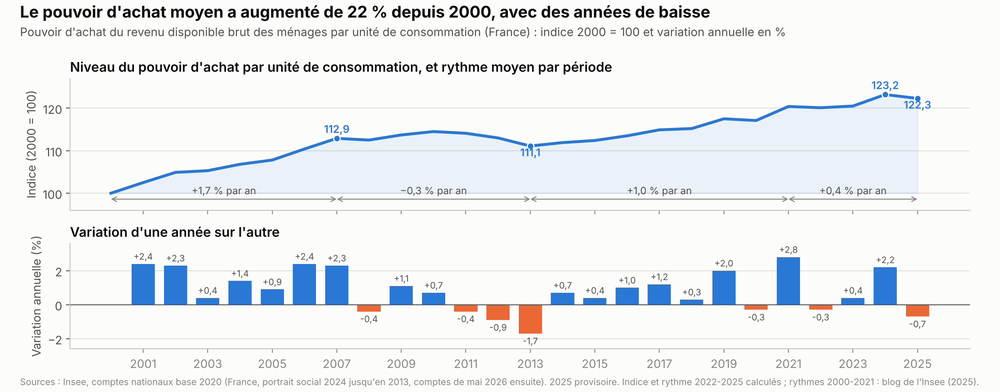
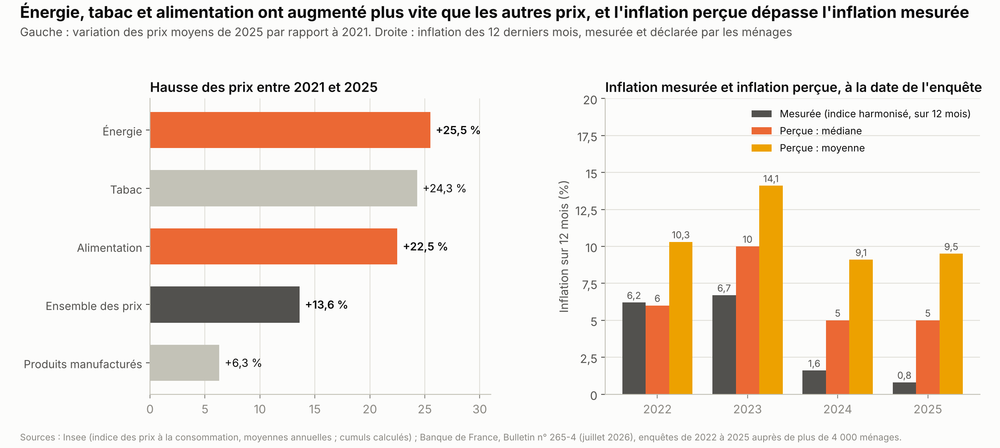
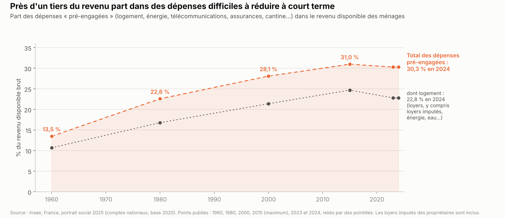
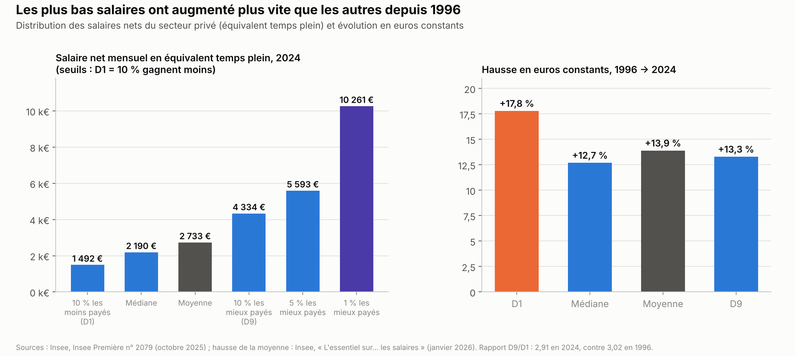
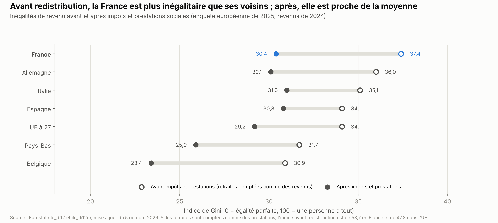
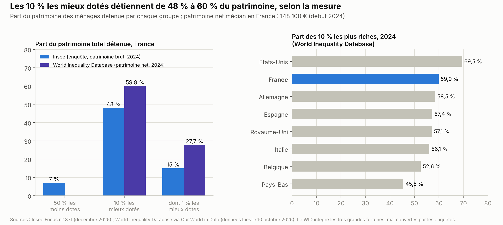

# Pouvoir d'achat, salaires et inégalités

*Version de travail du 10 octobre 2026, corrigée le 21 octobre 2026. Les chiffres seront mis à jour à la date d'arrêt des données de l'édition 1.*

Ce chapitre explique ce que mesure le pouvoir d'achat, ce que montrent les chiffres depuis 2000 et pourquoi tant de ménages ont l'impression de s'appauvrir. Il décrit les salaires, le SMIC, les aides aux ménages modestes et les inégalités de revenu et de patrimoine, puis ce que proposent les partis. Le chômage, le revenu de solidarité active (RSA) et le temps de travail sont traités dans le chapitre Travail et emploi.

**Voir aussi :**
- [Travail et emploi](../travail-emploi/travail_emploi.md), pour le chômage, le RSA, le temps de travail, les heures supplémentaires et le coût des allègements de cotisations ;
- [Finances publiques](../finances-publiques/finances_publiques.md), pour l'impôt des plus riches (taxe Zucman) et le budget 2027 dans son ensemble ;
- [Retraites et productivité](../retraites-productivite/retraites_productivite.md), pour les pensions et leur indexation ;
- [Énergie](../energie/energie_france_europe_allemagne.md), pour les prix de l'électricité et des carburants, le bouclier tarifaire et la TVA sur l'énergie ;
- [Logement](../logement/logement.md), pour les loyers et les prix des logements ;
- [Éducation](../education/remuneration_enseignants.md), pour le salaire des enseignants et le point d'indice ;
- [Présidentielle 2027 : ce que proposent les partis](../partis/programmes_partis_2027.md), pour les programmes complets.

> **Repères.**
> - **Le revenu disponible** est ce qui reste aux ménages pour consommer ou épargner : salaires nets de cotisations, retraites, allocations et revenus du patrimoine, moins les impôts directs. **Le pouvoir d'achat** est l'évolution de ce revenu, une fois retirée la hausse des prix.
> - **L'unité de consommation (UC)** tient compte de la taille du ménage : le premier adulte compte pour 1, chaque autre personne de 14 ans ou plus pour 0,5, chaque enfant de moins de 14 ans pour 0,3. **Le niveau de vie** est le revenu disponible du ménage divisé par son nombre d'UC.
> - **Les euros constants** retirent l'effet de la hausse des prix ; les euros courants ne le font pas. **L'inflation** est mesurée par l'indice des prix à la consommation (IPC) de l'Institut national de la statistique et des études économiques (Insee), ou par l'indice harmonisé européen (IPCH).
> - **La médiane** partage la population en deux moitiés égales. **Les déciles** la partagent en dix : le 1er décile (D1) est le seuil sous lequel vivent les 10 % les plus modestes, le 9e (D9) celui au-dessus duquel vivent les 10 % les plus aisés.
> - **Le taux de pauvreté** est la part des personnes dont le niveau de vie est inférieur à 60 % du niveau de vie médian. **L'indice de Gini** mesure les inégalités : 0 si tout le monde a le même revenu, 1 (ou 100) si une seule personne a tout.

---

## L'essentiel

1. **+22 % depuis 2000, en moyenne.** Par unité de consommation, le pouvoir d'achat a augmenté de 22 % de 2000 à 2025, soit +0,8 % par an, contre +4,4 % de 1960 à 1974.
2. **Un recul depuis 2025.** Il a baissé de 0,7 % en 2025, puis encore au 1er semestre 2026. En septembre 2026, les prix augmentent de 3,1 % sur un an, tirés par l'énergie (+21,3 %).
3. **Un ressenti plus sombre.** Plus de 8 ménages sur 10 jugent que leurs revenus ont moins augmenté que les prix depuis 2021. De 2021 à 2025, l'alimentation a pris 22,5 % et l'énergie 25,5 %, contre 13,6 % pour l'ensemble des prix. Près d'un tiers du revenu va aux dépenses contraintes, dont le logement.
4. **Des gagnants et des perdants.** Le taux de pauvreté atteint 15,4 % en 2024, un plus haut depuis 1996. En 2023, le pouvoir d'achat a baissé pour les 40 % les plus modestes et augmenté de 2,7 % pour les 20 % les plus aisés (services publics compris). Le salaire réel du privé a baissé en 2022-2023.
5. **Un SMIC élevé, des salaires resserrés près de lui.** Le SMIC vaut 62,5 % du salaire médian, l'un des rapports les plus élevés de l'UE. Sous le salaire médian, 100 € de revenu en plus pour un salarié coûtent 300 à 400 € à l'employeur, cotisations, impôts et baisse des aides compris.
6. **Des aides peu demandées ou non ciblées.** Fin 2021, la moitié des foyers qui y avaient droit ne touchaient pas la prime d'activité, complément de revenu des actifs modestes. Le bouclier tarifaire sur l'énergie a donné plus d'euros aux ménages aisés, mais pesé plus dans le budget des modestes.
7. **Des inégalités de revenu dans la moyenne européenne, un patrimoine concentré.** Après impôts et prestations, elles sont proches de la moyenne de l'UE. Les 10 % les mieux dotés détiennent 48 % à 60 % du patrimoine, selon la mesure, et ≈ 60 % du patrimoine est hérité.

**Les grandes options en débat.**
- **Salaires** : hausse du SMIC (LFI, Les Écologistes, PS) ou baisse des prélèvements (PS-Place publique, Renaissance, Horizons, LR, RN, Reconquête).
- **Prix** : blocage (LFI, Les Écologistes), TVA réduite sur l'énergie (LFI, RN), électricité moins chère (LR) ou aides ciblées (Place publique, Renaissance, Horizons).
- **Indexation** : salaires indexés sur les prix (LFI), impôt et prestations relevés comme les prix (RN), ou prestations gelées en partie (gouvernement, Renaissance).
- **Aides** : garantie d'autonomie (LFI, Les Écologistes), aides plafonnées à 70 % du SMIC (LR), prestations limitées pour les étrangers (RN, Reconquête).
- **Patrimoine** : grands héritages plus taxés (LFI, Les Écologistes, PS-Place publique), fortune financière taxée (RN) ou donations allégées (LR).

---

## 1. La situation

### 1.1 Comment on mesure le pouvoir d'achat

**Le point de départ est le revenu disponible brut** de l'ensemble des ménages, calculé dans les comptes nationaux, la comptabilité de l'économie du pays tenue par l'Insee. En 2024, il atteint 1 861 Md€.

| Composante du revenu disponible brut des ménages, 2024 | Montant |
|---|---|
| Revenus d'activité (salaires et revenus des indépendants), nets de cotisations | 1 103,0 Md€ |
| + Prestations sociales en espèces (retraites, allocations, minima sociaux) | 631,2 Md€ |
| + Revenus du patrimoine (intérêts, dividendes, loyers, y compris les loyers « imputés » aux propriétaires) | 417,7 Md€ |
| − Impôts sur le revenu et le patrimoine | −280,7 Md€ |
| − Autres transferts (solde) | ≈ −10,1 Md€ *(calcul)* |
| **= Revenu disponible brut** | **1 861,1 Md€** |

*Source : Insee, France, portrait social 2025[^insee-fps-2025-rdb].*

Les services publics gratuits, comme l'école ou l'hôpital, n'y figurent pas. L'Insee les ajoute dans une autre mesure, le « revenu disponible ajusté ».

**On retire ensuite l'effet des prix.** Le revenu est divisé par l'évolution du prix de la consommation des ménages, appelée « déflateur ». Sur vingt ans, l'écart entre ce déflateur et l'indice des prix à la consommation « s'élève à 0,07 % par an », selon l'Insee[^insee-blog-pouvoir-achat]. Certaines années, il est plus grand : en 2023, le déflateur augmente de 7,0 %[^insee-fps-2025-rdb], l'indice des prix de 4,9 %[^insee-ipc-2023].

**On tient compte enfin de la taille des ménages.** La population augmente et les ménages comptent moins de personnes. De 2019 à 2025, le pouvoir d'achat a augmenté de 7,5 % pour l'ensemble des ménages et de 5,1 % par personne. Il a augmenté de 4,1 % par unité de consommation et de 2,2 % par ménage *(calcul)*[^insee-menages-2025]. L'Insee utilise la mesure par unité de consommation dans ses analyses, car elle tient compte de la taille des ménages[^insee-blog-pouvoir-achat].

**Ce que la mesure capte mal.**
- **Les loyers « imputés ».** Les comptes nationaux considèrent qu'un propriétaire « se loue » son logement. Ce loyer est compté à la fois comme un revenu et comme une dépense, sans que le propriétaire voie cet argent sur son compte. Cette convention permet de comparer propriétaires et locataires.
- **L'achat d'un logement** est un investissement, hors de l'indice des prix. Selon l'Insee, en tenir compte « conduirait à diminuer les gains de pouvoir d'achat de 0,1 point par an entre 2000 et 2024 »[^insee-blog-pouvoir-achat].
- **La perte de valeur de l'épargne.** Quand les prix augmentent plus vite que les taux d'intérêt, l'épargne perd de la valeur, ce que la mesure ne déduit pas. La correction dépend de l'année. Pour 2024, quand l'inflation a ralenti, l'Insee indique une hausse du pouvoir d'achat « de l'ordre de +6 % » avec cette correction, au lieu de 2,1 % publiés alors (2,2 % aujourd'hui)[^insee-blog-pouvoir-achat].
- **La répartition.** Le pouvoir d'achat des comptes nationaux est une moyenne. D'autres sources de l'Insee décrivent les écarts entre ménages (section 1.4).

### 1.2 Ce que montrent les chiffres

**Depuis 2000, +22 % par unité de consommation.** Le pouvoir d'achat par unité de consommation a augmenté de 22,3 % de 2000 à 2025, soit +0,8 % par an en moyenne *(calcul)*[^insee-fps-2024-rdb][^insee-menages-2025]. Pour l'ensemble des ménages, la hausse est de 44,1 % *(calcul)*. Le niveau de 2024 est le plus haut de la série ; celui de 2025, le deuxième. Depuis 1960, le pouvoir d'achat par unité de consommation a été « multiplié par 3,2 »[^insee-fps-2024-rdb].

**Le rythme a changé selon les périodes.** L'Insee distingue trois phases depuis 2000 (graphique de L'essentiel)[^insee-blog-pouvoir-achat] :
- une progression « dynamique en moyenne avant la crise financière de 2008-2009 (+1,7 % par an) » ;
- une « période de baisse du pouvoir d'achat jusqu'en 2013 (-0,3 % par an) » ;
- de 2014 à 2021, une hausse « plus modestement qu'avant la crise financière (+1,0 % par an) ».

De 2022 à 2025, la hausse est de 0,4 % par an *(calcul)*[^insee-menages-2025].

**Sur longue période, la progression a ralenti.**

| Période | Hausse moyenne par an | Années qu'il faudrait pour doubler à ce rythme |
|---|---|---|
| 1960 → 1974 | +4,4 % | ≈ 16 ans |
| 1975 → 2007 | +1,4 % | ≈ 48 ans |
| 2007 → 2019 | +0,3 % | ≈ 210 ans |
| 2019 → 2025 | +0,7 % | ≈ 104 ans |
| 2000 → 2025 | +0,8 % | ≈ 86 ans |

*Pouvoir d'achat du revenu disponible par unité de consommation ; les flèches relient le niveau de deux années. Moyennes calculées *(calcul)* d'après l'Insee : France, portrait social 2024 jusqu'en 2013[^insee-fps-2024-rdb], comptes de mai 2026 ensuite[^insee-menages-2025].*

**2025 et 2026 : un recul.**
- En 2025, le pouvoir d'achat par unité de consommation baisse de 0,7 % (−0,4 % pour l'ensemble des ménages). Les dividendes reçus par les ménages diminuent de 10,5 Md€ et les impôts augmentent de 4,1 %. Le prix de la consommation des comptes nationaux augmente de 0,8 % (0,9 % pour l'indice des prix)[^insee-ip-2105].
- Il baisse encore de 0,2 % au 1er trimestre 2026 et de 0,6 % au 2e. À la fin juin, l'« acquis » pour 2026, c'est-à-dire l'évolution sur l'année si le pouvoir d'achat restait ensuite stable, est de −0,7 %[^insee-ir-212].
- Les ménages épargnent 17,8 % de leur revenu en 2025, selon les comptes révisés en août, et 17,2 % au 2e trimestre 2026[^insee-ir-212]. De 2014 à 2019, ce taux variait de 13,8 % à 14,6 %[^insee-menages-2025].
- En septembre 2026, les prix augmentent de 3,1 % sur un an, et de 3,4 % selon l'indice harmonisé. L'énergie augmente de 21,3 %, les produits frais de 9,5 % et les services de 2,4 %[^insee-ipc-sept-2026].

**Pour 2026 et 2027, les prévisions d'inflation ne portent pas toutes sur la même mesure.**
- Le gouvernement prévoit 2,1 % en moyenne en 2026 et 1,8 % en 2027[^tresor-resf-2027].
- La Banque de France prévoit 2,3 % en 2026 et 1,9 % en 2027, selon l'indice harmonisé. Le pouvoir d'achat des salaires versés baisserait de 0,7 % en 2026[^bdf-projections-sept-2026].
- L'Insee prévoit une hausse des prix de 2,9 % entre décembre 2025 et décembre 2026. Pour l'ensemble des ménages, « le pouvoir d'achat des ménages flancherait de 0,4 % sur l'année »[^insee-ndc-sept-2026-vue].

**En Europe, la France est proche de la moyenne depuis 2008.**

| Revenu disponible réel des ménages par habitant | 2008 → 2024 | 2019 → 2024 |
|---|---|---|
| France | +13,5 % | +6,2 % |
| Allemagne | +19,4 % | +4,2 % |
| Italie | −4,0 % | +4,0 % |
| Espagne | +4,1 % | +4,4 % |
| UE à 27 | +14,5 % | +6,1 % |

*Source : Eurostat, tableau tepsr_wc310 (indice 2008 = 100, évolutions calculées)[^eurostat-rdb-reel]. Mesure par habitant, et non par unité de consommation : ces chiffres ne se comparent pas directement à ceux de l'Insee.*

### 1.3 Pourquoi le ressenti diffère

**Le jugement des ménages sur la France est très en dessous de sa moyenne ; il l'est moins sur leur propre situation.** Un solde d'opinion est la différence entre la part des ménages qui voient une amélioration et celle qui voient une dégradation. En septembre 2026, il est de −81 pour l'évolution passée du niveau de vie en France, contre −49 en moyenne depuis 1987. Pour leur propre situation financière, il est de −26, contre −21[^insee-camme-sept-2026]. Fin 2025, « plus de 8 ménages sur 10 estiment que leurs revenus n'ont pas augmenté aussi vite que les prix » depuis 2021, selon la Banque de France[^bdf-inflation-percue].

**Beaucoup de ménages sous-estiment la hausse de leurs revenus.** Selon l'Insee, « 38 % des individus ont une perception de l'évolution de leurs revenus conforme à l'évolution réelle », 35 % la sous-estiment et 27 % la surestiment. En 2024, le niveau de vie médian a augmenté de 1,8 % en euros constants, mais « cette amélioration n'a été que partiellement ressentie par les ménages »[^insee-perception-revenus].

Plusieurs éléments, documentés par l'Insee et la Banque de France, aident à comprendre cet écart.

**Une hausse lente.** Au rythme moyen de +0,8 % par an, un revenu de 2 228 € par mois, le niveau de vie médian de 2024, augmenterait d'≈ 18 € par mois chaque année *(calcul)*[^insee-ip-2117].

**L'énergie, le tabac et l'alimentation ont augmenté plus vite que l'ensemble des prix.** De 2021 à 2025, l'énergie, le tabac et l'alimentation ont augmenté de 22 % à 26 %, contre 13,6 % pour l'ensemble des prix (graphique) *(calcul)*[^insee-ipc-2022][^insee-ipc-2023][^insee-ipc-bilan-2025]. L'inflation perçue reste au-dessus de l'inflation mesurée. En 2025, la moitié des ménages perçoivent une inflation d'au moins 5 %, quand l'indice harmonisé est à 0,8 %[^bdf-inflation-percue]. Selon la même étude, « seuls 5% des ménages déclarent avoir constaté les baisses de prix quand celles-ci se sont effectivement produites »[^bdf-inflation-percue].

**Près d'un tiers du revenu est dépensé d'avance.** Les dépenses « pré-engagées » sont celles qu'on ne peut pas réduire vite : logement, énergie, eau, télécommunications, assurances, cantine. Elles représentent 30,3 % du revenu disponible en 2024, contre 13,5 % en 1960[^insee-fps-2025-conso]. Le revenu qui reste après ces dépenses, dit « arbitrable », a augmenté moins vite. Depuis 1975, il progresse de 0,8 % par an par unité de consommation, contre 1,0 % pour le revenu disponible (calcul de l'Insee de 2023)[^insee-fps-2023-rdb].

**Le logement prend un tiers du revenu des ménages modestes.**
- Le graphique compte le logement dans le revenu disponible, loyers imputés compris. Mesurées autrement, en dépenses réellement payées (loyer ou emprunt, charges, énergie), aides déduites et rapportées au revenu avant impôts, les dépenses de logement représentent 16,8 % du revenu en 2024. C'est 1,5 point de moins qu'en 2014, surtout grâce à la suppression de la taxe d'habitation[^insee-ip-2128].
- Elles représentent 32,1 % du revenu pour les 25 % de ménages les plus modestes, 1,1 point de plus qu'en 2014. Pour l'ensemble des ménages, la part est de 25,4 % chez les locataires du privé et 24,0 % dans le parc social. Elle est de 23,3 % pour les propriétaires qui remboursent un emprunt[^insee-ip-2128].
- Le prix des logements a augmenté plus vite que le revenu. Selon Jacques Friggit, économiste à l'Inspection générale de l'environnement et du développement durable, leur rapport est 1,55 fois plus élevé au 3e trimestre 2024 qu'en 2000[^igedd-friggit-2025]. L'achat d'un logement n'entre pas dans l'indice des prix (section 1.1).

**Certains gains ne se voient pas.**
- La suppression de la taxe d'habitation a fait gagner « près de 19 Md€ » aux ménages en 2023, selon la Cour des comptes[^cour-comptes-impots-locaux].
- Le bouclier tarifaire sur l'énergie a réduit l'inflation de 3,1 points de mi-2021 à mi-2022, selon l'Insee[^insee-ia-75]. Selon la Banque de France, il l'a réduite de 2,2 points sur 2022-2023[^bdf-bouclier]. Selon la Cour des comptes, son coût brut atteindrait « près de 72 Md€ » de 2021 à 2024[^cour-comptes-boucliers].
- Une hausse de prix évitée ne se voit pas. Et selon la Banque de France, « on perçoit rarement qu'une baisse d'impôt correspond à une hausse du revenu disponible »[^bdf-abc-pouvoir-achat].

### 1.4 Qui gagne, qui perd

**Le niveau de vie et la pauvreté (2024).**
- Le niveau de vie médian est de 26 740 € par an, soit 2 228 € par mois pour une personne seule. Il augmente de 1,8 % en euros constants en 2024[^insee-ip-2117].
- Les 10 % les plus modestes vivent avec moins de 13 970 € par an ; les 10 % les plus aisés avec plus de 48 580 €[^insee-ip-2117].
- Le taux de pauvreté est de 15,4 % en 2023 et en 2024, contre 13,8 % en 2017 : « son plus haut niveau depuis 1996 ». Au total, 9,8 millions de personnes vivent sous le seuil de 1 337 € par mois[^insee-ip-2117].
- Les inégalités augmentent : l'indice de Gini atteint 0,302, son maximum depuis 1996. Les revenus des capitaux mobiliers déclarés au fisc (intérêts, dividendes) augmentent de 32 % en 2024[^insee-ip-2117].

**Depuis 2008, la redistribution a protégé le bas de l'échelle.** De 2008 à 2024, en euros constants, le seuil des 10 % les plus modestes augmente de 2,9 % après impôts et prestations. Avant, il baisse de 6,7 %[^insee-ip-2117]. « Avant » signifie ici avant les impôts directs et les prestations non contributives, versées sans cotisation préalable, comme les minima sociaux ; les retraites et les allocations chômage sont comptées. Le niveau de vie médian augmente de 7,8 % sur la même période[^insee-ip-2117].

**En 2023, les écarts se sont creusés.**

| Cinquième de niveau de vie (2023) | Pouvoir d'achat du revenu disponible ajusté, par UC | Pouvoir d'achat du revenu disponible brut, par UC |
|---|---|---|
| 20 % les plus modestes | −2,8 % | −4,6 % |
| 2e cinquième | −0,4 % | 0,0 % |
| 3e cinquième | 0,0 % | −0,5 % |
| 4e cinquième | +0,8 % | +0,8 % |
| 20 % les plus aisés | +2,7 % | +2,2 % |
| Ensemble | +0,4 % | +0,3 % |

*Source : Insee, Insee Analyses n° 119 (avril 2026)[^insee-ia-119]. Le revenu disponible « ajusté » comprend la valeur des services publics individualisables, comme l'éducation et la santé.*

Selon l'Insee, les prestations ont progressé moins vite que les prix pour les 40 % les plus modestes, avec la fin des aides exceptionnelles. En haut de l'échelle, les revenus du patrimoine et la revalorisation des retraites ont joué en sens inverse[^insee-ia-119].

**L'inflation de 2023 a pesé davantage sur les ménages modestes.** À consommation inchangée, elle a coûté 730 € aux 10 % les plus modestes, soit 7,1 % de leur niveau de vie. Elle a coûté 2 170 € aux 10 % les plus aisés, soit 3,1 %[^insee-fps-2024-inflation]. La hausse des revenus a couvert « la moitié du choc inflationniste » pour les 20 % les plus modestes, et 30 % pour les 10 % les plus modestes. Elle en a couvert 130 % pour les 20 % les plus aisés[^insee-fps-2024-inflation].

**Les retraités et les fonctionnaires** (détails dans les chapitres Retraites et Éducation).
- Les pensions déjà versées ont perdu 7,6 % de pouvoir d'achat brut de 2013 à 2023. En 2024, les pensions de base, revalorisées de 5,3 %, gagnent 3,9 % en euros constants ; l'ensemble des pensions, complémentaires comprises, 3,0 %[^drees-revalorisation-pensions]. Le niveau de vie moyen des retraités est égal à celui de l'ensemble de la population (100,2 % en 2023)[^cor-ra-2026]. Leur taux de pauvreté est de 10,4 % en 2024[^insee-ip-2117].
- De 2000 à 2025, la valeur du point d'indice des fonctionnaires a augmenté de 15,9 %, et les prix de 51,3 %. En euros constants, elle a donc baissé de 23,4 % *(calcul)*[^point-indice-historique][^insee-convertisseur]. Elle n'a pas bougé depuis juillet 2023. Le point ne résume pas toute la paie, qui dépend aussi de l'avancement et des primes. En 2024, le salaire net moyen des agents publics augmente de 1,7 % en euros constants[^insee-2100].

### 1.5 Les salaires et le SMIC

**Les salaires du privé.** Le salaire « en équivalent temps plein » ramène chaque salaire à ce qu'il serait pour un temps plein toute l'année. En 2024, le salaire net moyen d'un temps plein est de 2 733 € par mois et le salaire médian de 2 190 €[^insee-2079]. Le seuil des 10 % les mieux payés est 2,91 fois plus élevé que celui des 10 % les moins payés. Depuis 1996, l'écart s'est réduit par le bas (graphique).

**Deux années de baisse, puis une reprise lente.**
- En euros constants, le salaire net moyen du privé baisse de 1,3 % en 2022 et de 1,0 % en 2023. Il augmente de 0,8 % en 2024. Selon l'Insee, ce regain « permet à peine d'atteindre le niveau de 2019 en euros constants »[^insee-2079].
- En 2025, le salaire moyen par tête des branches marchandes augmente de 0,7 % en euros constants, selon une première estimation[^insee-ecrt-2026-salaires].
- Pour 2026, l'Insee prévoit que les salaires réels « stagneraient » et que « leur niveau de fin d'année demeurerait en deçà de celui de 2021 »[^insee-ndc-sept-2026].
- En 2024, le salaire net moyen est de 4 629 € pour les cadres et 2 633 € pour les professions intermédiaires. Il est de 2 051 € pour les ouvriers et 1 941 € pour les employés[^insee-2079].

**Le SMIC suit les prix, avec des hausses automatiques.**
- Depuis le 1er juin 2026, il est de 12,31 € brut de l'heure, soit 1 867,02 € brut et 1 477,93 € net par mois à temps plein[^smic-juin-2026][^sp-smic].
- Il est revalorisé chaque 1er janvier selon l'inflation des 20 % de ménages les plus modestes. S'y ajoute la moitié du gain de pouvoir d'achat du salaire horaire des ouvriers et des employés. En cours d'année, il augmente automatiquement dès que cet indice des prix a progressé de 2 %[^sp-smic].
- Du 1er janvier 2021 au 1er juin 2026, il a augmenté de 20,1 % en dix hausses *(calcul)*[^insee-smic-serie]. Cinq ont été déclenchées en cours d'année par l'inflation, et une a été anticipée en novembre 2024.
- Le dernier « coup de pouce », une hausse décidée au-delà de la règle, date du 1er juillet 2012[^insee-ecrt-2024-smic].
- La part des salariés concernés par une revalorisation est passée de 12,0 % en janvier 2021 à 17,3 % en janvier 2023, son plus haut niveau depuis trente ans. Elle est ensuite redescendue à 14,6 % en janvier 2024 et à 12,4 % en novembre 2024[^insee-ecrt-2026-smic].

**Un SMIC élevé par rapport aux autres salaires.** Selon le groupe d'experts sur le SMIC, il représente 62,5 % du salaire médian et 50,4 % du salaire moyen en 2024. Avec la Slovénie, la France est le seul pays de l'UE au-dessus des deux seuils de référence de 60 % et 50 %[^experts-smic-2025]. Le groupe recommande « de ne pas aller au-delà de la hausse prévue par la revalorisation automatique »[^experts-smic-2025].

**Comparé aux pays voisins, le SMIC est dans le haut du classement.**

| Salaire minimum brut mensuel (2e semestre 2026) | Montant, en standard de pouvoir d'achat par mois |
|---|---|
| Allemagne | 2 164 |
| Luxembourg | 2 108 |
| Pays-Bas | 2 023 |
| Belgique | 1 922 |
| Irlande | 1 756 |
| **France** | **1 692** |
| Slovénie | 1 660 |
| Espagne | 1 556 |
| Pologne | 1 547 |
| Portugal | 1 240 |

*Source : Eurostat, tableau earn_mw_cur, valeurs estimées[^eurostat-smic-spa]. Le standard de pouvoir d'achat corrige les écarts de prix entre pays. L'Italie, l'Autriche, le Danemark, la Finlande et la Suède n'ont pas de salaire minimum légal[^eurostat-minimum-wage-se].*

Une directive européenne de 2022 demande aux États de juger leur salaire minimum avec des valeurs de référence. Elle cite des valeurs « telles que 60 % du salaire médian brut et 50 % du salaire moyen brut »[^directive-2022-2041]. Le 11 novembre 2025, la Cour de justice de l'UE a annulé une partie de son article 5, qui fixait des critères de calcul. Le reste de la directive est maintenu[^cjue-c-19-23].

**La « trappe à bas salaires ».** Les employeurs paient moins de cotisations sur les bas salaires : c'est l'allègement général, maximal au SMIC et nul à partir de trois SMIC[^cae-91]. Ces allègements coûtent 75 Md€ en 2023 et 77 Md€ en 2024 (chapitre Travail et emploi)[^bozio-wasmer-2024][^cae-91]. Comme ils baissent quand le salaire monte, une hausse coûte cher à l'employeur :
- sous le salaire médian, une hausse de 100 € du revenu disponible d'un salarié coûte 300 à 400 € à l'employeur, selon le Conseil d'analyse économique (CAE)[^cae-91] ;
- entre 1,2 et 2 SMIC, cotisations, impôts et baisse des prestations prélèvent « entre 75 et 80 % » d'une hausse de salaire, selon le groupe d'experts[^experts-smic-2025].

Le CAE propose de « désindexer les allègements généraux du Smic pour réduire les taux marginaux implicites »[^cae-91]. Il s'agit de ne plus les calculer en fonction du SMIC, pour réduire la part d'une hausse de salaire reprise par les cotisations, les impôts et la baisse des aides. Le projet de budget 2027 les réduirait de 3,7 Md€ *(source secondaire)* (section 1.9).

**L'écart entre femmes et hommes** se mesure de trois façons (secteur privé, 2024)[^insee-focus-377] :
- sur l'année, les femmes perçoivent 21,8 % de moins que les hommes : elles travaillent moins d'heures dans l'année, notamment à temps partiel, et sont moins payées à temps égal ;
- à temps de travail égal, l'écart est de 14,0 % ;
- pour un même emploi dans le même établissement, il est de 3,6 %, sur un champ couvrant 40 % des emplois. Selon l'Insee, cet écart « ne peut pas être interprété au sens strict comme une mesure de la discrimination salariale ».

Un projet de loi sur la transparence des salaires a été déposé au Sénat le 10 septembre 2026, avec une procédure accélérée, qui réduit le nombre de lectures. Il crée sept indicateurs d'écarts pour les entreprises de 50 salariés ou plus. Au-delà d'un écart fixé par décret, d'au plus 5 %, l'employeur devra prendre des mesures correctrices. Il n'avait pas été examiné au 8 octobre 2026[^senat-pjl-944][^cm-2026-09-10].

**Public et privé.** En 2024, le salaire net moyen d'un temps plein est de 2 742 € dans la fonction publique, contre 2 733 € dans le privé[^insee-2100][^insee-2079]. Ces moyennes comparent des emplois et des qualifications différents.

| Fonction publique, 2024 | Salaire net moyen (temps plein) | Évolution en euros constants |
|---|---|---|
| État | 3 018 € | +2,6 % |
| Hôpitaux | 2 896 € | +0,7 % |
| Collectivités territoriales | 2 317 € | +1,3 % |
| Ensemble | 2 742 € | +1,7 % |

*Sources : Insee Première n° 2100, 2101 et 2102 (mai 2026)[^insee-2100][^insee-2101][^insee-2102].*

**Les salaires moyens français sont inférieurs d'≈ 7 % à la moyenne de l'Organisation de coopération et de développement économiques (OCDE) *(calcul)*, et les prélèvements sur le travail sont parmi les plus élevés.**

| Pays | Salaire annuel moyen, 2025 (dollars corrigés des écarts de prix entre pays) | Coin fiscal, 2025 (% du coût du travail) |
|---|---|---|
| Pays-Bas | 80 136 | 35,9 % |
| Belgique | 80 009 | 52,5 % |
| Allemagne | 76 285 | 49,3 % |
| Royaume-Uni | 66 299 | 32,4 % |
| Moyenne de l'OCDE | 64 803 | 35,1 % |
| **France** | **60 483** | **47,2 %** |
| Espagne | 57 779 | 41,4 % |
| Italie | 53 864 | 45,8 % |

*Sources : OCDE, salaires annuels moyens, prix constants de 2025[^ocde-salaires] ; OCDE, Taxing Wages 2026, célibataire sans enfant au salaire moyen[^ocde-taxing-wages-2026]. Le coin fiscal est la part des impôts et cotisations, salariales et patronales, dans le coût total d'un salarié pour l'employeur.*

La France a le 3e coin fiscal le plus élevé des 38 pays de l'OCDE[^ocde-taxing-wages-2026]. Ces cotisations financent la retraite, l'assurance maladie et l'assurance chômage des salariés.

### 1.6 Le partage de la valeur

**La part des salaires est stable et plus élevée que dans les pays voisins.** Les salaires, cotisations comprises, représentent 67,3 % de la richesse produite en 2025, contre 66,1 % en Allemagne et 63,9 % dans la zone euro. Cette part dite « ajustée » tient compte des non-salariés. Elle était de 75,2 % en 1980 et de 63,5 % en 2007 ; elle est proche de 67 % depuis 2015[^ameco-alcd2]. Pour l'Observatoire français des conjonctures économiques (OFCE), centre de recherche de Sciences Po souvent classé au centre gauche, elle « apparaît particulièrement stable dans cette période très chahutée ». L'inflation l'a au contraire réduite en Allemagne et en Italie[^ofce-part-salaires].

**Le taux de marge des sociétés non financières** est la part de leur valeur ajoutée, la richesse qu'elles produisent, qui leur reste après les salaires et les impôts sur la production. Il est de 32,7 % en 2024. Pour 2025, il est de 32,2 % dans les comptes annuels de mai 2026[^insee-ip-2105], révisé à 32,4 % en août[^insee-ir-212]. Il baisse à 31,5 % aux deux premiers trimestres de 2026[^insee-ir-212].

**Les profits et l'inflation.** Selon le Fonds monétaire international (FMI), les profits expliquent 45 % de la hausse des prix à la consommation dans la zone euro, du début de 2022 au début de 2023. Les prix des importations en expliquent ≈ 40 % et les coûts salariaux 25 % ; les impôts jouent en sens inverse[^imf-wp-23-131][^imf-blog-2023]. En France, leur contribution a été plus faible que celle des coûts salariaux, selon la Banque de France[^bdf-benassy-profits].

**Les grands groupes cotés.**
- En 2025, les groupes du CAC 40, les 40 plus grandes sociétés cotées à la Bourse de Paris, ont rendu 107,5 Md€ à leurs actionnaires, un record selon *La Lettre Vernimmen*. Ce sont 72,8 Md€ de dividendes et 34,8 Md€ de rachats par ces sociétés de leurs propres actions. Cela représente 71 % de leurs résultats. Environ 85 % de leurs ventes sont réalisées hors de France[^vernimmen-233].
- En 2024, leurs dirigeants ont reçu 6,5 M€ en moyenne, selon le cabinet Proxinvest *(source secondaire)*[^afp-proxinvest], soit ≈ 150 fois le salaire brut moyen du privé *(calcul)*.

**L'épargne salariale et les primes (2024).**
- La participation a versé 11,4 Md€ et l'intéressement 11,9 Md€. Les bénéficiaires ont reçu 3 113 € bruts en moyenne *(source secondaire)*[^moneyvox-epargne-salariale].
- Ces dispositifs couvrent 19,8 % des salariés des entreprises de moins de 10 salariés, et plus de 89 % dans celles de plus de 1 000 salariés[^cercle-epargne-m145].
- La prime de partage de la valeur, exonérée de cotisations, a versé ≈ 4,7 Md€ à ≈ 5,5 millions de salariés. Ces chiffres de l'Urssaf, l'organisme qui collecte les cotisations, sont cités par le Cercle de l'Épargne[^cercle-epargne-m145].
- Depuis 2025, et pour cinq ans à titre d'essai, certaines entreprises de 11 à 49 salariés doivent mettre en place un dispositif de partage de la valeur. Sont concernées celles dont le bénéfice atteint 1 % du chiffre d'affaires trois années de suite[^sp-partage-valeur].

### 1.7 Les aides au revenu des ménages modestes

| Aide | Montant | Bénéficiaires | Coût |
|---|---|---|---|
| Prime d'activité (complément de revenu des actifs modestes) | 186 € par mois en moyenne par foyer (2023)[^drees-ms-2025-pa] ; 246 € pour une personne seule au SMIC à temps plein (barèmes de janvier 2025)[^drees-ms-2025-cas-types] ; calcul à partir d'un montant forfaitaire de 638,28 € (avril 2026)[^sp-prime-activite] | 4,81 millions de foyers fin 2024[^drees-ms-2025-pa] | 10,5 Md€ (2023)[^drees-ms-2025-pa] |
| Chèque énergie | De 48 € à 277 € par an ; 153 € en moyenne (2025)[^an-rapport-2932] | 4,18 millions de chèques en 2025, contre 5,73 millions en 2024[^an-rapport-2932] | 578,9 M€ prévus en 2026[^an-rapport-2932] |
| Indemnité inflation (une fois, fin 2021) | 100 € par personne gagnant moins de 2 000 € nets par mois[^gouv-indemnite-inflation] | ≈ 37 millions de personnes payées (38 millions prévus)[^gouv-indemnite-inflation] | 3,8 Md€ annoncés[^gouv-indemnite-inflation] |
| Allocation de rentrée scolaire (2026) | De 426,87 € à 466,02 € par enfant selon l'âge[^sp-ars] | ≈ 3 millions de foyers (2025)[^cnaf-ars-2025] | Non trouvé |

**La prime d'activité.**
- Elle a été augmentée en avril 2026 : jusqu'à 54 € par mois de plus, selon le décret du 30 mars 2026 cité par la presse juridique *(source secondaire)*[^lextenso-rsa-prime].
- La moitié des foyers qui y ont droit ne la demandent pas : le non-recours est « estimé entre 48 % et 52 % » fin 2021, soit 3,4 millions de foyers. L'argent non versé représente ≈ 1,3 Md€ par trimestre[^drees-er-1379].
- Avec elle, travailler au SMIC rapporte plus que ne pas travailler. Les cas types de la Direction de la recherche, des études, de l'évaluation et des statistiques (DREES), service statistique du ministère des Solidarités, le montrent, aux barèmes de janvier 2025. Une personne seule dispose de 873 € par mois sans revenu d'activité, et de 1 673 € avec un SMIC à temps plein, dont 246 € de prime d'activité[^drees-ms-2025-cas-types]. L'écart est de 800 € *(calcul)*.

**Le chèque énergie a perdu des bénéficiaires.** Depuis la suppression de la taxe d'habitation, l'administration identifie moins bien les ménages éligibles. Pour la campagne 2025, les envois automatiques sont passés de 5,5 à 3,8 millions : le rapport de l'Assemblée nationale (juin 2026) relève « une déperdition très importante, de 1,8 million de ménages ». Le guichet en ligne en a récupéré une partie[^an-rapport-2932]. Son montant moyen « n'a jamais évolué depuis son instauration », selon un rapport du Sénat[^senat-avis-energie-2026].

### 1.8 Les inégalités de revenu et de patrimoine

**Avant redistribution, la France paraît plus inégalitaire que la moyenne de l'UE ; après, elle en est proche.**
- Après impôts et prestations, l'indice de Gini, sur l'échelle de 0 à 100, est de 30,4 en France et de 29,2 dans l'UE (revenus de 2024)[^eurostat-gini].
- Avant impôts et prestations, il est de 53,7 en France, contre 47,8 dans l'UE, quand les retraites sont comptées comme des prestations[^eurostat-gini]. Les retraites publiques pèsent plus en France que dans la plupart des pays de l'UE (chapitre Retraites) : les compter comme des prestations grossit les inégalités avant redistribution. Quand elles sont comptées comme des revenus, l'écart avec l'UE se réduit (graphique).
- Le taux de pauvreté mesuré par Eurostat est de 16,3 % en France comme dans l'UE (enquête de 2025, revenus de 2024). Il est de 16,1 % en Allemagne, 18,6 % en Italie, 19,5 % en Espagne et 10,9 % en Belgique[^eurostat-pauvrete]. Cette enquête européenne ne se compare pas directement aux 15,4 % de l'Insee.

**Les services publics réduisent aussi les écarts.** L'Insee compte aussi l'éducation, la santé et les autres services publics. Les 10 % les plus aisés ont alors en 2023 un revenu 3,5 fois plus élevé que les 10 % les plus modestes, « contre 26 fois avant transferts publics ». Au total, 56 % des personnes reçoivent plus qu'elles ne versent[^insee-ia-118].

**Les très hauts revenus.** La World Inequality Database est la base de données du World Inequality Lab, laboratoire rattaché à l'École d'économie de Paris. Selon elle, les 1 % les plus aisés reçoivent 12,1 % du revenu national avant impôts en 2022, contre 11,3 % en 2000 et 7,5 % en 1980. Cette part est de 13,3 % en Allemagne (2022) et de 20,7 % aux États-Unis (2024)[^wid-owid-top1].

**Le patrimoine est plus concentré que les revenus.**
- Début 2024, le patrimoine net médian d'un ménage est de 148 100 €. Les 10 % les mieux dotés possèdent au moins 750 400 €, les 10 % les moins dotés moins de 4 600 €[^insee-focus-371]. Le premier seuil est ≈ 163 fois le second *(calcul)*, contre 3,48 fois pour le niveau de vie (section 1.4).
- Selon l'enquête de l'Insee, les 10 % les mieux dotés détiennent 48 % du patrimoine brut, et la moitié la moins dotée 7 %[^insee-focus-371]. Selon la World Inequality Database, qui couvre mieux les très grandes fortunes, les 10 % les plus riches détiennent 59,9 % du patrimoine net[^wid-owid-patrimoine].
- Les 500 plus grandes fortunes professionnelles pèsent 1 128 Md€ en 2025, contre 170 Md€ en 2005, quand les prix augmentaient de 38 %. Ces chiffres de l'Observatoire des inégalités, association qui se donne pour objet de les réduire, viennent du magazine *Challenges*[^observatoire-fortunes]. Pour 2026, le total serait de 1 076 Md€ *(source secondaire)*[^afp-challenges-2026].

**L'héritage pèse de plus en plus.**
- Selon le CAE (2021), environ 60 % du patrimoine est hérité, contre 35 % au début des années 1970. Les héritages et donations représentent chaque année plus de 15 % du PIB, soit ≈ 300 Md€. Les 0,1 % d'héritiers les plus aisés paient « à peine 10 % » de droits de succession en moyenne[^cae-heritage].
- Les droits de succession et de donation rapportent 20,9 Md€ en 2024 et 21,2 Md€ en 2025[^dgfip-stat-43]. Les droits de succession seuls ont plus que doublé, de 7,0 Md€ en 2011 à 16,6 Md€ en 2023[^cour-comptes-successions].
- Le pacte Dutreil réduit les droits sur la transmission d'une entreprise familiale. Selon l'Institut des politiques publiques (IPP), il ramène le taux moyen d'imposition de ces transmissions de 17 % à ≈ 6 %. De 2018 à 2024, 66 % de la dépense a bénéficié aux grandes entreprises et aux entreprises de taille intermédiaire[^ipp-dutreil]. Il coûte plus de 5,5 Md€ en 2024. Selon la Cour des comptes, 65 % de cet avantage va au 1 % des bénéficiaires les mieux servis : en 2024, 110 donataires ont reçu en moyenne 30 M€ d'avantage fiscal[^cour-comptes-dutreil].
- La loi de finances pour 2026 a exclu du pacte les biens non professionnels, comme les yachts ou les œuvres d'art. Elle a allongé l'engagement de conservation de quatre à six ans *(source secondaire)*[^actu-juridique-dutreil]. Elle a aussi créé une taxe annuelle de 20 % sur les biens de luxe détenus par certaines sociétés patrimoniales (« holdings ») *(source secondaire)*[^lextenso-lf2026].
- L'impôt minimal de 20 % sur les très hauts revenus, créé en 2025, a rapporté 0,4 Md€ cette année-là, contre 1,9 Md€ attendus[^dgfip-stat-43][^legifiscal-cdhr]. La taxe Zucman sur les très grands patrimoines est traitée dans le chapitre Finances publiques.

### 1.9 Ce que le budget 2027 changerait pour les ménages

Le projet de budget présenté le 1er octobre 2026 n'est pas voté au 10 octobre 2026, et le gouvernement n'a pas de majorité à l'Assemblée. Le principe affiché pour les prestations est : « Le gel est la règle et l'augmentation est l'exception »[^cm-2026-10-01].

| Mesure | Ce que propose le projet |
|---|---|
| Impôt sur le revenu | « on indexe le barème de l'impôt sur le revenu à l'inflation » (David Amiel, ministre de l'Action et des Comptes publics)[^cm-2026-10-01] |
| Pensions de retraite | Indexation complète jusqu'à 1 260 € par mois, base et complémentaire comprises ; hausse inférieure à l'inflation au-delà[^cm-2026-10-01]. Abattement de 10 % des retraités, la part de la pension non imposée, plafonné à 3 000 € par foyer, au lieu de 4 439 € *(source secondaire)*[^legifiscal-plf2027]. Effort total demandé aux retraités : 5,5 Md€[^cm-2026-10-01] |
| Revenu de solidarité active, minimum vieillesse, allocation aux adultes handicapés | Indexés à 100 % sur l'inflation[^cm-2026-10-01] |
| Prime d'activité | Non indexée dans le texte initial *(source secondaire)*[^lcp-prime-activite-2027] |
| Prestations familiales, aides personnalisées au logement (APL) | « stabilisation des prestations familiales »[^cm-2026-10-01] ; APL non revalorisées *(source secondaire)*[^lcp-mesures-budget-2027] |
| Franchises médicales (sommes laissées à la charge des patients) | Plafond annuel porté de 50 € à 70 €[^an-plfss-2027] |
| Prestations des étrangers | Un an de résidence exigé des étrangers non européens pour certaines prestations familiales et aides au logement *(source secondaire)*[^afp-moneyvox-plfss] |
| Fonctionnaires | Point d'indice gelé en 2027 *(source secondaire)*[^acteurs-publics-point-indice] |
| Chèque énergie | Crédits en hausse de 7 % *(source secondaire)*[^moneyvox-cheque-energie-2027] |
| Allègements de cotisations | Réduits de 3,7 Md€ ; l'intéressement, la participation et la prime de partage de la valeur entrent dans leur calcul *(source secondaire)*[^afp-moneyvox-plfss] |

Aucune hausse de taux de la contribution sociale généralisée (CSG) n'a été trouvée dans les documents lus. Le SMIC sera revalorisé le 1er janvier 2027 selon la règle légale, après l'avis annuel du groupe d'experts[^sp-smic].

---

## 2. Ce qui fait débat

### Question 1. Le pouvoir d'achat a-t-il baissé ?

La réponse dépend de la période, des ménages et de la mesure.

**Ce qui va dans le sens d'une baisse.**
- En moyenne, le pouvoir d'achat recule depuis 2025 : −0,7 % en 2025, puis de nouveau au 1er semestre 2026 (section 1.2).
- Le salaire réel moyen du privé a baissé en 2022 et en 2023 ; il retrouve en 2024 son niveau de 2019, selon l'Insee (section 1.5).
- En 2023, le pouvoir d'achat des 40 % les plus modestes a baissé, et le taux de pauvreté est à son plus haut niveau depuis 1996 (section 1.4).
- Les pensions déjà versées ont perdu 7,6 % de pouvoir d'achat brut de 2013 à 2023 (section 1.4).
- Le revenu qui reste après les dépenses pré-engagées progresse moins vite que le revenu total (section 1.3).

**Ce qui va dans le sens d'une hausse.**
- Sur 25 ans, le pouvoir d'achat moyen par unité de consommation a augmenté de 22 %. Son niveau de 2025 est le deuxième plus haut de la série (section 1.2).
- En 2022 et 2023, quand les prix augmentaient vite, il a peu varié en moyenne : −0,3 % puis +0,4 %, alors que les salaires réels baissaient[^insee-menages-2025].
- Par habitant, de 2008 à 2024, le revenu disponible réel augmente de 13,5 % en France, contre 14,5 % dans l'UE (section 1.2).

**Un débat précis suppose donc trois réponses** : sur quelle période, pour quels ménages, avec quelle mesure (moyenne, médiane, salaire, revenu après dépenses contraintes). Plusieurs affirmations sont testées en section 5.

### Question 2. Augmenter les salaires : par le SMIC ou par la baisse des prélèvements ?

**Pour une hausse du SMIC** (LFI, Les Écologistes, PS ; section 3).
- Une hausse du SMIC se diffuse en partie aux salaires proches. Selon une étude de la Banque de France, cinq ans après une hausse de 1 % du SMIC, les salaires du 1er décile ont augmenté d'≈ 0,4 point. Au-delà de 1,3 SMIC, l'effet est d'≈ 0,1 point[^bdf-gautier-wp720].
- En Allemagne, la création du salaire minimum en 2015 et sa hausse de 22 % en 2022 n'ont pas réduit l'emploi, selon des études publiées (section 4.1).
- Jean-Luc Mélenchon (LFI) aux chefs d'entreprise : « Je vous mets en alerte : le budget Lecornu, plus l'inflation alimentaire, si vous n'augmentez pas les salaires, la France va tomber en récession » (27 août 2026) *(source secondaire)*[^lcp-debat-medef].

**Contre une hausse du SMIC.**
- Le SMIC est à 62,5 % du salaire médian. Le groupe d'experts juge que les risques pour l'emploi des moins qualifiés « augmentent lorsque le salaire minimum » se rapproche du salaire médian[^experts-smic-2025].
- En France, une étude portant sur les années 1990, publiée en 2001, a mesuré un effet négatif du coût du travail au niveau du SMIC sur l'emploi des salariés concernés (section 4.1).
- Chaque hausse du SMIC augmente le coût des allègements de cotisations, calculés en fonction de lui. Selon le groupe d'experts, elle « n'a pas favorisé la décompression de la distribution des salaires »[^experts-smic-2025].

**Pour une baisse des prélèvements sur les salaires** (PS et Raphaël Glucksmann pour la CSG, Renaissance pour les cotisations salariales, Horizons, LR pour les heures supplémentaires, RN en 2024, Reconquête ; section 3).
- La France a le 3e coin fiscal le plus élevé de l'OCDE (section 1.5). Baisser les prélèvements augmente le salaire net sans augmenter le coût du travail pour l'employeur.
- Pour Raphaël Glucksmann, il s'agit de « rapprocher le salaire net du salaire brut » (1er octobre 2026) *(source secondaire)*[^lcp-debat-primaire].

**Contre une baisse des prélèvements.**
- Il faut financer autrement la Sécurité sociale. Ségolène Royal, candidate à la primaire de la gauche, juge « dangereux » le dispositif de baisse de CSG proposé par Raphaël Glucksmann : « C'est transférer vers le budget de l'Etat une cotisation sociale » *(source secondaire)*[^lcp-debat-primaire].
- En 2000, le Conseil constitutionnel a censuré une baisse de CSG sur les bas salaires : elle ignorait les autres revenus du foyer et les charges de famille[^cc-2000-437].
- Les cotisations ouvrent des droits : retraite, assurance chômage.

**Une troisième voie porte sur les allègements.** Le CAE propose de ne plus les calculer en fonction du SMIC (section 1.5). Le 7 octobre 2026, le ministre du Travail a annoncé un groupe de travail sur ces allègements, qui font selon lui « une trappe à Smic » *(source secondaire)*[^moneyvox-farandou-allegements].

### Question 3. Agir sur les prix ou sur les revenus ?

**Bloquer les prix** (LFI ; Les Écologistes en cas d'inflation « anormale »).
- *Pour* : selon le FMI, les profits expliquent 45 % de la hausse des prix intérieurs de la zone euro en 2022-2023 (section 1.6). Sur les carburants, Jean-Luc Mélenchon estime : « Ce qui est en cause, c'est les marges » (23 septembre 2026) *(source secondaire)*[^publicsenat-melenchon-carburants].
- *Contre* : en France, la contribution des profits à l'inflation a été plus faible que celle des coûts salariaux (section 1.6). L'Institut Montaigne (libéral) juge en 2024 que la mesure de blocage « risque d'être contre-productive en aggravant le déséquilibre entre offre et demande »[^montaigne-nfp-blocage]. À propos du bouclier tarifaire de 2022-2023, financé par l'État, la Banque de France estime que, face à un choc durable, il « ne ferait que différer le surcroît d'inflation »[^bdf-bouclier].
- *Précédent* : le blocage de 1982 (section 4.4).

**Baisser la TVA** (RN sur l'énergie et 100 produits de première nécessité ; LFI sur l'énergie des ménages ; Les Écologistes sur l'abonnement électrique).
- *Pour* : l'effet sur les prix est rapide quand la baisse est répercutée. Pour l'alimentation, en Espagne et au Portugal en 2023, elle l'a été à 70 % ou plus (section 4.3). Pour Marine Le Pen (RN), « L'énergie est un bien de première nécessité »[^europe1-le-pen-tva].
- *Contre* : la baisse n'est pas toujours répercutée : dans la restauration en 2009, les consommateurs ont reçu ≈ 10 % du gain (section 4.3). Selon le Conseil des prélèvements obligatoires (CPO), les taux réduits de TVA rapportent 712 € par an aux 10 % les plus modestes. Ils rapportent 2 089 € aux 10 % les plus aisés[^cpo-tva-juste]. Rapporté à leur consommation, le gain est proche pour tous les ménages (section 4.3). Le droit européen ne permet pas de taux réduit sur les carburants (section 3).

**Aider les revenus des ménages modestes** (Raphaël Glucksmann pour les carburants, Renaissance, Horizons ; gouvernement).
- *Pour* : selon le CPO, une baisse de TVA sur l'alimentation « constitue une mesure moins efficace pour soutenir le pouvoir d'achat des ménages modestes » que des aides versées directement[^cpo-tva-2023]. Gabriel Attal (Renaissance) juge une baisse générale des taxes sur les carburants « la plus populaire sans doute, mais aussi la plus politicienne » des solutions *(source secondaire)*[^parlons-politique-attal-carburants].
- *Contre* : il faut repérer les ménages. La moitié des foyers qui ont droit à la prime d'activité ne la demandent pas. En 2025, 1,8 million de ménages n'ont plus reçu le chèque énergie automatiquement (section 1.7). Les aides ciblées ne baissent pas les prix pour ceux qui ne les reçoivent pas, dont les classes moyennes.

### Question 4. Faut-il indexer les salaires sur les prix ?

**Le droit actuel.** Le Code du travail interdit d'indexer les salaires sur les prix dans les accords (article L. 3231-3). Selon un rapport de l'Assemblée nationale (2022), « l'indexation automatique des salaires sur l'inflation est proscrite » depuis 1958, pour éviter une « boucle prix-salaires »[^an-rapport-610]. Le SMIC, lui, suit les prix (section 1.5). LFI veut indexer tous les salaires ; des sénateurs communistes ont déposé une proposition de loi en ce sens en décembre 2024[^senat-ppl-208].

**Les arguments pour.**
- Les salaires suivent les prix sans attendre une négociation. En Belgique, où ils sont indexés, les salaires réels avaient rattrapé leur niveau dès le début de 2023. Dans la zone euro, ce n'était pas le cas à la fin de 2023 (section 4.9).
- Selon la Banque nationale de Belgique, le risque d'une spirale entre prix et salaires « can be considered as being contained » *(traduction : peut être considéré comme contenu)*[^nbb-er-2024].

**Les arguments contre.**
- En février 2025, la commission des affaires sociales du Sénat a jugé que « l'interdiction de toute indexation des salaires était utile pour éviter tout emballement inflationniste »[^senat-essentiel-ppl-208].
- En Belgique, les salaires ont augmenté plus vite que chez les principaux voisins, ce qui pèse sur les entreprises qui exportent (section 4.9).
- En France, la fin de l'indexation de fait, en 1983, a accompagné le recul de l'inflation (section 4.9).

**Indexer les prestations et le barème de l'impôt est un autre choix.** Le RN veut indexer le barème de l'impôt sur le revenu, la CSG, les retraites et les prestations. Le projet de budget 2027 indexe le barème et les minima sociaux, mais pas toutes les pensions ni la prime d'activité. Renaissance propose une « année blanche » sur les prestations en 2028 (sections 1.9 et 3).

---

## 3. Ce que proposent les partis

*Les partis sont présentés dans l'ordre où leurs groupes siègent à l'Assemblée nationale, de gauche à droite ; Reconquête, qui n'a pas de groupe, vient en dernier. Les positions sont celles connues au 10 octobre 2026, complétées le 12 octobre. LFI publie la nouvelle version de son programme le 6 novembre 2026 *(source secondaire)*[^lcp-lfi-programme-2026]. Raphaël Glucksmann a été désigné candidat commun du PS et de Place publique le 11 octobre 2026, dès le premier tour de la primaire, avec 66,17 % des voix *(source secondaire)*[^publicsenat-primaire-resultats]. Le chômage, le RSA, le temps de travail et les heures supplémentaires sont traités dans le chapitre [Travail et emploi](../travail-emploi/travail_emploi.md) ; l'impôt des plus riches, dans le chapitre [Finances publiques](../finances-publiques/finances_publiques.md).*

### Vue d'ensemble

| Parti | SMIC et salaires | Prix et TVA | Impôts et cotisations | Aides | Patrimoine |
|---|---|---|---|---|---|
| **LFI** | SMIC à 1 600 € net ; salaires indexés | Blocage ; TVA à 5,5 % sur l'énergie | CSG progressive ; impôt à 14 tranches | Garantie d'autonomie ; aides au logement +10 % | Héritage maximal |
| **Les Écologistes** | SMIC à 2 000 € brut | Blocage si inflation « anormale » | CSG progressive\* | Garantie d'autonomie dès 18 ans\* | 10 % sur les héritages de plus de 4 M€ |
| **PS-Place publique** | SMIC à 1 700 € net ; conférence sociale | Chèque énergie à 500 € (Glucksmann) | CSG réduite sur les bas salaires | Non précisé | Taxe sur les « méga-héritages » |
| **Renaissance** | Baisse des cotisations salariales | Aides ciblées aux automobilistes | Pensions alimentaires non imposées | « Année blanche » sur les prestations en 2028 | Pas de hausse d'impôt |
| **Horizons** | Salaire net augmenté, financement hors travail | Aides ciblées doublées | Part fiscale entière dès le 2e enfant\* | Non précisé | Pas de nouvel impôt |
| **LR** | Heures au-delà de 1 607 sans cotisations | Électricité −10 % | Heures supplémentaires sans impôt | Aides plafonnées à 70 % du SMIC | Donations moins taxées\* |
| **RN** | Hausses de salaire exonérées (2024) | TVA réduite sur l'énergie | Barème et CSG indexés | Cinq ans de travail exigés des étrangers | Impôt sur la fortune financière |
| **Reconquête** | CSG supprimée sur les salaires | Non publié | Prime « zéro charge » (2022) | Aides retirées aux non-Européens\* | Non publié |

*\* Connu par un site qui compile les programmes, non confirmé par un document du parti.*

**Ce qui rapproche et ce qui sépare.**
- **La hausse du SMIC** est proposée à gauche : LFI, Les Écologistes, PS. Aucun parti du centre ou de droite ne propose de « coup de pouce ».
- **La hausse du salaire net par la baisse des prélèvements** est proposée par presque tous les partis, mais pas sur les mêmes prélèvements :
  - la CSG (PS, Raphaël Glucksmann, Reconquête) ;
  - les cotisations des salariés (Renaissance) ;
  - le financement de la protection sociale hors du travail (Horizons) ;
  - les heures supplémentaires (LR) et les hausses de salaire exonérées (RN, 2024).
- **Les prix de l'énergie** :
  - le RN veut baisser la TVA sur toute l'énergie ; LFI veut une TVA à 5,5 % sur l'énergie des ménages et un blocage des prix ;
  - Les Écologistes et Emmanuel Maurel veulent baisser la TVA sur l'électricité, et LR promet une électricité 10 % moins chère ;
  - Raphaël Glucksmann, Renaissance et Horizons préfèrent des aides ciblées.
- **Les prestations réservées** :
  - le RN veut réserver les prestations de solidarité aux Français et aux étrangers ayant cinq ans de travail ; Reconquête, retirer les aides non contributives aux non-Européens ;
  - LR veut un « délai de carence imposant cinq ans de travail effectif » aux étrangers pour les aides au logement et les allocations familiales *(source secondaire)*[^planet-retailleau] ;
  - le projet de budget 2027 exige un an de résidence des étrangers non européens pour certaines prestations (section 1.9).

**Les obstacles communs.** Ils s'appliquent à toutes les propositions du même type ; le tableau y renvoie.
- **Le SMIC** est fixé par décret. Toute hausse augmente le coût des allègements de cotisations, calculés en fonction du SMIC[^sp-rgdu], qui coûtent 75 à 77 Md€ par an (section 1.5).
- **L'indexation des salaires** suppose une loi, car le Code du travail l'interdit dans les accords (article L. 3231-3)[^an-rapport-610].
- **Le blocage des prix** peut être décidé par décret en Conseil d'État, en cas de crise, dans un secteur déterminé, pour six mois au plus (Code de commerce, article L. 410-2)[^senat-rapport-779]. Selon l'Institut Montaigne, une loi serait probablement nécessaire, et les traités européens pourraient faire obstacle[^montaigne-nfp-blocage].
- **La TVA** relève du budget, dans le cadre de la directive 2006/112/CE, modifiée en 2022 (article 98, article 105 *bis* et annexe III, point 22) *(lecture du texte)*[^directive-2022-542] :
  - deux taux réduits au plus, d'au moins 5 % ;
  - un taux plus bas ou nul possible pour sept catégories au plus, choisies notamment dans l'alimentation ;
  - un taux réduit permis sur l'électricité, et sur le gaz jusqu'au 1er janvier 2030 ;
  - aucun taux réduit possible sur les carburants, qui ne figurent pas dans la liste.
- **La CSG** relève de la loi de financement de la Sécurité sociale. Une baisse ciblée sur les bas salaires doit tenir compte des autres revenus et des charges de famille (décision de 2000)[^cc-2000-437]. Selon l'Institut Montaigne (libéral, 2022), des baisses comparables ont aussi été censurées en 2014 et en 2015 (décision n° 2015-725 DC)[^montaigne-zemmour-csg-2022].
- **Les prestations réservées aux Français**, ou soumises à une longue durée de résidence ou de travail. Le Conseil constitutionnel a jugé « disproportionnée » une condition de cinq ans de résidence ou de 30 mois d'activité[^cc-2024-6-rip]. Une directive européenne impose l'égalité de traitement des résidents de longue durée[^eurlex-2003-109] (chapitre [Immigration](../immigration/immigration.md)). Le projet de budget 2027 prévoit une condition d'un an de résidence pour certaines prestations ; la décision de 2024 portait sur cinq ans *(à vérifier)*.

### Le tableau standard

*Partis dans l'ordre de l'hémicycle, comme ci-dessus. Levier : ce qu'il faut pour appliquer la mesure (liste dans le mode d'emploi) ; le premier cité est le plus décisif. Les coûts sont annuels. Quand une proposition vient de la presse ou d'un site qui compile les programmes, la case le signale.*

| Parti | Propositions | Levier | Obstacles et coût |
|---|---|---|---|
| **LFI** | Dans les 15 premiers jours : « Augmenter les salaires par le passage du SMIC à 1600€ net » (+8,3 % *(calcul)*) et « la hausse de 10% du point d'indice des fonctionnaires » (programme de 2024)[^nfp-programme] | Décret ; Budget ; Collectivités | 19 Md€ pour le SMIC et 20 Md€ pour le point d'indice, selon l'Institut Montaigne (libéral, 2024)[^montaigne-nfp] ; ≈ 23 Md€ pour le point d'indice selon le calcul du chapitre Finances publiques, sur une autre année de base. Allègements de cotisations plus coûteux (obstacles communs). |
| | « Indexer les salaires sur l'inflation » ; « Organiser une grande conférence sociale sur les salaires, l'emploi et la qualification » (programme de 2024)[^nfp-programme] ; en juillet 2026 : « Revaloriser le SMIC mensuel et indexer les salaires sur l'inflation »[^lfi-chapitre-8] | Loi ; Négociation | Il faut une loi pour lever l'interdiction du Code du travail[^an-rapport-610]. 10,5 Md€ selon l'Institut Montaigne[^montaigne-nfp]. |
| | « Bloquer les prix des biens de première nécessité dans l'alimentation, l'énergie et les carburants par décret » (programme de 2024)[^nfp-programme] ; carburant plafonné à 1,70 € le litre et marges de raffinage plafonnées (septembre 2026) *(source secondaire)*[^publicsenat-melenchon-carburants] | Décret ; Loi ; UE | Décret limité dans le temps (obstacles communs). L'Institut Montaigne chiffre le coût à 9 Md€ dans sa synthèse. Sa fiche donne ≈ 24 Md€ par an en estimation médiane, calée sur le coût de la régulation des prix de l'énergie de 2022-2024 (9 à 38 Md€) ; elle juge aussi la mesure « neutre pour les finances publiques » si les entreprises ne sont pas compensées[^montaigne-nfp][^montaigne-nfp-blocage]. Selon le cabinet Asterès, cité par l'Institut, le blocage rapporterait 821 € par an aux 10 % les plus aisés et 368 € aux 10 % les plus modestes[^montaigne-nfp-blocage]. |
| | TVA à 5,5 % sur l'énergie des ménages (chapitre Énergie)[^ch-energie] ; TVA à 5 % sur les produits de première nécessité *(site compilateur)*[^ifrap-comparateur-pa] | Budget ; UE | Non chiffré. Mêmes limites de la directive que pour le RN : aucun taux réduit sur les carburants, gaz jusqu'au 1er janvier 2030 *(lecture du texte)*[^directive-2022-542]. |
| | « Rendre la CSG progressive » ; « Accroître la progressivité de l'impôt sur le revenu à 14 tranches » (programme de 2024)[^nfp-programme] | Budget | Risque de censure pour la CSG (obstacles communs). Barème non publié. Impôt à 14 tranches : +3,5 Md€ de recettes selon l'Institut Montaigne[^montaigne-nfp-micro]. |
| | « Revaloriser les APL de 10 % » ; allocation aux adultes handicapés portée au SMIC ; « garantie d'autonomie » pour les ménages sous le seuil de pauvreté (programme de 2024)[^nfp-programme] | Budget | Selon l'Institut Montaigne : 1,5 Md€ pour les aides au logement, 7,3 Md€ pour l'allocation aux adultes handicapés, 12,3 Md€ pour la garantie d'autonomie[^montaigne-nfp-micro]. |
| **Les Écologistes** | « un Smic à 2.000 euros brut » (+7,1 % *(calcul)*) et, en échange, un plan d'aide aux petites et moyennes entreprises (27 août 2026) *(source secondaire, paraphrase)*[^lcp-debat-medef] | Décret ; Budget | Non chiffré, plan d'aide compris. Allègements plus coûteux (obstacles communs). |
| | « dans les cas d'inflation anormale, un blocage des prix » ; affichage obligatoire de la répartition des marges sur les produits alimentaires[^ecologistes-programme] | Loi ; Décret | « Inflation anormale » non définie. Mêmes limites que pour LFI. |
| | Électricité : baisser la TVA sur l'abonnement et unifier la taxe sur le gaz et l'électricité ; « un bouclier climat » pour les classes moyennes et populaires[^ecologistes-programme]. TVA à 5,5 % sur le train, l'alimentation biologique et la réparation[^ecologistes-budget2027] | Budget ; UE | Taux réduits possibles dans les catégories prévues par la directive ; la liste n'a pas été relue pour ces trois produits *(à vérifier)*[^directive-2022-542]. Non chiffré. |
| | CSG progressive ; impôt plus bas pour les premières tranches ; garantie d'autonomie dès 18 ans *(site compilateur)*[^ifrap-comparateur-pa][^votons-tondelier] | Budget | Risque de censure pour la CSG (obstacles communs). Non chiffré. |
| | « Une contribution pour les générations futures de 10% sur les héritages dépassant 4 millions d'euros », 15 Md€ par an « en régime de croisière »[^ecologistes-budget2027] | Budget | Recette annoncée par le parti ; aucune évaluation indépendante trouvée (chapitre Finances publiques). |
| **PS-Place publique** | PS : « l'augmentation du SMIC à 1 700 € net par mois » (+15,0 % *(calcul)*) ; « l'ouverture d'une conférence sociale pour augmenter tous les salaires »[^ps-7-priorites] | Décret ; Négociation | Non chiffré séparément. Avec la seule baisse de CSG ci-dessous, le SMIC net passerait à ≈ 1 603 € *(calcul)* : atteindre 1 700 € suppose aussi une hausse du SMIC. |
| | PS : au SMIC, « le taux de CSG passera de 9,2 % à 0,85 % », soit « + 125 € net par mois pour un célibataire sans enfant », pour les revenus inférieurs à 2 700 € par mois[^ps-7-priorites] | Budget (Sécurité sociale) | Le PS chiffre l'ensemble de ses mesures de pouvoir d'achat à « + 10 milliards d'euros »[^ps-7-priorites]. Décisions du Conseil constitutionnel de 2000 et 2015 (obstacles communs). Le PS ne publie pas son calcul : sur l'assiette de la CSG, la baisse ferait ≈ 153 € par mois au SMIC *(calcul)*. |
| | Raphaël Glucksmann : « on baisse la CSG sur les salaires pour les salariés »[^lcp-debat-medef], avec les 15 Md€ d'une taxe sur les « méga héritages », versés « directement sur la fiche de paie » *(source secondaire)*[^publicsenat-glucksmann] | Budget | Mécanisme et seuil de salaire non précisés. Taxe sur les héritages : chapitre Finances publiques. |
| | Raphaël Glucksmann : chèque énergie à 500 €, étendu aux classes moyennes, pour 4 Md€ selon lui *(source secondaire)*[^parlons-politique-cheque-energie] ; pas de baisse générale des taxes sur les carburants[^lcp-debat-primaire] | Budget | Plafond de revenus non précisé. |
| | Autres candidats à la primaire : Ségolène Royal veut baisser les taxes sur les carburants ; Jérôme Guedj, une baisse « significative d'emblée » ; Emmanuel Maurel, baisser la TVA sur l'électricité *(source secondaire)*[^lcp-debat-primaire] | Budget ; UE | Non chiffré. |
| | François Hollande (PS, hors primaire ; rattaché à cette ligne s'il est candidat) : cotisations salariales réduites, financées par 4 points de TVA *(site compilateur)*[^ifrap-comparateur-pa] | Budget | Non chiffré. |
| **Renaissance** | « en réduisant les charges salariales pour faire monter le salaire net »[^attal-travail-salaires] ; « revenir sur les hausses du coût du travail qui sont intervenues depuis 2024 » (27 août 2026) *(source secondaire)*[^lcp-debat-medef] | Budget (Sécurité sociale) | Non chiffré ; financement non publié. Le parti ne liste pas ces hausses ; elles pourraient viser la réduction des allègements de 2025-2026, le projet de 2027 (−3,7 Md€) et la baisse des aides à l'apprentissage (chapitre Travail et emploi)[^ch-travail]. |
| | Pensions alimentaires retirées du revenu imposable du parent qui les reçoit, pour « autour d'un milliard d'euros » (28 août 2026) *(source secondaire)*[^lcp-attal-monoparentales] | Budget | Coût annoncé par La Chaîne parlementaire (LCP) ; aucune évaluation indépendante ni obstacle juridique relevé. |
| | « faire une année blanche sur l'ensemble des prestations sociales », « en épargnant toutefois les petites retraites », pour le budget 2028 *(source secondaire)*[^jdd-attal] | Budget | Selon l'IPP, ne pas revaloriser les retraites de base pendant un an rapporterait 5,2 Md€, avec un effet plus lourd pour les retraités modestes[^ipp-note-129]. Seuil des « petites retraites » non précisé. |
| | Carburants : aides ciblées aux salariés qui dépendent de leur voiture, pas de baisse générale des taxes *(source secondaire)*[^parlons-politique-attal-carburants] | Budget | Montant non précisé. |
| **Horizons** | « augmenter le salaire net des actifs » ; « Rééquilibrer le financement du modèle social pour qu'il ne repose plus uniquement sur le travail »[^philippe-prospere] | Budget ; Loi | Recette de remplacement non précisée. Non chiffré. |
| | « pas de nouvelle norme et de nouvel impôt sur le quinquennat »[^philippe-prospere], mais retraités appelés à « contribuer davantage au financement de notre système social », et plus aisés à contribuer aussi (premier meeting, 5 juillet 2026) *(source secondaire)*[^publicsenat-philippe-meeting-2026] ; une part fiscale entière dès le deuxième enfant *(site compilateur)*[^ifrap-comparateur-pa] | Budget | Pour une mesure proche de part fiscale, le RN annonce 2,86 Md€ par an[^rn-contre-budget-2026]. |
| | Carburants : « doubler immédiatement les aides ciblées » aux automobilistes *(source secondaire)*[^titrespresse-philippe-carburants] | Budget | Montant non précisé. |
| **LR** | Plan « La fête est finie » (7 janvier 2026) : 1 623 heures de travail par an ; au-delà de 1 607 heures, « zéro cotisation et zéro impôt », la CSG et la contribution au remboursement de la dette sociale restant dues *(source secondaire)*[^publicsenat-lr-fete-finie] | Loi ; Budget | 10 Md€ selon Bruno Retailleau *(source secondaire)*[^contrepoints-retailleau]. Gain de ≈ 230 € par mois pour un salarié payé 2 115 € net, selon Public Sénat[^publicsenat-lr-fete-finie]. L'exonération de 2007 a eu « un fort effet d'aubaine », selon un rapport de l'Assemblée : elle a surtout profité à des heures qui auraient été faites sans elle[^an-rapport-4220]. |
| | « compte social unique » qui plafonne la somme des aides à 70 % du SMIC ; fusion du RSA, de la prime d'activité et de l'allocation de solidarité spécifique[^ifrap-asu] ; « Revenu familial » à la place de 12 aides aux parents[^lr-propositions] | Loi ; Décret | ≈ 10 Md€ d'économies selon LR[^ifrap-asu]. Selon Public Sénat, une mère isolée sans emploi passerait de 1 486 € à 1 153 € d'aides par mois ; à mi-temps, elle gagnerait 470 € au lieu de 270 €[^publicsenat-lr-fete-finie]. Base du plafond non précisée. Le préambule de la Constitution de 1946 garantit « des moyens convenables d'existence » à qui ne peut pas travailler *(à vérifier)* (chapitre Travail et emploi)[^ch-travail]. |
| | Électricité : −10 % (août 2026) *(source secondaire)*[^ecoinfos-medef-energie] ; suppression des certificats d'économies d'énergie, une obligation des fournisseurs répercutée dans les prix (chapitre Énergie)[^ch-energie] | Décret ; UE | LR annonce 15 à 17 centimes de moins par litre ; la Cour des comptes estimait le coût de ces certificats à ≈ 7,3 centimes en 2023 (chapitre Énergie)[^ch-energie]. |
| | 30 Md€ d'économies du plan travail, dont « 15 milliards » rendus en pouvoir d'achat *(source secondaire)*[^publicsenat-lr-fete-finie] | Loi ; Budget | Distincts des 40 Md€ d'allègements pour les entreprises annoncés en avril 2026[^contrepoints-retailleau]. Auteur du chiffrage non précisé. |
| **RN** | « Baisse de la TVA sur les énergies (gaz, électricité, carburants, bois, fioul) »[^rn-contre-budget-2026] ; « Il faut baisser la TVA sur l'énergie » (Marine Le Pen, 16 septembre 2026) *(source secondaire)*[^europe1-le-pen-tva] | Budget ; UE | 10,96 Md€ selon le RN, qui ne donne pas le taux[^rn-contre-budget-2026]. Pour une TVA à 5,5 %, chiffrée en 2024 : de 11,3 Md€ (Institut Montaigne) à 16,8 Md€ (ministère de l'Économie) (chapitre Énergie)[^ch-energie]. La directive ne permet aucun taux réduit sur les carburants ; elle le permet sur l'électricité, et sur le gaz jusqu'au 1er janvier 2030 *(lecture du texte)*[^directive-2022-542]. |
| | « Suppression TVA 100 produits premières nécessité », sans condition d'inflation dans le contre-budget 2026 ; le programme de 2024 la réservait aux cas de « forte inflation »[^rn-contre-budget-2026][^rn-programme-2024] | Budget ; UE | 3,5 Md€ selon le RN[^rn-contre-budget-2026]. Taux nul possible pour sept catégories au plus *(lecture du texte)*[^directive-2022-542]. Liste des produits non publiée. |
| | Barème de l'impôt sur le revenu et CSG indexés sur l'inflation ; « Indexation des retraites et dégel des prestations » ; « Part fiscale pleine dès le deuxième enfant »[^rn-contre-budget-2026] | Budget | Selon le RN : 1,9 Md€, 3,61 Md€ et 2,86 Md€[^rn-contre-budget-2026]. |
| | Programme de 2024 : « permettre aux entreprises d'augmenter les salaires de 10 % jusqu'à trois fois le SMIC », sans hausse des cotisations patronales pendant trois à cinq ans ; impôt sur le revenu supprimé avant 30 ans[^rn-programme-2024] | Budget | ≈ 16 Md€ par an dans une hypothèse maximaliste, selon le rapport de l'Assemblée sur la proposition de loi de 2022[^an-rapport-610] ; 0,7 Md€ pour les moins de 30 ans, selon l'Institut Montaigne[^montaigne-rn-micro]. Reprise pour 2027 non confirmée. |
| | Prestations non contributives réservées aux Français et aux étrangers ayant cinq ans de travail, pour 6,1 Md€ d'économies selon le RN[^rn-contre-budget-2026] | Constitution ; Référendum ; UE | Décision du Conseil constitutionnel de 2024 et directive européenne (obstacles communs). |
| **Reconquête** | Sarah Knafo, eurodéputée : supprimer la CSG sur les revenus du travail, « 10% de salaire net en plus » (2026) *(source secondaire)*[^jdd-knafo] | Budget (Sécurité sociale) | Non chiffré. La CSG rapporte ≈ 154 Md€ en 2024, tous revenus confondus *(source secondaire)*[^meilleurtaux-csg]. |
| | Éric Zemmour, programme de 2022 : CSG ramenée de 9,2 % à 2,5 % sous 2 000 € net et prime « zéro charges »[^montaigne-zemmour-csg-2022] | Budget (Sécurité sociale) | 18,5 Md€ par an selon l'Institut Montaigne (2022), qui jugeait sa faisabilité juridique « Très faible »[^montaigne-zemmour-csg-2022]. Reprise pour 2027 non confirmée. |
| | Aides non contributives retirées aux étrangers non européens *(site compilateur)*[^ifrap-comparateur-pa] | Constitution ; UE | Mêmes obstacles que pour le RN. |
| **Autres** | Parti communiste français : CSG remplacée par des cotisations des entreprises *(site compilateur)*[^ifrap-comparateur-pa] ; carburant bloqué à ≈ 1,60 € le litre (chapitre Énergie)[^ch-energie]. Lutte ouvrière, en 2022 : « Aucun salaire, aucune pension de retraite, aucune allocation en dessous de 2 000 euros » *(source secondaire)*[^publicsenat-emploi-2022]. Union des droites pour la République (UDR, Éric Ciotti, allié du RN) : baisse des droits de succession *(source secondaire)*[^gazette-ciotti]. | Budget ; Décret | Non chiffrés. |
| **Gouvernement** (contexte) | Budget 2027 : barème indexé, pensions indexées jusqu'à 1 260 €, prestations familiales gelées, allègements réduits de 3,7 Md€, un an de résidence exigé des étrangers non européens pour certaines prestations (section 1.9) ; « une règle d'or neutralisant et restituant d'éventuels surplus de TVA sur les carburants » *(source secondaire)*[^afp-tva-carburants] ; projet de loi sur une allocation de solidarité unifiée, fusionnant plusieurs aides, en suspens *(source secondaire)*[^bdt-asu-report] | Budget ; Loi | Effort de 5,5 Md€ demandé aux retraités[^cm-2026-10-01]. Pas de majorité à l'Assemblée ; textes non votés au 10 octobre 2026. |

### Comment ils le mettraient en place : ce qui reste sans réponse

**LFI.**
- *Sans réponse* :
  - la liste des produits bloqués, la durée du blocage au-delà de six mois et la compensation des entreprises ;
  - le barème de la CSG progressive et le coût d'une TVA à 5,5 % sur l'énergie des ménages (chapitre Énergie) ;
  - la façon d'indexer les salaires du privé : par une loi pour tous, ou branche par branche ;
  - le coût pour les petites entreprises, et le maintien de la cible de 1 600 € net, fixée en 2024 quand le SMIC était plus bas.
- *Critiques* :
  - Libérale : l'Institut Montaigne juge le programme du Nouveau Front populaire, dont viennent ces mesures, « difficilement soutenable pour l'économie française » (2024)[^montaigne-nfp].
  - Institution sans orientation politique : le groupe d'experts refuse tout « coup de pouce » au SMIC (novembre 2025)[^experts-smic-2025].
  - Aucune critique de ces mesures venue d'un autre parti n'a été trouvée.
- *Réponses* : selon LFI, son programme est financé par des recettes nouvelles. « Nos dépenses correspondent exactement aux recettes supplémentaires que nous mettons sur la table » (Éric Coquerel, juin 2024) *(source secondaire)*[^publicsenat-nfp-chiffrage-2024]. Jean-Luc Mélenchon : « si vous n'augmentez pas les salaires, la France va tomber en récession » (27 août 2026) *(source secondaire)*[^lcp-debat-medef].

**Les Écologistes.**
- *Sans réponse* : le montant et le financement du plan d'aide aux petites entreprises ; la définition d'une « inflation anormale » ; le barème de la CSG progressive. La partie sociale du programme n'a pas pu être lue (section 6).
- *Critiques* : aucune critique nommée de ces propositions n'a été trouvée, d'aucune orientation. Agnès Verdier-Molinié, de la Fondation pour la recherche sur les administrations et les politiques publiques (IFRAP, libérale), vise en général les projets de taxer les « méga-héritages ». Elle rappelle que la France taxe déjà les successions et donations à « 0,7 % du PIB », contre « 0,2 % » en Europe (septembre 2026)[^ifrap-verdier-molinie].
- *Réponses* : « La grande transmission doit financer la grande transition » ; « 99% de la population doit pouvoir transmettre ce qu'elle a gagné au cours de sa vie »[^ecologistes-budget2027].

**PS-Place publique.**
- *Sans réponse* :
  - la ligne de Raphaël Glucksmann, désigné le 11 octobre 2026, au-delà de ses propositions de campagne ;
  - le mécanisme proposé par Raphaël Glucksmann (CSG ou cotisations) et le seuil de salaire visé ;
  - la compensation de la baisse de CSG à la Sécurité sociale et à l'assurance chômage, et le montant de la « reconfiguration des exonérations » prévue par le PS ;
  - la façon d'atteindre 1 700 € net, et le plafond de revenus du chèque énergie à 500 €.
- *Critiques* :
  - À gauche, pendant la primaire, sur la baisse de CSG de Raphaël Glucksmann : Ségolène Royal juge le dispositif « dangereux », Olivier Faure la qualifie de « droite ». Emmanuel Maurel partage ces réserves *(paraphrase, source secondaire)*[^lcp-debat-primaire].
  - Libérale : Agnès Verdier-Molinié (IFRAP) sur l'impôt des héritages (voir Les Écologistes)[^ifrap-verdier-molinie].
- *Réponses* : Raphaël Glucksmann refuse de financer les hausses de salaire par la dette ou par des coupes dans le modèle social *(paraphrase, source secondaire)*[^lcp-debat-medef]. Pour le PS, « On pense que l'argent est ailleurs » (Sandrine Runel, 16 septembre 2026) *(source secondaire)*[^lcp-contre-budget-ps].

**Renaissance.**
- *Sans réponse* :
  - la liste et le coût des « hausses du coût du travail » à annuler, et le financement de la baisse des cotisations salariales ;
  - le seuil des « petites retraites » et les prestations visées par l'« année blanche » ;
  - une baisse d'impôt de 2 Md€ pour les classes moyennes, citée par un site qui compile les programmes, non retrouvée dans un document du parti[^ifrap-comparateur-pa].
- *Critiques* :
  - RN : à son refus de baisser les taxes sur les carburants, Marine Le Pen répond « Merci de cette clarification » (22 septembre 2026) *(source secondaire)*[^cnews-le-pen-attal].
  - Académique : selon l'IPP, un gel des pensions pèserait surtout sur les retraités modestes (septembre 2026)[^ipp-note-129].
  - Syndicale : la Confédération générale du travail (CGT) titrait en 2025 « Année blanche : une année noire pour le monde du travail ? ». Elle visait une mesure proche, envisagée par le gouvernement de François Bayrou[^cgt-annee-blanche].
- *Réponses* : les hausses du coût du travail sont « un boulet pour nos entreprises »[^lcp-debat-medef] ; les dépenses sociales « pèsent trop sur ceux qui travaillent » *(source secondaire)*[^jdd-attal].

**Horizons.**
- *Sans réponse* : comment et de combien le salaire net augmenterait ; quels retraités contribueraient davantage, et par quel impôt ; le montant des aides aux automobilistes.
- *Critiques* : Olivier Redoulès, de l'institut Rexecode, proche des milieux patronaux, commente en novembre 2025 le « pacte fiscal » d'Édouard Philippe pour les entreprises. Ce pacte prévoit 50 Md€ d'impôts de production en moins, contre 50 Md€ d'aides en moins. « La question que pose Édouard Philippe est une question d'efficience fiscale » : c'est une réserve, pas un rejet *(source secondaire)*[^publicsenat-pacte-philippe]. Aucune autre critique de ses propositions de pouvoir d'achat n'a été trouvée.
- *Réponses* : aucune trouvée.

**LR.**
- *Sans réponse* :
  - qui a chiffré les 30 Md€ d'économies et les « 2 % de croissance » attendus, et sur quelle période ;
  - la base exacte du plafond à 70 % du SMIC (par personne ou par foyer) et les aides incluses ;
  - la méthode de la baisse de 10 % de l'électricité ;
  - le sort des cotisations salariales sur les heures supplémentaires : le plan de janvier parle de « zéro cotisation » pour le salarié et l'employeur, l'entretien d'avril des seules cotisations patronales.
- *Critiques* :
  - Libérale : selon l'IFRAP, faute d'élargir les aides fusionnées, LR « se condamne à ne pas faire d'économie sur les services d'allocations eux-mêmes » (janvier 2026)[^ifrap-asu].
  - Gouvernement : le ministre Serge Papin voit « un côté démagogique » à supprimer les certificats d'économies d'énergie (chapitre Énergie)[^ch-energie].
  - Syndicale, critique générale : selon la CGT, « encourager le recours aux heures supplémentaires empêche des embauches » (janvier 2026)[^cgt-lfss-2026].
- *Réponses* : François Asselin, ancien président de la Confédération des petites et moyennes entreprises, est associé au plan. Selon lui, les entreprises doivent savoir « que le coût horaire ne va pas exploser » *(source secondaire)*[^publicsenat-lr-fete-finie]. Le compte social unique donnerait « enfin à l'État une vision consolidée de toutes les aides versées »[^contrepoints-retailleau].

**RN.**
- *Sans réponse* :
  - la liste des 100 produits, et la condition d'inflation ;
  - le traitement des carburants, que la directive TVA exclut ;
  - la liste des 30 Md€ de baisses d'impôts annoncées le 6 octobre 2026 *(source secondaire)*[^gazette-rn-plan] ;
  - le maintien en 2027 des mesures sur les salaires de 2024.
- *Critiques* :
  - Proche du PS : la Fondation Jean-Jaurès juge qu'« une baisse de taux de TVA apparaît comme un outil qui n'est ni efficace, ni équitable ». Elle cite la Cour des comptes : 130 € de gain pour les 10 % les plus aisés, contre 82 € pour les trois premiers déciles (2024)[^jean-jaures-tva].
  - Gauche : Jean-Luc Mélenchon doute que le gain soit « répercuté sur le prix payé par le consommateur » (septembre 2026) *(source secondaire)*[^publicsenat-melenchon-carburants].
  - Centre : en 2022, Marc Ferracci (Renaissance) jugeait la proposition de loi sur les hausses de salaire exonérées « budgétairement coûteuse, économiquement inefficace, moralement inéquitable et opérationnellement fragile »[^an-rapport-610].
- *Réponses* : « L'énergie est un bien de première nécessité » (Marine Le Pen)[^europe1-le-pen-tva]. Sur les hausses de salaire exonérées : « c'est la première fois [...] qu'une exonération est conditionnée » (Jean-Philippe Tanguy, 2022)[^an-rapport-610].

**Reconquête.**
- *Sans réponse* :
  - le financement de la suppression de la CSG sur les salaires ;
  - le programme 2027 d'Éric Zemmour, candidat depuis le 17 septembre 2026 *(source secondaire)*[^gazette-zemmour-bfmtv] ;
  - les positions sur les prix et l'énergie.
- *Critiques* : l'Institut Montaigne (libéral) jugeait en 2022 la baisse de CSG d'Éric Zemmour de « Très faible faisabilité juridique »[^montaigne-zemmour-csg-2022]. Sur le calcul de Sarah Knafo (section 5), l'ancien ministre Alain Madelin (libéral) répond : « Ce million n'a pas été volé » *(source secondaire)*[^intellinews-madelin]. Aucune critique d'une autre orientation n'a été trouvée.
- *Réponses* : en 2022, l'équipe d'Éric Zemmour soutenait que différencier la CSG selon le revenu n'est pas interdit par principe *(paraphrase)*[^montaigne-zemmour-csg-2022].

---

## 4. Ce que disent les évaluations

*Cette section distingue ce qui a été mesuré après coup, en comparant avec une situation de référence, et ce qui relève d'une simulation ou d'un simple constat. Les heures supplémentaires défiscalisées sont évaluées dans le chapitre [Travail et emploi](../travail-emploi/travail_emploi.md).*

### 4.1 Les hausses du salaire minimum

**En France.**
- *Synthèse* : de 1970 à 2002, les « coups de pouce » ont représenté « 60 % des gains de pouvoir d'achat du SMIC », selon un rapport du CAE de 2008. Le même rapport estime que ces hausses « ont un effet négatif sur l'emploi des personnes les moins productives », mais qu'elles « réduisent les inégalités de salaires »[^cae-smic-2008].
- *Mesuré après coup* : de 1990 à 1998, les salariés au niveau du SMIC ont plus souvent perdu leur emploi quand leur coût augmentait. Une hausse de 1 % de ce coût va de pair avec une hausse d'≈ 1,5 % du risque de passer de l'emploi au non-emploi[^kramarz-philippon-2001]. L'étude porte sur le coût du travail, allègements compris, et non sur un coup de pouce isolé.
- *Mesuré après coup* : les hausses du SMIC se diffusent aux salaires proches, surtout par les grilles de salaires des branches, et s'atténuent au-delà de 1,3 SMIC[^bdf-gautier-wp720].
- *Constat* : du 1er janvier 2020 au 1er janvier 2025, les 25 % de salaires les plus proches du SMIC ont « progressé comme le Smic (environ 17 %) ». Les 5 % les plus élevés ont augmenté de 12,6 %[^experts-smic-2025].

**En Allemagne.**
- *Mesuré après coup* : la création du salaire minimum en 2015 a fait monter les salaires sans baisse de l'emploi. Elle a déplacé des salariés vers des entreprises plus grandes et plus productives[^dustmann-2022].
- *Mesuré après coup* : en 2022, le salaire minimum est passé de 9,82 € à 12 € (+22 %). Le salaire horaire des personnes concernées a augmenté de 5,7 points de plus que dans un groupe témoin, fait de salariés comparables non concernés. Les heures travaillées ont baissé de 1,1 %, sans effet sur l'emploi[^bossler-2024].
- *Réserve* : selon le groupe d'experts français, la création de 2015 a surtout réduit les « minijobs », des emplois à faible salaire. Les entreprises ont en grande partie répercuté la hausse sur leurs prix[^experts-smic-2025].
- *Limite* : le niveau du salaire minimum allemand par rapport au salaire médian n'a pas été relevé. La comparaison avec la France reste donc à faire (section 6).

### 4.2 Le bouclier tarifaire et la remise sur les carburants (2021-2024)

**Ce qui a été fait.** De l'automne 2021 à 2024, l'État a plafonné les prix de l'électricité et du gaz, accordé une remise à la pompe et versé des chèques exceptionnels. Coût : « près de 72 Md€ » bruts, 36 Md€ nets pour l'État. Selon la Cour des comptes, ces mesures étaient « pour l'essentiel » non ciblées sur les revenus[^cour-comptes-boucliers].

**Ce qui a été estimé.**
- *Simulation* : l'inflation a été réduite de 3,1 points de mi-2021 à mi-2022, selon l'Insee[^insee-ia-75]. Selon la Banque de France, elle l'a été de 2,2 points sur 2022-2023, avec 0,3 point de croissance en plus[^bdf-bouclier].
- *Simulation* : de janvier 2021 à juin 2022, le bouclier a évité 380 € de dépenses aux 10 % les plus aisés et 170 € aux 10 % les plus modestes. Mais il représente 0,3 % du revenu des premiers et 0,8 % des seconds. Après les aides, chaque ménage a perdu en moyenne 720 € de pouvoir d'achat à cause de la hausse des prix de l'énergie[^insee-ia-78].
- *Réserves* : face à un choc qui dure, un bouclier « ne ferait que différer le surcroît d'inflation », selon la Banque de France[^bdf-bouclier]. La Cour des comptes juge que les aides proportionnelles aux consommations de gaz et de carburants sont allées « à l'encontre des objectifs de décarbonation »[^cour-comptes-boucliers].

### 4.3 Les baisses de TVA

**La restauration en 2009.** La TVA sur les repas servis au restaurant est passée de 19,6 % à 5,5 %, pour ≈ 3 Md€ par an.
- *Mesuré après coup* : les prix ont baissé de 1,4 % en trente jours et de 1,9 % en trente mois. Selon le partage mesuré peu après la réforme, le gain est allé aux propriétaires (≈ 56 %), aux salariés (≈ 19 %), aux fournisseurs (≈ 12 %) et aux consommateurs (≈ 10 %). Le nombre de salariés n'a pas augmenté[^ipp-benzarti-carloni].
- *Simulation* : l'Insee estime à ≈ 10 500 le nombre d'emplois créés fin 2011 dans la restauration traditionnelle, avec une « répercussion seulement partielle » sur les prix[^insee-tva-restauration].

**Ailleurs en Europe.**
- *Mesuré après coup* : en Allemagne, la baisse temporaire de 2020 a été répercutée à ≈ 70 % dans les supermarchés. Au retour des anciens taux, la hausse l'a été environ à moitié[^fuest-2021].
- *Mesuré après coup* : en 2023, la baisse de la TVA sur l'alimentation de base a été répercutée à 70 % ou plus en Espagne[^bde-tva-2024]. Au Portugal, elle l'a été à ≈ 99 %[^bportugal-tva-2024].

**Qui en profite.** *Simulation* : les taux réduits de TVA rapportent 712 € par an aux 10 % les plus modestes et 2 089 € aux 10 % les plus aisés. Rapporté à leur consommation, le gain est proche pour tous les ménages[^cpo-tva-juste]. Les taux réduits coûtent « de l'ordre de 47 Md€ »[^cpo-tva-2023].

### 4.4 Le blocage des prix

- **Le blocage de 1982.** Du 11 juin au 1er novembre 1982, les prix et les revenus ont été bloqués. *Constat* : selon deux économistes de l'Insee en 1984, le blocage a été « très efficace pendant sa période d'application », avec des rattrapages « assez limités ». Mais « L'existence d'effets à plus long terme est difficile à apprécier »[^desprez-1984]. Il accompagnait une dévaluation du franc et la fin de l'indexation des salaires (section 4.9) : les études lues ne séparent pas leurs effets.
- **Le « bouclier qualité-prix » des outre-mer**, un accord annuel de modération des prix sur une liste de produits, existe depuis 2012. Aucune mesure de son effet n'a été trouvée. Selon le gouvernement, il « connaît certaines limites qui obèrent son efficacité », et aucune sanction n'est prévue en cas de non-respect[^etude-impact-vie-chere-2025].
- **Le « trimestre anti-inflation » de 2023** proposait des paniers de produits à prix réduits dans les supermarchés. Le gouvernement annonçait une baisse d'≈ 5 %, sans méthode publiée[^gouv-trimestre-anti-inflation]. L'association de consommateurs UFC-Que Choisir relevait des évolutions de −0,3 % à +1,5 % selon l'enseigne[^ufc-paniers-2023].

### 4.5 La prime d'activité

- **La hausse de 2019** (+90 € par mois au maximum) a coûté ≈ 3,7 Md€. Elle a fait 4,43 millions de ménages gagnants, de 840 € par an en moyenne. *Simulation* : elle a réduit le taux de pauvreté de 0,7 point *(à vérifier)*[^insee-reformes-2019].
- **Sur l'emploi**, l'étude de l'IPP est « à ce stade non concluante » : un test sur une fausse date de réforme donne des effets de même taille que la vraie[^ipp-prime-activite-2023].
- **Le non-recours** : si tous les foyers qui y ont droit la demandaient, le taux de pauvreté baisserait de 0,5 point, selon la DREES[^drees-er-1379].
- Le CAE recommande de « recentrer la prime d'activité sur l'incitation au retour à l'emploi »[^cae-91].

### 4.6 Les primes exceptionnelles (2019-2024)

Ces primes versées par les employeurs sont exonérées de cotisations, et en partie d'impôt.
- **La prime de 2019** a été versée à 4,8 millions de salariés, pour ≈ 2,2 Md€ (401 € en moyenne). *Mesuré après coup* : de 15 % à 40 % de ce montant a remplacé des hausses de salaire, selon la méthode retenue[^insee-pepa-2019].
- **La prime de partage de la valeur**, créée en 2022, a été versée à près de 5 millions de salariés cette année-là (806 € en moyenne). Selon une première analyse de l'Insee, l'effet d'aubaine, c'est-à-dire la part qui remplace des hausses de salaire, serait d'environ 30 % en première analyse (*constat*)[^insee-ppv-2023].

### 4.7 L'indemnité inflation et le chèque énergie

- **L'indemnité inflation** (100 € fin 2021) visait les personnes gagnant moins de 2 000 € nets par mois, et non les ménages modestes. *Simulation* : elle a apporté 110 € par ménage aux 10 % les plus modestes et 40 € aux 10 % les plus aisés[^insee-ia-78].
- **Le chèque énergie**, envoyé sans démarche, a un taux de recours de 84,5 % (2023) (*constat*). Il a fait baisser la précarité énergétique de 10,8 % à 9,4 % des ménages en 2023, mais couvre ≈ 10 % de la facture en 2024. Les chèques pour le fioul et le bois, qu'il fallait demander, ont été demandés par ≈ 20 % des ménages éligibles[^an-rapport-2932].

### 4.8 La suppression de la taxe d'habitation (2018-2023)

- **Coût** : 15,7 Md€ en 2022 par rapport à 2017, selon le rapport économique du budget 2022[^fipeco-mesures-fiscales]. Selon la Cour des comptes, les ménages ont gagné « près de 19 Md€ » en 2023[^cour-comptes-impots-locaux].
- **Répartition** : *simulation* : l'étape de 2019 a rapporté 26 € par personne aux 10 % les plus modestes, souvent déjà exonérés. Elle a rapporté jusqu'à 147 € au milieu de l'échelle, et 11 € aux 10 % les plus aisés[^insee-reformes-2019].
- **Effet sur les prix des logements** : *mesuré après coup* : selon l'IPP, « les variations de taxe d'habitation sont capitalisées au moins en partie par le marché immobilier ». Les loyers sont aussi touchés. Les collectivités ont été compensées[^ipp-taxe-habitation].

### 4.9 L'indexation des salaires : la France en 1983, la Belgique aujourd'hui

**En France.**
- *Mesuré après coup* : avant 1983, les salaires suivaient presque entièrement la hausse des prix ; ensuite, ils en ont suivi ≈ 70 %, avec jusqu'à trois trimestres de retard. L'inflation est passée d'≈ 10 % par an à ≈ 2 % au milieu des années 1980[^desplatz-2003].
- Selon cette étude de l'Insee, la désindexation a « vraisemblablement atteint ses objectifs : désindexation et désinflation ». Selon les modèles, la désinflation a apporté 0,5 à 1 point de pouvoir d'achat par an. En comptant la désindexation, le bilan net sur les salaires réels reste positif, de 0,1 à 0,8 point. Mais les salaires réels ont progressé de 2,5 % par an de 1972 à 1982, et de 0,7 % de 1983 à 2002. Les auteurs attribuent cette modération en grande partie à la hausse du chômage[^desplatz-2003].

**En Belgique**, les salaires sont indexés automatiquement sur les prix.
- *Simulation* : selon la Banque nationale de Belgique, les salaires ont joué « little role » (un faible rôle) dans l'inflation observée jusqu'à mi-2023 *(traduction)*[^nbb-wp-447].
- *Constat* : les salaires réels belges avaient rattrapé leur niveau dès le début de 2023 ; ceux de la zone euro ne l'avaient pas encore fait à la fin de 2023. Mais la rémunération par salarié a augmenté de 7,3 % en 2022 et de 7,7 % en 2023, contre 4,5 % et 5,2 % dans la zone euro. Selon la banque centrale, les entreprises belges ont des coûts salariaux qui peuvent augmenter plus vite que chez leurs principaux partenaires commerciaux *(traduction)*[^nbb-er-2024].
- Dans la zone euro, ≈ 3 % des salariés du privé ont une indexation automatique[^nbb-er-2024].

### 4.10 Ce qui revient dans plusieurs évaluations

- **Les mesures sur les prix donnent plus d'euros aux ménages qui consomment le plus** (bouclier, taux réduits de TVA), mais pèsent davantage dans le revenu des ménages modestes.
- **Une baisse de taxe n'est pas toujours répercutée** : de ≈ 10 % pour les consommateurs dans la restauration à ≈ 100 % pour l'alimentation au Portugal. Le retour aux anciens taux est en général moins répercuté que la baisse.
- **Les aides versées sans démarche atteignent mieux leur cible.** Le chèque énergie, envoyé d'office, a un taux de recours de 84,5 %. La moitié des ayants droit ne touchent pas la prime d'activité, et les chèques fioul et bois ont été demandés par ≈ 20 % des ménages éligibles.
- **Une partie des aides paie ce qui se serait fait sans elles** : de 15 % à 40 % des primes exceptionnelles ont remplacé des hausses de salaire. Le gain de la TVA de la restauration est allé surtout aux propriétaires des restaurants. La baisse de la taxe d'habitation s'est en partie reportée dans les prix des logements.
- **Les effets d'un salaire minimum plus élevé sur l'emploi diffèrent selon les pays et les périodes.** Aucun effet sur le nombre d'emplois n'a été mesuré en Allemagne en 2015 et en 2022, mais les heures ont baissé de 1,1 % en 2022. Un effet négatif sur l'emploi a été mesuré en France dans les années 1990.

---

## 5. Pour débattre : affirmations vérifiées

*Chaque affirmation est attribuée à un exemple daté. Quand aucun auteur n'a été identifié, elle est notée « idée répandue ». Le verdict porte sur l'affirmation, pas sur la personne. Les affirmations sur les revenus au RSA comparés au travail sont testées dans le chapitre [Travail et emploi](../travail-emploi/travail_emploi.md) ; celles sur le rendement de la taxe Zucman, dans [Finances publiques](../finances-publiques/finances_publiques.md).*

| Affirmation (qui, quand) | Verdict | Ce que disent les données |
|---|---|---|
| « l'augmentation des profits a été la première cause de l'inflation en 2022 et sur le premier trimestre 2023 », en citant le FMI (Manuel Bompard, LFI, Assemblée nationale, 30 novembre 2023) *(source secondaire)*[^aa-bompard] | **À nuancer** | Pour la zone euro, le FMI attribue aux profits 45 % de la hausse des prix à la consommation depuis le début de 2022, contre ≈ 40 % aux prix des importations et 25 % aux coûts salariaux[^imf-blog-2023]. C'est une décomposition comptable : elle ne dit pas ce qui a déclenché la hausse, l'énergie importée. En France, la contribution des profits a été plus faible que celle des coûts salariaux, selon la Banque de France[^bdf-benassy-profits]. |
| « Pendant ce temps, dix millions de gens tombés dans la pauvreté » (Jean-Luc Mélenchon, LFI, meeting de Saint-Denis, 7 juin 2026, après une phrase sur le « macronisme »)[^melenchon-saint-denis-2026] | **À nuancer** | En 2024, 9,8 millions de personnes vivent sous le seuil de pauvreté, soit 15,4 % de la population. Le nombre correspond, arrondi. Mais « tombés » laisse entendre que ces personnes sont devenues pauvres pendant la période : le taux était de 13,8 % en 2017, soit une hausse de 1,6 point[^insee-ip-2117]. |
| « les 378 familles les plus riches de notre pays ne paient que 2 % d'impôt sur leurs revenus – soit vingt fois moins que le reste de la population » (Gabrielle Cathala, LFI, Assemblée nationale, 20 février 2025)[^an-cr-2025-02-20] | **Plutôt faux** | Selon une étude de l'IPP (2023), les impôts personnels représentent 2 % du revenu économique des 0,0002 % de foyers les plus riches. En comptant l'impôt sur les sociétés, leur taux global est de 26 %, contre 46 % pour les 0,1 % les plus riches[^senat-rapport-689]. À périmètre égal, l'écart est donc de moins de deux fois. L'étude porte sur l'année 2016, et le rapporteur du Sénat discute sa méthode. |
| « les milliardaires, eux, ne paient que 27 %, et même 2 % si l'on ne prend en compte que les impôts personnels » (Eva Sas, Les Écologistes, même séance)[^an-cr-2025-02-20] | **Plutôt vrai** | Les chiffres sont proches de l'étude de l'IPP : 26 % tous impôts compris (27 % cités), 2 % en impôts personnels[^senat-rapport-689]. C'est une étude unique, sur une année, avec une méthode discutée. |
| « Aujourd'hui en France, il est indéfendable que les 1% les plus riches paient proportionnellement à leurs revenus moins d'impôts que tout le reste des Français·es » (Marine Tondelier, Les Écologistes, discours aux Journées d'été des Écologistes, publié le 21 août 2026)[^ecologistes-discours-je-2026] | **Plutôt faux** | Selon la même étude de l'IPP (données de 2016), le taux d'imposition effectif augmente avec le revenu jusqu'aux 0,1 % les plus riches (≈ 600 000 € de revenu économique par an), à 46 %. Il baisse ensuite, jusqu'à 26 % pour les 0,0002 % les plus riches[^senat-rapport-689]. La baisse touche le sommet du 1 %, pas le 1 % entier. « Indéfendable » relève du jugement. |
| « Là où on a aboli les privilèges, on se dirige de plus en plus vers une société d'héritiers. » (Estelle Mercier, PS, Assemblée nationale, 16 septembre 2026) *(source secondaire)*[^lcp-contre-budget-ps] | **Plutôt vrai** | Selon le CAE, ≈ 60 % du patrimoine est hérité, contre 35 % au début des années 1970, et les héritages et donations représentent plus de 15 % du PIB chaque année[^cae-heritage]. « Société d'héritiers » est une formule : les revenus du travail comptent aussi. |
| « le SMIC, qui devrait être un salaire plancher, soit devenu le salaire plafond pour beaucoup trop de nos compatriotes » (Gabriel Attal, Renaissance, site de campagne, octobre 2026)[^attal-travail-salaires] | **Plutôt vrai** | Le resserrement est réel : du 1er janvier 2020 au 1er janvier 2025, le SMIC a augmenté de ≈ 17 %, les 5 % de salaires les plus élevés de 12,6 %[^experts-smic-2025]. Selon les années, de 12 % à 17 % des salariés sont payés au niveau du SMIC, soit 2,2 millions en novembre 2024[^insee-ecrt-2026-smic]. « Beaucoup trop » relève du jugement. |
| Sur le SMIC à 1 600 € net : « Ces entreprises ne pourraient pas assumer cette hausse et devraient, soit licencier, soit augmenter leurs prix » (Gabriel Attal, Premier ministre, Renaissance, TF1, 25 juin 2024) *(source secondaire)*[^moneyvox-smic-2024] | **Non démontré** | Les estimations publiées en juin 2024 vont de ≈ 30 000 à 50 000 emplois détruits pour l'OFCE (centre gauche), selon la presse *(source secondaire)*[^elucid-smic-1600], à 230 000 à 380 000 pour l'Institut Montaigne (libéral)[^montaigne-smic-1600]. L'ampleur dépend des hypothèses et de la compensation par les allègements de cotisations. |
| À propos de l'impôt de solidarité sur la fortune (ISF), supprimé en 2018, et de la taxe Zucman : « L'ISF rapportait 4 milliards, mais les 25 milliards dont vous parlez ne sont qu'une illusion. » (François Jolivet, Horizons, Assemblée nationale, 20 février 2025)[^an-cr-2025-02-20] | **Plutôt vrai** | L'ISF a rapporté 4,2 Md€ net en 2017, sa dernière année, selon le Sénat[^senat-rapport-42-isf]. Les estimations de la taxe Zucman autres que celle de son auteur sont toutes inférieures à 25 Md€ : 2 à 3 Md€ pour la version modifiée par le Sénat, moins de 7,5 Md€ selon le CAE (chapitre Finances publiques)[^ch-finances-publiques][^cae-focus-118]. Le rendement réel reste inconnu. |
| « la facture d'électricité a augmenté de 50 % en dix ans » (Jean-Philippe Tanguy, RN, question au gouvernement, Journal officiel du 7 janvier 2026)[^an-qg-1142] | **Plutôt vrai** | Selon Eurostat, le prix de l'électricité a augmenté de 46,9 % de 2015 à 2025, contre 24,4 % pour l'ensemble des prix (indice harmonisé)[^eurostat-hicp-elec]. L'indice mesure un prix, pas une facture, qui dépend aussi de la consommation. |
| Une taxe sur les plus aisés ferait de la France « le seul pays du monde à surtaxer les contribuables les plus aisés » (Claire Marais-Beuil, RN, Assemblée nationale, 20 février 2025)[^an-cr-2025-02-20] | **Faux** | La Norvège, l'Espagne et la Suisse taxent le patrimoine net, selon la Tax Foundation, centre de réflexion libéral américain[^taxfoundation-wealth]. Selon le CAE, la fiscalité du capital a un effet significatif sur le départ des plus riches, mais un effet « relativement modeste » sur l'économie[^cae-focus-118-page]. |
| Pour un salarié médian, « 2 072 € net par mois, pour un coût employeur de 3 922 € » ; l'écart ferait « près d'un million en quarante-cinq ans de travail » (Sarah Knafo, Reconquête, livre paru en septembre 2026, cité par Alain Madelin) *(source secondaire)*[^intellinews-madelin] | **À nuancer** | L'écart cité vaut 47,2 % du coût du travail *(calcul)* : c'est le coin fiscal de l'OCDE pour un célibataire au salaire **moyen**, impôt sur le revenu compris[^ocde-taxing-wages-2026]. Au salaire médian (2 190 € net en 2024)[^insee-2079], les allègements de cotisations réduisent ce coût. Et ces prélèvements financent la retraite, l'assurance maladie et l'assurance chômage du salarié. |
| « Aucune hausse généralisée d'impôts » ; « Nous indexons le barème de l'impôt sur le revenu » (Roland Lescure, ministre de l'Économie, 1er octobre 2026)[^cm-2026-10-01] | **Plutôt vrai** | Les taux de l'impôt sur le revenu, de la TVA et de la CSG ne changent pas, et le barème suit l'inflation. Mais le projet demande 5,5 Md€ d'effort aux retraités[^cm-2026-10-01], et les prélèvements obligatoires passeraient de 43,6 % du PIB en 2025 à 44,2 % en 2027 *(source secondaire)*[^insee-2106][^legifiscal-po]. |
| « Depuis l'invasion de l'Ukraine par Poutine, les salaires n'ont pas retrouvé leur niveau d'avant 2020 » ; « On est à 100 milliards d'euros distribués aux actionnaires en 2025 » (Sophie Binet, CGT, *Libération*, 22 juin 2026) *(source secondaire)*[^nvo-binet] | **Vrai** pour les actionnaires ; **À nuancer** pour les salaires | Les groupes du CAC 40 ont versé 107,5 Md€ à leurs actionnaires en 2025[^vernimmen-233]. Le salaire moyen du privé a baissé en 2022 et 2023, puis a « à peine » retrouvé en 2024 son niveau de 2019 en euros constants[^insee-2079] ; le salaire moyen par tête des branches marchandes augmente de 0,7 % en 2025, selon une première estimation[^insee-ecrt-2026-salaires]. Fin 2026, il resterait sous son niveau de 2021, selon l'Insee[^insee-ndc-sept-2026]. |
| « Dans les années 1960, il fallait 16 ans à un Français pour doubler son pouvoir d'achat. Dorénavant, il faut 106 ans » (Patrick Martin, président du Mouvement des entreprises de France, Medef, RMC, 23 juin 2026) *(source secondaire)*[^capital-martin] | **Plutôt vrai** | Au rythme de 1960-1974, il fallait ≈ 16 ans. Au rythme de 2019-2025, il en faudrait ≈ 104 ; au rythme de 2007-2019, ≈ 210 *(calcul)*[^insee-fps-2024-rdb][^insee-menages-2025]. Le chiffre récent dépend de la période choisie. |
| « Le pouvoir d'achat n'a jamais été aussi bas » (idée répandue) | **Faux** | Le pouvoir d'achat moyen par unité de consommation a atteint son plus haut niveau en 2024 ; il recule de 0,7 % en 2025, puis au 1er semestre 2026, et reste proche de ce record[^insee-menages-2025][^insee-ir-212]. Le jugement des ménages sur le niveau de vie est, lui, très inférieur à sa moyenne depuis 1987 (section 1.3). |
| « Depuis 2017, le pouvoir d'achat a augmenté plus vite que sous les deux quinquennats précédents » (idée répandue) | **Vrai** pour 2018-2025 | Hausse moyenne par an et par unité de consommation *(calcul)* : ≈ 0,0 % de 2008 à 2012, ≈ +0,3 % de 2013 à 2017, ≈ +0,8 % de 2018 à 2025 (+0,9 % de 2018 à 2022, +0,6 % de 2023 à 2025)[^insee-fps-2024-rdb][^insee-menages-2025]. Le rythme ralentit depuis 2023, avec un recul en 2025 et au début de 2026. |
| « Les retraités sont plus riches que les actifs » (idée répandue) | **À nuancer** | En 2023, le niveau de vie moyen des retraités est de 2 473 € par mois, contre 2 693 € pour les actifs et 2 468 € pour l'ensemble de la population. Les ménages retraités perçoivent en revanche plus de revenus du patrimoine : 555 € par mois, contre 383 € pour les ménages actifs[^cor-doc-2026-02]. Leur taux de pauvreté est de 10,4 % en 2024, contre 15,4 % pour l'ensemble[^insee-ip-2117]. |
| « Le SMIC français est l'un des plus bas d'Europe » (idée répandue) | **Faux** | En standard de pouvoir d'achat, il est inférieur à celui de l'Allemagne, du Luxembourg, des Pays-Bas, de la Belgique et de l'Irlande, et supérieur à celui de l'Espagne, de la Pologne ou du Portugal[^eurostat-smic-spa]. Rapporté au salaire médian (62,5 %), il est l'un des plus élevés de l'UE[^experts-smic-2025]. |
| « Les femmes gagnent 22 % de moins que les hommes pour le même travail » (idée répandue) | **Faux** | 21,8 % est l'écart de revenu salarial sur l'année, qui inclut le temps partiel. Pour un même emploi dans le même établissement, l'écart est de 3,6 %[^insee-focus-377]. Le 10 septembre 2026, la ministre Aurore Bergé distinguait ces deux mesures[^cm-2026-09-10]. |

*Équilibre : chaque parti retenu a au moins une affirmation testée ici, sauf LR. Celles de LR sont testées dans les chapitres Travail et emploi (Laurent Wauquiez) et Finances publiques (Bruno Retailleau).*

---

## 6. Points incertains

- **Programmes encore incomplets.** LFI publie son programme le 6 novembre 2026. Raphaël Glucksmann a été désigné candidat du PS et de Place publique le 11 octobre. Les adhérents écologistes votent du 10 au 13 décembre. Ont été cherchés sans succès :
  - la partie sociale du programme des Écologistes (SMIC, CSG, prestations), qui n'a pas pu être consultée ; les propositions marquées d'un astérisque viennent de sites qui compilent les programmes ;
  - les pages du programme de LFI de 2025 sur les salaires, qui n'ont pas pu être consultées ;
  - un plafond des écarts de salaires de 1 à 20 chez LFI, cité par un site compilateur et par le chapitre Partis, absent des documents du parti lus ;
  - la reprise pour 2027 des mesures salariales du RN de 2024, et un programme de Reconquête pour 2027.
- **Le blocage des prix par décret** (article L. 410-2 du Code de commerce) est décrit d'après un rapport du Sénat de 2012 ; la version en vigueur n'a pas pu être relue sur Légifrance.
- **La baisse de CSG du PS** : le parti annonce +125 € par mois au SMIC, sans publier son calcul. Appliquée à l'assiette légale de la CSG (98,25 % du brut), la baisse de 8,35 points donne ≈ 153 € *(calcul)*. L'écart n'est pas expliqué.
- **La TVA à 5,5 % sur le train, l'alimentation biologique et la réparation** (Les Écologistes) : sa compatibilité avec la liste de la directive n'a pas été vérifiée.
- **Les conditions de résidence** : la décision du Conseil constitutionnel de 2024 portait sur cinq ans ; l'effet juridique d'une condition d'un an, prévue par le projet de budget 2027, n'a pas été examiné *(à vérifier)*.
- **Le plafond des aides de LR** : sa compatibilité avec le préambule de 1946 est une question soulevée dans le chapitre Travail et emploi, non tranchée.
- **L'effet de la prime d'activité de 2019 sur la pauvreté** (−0,7 point) a été lu dans un extrait ; il dépasse celui de l'ensemble des réformes de 2019 (−0,2 à −0,3 point).
- **Le coût de l'indemnité inflation** (3,8 Md€) est celui annoncé par le gouvernement ; l'Insee compte ≈ 3,0 Md€ dans le champ de son étude.
- **Le « demi-million d'emplois »** parfois attribué à Gabriel Attal en juin 2024 n'a pas été retrouvé dans une source directe ; il n'est pas repris.
- **Les discours testés en section 5** (relecture du 21 octobre 2026) : le texte du discours de Saint-Denis est une transcription publiée par le candidat. Celui de Marine Tondelier est daté par sa mise en ligne (21 août 2026), sans jour ni lieu. L'étude de l'IPP ne donne pas, dans le texte du Sénat, le taux moyen du reste de la population.
- **Sources de second rang gardées** (relecture du 21 octobre 2026) :
  - les mesures des Écologistes tirées d'un site compilateur (CSG progressive, garantie d'autonomie) n'ont pas été retrouvées dans les pages lues du programme du parti ;
  - le rendement de la CSG (≈ 154 Md€ en 2024) vient d'un site de placement, d'après la Commission des comptes de la Sécurité sociale, dont le rapport n'a pas été lu.
- **Chiffres connus par la presse** :
  - la hausse de la prime d'activité d'avril 2026 (décret non relu) et sa non-indexation dans le budget 2027 ;
  - le total des 500 fortunes en 2026 (une dépêche de l'Agence France-Presse en anglais) ;
  - les changements du pacte Dutreil et la taxe sur les holdings (loi de finances pour 2026 non relue) ;
  - l'épargne salariale de 2024 : les données de la Direction de l'animation de la recherche, des études et des statistiques (Dares), au ministère du Travail, n'ont pas pu être consultées.
- **Les salaires moyens de l'OCDE**, sans date de mise à jour affichée, sont à recouper dans l'interface de données de l'OCDE.
- **Le taux de marge de 2025** a été révisé de 32,2 % à 32,4 % entre mai et août 2026.
- **L'écart de salaire entre femmes et hommes à temps de travail égal** est de 14,0 % ou de 13,0 %, selon la publication et le champ.
- **Le revenu « arbitrable »**, après dépenses pré-engagées, n'a pas été mis à jour depuis 2023 ; il est calculé dans l'ancienne base des comptes nationaux.
- **Le rapport entre prix des logements et revenus** (Jacques Friggit) date de la fin 2024 ; la mise à jour de septembre 2026 n'a pas pu être lue.
- **Le niveau du salaire minimum allemand** par rapport au salaire médian, en 2015 et en 2022, n'a pas été relevé. La comparaison avec la France reste à faire.
- **Données à paraître avant la date d'arrêt** :
  - l'inflation d'octobre et les salaires du privé en 2025 (fin octobre) ;
  - le pouvoir d'achat du 3e trimestre (27 novembre) et l'avis du groupe d'experts sur le SMIC (fin novembre) ;
  - la part des salariés concernés par la hausse du SMIC de janvier 2026, non trouvée.

---

## Sources

**Pouvoir d'achat, prix et ressenti**
- Insee : [comptes de la Nation 2025](https://www.insee.fr/fr/statistiques/8996855) · [données sur les ménages en 2025](https://www.insee.fr/fr/statistiques/8988849) · [revenu disponible et pouvoir d'achat, France, portrait social 2024](https://www.insee.fr/fr/statistiques/8242381?sommaire=8242421) et [2025](https://www.insee.fr/fr/statistiques/8612564) · [consommation et épargne, 2025](https://www.insee.fr/fr/statistiques/8612566?sommaire=8612596) · [blog sur la mesure du pouvoir d'achat](https://blog.insee.fr/mesurer-l-evolution-du-pouvoir-d-achat-des-menages/) · [prix de septembre 2026](https://www.insee.fr/fr/statistiques/9080209) · [confiance des ménages](https://www.insee.fr/fr/statistiques/9054960) · [Note de conjoncture de septembre 2026](https://www.insee.fr/fr/statistiques/fichier/9050757/ndc-sept-2026.pdf) · [perception des revenus](https://www.insee.fr/fr/statistiques/9050753?sommaire=9050757) · [logement et budget des ménages](https://www.insee.fr/fr/statistiques/9053584)
- Banque de France : [les Français et l'inflation (2026)](https://www.banque-france.fr/fr/publications-et-statistiques/publications/les-francais-et-linflation-les-sequelles-de-lepisode-inflationniste-de-2022-2023) · [projections de septembre 2026](https://www.banque-france.fr/fr/publications-et-statistiques/publications/projections-macroeconomiques-intermediaires-septembre-2026) · [bilan du bouclier tarifaire](https://www.banque-france.fr/fr/publications-et-statistiques/publications/bouclier-tarifaire-sur-les-prix-de-lenergie-en-france-quel-bilan)
- [Eurostat, revenu réel disponible par habitant](https://ec.europa.eu/eurostat/databrowser/view/tepsr_wc310/default/table) · [Cour des comptes, mesures contre la hausse des prix de l'énergie (2024)](https://www.ccomptes.fr/sites/default/files/2024-03/20240315_Mesures-exceptionnelles-lutte-contre-hausse-prix-energie.pdf)

**Inégalités, pauvreté, patrimoine et héritage**
- Insee : [niveau de vie et pauvreté en 2024](https://insee.fr/fr/statistiques/9019316) · [compte des ménages par catégories en 2023](https://www.insee.fr/fr/statistiques/8973957) · [revenus élargis en 2023](https://www.insee.fr/fr/statistiques/8974371) · [inflation et niveau de vie en 2023](https://www.insee.fr/fr/statistiques/8242413) · [patrimoine des ménages en 2024](https://www.insee.fr/fr/statistiques/8672665)
- Eurostat : [indices de Gini](https://ec.europa.eu/eurostat/databrowser/view/ilc_di12/default/table) · [taux de pauvreté](https://ec.europa.eu/eurostat/databrowser/view/tessi010/default/table) · World Inequality Database via Our World in Data : [revenus](https://ourworldindata.org/grapher/income-share-top-1-before-tax-wid), [patrimoine](https://ourworldindata.org/grapher/wealth-share-richest-10-percent)
- [CAE, « Repenser l'héritage » (2021)](https://cae-eco.fr/static/pdf/cae-note069s.pdf) · [DGFiP, recettes fiscales 2025](https://www.impots.gouv.fr/sites/default/files/media/9_statistiques/0_etudes_et_stats/0_publications/dgfip_statistiques/2026/num43_03/dgfip_stat43_budget_2025.pdf) · Cour des comptes : [droits de succession](https://www.ccomptes.fr/fr/publications/les-droits-de-succession), [pacte Dutreil](https://www.ccomptes.fr/sites/default/files/2025-11/20251118-Pacte%20Dutreil.pdf) · [IPP, pacte Dutreil](https://www.ipp.eu/wp-content/uploads/2025/11/Dutreil_CourDesComptes-6_compressed.pdf)

**Salaires, SMIC et partage de la valeur**
- Insee : [salaires du privé en 2024](https://www.insee.fr/fr/statistiques/8657156) · [fonction publique en 2024](https://www.insee.fr/fr/statistiques/8986474) · [écart femmes-hommes](https://insee.fr/fr/statistiques/8743657) · [SMIC depuis 1980](https://www.insee.fr/fr/statistiques/1375188) · [fiche SMIC, 2026](https://www.insee.fr/fr/statistiques/8733087?sommaire=8733125)
- [Groupe d'experts sur le SMIC, rapport 2025](https://www.vie-publique.fr/files/rapport/pdf/301429_0.pdf) · [Eurostat, salaires minimaux](https://ec.europa.eu/eurostat/databrowser/view/earn_mw_cur/default/table) · [directive (UE) 2022/2041](https://eur-lex.europa.eu/legal-content/FR/TXT/HTML/?uri=CELEX:32022L2041) · [CAE, note n° 91 (2026)](https://cae-eco.fr/quelles-strategies-pour-lemploi-et-les-salaires) · [rapport Bozio-Wasmer (2024)](https://vie-publique.fr/files/rapport/pdf/295596.pdf)
- [OCDE, Taxing Wages 2026](https://www.oecd.org/fr/publications/2026/04/taxing-wages-2026_d1f39986/full-report/effective-tax-rates-on-labour-income-in-2025_b7bb1854.html) · [Commission européenne, AMECO](https://ec.europa.eu/economy_finance/ameco/wq/series?fullVariable=1.0.0.0.ALCD2&countries=FRA,DEU,EA20,ITA,ESP) · [La Lettre Vernimmen n° 233](https://www.vernimmen.net/Lire/Lettre_Vernimmen/Lettre_233.html)

**Aides et budget 2027**
- DREES : [prime d'activité](https://www.drees.solidarites-sante.gouv.fr/sites/default/files/2025-12/MS2025%20-%20Fiche%2030%20-%20La%20prime%20d%27activit%C3%A9.pdf) · [non-recours](https://www.drees.solidarites-sante.gouv.fr/sites/default/files/2026-07/ER1379_Non-recours_PA.pdf) · [cas types](https://drees.solidarites-sante.gouv.fr/sites/default/files/2025-12/MS2025%20-%20Fiche%2004%20-%20La%20combinaison%20des%20prestations%20et%20ses%20effets%20sur%20le%20niveau%20de%20vie.pdf)
- [Assemblée nationale, évaluation du chèque énergie (2026)](https://www.assemblee-nationale.fr/dyn/17/rapports/cec/l17b2932_rapport-information.pdf) · [Gouvernement, Conseil des ministres du 1er octobre 2026](https://www.info.gouv.fr/conseil-des-ministres/compte-rendu-du-conseil-des-ministres-du-01-10-2026)

**Évaluations**
- [CAE, salaire minimum et bas revenus (2008)](https://cae-eco.fr/static/pdf/079.pdf) · [Banque de France, SMIC et rigidité des salaires (2019)](https://www.banque-france.fr/system/files/2023-04/wp_720.pdf) · [IZA, salaire minimum allemand de 2022](https://docs.iza.org/dp17575.pdf) · [Insee, mesures énergie et pouvoir d'achat (2022)](https://www.insee.fr/fr/statistiques/6655850) · [IPP, TVA de la restauration](https://www.ipp.eu/wp-content/uploads/2018/05/n32-notesIPP-mai2018.pdf) · [Conseil des prélèvements obligatoires, TVA](https://www.ccomptes.fr/sites/default/files/2023-10/20230928-TVA-est-elle-impot-juste.pdf) · [Insee, désindexation des salaires (2003)](https://www.insee.fr/fr/statistiques/fichier/1375888/es367b.pdf) · [Banque nationale de Belgique (2024)](https://www.nbb.be/doc/ts/publications/economicreview/2024/ecorevi2024_h04.pdf) · [IPP, taxe d'habitation](https://www.ipp.eu/wp-content/uploads/2023/12/TH_CPO_vIPP_synthese.pdf)

**Partis**
- [Nouveau Front populaire, programme](https://melenchon2027.fr/wp-content/uploads/2026/04/PROGRAMME-FRONT-POPULAIRE.pdf) · [Jean-Luc Mélenchon, discours de Saint-Denis (7 juin 2026)](https://melenchon.fr/2026/06/07/meeting-de-jean-luc-melenchon-a-saint-denis/) · [Les Écologistes, programme](https://lesecologistes.fr/document/3N4JsAEmq6vsx42IITGNZa/vdef-programme-1.pdf), [budget 2027](https://lesecologistes.fr/document/3uFsOCRc1JbiqUtDqkoLVd/dossierpresse-budget2027.pdf) et [discours de Marine Tondelier (août 2026)](https://lesecologistes.fr/posts/2s0kOxQEOQdC8JP4jkXuu7/discours-de-marine-tondelier-aux-journees-d-ete-des-ecologistes-2026) · [PS, 7 priorités budgétaires](https://parti-socialiste.fr/wp-content/uploads/2026/10/7-priorites-budgetaires_SYNTHESE-V3.pdf) · [Gabriel Attal, travail et salaires](https://attalpresident.fr/programme/travail-salaires) · [Édouard Philippe, prospérité](https://www.edouardphilippe.fr/priorites/pour-une-france-plus-prospere) · [LR, propositions](https://republicains.fr/nos-propositions/) · [RN, contre-budget 2026](https://rassemblementnational.fr/documents/GRN-CONTRE-BUDGET-2026.pdf) et [programme de 2024](https://rassemblementnational.fr/documents/202406-programme.pdf)
- Chiffrages : [Institut Montaigne, Nouveau Front populaire (2024)](https://www.institutmontaigne.org/legislatives-2024/nouveau-front-populaire/synthese) · [Assemblée nationale, rapport n° 610 (2022)](https://www.assemblee-nationale.fr/dyn/16/rapports/cion-soc/l16b0610_rapport-fond.pdf) · [directive TVA modifiée en 2022](https://eur-lex.europa.eu/legal-content/FR/TXT/HTML/?uri=CELEX:32022L0542)

[^insee-fps-2025-rdb]: Insee, [« Revenu disponible brut et pouvoir d'achat des ménages », *France, portrait social*, édition 2025](https://www.insee.fr/fr/statistiques/8612564), 18 novembre 2025.
[^insee-blog-pouvoir-achat]: Insee, Y. Hauseux et G. Houriez, [« Comment mesurer l'évolution du pouvoir d'achat de l'ensemble des ménages ? »](https://blog.insee.fr/mesurer-l-evolution-du-pouvoir-d-achat-des-menages/), blog de l'Insee, 4 juin 2025, mis à jour le 1er décembre 2025.
[^insee-ipc-2023]: Insee, [*Informations rapides* n° 7, « En 2023, léger ralentissement des prix à la consommation en moyenne annuelle »](https://www.insee.fr/fr/statistiques/7750173), 12 janvier 2024.
[^insee-menages-2025]: Insee, [« Données diverses sur les ménages en 2025 », comptes nationaux annuels, base 2020](https://www.insee.fr/fr/statistiques/8988849), 29 mai 2026.
[^insee-fps-2024-rdb]: Insee, [« Revenu disponible brut et pouvoir d'achat des ménages », *France, portrait social*, édition 2024](https://www.insee.fr/fr/statistiques/8242381?sommaire=8242421), 21 novembre 2024.
[^insee-ip-2105]: Insee, J. Eguienta, J.-C. Héam et P. Meinzel, [« Les comptes de la Nation en 2025 », *Insee Première* n° 2105](https://www.insee.fr/fr/statistiques/8996855), 29 mai 2026.
[^insee-ir-212]: Insee, [*Informations rapides* n° 212, comptes trimestriels du 2e trimestre 2026](https://www.insee.fr/fr/statistiques/9039499), 28 août 2026.
[^insee-ipc-sept-2026]: Insee, [*Informations rapides* n° 247, « En septembre 2026, les prix à la consommation augmentent de 3,1 % sur un an »](https://www.insee.fr/fr/statistiques/9080209), 15 octobre 2026.
[^tresor-resf-2027]: Direction générale du Trésor, [« Le rapport économique, social et financier 2027 est publié »](https://www.tresor.economie.gouv.fr/Articles/2026/10/06/le-rapport-economique-social-et-financier-resf-2027-est-publie), 6 octobre 2026.
[^bdf-projections-sept-2026]: Banque de France, [projections macroéconomiques intermédiaires](https://www.banque-france.fr/fr/publications-et-statistiques/publications/projections-macroeconomiques-intermediaires-septembre-2026), 15 septembre 2026.
[^insee-ndc-sept-2026-vue]: Insee, [*Note de conjoncture*, « Vigilance orange sur la croissance », vue d'ensemble](https://www.insee.fr/fr/statistiques/9050743?sommaire=9050757), 10 septembre 2026.
[^eurostat-rdb-reel]: Eurostat, [revenu réel disponible brut des ménages par habitant, tableau tepsr_wc310](https://ec.europa.eu/eurostat/databrowser/view/tepsr_wc310/default/table), mise à jour du 7 octobre 2026.
[^insee-camme-sept-2026]: Insee, [*Informations rapides* n° 233, « Stable en septembre 2026, la confiance des ménages reste dégradée »](https://www.insee.fr/fr/statistiques/9054960), 24 septembre 2026.
[^bdf-inflation-percue]: Banque de France, V. Bignon et E. Gautier, [« Les Français et l'inflation : les séquelles de l'épisode inflationniste de 2022-2023 », *Bulletin* n° 265-4](https://www.banque-france.fr/fr/publications-et-statistiques/publications/les-francais-et-linflation-les-sequelles-de-lepisode-inflationniste-de-2022-2023), 23 juillet 2026, mis à jour le 24 septembre 2026.
[^insee-perception-revenus]: Insee, M. Seilles, [« Les Français sont un peu plus nombreux à sous-estimer l'évolution de leurs revenus qu'à les surestimer », *Note de conjoncture*](https://www.insee.fr/fr/statistiques/9050753?sommaire=9050757), 10 septembre 2026.
[^insee-ip-2117]: Insee, C. Rieg et A. Rousset, [« Niveau de vie et pauvreté en 2024 », *Insee Première* n° 2117](https://insee.fr/fr/statistiques/9019316), 9 juillet 2026.
[^insee-ipc-2022]: Insee, [*Informations rapides* n° 9, « En moyenne en 2022, nette accélération des prix à la consommation »](https://www.insee.fr/fr/statistiques/6688595), 13 janvier 2023.
[^insee-ipc-bilan-2025]: Insee, [indices des prix à la consommation, bilan de l'année 2025](https://www.insee.fr/fr/statistiques/fichier/version-html/8726461/IR08_IPCan-2025.pdf).
[^insee-fps-2025-conso]: Insee, [« Consommation et épargne des ménages », *France, portrait social*, édition 2025](https://www.insee.fr/fr/statistiques/8612566?sommaire=8612596), 18 novembre 2025.
[^insee-fps-2023-rdb]: Insee, [« Revenu disponible brut et pouvoir d'achat des ménages », *France, portrait social*, édition 2023](https://www.insee.fr/fr/statistiques/7666881), 23 novembre 2023.
[^insee-ip-2128]: Insee, C. Dufour, T. Lartigau, E. Parizeau et P. Zedam, [« Le logement pèse moins sur le budget des ménages en 2024 qu'il y a dix ans, sauf pour les plus modestes », *Insee Première* n° 2128](https://www.insee.fr/fr/statistiques/9053584), 23 septembre 2026.
[^igedd-friggit-2025]: Inspection générale de l'environnement et du développement durable, J. Friggit, [« Loyers, prix des logements, et revenu par ménage sur le long terme »](https://www.igedd.developpement-durable.gouv.fr/IMG/pdf/prix-immobilier-friggit-ceseridf-2025_cle2d7a8c-1.pdf), 18 février 2025.
[^cour-comptes-impots-locaux]: Cour des comptes, [« L'évolution de la répartition des impôts locaux entre ménages et entreprises et de la (dé)territorialisation de l'impôt »](https://www.ccomptes.fr/sites/default/files/2025-01/20250115-Levolution-de-la-repartition-des-impots-locaux-entre-menages-et-entreprises-et-de-la-deterritorialisation-de-limpot_0.pdf), janvier 2025.
[^insee-ia-75]: Insee, A. Bourgeois et R. Lafrogne-Joussier, [« La flambée des prix de l'énergie : un effet sur l'inflation réduit de moitié par le « bouclier tarifaire » », *Insee Analyses* n° 75](https://www.insee.fr/fr/statistiques/6524161), 1er septembre 2022.
[^bdf-bouclier]: Banque de France, M. Lemoine, A. Petronevich et A. Zhutova, [« Bouclier tarifaire sur les prix de l'énergie en France : quel bilan ? », *Bulletin* n° 253-4](https://www.banque-france.fr/fr/publications-et-statistiques/publications/bouclier-tarifaire-sur-les-prix-de-lenergie-en-france-quel-bilan), 15 juillet 2024.
[^cour-comptes-boucliers]: Cour des comptes, [mesures exceptionnelles de lutte contre la hausse des prix de l'énergie](https://www.ccomptes.fr/sites/default/files/2024-03/20240315_Mesures-exceptionnelles-lutte-contre-hausse-prix-energie.pdf), 15 mars 2024.
[^bdf-abc-pouvoir-achat]: Banque de France, [« La mesure du pouvoir d'achat », *ABC de l'économie*](https://www.banque-france.fr/system/files/2025-03/825155_Pouvoir-achat.pdf), mars 2025.
[^insee-ia-119]: Insee, M. André et T. Renaud, [« Compte des ménages par catégories en 2023 », *Insee Analyses* n° 119](https://www.insee.fr/fr/statistiques/8973957), 16 avril 2026.
[^insee-fps-2024-inflation]: Insee, S. Abdouni, G. Buresi et F. Delmas, [« En 2023, la hausse du niveau de vie couvre la moitié du surcoût lié à l'inflation pour les 20 % les plus modestes », *France, portrait social*](https://www.insee.fr/fr/statistiques/8242413), 21 novembre 2024.
[^drees-revalorisation-pensions]: DREES, [*Les retraités et les retraites*, édition 2025, fiche 04, « La revalorisation des pensions individuelles »](https://drees.solidarites-sante.gouv.fr/sites/default/files/2025-07/Fiche%2004%20-%20La%20revalorisation%20des%20pensions%20individuelles.pdf), juillet 2025.
[^cor-ra-2026]: Conseil d'orientation des retraites, [*Évolutions et perspectives des retraites en France*, rapport annuel](https://www.cor-retraites.fr/sites/default/files/2026-06/RA_2026_def.pdf), juin 2026.
[^point-indice-historique]: Service des retraites de l'État, [valeurs historiques du point d'indice](https://retraitesdeletat.gouv.fr/files/files/Professionnels/Indice%20FP/Historique_valeur_point_indice_FP.pdf).
[^insee-convertisseur]: Insee, [« Convertisseur franc-euro : pouvoir d'achat de l'euro et du franc »](https://www.insee.fr/fr/information/2417794), consulté le 10 octobre 2026.
[^insee-2100]: Insee, [Insee Première n° 2100, salaires de la fonction publique](https://www.insee.fr/fr/statistiques/8986474).
[^insee-2079]: Insee, [Insee Première n° 2079, salaires du secteur privé](https://www.insee.fr/fr/statistiques/8657156).
[^insee-ecrt-2026-salaires]: Insee, [« Évolutions conjoncturelles du coût du travail et des salaires », *Emploi, chômage, revenus du travail*, édition 2026](https://www.insee.fr/fr/statistiques/8733085?sommaire=8733125), 2 juillet 2026.
[^insee-ndc-sept-2026]: Insee, [*Note de conjoncture*, « Vigilance orange sur la croissance »](https://www.insee.fr/fr/statistiques/fichier/9050757/ndc-sept-2026.pdf), 10 septembre 2026.
[^smic-juin-2026]: Gouvernement, [« Le SMIC revalorisé le 1er juin 2026 »](https://www.info.gouv.fr/index.php/actualite/le-smic-revalorise-le-1er-juin-2026), 18 mai 2026, modifié le 13 août 2026.
[^sp-smic]: Service-public.fr, [fiche F2300, « Smic (salaire minimum interprofessionnel de croissance) »](https://www.service-public.gouv.fr/particuliers/vosdroits/F2300), vérifiée le 1er juin 2026.
[^insee-smic-serie]: Insee, [« Salaire minimum interprofessionnel de croissance (Smic) – Données annuelles de 1980 à 2026 »](https://www.insee.fr/fr/statistiques/1375188), mise à jour du 9 septembre 2026.
[^insee-ecrt-2024-smic]: Insee, [« Salaire minimum de croissance », *Emploi, chômage, revenus du travail*, édition 2024](https://www.insee.fr/fr/statistiques/7767089?sommaire=7767424).
[^insee-ecrt-2026-smic]: Insee, [« Salaire minimum de croissance », *Emploi, chômage, revenus du travail*, édition 2026](https://www.insee.fr/fr/statistiques/8733087?sommaire=8733125), 2 juillet 2026.
[^experts-smic-2025]: Groupe d'experts sur le SMIC, [*Salaire minimum interprofessionnel de croissance*, rapport 2025](https://www.vie-publique.fr/files/rapport/pdf/301429_0.pdf), 25 novembre 2025.
[^eurostat-smic-spa]: Eurostat, [salaires minimaux mensuels, tableau earn_mw_cur](https://ec.europa.eu/eurostat/databrowser/view/earn_mw_cur/default/table), mise à jour du 31 juillet 2026.
[^eurostat-minimum-wage-se]: Eurostat, [« Minimum wage statistics », *Statistics Explained*](https://ec.europa.eu/eurostat/statistics-explained/index.php?title=Minimum_wage_statistics), juillet 2026.
[^directive-2022-2041]: EUR-Lex, [directive (UE) 2022/2041 relative à des salaires minimaux adéquats dans l'Union européenne](https://eur-lex.europa.eu/legal-content/FR/TXT/HTML/?uri=CELEX:32022L2041), 19 octobre 2022.
[^cjue-c-19-23]: Cour de justice de l'Union européenne, [arrêt *Danemark contre Parlement et Conseil*, affaire C-19/23](https://eur-lex.europa.eu/legal-content/FR/TXT/HTML/?uri=CELEX:62023CJ0019), 11 novembre 2025.
[^cae-91]: Conseil d'analyse économique, A. Bozio et É. Wasmer, [note n° 91, « Quelles stratégies pour l'emploi et les salaires ? »](https://cae-eco.fr/quelles-strategies-pour-lemploi-et-les-salaires), 16 juin 2026.
[^bozio-wasmer-2024]: A. Bozio et É. Wasmer, [*Les politiques d'exonérations de cotisations sociales : une inflexion nécessaire*](https://vie-publique.fr/files/rapport/pdf/295596.pdf), octobre 2024.
[^insee-focus-377]: Insee, M. Gerardin, [« Écart de salaire entre femmes et hommes en 2024 », *Insee Focus* n° 377](https://insee.fr/fr/statistiques/8743657), 26 février 2026.
[^senat-pjl-944]: Sénat, [dossier législatif du projet de loi sur l'égalité des rémunérations entre les femmes et les hommes par la transparence des rémunérations, n° 944](https://www.senat.fr/dossier-legislatif/pjl25-944.html), mis à jour le 8 octobre 2026.
[^cm-2026-09-10]: Gouvernement, [compte rendu du Conseil des ministres du 10 septembre 2026](https://www.info.gouv.fr/conseil-des-ministres/compte-rendu-du-conseil-des-ministres-du-10-09-2026), 10 septembre 2026.
[^insee-2101]: Insee, [*Insee Première* n° 2101, salaires de la fonction publique territoriale](https://www.insee.fr/fr/statistiques/8984823), 6 mai 2026.
[^insee-2102]: Insee et DREES, L. Esbelin et C. Dixte, [*Insee Première* n° 2102, salaires de la fonction publique hospitalière](https://www.insee.fr/fr/statistiques/8986438), 6 mai 2026.
[^ocde-salaires]: OCDE, [salaires annuels moyens, en dollars en parité de pouvoir d'achat, prix constants de 2025](https://www.oecd.org/en/data/indicators/average-annual-wages.html), données lues le 10 octobre 2026.
[^ocde-taxing-wages-2026]: OCDE, [*Les impôts sur les salaires 2026*, chapitre 3](https://www.oecd.org/fr/publications/2026/04/taxing-wages-2026_d1f39986/full-report/effective-tax-rates-on-labour-income-in-2025_b7bb1854.html), avril 2026.
[^ameco-alcd2]: Commission européenne, [base AMECO, part ajustée des salaires (série ALCD2)](https://ec.europa.eu/economy_finance/ameco/wq/series?fullVariable=1.0.0.0.ALCD2&countries=FRA,DEU,EA20,ITA,ESP), consultée le 10 octobre 2026.
[^ofce-part-salaires]: Observatoire français des conjonctures économiques, X. Timbeau, [« Une part des salaires dans la VA élevée en 2025 en France »](https://www.ofce.fr/prev/prev2603/es/part_va/part_va.html), avril 2026.
[^imf-wp-23-131]: Fonds monétaire international, N.-J. H. Hansen, F. G. Toscani et J. Zhou, [« Euro Area Inflation after the Pandemic and Energy Shock: Import Prices, Profits and Wages »](https://www.imf.org/en/Publications/WP/Issues/2023/06/23/Euro-Area-Inflation-after-the-Pandemic-and-Energy-Shock-Import-Prices-Profits-and-Wages-534837), 23 juin 2023.
[^imf-blog-2023]: Fonds monétaire international, N.-J. H. Hansen, F. G. Toscani et J. Zhou, [« Europe's Inflation Outlook Depends on How Corporate Profits Absorb Wage Gains »](https://www.imf.org/en/Blogs/Articles/2023/06/26/europes-inflation-outlook-depends-on-how-corporate-profits-absorb-wage-gains), 26 juin 2023.
[^bdf-benassy-profits]: Banque de France, A. Bénassy-Quéré, [« Galloping profits? »](https://www.banque-france.fr/en/governors-interventions/banking-crisis-didnt-happengalloping-profits), 23 juin 2023, mis à jour le 21 novembre 2023.
[^vernimmen-233]: *La Lettre Vernimmen.net* n° 233, [« Dividendes et rachats d'actions au sein du CAC 40 en 2025 »](https://www.vernimmen.net/Lire/Lettre_Vernimmen/Lettre_233.html), janvier 2026.
[^afp-proxinvest]: AFP-AWP, [« France : la rémunération des dirigeants du CAC 40 en baisse de 9 % en 2024 »](https://allnews.ch/node/146790), 18 novembre 2025, d'après le rapport annuel de Proxinvest *(source secondaire)*.
[^moneyvox-epargne-salariale]: MoneyVox, C. Ferrere, [« Épargne salariale : les salariés ont perçu en moyenne 3 113 euros brut en 2024 »](https://www.moneyvox.fr/placement/actualites/109211/epargne-salariale-les-salaries-ont-percu-en-moyenne-3-113-euros-brut-en-2024), 10 juin 2026, d'après la Dares *(source secondaire)*.
[^cercle-epargne-m145]: Cercle de l'Épargne (centre d'études lié au secteur de l'assurance), [note M145 sur l'épargne salariale](https://cercledelepargne.com/wp-content/uploads/2026/07/NOTE-M145-EPARGNE-SALARIALE.pdf), juillet 2026, d'après la Dares et l'Urssaf.
[^sp-partage-valeur]: Service-public.fr, [actualité A17993 sur le partage de la valeur dans les entreprises de 11 à 49 salariés](https://www.service-public.gouv.fr/particuliers/actualites/A17993), 17 janvier 2025.
[^drees-ms-2025-pa]: DREES, [*Minima sociaux et prestations de solidarité*, édition 2025, fiche 30, « La prime d'activité »](https://www.drees.solidarites-sante.gouv.fr/sites/default/files/2025-12/MS2025%20-%20Fiche%2030%20-%20La%20prime%20d%27activit%C3%A9.pdf), décembre 2025.
[^drees-ms-2025-cas-types]: DREES, [*Minima sociaux et prestations de solidarité*, édition 2025, fiche 04, « La combinaison des prestations et ses effets sur le niveau de vie »](https://drees.solidarites-sante.gouv.fr/sites/default/files/2025-12/MS2025%20-%20Fiche%2004%20-%20La%20combinaison%20des%20prestations%20et%20ses%20effets%20sur%20le%20niveau%20de%20vie.pdf), décembre 2025.
[^sp-prime-activite]: Service-public.fr, [fiche F2882, « Prime d'activité : salarié ou fonctionnaire »](https://www.service-public.gouv.fr/particuliers/vosdroits/F2882), vérifiée le 1er juin 2026.
[^an-rapport-2932]: Assemblée nationale, comité d'évaluation et de contrôle, M. Amblard et V. Rolland, [rapport d'information n° 2932 sur l'évaluation du chèque énergie](https://www.assemblee-nationale.fr/dyn/17/rapports/cec/l17b2932_rapport-information.pdf), 17 juin 2026.
[^gouv-indemnite-inflation]: Gouvernement, [« Toutes les réponses à vos questions sur l'indemnité inflation »](https://www.info.gouv.fr/actualite/toutes-les-reponses-a-vos-questions-sur-l-indemnite-inflation), 3 novembre 2021, modifié le 3 juin 2025.
[^sp-ars]: Service-public.fr, [fiche F1878, « Allocation de rentrée scolaire (ARS) »](https://www.service-public.gouv.fr/particuliers/vosdroits/F1878), vérifiée le 4 août 2026.
[^cnaf-ars-2025]: Caisse nationale des allocations familiales, [communiqué sur l'allocation de rentrée scolaire](https://www.caf.fr/sites/default/files/medias/cnaf/Nous_connaitre/Presse/2025/250818%20CP%20L%27allocation%20de%20rentr%C3%A9e%20scolaire%20vers%C3%A9e%20par%20les%20Caf%20%C3%A0%20partir%20du%2019%20ao%C3%BBt.pdf), 18 août 2025.
[^lextenso-rsa-prime]: Lextenso, [« Revalorisation du RSA, de la prime d'activité et de l'allocation de solidarité »](https://www.labase-lextenso.fr/breves/jo-revalorisation-du-rsa-prime-d-activite-et-allocation-de-solidarite-BREVEBO346), mars 2026, d'après le décret n° 2026-222 du 30 mars 2026 *(source secondaire)*.
[^drees-er-1379]: DREES, C. Gayet, [« Non-recours à la prime d'activité : la moitié des foyers éligibles ne la perçoivent pas fin 2021 », *Études et résultats* n° 1379](https://www.drees.solidarites-sante.gouv.fr/sites/default/files/2026-07/ER1379_Non-recours_PA.pdf), juillet 2026.
[^senat-avis-energie-2026]: Sénat, D. Gremillet, [avis sur les crédits « Énergie » du projet de loi de finances pour 2026, synthèse](https://www.senat.fr/rap/a25-140-2/a25-140-2-syn.pdf), 26 novembre 2025.
[^eurostat-gini]: Eurostat, indice de Gini du revenu disponible : [après transferts (ilc_di12)](https://ec.europa.eu/eurostat/databrowser/view/ilc_di12/default/table), [avant transferts, retraites comptées comme prestations (ilc_di12b)](https://ec.europa.eu/eurostat/databrowser/view/ilc_di12b/default/table) et [retraites comptées comme revenus (ilc_di12c)](https://ec.europa.eu/eurostat/databrowser/view/ilc_di12c/default/table), mise à jour du 5 octobre 2026.
[^eurostat-pauvrete]: Eurostat, [taux de risque de pauvreté après transferts, tableau tessi010](https://ec.europa.eu/eurostat/databrowser/view/tessi010/default/table), mise à jour du 17 septembre 2026.
[^insee-ia-118]: Insee, M. André, A. Barrau et T. Renaud, [« Revenus des ménages élargis à l'ensemble de l'économie en 2023 », *Insee Analyses* n° 118](https://www.insee.fr/fr/statistiques/8974371), 16 avril 2026.
[^wid-owid-top1]: World Inequality Database, via Our World in Data, [part du revenu national avant impôts des 1 % les plus aisés](https://ourworldindata.org/grapher/income-share-top-1-before-tax-wid), mise à jour du 18 juin 2026.
[^insee-focus-371]: Insee, A. Casarotti, A. Cheptitski, A. Foucher et L. Le Clainche, [« Les montants de patrimoine détenus par les ménages en 2024 », *Insee Focus* n° 371](https://www.insee.fr/fr/statistiques/8672665), 9 décembre 2025.
[^wid-owid-patrimoine]: World Inequality Database, via Our World in Data, part du patrimoine net des [10 %](https://ourworldindata.org/grapher/wealth-share-richest-10-percent) et des [1 %](https://ourworldindata.org/grapher/wealth-share-richest-1-percent) les plus riches, données lues le 10 octobre 2026.
[^observatoire-fortunes]: Observatoire des inégalités, [« La croissance démesurée des 500 plus grandes fortunes »](https://inegalites.fr/La-croissance-demesuree-des-500-plus-grandes-fortunes), 4 juin 2026, d'après *Challenges*.
[^afp-challenges-2026]: AFP, via FashionUnited, [« Bernard Arnault reclaims top spot as France's wealthiest professional, according to Challenges »](https://au.fashionunited.com/news/people/bernard-arnault-reclaims-top-spot-as-frances-wealthiest-professional-according-to-challenges/2026070820666), 8 juillet 2026 *(source secondaire)*.
[^cae-heritage]: Conseil d'analyse économique, C. Dherbécourt, G. Fack, C. Landais et S. Stantcheva, [« Repenser l'héritage », *Les notes du CAE* n° 69](https://cae-eco.fr/static/pdf/cae-note069s.pdf), décembre 2021.
[^dgfip-stat-43]: Direction générale des finances publiques, O. Arnal, P. Barnouin et L. Magnet, [« Les recettes fiscales collectées par la DGFiP augmentent de 7,1 % en 2025 », *DGFiP Statistiques* n° 43](https://www.impots.gouv.fr/sites/default/files/media/9_statistiques/0_etudes_et_stats/0_publications/dgfip_statistiques/2026/num43_03/dgfip_stat43_budget_2025.pdf), mars 2026.
[^cour-comptes-successions]: Cour des comptes, [« Les droits de succession »](https://www.ccomptes.fr/fr/publications/les-droits-de-succession), 2025.
[^ipp-dutreil]: Institut des politiques publiques, L. Bach, A. Bozio, É. Fize, A. Guillouzouic et C. Malgouyres, [*L'impact économique des transmissions d'entreprises réalisées avec un pacte Dutreil*, rapport n° 62](https://www.ipp.eu/wp-content/uploads/2025/11/Dutreil_CourDesComptes-6_compressed.pdf), novembre 2025.
[^cour-comptes-dutreil]: Cour des comptes, [« Le pacte Dutreil : un dispositif fiscal en forte croissance à mieux cibler »](https://www.ccomptes.fr/sites/default/files/2025-11/20251118-Pacte%20Dutreil.pdf), 18 novembre 2025.
[^actu-juridique-dutreil]: Actu-Juridique, A. Pando, [« Pacte Dutreil : une réforme a minima »](https://www.actu-juridique.fr/fiscalite/fiscal-finances/pacte-dutreil-une-reforme-a-minima/), 19 mars 2026 *(source secondaire)*.
[^lextenso-lf2026]: Lextenso, [« Loi de finances pour 2026 : les principales mesures concernant les entreprises »](https://www.labase-lextenso.fr/breves/jo-loi-de-finances-pour-2026-les-principales-mesures-concernant-les-entreprises-BREVEBO283), février 2026 *(source secondaire)*.
[^legifiscal-cdhr]: Légifiscal, D. Pean, [« Contribution différentielle sur les hauts revenus : 0,4 Md€ de recettes au lieu de 1,9 prévu »](https://www.legifiscal.fr/actualites-fiscales/4455-contribution-differentielle-hauts-revenus-04-md-recettes-lieu-19-prevu.html), 24 mars 2026 *(source secondaire)*.
[^cm-2026-10-01]: Gouvernement, [compte rendu du Conseil des ministres du 1er octobre 2026](https://www.info.gouv.fr/conseil-des-ministres/compte-rendu-du-conseil-des-ministres-du-01-10-2026), 1er octobre 2026.
[^legifiscal-plf2027]: Légifiscal, [présentation du projet de loi de finances pour 2027](https://www.legifiscal.fr/actualites-fiscales/4656-presentation-plf-2027.html), 1er octobre 2026 *(source secondaire)*.
[^lcp-prime-activite-2027]: LCP, R. Marchal, [« Budget : la prime d'activité ne sera pas indexée sur l'inflation, annonce le ministre du Travail »](https://lcp.fr/actualites/budget-la-prime-d-activite-ne-sera-pas-indexee-sur-l-inflation-annonce-le-ministre-du), 30 septembre 2026 *(source secondaire)*.
[^lcp-mesures-budget-2027]: LCP, A.-C. Dusseaulx et M. Kagni, [« Retraites, arrêts de travail, APL… : les principales mesures prévues par le gouvernement dans son projet de budget pour 2027 »](https://lcp.fr/actualites/retraites-arrets-de-travail-apl-les-principales-mesures-contenues-dans-le-projet-de), 1er octobre 2026, mis à jour le 5 octobre *(source secondaire)*.
[^an-plfss-2027]: Assemblée nationale, [projet de loi de financement de la sécurité sociale pour 2027, n° 3211](https://www.assemblee-nationale.fr/dyn/17/dossiers/PLFSS_2027), déposé le 1er octobre 2026.
[^afp-moneyvox-plfss]: Moneyvox (AFP), [principales mesures du projet de budget de la Sécurité sociale pour 2027](https://www.moneyvox.fr/votre-argent/actualites/110612/budget-de-la-securite-sociale-retraites-caf-les-principales-mesures-du-projet), 1er octobre 2026 *(source secondaire)*.
[^acteurs-publics-point-indice]: Acteurs publics, M. Malaterre, [« La confirmation du gel du point d'indice plombe un peu plus le climat social dans la fonction publique »](https://acteurspublics.fr/articles/budget-2027-la-confirmation-du-gel-du-point-dindice-plombe-un-peu-plus-le-climat-dans-la-fonction-publique/), 18 septembre 2026 *(source secondaire)*.
[^moneyvox-cheque-energie-2027]: MoneyVox, M. Sire, [« Budget 2027 : 100 000 foyers supplémentaires recevront le chèque énergie automatiquement »](https://www.moneyvox.fr/energie/actualites/110618/budget-2027-100-000-foyers-supplementaires-recevront-le-cheque-energie-automatiquement), 1er octobre 2026 *(source secondaire)*.
[^bdf-gautier-wp720]: Banque de France, E. Gautier, S. Roux et M. Suarez Castillo, [« Do Minimum Wages Make Wages More Rigid? Evidence from French Micro Data », document de travail n° 720](https://www.banque-france.fr/system/files/2023-04/wp_720.pdf), mai 2019.
[^lcp-debat-medef]: LCP, [ce qu'il faut retenir du premier débat entre les candidats, au Medef](https://lcp.fr/actualites/presidentielle-2027-ce-qu-il-faut-retenir-du-premier-debat-entre-les-candidats-440670), 27 août 2026 *(source secondaire)*.
[^lcp-debat-primaire]: LCP, [deuxième débat de la primaire de la gauche](https://lcp.fr/actualites/mobilisation-lyceenne-budget-situation-internationale-ce-qu-il-faut-retenir-du-deuxieme), 1er octobre 2026 *(source secondaire)*.
[^cc-2000-437]: Conseil constitutionnel, [décision n° 2000-437 DC, loi de financement de la sécurité sociale pour 2001](https://www.conseil-constitutionnel.fr/decision/2000/2000437DC.htm), 19 décembre 2000.
[^moneyvox-farandou-allegements]: MoneyVox avec l'AFP, [Jean-Pierre Farandou et la réforme des allègements de charges](https://www.moneyvox.fr/votre-argent/actualites/110700/bas-salaires-farandou-envisage-une-reforme-de-fond-des-allegements-de-charges), 8 octobre 2026 *(source secondaire)*.
[^publicsenat-melenchon-carburants]: Public Sénat, [Jean-Luc Mélenchon et la flambée des prix des carburants](https://www.publicsenat.fr/actualites/politique/jean-luc-melenchon-denonce-un-gouvernement-depasse-face-a-la-flambee-des-prix-des-carburants), 23 septembre 2026 *(source secondaire)*.
[^montaigne-nfp-blocage]: Institut Montaigne (libéral), [« Bloquer les prix des produits de première nécessité »](https://www.institutmontaigne.org/legislatives-2024/nouveau-front-populaire/bloquer-les-prix-des-produits-de-premiere-necessite), juin 2024.
[^europe1-le-pen-tva]: Europe 1, A. Chauveau, [Marine Le Pen entre baisse de la TVA sur l'énergie et réduction des dépenses](https://www.europe1.fr/politique/des-choix-a-faire-entre-baisse-de-la-tva-sur-lenergie-et-reduction-des-depenses-marine-le-pen-detaille-son-projet-economique-1083380), 17 septembre 2026, propos tenus sur LCI le 16 *(source secondaire)*.
[^cpo-tva-juste]: Conseil des prélèvements obligatoires, P.-A. Veillon, [« La TVA est-elle un impôt juste ? », note n° 6](https://www.ccomptes.fr/sites/default/files/2023-10/20230928-TVA-est-elle-impot-juste.pdf), septembre 2023.
[^cpo-tva-2023]: Conseil des prélèvements obligatoires, [rapport sur la taxe sur la valeur ajoutée, synthèse](https://www.ccomptes.fr/system/files/2023-02/20230209-TVA_0.pdf), février 2023.
[^parlons-politique-attal-carburants]: Parlons Politique, [Gabriel Attal mise sur des aides ciblées sur les carburants](https://www.parlons-politique.fr/actualite-nationale/carburant-gabriel-attal-mise-sur-des-aides-ciblees-pour-proteger-les-travailleurs-sans-creuser-davantage-le-deficit-public_27558/), septembre 2026 *(source secondaire)*.
[^an-rapport-610]: Assemblée nationale, commission des affaires sociales, [rapport n° 610 sur la proposition de loi n° 578 visant à inciter les entreprises à augmenter les salaires nets de 10 %](https://www.assemblee-nationale.fr/dyn/16/rapports/cion-soc/l16b0610_rapport-fond.pdf), 14 décembre 2022.
[^senat-ppl-208]: Sénat, [proposition de loi n° 208 (2024-2025) visant à indexer les salaires sur l'inflation](https://www.senat.fr/leg/ppl24-208.html), déposée le 17 décembre 2024.
[^nbb-er-2024]: Banque nationale de Belgique, J. Jonckheere et H. Zimmer, [« Wage-price dynamics and monetary policy », *Economic Review*, 2024, n° 4](https://www.nbb.be/doc/ts/publications/economicreview/2024/ecorevi2024_h04.pdf).
[^senat-essentiel-ppl-208]: Sénat, commission des affaires sociales, [« Indexation des salaires sur l'inflation », *L'essentiel*](https://www.senat.fr/lessentiel/ppl24-208.pdf), 12 février 2025.
[^lcp-lfi-programme-2026]: LCP, [« Présidentielle : le programme remanié de Jean-Luc Mélenchon »](https://lcp.fr/actualites/presidentielle-le-programme-remanie-de-la-nouvelle-france-de-jean-luc-melenchon-sera), 23 septembre 2026 *(source secondaire)*.
[^publicsenat-primaire-resultats]: Public Sénat, F. Vignal, [« Primaire de la gauche : Raphaël Glucksmann plie le match et remporte le scrutin dès le premier tour avec 66 % »](https://www.publicsenat.fr/actualites/politique/primaire-de-la-gauche-raphael-glucksmann-plie-le-match-et-remporte-le-scrutin-des-le-premier-tour-avec-66), 11 octobre 2026, mis à jour le même jour à 23 h 46 *(source secondaire)*.
[^planet-retailleau]: Planet, [« Présidentielle 2027 : Bruno Retailleau durcit sa ligne et prône la fin du droit du sol »](https://www.planet.fr/politique-presidentielle-2027-bruno-retailleau-durcit-sa-ligne-et-prone-la-fin-du-droit-du-sol.2997878.29334.html), 1er juillet 2026 *(source secondaire)*.
[^publicsenat-philippe-meeting-2026]: Public Sénat, F. Vignal, [« Présidentielle : pour son premier meeting, Edouard Philippe joue la carte du bon père de famille qui veut préparer “l'avenir” de nos enfants »](https://www.publicsenat.fr/actualites/politique/presidentielle-pour-son-premier-meeting-edouard-philippe-joue-la-carte-du-bon-pere-de-famille-qui-veut-preparer-lavenir-de-nos-enfants), 5 juillet 2026 *(source secondaire)*.
[^publicsenat-nfp-chiffrage-2024]: Public Sénat, [chiffrage du programme par le Nouveau Front populaire : 150 Md€ de dépenses supplémentaires d'ici fin 2027](https://www.publicsenat.fr/actualites/economie/150-milliards-de-depenses-supplementaires-dici-fin-2027-le-nouveau-front-populaire-detaille-le-cout-de-son-programme), 21 juin 2024 *(source secondaire)*.
[^sp-rgdu]: Service public Entreprendre, [fiche F24542 sur la réduction générale dégressive unique](https://entreprendre.service-public.gouv.fr/vosdroits/F24542), vérifiée le 15 juin 2026.
[^senat-rapport-779]: Sénat, [rapport n° 779 (2011-2012), commentaire de l'article L. 410-2 du Code de commerce](https://www.senat.fr/rap/l11-779/l11-7796.html), 2012.
[^directive-2022-542]: Conseil de l'UE, [directive (UE) 2022/542 sur les taux de TVA](https://eur-lex.europa.eu/legal-content/FR/TXT/HTML/?uri=CELEX:32022L0542), 5 avril 2022.
[^montaigne-zemmour-csg-2022]: Institut Montaigne (libéral), [« Baisser le taux de la CSG sur les revenus d'activité de 9,2 à 2,5 % » (Éric Zemmour)](https://www.institutmontaigne.org/presidentielle-2022/eric-zemmour/baisser-le-taux-de-la-csg-sur-les-revenus-dactivite-de-92-a-25), présidentielle 2022.
[^cc-2024-6-rip]: Conseil constitutionnel, [décision n° 2024-6 RIP](https://www.conseil-constitutionnel.fr/decision/2024/20246RIP.htm), 11 avril 2024.
[^eurlex-2003-109]: EUR-Lex, [directive 2003/109/CE relative au statut des ressortissants de pays tiers résidents de longue durée](https://eur-lex.europa.eu/legal-content/FR/TXT/HTML/?uri=CELEX:32003L0109), 25 novembre 2003.
[^nfp-programme]: Nouveau Front populaire, [programme de 2024, republié par la campagne de J.-L. Mélenchon](https://melenchon2027.fr/wp-content/uploads/2026/04/PROGRAMME-FRONT-POPULAIRE.pdf), avril 2026.
[^montaigne-nfp]: Institut Montaigne (libéral), [synthèse du chiffrage du programme du Nouveau Front populaire, législatives 2024](https://www.institutmontaigne.org/legislatives-2024/nouveau-front-populaire/synthese), 2024.
[^lfi-chapitre-8]: La France insoumise, [*L'Avenir en commun*, chapitre 8, synthèse des contributions](https://melenchon2027.fr/?p=23056), 17 juillet 2026.
[^ch-energie]: Chapitre [Énergie](../energie/energie_france_europe_allemagne.md), qui donne les sources d'origine.
[^ifrap-comparateur-pa]: Fondation IFRAP (libérale), [comparateur des propositions pour la présidentielle 2027](https://www.ifrap.org/comparateurs/presidentielles-2027), consulté le 10 octobre 2026 *(site compilateur)*.
[^montaigne-nfp-micro]: Institut Montaigne (libéral), [synthèse des micro-chiffrages du programme du Nouveau Front populaire](https://institutmontaigne.org/ressources/documents/synthese-legislatives-2024-micro-chiffrages-institut-montaigne-nfp.pdf), juin 2024.
[^ecologistes-programme]: Les Écologistes, [programme](https://lesecologistes.fr/document/3N4JsAEmq6vsx42IITGNZa/vdef-programme-1.pdf), juillet 2026.
[^ecologistes-budget2027]: Les Écologistes, [dossier de presse « Budget 2027 : la grande transmission doit financer la grande transition »](https://lesecologistes.fr/document/3uFsOCRc1JbiqUtDqkoLVd/dossierpresse-budget2027.pdf), 26 août 2026.
[^votons-tondelier]: Votons 2027, [programme de Marine Tondelier](https://votons-2027.fr/candidats/tondelier/programme), consulté le 10 octobre 2026 *(site compilateur)*.
[^ps-7-priorites]: Parti socialiste, [« Les 7 priorités budgétaires »](https://parti-socialiste.fr/wp-content/uploads/2026/10/7-priorites-budgetaires_SYNTHESE-V3.pdf), septembre 2026.
[^publicsenat-glucksmann]: Public Sénat, [Raphaël Glucksmann sur la fiscalité, l'école et l'immigration](https://www.publicsenat.fr/actualites/politique/fiscalite-ecole-immigration-ce-que-propose-raphael-glucksmann), 24 août 2026 *(source secondaire)*.
[^parlons-politique-cheque-energie]: Parlons Politique, [« Chèque énergie à 500 euros : la promesse de Glucksmann »](https://www.parlons-politique.fr/economie-societe/cheque-energie-a-500-euros-la-promesse-de-glucksmann-face-au-defi-du-financement-public-et-des-classes-moyennes_27452/), septembre 2026 *(source secondaire)*.
[^attal-travail-salaires]: Gabriel Attal, site de campagne, [page « Travail & salaires »](https://attalpresident.fr/programme/travail-salaires), consultée le 9 octobre 2026.
[^ch-travail]: Chapitre [Travail et emploi](../travail-emploi/travail_emploi.md), qui donne les sources d'origine.
[^lcp-attal-monoparentales]: LCP, A.-C. Dusseaulx, [« Présidentielle 2027 : comment Gabriel Attal veut soutenir les familles monoparentales »](https://lcp.fr/actualites/presidentielle-2027-comment-gabriel-attal-veut-soutenir-les-familles-monoparentales-s-il), 28 août 2026 *(source secondaire)*.
[^jdd-attal]: *Le Journal du Dimanche*, [plan de Gabriel Attal pour redresser les finances publiques](https://www.lejdd.fr/politique/presidentielle-le-plan-de-gabriel-attal-pour-redresser-les-finances-publiques-177987), juillet 2026 *(source secondaire)*.
[^ipp-note-129]: Institut des politiques publiques, [note n° 129 sur la mise à contribution des retraites](https://www.ipp.eu/publication/comment-mettre-a-contribution-les-retraites-pour-le-redressement-des-finances-publiques/), septembre 2026.
[^philippe-prospere]: Édouard Philippe, site de campagne, [« Pour une France plus prospère »](https://www.edouardphilippe.fr/priorites/pour-une-france-plus-prospere), consulté le 9 octobre 2026.
[^rn-contre-budget-2026]: Rassemblement national, [contre-budget 2026](https://rassemblementnational.fr/documents/GRN-CONTRE-BUDGET-2026.pdf), 2025.
[^titrespresse-philippe-carburants]: Titrespresse, [Édouard Philippe et les carburants](https://www.titrespresse.com/21543322603/edouard-philippe-carburants), septembre 2026 *(source secondaire)*.
[^publicsenat-lr-fete-finie]: Public Sénat, [plan « La fête est finie » de Bruno Retailleau](https://www.publicsenat.fr/actualites/politique/la-fete-est-finie-bruno-retailleau-veut-supprimer-les-35-heures-inciter-a-la-reprise-dactivite-et-plafonner-les-aides-sociales-pour-relancer-lemploi), 7 janvier 2026 *(source secondaire)*.
[^contrepoints-retailleau]: Contrepoints (site libéral), [entretien de Bruno Retailleau avec l'IREF sur le calendrier de ses réformes](https://contrepoints.org/flat-tax-aides-aux-entreprises-assurances-sociales-calendrier-des-reformes-bruno-retailleau-repond-a-nos-questions/), 15 avril 2026 *(source secondaire)*.
[^an-rapport-4220]: Assemblée nationale, [rapport d'information n° 4220 sur l'évaluation de la loi TEPA](https://www.assemblee-nationale.fr/13/pdf/rap-info/i4220.pdf), janvier 2012.
[^ifrap-asu]: Fondation IFRAP (libérale), [« Allocation sociale unique : les différents projets sur la table »](https://www.ifrap.org/emploi-et-politiques-sociales/allocation-sociale-unique-les-differents-projets-sur-la-table), 14 janvier 2026.
[^lr-propositions]: Les Républicains, [« Nos propositions »](https://republicains.fr/nos-propositions/), page modifiée le 3 septembre 2026.
[^ecoinfos-medef-energie]: ECOinfos, [« Ce que chaque candidat à la présidentielle veut faire à votre facture d'électricité »](https://www.les-energies-renouvelables.eu/article/actualites/energies/ce-que-chaque-candidat-a-la-presidentielle-veut-faire-a-votre-facture-electricite-1719/), août 2026 *(source secondaire)*.
[^rn-programme-2024]: Rassemblement national, [programme des élections législatives](https://rassemblementnational.fr/documents/202406-programme.pdf), juin 2024.
[^montaigne-rn-micro]: Institut Montaigne (libéral), [synthèse des micro-chiffrages du programme du RN](https://institutmontaigne.org/ressources/documents/synthese-legislatives-2024-micro-chiffrages-institut-montaigne-rn.pdf), juin-juillet 2024.
[^jdd-knafo]: *Le Journal du Dimanche*, [entretien de S. Knafo sur son livre *Le Casse du siècle*](https://www.lejdd.fr/politique/exclusif-le-casse-du-siecle-sarah-knafo-fait-le-proces-de-letat-depensier-182118), 2026 *(source secondaire)*.
[^meilleurtaux-csg]: Meilleurtaux Placement, [« CSG : définition, montants 2024 et différences avec l'IR »](https://placement.meilleurtaux.com/placement-financier/actualites/2025-decembre/csg-definition-montants-2024-differences-ir.html), mis à jour le 5 décembre 2025, d'après la Commission des comptes de la Sécurité sociale *(source secondaire)*.
[^publicsenat-emploi-2022]: Public Sénat, [propositions des candidats à la présidentielle de 2022 sur l'emploi](https://www.publicsenat.fr/actualites/politique/emploi-retrouvez-les-principales-propositions-des-candidats-a-la-presidentielle), 22 mars 2022 *(source secondaire)*.
[^gazette-ciotti]: La Gazette France (AFP), [pacte d'alliance proposé par É. Ciotti à M. Le Pen](https://www.lagazettefrance.fr/article/eric-ciotti-propose-a-marine-le-pen-un-pacte-d-alliance-pour-la-presidentielle), septembre 2026 *(source secondaire)*.
[^afp-tva-carburants]: AFP, via Connaissance des Énergies, [« Carburants : Lecornu veut une règle d'or dans le budget pour que les surplus de TVA soient restitués aux Français »](https://www.connaissancedesenergies.org/afp/carburants-lecornu-veut-une-regle-dor-dans-le-budget-pour-que-les-surplus-de-tva-soient-restitues-aux-francais-entourage-260922), 22 septembre 2026 *(source secondaire)*.
[^bdt-asu-report]: Banque des territoires, [« Allocation de solidarité unifiée : nouveau report pour le projet de loi »](https://www.banquedesterritoires.fr/allocation-de-solidarite-unifiee-nouveau-report-pour-le-projet-de-loi), mai 2026 *(source secondaire)*.
[^ifrap-verdier-molinie]: Fondation IFRAP (libérale), A. Verdier-Molinié, [« Tout prendre : l'arme fiscale de ceux qui ne savent pas créer de richesses »](https://www.ifrap.org/budget-et-fiscalite/tout-prendre-larme-fiscale-de-ceux-qui-ne-savent-pas-creer-de-richesses), 8 septembre 2026.
[^lcp-contre-budget-ps]: LCP, [présentation du contre-budget 2027 du groupe PS](https://lcp.fr/actualites/budget-a-l-assemblee-les-socialistes-presentent-leurs-propositions-et-previennent-qu-ils), 16 septembre 2026 *(source secondaire)*.
[^cnews-le-pen-attal]: CNews, [« Merci de cette clarification » : Marine Le Pen répond à Gabriel Attal](https://www.cnews.fr/france/2026-09-22/merci-de-cette-clarification-marine-le-pen-ironise-et-tacle-gabriel-attal-qui-ne), 22 septembre 2026 *(source secondaire)*.
[^cgt-annee-blanche]: CGT, [*Mémo éco* n° 151, « Année blanche : une année noire pour le monde du travail ? »](https://analyses-propositions.cgt.fr/sites/analyses-propositions.cgt.fr/files/2025-09/M%C3%A9mo%20%C3%A9co%20n%C2%B0151%20-%20Ann%C3%A9e%20blanche%20une%20ann%C3%A9e%20noire%20pour%20le%20monde%20du%20travail.pdf), 4 septembre 2025.
[^publicsenat-pacte-philippe]: Public Sénat, [« pacte fiscal » d'É. Philippe : 250 milliards d'euros sur un quinquennat](https://www.publicsenat.fr/actualites/economie/entreprises-un-deal-a-250-milliards-deuros-sur-un-quinquennat-que-represente-la-proposition-dedouard-philippe), 6 novembre 2025 *(source secondaire)*.
[^cgt-lfss-2026]: CGT, [« Point clef » sur les exonérations de cotisations dans la loi de financement de la Sécurité sociale pour 2026](https://analyses-propositions.cgt.fr/sites/analyses-propositions.cgt.fr/files/2026-01/202601_PointClef_LFSS_Exon%C3%A9rationsCotisations%20DG%202.pdf), janvier 2026.
[^gazette-rn-plan]: La Gazette France (AFP), [plan de 140 milliards d'euros d'économies nettes de M. Le Pen](https://www.lagazettefrance.fr/article/presidentielle-en-quete-de-credibilite-budgetaire-le-pen-promet-un-effort-radical-de-140-milliards-net), 6 octobre 2026 *(source secondaire)*.
[^jean-jaures-tva]: Fondation Jean-Jaurès (proche du PS), [« Programme du RN : la baisse de la TVA à 5,5 % sur l'énergie, une mesure coûteuse et inefficace pour le pouvoir d'achat »](https://www.jean-jaures.org/publication/programme-du-rn-la-baisse-de-la-tva-a-55-sur-lenergie-une-mesure-couteuse-et-inefficace-pour-le-pouvoir-dachat/), juin 2024.
[^gazette-zemmour-bfmtv]: La Gazette France avec l'AFP, [Éric Zemmour confirme sa candidature](https://www.lagazettefrance.fr/article/zemmour-confirme-qu-il-sera-candidat-durcit-encore-son-discours-sur-l-immigration), septembre 2026 *(source secondaire)*.
[^intellinews-madelin]: IntelliNews, [« Hélas, l'enquête tourne court » : le dernier livre de Sarah Knafo décortiqué par Alain Madelin](https://intelli.news/2026/09/24/helas-lenquete-tourne-court-le-dernier-livre-de-sarah-knafo-decortique-par-alain-madelin/), 24 septembre 2026, d'après *L'Express* *(source secondaire)*.
[^cae-smic-2008]: P. Cahuc, G. Cette et A. Zylberberg, [*Salaire minimum et bas revenus : comment concilier justice sociale et efficacité économique ?*](https://cae-eco.fr/static/pdf/079.pdf), rapport du Conseil d'analyse économique, 2008.
[^kramarz-philippon-2001]: F. Kramarz et T. Philippon, [« The impact of differential payroll tax subsidies on minimum wage employment », *Journal of Public Economics*, vol. 82, n° 1](https://ideas.repec.org/a/eee/pubeco/v82y2001i1p115-146.html), octobre 2001.
[^dustmann-2022]: C. Dustmann, A. Lindner, U. Schönberg, M. Umkehrer et P. vom Berge, [« Reallocation Effects of the Minimum Wage », *Quarterly Journal of Economics*, vol. 137, n° 1](https://ideas.repec.org/a/oup/qjecon/v137y2022i1p267-328..html), 2022.
[^bossler-2024]: M. Bossler, L. Chittka et T. Schank, [« A 22 Percent Increase in the German Minimum Wage: Nothing Crazy! », document de travail IZA n° 17575](https://docs.iza.org/dp17575.pdf), décembre 2024.
[^insee-ia-78]: Insee, F. Cornuet, [« Entre janvier 2021 et juin 2022, la hausse des prix de l'énergie a entraîné une perte de pouvoir d'achat, malgré la mise en œuvre des mesures exceptionnelles », *Insee Analyses* n° 78](https://www.insee.fr/fr/statistiques/6655850), 19 décembre 2022.
[^ipp-benzarti-carloni]: Institut des politiques publiques, Y. Benzarti et D. Carloni, [« Qui a bénéficié de la baisse de la TVA dans la restauration en 2009 ? », note n° 32](https://www.ipp.eu/wp-content/uploads/2018/05/n32-notesIPP-mai2018.pdf), mai 2018.
[^insee-tva-restauration]: Insee, S. Quantin, M. Robin et J. Accardo, [document de travail E2015/02 sur la baisse de la TVA dans la restauration](https://www.insee.fr/fr/statistiques/1381051), 6 mars 2015.
[^fuest-2021]: C. Fuest, F. Neumeier et D. Stöhlker, [« The Pass-Through of Temporary VAT Rate Cuts: Evidence from German Supermarket Retail », document de travail CESifo n° 9149](https://www.ifo.de/en/cesifo/publications/2021/working-paper/pass-through-temporary-vat-rate-cuts-evidence-german-supermarket), 2021.
[^bde-tva-2024]: Banque d'Espagne, N. Forteza, E. Prades et M. Roca, [« Analysing the VAT cut pass-through in Spain using web-scraped supermarket data and machine learning », document de travail n° 2417](https://repositorio.bde.es/bitstream/123456789/36652/4/dt2417e.pdf), mai 2024.
[^bportugal-tva-2024]: Banque du Portugal, T. Bernardino, R. Duque Gabriel, J. Quelhas et M. Silva-Pereira, [« A Temporary VAT Cut in Three Acts: Announcement, Implementation, and Reversal », document de travail n° 04/2024](https://www.bportugal.pt/sites/default/files/documents/2024-04/WP202404.pdf), mars 2024.
[^desprez-1984]: N. Desprez et P. L'Hardy, [« Formes de l'inflation », *Économie et Statistique*, n° 164](https://ideas.repec.org/a/prs/ecstat/estat_0336-1454_1984_num_164_1_4840.html), 1984 (résumé lu).
[^etude-impact-vie-chere-2025]: Gouvernement, [étude d'impact du projet de loi de lutte contre la vie chère dans les outre-mer](https://conferenceconsensuslogement.senat.fr/leg/etudes-impact/pjl24-870-ei/pjl24-870-ei.pdf), 29 juillet 2025.
[^gouv-trimestre-anti-inflation]: Gouvernement, [« Protéger le pouvoir d'achat des Français avec le trimestre anti-inflation »](https://www.info.gouv.fr/actualite/proteger-le-pouvoir-dachat-des-francais-avec-le-trimestre-anti-inflation), 14 avril 2023.
[^ufc-paniers-2023]: UFC-Que Choisir (association de consommateurs), E. Casalegno et G. Caret, [« Pouvoir d'achat : les prix ont-ils vraiment baissé avec les paniers anti-inflation ? »](https://www.quechoisir.org/actualite-pouvoir-d-achat-les-prix-ont-ils-vraiment-baisse-avec-les-paniers-anti-inflation-n107670), 15 mai 2023.
[^insee-reformes-2019]: Insee et DREES, F. Cornuet, M. Sicsic, S. Fredon, F. Paquier et N. Vergier, [« Les réformes socio-fiscales de 2019 augmentent fortement le revenu disponible des ménages », *France, portrait social*](https://www.insee.fr/fr/statistiques/4797668), 3 décembre 2020.
[^ipp-prime-activite-2023]: Institut des politiques publiques, A. Bozio, B. Fabre, C. Leroy, N. Loisel et M. Tô, [*La réforme de 2019 de la prime d'activité : analyse sur la possibilité de mesurer les effets sur l'emploi*](https://www.strategie.gouv.fr/sites/strategie.gouv.fr/files/atoms/files/ipp_-_reforme_2019_prime_dactivite_-_octobre_2023_v3.pdf), rapport pour France Stratégie, octobre 2023.
[^insee-pepa-2019]: Insee, É. Frel-Cazenave et F. Guggemos, [« Prime exceptionnelle de pouvoir d'achat en 2019 : entre hausse des salaires et aubaine pour les entreprises »](https://www.insee.fr/fr/statistiques/4506077), 2 juillet 2020.
[^insee-ppv-2023]: Insee, [« Prime de partage de la valeur : des versements massifs fin 2022, avec de potentiels effets d'aubaine », *Note de conjoncture*](https://www.insee.fr/fr/statistiques/6967902?sommaire=6966784), 15 mars 2023.
[^fipeco-mesures-fiscales]: Fipeco (F. Ecalle), [coût des mesures fiscales de 2017 à 2022, d'après le rapport économique, social et financier du PLF 2022](https://www.fipeco.fr/pdf/Mesures%20fiscales.pdf), janvier 2022.
[^ipp-taxe-habitation]: Institut des politiques publiques, [rapport n° 48 sur la suppression de la taxe d'habitation, synthèse](https://www.ipp.eu/wp-content/uploads/2023/12/TH_CPO_vIPP_synthese.pdf), décembre 2023.
[^desplatz-2003]: Insee, R. Desplatz, S. Jamet, V. Passeron et F. Romans, [« La modération salariale en France depuis le début des années 1980 », *Économie et Statistique*, n° 367](https://www.insee.fr/fr/statistiques/fichier/1375888/es367b.pdf), 2003.
[^nbb-wp-447]: Banque nationale de Belgique, G. de Walque et T. Lejeune, [« What caused the post-pandemic era inflation in Belgium? », document de travail n° 447](https://www.nbb.be/doc/ts/publications/wp/wp447en.pdf), mars 2024.
[^aa-bompard]: Anadolu (agence de presse publique turque), [« France : la proposition de loi LFI pour lutter contre l'inflation rejetée par l'Assemblée nationale »](https://www.aa.com.tr/fr/monde/france-la-proposition-de-loi-lfi-pour-lutter-contre-linflation-rejet%C3%A9e-par-lassembl%C3%A9e-nationale-/3069487), 30 novembre 2023 *(source secondaire)*.
[^melenchon-saint-denis-2026]: Jean-Luc Mélenchon, [« Le discours de Jean-Luc Mélenchon à Saint-Denis pour ouvrir la campagne présidentielle des insoumis »](https://melenchon.fr/2026/06/07/meeting-de-jean-luc-melenchon-a-saint-denis/), melenchon.fr, 7 juin 2026.
[^an-cr-2025-02-20]: Assemblée nationale, [compte rendu de la deuxième séance du jeudi 20 février 2025](https://questions.assemblee-nationale.fr/dyn/17/comptes-rendus/seance/session-ordinaire-de-2024-2025/deuxieme-seance-du-jeudi-20-fevrier-2025.pdf).
[^senat-rapport-689]: Sénat, [rapport n° 689 (2024-2025) sur la proposition de loi instaurant un impôt plancher sur les très hauts patrimoines](https://www.senat.fr/rap/l24-689/l24-689_mono.html), 4 juin 2025.
[^ecologistes-discours-je-2026]: Les Écologistes, [« Discours de Marine Tondelier aux Journées d'été des Écologistes 2026 »](https://lesecologistes.fr/posts/2s0kOxQEOQdC8JP4jkXuu7/discours-de-marine-tondelier-aux-journees-d-ete-des-ecologistes-2026), 21 août 2026.
[^moneyvox-smic-2024]: MoneyVox, [« Législatives 2024 : qui veut augmenter le Smic ? »](https://www.moneyvox.fr/actu/98555/legislatives-2024-qui-veut-augmenter-le-smic), 2 juillet 2024 *(source secondaire)*.
[^elucid-smic-1600]: Élucid, [« Le Smic à 1 600 euros net du Front populaire ne causera pas la ruine annoncée de la France »](https://elucid.media/analyse-graphique/smic-1600-euros-net-front-populaire-causera-pas-ruine-annoncee-france), 12 août 2024 *(source secondaire)*.
[^montaigne-smic-1600]: Institut Montaigne (libéral), [« Augmenter le SMIC à 1 600 € net »](https://www.institutmontaigne.org/legislatives-2024/nouveau-front-populaire/augmenter-le-smic-a-1600-e-net), 24 juin 2024.
[^senat-rapport-42-isf]: Sénat, V. Éblé et A. de Montgolfier, [rapport d'information n° 42 (2019-2020) sur la transformation de l'impôt de solidarité sur la fortune](https://www.senat.fr/rap/r19-042-1/r19-042-1_mono.html), 9 octobre 2019.
[^ch-finances-publiques]: Chapitre [Finances publiques](../finances-publiques/finances_publiques.md), qui donne les sources d'origine.
[^cae-focus-118]: Conseil d'analyse économique, [communiqué de presse du *Focus* n° 118](https://cae-eco.fr/static/pdf/Communique_de_presse_F118_V2.pdf), 2025.
[^an-qg-1142]: Assemblée nationale, [question au gouvernement n° 1142 de Jean-Philippe Tanguy](https://www.assemblee-nationale.fr/dyn/17/questions/QANR5L17QG1142.pdf), Journal officiel du 7 janvier 2026.
[^eurostat-hicp-elec]: Eurostat, [indice des prix à la consommation harmonisé, électricité, France, moyennes annuelles (prc_hicp_aind)](https://ec.europa.eu/eurostat/api/dissemination/statistics/1.0/data/prc_hicp_aind?geo=FR&coicop=CP0451&unit=INX_A_AVG&format=JSON&lang=fr), dernière mise à jour le 6 février 2026 (tableau remplacé depuis par prc_hicp_ainr).
[^taxfoundation-wealth]: Tax Foundation (centre de réflexion libéral américain), [« Wealth Taxes in Europe »](https://taxfoundation.org/data/all/eu/wealth-taxes-europe/), 4 août 2026.
[^cae-focus-118-page]: Conseil d'analyse économique, [« Fiscalité du capital : quels sont les effets de l'exil fiscal sur l'économie ? », *Focus* n° 118](https://cae-eco.fr/fiscalite-du-capital-quels-sont-les-effets-de-lexil-fiscal-sur-leconomie), 2025.
[^insee-2106]: Insee, [« Comptes de la Nation 2025 : les administrations publiques », *Insee Première* n° 2106](https://www.insee.fr/fr/statistiques/8997691), 29 mai 2026.
[^legifiscal-po]: Légifiscal, [PLF 2027 : point sur les prélèvements obligatoires](https://www.legifiscal.fr/actualites-fiscales/4641-plf-2027-03-point-prelevements-obligatoires.html), 20 septembre 2026 *(source secondaire)*.
[^nvo-binet]: NVO (site de la CGT), [« Sophie Binet dans Libération : augmenter les salaires, c'est aussi régler la question des retraites »](https://nvo.fr/sophie-binet-dans-liberation-augmenter-les-salaires-cest-aussi-regler-la-question-des-retraites/), 22 juin 2026 *(source secondaire)*.
[^capital-martin]: *Capital*, via Yahoo Finance, [entretien de Patrick Martin sur RMC](https://fr.finance.yahoo.com/actualites/augmenter-salaires-net-plan-patrick-081723429.html), 23 juin 2026 *(source secondaire)*.
[^cor-doc-2026-02]: Conseil d'orientation des retraites, [document n° 2 de la séance du 5 février 2026, « Niveau de vie, patrimoine, consommation et épargne des retraités »](https://www.cor-retraites.fr/sites/default/files/2026-02/Doc_02_Niveau%20vie%20des%20retrait%C3%A9s_SGCOR.pdf), février 2026.
