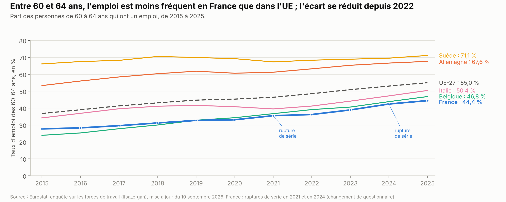
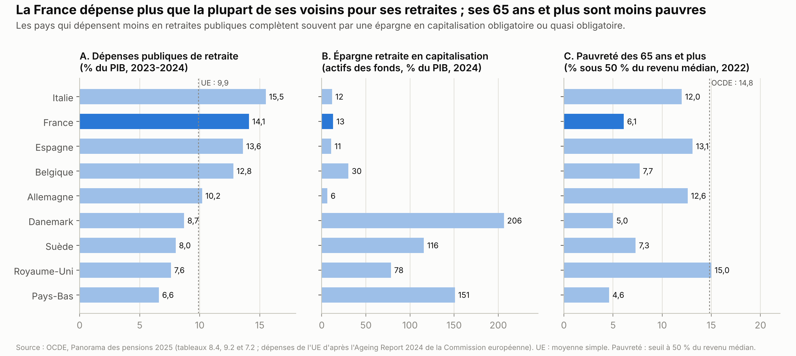
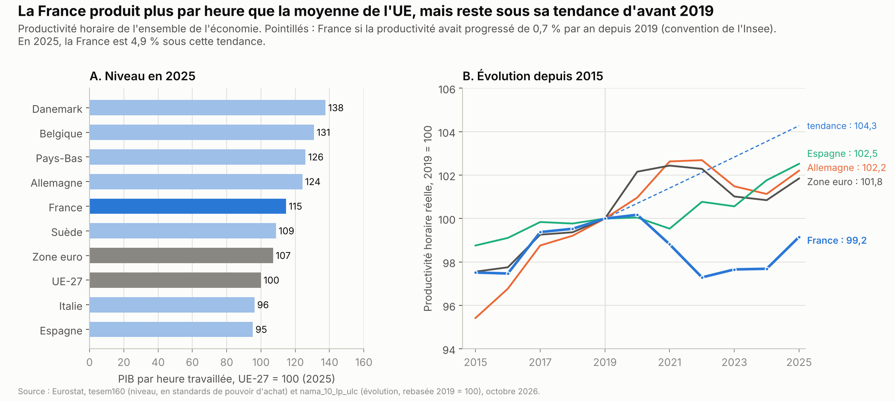
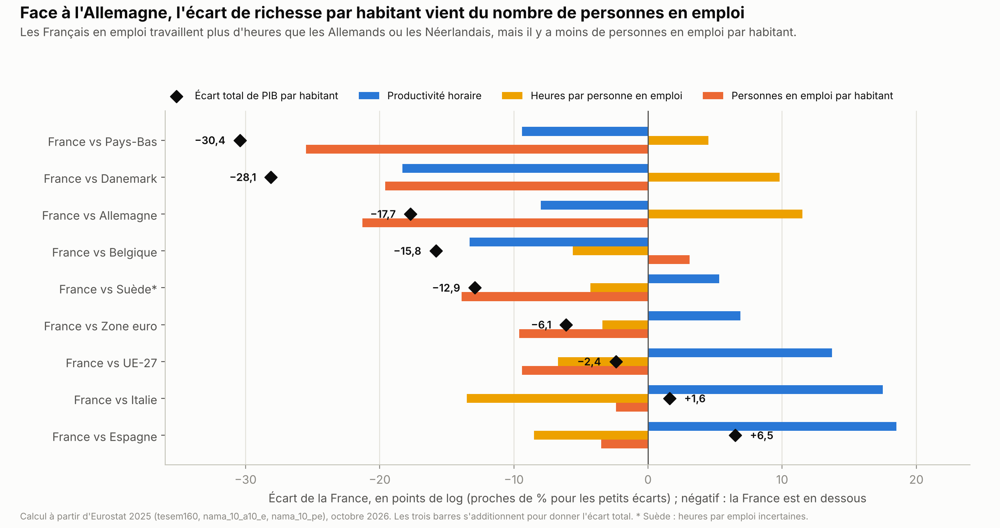
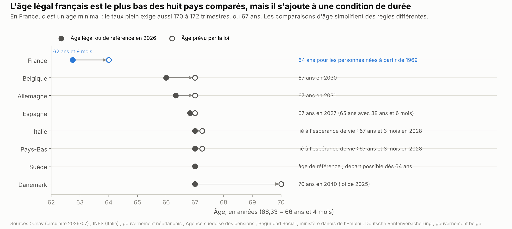
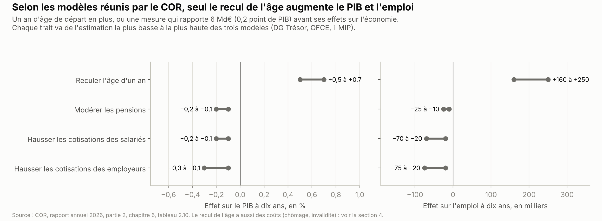

# Retraites et productivité : faut-il travailler plus longtemps ?

*Version de travail du 10 octobre 2026, corrigée le 21 octobre 2026. Les chiffres seront mis à jour à la date d'arrêt des données de l'édition 1.*

Ce chapitre décrit le système de retraite : ses règles, son coût, ce qu'il garantit et son financement à long terme. Il examine si la France produit et travaille moins que ses voisins, puis ce que l'on sait des effets d'un recul de l'âge de départ. Il présente enfin les propositions des partis. Le chômage, l'emploi des jeunes et le temps de travail sont traités dans le chapitre Travail et emploi.

**Voir aussi :**
- [Travail et emploi](../travail-emploi/travail_emploi.md), pour le chômage, l'emploi des jeunes, le temps de travail et le coût du travail ;
- [Finances publiques](../finances-publiques/finances_publiques.md), pour le poids des retraites dans la dépense publique et le budget 2027 ;
- [Pouvoir d'achat, salaires et inégalités](../pouvoir-achat/pouvoir_achat.md), pour le pouvoir d'achat des pensions et le niveau de vie des retraités ;
- [Santé et assurance maladie](../sante/sante_assurance_maladie.md), pour les arrêts maladie et l'invalidité ;
- [Institutions](../institutions/institutions.md), pour le vote des lois de financement de la Sécurité sociale et le référendum ;
- [Immigration](../immigration/immigration.md), pour l'effet de l'immigration sur les retraites ;
- [Présidentielle 2027 : ce que proposent les partis](../partis/programmes_partis_2027.md), pour les programmes complets.

> **Repères.**
> - **La retraite par répartition** : les cotisations des actifs d'une année paient les pensions des retraités de la même année. **Par capitalisation**, chacun épargne pour sa propre retraite, et cette épargne est placée.
> - **Deux étages obligatoires** : un régime de base et un régime complémentaire. Pour les salariés du privé, ce sont la Caisse nationale d'assurance vieillesse (Cnav) et l'Agirc-Arrco, gérée par les syndicats et le patronat.
> - **L'âge légal** est l'âge minimal de départ. **Le taux plein** est la pension sans réduction : on l'obtient avec la durée d'assurance requise (170 à 172 trimestres) ou à 67 ans. Partir sans cette durée entraîne une **décote** ; travailler au-delà donne une **surcote**.
> - **La productivité horaire** est la richesse produite (le PIB) par heure travaillée.
> - **Le Conseil d'orientation des retraites (COR)**, organisme public placé auprès du Premier ministre, publie chaque juin des projections du système.

---

## L'essentiel

1. **Un système presque à l'équilibre, puis en déficit.** Les retraites coûtent 14,1 % du PIB en 2025, soit 422 Md€. Le solde est de −0,2 % du PIB. Selon le Conseil d'orientation des retraites (COR), il atteindrait −0,9 % en 2045 et −2,4 % en 2070, de −1,7 % à −3,1 % selon la productivité.
2. **Des retraités au niveau de vie de l'ensemble de la population.** En 2023, leur niveau de vie moyen égale celui de l'ensemble des Français. Les plus de 65 ans sont moins souvent pauvres que dans la plupart des pays riches. La dépense de retraite dépasse de 2,6 à 4 points de PIB la moyenne de l'UE, selon la mesure.
3. **L'âge légal : 62 ans et 9 mois, puis 64 ans.** La réforme de 2023 est suspendue jusqu'à fin 2027. Sans nouvelle loi, la hausse reprend ensuite : 64 ans pour les personnes nées à partir de 1969.
4. **Une productivité au-dessus de la moyenne européenne.** Une heure de travail produit 15 % de plus que la moyenne de l'UE, mais 7,6 % de moins qu'en Allemagne. La baisse d'après 2019 est presque rattrapée ; la France reste 4,9 points sous sa tendance d'avant le Covid.
5. **Moins de personnes en emploi après 60 ans.** 44 % des 60-64 ans ont un emploi, contre 55 % dans l'UE. Ce taux a gagné 8 points depuis 2022. Selon l'Institut national de la statistique et des études économiques (Insee), la hausse de 2024 s'est faite « sous l'effet principalement » de la réforme de 2023. Ceux qui travaillent font plus d'heures que les Allemands.
6. **Reculer l'âge : plus d'emploi, mais des reports.** Selon les modèles réunis par le COR, un an de plus ajoute 0,5 à 0,7 % de PIB et 160 000 à 250 000 emplois en dix ans. Un quart à un tiers des économies part en chômage, invalidité ou maladie, plus chez les ouvriers.
7. **Un choix de répartition de l'effort.** Âge, durée, cotisations, niveau des pensions, impôts ou épargne : chaque levier pèse sur un groupe différent.

**Les grandes options en débat.**
- **Âge légal** : 60 ans (LFI), 62 ans (Les Écologistes, PS-Place publique, RN), 63 ans avec décote (LR), 65 ans (Horizons), plus d'âge légal (Renaissance).
- **Durée** : 40 ans (LFI ; RN pour qui a commencé avant 20 ans), 42 ans (RN), 43 ans réduits selon la pénibilité (PS-Place publique), 45 ans (Horizons), 44 à 46 ans évoqués (Reconquête).
- **Financement** : cotisations et revenus du capital (LFI), imposition du capital (PS-Place publique), retraités aisés (Les Écologistes), « année blanche » (Renaissance), recul de l'âge (Horizons, LR), économies non détaillées (RN).
- **Capitalisation** : un pilier en complément (Renaissance, Horizons, LR, RN, Reconquête) ; non (LFI) ; la répartition reste « centrale » (PS-Place publique).

---

## 1. La situation

### 1.1 Comment fonctionnent les retraites

**Un système en répartition, à deux étages.**
- Les pensions de l'année sont payées par les cotisations et les impôts de la même année. Les provisions des régimes obligatoires en capitalisation représentent 1,4 % du PIB fin 2025, pour un actif de près de 61,2 Md€ en valeur de marché[^cor-solde-2026].
- Le régime de base est la Cnav pour les salariés du privé. Les fonctionnaires ont leurs propres régimes : celui de l'État, et la Caisse nationale de retraites des agents des collectivités locales (CNRACL) pour la fonction publique territoriale et hospitalière.
- Les régimes spéciaux (Régie autonome des transports parisiens, industries électriques et gazières, notaires, Banque de France) sont fermés aux personnes recrutées depuis le 1er septembre 2023 : elles relèvent du régime général[^sp-reforme-2023].
- Le régime complémentaire des salariés du privé est l'Agirc-Arrco ; celui des contractuels publics, l'Institution de retraite complémentaire des agents non titulaires de l'État et des collectivités publiques (Ircantec).

**Les règles du régime général.**
- La pension de base est de 50 % du salaire annuel moyen des 25 meilleures années, au taux plein. Elle ne peut dépasser 2 002,50 € bruts par mois en 2026[^sp-montant-retraite].
- Chaque trimestre manquant retire 0,625 point au taux, dans la limite de 20 trimestres. La décote disparaît à 67 ans, « quel que soit votre nombre de trimestres »[^sp-montant-retraite].
- Les personnes qui ont commencé à travailler avant 16, 18, 20 ou 21 ans peuvent partir plus tôt, si elles ont cotisé la durée requise. Pour la génération 1969, l'âge est par exemple de 61 ans et 6 mois pour qui a commencé avant 20 ans, avec 172 trimestres[^cnav-carrieres-longues-2026].
- Les pensions de base sont revalorisées chaque 1er janvier selon les prix hors tabac : +0,9 % en 2026[^info-retraite-2026]. Faute d'accord entre syndicats et patronat, les pensions de l'Agirc-Arrco n'ont pas été revalorisées au 1er novembre 2025[^sp-agirc-2025].

**Qui touche quoi.**
- Fin 2024, 17,3 millions de personnes touchent une retraite de droit direct. Leur pension moyenne est de 1 705 € bruts par mois[^drees-donnees-2024]. Fin 2023, elle était de 1 541 € nets[^drees-retraites-2025].
- La pension moyenne des femmes est inférieure de 36 % à celle des hommes. L'écart tombe à 25 % en comptant les pensions de réversion, versées au conjoint survivant[^drees-donnees-2024].
- Le minimum vieillesse, ou allocation de solidarité aux personnes âgées (Aspa), est de 961 € par mois pour une personne seule en 2023. 723 000 personnes le touchent[^drees-retraites-2025].
- On compte 1,8 cotisant par retraité en 2025, contre 2,1 en 2002. Le COR en projette 1,3 en 2070[^cor-depenses-2026].

Le pouvoir d'achat des pensions est traité dans le chapitre [Pouvoir d'achat](../pouvoir-achat/pouvoir_achat.md) (section 1.4)[^ch-pouvoir-achat].

### 1.2 Ce que coûtent les retraites, et ce qu'elles garantissent

**Le coût.**
- Selon le COR, les dépenses de retraite atteignent 422,2 Md€ en 2025, soit 14,1 % du PIB. Les pensions en représentent 401 Md€ ; le reste couvre le minimum vieillesse, l'action sociale et les frais de gestion[^cor-depenses-2026].
- Eurostat mesure 14,8 % du PIB en 2024 (chapitre [Finances publiques](../finances-publiques/finances_publiques.md))[^ch-finances-publiques]. Ce chiffre additionne toutes les dépenses publiques de vieillesse (13,4 %) et de survivants (1,4 %), un périmètre plus large que celui du COR[^eurostat-gov-exp].
- Pour comparer les pays, l'Organisation de coopération et de développement économiques (OCDE) donne 14,1 % du PIB en 2023-2024 pour la France, contre 9,9 % en moyenne simple dans l'UE[^ocde-pag-2025-depenses]. Eurostat donne 14,8 % contre 12,2 % en 2024, soit 2,6 points d'écart[^ch-finances-publiques].

**Ce que garantit le système.**

| Pays | Taux de remplacement net | Revenu médian des 65 ans et plus, rapporté à celui des moins de 65 ans |
|---|---|---|
| **France** | **70 %** | **0,97** |
| Italie | 79 % | 1,00 |
| Espagne | 86 % | 1,06 |
| Belgique | 61 % | 0,80 |
| Allemagne | 53 % | 0,83 |
| Danemark | 77 % | 0,77 |
| Suède | 66 % | 0,84 |
| Pays-Bas | 96 % | 0,76 |
| UE | 65 % | 0,91 |

*Taux de remplacement : pension nette rapportée au dernier salaire net, pour un salarié au salaire moyen avec une carrière complète. Revenu relatif : 0,97 signifie que le revenu médian des 65 ans et plus vaut 97 % de celui des moins de 65 ans (enquête de 2025). Sources : Organisation de coopération et de développement économiques (OCDE)[^ocde-pag-2025-remplacement] ; Eurostat[^eurostat-revenu-relatif].*

- En 2023, le niveau de vie moyen des retraités vaut 100,2 % de celui de l'ensemble de la population (2 473 € contre 2 468 € par mois et par unité de consommation)[^cor-synthese-2026].
- Si l'on compte le loyer que les propriétaires n'ont pas à payer, il dépasse de 6,5 % celui de l'ensemble de la population[^cor-ra-2026].
- Selon l'Insee, le taux de pauvreté des retraités est de 10,4 % en 2024, contre 15,4 % pour l'ensemble de la population. Le seuil retenu est de 60 % du niveau de vie médian[^insee-ip-2117].
- Les fonds de retraite par capitalisation détiennent 12,9 % du PIB en France, contre 115,8 % en Suède et 150,9 % aux Pays-Bas (graphique ci-dessus)[^ocde-pag-2025-actifs]. S'y ajoutent les réserves des régimes en répartition, 7,5 % du PIB fin 2025 (section 1.3).

### 1.3 Le solde et les projections du COR

**Les hypothèses du scénario de référence** (juin 2026) : productivité horaire +0,7 % par an ; chômage de 7 % à partir de 2040. Le COR retient aussi 1,45 enfant par femme à partir de 2028 et un solde migratoire de +150 000 personnes par an[^cor-synthese-2026].

| | 2025 | 2030 | 2045 | 2070 |
|---|---|---|---|---|
| Dépenses (% du PIB) | 14,1 | 14,1 | 14,2 | 15,3 |
| Ressources (% du PIB) | 13,9 | 13,9 | 13,3 | 12,9 |
| Solde (% du PIB) | −0,2 (−5,1 Md€) | −0,2 (−6,8 Md€) | −0,9 | −2,4 |

*Ressources 2045 : différence entre dépenses et solde (calcul). Source : COR, rapport annuel 2026[^cor-synthese-2026][^cor-solde-2026].*

- **En 2025**, en comptant les revenus des placements, le solde est de −1,3 Md€[^cor-solde-2026].
- **La productivité** change le résultat en 2070 : −3,1 % du PIB si elle progresse de 0,4 % par an, −1,7 % si elle progresse de 1 %[^cor-synthese-2026]. Le mécanisme est expliqué en section 1.5.
- **La démographie** : on comptait 3,6 personnes de 20 à 64 ans pour une de 65 ans ou plus en 2009, et 2,5 en 2025. Le COR en projette 1,62 en 2070[^cor-synthese-2026]. Une fécondité de 1,2 ou de 1,7 enfant par femme ferait varier les dépenses d'environ 1 point de PIB en 2070[^cor-ra-2026].
- **Par rapport au rapport de 2025**, qui projetait −1,4 % en 2070, le solde se dégrade d'un point. Le COR cite notamment les règles de l'Agirc-Arrco, qui rendent les pensions « un peu plus dynamiques que prévu l'an dernier »[^cor-ecarts-2026].

**Ce qu'il faudrait pour équilibrer avec un seul levier.** Le COR calcule l'effort nécessaire avec un seul levier, sans tenir compte de ses effets sur l'économie[^cor-pilotage-2026] :
- reporter l'âge moyen de départ à 64,2 ans en 2030, 65,6 ans en 2045 et 67,6 ans en 2070, contre 63,1 ans en 2025 ;
- ou relever les prélèvements de 0,5 point en 2030, 2,1 points en 2045 et 5,6 points en 2070 ;
- ou baisser la pension moyenne, rapportée aux revenus d'activité, de 1,0 point en 2030, 3,3 points en 2045 et 7,4 points en 2070.

**Une question de convention.**
- L'État verse une contribution d'équilibre au régime de ses fonctionnaires et une subvention aux régimes spéciaux. Ces sommes représentent 1,9 % du PIB en 2025[^cor-ra-2026].
- Le COR les compte comme des ressources : ces régimes sont donc à l'équilibre par construction. Son cadre comptable est « conforme aux textes en vigueur », mais il « ne fournit aucune information sur le solde des régimes dont l'équilibre financier est assuré par l'État »[^cor-ra-2026].
- Jean-Pascal Beaufret, ancien haut fonctionnaire, applique aux fonctionnaires un taux de cotisation de 28 %, celui qu'il juge « raisonnable ». Il obtient un solde de « -29 Md€ en 2022 » (document de travail présenté au COR, septembre 2023)[^cor-beaufret-2023].
- Selon la Cour des comptes, ce choix de présentation est « sans effet » sur la charge qui pèse sur l'ensemble des finances publiques[^cour-retraites-2025].

**Les chiffres de la Cour des comptes** (février 2025), sur un autre périmètre que le COR[^cour-retraites-2025] :
- déficit de 6,6 Md€ en 2025, proche de ce montant jusqu'en 2030, près de 15 Md€ en 2035 et ≈ 30 Md€ en 2045 ;
- en 2045, une dette accumulée de l'ordre de 350 Md€ pour le régime général et de plus de 120 Md€ pour la CNRACL.

**Les réserves.** Fin 2025, les régimes en répartition détiennent 223,9 Md€ de réserves, soit 7,5 % du PIB. L'Agirc-Arrco en détient 113,6 Md€, dont 92,1 Md€ de réserves de financement, soit « près de 11 mois » de prestations. S'y ajoutent les 20,7 Md€ du Fonds de réserve pour les retraites (FRR)[^cor-solde-2026].

### 1.4 L'âge de départ : la réforme de 2023, sa suspension et le budget 2027

**La réforme de 2023.**
- Elle a porté l'âge légal de 62 à 64 ans, à raison de trois mois par génération, et la durée d'assurance à 172 trimestres (43 ans) dès la génération 1965[^cnav-circulaire-2026-07]. Elle a été adoptée par une loi de financement rectificative de la Sécurité sociale (loi du 14 avril 2023)[^sp-reforme-2023].
- Le Conseil constitutionnel l'a validée, mais a censuré six articles sans effet financier direct, dont l'index des seniors, qui n'avaient pas leur place dans ce type de loi[^cc-2023-849].
- En 2025, les syndicats et le patronat ont négocié des aménagements (le « conclave »). Le 26 juin 2025, le Premier ministre, François Bayrou, constate qu'« il n'y a pas eu de signature »[^gouv-conclave-2025].

**La suspension.** L'article 105 de la loi de financement de la Sécurité sociale pour 2026 décale la hausse, pour les retraites prenant effet à partir du 1er septembre 2026[^cnav-circulaire-2026-07].

| Année de naissance | Âge légal | Trimestres requis | Prévu par la réforme de 2023 |
|---|---|---|---|
| 1963 | 62 ans et 9 mois | 170 | Inchangé |
| 1964 | 62 ans et 9 mois | 170 | 63 ans ; 171 trimestres |
| Janvier à mars 1965 | 62 ans et 9 mois | 170 | 63 ans et 3 mois ; 172 trimestres |
| Avril à décembre 1965 | 63 ans | 171 | 63 ans et 3 mois ; 172 trimestres |
| 1966 | 63 ans et 3 mois | 172 | 63 ans et 6 mois |
| 1967 | 63 ans et 6 mois | 172 | 63 ans et 9 mois |
| 1968 | 63 ans et 9 mois | 172 | 64 ans |
| 1969 et après | 64 ans | 172 | Inchangé |

*Source : Cnav, circulaire n° 2026-07[^cnav-circulaire-2026-07]. Le taux plein reste acquis à 67 ans.*

- Le Premier ministre, Sébastien Lecornu, l'a résumé ainsi le 14 octobre 2025 : « Aucun relèvement de l'âge n'interviendra à partir de maintenant jusqu'en janvier 2028 »[^gouv-dpg-lecornu]. Les personnes nées en mars 1965 sont les dernières à partir à 62 ans et 9 mois, en décembre 2027 *(calcul)*.
- Sans nouvelle loi, la hausse reprend ensuite avec un trimestre de retard, jusqu'à 64 ans.
- **Coût** : 1,8 Md€ par an en moyenne jusqu'en 2032, selon le COR[^cor-synthese-2026]. Le Premier ministre l'estimait à 0,4 Md€ en 2026 et 1,8 Md€ en 2027[^gouv-dpg-lecornu] ; la lettre rectificative du 23 octobre 2025 retient 0,1 Md€ et 1,4 Md€ *(source secondaire)*[^cms-suspension].
- **Effet sur l'emploi** : selon l'Observatoire français des conjonctures économiques (OFCE), centre de recherche de Sciences Po, la réforme ajoute 69 000 actifs en 2026 avec la suspension, contre 103 000 sans. L'écart est de ≈ 88 000 en 2030 et quasi nul à long terme[^ofce-dauvin-2026].
- **L'âge moyen de départ** est de 63,1 ans en 2025. Le COR le projette à 64,6 ans en 2070[^cor-synthese-2026].

**Le projet de budget de la Sécurité sociale pour 2027** (1er octobre 2026)[^cm-2026-10-01][^lcp-mesures-budget-2027] :
- les pensions jusqu'à 1 260 € par mois, base et complémentaire réunies, suivraient l'inflation ;
- au-delà, la hausse serait plus faible, par paliers jusqu'à ≈ 2 000 €, puis à un taux fixé par décret, « inférieur à celui de l'inflation et supérieur à 1 » : les pensions augmenteraient, mais moins que les prix. La règle légale donnerait +1,7 % *(source secondaire)*[^moneyvox-seuils-2027] ;
- le plafond de l'abattement fiscal de 10 % des retraités, la part de la pension qui n'est pas imposée, passerait de 4 439 € à 3 000 € par foyer *(source secondaire)* ;
- le ministre du Travail évoque aussi une piste, sans montant : remplacer par des forfaits les droits familiaux de retraite, comme la majoration de 10 % des pensions pour trois enfants ;
- au total, « un effort de 5,5 milliards » est demandé aux retraités, dont ≈ 4 Md€ par la revalorisation partielle et ≈ 1,4 Md€ par l'abattement (Jean-Pierre Farandou, ministre du Travail)[^cm-2026-10-01].

Les effets de ces mesures sur le niveau de vie sont décrits dans le chapitre [Pouvoir d'achat](../pouvoir-achat/pouvoir_achat.md) (section 1.9)[^ch-pouvoir-achat].

### 1.5 La productivité : un niveau élevé, un décrochage depuis 2019

**Le niveau.**
- En 2025, une heure de travail produit en France 15 % de plus que la moyenne de l'UE, mais 7,6 % de moins qu'en Allemagne *(calcul)*. L'avance sur la moyenne de l'UE s'est réduite : l'indice était de 125 en 2019, de 115 en 2025[^eurostat-tesem160].
- Face aux États-Unis, l'écart de productivité horaire atteint 14 % en 2023, selon la Banque de France. Il est de 10 % pour l'Allemagne et de 28 % pour l'Italie[^bdf-billet-391].
- Une partie de l'avance française tient à un effet de sélection : les personnes les moins productives ont moins souvent un emploi. Une étude de la Banque de France estime qu'un point de taux d'emploi en plus réduit la productivité horaire d'environ 0,5 %[^bdf-cette-2011].

**Le décrochage depuis 2019.** Les chiffres varient selon la référence choisie.
- **Par rapport au niveau de 2019.** Selon l'Insee, la productivité horaire « n'est plus inférieure que de 0,8 point à son niveau de 2019 » en 2025. « L'essentiel de la perte de productivité depuis la crise sanitaire est donc comblé en niveau »[^insee-blog-productivite-2026].
- **Par rapport à la tendance d'avant 2019** (≈ +0,7 % par an), elle reste 4,9 points en dessous en 2025, soit un niveau inférieur de 4,9 % à cette tendance. Par tête, l'écart est de 4,3 points en France, contre 1,8 point dans les principaux pays de la zone euro[^insee-blog-productivite-2026].
- Le Conseil national de productivité (CNP) estime que ce retard « n'est pas entièrement résorbé »[^cnp-2026]. Selon l'OFCE, la productivité par salarié des entreprises dépasse de 2,6 % son niveau de 2019 début 2026 ; le retard sur les partenaires « semble résorbé depuis la mi-2024 »[^ofce-heyer-productivite-2026].
- Les estimations de 2024 étaient plus fortes : jusqu'à −8,5 % par personne en emploi, par rapport à la tendance, à la mi-2023, selon la Banque de France[^bdf-bulletin-251]. Les comptes nationaux ont été révisés depuis.

**Les causes identifiées.** Les estimations portent sur des mesures différentes.
- **Une perte durable** : selon la Banque de France (2026), les entreprises ont perdu 2,7 % de productivité potentielle. La composition de l'emploi en explique 1,2 point, l'apprentissage 0,8 point et les séquelles du Covid 0,4 point. Beaucoup d'embauches ont concerné des personnes peu qualifiées ou peu expérimentées[^bdf-bloc-notes-455].
- **L'apprentissage** : selon l'Insee, il explique 1,3 point de l'écart à la tendance en 2025 dans les branches marchandes. Les apprentis comptent comme des emplois, mais produisent moins au début. Ils représentent ≈ 21 % des emplois créés depuis fin 2019[^insee-blog-productivite-2026].
- **La rétention de main-d'œuvre** : 1,7 point de l'écart de 8,5 % mesuré à la mi-2023 par la Banque de France. Des entreprises ont gardé leurs salariés malgré une activité plus faible. Cet effet s'est en partie résorbé depuis[^bdf-bulletin-251][^insee-blog-productivite-2026].

**Pourquoi la productivité compte pour les retraites.**
- Les cotisations suivent les salaires, qui progressent à long terme avec la productivité. Les pensions déjà versées suivent les prix.
- Quand la productivité progresse vite, les recettes montent donc plus vite que les pensions. Selon le COR, « le niveau de vie relatif des retraités baisse en période de forte croissance, ce qui améliore les finances du système de retraite »[^cor-indexation-2025].
- Dans le scénario de référence, le niveau de vie des retraités passerait de 100,2 % de celui de l'ensemble de la population en 2023 à 90,3 % en 2070[^cor-synthese-2026].

### 1.6 La quantité de travail et l'emploi des seniors

**Ceux qui travaillent font plus d'heures que les Allemands.**
- En 2025, une personne en emploi travaille 1 500 heures par an en France, contre 1 336 en Allemagne et 1 604 en moyenne dans l'UE *(calcul)*[^eurostat-heures]. Ces comparaisons d'heures entre pays restent fragiles.
- La différence avec l'Allemagne vient surtout du temps partiel : 16,9 % des emplois en France, 29,4 % en Allemagne, 17,7 % dans l'UE[^eurostat-temps-partiel]. La durée hebdomadaire est traitée dans le chapitre [Travail et emploi](../travail-emploi/travail_emploi.md)[^ch-travail].

**Mais moins de personnes travaillent.**
- Selon le Conseil d'analyse économique (CAE), les Français de 16 à 74 ans travaillent « 100 heures annuelles de moins que les Allemands et Britanniques » et « 300 heures de moins que les Américains ». Face aux voisins européens, l'écart « s'explique entièrement par la faiblesse du taux d'emploi français »[^cae-focus-110].
- Entre 30 et 54 ans, le CAE n'observe « aucune différence d'emploi » avec les États-Unis, l'Allemagne ou le Royaume-Uni[^cae-focus-110].

| Taux d'emploi 2025 | 15-24 ans | 25-54 ans | 55-64 ans |
|---|---|---|---|
| **France** | **34,5 %** | **83,0 %** | **61,7 %** |
| Allemagne | 50,8 % | 84,9 % | 75,3 % |
| Pays-Bas | 76,0 % | 86,7 % | 75,8 % |
| Suède | 43,3 % | 85,7 % | 78,3 % |
| Italie | 17,9 % | 74,9 % | 61,2 % |
| Espagne | 25,4 % | 79,7 % | 62,4 % |
| Belgique | 28,4 % | 81,3 % | 61,5 % |
| UE | 34,5 % | 82,7 % | 66,4 % |

*Source : Eurostat, enquête sur les forces de travail[^eurostat-emploi]. Les 60-64 ans sont dans le graphique de « L'essentiel »[^eurostat-emploi-6064].*

**L'emploi des seniors progresse.**
- Le taux d'emploi des 55-64 ans est passé de 41,0 % en 2010 à 61,7 % en 2025. De 2015 à 2025, il a gagné 11,6 points en France et 15,0 points dans l'UE[^eurostat-emploi].
- Chez les 60-64 ans, il atteint 44,4 % en 2025, soit 8,2 points de plus qu'en 2022[^eurostat-emploi-6064]. Selon l'Insee, la hausse de 2024 (+3,4 points) s'est faite « sous l'effet principalement de la mise en œuvre de la réforme des retraites de 2023 »[^insee-ip-2096]. La série connaît des ruptures en 2021 et en 2024.
- À 61 ans, 24,5 % des personnes ne sont ni en emploi ni à la retraite : 3,8 % sont au chômage et 20,7 % inactives. À 62 ans, la part tombe à 14,7 %[^cor-passage-2026].
- La durée de vie active, emploi et chômage compris, est de 37,5 ans en France comme dans l'UE, contre 40,2 ans en Allemagne et 33,0 ans en Italie[^eurostat-vie-active].

**D'où vient l'écart de richesse par habitant.**

- Le PIB par habitant est le produit de trois termes : la productivité horaire, les heures par personne en emploi et la part de la population en emploi. Le graphique mesure ces trois écarts dans une unité proche du pourcentage, choisie pour qu'ils s'additionnent exactement *(calcul)*[^eurostat-tesem160][^eurostat-heures][^eurostat-population].
- Face à l'Allemagne, la France est ≈ 16 % moins riche par habitant en 2025. Le moindre nombre de personnes en emploi par habitant pèse plus que l'écart total : les heures plus longues font plus que compenser la productivité plus faible. Ce terme mêle le taux d'emploi et la pyramide des âges.
- Face aux États-Unis, selon la Banque de France, « la majeure partie de l'écart de PIB/habitant » de la France et de l'Allemagne reste due « au moindre nombre d'heures travaillées »[^bdf-billet-391].

**Ce que rapporterait davantage d'emploi** (le détail est dans le chapitre Travail et emploi).
- Selon la direction générale du Trésor (DG Trésor), aligner le taux d'emploi sur celui de l'Allemagne ajouterait 1,5 million d'emplois à temps plein, 3,2 % de PIB et au moins 38 Md€ de prélèvements. L'exercice « est illustratif et doit être interprété avec une grande prudence »[^tresor-hcfips-2024].
- Sylvie Vermeillet (Union centriste), rapporteure au Sénat, a chiffré en mai 2025 l'emploi des 589 000 personnes en bonne santé qui ne sont ni en emploi, ni au chômage, ni à la retraite. Il rapporterait 11,7 Md€, et 5,8 Md€ nets. Cette mesure ne permettrait « pas à elle seule de combler le déficit » des retraites[^senat-vermeillet-2025].
- Pour l'institut Rexecode, proche des milieux patronaux, reculer l'âge effectif de départ est « le levier le plus efficace » pour augmenter la quantité de travail[^rexecode-quantite-travail-2025]. La DG Trésor relève que, lorsqu'elle passe par des aménagements de fin de carrière, la hausse de l'emploi des seniors peut être « en partie voire entièrement compensée » par une baisse de leurs heures[^tresor-eco-404].

### 1.7 Vivre plus longtemps : espérance de vie et inégalités

| Pays | Espérance de vie à 60 ans, hommes | Espérance de vie à 60 ans, femmes | Années en bonne santé après 65 ans |
|---|---|---|---|
| **France** | **23,8** | **27,9** | **10,9** |
| Allemagne | 21,9 | 25,5 | 8,6 |
| Italie | 24,1 | 27,2 | 13,1 |
| Espagne | 23,9 | 28,1 | 12,5 |
| Suède | 24,5 | 26,8 | 14,2 |
| Belgique | 23,2 | 26,4 | 11,8 |
| Pays-Bas | 23,1 | 25,3 | 9,6 |
| UE | 22,3 | 26,1 | 10,3 |

*Données de 2024, provisoires pour la France et l'UE ; ruptures de série pour l'Italie et l'Espagne. Sources : Eurostat[^eurostat-esperance-vie][^eurostat-bonne-sante].*

- En 2025, l'espérance de vie à 60 ans est de 23,9 ans pour les hommes et de 27,9 ans pour les femmes[^insee-demographie-2025].
- Pour les générations nées entre la fin des années 1950 et le début des années 1960, la retraite dure ≈ 24 ans, soit un peu moins de 28 % de la vie[^cor-equite-2026].

**Des écarts selon le revenu et le métier.**
- Entre 2020 et 2024, les 5 % d'hommes les plus aisés vivent en moyenne 85,0 ans, les 5 % les plus modestes 72,0 ans : 13 ans d'écart. Chez les femmes, l'écart est de 8,7 ans. « Plus on est aisé, plus l'espérance de vie est élevée »[^insee-ip-2085].
- À 35 ans, un homme cadre peut espérer vivre 5,3 ans de plus qu'un ouvrier ; une femme cadre, 3,4 ans de plus qu'une ouvrière (2020-2022)[^insee-ip-2005].
- Selon le COR, « en dépit d'un départ à la retraite à un âge plus jeune que les cadres, les ouvriers y passent 2 années de moins ». Ils vivent aussi plus d'années en mauvaise santé, une « double peine »[^cor-seance-2025-02].
- Le compte professionnel de prévention (C2P) permet de partir plus tôt après une exposition à certains risques, comme le travail de nuit. Fin 2021, près de 1,9 million de salariés avaient un compte. Depuis la création du dispositif, 9 600 avaient demandé à convertir leurs points en trimestres pour partir plus tôt[^secu-c2p-2022]. Selon le COR, il « est encore en phase de montée en charge »[^cor-seance-2025-02].

### 1.8 Ce que font nos voisins

**Les âges ne se comparent pas directement.** En France, l'âge légal est un minimum : il faut aussi la durée d'assurance requise, ou attendre 67 ans. Pour une carrière complète commencée à 22 ans, l'OCDE retient un âge « normal » futur de 65 ans en France, contre 67 ans en Allemagne et en Belgique. Il est de 70 ans aux Pays-Bas et en Suède, de 70 ou 71 ans en Italie et de 74 ans au Danemark. La moyenne de l'OCDE est de 66,4 ans pour les hommes[^ocde-pag-2025-ages].

**Les mécanismes automatiques.**
- **Italie** : l'âge suit l'espérance de vie, avec une révision tous les deux ans. Il passera de 67 ans à 67 ans et 1 mois en 2027, puis 67 ans et 3 mois en 2028[^inps-circulaire-2026].
- **Pays-Bas** : l'âge de la pension publique suit l'espérance de vie et est fixé cinq ans à l'avance : 67 ans, puis 67 ans et 3 mois de 2028 à 2031[^rijksoverheid-aow].
- **Suède** : l'âge de référence est de 67 ans de 2026 à 2032, avec un départ possible dès 64 ans[^pensionsmyndigheten-ages]. Sur une cotisation de 18,5 % du salaire, 16 points sont inscrits sur un compte individuel en répartition et 2,5 points sont placés en capitalisation. Un « frein » ralentit la revalorisation des pensions quand les engagements dépassent les ressources[^ap2-suede].
- **Danemark** : l'âge est lié à l'espérance de vie. Le Parlement a voté le 22 mai 2025 le passage à 70 ans en 2040. Selon le ministère de l'Emploi, les sociaux-démocrates votent pour la dernière fois une hausse dans le cadre du mécanisme actuel *(paraphrase)*[^bm-dk-2025].
- **Allemagne** : l'âge atteindra 67 ans en 2031. Une loi de décembre 2025 garantit le niveau des pensions à 48 % du salaire moyen jusqu'en 2031. Elle exonère d'impôt jusqu'à 2 000 € par mois pour les salariés qui ont atteint l'âge légal et continuent de travailler[^bundestag-rentenpaket-2025][^bundesregierung-2026]. Une commission propose de lier l'âge à l'espérance de vie après 2031, sans valeur de loi[^drv-reforme-2026].
- **Espagne** : 66 ans et 10 mois en 2026, ou 65 ans avec 38 ans et 3 mois de cotisation ; 67 ans à partir de 2027, ou 65 ans avec 38 ans et 6 mois[^seg-social-jubilacion]. Un « mécanisme d'équité intergénérationnelle » ajoute une cotisation de 0,9 % des salaires en 2026, dont 0,75 point à la charge de l'employeur[^boe-orden-pjc-297-2026]. Elle augmente de 0,1 point par an jusqu'à 1,2 % en 2029, puis reste à ce niveau jusqu'en 2050 *(sources secondaires)*[^csif-mei][^legalitas-mei-2026].
- **Belgique** : 67 ans en 2030[^belgique-reforme-2015]. La réforme de 2026 prévoit une baisse de la pension de 2 à 5 % par année de départ anticipé *(source secondaire, à vérifier)*[^lavenir-belgique-2026].
- **France** : l'OCDE ne la classe pas parmi les pays qui lient l'âge à l'espérance de vie[^ocde-pag-2025-ages].

---

## 2. Ce qui fait débat

### Question 1. Reculer l'âge de départ, ou s'appuyer sur la durée de cotisation ?

**Pour un recul de l'âge.**
- Selon le COR, « seul le recul de l'âge de départ à la retraite apparaît, dans les modèles étudiés, comme expansionniste » : il augmente l'emploi et la production (section 4.1)[^cor-leviers-2026].
- La Fondation pour la recherche sur les administrations et les politiques publiques (IFRAP), libérale, en conclut que les autres leviers sont « de nature récessive » (mars 2026)[^ifrap-cor-2026].
- L'espérance de vie à 60 ans a progressé. Pour une carrière complète, l'âge « normal » français (65 ans) reste sous celui de l'Allemagne (67 ans) et sous la moyenne de l'OCDE (section 1.8).
- Après les réformes de 2010 et de 2023, l'emploi des seniors a augmenté (sections 1.6, 4.2 et 4.3).

**Contre, ou pour d'autres leviers.**
- Une partie des économies se reporte sur d'autres dépenses : environ un quart selon la Direction de la recherche, des études, de l'évaluation et des statistiques (DREES), un tiers avec l'assurance chômage (section 4.3).
- Les reports touchent plus les ouvriers. Dans les années 2010, 66 % de la hausse de l'âge de départ s'est traduite en emploi chez eux, contre plus de 85 % chez les professions intermédiaires et les cadres, selon la Cour des comptes[^cour-retraites-emploi-2025].
- Les plus modestes vivent moins longtemps (section 1.7).
- Henri Sterdyniak, des Économistes atterrés (hétérodoxes, à gauche), reproche aux simulations de ne pas prendre « en compte les difficultés spécifiques de cette classe d'âge à se maintenir en emploi »[^atterres-sterdyniak-2025].

**La durée plutôt que l'âge ?** Renaissance, et Jordan Bardella au RN, veulent que la durée de cotisation décide du départ (section 3). Aujourd'hui, l'âge légal décide pour environ un tiers des assurés : fin 2022, 33 % des personnes qui avaient atteint 62 ans avaient pris leur retraite dans l'année[^drees-ages-depart-2024]. Le PS veut une durée réduite selon la pénibilité.

### Question 2. Qui doit porter l'effort ?

Pour équilibrer le système en 2070 avec un seul levier, il faudrait un âge moyen de départ de 67,6 ans, ou 5,6 points de prélèvements en plus. L'autre option serait des pensions plus basses de 7,4 points par rapport aux revenus d'activité (section 1.3). Chaque levier pèse sur un groupe différent.

**Les retraités.**
- Revaloriser les pensions d'un point de moins que l'inflation rapporte 2,9 Md€ (Cour des comptes, 2025)[^cour-retraites-2025]. Le projet de budget 2027 prévoit une revalorisation partielle au-delà de 1 260 € par mois (section 1.4).
- Selon l'Institut des politiques publiques (IPP), ne pas revaloriser les retraites de base pendant un an rapporterait 5,2 Md€, avec un effet plus lourd pour les retraités modestes. Supprimer l'abattement fiscal de 10 % rapporterait 5,4 Md€[^ipp-note-129].
- Aligner les deux taux de contribution sociale généralisée (CSG) les plus élevés des retraités sur celui des actifs rapporterait 4,2 Md€ ; la mesure toucherait surtout les retraités aux revenus moyens[^ipp-note-129].

**Les actifs et les entreprises.**
- Un point de cotisation en plus rapporte 4,8 à 7,6 Md€ par an, selon qu'il pèse sur l'employeur ou le salarié (Cour des comptes)[^cour-retraites-2025].
- Selon les modèles réunis par le COR, hausser les cotisations des employeurs de 6 Md€ supprimerait 20 000 à 75 000 emplois en dix ans (section 4.1)[^cor-pilotage-2026].
- Pour Henri Sterdyniak, juger récessive une hausse des cotisations salariées est « erroné si elle finance une hausse équivalente des prestations retraite » (juin 2025)[^atterres-sterdyniak-2025].

**Les revenus du capital.** LFI veut soumettre les dividendes et les rachats d'actions à cotisation ; le PS veut « flécher des revenus de l'imposition du capital » vers les retraites (section 3). Aucun de ces deux financements n'est chiffré.

### Question 3. Faut-il une part de capitalisation ?

**Pour.**
- Bertrand Martinot, expert associé à l'Institut Montaigne, propose pour la Fondation pour l'innovation politique (Fondapol, libérale) un pilier obligatoire financé par 4 à 4,5 % du salaire brut. Il fournirait 24 % des pensions du privé en 2070[^fondapol-martinot-2024].
- Il retient un rendement réel de 3,5 ou 4 % par an. Dans les scénarios du COR de 2026, la productivité progresse de 0,4 à 1 % par an[^cor-synthese-2026]. Selon lui, « la capitalisation obligatoire permet de doter en capital une large partie de la population qui n'en possède pas »[^fondapol-martinot-2024].
- Le COR note que le rendement du capital « dépasse souvent la croissance à long terme », alors que la répartition offre « un rendement en moyenne égal à la croissance de l'économie »[^cor-capitalisation-2025].

**Contre, ou avec prudence.**
- **Le coût de la transition.** Il faut payer les pensions actuelles tout en épargnant pour les futures. Le COR décrit trois options, sans les chiffrer : « une double cotisation pour les actifs », une sous-indexation durable des pensions, ou « une prise en charge par l'État »[^cor-capitalisation-2025].
- Pour le consultant Éric Weil, dans la revue de Terra Nova (think tank progressiste), une capitalisation qui représenterait 10 à 15 % des retraites du privé « nécessiterait d'injecter environ 20 Md€ de plus chaque année ». La facture totale atteindrait « entre 300 Md€ et 400 Md€ », pour des gains nets possibles « au terme de 30 à 40 ans »[^weil-2025].
- Pour François Ecalle, ancien magistrat de la Cour des comptes qui tient le site Fipeco, « La capitalisation ne peut pas complètement et rapidement remplacer la répartition car les actifs actuels devraient payer deux fois ». Rendue obligatoire, elle « équivaut à créer un nouvel impôt dont le produit serait affecté à des fonds de pension privés »[^fipeco-capitalisation-2026].
- **Le risque.** En capitalisation, l'épargnant reste exposé « aux fluctuations de marché, aux frais d'intermédiation et au risque de fortes pertes en cas de crise » (COR)[^cor-capitalisation-2025].

### Question 4. Le déficit : trop de dépenses, pas assez de recettes, ou une question de convention ?

- **Jusqu'en 2045**, les dépenses restent stables en part du PIB (14,1 % puis 14,2 %), et les ressources baissent (13,9 % puis 13,3 %). **Après 2045**, les dépenses montent aussi, jusqu'à 15,3 % en 2070 (section 1.3).
- Selon le COR, la baisse des ressources « reflète toutefois avant tout le cadre comptable retenu »[^cor-ra-2026]. Les contributions de l'État aux régimes de ses fonctionnaires et aux régimes spéciaux passent de 1,9 % du PIB en 2025 à 1,1 % en 2070[^cor-ra-2026].
- Ceux qui mettent l'accent sur les dépenses rappellent qu'elles dépassent de 2,6 à 4 points de PIB la moyenne de l'UE, selon la mesure (section 1.2).
- **L'hypothèse de productivité** fait débat des deux côtés.
  - Selon Gilbert Cette, président du COR, le scénario de 0,7 % par an est un scénario central « que certains membres du COR jugent même optimiste ». Il ajoute que « certains économistes jugent l'hypothèse de 0,4 % plus réaliste » (Assemblée nationale, juillet 2026)[^an-cette-2026].
  - À l'inverse, Jean-Marie Harribey (Économistes atterrés) relève que « Le scénario le plus haut de 1,3 % qui était encore retenu dans le rapport 2024 a été écarté »[^atterres-harribey-2025].
  - Pour Henri Sterdyniak, cette hypothèse « n'a d'importance pour l'équilibre du système de retraite que parce que » les pensions suivent les prix et non les salaires *(paraphrase de la fin de la phrase)*[^atterres-sterdyniak-2025].

---

## 3. Ce que proposent les partis

*Les partis sont présentés dans l'ordre où leurs groupes siègent à l'Assemblée nationale, de gauche à droite ; Reconquête, qui n'a pas de groupe, vient en dernier. Les positions sont celles connues au 10 octobre 2026, complétées le 12 octobre. Raphaël Glucksmann a été désigné candidat du PS et de Place publique le 11 octobre 2026, dès le premier tour de la primaire, avec 66,17 % des voix *(source secondaire)*[^publicsenat-primaire-resultats]. LFI publie la nouvelle version de son programme le 6 novembre 2026 *(source secondaire)*[^lcp-lfi-programme-2026]. Les Écologistes n'ont pas encore désigné leur candidat.*

### Vue d'ensemble

| Parti | Âge légal | Durée de cotisation | Capitalisation | Financement |
|---|---|---|---|---|
| LFI | 62 ans, puis 60 ans | 40 ans | Non | Cotisations, revenus du capital |
| Les Écologistes | 62 ans ; 60 ans pour les métiers pénibles | Non précisée | Non précisée | Retraités aisés |
| PS-Place publique | 62 ans | 43 ans, réduits selon la pénibilité | Non : répartition « centrale » | Imposition du capital |
| Renaissance | Supprimé : décote et surcote | Décide du départ | Oui, en complément | « Année blanche » en 2028 |
| Horizons | 64 ans, puis 65 ans | 45 ans | Oui, 10 à 15 % des pensions | Recul de l'âge |
| LR | 63 ans, avec une décote de 7 % par an ; taux plein à 65 ans | Non précisée | Oui, pour les nouveaux entrants | Recul de l'âge |
| RN | 62 ans ; 60 ans si début avant 20 ans | 42 ans ; 40 ans | Oui, « pilier » annoncé | Économies non détaillées |
| Reconquête | Travailler « plus longtemps », sans âge précisé | 44 à 46 ans évoqués | Oui, « une partie » | Ni hausse des cotisations ni baisse des pensions |

### Ce qui rapproche et ce qui sépare

- **Revenir sur la réforme de 2023** : LFI, Les Écologistes, PS-Place publique et le RN veulent un âge légal de 62 ans ou moins. Horizons veut aller à 65 ans ; LR veut un âge minimal de 63 ans, mais une décote plus forte.
- **La durée comme critère principal** : Renaissance supprime l'âge légal. Le PS et Jordan Bardella mettent aussi la durée en avant.
- **La pénibilité** : tous les partis de gauche veulent des départs plus tôt pour les métiers pénibles. Horizons et LR renvoient les critères à une négociation.
- **La capitalisation** : Renaissance, Horizons, LR et le RN veulent un pilier en complément de la répartition ; Éric Zemmour veut aussi « une partie de capitalisation ». LFI s'y oppose. Le projet du PS réaffirme « le rôle central du régime par répartition »[^ps-projet-retraites].

### Les obstacles communs

- **Une loi, souvent de financement de la Sécurité sociale.** L'âge de 64 ans est écrit dans la loi : un décret ne suffit pas pour le changer *(lecture du texte)*[^cc-2023-849]. Une loi de financement est examinée en 50 jours au plus (article 47-1 de la Constitution)[^an-constitution]. Aucun parti n'a seul la majorité à l'Assemblée (chapitre [Institutions](../institutions/institutions.md))[^ch-institutions].
- **Les « cavaliers sociaux ».** Le Conseil constitutionnel a censuré six dispositions de la réforme de 2023, qui n'avaient « pas d'effet ou un effet trop indirect » sur les finances sociales[^cc-2023-849]. Une mesure de ce type (gouvernance, information des assurés, emploi des seniors) doit passer par une loi ordinaire.
- **Les régimes complémentaires.** L'Agirc-Arrco est géré par les syndicats et le patronat. Utiliser ses excédents (Horizons) ou changer la revalorisation de ses pensions (LFI, Renaissance) suppose de négocier avec eux.
- **La capitalisation.** Outre le coût de transition (Question 3), un fonds de retraite professionnelle relève de la directive européenne de 2016 sur ces institutions. Elle ne s'applique pas aux régimes de sécurité sociale ni aux régimes en répartition (article 2) *(lecture du texte)*[^iorp-2016]. Un fonds rattaché à la Sécurité sociale y échapperait donc ; un fonds professionnel y serait soumis.
- **Le référendum.** L'article 11 permet un référendum sur une réforme de « politique économique, sociale ou environnementale », ce qui inclut les retraites (chapitre Institutions)[^ch-institutions]. Aucun parti ne le promet ; Édouard Philippe ne l'exclut pas *(source secondaire)*[^jdn-retraites-philippe].

**Les chiffrages de référence de la Cour des comptes.** Effets en 2035, par rapport à la loi de 2023 (64 ans, 43 ans de cotisation) :

| Mesure | Système de retraite | Ensemble des finances publiques |
|---|---|---|
| Âge de 63 ans au lieu de 64 | −5,8 Md€ | −13 Md€ |
| Âge de 65 ans au lieu de 64 | jusqu'à +8,4 Md€ | jusqu'à +17,7 Md€ |
| Durée de 42 ans au lieu de 43 | −3,9 Md€ | −7,1 Md€ |
| Durée de 44 ans au lieu de 43 | +5,2 Md€ | +9,7 Md€ |

*Source : Cour des comptes, février 2025[^cour-retraites-2025]. La Cour n'a pas chiffré le retour à 62 ans ; elle estime l'effet de la réforme de 2023 « autour de 10 Md€ » en 2030. Les effets de plusieurs mesures ne s'additionnent pas.*

### Le tableau standard

*Partis dans l'ordre de l'hémicycle, comme ci-dessus. Levier : ce qu'il faut pour appliquer la mesure (liste dans le mode d'emploi) ; le premier cité est le plus décisif. Les montants sont annuels sauf mention. Quand une proposition vient de la presse ou d'un site qui compile les programmes, la case le signale.*

| Parti | Propositions | Levier | Obstacles et coût |
|---|---|---|---|
| **LFI** | « Abroger immédiatement les décrets d'application de la réforme d'Emmanuel Macron passant l'âge de départ à la retraite à 64 ans » ; « Réaffirmer l'objectif commun du droit à la retraite à 60 ans » ; « Augmenter le minimum contributif » (pension pour une carrière complète) au niveau du SMIC ; « Indexer le montant des retraites sur les salaires » ; « Soumettre à cotisation les dividendes, la participation, l'épargne salariale, les rachats d'action » (programme de 2024)[^nfp-programme]. En 2026 : 60 ans « pour 40 ans de cotisation » *(source secondaire)*[^lcp-qui-propose-retraites] | Loi ; Budget ; Négociation | Retraite à 60 ans : 58 Md€ selon l'Institut Montaigne (libéral, 2024)[^montaigne-nfp], ≈ 50 Md€ en 2027 selon l'IFRAP[^ifrap-nfp], « en gros 50 milliards » selon LFI (Éric Coquerel, 2024) *(source secondaire)*[^moneyvox-abrogation-2024]. Indexation sur les salaires : 13,4 Md€ ; minimum contributif au SMIC : 13,9 Md€ (Institut Montaigne)[^montaigne-nfp][^moneyvox-abrogation-2024]. Financement prévu : « Augmenter de 0,25 point par an pendant 5 ans les cotisations vieillesse »[^nfp-programme], soit ≈ 6 à 9,5 Md€ au bout de cinq ans *(calcul)*. L'âge de 64 ans est fixé par la loi : un décret ne suffit pas *(lecture du texte)*[^cc-2023-849]. |
| **Les Écologistes** | Retraite à 60 ans pour qui a commencé avant 20 ans ou exercé un métier pénible, à 62 ans pour les autres *(paraphrase, source secondaire)*[^lcp-candidats-retraites] ; « supprimer l'abattement fiscal de 10 % pour les retraités aisés » *(site compilateur)*[^ifrap-comparateur] | Loi ; Budget | Non chiffré par le parti ; aucun chiffrage indépendant. Supprimer tout l'abattement rapporterait 5,4 Md€ (IPP)[^ipp-note-129]. Le chapitre du programme sur les retraites n'a pas pu être lu[^ecologistes-programme]. |
| **PS-Place publique** | Projet du PS : abrogation de la réforme ; un âge légal « ramené à 62 ans », qui « ne disparaîtra pas pour autant » ; 43 annuités, réduites selon les 10 critères de pénibilité de 2015 ; des recettes tirées de « l'imposition du capital »[^ps-projet-retraites]. Raphaël Glucksmann, interrogé avec les autres candidats par Sophie Binet, secrétaire générale de la Confédération générale du travail (CGT), au dernier débat de la primaire (BFMTV, 4 octobre 2026) : « Nous abrogerons la réforme injuste de 2023 » ; « On ne pourra pas faire 60 ans, ce sera 62 ans » *(source secondaire)*[^lcp-dernier-debat-primaire]. En mai 2026, il disait que les cadres, à l'espérance de vie en bonne santé plus longue, « devront en revanche partir plus tard » *(source secondaire)*[^lcp-glucksmann-2026]. François Hollande (PS, hors primaire ; rattaché à cette ligne s'il est candidat) : un âge « aux alentours de 63 ans » en 2028 *(source secondaire)*[^publicsenat-candidats-retraites] | Loi ; Négociation ; Budget | Non chiffré par le parti. Abrogation : 8,2 Md€ en 2027 selon l'Institut Montaigne ; 14,1 Md€ en 2030 selon l'étude d'impact du gouvernement de 2023 *(source secondaire)*[^moneyvox-abrogation-2024]. Un an de durée en moins : −3,9 Md€ pour le système en 2035 (Cour des comptes)[^cour-retraites-2025]. |
| **Renaissance** | « La question de l'âge légal ne sert plus à rien » ; « une vraie décote si vous partez tôt, une vraie surcote si vous partez tard » ; un « vrai pilier de capitalisation » *(sources secondaires)*[^lcp-qui-propose-retraites][^publicsenat-candidats-retraites] ; 1 000 € placés à chaque naissance sur un fonds de retraite *(source secondaire)*[^econostrum-attal-2025] ; « année blanche » sur les prestations en 2028, « en épargnant toutefois les petites retraites » *(source secondaire)*[^jdd-attal] | Loi ; Budget ; Négociation | Non chiffré par le parti. Un an sans revalorisation des retraites de base : 5,2 Md€ (IPP)[^ipp-note-129]. 1 000 € par naissance : ≈ 660 M€ *(source secondaire)*[^econostrum-attal-2025]. Le fonctionnement d'un système sans âge minimal n'est pas décrit. |
| **Horizons** | Rétablir 64 ans et 43 ans, puis 65 ans et 45 ans « en moins de 10 ans » ; « un Français sur trois » pourrait partir entre 60 et 64 ans (carrières longues, pénibilité) *(source secondaire)*[^publicsenat-philippe-retraites] ; « un pilier de capitalisation à 10-15 % des pensions d'ici quinze ans »[^philippe-prospere], alimenté par les excédents de l'Agirc-Arrco *(source secondaire)*[^jdn-retraites-philippe] | Loi ; Négociation ; Budget | Gain annoncé par l'équipe du candidat : 30 Md€ par an, dont 10 Md€ pour le système de retraite et 20 Md€ pour les finances publiques ; non évalué *(source secondaire)*[^jdn-retraites-philippe]. 65 ans au lieu de 64 : jusqu'à 8,4 Md€ pour les retraites et 17,7 Md€ pour les finances publiques en 2035 ; 44 ans de durée au lieu de 43 : 5,2 et 9,7 Md€ (Cour des comptes)[^cour-retraites-2025]. Utiliser les réserves de l'Agirc-Arrco suppose l'accord des syndicats et du patronat. |
| **LR** | « L'âge minimal de départ, c'est 63 ans », avec une décote de « 7% par an » ; taux plein à 65 ans au lieu de 67, lié à l'espérance de vie ; pour les nouveaux entrants, une capitalisation de « 25 à 30% des retraites », avec un rendement minimal de 4 % *(sources secondaires)*[^lcp-retailleau-retraites][^jdd-retailleau-retraites] ; à court terme, retour de la réforme de 2023 *(source secondaire)*[^publicsenat-retailleau-retraites] | Loi ; Négociation ; Budget | Gain annoncé : « 40 milliards d'économies en cumulé sur cinq ans », non évalué *(source secondaire)*[^jdd-retailleau-retraites]. 63 ans au lieu de 64 : −5,8 Md€ pour les retraites et −13 Md€ pour les finances publiques en 2035 (Cour des comptes)[^cour-retraites-2025] ; la décote de 7 % et le taux plein à 65 ans, qui jouent en sens contraires, ne sont pas chiffrés. Le garant des 4 % n'est pas désigné. |
| **RN** | « puis progressivement on arrivera à 42 ans de cotisations et un âge légal de 62 ans », avec un départ à 60 ans pour qui a commencé avant 20 ans (Marine Le Pen, août 2026) *(source secondaire)*[^lcp-debat-medef] ; « un véritable pilier de capitalisation » *(source secondaire)*[^europe1-rn-plan] ; « entre 15 et 20 milliards d'économies à terme » sur les retraites *(source secondaire)*[^gazette-rn-retenir] | Loi ; Budget | Coût annoncé par Marine Le Pen : 9 Md€ en année pleine *(source secondaire)*[^publicsenat-candidats-retraites]. Programme de 2024 : 34,7 Md€ à l'horizon 2027 selon l'Institut Montaigne[^montaigne-retraites-rn]. Comment revenir à 62 ans tout en économisant 15 à 20 Md€ n'est pas expliqué. |
| **Reconquête** | Pas de programme pour 2027[^lcp-zemmour-candidature]. Le 19 mai 2026, Éric Zemmour juge qu'« on va être obligé de travailler plus longtemps » : « on est à 43 ans de cotisation, on peut augmenter à 44, 45, 46 ans ». Il veut « injecter, dans notre système de répartition une partie de capitalisation » et refuse de hausser les cotisations ou de baisser les pensions[^europe1-zemmour-2026]. Programme de 2022 : 64 ans d'ici 2030[^montaigne-zemmour-retraites-2022] ; petites retraites exonérées de CSG et de contribution au remboursement de la dette sociale (CRDS) ; minimum vieillesse retiré aux étrangers non européens[^reconquete-programme] | Loi ; Budget ; Constitution | Propositions de 2026 non chiffrées. En 2022 : 20 Md€ d'économies en 2030 selon le candidat, 10,7 Md€ selon l'Institut Montaigne[^montaigne-zemmour-retraites-2022]. En 2024, le Conseil constitutionnel a jugé qu'une condition de cinq ans de résidence ou de 30 mois d'activité, imposée aux étrangers en situation régulière pour certaines prestations, portait une « atteinte disproportionnée » au préambule de 1946 ; un retrait complet irait plus loin *(lecture du texte)*[^cc-2024-6-rip]. |
| **Autres** | Parti communiste français : « la retraite à 60 ans, à taux plein », aucune pension sous 1 200 € net[^pcf-retraite]. Union des droites pour la République (UDR) : capitalisation *(source secondaire)*[^gazette-ciotti] | Loi ; Budget | Non chiffrés. |
| *Gouvernement* | Suspension de la réforme jusqu'à fin 2027 ; projet de budget 2027 : pensions au-delà de 1 260 € revalorisées moins que l'inflation, abattement des retraités plafonné (section 1.4)[^cm-2026-10-01] | Budget ; Décret | 5,5 Md€ demandés aux retraités en 2027[^cm-2026-10-01]. Le gouvernement n'a pas de majorité à l'Assemblée. |

### Comment ils le mettraient en place : ce qui reste sans réponse

**LFI.**
- L'âge et la durée passent par une loi de financement ; la revalorisation des complémentaires, par une négociation avec les syndicats et le patronat.
- *Sans réponse* : le calendrier du passage de 62 à 60 ans ; le coût total et son financement ; le contenu du programme du 6 novembre.
- *Critiques* :
  - Libérale : l'Institut Montaigne juge le programme du Nouveau Front populaire « difficilement soutenable pour l'économie française » (2024)[^montaigne-nfp].
  - Centre droit : Édouard Philippe qualifie de « charlatans » les partisans d'un retour à 60 ans (29 septembre 2026) *(source secondaire)*[^lcp-philippe-retraites].
  - Centre gauche : « On ne pourra pas faire 60 ans, ce sera 62 ans » (Raphaël Glucksmann, dernier débat de la primaire, BFMTV, 4 octobre 2026) *(source secondaire)*[^lcp-dernier-debat-primaire]. Il répondait à une question de Sophie Binet (CGT) posée aux cinq candidats, sans viser LFI nommément.
- *Réponses* : selon Jean-Luc Mélenchon, Édouard Philippe « vous condamne à travailler à mort » *(source secondaire)*[^jdn-retraites-philippe]. L'économiste Michaël Zemmour (Sciences Po, proche du Nouveau Front populaire) estime que la hausse de cotisation financerait « quasiment intégralement » l'abrogation de la réforme de 2023 (2024) *(source secondaire)*[^moneyvox-abrogation-2024].

**Les Écologistes.**
- *Sans réponse* : la durée de cotisation ; le financement ; la définition des « retraités aisés » ; le choix du candidat.
- *Critiques* : aucune critique nommée de ces propositions n'a été trouvée.

**PS-Place publique.**
- Une conférence sociale préparerait un nouveau système. Les autres candidats à la primaire s'en écartent sur des points précis. Olivier Faure veut ramener le taux plein de 67 à 66 ou 65 ans, Jérôme Guedj moduler les trimestres selon la pénibilité ; Emmanuel Maurel s'en tient aux 62 ans *(source secondaire)*[^lcp-dernier-debat-primaire][^publicsenat-candidats-retraites].
- *Sans réponse* : le coût total ; l'ampleur de la modulation par la pénibilité ; le programme de Raphaël Glucksmann, désigné le 11 octobre 2026.
- *Critiques* :
  - Patronat : en 2024, Patrick Martin, président du Mouvement des entreprises de France (Medef), voyait dans l'abrogation « un signal terrible » *(source secondaire)*[^moneyvox-abrogation-2024].
  - Libérale : les coûts estimés par l'Institut Montaigne (tableau ci-dessus).
  - Aucune critique nommée du projet du PS par un parti du centre ou de droite n'a été trouvée.
- *Réponses* : aucune réponse aux chiffrages n'a été trouvée.

**Renaissance.**
- Gabriel Attal évoque un « nouveau système universel » à points, sans modalités *(source secondaire)*[^publicsenat-candidats-retraites]. Un système universel par points avait été adopté en première lecture par l'Assemblée nationale le 3 mars 2020, par l'article 49.3[^an-ta-409-2020], puis abandonné : une « réforme avortée », selon Public Sénat *(source secondaire)*[^publicsenat-candidats-retraites]. L'« année blanche » passerait par le budget et, pour les complémentaires, par une négociation.
- *Sans réponse* : comment fonctionnerait un système sans âge minimal ; les taux de décote et de surcote ; la part de capitalisation et son financement ; le seuil des « petites retraites ».
- *Critiques* :
  - Centre droit : sans nommer Gabriel Attal, Édouard Philippe juge qu'un système sans âge légal serait « financièrement intenable » et « socialement incroyablement injuste » (29 septembre 2026) *(source secondaire)*[^publicsenat-philippe-retraites].
  - Académique : selon l'IPP, une désindexation uniforme pèse plus sur les retraités modestes[^ipp-note-129].
  - Syndicale : en 2025, la Confédération générale du travail (CGT) titrait, sur l'année blanche alors envisagée par le gouvernement : « Année blanche : une année noire pour le monde du travail ? »[^cgt-annee-blanche].
- *Réponses* : Gabriel Attal critique les réformes qui se bornent à « bouger les paramètres ou les curseurs », des « soins palliatifs » pour un système qui « ne tient plus » *(source secondaire)*[^publicsenat-candidats-retraites].

**Horizons.**
- La gestion du régime serait confiée aux syndicats et au patronat, avec une « règle d'or d'équilibre »[^publicsenat-philippe-retraites]. Le plan d'épargne retraite (PER) serait généralisé ; l'État y verserait 500 € à la signature du premier contrat de travail *(source secondaire)*[^jdn-retraites-philippe].
- *Sans réponse* : le calendrier par génération ; le montant des excédents de l'Agirc-Arrco mobilisés ; la contribution des retraités aisés ; le rendement attendu.
- *Critiques* :
  - LFI : selon Jean-Luc Mélenchon, Édouard Philippe « vous condamne à travailler à mort » (septembre 2026) *(source secondaire)*[^jdn-retraites-philippe].
  - Renaissance : sans nommer personne, Gabriel Attal juge qu'« On n'en est plus à bouger les paramètres ou les curseurs » (septembre 2026) *(source secondaire)*[^publicsenat-candidats-retraites].
  - Aucune critique d'un économiste ou d'un institut sur le projet du 29 septembre n'a été trouvée.
- *Réponses* : « Dire qu'il faut travailler plus longtemps n'est pas très populaire en France », « mais je veux protéger les Français » *(source secondaire)*[^publicsenat-philippe-retraites].

**LR.**
- Une piste de financement de la capitalisation est évoquée : « une cotisation de 1 % du salaire brut, répartie entre le salarié et l'employeur ». Les métiers pénibles seraient définis après consultation des syndicats et du patronat *(source secondaire)*[^lcp-retailleau-retraites].
- *Sans réponse* :
  - qui garantit le rendement de 4 %, et si le 1 % s'ajoute aux cotisations actuelles ou en remplace une partie ;
  - la répartition des 40 Md€ et la formule qui lie le taux plein à l'espérance de vie ;
  - l'articulation entre 63 ans et la demande de revenir à 64 ans dès maintenant.
- *Critiques* : aucune critique nommée du projet du 22 septembre n'a été trouvée, d'aucune orientation.
- *Réponses* : le projet doit « sauver la retraite par répartition »[^jdd-retailleau-retraites] ; « aucun des candidats ne pourra résoudre le problème des finances publiques et de la dette sans les retraites » (Bruno Retailleau, débat du Medef) *(source secondaire)*[^lcp-debat-medef].

**RN.**
- Le contre-budget de 2026 prévoyait 1,5 Md€ pour lancer la réforme des retraites de Marine Le Pen et 3,61 Md€ pour l'« Indexation des retraites et dégel des prestations »[^rn-contre-budget-2026].
- *Sans réponse* : le contenu des 15 à 20 Md€ d'économies ; le calendrier ; le fonctionnement du pilier de capitalisation. La ligne de Jordan Bardella diffère aussi : pour lui, « L'âge légal ne veut rien dire, ce qui compte c'est la durée de cotisation » *(source secondaire)*[^lcp-qui-propose-retraites].
- *Critiques* :
  - Centre droit : Édouard Philippe range Marine Le Pen parmi les « charlatans » ; selon lui, sa réforme « va coûter 30 milliards de plus » (septembre 2026) *(source secondaire)*[^jdn-retraites-philippe].
  - Libérale : l'Institut Montaigne chiffrait le programme de 2024 à 34,7 Md€[^montaigne-retraites-rn].
  - Aucune critique de gauche du volet retraites du plan du 6 octobre n'a été trouvée.
- *Réponses* : sur l'écart entre Jordan Bardella et Marine Le Pen, Sébastien Chenu, vice-président du RN, assurait en juin 2026 : « C'est le même programme » *(source secondaire)*[^publicsenat-rn-retraites]. Aucune réponse aux critiques n'a été trouvée.

**Reconquête.**
- *Sans réponse* : le programme de 2027 ; la durée de cotisation retenue ; la part de capitalisation et son financement.
- *Critiques* : en 2022, l'Institut Montaigne jugeait « optimiste » le chiffrage d'Éric Zemmour[^montaigne-zemmour-retraites-2022]. Aucune critique de 2026 n'a été trouvée.

---

## 4. Ce que disent les évaluations

*Cette section distingue ce qui a été mesuré après coup, en comparant avec une situation de référence, ce qui relève d'une simulation et ce qui est un simple constat. Le chômage des seniors et l'emploi des jeunes sont aussi traités dans le chapitre [Travail et emploi](../travail-emploi/travail_emploi.md).*

### 4.1 Reculer l'âge : ce que prévoient les modèles

- *Simulation* : en mars 2026, le COR a comparé quatre leviers : un an d'âge effectif de départ en plus, et trois mesures qui rapportent chacune 6 Md€ avant leurs effets sur l'économie, soit 0,2 point de PIB. Ces trois mesures sont une modération des pensions et une hausse des cotisations des employeurs ou des salariés[^cor-leviers-2026].
- Trois modèles ont servi : celui de la DG Trésor, développé avec l'Insee, celui de l'OFCE et un modèle universitaire. Le graphique donne leurs fourchettes à dix ans, publiées dans le rapport annuel de juin 2026 (tableau 2.10)[^cor-pilotage-2026].
- Pour le recul de l'âge, le solde public s'améliore de 0,3 à 0,6 point de PIB en dix ans. À vingt ans, l'effet sur le PIB va de +0,1 à +0,8 %[^cor-pilotage-2026].
- Selon le COR, le modèle le plus simple, celui de la DG Trésor, suppose « l'absence d'un effet retour macroéconomique sur l'emploi des jeunes et des classes d'âge intermédiaire ». Le recul « se traduirait temporairement par une hausse plus ou moins importante du chômage selon les modèles »[^cor-leviers-2026]. Ces calculs ont une « vocation exclusivement pédagogique »[^cor-pilotage-2026].

**L'hypothèse sur la productivité des seniors.**
- La DG Trésor suppose que « la productivité des séniors en emploi est identique à la productivité moyenne des personnes en emploi ». Elle signale « un effet ambigu sur la productivité, dépendant de la productivité relative des seniors »[^tresor-leviers-2026].
- Avec cette hypothèse, passer de 64 à 65 ans ajouterait 0,7 % de PIB et 210 000 emplois à long terme, sans hausse du chômage, dans sa méthode la plus simple[^tresor-leviers-2026].
- Si les seniors maintenus en emploi produisent moins que la moyenne, le gain de PIB serait plus faible. Selon une étude de la Banque de France, un point de taux d'emploi en plus réduit la productivité horaire d'environ 0,5 % (section 1.5).

**Le chômage.** *Simulation* : selon deux économistes de l'OFCE (2024), un recul de l'âge d'un trimestre par génération augmenterait le taux de chômage de 0,1 point la première année, de 0,2 la deuxième et de 0,4 la troisième. Une note de l'OFCE de 2026, qui cite ces chiffres, juge « l'impact final sur le chômage ambigu »[^ofce-dauvin-2026].

### 4.2 La réforme de 2010 : de 60 à 62 ans

- *Mesuré après coup* : selon l'Insee, à 60 ans, la part des hommes à la retraite a baissé de 27 points. Leur part en emploi a augmenté de 17 points, dont 14 à temps plein, et leur part au chômage de 7 points. Chez les femmes, la part en emploi a augmenté de 16 points[^insee-ia-30].
- Selon les auteurs, « Le surcroît d'activité induit par la réforme se traduit majoritairement par un accroissement de l'emploi, mais également du chômage, voire de l'inactivité (hors retraite) »[^insee-ia-30].
- *Mesuré après coup* : une étude présentée au COR en 2016 porte sur le passage de 60 à 61 ans, hors carrières longues. Parmi les personnes qui ne sont plus à la retraite à cet âge, on trouve « un tiers en emploi, un tiers au chômage, un cinquième en invalidité ou en maladie, et le reste en inactivité »[^cor-rabate-rochut-2016].
- Selon ses auteurs, Simon Rabaté et Julie Rochut, « pour 100 euros économisés grâce à la réforme, 32 euros sont dépensés dans d'autres dispositifs d'assurance ». Ils jugent ce calcul « purement indicatif »[^cor-rabate-rochut-2016].
- La DREES estime que la réforme a ajouté 125 000 à 150 000 pensions d'invalidité, pour 1,2 à 1,5 Md€ par an. Les minima sociaux comptent ≈ 80 000 bénéficiaires de plus, pour ≈ 600 M€ par an[^drees-dd6-2016].
- *Mesuré après coup* : selon l'IPP, l'emploi a augmenté de 20 à 25 points entre 60 et 62 ans chez les personnes qui ne pouvaient pas partir pour carrière longue. Le chômage indemnisé a augmenté de 12 à 15 points[^ipp-rapport-61].
- Pour l'assurance chômage, l'effet est « globalement neutre », selon l'IPP. Les cotisations en plus et les entrées au chômage évitées avant 60 ans compensent presque les allocations versées. Le coût est estimé à « au maximum 36 millions d'euros » par an[^ipp-rapport-61].
- *Constat* : selon la Cour des comptes, l'âge effectif de départ a augmenté de 2,1 ans au cours des années 2010, et le temps passé en emploi d'1 an et 7 mois. Chez les ouvriers, 66 % de la hausse de l'âge s'est traduite en emploi, contre plus de 85 % chez les professions intermédiaires et les cadres[^cour-retraites-emploi-2025].

**Pourquoi ces chiffres diffèrent.** La DREES et l'étude présentée au COR comptent les dépenses en plus des autres prestations. L'IPP compte un solde, qui inclut les cotisations des personnes restées en emploi. Les périmètres diffèrent aussi : l'IPP couvre l'assurance chômage, la DREES l'invalidité et les minima sociaux.

### 4.3 La réforme de 2023 : de 62 à 64 ans

**Les premiers effets.**
- *Constat* : à 62 ans, la part des personnes en emploi a augmenté de 3,4 points entre 2022-2024 et 2023-2025, « en lien avec la montée en charge de la réforme des retraites », selon le COR[^cor-passage-2026]. Les 60-64 ans sont traités en section 1.6.
- Aucune évaluation qui compare avec une situation de référence n'a été trouvée.

**Ce que coûteraient les reports.** *Simulation* : la DREES a estimé l'effet d'un passage de 62 à 64 ans, comme s'il s'était appliqué en 2019[^drees-cor-2022] :
- 1,8 Md€ de pensions d'invalidité en plus, pour 162 000 bénéficiaires ;
- ≈ 1 Md€ d'indemnités journalières de maladie et d'accidents du travail, et 0,8 Md€ de minima sociaux ;
- au total, 3,6 Md€, soit un « effet d'éviction » d'environ 25 % des économies sur les retraites, selon la DREES.

La Direction de l'animation de la recherche, des études et des statistiques (Dares), au ministère du Travail, ajoute ≈ 1,3 Md€ d'allocations chômage, sans compter les cotisations en plus[^dares-cor-2022]. Les reports atteignent alors ≈ un tiers des économies *(calcul)*.

**Le gain attendu en 2030.**
- En janvier 2023, le gouvernement annonçait ≈ 18 Md€ d'économies en 2030, dont un tiers pour des mesures d'accompagnement *(source secondaire)*[^bdt-reforme-2023].
- Selon Rexecode, les pensions baisseraient de près de 14 Md€ en 2030, avant ≈ 7 Md€ de mesures d'accompagnement. Les autres prestations augmenteraient de ≈ 3,5 Md€, et les recettes de 18 Md€[^rexecode-retraites].
- Au total, selon Rexecode, le solde des retraites s'améliorerait de 0,4 point de PIB, et celui de l'ensemble des administrations publiques de 0,6 point[^rexecode-retraites]. La Cour des comptes estime les effets de la réforme « autour de 10 Md€ » en 2030[^cour-retraites-2025].

**Les arrêts maladie.** *Constat* : les indemnités journalières de maladie atteignent 12,1 Md€ en 2024. Hors Covid, elles ont augmenté de 6,6 % par an de 2019 à 2024, contre 3,7 % de 2014 à 2019. Selon la DREES, « Le vieillissement de la population active est accentué par les réformes des retraites », sans chiffrer la part due au recul de l'âge[^drees-ij-2025].

### 4.4 La santé et la mortalité

- *Mesuré après coup* : en France, la réforme de 1993 a allongé la durée de cotisation. Selon une étude publiée en 2021, partir un an plus tard n'a pas d'effet significatif sur le risque de décès entre 61 et 79 ans *(traduction)*[^bozio-2021].
- *Mesuré après coup* : en Espagne, une réforme de 1967 a supprimé la retraite anticipée volontaire à 60 ans pour une partie des salariés. Selon une étude de 2024, partir un an plus tard augmente de 38 % le risque de décès entre 60 et 69 ans[^belles-obrero-2024].
- Selon cette étude, la hausse concerne tous les groupes. Elle est plus forte dans les secteurs où les accidents sont fréquents et dans les emplois peu valorisés. L'étude n'est pas encore publiée dans une revue[^belles-obrero-2024].
- *Mesuré après coup* : en Allemagne, la hausse de l'âge de départ pour certaines générations de femmes a dégradé leur santé. Les troubles mentaux, les maladies des muscles et des articulations et l'obésité ont augmenté[^barschkett-2022].
- *Limite* : ces réformes diffèrent. La réforme espagnole supprimait une possibilité de départ ; la réforme française de 1993 allongeait la durée. Aucune ne se transpose directement à la réforme de 2023.

### 4.5 Les seniors prennent-ils l'emploi des jeunes ?

- *Mesuré après coup* : dans les 12 pays étudiés par trois économistes américains, les auteurs ne trouvent aucun signe qu'une hausse de l'emploi des seniors réduise celui des jeunes *(traduction)*. En Allemagne, après la réforme des retraites de 1972, l'emploi des 55-64 ans a baissé de 7 points en quatre ans, et celui des jeunes de 2 points[^nber-gruber-2009].
- *Mesuré après coup* : en Italie, après la réforme de 2011, garder cinq seniors un an de plus a conduit les entreprises concernées à embaucher environ un jeune de moins[^boeri-2016].
- La version publiée de cette étude, en 2022, précise que l'effet touche surtout des entreprises qui réduisaient déjà leurs effectifs. Les salariés d'âge intermédiaire sont plus touchés que les jeunes[^boeri-2022].
- *Mesuré après coup* : dans les grandes entreprises italiennes, une hausse de 10 % du nombre de salariés de 55 ans ou plus va de pair avec 1,8 % d'emplois de 15 à 34 ans en plus. L'effet est mesuré sur trois ans, sans effet sur les salaires[^carta-2021].

### 4.6 Ce qu'ont donné des réformes à l'étranger

- **Suède** : le « frein » automatique (section 1.8) a fait baisser les pensions en 2010, 2011 et 2014. Des baisses d'impôts ont compensé cette baisse, en partie ou entièrement[^ap2-suede][^pensionsmyndigheten-frein-2019].
- **Italie** : le départ anticipé « Quota 100 » (2019-2021) a concerné ≈ 341 000 personnes à fin août 2021. Selon la Cour des comptes italienne (2020), il y a eu moins d'une embauche pour deux départs *(traduction, source secondaire)*[^pagella-quota100].
- **Royaume-Uni** : depuis 2012, les salariés sont inscrits d'office à une épargne retraite d'entreprise, dont ils peuvent sortir. La cotisation minimale est de 8 % du salaire, dont 3 % au moins pour l'employeur. En 2025, 90 % des salariés concernés y participent[^dwp-2026][^dwp-2022].
- **Pays-Bas** : la loi de 2023 sur l'avenir des pensions fait passer les fonds de pension à un nouveau système. Au 31 mars 2026, 30 fonds représentant ≈ 33 % des actifs ont basculé ; la date limite est le 1er janvier 2028[^dnb-2026].
- **Chili** : depuis 1980, les retraites reposent sur des comptes individuels gérés par des fonds privés[^previsionsocial-chili-2025]. La loi de 2025 crée une cotisation des employeurs, de 1 % du salaire en août 2025 à 8,5 % en 2033. À terme, 4,5 points iront aux comptes individuels, le reste à des mécanismes de solidarité et d'assurance[^hacienda-chili-2025].

### 4.7 La capitalisation en France

- Le plan d'épargne retraite (PER) compte 150,4 Md€ d'encours fin 2025, soit 20 % de plus en un an, et plus de 12,9 millions de titulaires *(source secondaire)*[^professioncgp-per-2026].
- La retraite additionnelle de la fonction publique (RAFP), obligatoire et assise sur les primes, détient 47,8 Md€ d'actifs fin 2024. Elle compte ≈ 4,4 millions de cotisants[^rafp-2026].
- Le FRR, créé en 2001, détient 20,7 Md€ fin 2025. Depuis la réforme de 2010, il verse chaque année une partie de ses fonds à la Caisse d'amortissement de la dette sociale (CADES) : 2,1 Md€ jusqu'en 2024, puis 1,45 Md€ jusqu'en 2033[^frr-2025].
- Selon son rapport annuel, le FRR « a désormais restitué l'intégralité des sommes qui lui avaient été allouées (environ 32 Md€) ». Son rendement annualisé est de 4,4 % depuis fin 2010[^frr-2025].
- Selon François Ecalle (Fipeco), la capitalisation représente 2 % des retraites en France, contre 18 % en moyenne dans l'OCDE[^fipeco-capitalisation-2026].

### 4.8 Ce qui revient dans plusieurs évaluations

- **Reculer l'âge augmente l'emploi des seniors.** Après la réforme de 2010, la part en emploi des hommes de 60 ans a gagné 17 points. Après celle de 2023, l'emploi des 60-64 ans a progressé.
- **Une partie des économies se reporte sur d'autres dépenses** : chômage, invalidité, maladie, minima sociaux. Les études donnent d'un quart à un tiers des économies, et le report est plus fort chez les ouvriers.
- **Les modèles prévoient un gain de PIB.** Son ampleur dépend de la productivité des seniors qui restent en emploi, supposée égale à la moyenne.
- **Les effets sur la santé dépendent de la réforme.** Aucun effet sur la mortalité n'a été mesuré en France après 1993 ; des effets négatifs ont été mesurés en Espagne et en Allemagne.
- **À l'échelle d'un pays, l'emploi des seniors ne réduit pas celui des jeunes.** Une substitution a été mesurée dans certaines entreprises, à court terme.
- **La capitalisation représente 2 % des retraites versées en France**, contre 18 % en moyenne dans l'OCDE (section 4.7). Les réformes étrangères qui la développent s'étalent sur plusieurs années, et le coût d'une transition se compte en décennies (section 2, Question 3).

---

## 5. Pour débattre : affirmations vérifiées

*Chaque affirmation est attribuée à un exemple daté. Quand aucun auteur n'a été identifié, elle est notée « idée répandue ». Le verdict porte sur l'affirmation, pas sur la personne. « Les retraités sont plus riches que les actifs » est testée dans le chapitre [Pouvoir d'achat](../pouvoir-achat/pouvoir_achat.md) ; « L'immigration finance nos retraites », dans le chapitre [Immigration](../immigration/immigration.md).*

| Affirmation (qui, quand) | Verdict | Ce que disent les données |
|---|---|---|
| Voter « le décalage », c'est « voter pour la retraite à 64 ans » (Mathilde Panot, LFI, Assemblée nationale, 12 novembre 2025) *(source secondaire)*[^moneyvox-suspension-2025] ; la suspension n'est « qu'un report de quelques mois de son application » (Marine Le Pen, RN, question au gouvernement, octobre 2025)[^an-qg-890] | **Plutôt vrai** | La suspension décale le calendrier d'un trimestre sans changer la cible : 64 ans pour les personnes nées à partir de 1969, sauf nouvelle loi (section 1.4). Mais voter contre la suspension n'aurait pas non plus supprimé les 64 ans, déjà inscrits dans la loi. |
| « si l'on ne fait rien, la réforme reprendra au 1er janvier 2028 » (Raymonde Poncet Monge, sénatrice écologiste, 21 octobre 2025) *(source secondaire)*[^publicsenat-lettre-rectificative-2025] | **Vrai** | Sans nouvelle loi, la hausse de l'âge reprend en 2028, avec un trimestre de retard, jusqu'à 64 ans pour les personnes nées à partir de 1969[^cnav-circulaire-2026-07]. La majorité élue en 2027 devra trancher. |
| « vous assumez donc pleinement de voler des années de vie à 3,5 millions de Français » (Patrick Kanner, PS, Sénat, 25 novembre 2025, à la majorité qui supprimait la suspension) *(source secondaire)*[^publicsenat-suspension-senat-2025] | **Plutôt faux** | Le chiffre de 3,5 millions est celui du gouvernement[^gouv-dpg-lecornu]. Pour ces personnes, nées de 1964 à 1968, le gain est en général d'un trimestre de retraite, deux pour celles nées de janvier à mars 1965 (section 1.4). En France, la réforme de 1993 n'a pas eu d'effet mesuré sur la mortalité ; un effet a été mesuré en Espagne (section 4.4). |
| « La question de l'âge légal ne sert plus à rien » (Gabriel Attal, Renaissance, RMC, 1er mai 2026) ; « L'âge légal ne veut rien dire, ce qui compte c'est la durée de cotisation » (Jordan Bardella, RN, printemps 2026) *(sources secondaires)*[^lcp-qui-propose-retraites] | **Plutôt faux** | Fin 2022, 33 % des personnes qui avaient atteint 62 ans avaient pris leur retraite dans l'année. Selon la DREES, les départs sont « polarisés autour des deux âges légaux »[^drees-ages-depart-2024]. Pour environ un tiers des assurés, c'est donc l'âge qui fixe la date de départ. |
| La suspension coûtera « 400 millions d'euros en 2026 et 1,8 milliard en 2027 » et « bénéficiera à terme à 3,5 millions de Français » (Sébastien Lecornu, Premier ministre, 14 octobre 2025)[^gouv-dpg-lecornu] | **Plutôt vrai** | Les chiffrages suivants restent du même ordre : 0,1 à 0,3 Md€ en 2026 et 1,4 à 1,9 Md€ en 2027, selon le périmètre *(sources secondaires)*[^cms-suspension][^moneyvox-suspension-2025]. Le COR compte 1,8 Md€ par an en moyenne jusqu'en 2032[^cor-synthese-2026]. Le nombre de 3,5 millions n'a pas été vérifié à la source. |
| « Notre système de retraites verse chaque année quelque 380 milliards d'euros de pensions » ; il manque « 55 milliards », dont « 40 ou 45 milliards » pour l'État : « Chaque année, cette somme, le pays l'emprunte. » (François Bayrou, MoDem, Premier ministre, Assemblée nationale, 14 janvier 2025)[^an-dpg-bayrou-2025] | **À nuancer** | Les montants existent, et l'État les paie. Les présenter comme un déficit dépend d'une convention (section 1.3). Saisie par François Bayrou, la Cour des comptes a chiffré le déficit à 6,6 Md€ en 2025[^cour-retraites-2025]. Son premier président, Pierre Moscovici, a déclaré qu'« il n'existe aucun déficit caché des retraites des fonctionnaires » *(source secondaire)*[^publicsenat-cour-2025]. |
| « 65 ans, c'était l'âge de départ à la retraite en 1983 » ; « nous vivons aujourd'hui en moyenne huit ans de plus » (Édouard Philippe, Horizons, 29 septembre 2026) *(source secondaire)*[^lcp-philippe-retraites] | **À nuancer** | De 1983 à 2025, l'espérance de vie à la naissance a gagné 9,6 ans chez les hommes et 7,1 ans chez les femmes *(calcul ; France métropolitaine en 1983)*[^insee-esperance-retro][^insee-demographie-2025]. À 60 ans, ce qui compte pour la durée de la retraite, le gain est de 5,3 à 6,3 ans. L'ordonnance du 26 mars 1982 « finalise ainsi la généralisation de la retraite à 60 ans » : avant elle, 65 ans était l'âge du taux plein, mais l'âge moyen de départ était de 63 ans en 1982[^cor-histoire-2019]. |
| « La retraite à 60 ans est impossible à financer » (idée répandue ; Édouard Philippe, Horizons, qualifie de « charlatans » ceux qui la proposent, 29 septembre 2026) *(source secondaire)*[^lcp-philippe-retraites] | **À nuancer** | Une retraite à 60 ans avec 40 ans de cotisation coûterait ≈ 50 Md€ par an selon l'IFRAP et selon LFI, 58 Md€ selon l'Institut Montaigne[^ifrap-nfp][^moneyvox-abrogation-2024][^montaigne-nfp]. Cela représente 1,7 à 1,9 point de PIB, soit 12 à 14 % des dépenses de retraite *(calcul)*. Il faudrait des prélèvements nouveaux, des économies ou de la dette : c'est un choix de financement, pas une impossibilité technique. |
| « Sur une vie, il nous manque trois années de travail ! » (Bruno Retailleau, LR, Sénat, 25 novembre 2025) *(source secondaire)*[^publicsenat-suspension-senat-2025] | **À nuancer** | La durée de vie active, emploi et chômage compris, est de 37,5 ans en France comme dans l'UE. L'écart est de 2,7 ans avec l'Allemagne, de 5,9 ans avec la Suède et de 6,5 ans avec les Pays-Bas *(calcul)*[^eurostat-vie-active]. L'indicateur compte le chômage comme du temps d'activité. |
| « Dans les années 1950, il y avait quatre cotisants pour un retraité » ; « Le système de répartition est condamné, on ne peut plus le financer » (Éric Zemmour, Reconquête, Europe 1, 19 mai 2026)[^europe1-zemmour-2026] | **Plutôt faux** | En 2025, les pensions sont financées à 0,2 point de PIB près. Le COR projette un déficit croissant, de 0,9 % du PIB en 2045 et de 2,4 % en 2070 ; son ampleur dépend des choix sur l'âge, les cotisations et les pensions (section 1.3). La baisse du nombre de cotisants par retraité est réelle : 1,8 en 2025, 1,3 projeté en 2070[^cor-depenses-2026]. Le chiffre des années 1950 n'a pas été vérifié. |
| « si on revenait aux 63 ans, on creuserait encore le déficit des retraites de 10 milliards d'euros par an » (Patrick Martin, Medef, Europe 1, 11 juin 2025)[^medef-martin-2025] | **Plutôt faux** | La Cour des comptes chiffre l'âge de 63 ans à 5,8 Md€ en 2035 pour le système de retraite, et à 13 Md€ pour l'ensemble des finances publiques, autres dépenses et recettes comprises[^cour-retraites-2025]. Pour le seul déficit des retraites, le chiffre de 10 Md€ est trop élevé. |
| « le fait de reporter l'âge de départ en retraite, cela accroît le taux d'emploi chez les seniors » (Patrick Martin, Medef, même entretien)[^medef-martin-2025] | **Vrai** | Les réformes de 2010 et de 2023 l'ont montré (sections 1.6 et 4.2). Le gain est plus faible chez les ouvriers, et une partie des personnes concernées passe par le chômage ou l'invalidité (section 4.2). |
| « Augmenter les salaires, c'est aussi régler le problème de financement des pensions de retraite » (Sophie Binet, CGT, *Libération*, 22 juin 2026) *(source secondaire)*[^nvo-binet] | **À nuancer** | Les pensions suivent les prix : des salaires réels plus élevés font monter les cotisations plus vite que les pensions. Mais avec une productivité de +1 % par an, le COR projette encore un déficit de 1,7 % du PIB en 2070 (section 1.3). En contrepartie, le niveau de vie des retraités, rapporté à celui des actifs, baisse (section 1.5). |
| « Le déficit des retraites vient d'un manque de recettes » (idée répandue ; exemple : « Tant que l'on ne s'attaquera pas aux exonérations de cotisations, à la fraude, on ne pourra pas s'en sortir », Cathy Apourceau-Poly, sénatrice communiste, 9 juin 2026) *(source secondaire)*[^publicsenat-cor-2026] | **À nuancer** | Jusqu'en 2045, le déficit projeté vient de la baisse des ressources, de 13,9 % à 13,3 % du PIB, quand les dépenses restent stables. Selon le COR, cette baisse « reflète toutefois avant tout le cadre comptable retenu » (section 2, Question 4). Après 2045, les dépenses augmentent aussi. La part des exonérations dans le déficit n'est pas chiffrée. |
| « Le problème des retraites, ce sont les dépenses » (idée répandue ; exemple : « Quand on voit les masses en jeu, on se dit qu'il faut réduire les dépenses de retraite », Élisabeth Doineau, Union centriste, Sénat, 9 juin 2026) *(source secondaire)*[^publicsenat-cor-2026] | **À nuancer** | Les dépenses publiques de retraite dépassent de 2,6 à 4 points de PIB la moyenne de l'UE, selon la mesure (section 1.2). Mais, rapportées au PIB, elles restent stables jusqu'en 2045, à 14,1 % puis 14,2 % (section 1.3). Ce niveau va de pair avec un taux de pauvreté des plus de 65 ans parmi les plus bas des pays comparés (section 1.2). |
| « La réforme de 2023 n'a servi à rien » (idée répandue) | **Plutôt faux** | L'emploi des 60-64 ans a gagné 8 points depuis 2022 ; selon l'Insee, la hausse de 2024 s'est faite « sous l'effet principalement » de la réforme (section 1.6). La Cour des comptes estime ses effets « autour de 10 Md€ » en 2030[^cour-retraites-2025]. Elle ne suffit pas à équilibrer le système à long terme, et ses effets sont mesurés sur peu d'années. |
| « Nos voisins partent tous à 67 ans » (idée répandue) | **Plutôt faux** | L'Allemagne, l'Espagne, l'Italie, les Pays-Bas et la Belgique y sont ou y vont ; le Danemark ira à 70 ans en 2040 ; en Suède, on peut partir dès 64 ans (section 1.8). Les âges se comparent mal : l'âge français est un minimum, assorti d'une durée. Pour une carrière complète, l'OCDE retient 65 ans en France, contre 67 ans en Allemagne[^ocde-pag-2025-ages]. |
| « La capitalisation rapporte plus que la répartition » (idée répandue) | **À nuancer** | Selon le COR, le rendement du capital « dépasse souvent la croissance à long terme », qui fixe celui de la répartition. Mais l'épargnant supporte des frais et le risque de fortes pertes en cas de crise, et la génération de transition paie deux fois (section 2, Question 3)[^cor-capitalisation-2025]. |
| « La capitalisation permettra d'équilibrer les retraites » (idée répandue, sans auteur identifié) | **Plutôt faux** | Pendant des décennies, il faut payer les pensions en cours et épargner pour les futures : ≈ 20 Md€ de plus par an pour une capitalisation qui fournirait 10 à 15 % des retraites du privé, selon Éric Weil[^weil-2025]. Selon le COR, la répartition peut être équilibrée par l'âge, les prélèvements ou le niveau des pensions (section 1.3). |
| « Partir plus tard prend l'emploi des jeunes » (idée répandue) | **Plutôt faux** | À l'échelle d'un pays, les études ne trouvent pas d'éviction. Une substitution limitée a été mesurée dans des entreprises italiennes qui réduisaient déjà leurs effectifs ; elle touche surtout les salariés d'âge intermédiaire (section 4.5). |
| « Les ouvriers meurent avant de toucher leur retraite » (idée répandue) | **Faux** | Sur 100 hommes de 35 ans, 89 ouvriers et 96 cadres atteignent 62 ans ; chez les femmes, 94 ouvrières et 97 cadres[^ined-ps-611]. Les écarts restent réels : les ouvriers vivent moins longtemps. Les hommes ouvriers passent environ 2 ans de moins à la retraite que les cadres ; chez les femmes, l'écart est d'environ 8 mois[^ined-ps-611]. |
| « La France a un problème de productivité » (idée répandue) | **À nuancer** | Une heure de travail produit 15 % de plus que la moyenne de l'UE, mais 7,6 % de moins qu'en Allemagne. Le recul d'après 2019 est presque rattrapé, mais la France reste 4,9 points sous sa tendance (section 1.5). L'écart de richesse par habitant avec l'Allemagne vient surtout du nombre de personnes en emploi (section 1.6). |

*Équilibre : chaque parti retenu a au moins une affirmation testée ici. Le RN figure dans deux lignes partagées, avec LFI et avec Renaissance ; le coût de 9 Md€ annoncé par Marine Le Pen n'est pas testé, faute de périmètre clair (section 6).*

---

## 6. Points incertains

- **Programmes encore incomplets.** LFI publie la nouvelle version de son programme le 6 novembre 2026. Raphaël Glucksmann a été désigné le 11 octobre 2026 par la primaire du PS et de Place publique ; Les Écologistes n'ont pas encore désigné leur candidat.
  - Le chapitre du programme des Écologistes sur les retraites n'a pas pu être lu.
  - Aucun programme de Reconquête pour 2027 n'a été trouvé ; Éric Zemmour a donné des pistes le 19 mai 2026.
  - Aucun chiffrage indépendant des projets de 2026 (Les Écologistes, Renaissance, Horizons, LR, RN, Reconquête) n'a été trouvé.
  - Le résultat de la primaire PS-Place publique (66,17 %, 11 octobre 2026) vient de la presse ; aucune page officielle des organisateurs n'a été trouvée.
- **Le coût annoncé par le RN** : 9 Md€ « en année pleine », selon Marine Le Pen (août 2026). La presse le rattache tantôt aux mesures pour les seniors, tantôt à toute la réforme.
- **Le projet de budget de la Sécurité sociale pour 2027** : l'article sur les pensions n'a pas pu être lu. Les seuils de revalorisation et le plafond de l'abattement viennent de la presse ; le taux appliqué au-delà de ≈ 2 000 € serait fixé par décret.
- **La réforme belge de 2026** (baisse de 2 à 5 % par année de départ anticipé) est connue par la presse. Le site du service des pensions belge n'a pas pu être lu, et le vote de la Chambre n'a pas été vérifié *(à vérifier)*.
- **Les 3,5 millions de bénéficiaires** de la suspension, chiffre du gouvernement, n'ont pas été vérifiés à la source.
- **Des citations lues par extraits** : les propos de François Bayrou (14 janvier 2025) et de Mathilde Panot (12 novembre 2025) sont exacts mais partiels.
- **Les 10 Md€ « de la Cour des comptes »** souvent cités pour un retour à 62 ans n'ont pas été trouvés dans son rapport de février 2025. Celui-ci ne chiffre ni l'abrogation de la réforme de 2023 ni le retour à 62 ans.
- **Le gain de la réforme de 2023 en 2030** varie selon les sources. Le gouvernement annonçait ≈ 18 Md€ en janvier 2023 (presse) ; des économistes de l'OFCE citent 13,8 Md€ « bruts » ; la presse cite 14,1 Md€ d'après l'étude d'impact. Celle-ci n'a pas été relue.
- **Un écart interne au COR** : pour un an d'âge en plus, le texte du rapport de juin 2026 donne +0,7 à +0,9 point de PIB et 210 000 à 240 000 emplois, sans horizon précis. Le chapitre retient le tableau, qui donne les horizons.
- **Le chômage après un recul de l'âge** : l'article de l'OFCE de 2024 n'a pas été lu ; ses chiffres viennent d'une citation.
- **L'étude espagnole sur la mortalité** (2024) n'est pas encore publiée dans une revue.
- **La série d'emploi des 60-64 ans** connaît des ruptures en 2021 et en 2024 : la hausse de 2024 mêle l'effet de la réforme et le changement de mesure.
- **Aucune évaluation de l'effet de la réforme de 2023** sur l'invalidité et les arrêts maladie n'a été trouvée.
- **Les comparaisons de productivité et d'heures** : les bases de l'OCDE n'ont pas pu être lues. Le chapitre utilise Eurostat et la Banque de France, et les heures restent difficiles à comparer entre pays.
- **Données à paraître** :
  - la pension nette fin 2024, attendue dans l'édition 2026 de *Les retraités et les retraites* (DREES), non trouvée au 10 octobre ;
  - l'emploi des seniors en 2026 (Insee, mars 2027) et le prochain rapport du COR (juin 2027).

---

## Sources

**Le système de retraite, son coût et ses projections**
- COR : [rapport annuel 2026](https://www.cor-retraites.fr/sites/default/files/2026-06/RA_2026_def.pdf) et [synthèse](https://www.cor-retraites.fr/sites/default/files/2026-06/Synth%C3%A8se_RA_2026.pdf) · [leviers d'équilibre (mars 2026)](https://www.cor-retraites.fr/sites/default/files/2026-03/Dossier%20en%20bref_2026_03.pdf) · [règles d'indexation (octobre 2025)](https://www.cor-retraites.fr/sites/default/files/2025-10/Dossier%20en%20bref_16102025.pdf) · [répartition, réserves et capitalisation (décembre 2025)](https://www.cor-retraites.fr/sites/default/files/2025-12/Dossier%20en%20bref_18.12.2025.pdf)
- [Cour des comptes, situation financière du système de retraites (février 2025)](https://www.ccomptes.fr/sites/default/files/2025-02/20250220-Situation-financiere-et-perspectives-du-systeme-de%20retraites_0.pdf) · [DREES, *Les retraités et les retraites*, édition 2025](https://www.drees.solidarites-sante.gouv.fr/sites/default/files/2025-07/Les%20retrait%C3%A9s%20et%20les%20retraites%20-%20%C3%89dition%202025.pdf) · [Cnav, circulaire n° 2026-07](https://legislation.lassuranceretraite.fr/Documents/Circulaires/Pdf/circulaire_cnav_2026_07_05032026.pdf)
- OCDE, *Panorama des pensions 2025* : [dépenses](https://www.oecd.org/fr/publications/panorama-des-pensions-2025_58bd74b1-fr/full-report/long-term-projections-of-public-pension-expenditure_af4ed734) · [taux de remplacement](https://www.oecd.org/fr/publications/panorama-des-pensions-2025_58bd74b1-fr/full-report/net-pension-replacement-rates_a7a9e376) · [âges futurs](https://www.oecd.org/fr/publications/panorama-des-pensions-2025_58bd74b1-fr/full-report/future-retirement-ages_23752280)

**Productivité et quantité de travail**
- [Insee, blog sur la productivité (mai 2026)](https://blog.insee.fr/les-gains-de-productivite-francais-en-partie-retrouves/) · [Conseil national de productivité, rapport 2026](https://www.strategie-plan.gouv.fr/files/files/Publications/2026/2026-07-01%20-%20CNP%20-%20Rapport%20et%20NS/CNP-2026-Sixi%C3%A8me-Rapport-1juillet15h-FINAL-COUV.pdf) · Banque de France : [écart avec les États-Unis](https://www.banque-france.fr/fr/publications-et-statistiques/publications/reexamen-de-lecart-de-performance-de-leurope-vis-vis-des-etats-unis), [pertes de productivité](https://www.banque-france.fr/system/files/2026-07/Billet_455_VF.pdf)
- Eurostat : [productivité horaire](https://ec.europa.eu/eurostat/databrowser/view/tesem160/default/table) · [emploi par âge](https://ec.europa.eu/eurostat/databrowser/view/lfsi_emp_a/default/table) · [durée de vie active](https://ec.europa.eu/eurostat/databrowser/view/lfsi_dwl_a/default/table) · [CAE, *Focus* n° 110](https://cae-eco.fr/staticfiles/pdf/communique-de-presse-focus110-pleinemploi-v3.pdf)

**Évaluations des réformes**
- [Insee Analyses n° 30 (réforme de 2010)](https://www.insee.fr/fr/statistiques/fichier/version-html/2546882/ia30.pdf) · [Rabaté et Rochut (COR, 2016)](https://www.cor-retraites.fr/sites/default/files/2019-06/doc-3747.pdf) · [IPP, rapport n° 61](https://www.ipp.eu/wp-content/uploads/2025/11/Synthese_rapport61.pdf) · [DREES, reports vers d'autres prestations (2022)](https://www.cor-retraites.fr/sites/default/files/2022-01/Doc10_D%C3%A9penses%20rel%C3%A8vement%20%C3%A2ge_DREES.pdf) · [Rexecode, *Repères* n° 5](https://www.rexecode.fr/media/documents/document-de-travail/reperes/reperes-5-impact-de-la-reforme-des-retraites-sur-le-deficit-avril-2023)
- [Bozio, Garrouste et Perdrix (2021)](https://ideas.repec.org/p/hal/psewpa/hal-03352846.html) · [Bellés-Obrero, Jiménez-Martín et Ye (2024)](https://www.wiwi.uni-bonn.de/bgsepapers/boncrc/CRCTR224_2023_410v2.pdf) · [Gruber, Milligan et Wise (NBER)](https://www.nber.org/digest/may09/social-security-retirement-and-youth-employment) · [Carta, D'Amuri et von Wachter (2021)](https://cepr.org/voxeu/columns/workforce-ageing-pension-reforms-and-firms-outcomes)

**Capitalisation et pays voisins**
- [FRR, rapport annuel 2025](https://www.fondsdereserve.fr/wp-content/uploads/2026/07/FRR-Rapport-Annuel-2025-PAGE.pdf) · [Fipeco, note n° 11](https://fipeco.fr/pdf/CapitalisationNote.pdf) · [Éric Weil, *La Grande Conversation*](https://www.lagrandeconversation.com/app/uploads/2025/05/la-retraite-par-capitalisation-obligatoire-lobstacle-du-cout-de-la-transition-la-grande-conversation.pdf) · [Bertrand Martinot, Fondapol](https://www.cor-retraites.fr/sites/default/files/2025-12/Doc_09_capitalisation_sortir%20par%20le%20haut%20de%20la%20crise.pdf)
- [INPS (Italie)](https://www.inps.it/content/dam/inps-site/it/scorporati/circolari-e-messaggi/2026/03/Circolare_15199/Allegati/16640_Circolare-numero-28-del-16-03-2026.pdf) · [Rijksoverheid (Pays-Bas)](https://www.rijksoverheid.nl/onderwerpen/algemene-ouderdomswet-aow/aow-leeftijd) · [Pensionsmyndigheten (Suède)](https://www.pensionsmyndigheten.se/ga-i-pension/planera-din-pension/pensionsaldrar-och-riktalder) · [Deutsche Rentenversicherung](https://www.deutsche-rentenversicherung.de/DRV/DE/Rente/Rentenreform/vorschlaege-zur-rentenreform) · [ministère britannique du Travail et des Pensions](https://www.gov.uk/government/statistics/workplace-pension-participation-and-savings-trends-2009-to-2025/workplace-pension-participation-and-savings-trends-of-employees-2009-to-2025)

**Partis**
- [Nouveau Front populaire, programme](https://melenchon2027.fr/wp-content/uploads/2026/04/PROGRAMME-FRONT-POPULAIRE.pdf) · [PS, projet](https://projet-socialiste.fr/projet/vivre-libres/) · [Édouard Philippe, site de campagne](https://www.edouardphilippe.fr/priorites/pour-une-france-plus-prospere) · [RN, contre-budget 2026](https://rassemblementnational.fr/documents/GRN-CONTRE-BUDGET-2026.pdf) · [PCF, proposition 8](https://www.pcf.fr/objectif_1) · [Assemblée nationale, système universel de retraite, texte adopté n° 409 (2020)](https://www.assemblee-nationale.fr/dyn/15/textes/l15t0409_texte-adopte-provisoire)
- Presse : [LCP, qui propose quoi (juin 2026)](https://lcp.fr/actualites/presidentielle-2027-qui-propose-quoi-sur-les-retraites-437864) · [Public Sénat, propositions des candidats (septembre 2026)](https://www.publicsenat.fr/actualites/politique/reculer-ou-avancer-lage-legal-avec-ou-sans-capitalisation-ce-que-proposent-les-principaux-candidats-a-lelection-presidentielle-sur-les-retraites) · Chiffrages : [Institut Montaigne, Nouveau Front populaire](https://www.institutmontaigne.org/legislatives-2024/nouveau-front-populaire/synthese) · [Institut Montaigne, RN](https://www.institutmontaigne.org/legislatives-2024/rassemblement-national/abroger-la-reforme-des-retraites-et-pour-ceux-ayant-commence-a-travailler-avant-20-ans-partir-a-40-annuites-de-cotisations)

[^cor-solde-2026]: Conseil d'orientation des retraites, [rapport annuel 2026, partie 2, chapitre 3, « Le solde du système de retraite »](https://www.cor-retraites.fr/sites/default/files/2026-06/RA_Part2_Chap3.pdf), juin 2026.
[^sp-reforme-2023]: Service-public.gouv.fr, [« Réforme des retraites : un ensemble de mesures applicables au 1er septembre »](https://www.service-public.gouv.fr/particuliers/actualites/A16717), 21 août 2023, mis à jour le 6 septembre 2023.
[^sp-montant-retraite]: Service-public.gouv.fr, [« Montant de la retraite du salarié du secteur privé »](https://www.service-public.gouv.fr/particuliers/vosdroits/F21552), vérifié le 1er septembre 2026.
[^cnav-carrieres-longues-2026]: L'Assurance retraite, [« Carrière longue : quels changements avec la suspension de la réforme des retraites ? »](https://www.lassuranceretraite.fr/portail-info/hors-menu/actualites-nationales/actif/2026/carriere-longue-quels-changement.html), mis à jour le 1er juin 2026.
[^info-retraite-2026]: Info-retraite.fr, [« Revalorisation de la retraite de base en 2026 »](https://www.info-retraite.fr/portail-info/sites/PortailInformationnel/home/actualites-1/revalorisation-de-la-retraite-de-base-en-2026.html), date non indiquée.
[^sp-agirc-2025]: Service-public.gouv.fr, [actualité sur la revalorisation des pensions de l'Agirc-Arrco](https://www.service-public.gouv.fr/particuliers/actualites/A17790), 20 octobre 2025.
[^drees-donnees-2024]: DREES, [« Effectifs de retraités et montants des pensions versées : mise à disposition des données 2024 »](https://drees.solidarites-sante.gouv.fr/communique-de-presse-jeux-de-donnees/jeux-de-donnees/effectifs-de-retraites-et-montants-des), 26 mai 2026.
[^drees-retraites-2025]: DREES, [*Les retraités et les retraites*, édition 2025](https://www.drees.solidarites-sante.gouv.fr/sites/default/files/2025-07/Les%20retrait%C3%A9s%20et%20les%20retraites%20-%20%C3%89dition%202025.pdf), juillet 2025.
[^cor-depenses-2026]: Conseil d'orientation des retraites, [rapport annuel 2026, partie 2, chapitre 1, « Les dépenses du système de retraite »](https://www.cor-retraites.fr/sites/default/files/2026-06/RA_Part2_Chap1.pdf), juin 2026.
[^ch-pouvoir-achat]: Chapitre [Pouvoir d'achat, salaires et inégalités](../pouvoir-achat/pouvoir_achat.md), qui donne les sources d'origine.
[^ch-finances-publiques]: Chapitre [Finances publiques](../finances-publiques/finances_publiques.md), qui donne les sources d'origine.
[^eurostat-gov-exp]: Eurostat, [dépenses des administrations publiques par fonction, tableau gov_10a_exp](https://ec.europa.eu/eurostat/databrowser/view/gov_10a_exp/default/table), données 2024 (provisoires).
[^ocde-pag-2025-depenses]: OCDE, [*Panorama des pensions 2025*, projections des dépenses publiques de retraite (tableau 8.4)](https://www.oecd.org/fr/publications/panorama-des-pensions-2025_58bd74b1-fr/full-report/long-term-projections-of-public-pension-expenditure_af4ed734), 27 novembre 2025.
[^ocde-pag-2025-remplacement]: OCDE, [*Panorama des pensions 2025*, taux de remplacement nets](https://www.oecd.org/fr/publications/panorama-des-pensions-2025_58bd74b1-fr/full-report/net-pension-replacement-rates_a7a9e376), 27 novembre 2025.
[^eurostat-revenu-relatif]: Eurostat, [revenu médian relatif des 65 ans et plus, tableau ilc_pnp2](https://ec.europa.eu/eurostat/databrowser/view/ilc_pnp2/default/table), mis à jour le 17 septembre 2026.
[^cor-synthese-2026]: Conseil d'orientation des retraites, [*Évolutions et perspectives des retraites en France*, synthèse du rapport annuel](https://www.cor-retraites.fr/sites/default/files/2026-06/Synth%C3%A8se_RA_2026.pdf), juin 2026.
[^cor-ra-2026]: Conseil d'orientation des retraites, [*Évolutions et perspectives des retraites en France*, rapport annuel](https://www.cor-retraites.fr/sites/default/files/2026-06/RA_2026_def.pdf), juin 2026.
[^insee-ip-2117]: Insee, C. Rieg et A. Rousset, [« Niveau de vie et pauvreté en 2024 », *Insee Première* n° 2117](https://insee.fr/fr/statistiques/9019316), 9 juillet 2026.
[^ocde-pag-2025-actifs]: OCDE, [*Panorama des pensions 2025*, actifs destinés à la retraite (tableau 9.2)](https://www.oecd.org/fr/publications/panorama-des-pensions-2025_58bd74b1-fr/full-report/assets-earmarked-for-retirement_089c3f13), 27 novembre 2025.
[^cor-ecarts-2026]: Conseil d'orientation des retraites, [rapport annuel 2026, partie 2, chapitre 4, écarts avec les projections de 2025](https://www.cor-retraites.fr/sites/default/files/2026-06/RA_Part2_Chap4.pdf), juin 2026.
[^cor-pilotage-2026]: Conseil d'orientation des retraites, [rapport annuel 2026, partie 2, chapitre 6, « Le pilotage de l'équilibre financier du système de retraite »](https://www.cor-retraites.fr/sites/default/files/2026-06/RA_Part2_Chap6.pdf), juin 2026.
[^cor-beaufret-2023]: Jean-Pascal Beaufret, [note présentée au Conseil d'orientation des retraites, document n° 7](https://www.cor-retraites.fr/sites/default/files/2023-09/Doc_07_Note%20J-P.%20Beaufret.pdf), séance du 21 septembre 2023 (document de travail, qui n'engage pas le COR).
[^cour-retraites-2025]: Cour des comptes, [« Situation financière et perspectives du système de retraites », communication au Premier ministre](https://www.ccomptes.fr/sites/default/files/2025-02/20250220-Situation-financiere-et-perspectives-du-systeme-de%20retraites_0.pdf), février 2025 ([copie sur vie-publique.fr](https://www.vie-publique.fr/files/rapport/pdf/297428.pdf)).
[^cnav-circulaire-2026-07]: Cnav, [circulaire n° 2026-07, « Âge légal de la retraite et durée d'assurance »](https://legislation.lassuranceretraite.fr/Documents/Circulaires/Pdf/circulaire_cnav_2026_07_05032026.pdf), 5 mars 2026.
[^cc-2023-849]: Conseil constitutionnel, [décision n° 2023-849 DC, loi de financement rectificative de la sécurité sociale pour 2023](https://www.conseil-constitutionnel.fr/decision/2023/2023849DC.htm), 14 avril 2023.
[^gouv-conclave-2025]: Gouvernement, [« Conclave sur la réforme des retraites : François Bayrou souligne les avancées »](https://www.info.gouv.fr/actualite/conclave-sur-la-reforme-des-retraites-francois-bayrou-souligne-les-avancees), 26 juin 2025.
[^gouv-dpg-lecornu]: Gouvernement, [« Ce qu'il faut retenir de la déclaration de politique générale de Sébastien Lecornu »](https://www.info.gouv.fr/actualite/ce-qu-il-faut-retenir-de-la-declaration-de-politique-generale-de-sebastien-lecornu), 14 octobre 2025.
[^cms-suspension]: CMS, [PLFSS pour 2026 : une lettre rectificative pour suspendre la réforme des retraites](https://cms.law/fr/fra/legal-updates/plfss-pour-2026-une-lettre-rectificative-pour-suspendre-la-reforme-des-retraites), 2025.
[^ofce-dauvin-2026]: OFCE, M. Dauvin, [« Réforme et suspension de la réforme des retraites : quels impacts sur les projections de population active à court et moyen terme »](https://www.ofce.fr/blog2024/fr/2026/20260129_MD/20260129_MD.fr.pdf), 29 janvier 2026 (cite Ducoudré et Heyer, *Revue de l'OFCE* n° 184, 2024).
[^cm-2026-10-01]: Gouvernement, [compte rendu du Conseil des ministres du 1er octobre 2026](https://www.info.gouv.fr/conseil-des-ministres/compte-rendu-du-conseil-des-ministres-du-01-10-2026), 1er octobre 2026.
[^lcp-mesures-budget-2027]: LCP, A.-C. Dusseaulx et M. Kagni, [« Retraites, arrêts de travail, APL… : les principales mesures prévues par le gouvernement dans son projet de budget pour 2027 »](https://lcp.fr/actualites/retraites-arrets-de-travail-apl-les-principales-mesures-contenues-dans-le-projet-de), 1er octobre 2026, mis à jour le 5 octobre *(source secondaire)*.
[^moneyvox-seuils-2027]: MoneyVox, B. Lety, [« Retraites : seuils à 1 281 euros et 2 034 euros, ce qui est prévu pour janvier 2027 »](https://www.moneyvox.fr/retraite/actualites/110604/retraites-seuils-a-1-281-euros-et-2-034-euros-ce-qui-est-prevu-pour-janvier-2027), 1er octobre 2026 *(source secondaire)*.
[^eurostat-tesem160]: Eurostat, [productivité horaire en standards de pouvoir d'achat, tableau tesem160](https://ec.europa.eu/eurostat/databrowser/view/tesem160/default/table), données 2025.
[^bdf-billet-391]: Banque de France, S. Bunel, A. Clymo, O. Garnier et R. Zago, [« Réexamen de l'écart de performance de l'Europe vis-à-vis des États-Unis », billet n° 391](https://www.banque-france.fr/fr/publications-et-statistiques/publications/reexamen-de-lecart-de-performance-de-leurope-vis-vis-des-etats-unis), 28 février 2025, mis à jour le 24 septembre 2026.
[^bdf-cette-2011]: Banque de France, G. Cette, S. Chang et M. Konte, [« The decreasing returns on working time: An empirical analysis on panel country data », document de travail n° 315](https://publications.banque-france.fr/sites/default/files/medias/documents/document-de-travail_315_2011.pdf), janvier 2011.
[^insee-blog-productivite-2026]: Insee, G. Vermersch, [« Les gains de productivité français en partie retrouvés »](https://blog.insee.fr/les-gains-de-productivite-francais-en-partie-retrouves/), blog, 29 mai 2026.
[^cnp-2026]: Conseil national de productivité, [sixième rapport](https://www.strategie-plan.gouv.fr/files/files/Publications/2026/2026-07-01%20-%20CNP%20-%20Rapport%20et%20NS/CNP-2026-Sixi%C3%A8me-Rapport-1juillet15h-FINAL-COUV.pdf), 1er juillet 2026.
[^ofce-heyer-productivite-2026]: OFCE (souvent classé keynésien), É. Heyer, [billet de blog sur la productivité](https://www.ofce.fr/blog2024/fr/2026/20260603_EH/index.html), 3 juin 2026.
[^bdf-bulletin-251]: Banque de France, [« Comment expliquer les pertes de productivité observées en France depuis la période pré-Covid ? », *Bulletin* n° 251](https://www.banque-france.fr/fr/publications-et-statistiques/publications/comment-expliquer-les-pertes-de-productivite-observees-en-france-depuis-la-periode-pre-covid), 22 mars 2024.
[^bdf-bloc-notes-455]: Banque de France, A. Devulder, [*Bloc-notes Éco* n° 455](https://www.banque-france.fr/system/files/2026-07/Billet_455_VF.pdf), 8 juillet 2026.
[^cor-indexation-2025]: Conseil d'orientation des retraites, [dossier « Les règles d'indexation du système de retraite »](https://www.cor-retraites.fr/sites/default/files/2025-10/Dossier%20en%20bref_16102025.pdf), séance du 16 octobre 2025.
[^eurostat-heures]: Eurostat, [heures travaillées, comptes nationaux, tableau nama_10_a10_e](https://ec.europa.eu/eurostat/databrowser/view/nama_10_a10_e/default/table), données 2025.
[^eurostat-temps-partiel]: Eurostat, [part de l'emploi à temps partiel, tableau lfsi_pt_a](https://ec.europa.eu/eurostat/databrowser/view/lfsi_pt_a/default/table), données 2025.
[^ch-travail]: Chapitre [Travail et emploi](../travail-emploi/travail_emploi.md), qui donne les sources d'origine.
[^cae-focus-110]: Conseil d'analyse économique, A. Bozio, J. Ferreira, C. Landais, A. Lapeyre et M. Modena, [*Focus* n° 110, « Objectif « plein emploi » : pourquoi et comment ? », communiqué](https://cae-eco.fr/staticfiles/pdf/communique-de-presse-focus110-pleinemploi-v3.pdf), 4 mars 2025.
[^eurostat-emploi]: Eurostat, [taux d'emploi par âge, tableau lfsi_emp_a](https://ec.europa.eu/eurostat/databrowser/view/lfsi_emp_a/default/table), données 2025.
[^eurostat-emploi-6064]: Eurostat, [taux d'emploi par âge détaillé, tableau lfsa_ergan](https://ec.europa.eu/eurostat/databrowser/view/lfsa_ergan/default/table), mis à jour le 10 septembre 2026.
[^insee-ip-2096]: Insee, [*Insee Première* n° 2096, « Une photographie du marché du travail en 2025 »](https://www.insee.fr/fr/statistiques/8901327), 25 mars 2026.
[^cor-passage-2026]: Conseil d'orientation des retraites, [rapport annuel 2026, partie 4, chapitre 1, « Les conditions du passage à la retraite »](https://www.cor-retraites.fr/sites/default/files/2026-06/RA_Part4_Chap1.pdf), juin 2026.
[^eurostat-vie-active]: Eurostat, [durée de vie active, tableau lfsi_dwl_a](https://ec.europa.eu/eurostat/databrowser/view/lfsi_dwl_a/default/table), mis à jour le 17 avril 2026.
[^eurostat-population]: Eurostat, [population, comptes nationaux, tableau nama_10_pe](https://ec.europa.eu/eurostat/databrowser/view/nama_10_pe/default/table), données 2025.
[^tresor-hcfips-2024]: Direction générale du Trésor, J. Ducoulombier, [« Quels seraient les effets sur les finances sociales d'un alignement du taux d'emploi français sur celui de l'Allemagne ? », note pour le Haut Conseil du financement de la protection sociale](https://www.strategie-plan.gouv.fr/files/2025-01/20240807_annexe_emploi_fr_all_vf.pdf), 2024.
[^senat-vermeillet-2025]: Sénat, S. Vermeillet, [« L'essentiel sur… le contrôle budgétaire sur l'emploi des seniors : une clé pour sauver la répartition ? »](https://www.senat.fr/rap/r24-616/r24-616-syn.pdf), 14 mai 2025.
[^rexecode-quantite-travail-2025]: Rexecode (proche des milieux patronaux), O. Redoulès, [*Repères* n° 13, « Augmenter la quantité de travail : enjeux et leviers »](https://rexecode.fr/media/documents/document-de-travail/reperes/reperes-13-augmenter-la-quantite-de-travail-en-france-enjeux-et-leviers-mars-2025), 10 mars 2025.
[^tresor-eco-404]: Direction générale du Trésor, N. Baaklini et T. D. Nguyen, [*Trésor-Éco* n° 404, « Marché du travail : quelles marges pour retrouver le chemin du plein emploi ? »](https://www.tresor.economie.gouv.fr/Articles/58cdabc0-da6b-44df-9e9d-df575577c925/files/c3af2a2a-ba99-4330-9384-6a2122bf4852), septembre 2026.
[^eurostat-esperance-vie]: Eurostat, [espérance de vie par âge, tableau demo_mlexpec](https://ec.europa.eu/eurostat/databrowser/view/demo_mlexpec/default/table), mis à jour le 25 septembre 2026.
[^eurostat-bonne-sante]: Eurostat, [années de vie en bonne santé, tableau hlth_hlye](https://ec.europa.eu/eurostat/databrowser/view/hlth_hlye/default/table), mis à jour le 17 juillet 2026.
[^insee-demographie-2025]: Insee, [bilan démographique 2025](https://www.insee.fr/fr/statistiques/8719824).
[^cor-equite-2026]: Conseil d'orientation des retraites, [rapport annuel 2026, partie 3, chapitre 1, équité entre générations](https://www.cor-retraites.fr/sites/default/files/2026-06/RA_Part3_Chap1.pdf), juin 2026.
[^insee-ip-2085]: Insee, N. Blanpain, [« De 2012-2016 à 2020-2024, l'écart d'espérance de vie entre les personnes modestes et aisées s'est accru », *Insee Première* n° 2085](https://www.insee.fr/fr/statistiques/8679561), 15 décembre 2025.
[^insee-ip-2005]: Insee, N. Blanpain, [« Les écarts d'espérance de vie entre cadres et ouvriers : 5 ans chez les hommes, 3 ans chez les femmes », *Insee Première* n° 2005](https://www.insee.fr/fr/statistiques/8220688), 16 juillet 2024.
[^cor-seance-2025-02]: Conseil d'orientation des retraites, [dossier « Parcours professionnels, écarts d'espérance de vie et retraite »](https://cor-retraites.fr/sites/default/files/2025-02/2025_02_06_Dossier%20en%20bref_0.pdf), séance du 6 février 2025.
[^secu-c2p-2022]: Sécurité sociale, [rapport d'évaluation de la branche accidents du travail et maladies professionnelles, indicateur 1.10, bénéficiaires du compte professionnel de prévention](https://evaluation.securite-sociale.fr/home/at-mp/AT18.html), données de la Cnav, mai 2022.
[^ocde-pag-2025-ages]: OCDE, [*Panorama des pensions 2025*, âges de la retraite futurs](https://www.oecd.org/fr/publications/panorama-des-pensions-2025_58bd74b1-fr/full-report/future-retirement-ages_23752280), 27 novembre 2025.
[^inps-circulaire-2026]: INPS (organisme public de retraite italien), [circulaire n° 28 sur l'adaptation des conditions de départ à l'espérance de vie pour 2027-2028](https://www.inps.it/content/dam/inps-site/it/scorporati/circolari-e-messaggi/2026/03/Circolare_15199/Allegati/16640_Circolare-numero-28-del-16-03-2026.pdf), 16 mars 2026.
[^rijksoverheid-aow]: Gouvernement néerlandais, [« AOW-leeftijd »](https://www.rijksoverheid.nl/onderwerpen/algemene-ouderdomswet-aow/aow-leeftijd), consulté le 10 octobre 2026.
[^pensionsmyndigheten-ages]: Agence suédoise des pensions, [« Pensionsåldrar och riktålder »](https://www.pensionsmyndigheten.se/ga-i-pension/planera-din-pension/pensionsaldrar-och-riktalder), consulté le 10 octobre 2026.
[^ap2-suede]: AP2 (fonds de réserve suédois), [« A unique pension system »](https://ap2.se/en/about-ap2/a-unique-pension-system/), mis à jour le 25 septembre 2026.
[^bm-dk-2025]: Ministère danois de l'Emploi, [« Forhøjelse af folkepensionsalderen i 2040 sikrer velfærden »](https://bm.dk/nyheder/pressemeddelelser/2025/05/forhoejelse-af-folkepensionsalderen-i-2040-sikrer-velfaerden), 22 mai 2025.
[^bundestag-rentenpaket-2025]: Bundestag, [« Bundestag beschließt das Rentenpaket »](https://www.bundestag.de/dokumente/textarchiv/2025/kw49-de-rentenpaket-1128720), 5 décembre 2025.
[^bundesregierung-2026]: Gouvernement fédéral allemand, [« Gesetzliche Neuregelungen Januar 2026 »](https://www.bundesregierung.de/breg-de/aktuelles/gesetzliche-neuregelungen-januar-2026-2399838), 29 décembre 2025.
[^drv-reforme-2026]: Deutsche Rentenversicherung, [« Vorschläge zur Rentenreform »](https://www.deutsche-rentenversicherung.de/DRV/DE/Rente/Rentenreform/vorschlaege-zur-rentenreform), août 2026.
[^seg-social-jubilacion]: Seguridad Social (Espagne), [« Jubilación ordinaria »](https://www.seg-social.es/wps/portal/wss/internet/Trabajadores/PrestacionesPensionesTrabajadores/10963/28393/28396/28472), consulté le 10 octobre 2026.
[^boe-orden-pjc-297-2026]: Boletín Oficial del Estado (BOE), [Orden PJC/297/2026, de 30 de marzo, article 16](https://www.boe.es/boe/dias/2026/03/31/pdfs/BOE-A-2026-7296.pdf), 31 mars 2026.
[^csif-mei]: CSIF (syndicat espagnol de la fonction publique et du privé), [« ¿Qué es el MEI (Mecanismo de Equidad Intergeneracional)? »](https://www.csif.es/es/noticia/portada/castillayleonempresaprivada/articulo/82648), 17 décembre 2025 *(source secondaire)*.
[^legalitas-mei-2026]: Legalitas (cabinet juridique), [mécanisme d'équité intergénérationnelle en 2026](https://www.legalitas.com/actualidad/mei-2026), 2026 *(source secondaire)*.
[^belgique-reforme-2015]: Gouvernement belge, [« Réforme des pensions »](https://news.belgium.be/fr/reforme-des-pensions), 3 avril 2015.
[^lavenir-belgique-2026]: L'Avenir, [« Accord final sur la réforme des pensions »](https://www.lavenir.net/actu/belgique/politique/2026/03/06/accord-final-sur-la-reforme-des-pensions-malus-seuil-de-156-jours-ce-qui-va-concretement-changer-ISG37766QNAIHJM2HLZFV2MI6Y/), 6 mars 2026 *(source secondaire)*.
[^cor-leviers-2026]: Conseil d'orientation des retraites, [dossier « Impact macroéconomique des leviers d'équilibre financier d'un système de retraite »](https://www.cor-retraites.fr/sites/default/files/2026-03/Dossier%20en%20bref_2026_03.pdf), séance du 26 mars 2026.
[^ifrap-cor-2026]: Fondation IFRAP (libérale), S. Gorreri, [« Le COR démontre que seul le report de l'âge de la retraite améliore les comptes sans être récessif »](https://www.ifrap.org/retraite/le-cor-demontre-que-seul-le-report-de-lage-de-la-retraite-ameliore-les-comptes-sans-etre-recessif), 31 mars 2026.
[^cour-retraites-emploi-2025]: Cour des comptes, [« Impacts du système de retraites sur la compétitivité et l'emploi », communication au Premier ministre](https://www.ccomptes.fr/sites/default/files/2025-04/20250410-Impacts-du-systeme-de-retraites-sur-la-competitivite-et-lemploi_0.pdf), 10 avril 2025.
[^atterres-sterdyniak-2025]: Henri Sterdyniak (Économistes atterrés), [« Le rapport 2025 du COR »](https://www.atterres.org/wp-content/uploads/2025/06/Le-rapport-2025-du-COR-Henri-Sterdyniak.pdf), 18 juin 2025.
[^drees-ages-depart-2024]: DREES, [*Les retraités et les retraites*, édition 2024, fiche 16, « La diversité des âges de départ à la retraite »](https://www.drees.solidarites-sante.gouv.fr/sites/default/files/2024-10/RR24%20-%20Fiche%2016%20-%20La%20diversit%C3%A9%20des%20%C3%A2ges%20de%20d%C3%A9part%20%C3%A0%20la%20retraite.pdf), octobre 2024.
[^ipp-note-129]: Institut des politiques publiques, [note n° 129 sur la mise à contribution des retraites](https://www.ipp.eu/publication/comment-mettre-a-contribution-les-retraites-pour-le-redressement-des-finances-publiques/), septembre 2026.
[^fondapol-martinot-2024]: Bertrand Martinot, [« La capitalisation : un moyen de sortir par le haut de la crise des retraites ? »](https://www.cor-retraites.fr/sites/default/files/2025-12/Doc_09_capitalisation_sortir%20par%20le%20haut%20de%20la%20crise.pdf), Fondapol (libérale), novembre 2024, repris comme document n° 9 de la séance du COR du 18 décembre 2025.
[^cor-capitalisation-2025]: Conseil d'orientation des retraites, [dossier « Répartition, réserves et capitalisation : quels enjeux pour les retraites ? »](https://www.cor-retraites.fr/sites/default/files/2025-12/Dossier%20en%20bref_18.12.2025.pdf), séance du 18 décembre 2025.
[^weil-2025]: Éric Weil (consultant), [« La retraite par capitalisation obligatoire : l'obstacle du coût de la transition »](https://www.lagrandeconversation.com/app/uploads/2025/05/la-retraite-par-capitalisation-obligatoire-lobstacle-du-cout-de-la-transition-la-grande-conversation.pdf), *La Grande Conversation*, revue de Terra Nova (think tank progressiste), 19 mai 2025.
[^fipeco-capitalisation-2026]: Fipeco (F. Ecalle), [note n° 11, « Faut-il et comment développer les retraites par capitalisation ? »](https://fipeco.fr/pdf/CapitalisationNote.pdf), 5 mars 2026.
[^an-cette-2026]: Assemblée nationale, [audition de Gilbert Cette, président du COR, par la commission des affaires sociales](https://www.assemblee-nationale.fr/dyn/17/comptes-rendus/cion-soc/l17cion-soc2526094_compte-rendu.pdf), 7 juillet 2026.
[^atterres-harribey-2025]: Jean-Marie Harribey (Économistes atterrés), [« Premiers éléments sur le rapport du COR 2025 »](https://www.atterres.org/wp-content/uploads/2025/06/Premiers-elements-sur-le-rapport-du-COR-2025.pdf), 17 juin 2025.
[^lcp-dernier-debat-primaire]: LCP, I. Valerio et A.-C. Dusseaulx, [« Glucksmann face à Royal, divisions sur LFI, lycées… Ce qu'il faut retenir du dernier débat de la primaire socialiste »](https://lcp.fr/actualites/glucksmann-face-a-royal-divisions-sur-lfi-lycees-ce-qu-il-faut-retenir-du-dernier-debat), 5 octobre 2026 *(source secondaire)*.
[^lcp-lfi-programme-2026]: LCP, [« Présidentielle : le programme remanié de Jean-Luc Mélenchon »](https://lcp.fr/actualites/presidentielle-le-programme-remanie-de-la-nouvelle-france-de-jean-luc-melenchon-sera), 23 septembre 2026 *(source secondaire)*.
[^ps-projet-retraites]: Parti socialiste, [projet, partie « Vivre libres », section « Pouvoir profiter de sa retraite »](https://projet-socialiste.fr/projet/vivre-libres/), avril 2026.
[^an-constitution]: Assemblée nationale, [Constitution du 4 octobre 1958, texte en vigueur](https://www.assemblee-nationale.fr/dyn/17/divers/texte_reference/01_constitution.pdf), version postérieure au 8 mars 2024.
[^ch-institutions]: Chapitre [Institutions : comment la France est gouvernée](../institutions/institutions.md), qui donne les sources d'origine.
[^iorp-2016]: Union européenne, [directive (UE) 2016/2341 concernant les activités et la surveillance des institutions de retraite professionnelle](https://eur-lex.europa.eu/legal-content/FR/TXT/HTML/?uri=CELEX:32016L2341), 14 décembre 2016.
[^jdn-retraites-philippe]: Journal du Net, [projet de réforme des retraites d'É. Philippe](https://www.journaldunet.com/business/action-publique/1555605-edouard-philippe-devoile-son-projet-de-reforme-des-retraites-pour-la-presidentielle-2027-prevoyant-un-depart-a-65-ans-et-45-annuites/), 30 septembre 2026 *(source secondaire)*.
[^nfp-programme]: Nouveau Front populaire, [programme de 2024, republié par la campagne de J.-L. Mélenchon](https://melenchon2027.fr/wp-content/uploads/2026/04/PROGRAMME-FRONT-POPULAIRE.pdf), avril 2026.
[^lcp-qui-propose-retraites]: LCP, A.-C. Dusseaulx, [« Présidentielle 2027 : qui propose quoi sur les retraites »](https://lcp.fr/actualites/presidentielle-2027-qui-propose-quoi-sur-les-retraites-437864), 19 juin 2026 *(source secondaire)*.
[^montaigne-nfp]: Institut Montaigne (libéral), [synthèse du chiffrage du programme du Nouveau Front populaire, législatives 2024](https://www.institutmontaigne.org/legislatives-2024/nouveau-front-populaire/synthese), 2024.
[^ifrap-nfp]: Fondation IFRAP (libérale), [coût du programme du Nouveau Front populaire](https://www.ifrap.org/budget-et-fiscalite/le-vrai-cout-du-programme-du-nouveau-front-populaire), 2024.
[^moneyvox-abrogation-2024]: MoneyVox avec l'AFP, [« Abroger la réforme des retraites et le départ à 64 ans : combien ça coûte ? »](https://www.moneyvox.fr/retraite/actualites/98707/abroger-la-reforme-des-retraites-et-le-depart-a-64-ans-combien-ca-coute), 12 juillet 2024 *(source secondaire)*.
[^lcp-candidats-retraites]: LCP, R. Marchal, [« Présidentielle : que proposent les candidats à l'Élysée sur les retraites ? »](https://lcp.fr/actualites/presidentielle-que-proposent-les-candidats-a-l-elysee-sur-les-retraites-441751), 16 septembre 2026, mis à jour le 23 septembre *(source secondaire)*.
[^ifrap-comparateur]: Fondation IFRAP (libérale), [comparateur des propositions pour la présidentielle 2027](https://www.ifrap.org/comparateurs/presidentielles-2027), consulté le 7 octobre 2026.
[^ecologistes-programme]: Les Écologistes, [programme](https://lesecologistes.fr/document/3N4JsAEmq6vsx42IITGNZa/vdef-programme-1.pdf), juillet 2026.
[^publicsenat-candidats-retraites]: Public Sénat, G. Jacquot, [« Reculer ou avancer l'âge légal, avec ou sans capitalisation : ce que proposent les principaux candidats à l'élection présidentielle sur les retraites »](https://www.publicsenat.fr/actualites/politique/reculer-ou-avancer-lage-legal-avec-ou-sans-capitalisation-ce-que-proposent-les-principaux-candidats-a-lelection-presidentielle-sur-les-retraites), 30 septembre 2026 *(source secondaire)*.
[^econostrum-attal-2025]: Econostrum, [« Retraite : 1 000 euros à la naissance, la proposition de Gabriel Attal pour introduire une part de capitalisation »](https://econostrum.info/retraite-1-000-euros-naissance-capitalisation/), 11 novembre 2025, d'après *Le Parisien* *(source secondaire)*.
[^jdd-attal]: *Le Journal du Dimanche*, [plan de Gabriel Attal pour redresser les finances publiques](https://www.lejdd.fr/politique/presidentielle-le-plan-de-gabriel-attal-pour-redresser-les-finances-publiques-177987), juillet 2026 *(source secondaire)*.
[^publicsenat-philippe-retraites]: Public Sénat avec l'AFP, E. Bador-Fritche, [« Retraites : Édouard Philippe sort du bois et propose un âge de départ à 65 ans »](https://www.publicsenat.fr/actualites/politique/retraites-edouard-philippe-sort-du-bois-et-propose-un-age-de-depart-a-65-ans), 29 septembre 2026 *(source secondaire)*.
[^philippe-prospere]: Édouard Philippe, site de campagne, [« Pour une France plus prospère »](https://www.edouardphilippe.fr/priorites/pour-une-france-plus-prospere), consulté le 9 octobre 2026.
[^lcp-retailleau-retraites]: LCP, [« Retraites : Bruno Retailleau veut un âge minimal de départ à 63 ans et un taux plein à 65 ans »](https://lcp.fr/actualites/retraites-bruno-retailleau-veut-un-age-minimal-de-depart-a-63-ans-et-un-taux-plein-a-65), 23 septembre 2026 *(source secondaire)*.
[^jdd-retailleau-retraites]: *Le Journal du Dimanche*, [réforme des retraites proposée par B. Retailleau](https://www.lejdd.fr/politique/presidentielle-bruno-retailleau-devoile-sa-reforme-choc-des-retraites-184203), 2026 *(source secondaire)*.
[^publicsenat-retailleau-retraites]: Bruno Retailleau sur franceinfo, propos rapportés par [Public Sénat](https://www.publicsenat.fr/actualites/politique/budget-bruno-retailleau-demande-au-gouvernement-le-retour-de-la-reforme-des-retraites), 16 septembre 2026 *(source secondaire)*.
[^lcp-debat-medef]: LCP, [ce qu'il faut retenir du premier débat entre les candidats, au Medef](https://lcp.fr/actualites/presidentielle-2027-ce-qu-il-faut-retenir-du-premier-debat-entre-les-candidats-440670), 27 août 2026 *(source secondaire)*.
[^europe1-rn-plan]: Europe 1, [promesse de M. Le Pen de 140 milliards d'euros d'économies nettes d'ici 2032](https://www.europe1.fr/politique/budget-2027-marine-le-pen-promet-140-milliards-deuros-nets-deconomies-dici-2032-pour-eviter-a-la-france-le-defaut-de-paiement-1126400), 6 octobre 2026 *(source secondaire)*.
[^gazette-rn-retenir]: La Gazette France (AFP), [« 140 milliards d'économies : ce qu'il faut retenir de l'intervention de Marine Le Pen »](https://www.lagazettefrance.fr/article/140-milliards-d-economies-ce-qu-il-faut-retenir-de-l-intervention-de-marine-le-pen), 6 octobre 2026 *(source secondaire)*.
[^montaigne-retraites-rn]: Institut Montaigne (libéral), [chiffrage du programme de retraites du RN, législatives 2024](https://www.institutmontaigne.org/legislatives-2024/rassemblement-national/abroger-la-reforme-des-retraites-et-pour-ceux-ayant-commence-a-travailler-avant-20-ans-partir-a-40-annuites-de-cotisations), 2024.
[^lcp-zemmour-candidature]: LCP, [« Présidentielle 2027 : Éric Zemmour officialise sa candidature »](https://lcp.fr/actualites/presidentielle-2027-eric-zemmour-officialise-sa-candidature-441871), 17 septembre 2026 *(source secondaire)*.
[^europe1-zemmour-2026]: Europe 1, [entretien d'Éric Zemmour dans « La France en face »](https://www.europe1.fr/politique/en-direct-immigration-pouvoir-dachat-narcotrafic-ce-quil-faut-retenir-de-linterview-deric-zemmour-dans-la-france-en-face-936419), 19 mai 2026.
[^montaigne-zemmour-retraites-2022]: Institut Montaigne (libéral), [« Augmenter l'âge légal de la retraite à 64 ans et aligner les différents régimes de retraite » (É. Zemmour)](https://www.institutmontaigne.org/presidentielle-2022/eric-zemmour/augmenter-lage-legal-de-la-retraite-a-64-ans-et-aligner-les-differents-regimes-de-retraite/), présidentielle 2022.
[^reconquete-programme]: Reconquête, [programme](https://www.parti-reconquete.fr/programme), consulté le 9 octobre 2026 (programme de la campagne de 2022).
[^publicsenat-primaire-resultats]: Public Sénat, F. Vignal, [« Primaire de la gauche : Raphaël Glucksmann plie le match et remporte le scrutin dès le premier tour avec 66 % »](https://www.publicsenat.fr/actualites/politique/primaire-de-la-gauche-raphael-glucksmann-plie-le-match-et-remporte-le-scrutin-des-le-premier-tour-avec-66), 11 octobre 2026, mis à jour le même jour à 23 h 46 *(source secondaire)*.
[^lcp-glucksmann-2026]: LCP, [« Présidentielle : Raphaël Glucksmann dévoile les premières lignes de son possible programme »](https://lcp.fr/actualites/presidentielle-raphael-glucksmann-devoile-les-premieres-lignes-de-son-possible-programme), 26 mai 2026 *(source secondaire)*.
[^cc-2024-6-rip]: Conseil constitutionnel, [décision n° 2024-6 RIP](https://www.conseil-constitutionnel.fr/decision/2024/20246RIP.htm), 11 avril 2024.
[^an-ta-409-2020]: Assemblée nationale, [texte adopté n° 409, projet de loi instituant un système universel de retraite](https://www.assemblee-nationale.fr/dyn/15/textes/l15t0409_texte-adopte-provisoire), considéré comme adopté en première lecture le 3 mars 2020 (article 49, alinéa 3, de la Constitution).
[^pcf-retraite]: Parti communiste français, [« La retraite à 60 ans à taux plein », propositions 1 et 8](https://www.pcf.fr/objectif_1), consulté le 10 octobre 2026.
[^gazette-ciotti]: La Gazette France (AFP), [pacte d'alliance proposé par É. Ciotti à M. Le Pen](https://www.lagazettefrance.fr/article/eric-ciotti-propose-a-marine-le-pen-un-pacte-d-alliance-pour-la-presidentielle), septembre 2026 *(source secondaire)*.
[^lcp-philippe-retraites]: LCP, A.-C. Dusseaulx, [« Retraites : Édouard Philippe veut porter l'âge de départ à 65 ans et la durée de cotisation à 45 ans »](https://lcp.fr/actualites/retraites-edouard-philippe-veut-porter-l-age-de-depart-a-65-ans-et-la-duree-de), 29 septembre 2026 *(source secondaire)*.
[^cgt-annee-blanche]: CGT, [*Mémo éco* n° 151, « Année blanche : une année noire pour le monde du travail ? »](https://analyses-propositions.cgt.fr/sites/analyses-propositions.cgt.fr/files/2025-09/M%C3%A9mo%20%C3%A9co%20n%C2%B0151%20-%20Ann%C3%A9e%20blanche%20une%20ann%C3%A9e%20noire%20pour%20le%20monde%20du%20travail.pdf), 4 septembre 2025.
[^rn-contre-budget-2026]: Rassemblement national, [contre-budget 2026](https://rassemblementnational.fr/documents/GRN-CONTRE-BUDGET-2026.pdf), 2025.
[^publicsenat-rn-retraites]: Public Sénat, S. Duguet, [« Au RN, la réforme des retraites divise Jordan Bardella et Marine Le Pen sur le programme pour la présidentielle 2027 »](https://www.publicsenat.fr/actualites/politique/au-rn-la-reforme-des-retraites-divise-jordan-bardella-et-marine-le-pen-sur-le-programme-pour-la-presidentielle-2027), 12 juin 2026 *(source secondaire)*.
[^tresor-leviers-2026]: Direction générale du Trésor, [note sur l'effet macroéconomique des leviers, document n° 3](https://www.cor-retraites.fr/sites/default/files/2026-03/Doc_03_DG%20Tr%C3%A9sor_mod%C3%A8le_r%C3%A9sultats.pdf), séance du COR du 26 mars 2026.
[^insee-ia-30]: Insee, Y. Dubois et M. Koubi, [« Report de l'âge de la retraite et taux d'emploi des séniors : le cas de la réforme des retraites de 2010 », *Insee Analyses* n° 30](https://www.insee.fr/fr/statistiques/fichier/version-html/2546882/ia30.pdf), janvier 2017.
[^cor-rabate-rochut-2016]: S. Rabaté (École d'économie de Paris) et J. Rochut (Cnav), [« Impact de la réforme des retraites de 2010 sur l'activité des seniors en France »](https://www.cor-retraites.fr/sites/default/files/2019-06/doc-3747.pdf), document n° 11 de la séance du COR du 19 octobre 2016 (version provisoire du 13 octobre 2016).
[^drees-dd6-2016]: DREES, [communiqué sur *Les Dossiers de la DREES* n° 6, effets du recul de l'âge de 2010 sur l'invalidité et les minima sociaux](https://drees.solidarites-sante.gouv.fr/sites/default/files/2020-08/cp_dd6.pdf), 12 octobre 2016.
[^ipp-rapport-61]: Institut des politiques publiques, P. Aubert, A. Bozio, M. Pedrono et M. Tô, [synthèse du rapport n° 61, « Impact de la réforme des retraites de 2010 sur l'équilibre financier de l'assurance chômage »](https://www.ipp.eu/wp-content/uploads/2025/11/Synthese_rapport61.pdf), novembre 2025.
[^drees-cor-2022]: DREES, [« Évaluation de l'augmentation des dépenses de certaines prestations sociales induite par un relèvement de l'âge légal d'ouverture des droits à la retraite », document n° 10](https://www.cor-retraites.fr/sites/default/files/2022-01/Doc10_D%C3%A9penses%20rel%C3%A8vement%20%C3%A2ge_DREES.pdf), séance du COR du 27 janvier 2022.
[^dares-cor-2022]: Dares, [note sur l'effet d'un décalage de l'âge d'ouverture des droits sur l'assurance chômage, document n° 11](https://www.cor-retraites.fr/sites/default/files/2022-01/Doc11_D%C3%A9calage%20AOD_DARES.pdf), séance du COR du 27 janvier 2022.
[^bdt-reforme-2023]: Banque des Territoires, [« La réforme des retraites présentée en Conseil des ministres »](https://www.banquedesterritoires.fr/la-reforme-des-retraites-presentee-en-conseil-des-ministres), janvier 2023 *(source secondaire)*.
[^rexecode-retraites]: Rexecode (proche des milieux patronaux), [*Repères* n° 5, impact de la réforme des retraites sur le déficit](https://www.rexecode.fr/media/documents/document-de-travail/reperes/reperes-5-impact-de-la-reforme-des-retraites-sur-le-deficit-avril-2023), avril 2023.
[^drees-ij-2025]: DREES, [*Les dépenses de santé en 2024*, édition 2025, fiche 25, « Les indemnités journalières »](https://www.drees.solidarites-sante.gouv.fr/sites/default/files/2025-12/CNS%20-%20Fiche%2025%20-%20Les%20indemnit%C3%A9s%20journali%C3%A8res.pdf), décembre 2025.
[^bozio-2021]: A. Bozio, C. Garrouste et E. Perdrix, [« Impact of later retirement on mortality: Evidence from France », *Health Economics*, vol. 30, n° 5](https://ideas.repec.org/p/hal/psewpa/hal-03352846.html), mai 2021.
[^belles-obrero-2024]: C. Bellés-Obrero, S. Jiménez-Martín et H. Ye, [« The Effect of Removing Early Retirement on Mortality », document de travail](https://www.wiwi.uni-bonn.de/bgsepapers/boncrc/CRCTR224_2023_410v2.pdf), version de juillet 2024.
[^barschkett-2022]: M. Barschkett, J. Geyer, P. Haan et A. Hammerschmid, [« The effects of an increase in the retirement age on health — Evidence from administrative data », *The Journal of the Economics of Ageing*, vol. 23](https://bib.bund.de/Publikation/2022/The-Effects-of-an-Increase-in-the-Retirement-Age-on-Health-Evidence-from-Administrative-Data.html?nn=1210622), 2022.
[^nber-gruber-2009]: J. Gruber, K. Milligan et D. Wise, [« Social Security, Retirement, and Youth Employment », *NBER Digest*](https://www.nber.org/digest/may09/social-security-retirement-and-youth-employment), mai 2009.
[^boeri-2016]: T. Boeri, P. Garibaldi et E. R. Moen, [« The link between increasing retirement ages and youth employment »](https://www.weforum.org/stories/2016/09/the-link-between-increasing-retirement-ages-and-youth-employment/), Forum économique mondial (repris de VoxEU), 12 septembre 2016.
[^boeri-2022]: T. Boeri, P. Garibaldi et E. R. Moen, [« In medio stat victus: labor demand effects of an increase in the retirement age », *Journal of Population Economics*](https://economics.unibocconi.eu/publications/medio-stat-victus-labor-demand-effects-increase-retirement-age), 2022.
[^carta-2021]: F. Carta, F. D'Amuri et T. von Wachter, [« Workforce ageing, pension reforms, and firms' outcomes », VoxEU](https://cepr.org/voxeu/columns/workforce-ageing-pension-reforms-and-firms-outcomes), 16 mars 2021.
[^pensionsmyndigheten-frein-2019]: Agence suédoise des pensions, O. Settergren, [commentaires sur le mécanisme d'équilibrage automatique](https://www.etk.fi/wp-content/uploads/2021/06/ole_settergren_pensionsmyndigheten_comments_on_automatic_balancing_mechanism_in_swedish_earnings_related_pension_system_2019.pdf), 22 novembre 2019.
[^pagella-quota100]: Pagella Politica, [« Quota 100 non ha dato lavoro a oltre 200 mila giovani »](https://pagellapolitica.it/fact-checking/quota-100-non-ha-dato-lavoro-a-oltre-200-mila-giovani), vérification des faits, citant l'INPS et la Cour des comptes italienne *(source secondaire)*.
[^dwp-2026]: Ministère britannique du Travail et des Pensions, [« Workplace pension participation and savings trends of employees: 2009 to 2025 »](https://www.gov.uk/government/statistics/workplace-pension-participation-and-savings-trends-2009-to-2025/workplace-pension-participation-and-savings-trends-of-employees-2009-to-2025), 30 juillet 2026.
[^dwp-2022]: Ministère britannique du Travail et des Pensions, [« Ten years of Automatic Enrolment in Workplace Pensions »](https://www.gov.uk/government/statistics/ten-years-of-automatic-enrolment-in-workplace-pensions/ten-years-of-automatic-enrolment-in-workplace-pensions-statistics-and-analysis), 26 octobre 2022.
[^dnb-2026]: Banque centrale des Pays-Bas, [« Pension transition and pension fund funding ratios in first quarter »](https://www.dnb.nl/en/general-news/news-2026/pension-transition-and-pension-fund-funding-ratios-in-first-quarter/), 28 avril 2026.
[^previsionsocial-chili-2025]: Subsecretaría de Previsión Social (Chili), [note technique sur la loi n° 21.735](https://previsionsocial.gob.cl/wp-content/uploads/2025/08/Nota-Tecnica-Reforma-de-Pensiones-Ley-N%C2%B021.735.pdf), août 2025.
[^hacienda-chili-2025]: Ministère des Finances du Chili, [« Implementación de la reforma previsional: nueva cotización del empleador »](https://www.hacienda.cl/noticias-y-eventos/noticias/implementacion-de-la-reforma-previsional-nueva-cotizacion-del-empleador-regira), 11 juin 2025.
[^professioncgp-per-2026]: ProfessionCGP, [« PER : 150,4 milliards d'euros d'encours à fin 2025 »](https://www.professioncgp.com/article/reperes/chiffres-cles/per-150-4-milliards-deuros-dencours-a-fin-2025.html), 21 mai 2026, d'après le ministère de l'Économie *(source secondaire)*.
[^rafp-2026]: Retraite additionnelle de la fonction publique, [page d'accueil](https://www.rafp.fr/), consultée le 10 octobre 2026.
[^frr-2025]: Fonds de réserve pour les retraites, [rapport annuel 2025](https://www.fondsdereserve.fr/wp-content/uploads/2026/07/FRR-Rapport-Annuel-2025-PAGE.pdf), juillet 2026.
[^moneyvox-suspension-2025]: MoneyVox avec l'AFP, [« Large feu vert pour la suspension de la réforme des retraites »](https://www.moneyvox.fr/impot/actualites/106102/large-feu-vert-pour-la-suspension-de-la-reforme-des-retraites), 12 novembre 2025 *(source secondaire)*.
[^an-qg-890]: Assemblée nationale, [question au gouvernement n° 890 de Marine Le Pen](https://questions.assemblee-nationale.fr/dyn/17/questions/QANR5L17QG890.pdf), *Journal officiel* du 22 octobre 2025.
[^publicsenat-lettre-rectificative-2025]: Public Sénat, [« Suspension, décalage, lettre rectificative : à quoi joue l'exécutif sur les retraites ? »](https://www.publicsenat.fr/actualites/politique/suspension-decalage-lettre-rectificative-a-quoi-joue-lexecutif-sur-les-retraites), 21 octobre 2025 *(source secondaire)*.
[^publicsenat-suspension-senat-2025]: Public Sénat, [direct du débat au Sénat sur la suspension de la réforme des retraites](https://www.publicsenat.fr/actualites/politique/direct-budget-de-la-secu-suivez-le-debat-au-senat-sur-la-suspension-de-la-reforme-des-retraites), 25 novembre 2025 *(source secondaire)*.
[^an-dpg-bayrou-2025]: Assemblée nationale, [compte rendu de la 1re séance du 14 janvier 2025, déclaration de politique générale de François Bayrou](https://www.assemblee-nationale.fr/dyn/17/comptes-rendus/seance/session-ordinaire-de-2024-2025/premiere-seance-du-mardi-14-janvier-2025), 14 janvier 2025.
[^publicsenat-cour-2025]: Public Sénat, [« Retraites : un déficit qui pourrait atteindre environ 30 milliards d'euros d'ici 2045, selon le rapport de la Cour des comptes »](https://www.publicsenat.fr/actualites/societe/retraites-un-deficit-qui-pourrait-atteindre-environ-30-milliards-deuros-dici-2045-selon-le-rapport-de-la-cour-des-comptes), 20 février 2025 *(source secondaire)*.
[^insee-esperance-retro]: Insee, [tableaux rétrospectifs de l'espérance de vie](https://www.insee.fr/fr/statistiques/6037739), consultés le 10 octobre 2026.
[^cor-histoire-2019]: Conseil d'orientation des retraites, [« Évolution historique et projetée de l'âge de départ à la retraite », document n° 4](https://www.cor-retraites.fr/sites/default/files/2019-06/doc-4439.pdf), séance du 21 février 2019.
[^medef-martin-2025]: Medef, [« Patrick Martin sur Europe 1 : revenir à 63 ans creuserait le déficit de 10 milliards par an »](https://www.medef.com/actualites-download/patrick-martin-sur-europe-1-retraites-revenir-a-63-ans-creuserait-le-deficit-de-10-milliards-par-an), 12 juin 2025.
[^nvo-binet]: NVO (site de la CGT), [« Sophie Binet dans Libération : augmenter les salaires, c'est aussi régler la question des retraites »](https://nvo.fr/sophie-binet-dans-liberation-augmenter-les-salaires-cest-aussi-regler-la-question-des-retraites/), 22 juin 2026 *(source secondaire)*.
[^publicsenat-cor-2026]: Public Sénat, [« Retraites : droite et gauche se déchirent sur l'interprétation du rapport du COR »](https://www.publicsenat.fr/actualites/societe/retraites-droite-et-gauche-se-dechirent-sur-linterpretation-du-rapport-du-cor), 9 juin 2026 *(source secondaire)*.
[^ined-ps-611]: INED, [« Les ouvriers vivent moins longtemps que les cadres : combien de temps passent-ils à la retraite et en (in)activité ? », *Population et Sociétés* n° 611](https://www.ined.fr/fr/publications/editions/population-et-societes/les-ouvriers-vivent-moins-longtemps-que-les-cadres-combien-de-temps-passent-ils-a-la-retraite-et-en-in-activite/), mai 2023.
