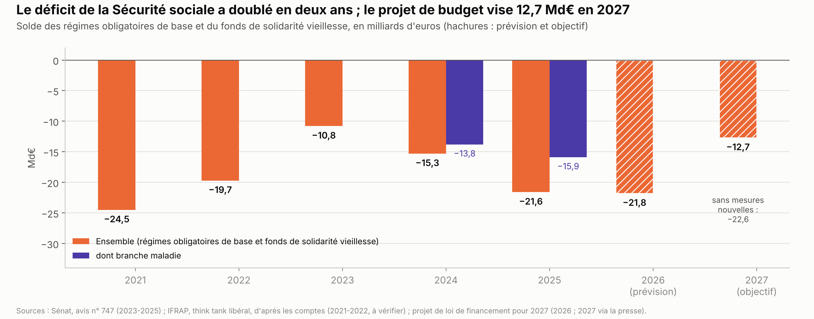
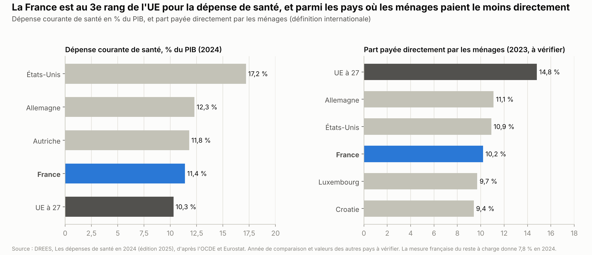
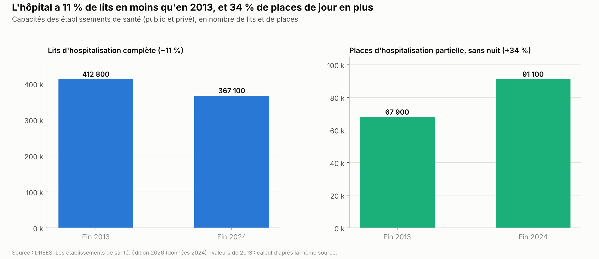
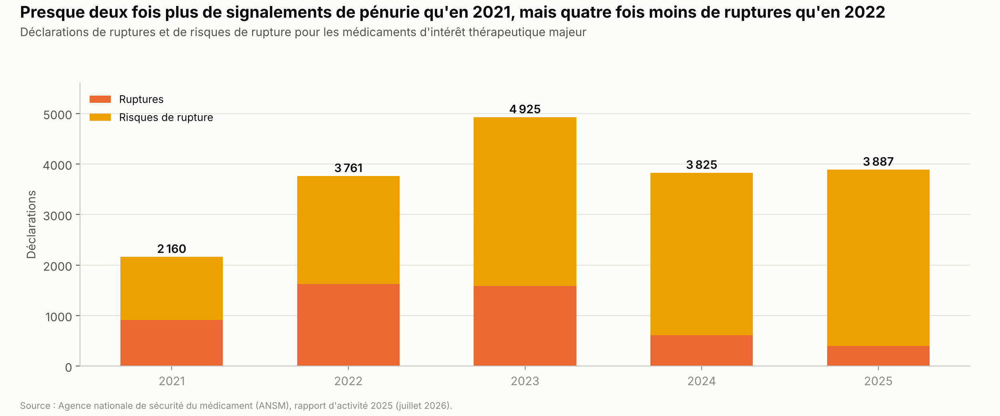
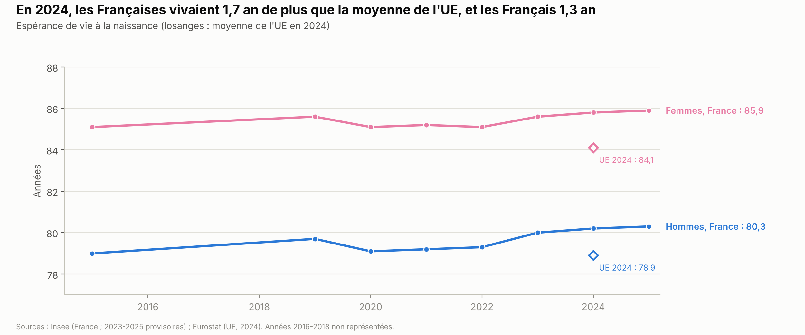

# Santé et assurance maladie

*Version de travail du 7 octobre 2026, corrigée le 21 octobre 2026. Les chiffres seront mis à jour à la date d'arrêt des données de l'édition 1.*

Ce chapitre présente ce que la France dépense pour la santé, qui paie les soins et pourquoi la Sécurité sociale est en déficit. Il traite aussi l'accès aux médecins, l'hôpital, les médicaments, l'état de santé des Français comparé à l'Europe et le grand âge. Il présente ensuite les propositions des partis et ce qu'on sait des mesures déjà essayées.

**Voir aussi :**
- [Finances publiques](../finances-publiques/finances_publiques.md), pour la place de la santé dans la dépense publique et le solde de toutes les administrations de sécurité sociale ;
- [Retraites et productivité](../retraites-productivite/retraites_productivite.md), pour la branche vieillesse de la Sécurité sociale et la suspension de la réforme de 2023 ;
- [Immigration](../immigration/immigration.md), section 1.6, pour l'aide médicale de l'État (AME) ;
- [Pouvoir d'achat, salaires et inégalités](../pouvoir-achat/pouvoir_achat.md), pour les baisses de cotisations sociales et la redistribution par les services publics ;
- [Travail et emploi](../travail-emploi/travail_emploi.md), pour le coût des allègements de cotisations et leur compensation à la Sécurité sociale, et pour la journée de solidarité, qui finance l'autonomie ;
- [Climat et environnement](../climat-environnement/climat_environnement.md), pour les décès dus à la chaleur, la pollution de l'air et les « polluants éternels » ;
- [Sécurité et justice](../securite-justice/securite_justice.md), pour le trafic de drogue et la consommation de cocaïne ;
- [Présidentielle 2027 : ce que proposent les partis](../partis/programmes_partis_2027.md), pour les programmes complets.

> **Repères.**
> - **La Sécurité sociale** a cinq branches : maladie, vieillesse (les retraites), famille, accidents du travail, autonomie (la perte d'autonomie des personnes âgées et handicapées). Le **régime général** couvre la plupart des salariés. Le **fonds de solidarité vieillesse (FSV)** finance le minimum vieillesse.
> - **La loi de financement de la Sécurité sociale (LFSS)**, votée chaque automne, fixe les recettes, l'objectif de déficit et l'**objectif national de dépenses d'assurance maladie (ONDAM)**. L'ONDAM est un plafond voté par le Parlement ; il peut être dépassé.
> - **La Caisse nationale de l'assurance maladie (CNAM)** rembourse les soins. Elle fixe les tarifs avec les syndicats de médecins, dans une « convention médicale ». En **secteur 1**, le médecin applique le tarif de la Sécurité sociale. En **secteur 2**, il peut demander un **dépassement d'honoraires**.
> - **Les complémentaires santé** (mutuelles, sociétés d'assurance, institutions de prévoyance) remboursent une partie de ce que la Sécurité sociale ne prend pas en charge.
> - **Les agences régionales de santé (ARS)** sont des administrations de l'État. Elles organisent et financent les soins dans chaque région.
> - **Les chiffres** viennent surtout de la Direction de la recherche, des études, de l'évaluation et des statistiques (DREES), le service statistique du ministère de la Santé.

---

## L'essentiel

1. **La France consacre 11,4 % de son PIB à la santé** (332,6 Md€ en 2024), au 3e rang de l'UE après l'Allemagne et l'Autriche, selon le service statistique du ministère de la Santé. Les ménages paient directement 7,8 % des soins, ≈ 292 € par habitant. Avec la mesure qui sert à comparer les pays, ce taux (10,2 %, contre 14,8 % dans l'UE) est l'un des plus bas de l'UE.
2. **Le déficit de la Sécurité sociale a doublé en deux ans** : 10,8 Md€ en 2023, 21,6 Md€ en 2025 (régimes de base et FSV), dont 15,9 Md€ pour l'assurance maladie. Le projet de budget pour 2027 prévoit 21,8 Md€ en 2026 et vise 12,7 Md€ en 2027.
3. **La dette de court terme grossit.** Les emprunts de la « banque » de la Sécurité sociale sont passés de 34,6 Md€ fin 2024 à 59,4 Md€ fin 2025. Selon la Cour des comptes, leur financement pourrait devenir difficile dès 2027.
4. **Les dépenses d'assurance maladie augmentent plus vite que la richesse** : ≈ +4,8 % par an de 2019 à 2025, contre ≈ +3,5 % pour le PIB en valeur *(calcul)*. Causes : vieillissement, maladies chroniques, arrêts de travail, médicaments.
5. **6,3 millions d'adultes n'ont pas de médecin traitant** (Cour des comptes, 2026). Les facultés admettent ≈ 11 000 étudiants en médecine par an (≈ 8 700 avant 2021), formés en ≈ 10 ans.
6. **L'hôpital compte 11 % de lits en moins qu'en 2013, et 34 % de places de jour en plus.** En 2024, 72 % des hôpitaux publics étaient en déficit.
7. **Les Français vivent 1,4 an de plus que la moyenne de l'UE** (2024), et les décès évitables par des soins y sont parmi les plus rares de l'UE. Mais la mortalité des bébés augmente depuis 2011 : 4,1 décès avant un an pour 1 000 naissances en 2024, contre 3,5 dans l'UE.

**Les grandes options en débat.**
- **Installation des médecins** : la soumettre à une autorisation (loi Garot ; version du Sénat, sous condition), ou inciter sans contraindre (gouvernement).
- **Remboursement** : tout faire rembourser par la Sécurité sociale (« 100 % Sécu »), ou garder le partage avec les complémentaires.
- **Déficit** : freiner les dépenses (franchises, déremboursements, gel des prestations), ajouter des recettes, ou reporter la dette.
- **Hôpital** : rouvrir des lits ou soigner davantage sans nuit à l'hôpital ; le payer à l'activité ou par une dotation.
- **Organisation** : supprimer les agences régionales de santé ou les garder ; remplacer l'aide médicale de l'État, réservée aux étrangers en situation irrégulière, par une aide d'urgence, ou la maintenir.
- **Grand âge** : créer des places dans les établissements publics pour personnes âgées dépendantes (Ehpad) et sortir les Ehpad du secteur lucratif (LFI), financer l'autonomie par une deuxième journée de solidarité (rapport du Sénat), ou recentrer l'allocation personnalisée d'autonomie (gouvernement).

---

## 1. La situation

### 1.1 Les dépenses, et qui les paie

**Combien.** Selon les comptes de la santé de la DREES (édition 2025), la France a dépensé en 2024 :
- 254,8 Md€ pour les soins eux-mêmes : c'est la « consommation de soins et de biens médicaux », en hausse de 3,7 % sur un an. Elle représente 8,7 % du PIB et 3 723 € par habitant. L'hôpital en fait 47 %, les soins de ville 31 %, les médicaments et autres biens médicaux 22 %[^drees-cns-2025-csbm] ;
- 332,6 Md€ au sens international : c'est la « dépense courante de santé », qui ajoute les soins de longue durée, la prévention et la gestion. Elle représente 11,4 % du PIB[^drees-cns-2025-vue].

Les comptes de 2025 (édition 2026) n'avaient pas été trouvés au 7 octobre 2026 (section 6).

**La comparaison européenne.** Avec la dépense courante, la France est au 3e rang de l'UE, selon la DREES (graphique, données de 2024)[^drees-cns-2025-vue]. Le profil de santé de la France publié par l'Organisation de coopération et de développement économiques (OCDE) et la Commission européenne porte sur 2023. Il la place au 2e rang, avec 11,5 % du PIB contre 10,0 % pour l'UE[^ocde-profil-france-2025]. L'année et le mode de calcul diffèrent.

> **Quatre façons de compter les dépenses de santé.** Ce chapitre et celui sur les finances publiques citent plusieurs totaux. Ils ne mesurent pas la même chose.
>
> | Mesure | Ce qu'elle compte | Montant | Part du PIB |
> |---|---|---|---|
> | Consommation de soins et de biens médicaux (DREES) | Les soins eux-mêmes : hôpital, médecins, infirmiers, médicaments, optique… Tous les payeurs sont comptés. Les soins de longue durée, la prévention, la gestion et les indemnités journalières ne le sont pas. | 254,8 Md€ (2024)[^drees-cns-2025-csbm] | 8,7 % |
> | Objectif national de dépenses d'assurance maladie (ONDAM), voté par le Parlement | Ce que paie l'assurance maladie obligatoire : remboursements, indemnités journalières, établissements pour personnes âgées et handicapées. La part des complémentaires et des ménages n'est pas comptée. | 265,4 Md€ (2025)[^senat-delahaye-2026] | ≈ 8,9 % *(calcul)* |
> | Dépense publique de santé (Eurostat) | Toute la dépense publique classée « santé » : Sécurité sociale, État, collectivités. Ni les complémentaires ni les ménages. | 261,2 Md€ (2024)[^eurostat-cofog] | 8,9 % |
> | Dépense courante de santé (DREES, norme internationale) | Les soins, plus les soins de longue durée, la prévention et la gestion, tous payeurs confondus. | 332,6 Md€ (2024)[^drees-cns-2025-vue] | Voir le graphique ci-dessus |
>
> **Laquelle retenir ?** Pour comparer les pays : la dépense courante. Pour la part payée par la puissance publique : la mesure d'Eurostat, reprise dans le chapitre [Finances publiques](../finances-publiques/finances_publiques.md). Pour le budget voté par le Parlement : l'ONDAM. Pour les soins consommés : la consommation de soins.

**Qui paie les soins (2024).**

| Financeur | Part | Montant |
|---|---|---|
| Sécurité sociale | 78,7 % | 200,5 Md€ |
| Complémentaires santé | 12,8 % | 32,5 Md€ |
| Ménages, directement | 7,8 % | 20,0 Md€, soit ≈ 292 € par habitant |
| État, dont l'aide médicale de l'État | 0,7 % | 1,8 Md€ *(calcul)* |

*Source : DREES, comptes de la santé 2024 (édition 2025)[^drees-cns-2025-financement][^drees-cns-2025-vue]. La part de l'État est le reste du total.*

- **Le reste à charge des ménages**, c'est-à-dire la part qu'ils paient directement, est passé de 9,5 % en 2014 à 7,8 % en 2024. Il a augmenté de 0,2 point en 2024[^drees-cns-2025-financement].
- **Avec la mesure internationale**, il atteint 10,2 % en France, contre 14,8 % en moyenne dans l'UE (graphique, données de 2023). Selon la DREES, seuls le Luxembourg et la Croatie ont une part plus faible[^drees-cns-2025-vue]. Cette mesure est plus large : elle inclut les soins de longue durée, où les familles paient davantage *(à vérifier)*.
- **Les dépassements d'honoraires** ont atteint 4,5 Md€ en 2024, en hausse de 27 % hors inflation depuis 2019. 31 % des médecins exercent en secteur 2 en 2025, et 56 % des spécialistes. Ces chiffres viennent du Haut Conseil pour l'avenir de l'assurance maladie (HCAAM, octobre 2025) *(source secondaire)*[^vidal-hcaam-depassements].
- **Les frais de gestion** du système de santé atteignent 16,9 Md€ en 2024 : 7,0 Md€ pour la Sécurité sociale, 8,7 Md€ pour les complémentaires et 1,2 Md€ pour l'État (DREES). La DREES précise que les deux premiers « ne sont pas directement comparables »[^drees-cns-2025-gestion], les tâches n'étant pas les mêmes.

**L'objectif de dépenses (ONDAM).**
- **2025** : 265,4 Md€ dépensés, pour un objectif de 265,9 Md€. L'objectif a été « respecté pour la première fois depuis 2020 »[^senat-delahaye-2026], selon le Sénat (juin 2026). Il a fallu 5,1 Md€ d'économies décidées en cours d'année. Le comité d'alerte avait signalé un risque de dépassement en avril 2025, puis une alerte a été déclenchée en juin[^senat-delahaye-2026].
- **2026** : 274,4 Md€ votés *(source secondaire)*[^fhf-lfss-2026]. Selon la loi, c'est +3,1 %, sur une base de 266,1 Md€ qui correspond sans doute à l'objectif de 2025 corrigé des changements de périmètre *(calcul)*[^fhf-lfss-2026]. C'est +3,4 % par rapport aux dépenses de 2025 *(calcul)*. Le projet initial du gouvernement prévoyait 270,4 Md€ *(source secondaire)*[^fhf-lfss-2026]. En octobre 2026, le gouvernement prévoit 273,3 Md€ de dépenses pour 2026, soit +2,8 % au lieu des +3,1 % votés (projet de loi de financement pour 2027, article 2)[^an-plfss-2027].
- **2027** : le projet de budget de la Sécurité sociale propose 278,7 Md€, soit +2,0 % par rapport à la prévision pour 2026. Sans mesures nouvelles, la hausse serait de 3,4 % *(source secondaire)*[^caducee-plfss-2027].
- **De 2019 à 2025**, les dépenses de l'ONDAM sont passées de 200,3 à 265,4 Md€, soit ≈ +4,8 % par an *(calcul)*[^senat-r19-600][^senat-delahaye-2026]. Le PIB en valeur, c'est-à-dire sans retirer l'inflation, a augmenté d'≈ 3,5 % par an *(calcul, d'après Eurostat)*[^eurostat-pib]. Le Sénat donne +4,7 % par an pour l'ONDAM, contre +3,3 % pour le PIB en valeur[^senat-delahaye-2026]. Les données de départ diffèrent, et le calcul du chapitre utilise les comptes du PIB publiés en octobre 2026. L'ONDAM est ainsi passé de 8,2 % à 8,9 % du PIB *(calcul)*. Cette période inclut les dépenses du Covid, les hausses de salaires du Ségur et des changements de périmètre.

### 1.2 Le déficit et la dette

**Le déficit.** Le graphique de « L'essentiel » donne le solde des régimes obligatoires de base et du FSV, l'un des périmètres des lois de financement. Pour le seul régime général et le FSV, le déficit de 2025 est de 20,3 Md€[^senat-delahaye-2026].
- Le déficit est passé de 10,8 Md€ en 2023 à 15,3 Md€ en 2024, puis 21,6 Md€ en 2025. Selon le Sénat, c'est le plus haut niveau depuis 2012, hors années du Covid[^senat-delahaye-2026].
- **En 2025, par branche** : maladie −15,9 Md€ ; vieillesse −7,1 Md€ ; accidents du travail −0,2 Md€ ; famille +1,2 Md€ ; autonomie +0,1 Md€ ; FSV +0,4 Md€ (Sénat, juin 2026)[^senat-delahaye-2026]. L'assurance maladie fait 74 % du déficit *(calcul)*.
- **Le déficit s'est creusé de 6,3 Md€ entre 2024 et 2025** *(calcul, d'après le Sénat)*. Les écarts par branche : maladie −2,1 Md€ ; vieillesse −1,5 ; autonomie −1,2 ; accidents du travail −0,9 ; FSV −0,7 ; famille +0,1[^senat-delahaye-2026].
- La branche vieillesse couvre ici les régimes obligatoires de base, pas les retraites complémentaires. Le chapitre [Retraites et productivité](../retraites-productivite/retraites_productivite.md) donne le solde de tous les régimes de retraite.

**Les prévisions.**
- **2026** : la loi de financement visait un déficit de 19,4 Md€[^fhf-lfss-2026]. En juin 2026, la Commission des comptes de la Sécurité sociale prévoyait ≈ 22 Md€[^senat-delahaye-2026]. Le projet de budget pour 2027 retient 21,8 Md€ (article 1er ; périmètre exact à vérifier)[^an-plfss-2027].
- **2027** : sans mesures nouvelles, le déficit atteindrait 22,6 Md€. Le gouvernement vise 12,7 Md€, soit un effort d'≈ 10 Md€ *(source secondaire ; calcul)*[^vidal-plfss-2027]. Selon le même projet, les administrations de sécurité sociale au sens de l'Insee passeraient d'un déficit de 0,1 point de PIB en 2026 à un excédent de 0,2 point en 2027 (article liminaire)[^an-plfss-2027].
- Selon la Cour des comptes (mai 2026), il faudrait ≈ 10 Md€ d'économies ou de recettes chaque année pour revenir à l'équilibre en 2030 *(source secondaire)*[^santementale-cour-2026][^acteurspublics-cour-2026]. En juin 2026, le rapporteur du Sénat, Vincent Delahaye, mettait en doute la crédibilité de la trajectoire votée pour 2026-2029[^senat-delahaye-2026].

**Pourquoi le chapitre Finances publiques donne un autre chiffre.** Pour 2025, l'Institut national de la statistique et des études économiques (Insee) donne un déficit de 6,7 Md€ pour toutes les administrations de sécurité sociale[^insee-2106]. Les deux chiffres sont justes, mais leur périmètre diffère.
- L'Insee compte aussi l'assurance chômage, les retraites complémentaires, les hôpitaux publics et surtout la Caisse d'amortissement de la dette sociale (CADES).
- La CADES reçoit des impôts pour rembourser la dette passée. Pour l'Insee, rembourser une dette n'est pas une dépense : ces recettes apparaissent comme un excédent, d'≈ 15 Md€ en 2025 *(calcul)*[^insee-2106].
- L'Insee l'écrit ainsi : « Hors Caisse d'amortissement de la dette sociale (CADES), qui dégage structurellement un excédent de par sa mission, le solde cumulé des autres administrations de sécurité sociale est en déficit de 22,1 Md€ »[^insee-2106] (mai 2026). C'est proche des 21,6 Md€ des lois de financement.

**La dette.**
- **La dette ancienne** a été confiée à la CADES. Elle la rembourse peu à peu, jusqu'en 2033, grâce à deux ressources[^senat-delahaye-2026]. La première est la contribution pour le remboursement de la dette sociale (CRDS), un prélèvement de 0,5 % sur presque tous les revenus *(à vérifier)*. La seconde est une part de la contribution sociale généralisée (CSG). Il lui reste 121,7 Md€ à rembourser fin 2025 (Sénat)[^senat-delahaye-2026]. Elle doit en rembourser 16 Md€ en 2026 (projet de loi de financement pour 2027)[^an-plfss-2027].
- **Les nouveaux déficits** sont couverts par des emprunts de court terme. C'est l'Union de recouvrement des cotisations de sécurité sociale et d'allocations familiales (Urssaf) Caisse nationale, la « banque » de la Sécurité sociale, qui les souscrit. Ces emprunts sont passés de 34,6 Md€ fin 2024 à 59,4 Md€ fin 2025 (Sénat)[^senat-delahaye-2026]. La loi de financement pour 2026 permet d'emprunter jusqu'à 83 Md€ *(source secondaire)*[^ifrap-lfss-2026].
- **Le risque** : en mai 2025, la Cour des comptes jugeait de plus en plus sérieux un risque de crise de liquidité à partir de 2027, selon la presse *(source secondaire)*. Les marchés de court terme pourraient ne plus suffire à financer cette dette[^publicsenat-liquidite-2025]. En novembre 2025, la Cour prévoyait qu'avec des déficits jusqu'en 2029, une dette de plus de 100 Md€ se reconstituerait *(source secondaire)*[^anfh-cour-2025].
- **Transférer cette dette à la CADES** demande des recettes nouvelles, ou un report de sa date de fin. Une loi organique de 2005 prévoit que toute nouvelle reprise de dette s'accompagne de recettes qui n'allongent pas la durée de vie de la caisse *(à vérifier)*. Une loi organique complète la Constitution ; elle est votée selon une procédure renforcée. Selon la Cour des comptes (novembre 2025), une reprise par la CADES est devenue nécessaire et demande une loi organique *(source secondaire)*[^anfh-cour-2025]. Le projet de budget pour 2027 n'en prévoit pas dans ses premiers articles *(lecture partielle du texte)*[^an-plfss-2027].
- **Au sens européen (dit « de Maastricht »)**, la dette de toutes les administrations de sécurité sociale atteint 293,1 Md€ fin 2025 (Insee)[^insee-2106]. Elle comprend aussi la dette de l'assurance chômage et des hôpitaux.

**La loi de financement pour 2026** (loi n° 2025-1403 du 30 décembre 2025) :
- un déficit visé de 19,4 Md€ et un ONDAM de 274,4 Md€[^fhf-lfss-2026] ;
- la suspension de la réforme des retraites de 2023 (chapitre [Retraites et productivité](../retraites-productivite/retraites_productivite.md)) ;
- la suppression, par le Parlement, de l'article qui étendait les franchises médicales *(source secondaire)*[^fhf-lfss-2026] ;
- un premier arrêt de travail limité à un mois, et des prolongations limitées à deux mois, depuis le 1er septembre 2026 *(source secondaire)*[^fhf-lfss-2026] ;
- le déploiement du réseau « France Santé » (section 1.4).

**Le projet de loi de financement pour 2027** (n° 3211, déposé le 1er octobre 2026) demande 5,1 Md€ d'économies sur la santé *(source secondaire)*[^caducee-plfss-2027] :

| Poste | Économies (Md€) |
|---|---|
| Médicaments et dispositifs médicaux (prix et volumes) | 2,1 |
| Arrêts de travail (indemnités journalières) | 1,0 |
| Efficacité des hôpitaux et des établissements médico-sociaux | 0,9 |
| Moins de remboursements, reportés sur les complémentaires | 0,7 |
| Soins de ville | 0,3 |
| Autres | 0,1 |

*Source : Caducée[^caducee-plfss-2027], 1er octobre 2026, d'après le projet de loi (source secondaire).*

- Par des décrets publiés le 22 août 2026, le gouvernement a réduit plusieurs remboursements. Les soins dentaires courants seront remboursés à 50 % au lieu de 60 % à partir du 1er janvier 2027 ; les transports de malades à 50 % au lieu de 55 % *(source secondaire)*[^selectra-deremboursements].
- Le gouvernement en attend 0,7 Md€ d'économies en 2027[^caducee-plfss-2027]. La Mutualité française estime à 1,5 Md€ la somme reportée sur les complémentaires par l'ensemble de ces décrets *(sources secondaires)*[^selectra-deremboursements].
- Le projet prolonge en 2027 la contribution exceptionnelle de 2,05 % payée par les complémentaires santé (article 12)[^an-plfss-2027].
- Le plafond annuel des franchises est passé de 50 à 70 € le 1er octobre 2026 (section 2, question 2)[^legisocial-franchises-70].
- Le projet prévoit 1,0 Md€ d'économies sur les indemnités journalières dans l'ONDAM *(source secondaire)*[^caducee-plfss-2027]. Selon l'Agence France-Presse, citée dans le chapitre [Finances publiques](../finances-publiques/finances_publiques.md), les économies sur les arrêts maladie atteignent 2 Md€, dont la moitié renvoyée à une négociation avec les syndicats et le patronat *(source secondaire)*[^afp-moneyvox-mesures]. L'écart avec 1,0 Md€ n'est pas expliqué *(à vérifier)*.
- Le projet étend la taxation des produits sucrés (article 8)[^an-plfss-2027].
- Les mesures sur les pensions de retraite sont présentées dans le chapitre [Retraites et productivité](../retraites-productivite/retraites_productivite.md).
- L'Assemblée doit voter en première lecture le 27 octobre 2026, avant l'examen au Sénat *(source secondaire)*[^tripalio-plfss-2027] ; le vote définitif est attendu en décembre.

### 1.3 Pourquoi les dépenses augmentent

- **Le vieillissement.** Au 1er janvier 2026, 22,2 % des habitants ont 65 ans ou plus, et 11,1 % ont 75 ans ou plus. En 2025, les décès (651 000) ont dépassé les naissances (645 000) (Insee)[^insee-demographie-2025].
- **Les maladies chroniques**, longues et souvent à vie (diabète, cancers, maladies du cœur…). Elles font 65 % des remboursements de l'assurance maladie en 2024, et peut-être 70 % en 2035, selon la CNAM *(source secondaire, à vérifier)*.
- **Les arrêts de travail.** L'assurance maladie verse des indemnités journalières pour remplacer le salaire pendant un arrêt. Celles des arrêts maladie ont atteint 12,1 Md€ en 2024. Elles ont augmenté de 6,6 % par an de 2019 à 2024, contre 3,7 % par an de 2014 à 2019 (DREES) *(à vérifier)*. Selon la DREES, la hausse vient surtout des salaires, de l'emploi, du vieillissement des actifs et du recul de l'âge de la retraite[^drees-ij-2025].
- **Les médicaments** : +5,5 % en 2024 (DREES, d'après Hospitalia *(source secondaire)*[^hospitalia-cns-2025]).
- **Les hausses de salaires.** Le « Ségur de la santé » est un accord de 2020. Il a augmenté les salaires à l'hôpital et dans les maisons de retraite, dont +183 € net par mois pour les soignants *(source secondaire)*. Son coût annuel dépend du périmètre retenu : ≈ 8 Md€ pour les hausses de salaires de 2020 ; ≈ 12 à 13 Md€ par an à partir de 2022-2023, avec les mesures qui ont suivi. La Commission des comptes de la Sécurité sociale compte ainsi 13,2 Md€ de dépenses supplémentaires en 2023 *(sources secondaires)*[^lqdm-segur-2022][^maireinfo-ccss-2025].
- **La santé mentale.** Les maladies psychiatriques et les traitements par psychotropes font partie des premiers postes de dépenses de l'assurance maladie : ≈ 14 % de ses dépenses, selon la presse, d'après la CNAM (2025) *(source secondaire, à vérifier)*[^santementale-depenses-2025]. Selon le Haut-commissariat au Plan (2025), une personne sur trois connaît un trouble psychique au cours de sa vie *(à vérifier)*[^hcp-sante-mentale-2025].

### 1.4 L'accès aux soins

**Les patients sans médecin traitant.** Chaque assuré déclare un médecin traitant, en général un généraliste, qui le suit et l'oriente. Il est alors mieux remboursé.
- **6,3 millions d'adultes** n'avaient pas de médecin traitant en 2025, selon un rapport de la Cour des comptes rendu public le 30 septembre 2026. Les autres, soit 88,5 % des adultes, en avaient un *(source secondaire)*[^vidal-cour-medecin-traitant]. Le gouvernement donnait 6,4 millions en septembre 2025[^gouv-medecin-pres].
- **Les plus malades sont mieux couverts.** Une affection de longue durée est une maladie grave et durable, remboursée à 100 %. Parmi ces patients, la part sans médecin traitant est passée de 5,6 % fin 2022 à 4,3 % fin 2025 (CNAM, juin 2026)[^cnam-observatoire-2026].
- **Beaucoup de généralistes refusent des patients.** En 2022, 65 % disaient devoir refuser de nouveaux patients comme médecin traitant, contre 53 % en 2019 (DREES)[^drees-er-1267]. Un médecin traitant suit en moyenne 1 033 patients fin 2025 (CNAM)[^cnam-observatoire-2026].
- **Tous les généralistes ne jouent pas ce rôle.** Sur 53 840 généralistes libéraux en 2024, 8 553 avaient peu ou pas de patients comme médecin traitant, selon la Cour des comptes *(source secondaire)*[^vidal-cour-medecin-traitant].

**Combien de médecins ?**
- 237 214 médecins exercent en France au 1er janvier 2025, soit 346 pour 100 000 habitants, dont 146 généralistes pour 100 000 (Insee, d'après la DREES)[^insee-medecins].
- La densité de généralistes est la plus faible dans l'Eure (88 pour 100 000) et en Seine-et-Marne (89), hors Mayotte (39) *(à vérifier)*[^insee-medecins].
- Selon l'OCDE, la France compte moins de médecins par habitant que la moyenne de l'UE (section 1.7)[^ocde-profil-france-2025]. Ce chiffre ne se compare pas directement à celui de la DREES : la source, l'année et les médecins comptés diffèrent.
- Le nombre de généralistes a baissé d'≈ 6 % entre 2012 et 2021 *(à vérifier)*. En 2021, la DREES prévoyait une baisse jusqu'en 2026, puis une remontée progressive *(source secondaire)*[^lqdm-drees-2021].

**Où sont les « déserts médicaux » ?** Tout dépend de la définition.
- Les ARS classent les territoires en « zones d'intervention prioritaire », les plus fragiles, et en « zones d'action complémentaire ». Les médecins qui s'y installent peuvent recevoir des aides.
- Ces zones couvrent 72 % de la population, selon la Cour des comptes (2024) *(source secondaire)*[^caducee-cour-2024].
- Le chiffre de « 87 % du territoire »[^an-qg-855] a été cité en 2025 par le ministre chargé de la Santé. Aucune source publiée n'a été trouvée. Il semble porter, sans que ce soit confirmé, sur la surface classée en zone d'aide, et non sur la population (section 5).

**Ce qui a été décidé, et les premiers chiffres.**
- **Plus d'étudiants.** La loi du 24 juillet 2019 a supprimé le « numerus clausus », le nombre maximal d'étudiants fixé par l'État. Depuis 2021, les universités fixent les places selon leurs capacités. Le numerus clausus ouvrait ≈ 8 700 places par an en 2016-2020 ; les facultés ont admis ≈ 11 000 étudiants par an en 2021-2025, dont 11 133 en 2025. L'objectif de la période (51 505) a été dépassé, avec 55 078 admis. Ces chiffres viennent de l'Observatoire national de la démographie des professions de santé (décembre 2025)[^ondps-bilan-2025]. L'objectif de 16 000 places en 2027, cité par la presse, n'a pas été trouvé dans une source officielle[^letudiant-places-medecine].
- **Une 4e année d'internat en médecine générale.** Les futurs généralistes la font comme « docteurs juniors », surtout en cabinet, sous la supervision d'un médecin[^macsf-docteurs-juniors]. Environ 3 700 étaient attendus en novembre 2026, selon le ministre chargé de la Santé (juillet 2025)[^an-qg-855] ; le nombre réel n'est pas encore publié. Ils reçoivent 1 000 € brut de plus par mois s'ils font leur stage en zone d'intervention prioritaire (arrêté du 27 août 2025, modifié le 13 mai 2026 *(à vérifier)*)[^arrete-docteurs-juniors-2025].
- **Les installations repartent.** En 2025, 2 810 généralistes se sont installés pour la première fois en libéral, soit +32 % en un an. 891 l'ont fait en zone d'intervention prioritaire (+45 %) (CNAM, juin 2026)[^cnam-observatoire-2026].
- **La « mission de solidarité territoriale »** (septembre 2025). Des médecins volontaires peuvent consulter jusqu'à 2 jours par mois dans 151 « zones rouges », où vivent plus de 2,5 millions d'habitants. Ils reçoivent 200 € par jour en plus des consultations[^gouv-medecin-pres]. ≈ 250 généralistes y participaient début décembre 2025, selon la Direction générale de l'offre de soins du ministère *(source secondaire)*[^caducee-solidarite-2025].
- **Le réseau « France Santé »** (octobre 2025). Le label est donné à des lieux de soins proches des patients : un médecin et un infirmier, une ouverture d'au moins 5 jours par semaine, des consultations sans dépassement d'honoraires. Le gouvernement visait 2 000 lieux labellisés à l'été 2026, avec 130 M€, et 5 000 en 2027[^gouv-france-sante]. Le nombre national atteint n'a pas été publié ; 378 lieux étaient labellisés en Auvergne-Rhône-Alpes fin 2025 (ARS)[^ars-ara-france-sante].

**Les textes sur l'installation des médecins, au 7 octobre 2026.**
- **La proposition de loi Garot** a été déposée par le député socialiste Guillaume Garot avec des députés de plusieurs groupes. Une proposition de loi est un texte déposé par des parlementaires. Dans sa version de l'Assemblée, un médecin devrait demander une autorisation à l'ARS pour s'installer. Elle serait automatique là où les médecins manquent. Là où ils sont nombreux, il faudrait le départ d'un autre médecin *(source secondaire)*[^lcp-garot-2025].
  - L'Assemblée l'a adoptée le 7 mai 2025, par 99 voix contre 9 et 10 abstentions. 118 députés sur 577 ont voté[^an-scrutin-1607]. Le détail par groupe est en section 3.
  - Le Sénat l'a examinée le 11 juin 2026. Il a réécrit l'article 1er : un généraliste pourrait s'installer là où les médecins sont nombreux, s'il exerce aussi à temps partiel dans une zone qui en manque[^senat-loi-en-clair-garot]. Cet article a été adopté par 215 voix contre 118 : LR, centristes et Indépendants pour ; socialistes, communistes, écologistes et sénateurs macronistes contre. Les amendements de gauche qui rétablissaient la version de l'Assemblée ont été rejetés par 236 voix contre 106 (scrutins n° 307 et 305)[^senat-scrutin-307][^senat-scrutin-305].
  - L'examen s'est arrêté faute de temps[^senat-seance-20260611]. Le texte n'est ni adopté ni rejeté, et aucune nouvelle séance n'était prévue au 7 octobre 2026[^senat-dossier-garot].
- **La proposition de loi du sénateur LR Philippe Mouiller**, adoptée par le Sénat le 13 mai 2025, soumet l'installation dans les zones bien pourvues à une autorisation de l'ARS. Un généraliste l'obtient s'il s'engage à exercer aussi à temps partiel dans une zone qui manque de médecins[^senat-tas-118].
  - Le texte rend obligatoire une « mission de solidarité territoriale ». Les médecins y participent comme volontaires ou, à défaut, sur désignation de l'ARS. Un refus peut coûter jusqu'à 1 000 € par jour[^senat-tas-118].
  - Il prévoit aussi des incitations : guichet départemental, rémunérations forfaitaires dans les zones sous-dotées[^senat-tas-118].
  - Transmis à l'Assemblée le 14 mai 2025, il n'y avait pas été examiné au 7 octobre 2026, selon le dossier du Sénat[^senat-dossier-mouiller].
- **La loi Valletoux** (décembre 2023), du nom d'un député Horizons, a notamment organisé le partage des gardes entre hôpitaux et cliniques *(source secondaire)*[^lcp-valletoux-2023].

### 1.5 L'hôpital

**Les établissements.** La France compte 2 962 établissements de santé fin 2024 : 1 330 hôpitaux publics, 977 cliniques privées et 655 établissements privés à but non lucratif (DREES, juillet 2026)[^drees-es-2026].

**Moins de lits, plus de soins de jour.**
- Les lits d'hospitalisation complète, où le patient reste au moins une nuit, sont passés de 412 800 fin 2013 à 367 100 fin 2024 : 45 700 de moins (DREES). La baisse a été de 1,4 % en 2021, 1,8 % en 2022, 1,2 % en 2023 et 0,6 % en 2024[^drees-es-2026].
- Les places d'hospitalisation partielle, sans nuit à l'hôpital, sont passées de 67 900 à 91 100 : 23 200 de plus[^drees-es-2026].
- L'hospitalisation à domicile, qui donne des soins de niveau hospitalier chez le patient, prend en charge 25 400 patients à la fois en 2024[^drees-es-2026].
- Selon la DREES, ce « virage ambulatoire »[^drees-es-2026] suit les progrès des techniques et des traitements.
- Une autre partie des fermetures tient au manque de personnel. Aucun chiffre national officiel n'a été trouvé. À l'été 2024, Samu-Urgences de France, un syndicat de médecins urgentistes, a interrogé les établissements (le Samu est le service d'aide médicale urgente). Parmi ceux qui ont répondu, 65 % avaient fermé des lits de médecine, de chirurgie ou d'obstétrique ; plus de 1 500 lits au total[^sudf-ete-2024].

**Les urgences.** Elles ont reçu 21,3 millions de passages en 2024 (+2,5 %), dans 682 services (DREES)[^drees-es-2026].
- À l'été 2024, 331 établissements ont répondu à l'enquête de Samu-Urgences de France. Parmi eux, 61 % avaient fermé au moins une « ligne de garde », c'est-à-dire un poste de médecin de garde. Et 34 % demandaient aux patients d'appeler le 15 avant de venir[^sudf-ete-2024].
- À l'été 2023, 163 services d'urgences avaient fermé temporairement, selon la Fédération hospitalière de France *(source secondaire)*[^infirmiers-fhf-2023].
- Aucun bilan national des étés 2025 et 2026 n'a été trouvé.

**Le personnel.** Les établissements de santé emploient 1,41 million de salariés fin 2024, dont 357 800 infirmiers, 285 800 aides-soignants et 116 500 médecins (DREES)[^drees-es-2026].

**Les finances.** Le déficit des hôpitaux publics a atteint 2,9 Md€ en 2024, soit 2,7 % de leurs recettes. 72 % d'entre eux étaient en déficit, contre 58 % en 2019 (DREES)[^drees-es-2026]. Les chiffres de 2025 n'ont pas été trouvés.

**Les maternités.** Il y en avait 717 en 2000, 496 en 2017 et 445 en 2024 (DREES)[^drees-er-1201][^drees-es-2026]. Entre 2000 et 2017, le temps d'accès médian est passé de 7,9 à 9,1 minutes. La part des femmes de 15 à 44 ans à plus de 45 minutes d'une maternité a augmenté d'≈ 40 %, pour atteindre 1 à 2 %[^drees-er-1201].

**L'aide à mourir.** La loi relative au droit à l'aide à mourir, adoptée le 15 juillet 2026, est parue au *Journal officiel* le 19 août. Elle vise les adultes atteints d'une affection grave et incurable, en phase avancée ou terminale, avec une souffrance réfractaire ou insupportable[^infogouv-aide-a-mourir]. Le 14 août 2026, le Conseil constitutionnel l'a jugée conforme sous réserves : les pharmaciens, par exemple, ne peuvent pas être tenus de participer[^cc-2026-910]. Les décrets d'application restent à publier ; le vote de la loi est présenté dans le chapitre [Institutions](../institutions/institutions.md)[^infogouv-aide-a-mourir].

### 1.6 Les médicaments

- **Les signalements.** Les laboratoires doivent déclarer à l'Agence nationale de sécurité du médicament et des produits de santé (ANSM) les ruptures et les risques de rupture. L'obligation porte sur les médicaments « d'intérêt thérapeutique majeur », dont le manque met en danger les patients.
  - En 2025, l'ANSM a reçu 3 887 déclarations, contre 2 160 en 2021 et 4 925 au pic de 2023[^ansm-ra-2025].
  - La plupart sont des risques de rupture, déclarés plus tôt qu'avant. Les ruptures effectives sont passées de 1 623 en 2022 à 399 en 2025[^ansm-ra-2025].
  - Les règles de stock et de déclaration ont été renforcées depuis 2021 : par exemple, un stock de sécurité de 2 mois, et jusqu'à 4 mois pour certains médicaments *(à vérifier)*.
- **Les mesures.** En 2025, près de la moitié des déclarations ont demandé des mesures. La première est le « contingentement » : répartir les stocks entre les pharmacies (ANSM)[^ansm-ra-2025].
- **La dépense.** Un Français dépense 560 € par an en médicaments, contre 510 € en moyenne dans l'UE. Les génériques, copies moins chères d'un médicament dont le brevet a expiré, font 42 % des médicaments vendus, contre 51 % dans l'UE (OCDE et Commission européenne, données 2023)[^ocde-profil-france-2025].

### 1.7 L'état de santé : la France en Europe

| Indicateur | France | UE | Année |
|---|---|---|---|
| Mortalité infantile : décès avant un an, pour 1 000 naissances | 4,1 | 3,5 | 2024 |
| Mortalité « traitable » : décès de moins de 75 ans qu'on aurait pu éviter par des soins efficaces et donnés à temps, pour 100 000 habitants | ≈ 58,5 | 86,8 | 2023 |
| Médecins pour 1 000 habitants | 3,9 | 4,3 | 2023 |
| Infirmiers pour 1 000 habitants | 8,8 | 8,5 | 2023 |

*Sources : Insee[^insee-ip-2048] et Eurostat[^eurostat-mortalite-se] (mortalité infantile) ; Eurostat[^eurostat-mortalite-evitable] (mortalité traitable) ; OCDE et Commission européenne[^ocde-profil-france-2025], profil de santé 2025 (médecins, infirmiers). L'OCDE compte 3,9 médecins pour 1 000 habitants en 2023, la DREES 346 pour 100 000 (section 1.4). Ces deux chiffres ne se comparent pas directement : la source, l'année et la définition des médecins comptés diffèrent* *(à vérifier)*.

- **L'espérance de vie** a dépassé son niveau d'avant le Covid. En 2025, elle atteint 85,9 ans pour les femmes et 80,3 ans pour les hommes (Insee, provisoire)[^insee-esperance-vie][^insee-demographie-2025].
- **La mortalité infantile augmente** : 3,5 pour 1 000 en 2011, 4,1 en 2024. La hausse porte surtout sur les décès de la première semaine. Elle dépasse la moyenne de l'UE depuis 2015. Elle atteint 8,0 pour 1 000 en outre-mer, contre 3,5 dans l'Hexagone, en moyenne sur 2004-2022 (Insee)[^insee-ip-2048].
- **Les inégalités.** Selon l'OCDE et la Commission européenne, les hommes les plus diplômés vivent ≈ 8 ans de plus que ceux qui n'ont pas de diplôme du secondaire. En 2024, 4,5 % des Français déclaraient des besoins médicaux non satisfaits, 6,5 % dans les ménages pauvres. Pour les soins dentaires, ces taux sont de 8,2 % et 13,7 % *(à vérifier)*[^ocde-profil-france-2025].
- **Les facteurs de risque.** Selon l'OCDE et la Commission européenne, 23 % des adultes fument chaque jour, l'une des proportions les plus élevées de l'UE ; 15 % sont obèses (2023) *(à vérifier)*[^ocde-profil-france-2025].
- La chaleur et la pollution de l'air sont traitées dans le chapitre [Climat et environnement](../climat-environnement/climat_environnement.md).

### 1.8 Le grand âge et la perte d'autonomie

**Combien de personnes.** Une personne âgée est en perte d'autonomie quand elle a besoin d'aide pour les actes de la vie quotidienne. Ce besoin est classé en groupes iso-ressources (GIR) : la perte d'autonomie va du GIR 4 au GIR 1, le plus lourd[^insee-ip-2078].
- En 2021, 2,03 millions de personnes de 60 ans ou plus étaient en perte d'autonomie, soit 11,2 % de cette tranche d'âge (Insee et DREES)[^insee-ip-2078].
- Selon la projection centrale, elles seraient 2,29 millions en 2030 et près de 2,8 millions en 2052, au plus haut. Les progrès de santé à âge donné éviteraient ≈ 0,6 million de cas entre 2021 et 2052[^insee-ip-2078].

**La branche autonomie.** Créée par une loi d'août 2020 et en place depuis 2021 *(à vérifier)*, elle est gérée par la Caisse nationale de solidarité pour l'autonomie (CNSA).
- En 2026, elle dépenserait 43,3 Md€ pour 43,0 Md€ de recettes, soit un déficit de 0,3 Md€ (projet de loi de financement pour 2027, article 1er)[^an-plfss-2027]. Son solde était de +0,1 Md€ en 2025 (section 1.2)[^senat-delahaye-2026].
- En 2025, les établissements et services font 78 % de ses charges. L'allocation personnalisée d'autonomie (APA) et la prestation de compensation du handicap (PCH), versées par les départements, en font 18 % *(source secondaire)*[^bdt-cour-cnsa-2025].
- La contribution sociale généralisée (CSG) apporte 89 % de ses recettes prévues en 2026 (CNSA)[^cnsa-chiffres-cles-2026]. Selon la Cour des comptes (décembre 2025), sa situation est « fragile » *(source secondaire)*[^bdt-cour-cnsa-2025].

**Les Ehpad.** La France compte 7 400 établissements d'hébergement pour personnes âgées dépendantes (Ehpad) en 2025, avec 614 400 places (CNSA)[^cnsa-chiffres-cles-2026].
- Fin 2023, ils accueillent 573 100 résidents, dont 55 % en forte perte d'autonomie (GIR 1 ou 2). On y entre en moyenne à 85 ans et 11 mois (DREES)[^drees-er-1351].
- **Le coût pour les familles.** En 2024, une chambre individuelle coûte 2 164 € par mois dans un Ehpad habilité à l'aide sociale à l'hébergement (ASH) du département, et 3 128 € dans les autres. Ces prix ont augmenté de 4,0 %, pour une inflation de 2 % (CNSA)[^cnsa-rs-27].
- En 2019, le reste à charge moyen d'un résident était de 1 957 € par mois avant l'ASH. « Même une fois les bénéficiaires de l'ASH décomptés, 61 % des résidents – tous niveaux de ressources confondus – ont un reste à charge supérieur à leurs ressources » (DREES)[^cor-drees-autonomie-2026].
- **Les finances.** La part des Ehpad en déficit est passée de 27 % en 2020 à 66 % en 2023, selon un rapport du Sénat (septembre 2024)[^senat-r23-778].
- **Les contrôles.** Après l'affaire Orpea, du nom d'un groupe privé d'Ehpad, les ARS ont contrôlé tous les Ehpad entre 2022 et juin 2025. Près de 90 % des contrôles n'ont pas conduit à une injonction ; 55 établissements ont été sanctionnés[^an-qe-10411]. Selon la ministre chargée de l'Autonomie (mars 2025), ils ont été fermés ou placés sous tutelle *(source secondaire)*[^lqdm-sanctions-ehpad-2025].

**Le maintien à domicile et l'APA.** L'APA est versée par les départements aux personnes de 60 ans ou plus classées en GIR 1 à 4[^drees-paph-2025-apa].
- Fin 2024, 1,39 million de personnes la perçoivent : 832 100 à domicile et 560 600 en établissement (CNSA)[^cnsa-chiffres-cles-2026].
- En 2023, les départements y ont consacré 7,1 Md€ bruts, soit 431 € par mois et par bénéficiaire en moyenne (DREES)[^drees-paph-2025-apa].
- 9,3 millions de personnes aident régulièrement un proche âgé ou handicapé (DREES, 2021)[^cnsa-chiffres-cles-2026].
- La loi « bien vieillir » du 8 avril 2024 a créé un service public départemental de l'autonomie et une carte professionnelle pour les aides à domicile *(source secondaire)*[^lcp-bien-vieillir-2024]. Elle prévoyait une loi de programmation sur le grand âge avant fin 2024 ; celle-ci n'avait pas été présentée en septembre 2026[^an-qe-18273].

**Le budget de la Sécurité sociale pour 2027.**
- Le barème de l'APA serait recentré sur les plus modestes et les restes à charge les plus lourds. Le gouvernement en attend 250 M€ de dépenses d'APA en moins pour les départements *(source secondaire)*[^bdt-plfss-2027-autonomie].
- Les départements recevraient directement 300 M€ de CSG pour l'APA et la PCH, en déduction des concours de la CNSA (article 13)[^an-plfss-2027].
- Le forfait unique qui réunit soins et dépendance, expérimenté dans ≈ 1 570 Ehpad de 23 départements, serait prolongé jusqu'à fin 2027 *(source secondaire)*[^bdt-plfss-2027-autonomie].
- Pour la Fédération hospitalière de France et d'autres fédérations, la hausse des crédits médico-sociaux (+900 M€) est la plus faible, en valeur, depuis 2019 : « À ce stade, le compte n'y est pas »[^fhf-plfss-2027-autonomie] (6 octobre 2026).

---

## 2. Ce qui fait débat

### Question 1. Déserts médicaux : obliger les médecins à s'installer là où ils manquent, ou les y inciter ?

**Les arguments pour encadrer l'installation.**
- *Les aides n'ont pas suffi.* Selon la Cour des comptes (novembre 2025), au moins 15 aides à l'installation ont coûté ≈ 205 M€ en 2023, et leur efficacité est « non démontrée »[^cour-aides-installation-2025]. Selon la Cour (2024), la part des généralistes installés en zone sous-dotée a baissé de 13 % en 2015 à moins de 12,5 % en 2021 *(source secondaire, à vérifier)*[^caducee-cour-2024].
- *D'autres soignants sont déjà régulés* : infirmiers, et aussi masseurs-kinésithérapeutes et pharmacies *(à vérifier)*. Pour les infirmiers libéraux, l'écart de densité entre les zones les mieux et les moins bien pourvues a été divisé par deux en dix ans (section 4)[^irdes-qes-270].
- *L'égalité entre territoires.* Pour Guillaume Garot (PS), « lorsque les déserts médicaux avancent, c'est la République qui recule »[^caducee-garot-2025] (Assemblée nationale, 7 mai 2025) *(source secondaire)*. Au Sénat, Michel Masset (groupe du Rassemblement démocratique et social européen, RDSE) estime que l'attente a aggravé la situation (juin 2026, *paraphrase de la presse*)[^maireinfo-senat-2026].
- *Des exemples étrangers.* Au Québec, les plans régionaux de postes de médecins ont augmenté les installations hors de Montréal (section 4)[^cirano-2025].

**Les arguments pour inciter plutôt que contraindre.**
- *Les médecins manquent presque partout.* La France compte 3,9 médecins pour 1 000 habitants, contre 4,3 dans l'UE (OCDE, 2023 ; section 1.7)[^ocde-profil-france-2025]. Pour les opposants, réguler reviendrait à répartir la pénurie. Stéphanie Rist (Renaissance), alors députée, jugeait la loi Garot inefficace pour cette raison (7 mai 2025, *paraphrase de la presse*)[^lcp-garot-2025]. Yannick Neuder (LR), alors ministre chargé de la Santé, préférait former davantage de médecins (7 mai 2025, *paraphrase de la presse*)[^lcp-garot-2025].
- *Le risque de décourager les jeunes médecins.* Pour Jérôme Marty, président de l'Union française pour une médecine libre (UFML), un syndicat de médecins libéraux, « la médecine libérale a été poignardée dans le dos à l'Assemblée nationale ce 7 mai »[^caducee-garot-2025]. Patrick Gasser, du syndicat de spécialistes Avenir Spé, parle d'une « sanction générationnelle »[^caducee-garot-2025] *(sources secondaires)*. Le sénateur LR Laurent Somon craint qu'une régulation décourage les vocations (juin 2026, *paraphrase de la presse*)[^maireinfo-senat-2026].
- *Les limites observées ailleurs.* La régulation des infirmiers a été en partie contournée[^irdes-qes-270]. En Allemagne, malgré une planification ancienne, une étude de 2024 constate que les écarts persistent pour les pédiatres entre zones attractives et zones périphériques (section 4)[^neumeier-2024].

**Les voies intermédiaires.**
- *La version du Sénat* (juin 2026) et la proposition de loi Mouiller : s'installer là où les médecins sont nombreux reste possible, à condition d'exercer aussi à temps partiel dans une zone qui en manque (section 1.4).
- *La Cour des comptes* (30 septembre 2026) propose que chaque généraliste libéral suive au moins 500 patients comme médecin traitant. Selon elle, 2,5 à 4 millions de patients de plus seraient ainsi suivis *(source secondaire)*[^vidal-cour-medecin-traitant].
- *Le gouvernement* mise sur la mission de solidarité territoriale, le réseau « France Santé » et les docteurs juniors (section 1.4). La ministre de la Santé, Stéphanie Rist (Renaissance), s'oppose à une régulation contraignante (Sénat, juin 2026, *paraphrase de la presse*)[^maireinfo-senat-2026].

**Ce qu'on ne sait pas.** Aucune régulation de l'installation des médecins n'a été appliquée ni évaluée en France. Son effet sur le nombre total de médecins en libéral est inconnu.

### Question 2. Comment réduire le déficit : économies, recettes nouvelles ou report de la dette ?

Selon la Cour des comptes (mai 2026), il faudrait ≈ 10 Md€ d'économies ou de recettes nouvelles par an pour revenir à l'équilibre en 2030 *(source secondaire)*[^santementale-cour-2026][^acteurspublics-cour-2026].

**Faire des économies.**
- *Le gouvernement* demande 5,1 Md€ d'économies sur la santé en 2027 : médicaments, arrêts de travail, hôpitaux, remboursements (section 1.2)[^caducee-plfss-2027].
- *L'assurance maladie* proposait 3,9 Md€ d'économies pour 2027, dont 1,3 Md€ sur les médicaments (rapport « Charges et produits », juillet 2026) *(source secondaire)*[^vidal-cnam-charges-produits-2027].
- *La Cour des comptes* (mai 2026) propose notamment de mieux recouvrer les franchises (500 M€) et de supprimer des exonérations de franchises (600 M€). Elle propose aussi de réduire de 30 % les hospitalisations évitables (1,3 Md€) *(source secondaire)*[^santementale-cour-2026].
- *Les franchises.* Les patients paient 1 € par boîte de médicaments et 2 € par consultation depuis 2024, contre 0,50 € et 1 € avant[^lqdm-franchises-2024]. Depuis le 1er octobre 2026, le total est plafonné à 70 € par an pour chaque catégorie, contre 50 € auparavant (décret du 11 septembre 2026) *(source secondaire)*[^legisocial-franchises-70]. Le projet de budget pour 2027 en attend 0,3 Md€ d'économies dès 2026[^an-plfss-2027]. En juillet, le gouvernement avait envisagé de doubler ces plafonds, pour ≈ 750 M€ par an ; il y a renoncé *(source secondaire)*[^lcp-franchises-2026][^caducee-franchises-140]. Selon la Cour des comptes, franchises et participations ont réduit les dépenses d'≈ 2,5 Md€ en 2025 *(source secondaire)*. Environ 18 millions de personnes en sont exonérées, dont les mineurs et les femmes enceintes *(source secondaire)*[^caducee-franchises-140].
- *Des partis* proposent d'autres économies : une « année blanche » des prestations sociales en 2028 (Renaissance)[^jdd-attal] ; 15 à 20 Md€ « à terme » sur les retraites (RN) *(source secondaire)*[^europe1-rn-plan]. Aucun des deux ne détaille la part de la santé (section 3).

**Les limites des économies.**
- Faire payer les patients réduit leur consommation de soins, y compris de soins utiles, et touche davantage les ménages modestes, selon plusieurs études (section 4)[^irdes-qes-158][^rand-hie].
- LFI veut abroger la hausse des franchises de 2024, selon un site compilateur *(à vérifier)*[^votons-melenchon-sante]. Le Parlement a supprimé l'extension des franchises prévue pour 2026 (section 1.2)[^fhf-lfss-2026].

**Trouver des recettes nouvelles.**
- *Les exonérations de cotisations.* Elles ont atteint 91,3 Md€ en 2024 ; l'État en a compensé ≈ 97 % *(calcul)*. La part non compensée était de 2,9 Md€, selon les annexes du budget citées par un amendement du groupe écologiste du Sénat *(à vérifier)*[^senat-amdt-57]. Elle équivaut à ≈ 19 % du déficit de 2024 *(calcul)*.
- *Les taxes dites comportementales.* L'assurance maladie évoque 2,5 Md€ de recettes d'ici 2030, par exemple en taxant davantage les boissons sucrées *(source secondaire)*[^vidal-cnam-charges-produits-2027]. Le projet de budget pour 2027 étend la taxation des produits sucrés (section 1.2)[^an-plfss-2027].
- *La lutte contre la fraude.* L'assurance maladie a détecté et stoppé 723 M€ de fraude en 2025 *(source secondaire)*[^lqdm-fraude-2025]. Le Haut Conseil du financement de la protection sociale (HCFiPS) estime la fraude sociale totale à ≈ 13 Md€ par an. Elle comprend 6,9 Md€ sur les cotisations et ≈ 1,7 Md€ sur l'assurance maladie, pour la part qu'il a pu évaluer[^publicsenat-hcfips-fraude]. Selon lui, la fraude n'est pas un « réservoir magique »[^publicsenat-hcfips-fraude] pour réduire le déficit (septembre 2024) *(source secondaire)*.
- *Les impôts.* Le PS finance ses mesures de santé par des recettes nouvelles, dont une taxe sur les très hauts patrimoines dite « Zucman » (chapitre [Partis](../partis/programmes_partis_2027.md))[^ps-7-priorites].

**Reporter la dette.** Transférer les emprunts de court terme à la CADES permettrait de les étaler. Mais il faut alors des recettes nouvelles ou un report de 2033, ce qui allongerait la durée du remboursement. Selon la Cour des comptes (novembre 2025), cette reprise est devenue nécessaire et demande une loi organique *(source secondaire ; section 1.2)*[^anfh-cour-2025].

### Question 3. Qui doit payer les soins : la Sécurité sociale seule, ou avec les complémentaires ?

Aujourd'hui, la Sécurité sociale paie 78,7 % des soins, les complémentaires 12,8 % et les ménages 7,8 % (section 1.1)[^drees-cns-2025-financement].

**Les arguments pour un remboursement à 100 % par la Sécurité sociale.** LFI le propose (« 100 % Sécu »)[^votons-melenchon-sante], de même que Les Écologistes pour les « soins essentiels »[^votons-tondelier-sante]. Place publique veut aller vers une « Sécurité sociale unique »[^pp-chantiers-sante] (section 3).
- *Les frais de gestion.* Les complémentaires dépensent 8,7 Md€ en frais de gestion pour 32,5 Md€ de soins remboursés. La Sécurité sociale en dépense 7,0 Md€ pour 200,5 Md€ (DREES, 2024)[^drees-cns-2025-gestion][^drees-cns-2025-financement]. La DREES précise que ces chiffres « ne sont pas directement comparables »[^drees-cns-2025-gestion].
- *Le scénario « Grande Sécu ».* Le HCAAM a étudié en janvier 2022 un scénario proche, avec une économie de frais de gestion d'≈ 5,4 Md€ (valeur 2020). Selon lui, les huit dixièmes les moins aisés de la population y gagneraient, surtout les personnes âgées et les malades chroniques *(source secondaire)*[^lefebvre-hcaam-2022].

**Les arguments pour garder le partage.**
- *Le coût public.* Dans ce scénario, le HCAAM estimait la dépense publique supplémentaire à ≈ 22 Md€ par an *(source secondaire, à vérifier : 22,4 ou 22,5 Md€)*[^lefebvre-hcaam-2022]. Rapportée au PIB de 2025, elle vaut ≈ 0,75 point *(calcul)*[^eurostat-pib]. Les ménages ne paieraient plus de complémentaire, mais il faudrait plus d'impôts ou de cotisations. L'effet pour chaque ménage dépendrait du financement.
- *Le choix du gouvernement* va dans l'autre sens : le projet de budget pour 2027 réduit certains remboursements, reportés sur les complémentaires (section 1.2)[^caducee-plfss-2027].
- Aucune critique nommée et datée du « 100 % Sécu » n'a été trouvée pour 2026.

**Les voies intermédiaires.** Le PS propose une mutuelle publique gratuite pour les 18-25 ans (1 Md€), et l'accès automatique des jeunes à la complémentaire santé solidaire (C2S), la complémentaire gratuite ou à bas prix pour les ménages modestes[^ps-7-priorites]. La réforme « 100 % santé » a supprimé le reste à charge sur certaines lunettes, prothèses dentaires et aides auditives (section 4)[^drees-cs-2024-fiche29].

### Question 4. L'hôpital : rouvrir des lits, ou soigner davantage sans hospitalisation ?

**Les arguments pour rouvrir des lits et recruter.**
- Des élus de gauche comptent 26 000 lits fermés depuis 2017 (section 5)[^an-qe-3501]. LFI veut un plan pluriannuel de recrutement et le « rattrapage des postes manquants »[^nfp-programme] à l'hôpital public. Le PS prévoit 3 Md€ pour l'hôpital et les Ehpad publics (sections 1.8 et 3)[^ps-7-priorites].
- Chaque été, des services ferment faute de personnel. À l'été 2024, 61 % des établissements qui ont répondu à l'enquête de Samu-Urgences de France avaient fermé au moins une ligne de garde (section 1.5)[^sudf-ete-2024].
- Le RN veut « redonner confiance à l'hôpital public en lui fournissant les moyens pour être efficace »[^rn-programme-2024], et transférer une partie des emplois administratifs « vers les services opérationnels »[^rn-programme-2024] (programme de juin 2024 ; section 3).

**Les arguments pour soigner davantage sans hospitalisation.**
- La baisse des lits s'accompagne d'une hausse des places de jour (+34 % depuis 2013) et de l'hospitalisation à domicile. Selon la DREES, elle suit les progrès des techniques (section 1.5)[^drees-es-2026].
- La Cour des comptes (mai 2026) propose de réduire de 30 % les hospitalisations évitables, pour 1,3 Md€ d'économies *(source secondaire)*[^santementale-cour-2026]. Le gouvernement demande 0,9 Md€ d'efficacité aux hôpitaux et aux établissements médico-sociaux en 2027 (section 1.2)[^caducee-plfss-2027].
- Rouvrir des lits demande du personnel. En 2023, 4,98 % des postes d'infirmiers étaient vacants dans les hôpitaux publics, selon la Fédération hospitalière de France *(source secondaire)*[^infirmiers-fhf-2023] ; une autre source donne 3 % *(à vérifier)*[^maireinfo-ccss-2025].

**Le mode de paiement des hôpitaux.** Depuis 2004-2008, les hôpitaux sont payés surtout selon le nombre et le type de séjours : c'est la « tarification à l'activité »[^irdes-qes-186][^insee-analyses-47]. Place publique veut « en finir avec la tarification à l'acte à l'hôpital » au profit d'un « financement global »[^pp-chantiers-sante]. Les Écologistes veulent réformer le financement des hôpitaux *(à vérifier)*[^votons-tondelier-sante]. Les évaluations de la tarification à l'activité ne concluent pas toutes de la même façon (section 4). Une réforme vers un financement mixte est en cours depuis 2023 *(à vérifier)*.

---

## 3. Ce que proposent les partis

*Les partis sont présentés dans l'ordre où leurs groupes siègent à l'Assemblée nationale, de gauche à droite ; Reconquête, qui n'a pas de groupe, vient en dernier. Les positions sont celles connues au 7 octobre 2026, complétées le 12 octobre, puis le 21 octobre pour le grand âge. LFI publiera son programme le 6 novembre 2026[^lcp-lfi-programme-2026]. Raphaël Glucksmann a été désigné candidat du PS et de Place publique le 11 octobre 2026, dès le premier tour de la primaire, avec 66,17 % des voix *(source secondaire)*[^publicsenat-primaire-resultats]. Marine Tondelier est candidate des Écologistes ; du 10 au 13 décembre, les adhérents choisiront entre sa candidature et le soutien à un candidat d'une autre force de gauche *(source secondaire)*[^lcp-ecologistes-decembre]. Renaissance, Horizons, LR, le RN et Reconquête n'ont pas publié de programme de santé pour 2027 : leurs positions viennent d'autres textes, datés (pour le RN, le programme des législatives de juin 2024). L'aide médicale de l'État est traitée en détail dans le chapitre [Immigration](../immigration/immigration.md), section 5.2.*

### Vue d'ensemble

| Parti | Accès et installation | Remboursement | Hôpital | Dépenses et financement | Organisation et AME | Grand âge |
|---|---|---|---|---|---|---|
| **LFI** | Réguler l'installation (2024) | « 100 % Sécu » | Plan de recrutement de soignants (2024) | Pas d'économie sur la santé annoncée | AME garantie ; pôle public du médicament (2024) | 10 000 places par an en Ehpad publics |
| **Les Écologistes** | 2 000 centres de santé d'ici 2030 | Soins essentiels remboursés à 100 % | Financement des hôpitaux réformé | Non chiffré | AME garantie (contrat de 2024) ; ARS : rien trouvé | Aidants reconnus ; habitats intergénérationnels |
| **PS-Place publique** | Loi Garot (PS) ; dispensaires, équipes mobiles (Place publique) | Mutuelle gratuite pour les 18-25 ans (PS) | 3 Md€ pour l'hôpital et les Ehpad (PS) | Recettes nouvelles (PS) | « Sécurité sociale unique » (Place publique) ; AME garantie (2024) | Taxer les Ehpad lucratifs (sénateur PS, 2024) |
| **Renaissance** | Pas de position trouvée | Pas de position trouvée | Pas de position trouvée | 120 à 150 Md€ d'économies ; « année blanche » en 2028 | Pas de position trouvée | Loi « bien vieillir » (2024) ; rien pour 2027 |
| **Horizons** | Pas de position trouvée | Pas de position trouvée | Pas de position trouvée | Économies ; santé non détaillée | Réforme par ordonnances, autorisée par référendum | Coauteur de la loi de 2024 ; rien pour 2027 |
| **LR** | Autorisation sous condition ; « solidarité territoriale » obligatoire (Sénat) | Pas de position trouvée | Pas de position trouvée | 120 Md€ d'économies ; santé non détaillée | AME remplacée par une aide d'urgence (2024) | Deuxième journée de solidarité (sénatrice LR corapporteure, 2024) |
| **RN** | Plus d'étudiants en médecine (2024) | Pas de position trouvée | Moins d'administratifs, plus d'emplois opérationnels (2024) | 140 Md€ d'économies ; santé non détaillée | Supprimer les ARS ; AME remplacée (2024) | Plus de personnel médical en Ehpad ; aidants (2022, 2024) |
| **Reconquête** | Rien de publié pour 2027 | Rien de publié pour 2027 | Rien de publié pour 2027 | ≈ 130 Md€ d'économies (Sarah Knafo) ; santé non détaillée | AME supprimée, aide d'urgence gardée (2022) | Rien de publié |

*Les propositions des Écologistes, le « 100 % Sécu » de LFI et leurs mesures sur le grand âge sont connus par un site qui compile les programmes : ils sont à vérifier dans les documents des partis (tableau suivant). « Contrat de 2024 » : contrat du Nouveau Front populaire, signé par LFI, le PS, Les Écologistes et le Parti communiste.*

**Ce qui rapproche et ce qui sépare.**
- **L'installation des médecins.** À l'Assemblée, les députés LFI, écologistes et communistes présents ont voté la loi Garot, comme 26 des 27 socialistes, 5 des 6 députés Horizons et 8 des 10 députés MoDem présents. Les députés Renaissance (4 pour, 4 contre) et LR (4 pour, 2 contre) présents se sont partagés ; le RN s'est abstenu. Au Sénat, la majorité de droite et du centre préfère une installation sous condition : s'installer en zone bien pourvue reste possible si le médecin exerce aussi dans une zone qui manque de médecins.
- **Le remboursement.** LFI, Les Écologistes et Place publique veulent étendre la prise en charge par la Sécurité sociale. Le gouvernement réduit certains remboursements en 2027. Aucune position n'a été trouvée à droite.
- **L'aide médicale de l'État.** Le contrat du Nouveau Front populaire de 2024, signé par LFI, le PS, Les Écologistes et le PCF, prévoyait de la garantir. LR et le RN veulent la remplacer par une aide limitée à l'urgence ; Reconquête proposait en 2022 de la supprimer, en gardant une aide médicale d'urgence.
- **Les économies.** Renaissance, LR et le RN annoncent des économies, sans détailler la part de la santé. Renaissance vise 120 à 150 Md€, dont deux tiers sur les dépenses sociales, et LR 120 Md€. Le RN vise 140 Md€ nets en 2032, dont 15 à 20 Md€ « à terme » sur les retraites.
- **Le grand âge.** LFI veut créer des places en Ehpad publics et confier les Ehpad privés à but lucratif à des associations ou des coopératives ; un sénateur socialiste proposait de taxer leurs bénéfices. La loi « bien vieillir » de 2024, déposée par Renaissance et Horizons, a été votée aussi par le RN ; LFI a voté contre, LR et le PS se sont surtout abstenus. Un rapport du Sénat, coécrit par des sénatrices LR, macroniste et écologiste, propose une deuxième journée de solidarité. Le RN parle surtout de personnel et d'aidants. Reconquête n'a rien publié.

### Le tableau standard

*Partis dans l'ordre de l'hémicycle, comme ci-dessus. Levier : ce qu'il faut pour appliquer la mesure (liste dans le mode d'emploi) ; le premier cité est le plus décisif. Les coûts et les obstacles sont attribués à leur source. Quand une proposition vient de la presse ou d'un site compilateur, la case le signale.*

| Parti | Propositions | Levier | Obstacles et coût |
|---|---|---|---|
| **LFI** | « Réguler l'installation des médecins dans les déserts médicaux et rétablir des permanences de soin des soignants libéraux dans les centres de santé »[^nfp-programme] (contrat du Nouveau Front populaire, juin 2024) | Loi | Le code de la sécurité sociale range la liberté d'installation parmi les principes de la médecine libérale (article L162-2) *(lecture du texte, à vérifier)*. Une loi peut y déroger, sous le contrôle du Conseil constitutionnel, qui protège la liberté d'entreprendre ; aucune décision du Conseil sur une régulation de l'installation des médecins n'a été trouvée *(à vérifier)*. La loi Garot, qui va dans ce sens, a été adoptée par l'Assemblée ; son examen au Sénat est interrompu (section 1.4). Pas de coût budgétaire direct. |
| | « 100 % Sécu » : remboursement intégral des soins prescrits ; abrogation de la hausse des franchises de 2024 (« L'Avenir en commun », édition 2025, connu par un site compilateur *(à vérifier)*)[^votons-melenchon-sante] | Loi ; Budget ; Décret (franchises) | Pour un scénario proche, le HCAAM estimait en 2022 la dépense publique supplémentaire à ≈ 22 Md€ par an *(source secondaire, à vérifier)*[^lefebvre-hcaam-2022]. Financement non précisé. |
| | « Engager un plan pluriannuel de recrutement des professionnels du soin et du médico-social » ; « Lancer le rattrapage des postes manquants de fonctionnaires à l'hôpital public » ; conditionner l'ouverture des cliniques privées à la participation aux gardes et à un reste à charge nul (Nouveau Front populaire, 2024)[^nfp-programme] | Budget ; Loi | Non chiffré. Les recrutements se heurtent au manque de personnel : 4,98 % des postes d'infirmiers étaient vacants en 2023 *(source secondaire)*[^infirmiers-fhf-2023]. |
| | « Créer un pôle public du médicament avec renforcement des obligations de stocks » ; « Faire un grand plan pour la santé mentale » (Nouveau Front populaire, 2024)[^nfp-programme] | Loi ; Budget ; UE | Une aide publique à la production de médicaments doit respecter les règles européennes sur les aides d'État (article 107 du traité sur le fonctionnement de l'UE) *(lecture du texte)*[^tfue-107]. Non chiffré. |
| | « Garantir l'accès à l'aide médicale d'État » (Nouveau Front populaire, 2024, contrat signé aussi par le PS, Les Écologistes et le PCF)[^nfp-programme] | Budget | Maintien de la dépense actuelle : 1,39 Md€ en 2024 (chapitre Immigration)[^senat-ame-2025]. |
| | Grand âge : « Lancer un plan Grand âge en rénovant les EHPAD, en augmentant et en formant les professionnels du grand âge »[^nfp-programme] (Nouveau Front populaire, 2024). « L'Avenir en commun » (édition 2025) est connu ici par un site compilateur *(à vérifier)*. Il prévoit de « Créer 10 000 places par an en EHPAD publics pendant cinq ans » et de recruter « au moins 210 000 personnes ». Il veut aussi « Collectiviser les EHPAD privés à but lucratif et les confier à des associations, coopératives, etc. » et « Construire un service public de la dépendance, pour aider les seniors à rester à domicile »[^votons-melenchon-sante] | Budget ; Loi (collectivisation) | Non chiffré par LFI ; aucun chiffrage indépendant trouvé. Recrutements : le président du conseil de la CNSA estime à ≈ 600 000 les aides à domicile et aides-soignants à recruter d'ici 2030 *(source secondaire)*[^maireinfo-cnsa-2026]. Collectivisation : les Ehpad privés à but lucratif accueillent ≈ 22 % des résidents *(calcul, d'après la DREES)*[^drees-er-1351]. Si elle passe par une expropriation, l'article 17 de la Déclaration de 1789 exige « une juste et préalable indemnité »[^ddhc] *(lecture du texte)*. |
| **Les Écologistes** | Programme « Pour une prospérité écologique » (juillet 2026), propositions 28 à 30 : « Sortir de la civilisation des toxiques », « Améliorer la prévention et le parcours de soin », « Rendre accessible une offre de soin de qualité »[^ecologistes-programme]. Contenu connu par un site compilateur *(à vérifier)* : 2 000 centres de santé d'ici 2030 ; soins essentiels remboursés à 100 % ; dépassements d'honoraires encadrés chez les spécialistes ; financement des hôpitaux réformé ; interdiction des « polluants éternels »[^votons-tondelier-sante] | Loi ; Budget ; Négociation (dépassements) ; Collectivités (centres de santé) | Remboursement à 100 % : même référence que pour LFI (HCAAM)[^lefebvre-hcaam-2022]. Les dépassements sont encadrés par la convention entre l'assurance maladie et les syndicats de médecins (article L162-5 du code de la sécurité sociale) *(lecture du texte, à vérifier)* ; une loi peut aussi les limiter. Coût des centres de santé non chiffré. |
| | Grand âge, d'après un site compilateur *(à vérifier)* : « Préserver l'autonomie des personnes âgées » ; « Reconnaître les aidant·es familiaux » ; « Massifier les habitats alternatifs, solidaires et intergénérationnels, le béguinage, les résidences autonomies » ; rembourser totalement « les soins essentiels nécessaires au maintien de l'autonomie »[^votons-tondelier-sante] | Loi ; Budget ; Collectivités (habitat) | Non chiffré. Contenu à vérifier dans le programme de juillet 2026[^ecologistes-programme]. |
| **PS-Place publique** | Loi Garot, déposée par le député PS Guillaume Garot : autorisation de l'ARS pour s'installer (section 1.4)[^lcp-garot-2025]. Le contrat du Nouveau Front populaire de 2024, signé par le PS, prévoyait aussi de réguler l'installation et de garantir l'AME[^nfp-programme] | Loi | Mêmes obstacles juridiques que pour LFI. Texte adopté par l'Assemblée ; examen interrompu au Sénat[^an-scrutin-1607][^senat-dossier-garot]. |
| | PS, « Les 7 priorités budgétaires » (24 septembre 2026) : 3 Md€ pour l'hôpital public et les Ehpad publics (recrutements, rénovation, matériel, climatisation, mortalité infantile, santé mentale) ; 1 Md€ pour la prévention ; « mutuelle publique gratuite » pour les 18-25 ans (1 Md€) ; actes de prévention et activité physique adaptée remboursés à 100 %[^ps-7-priorites] | Budget | 5 Md€ au total *(calcul)*. Ils font partie de ≈ 22 Md€ de dépenses nouvelles, financées selon le PS par ≈ 40 Md€ de recettes nouvelles[^ps-7-priorites]. Le rendement de la principale recette, la taxe « Zucman » (15 Md€ selon le groupe PS *(source secondaire)*[^lcp-contre-budget-ps]), va de 2 à 25 Md€ selon les estimations (chapitre Finances publiques)[^senat-capus-zucman]. Pas d'évaluation indépendante. Les recrutements se heurtent au même manque de personnel que ceux de LFI. |
| | Place publique, « Les chantiers » (non daté) : « en finir avec la tarification à l'acte à l'hôpital, proposer un financement global » ; prévention financée hors de l'ONDAM ; « aller vers une Sécurité sociale unique, simple et juste » ; centres, dispensaires et permanences mobiles[^pp-chantiers-sante] | Loi ; Budget ; Collectivités | Changer le financement des hôpitaux demande une loi *(lecture du texte, à vérifier)*. Sortir la prévention de l'ONDAM pourrait demander une loi organique *(à vérifier)*. « Sécurité sociale unique » non chiffrée : voir le scénario du HCAAM. |
| | Grand âge : les 3 Md€ des « 7 priorités budgétaires » vont à l'hôpital public et aux Ehpad publics, sans part propre aux Ehpad[^ps-7-priorites]. Proposition de loi du sénateur socialiste Jean-Luc Fichet (juin 2024) : une contribution sur les bénéfices des Ehpad privés à but lucratif dont la rentabilité dépasse 10 % (20 % puis 30 %), versée à la CNSA[^senat-l24-022] | Budget ; Loi | La commission des finances du Sénat a rejeté ce texte le 9 octobre 2024 : elle n'y voyait pas un instrument adapté (rapporteur Bruno Belin, LR ; *paraphrase*)[^senat-l24-022]. Rendement non trouvé. |
| **Renaissance** | « Année blanche » : aucune revalorisation des prestations sociales dans le budget de 2028, sauf pour les petites retraites (Gabriel Attal, juillet 2026, *paraphrase de la presse*)[^jdd-attal] | Budget | Elle s'inscrit dans 120 à 150 Md€ d'économies, dont deux tiers sur les dépenses sociales (chapitre Partis)[^jdd-attal]. Économie de l'« année blanche » non chiffrée par Renaissance. L'Institut des politiques publiques (IPP), centre de recherche universitaire, estime à ≈ 5,2 Md€ un gel complet des pensions pendant un an ; la variante qui épargne les petites retraites n'est pas chiffrée[^ipp-note-129]. Effet sur l'assurance maladie non précisé. |
| | Un assistant médical fondé sur l'intelligence artificielle pour chaque Français (site compilateur *(à vérifier)*)[^votons-attal-sante] | Décret ; Budget ; UE | Absent du site de campagne. Un outil d'aide au diagnostic peut relever du règlement européen sur les dispositifs médicaux (2017/745) et du règlement européen sur l'intelligence artificielle *(à vérifier)*. Non chiffré. |
| | Grand âge : aucune mesure trouvée dans le programme de Gabriel Attal (site compilateur)[^votons-attal-sante]. Des députés Renaissance et Horizons ont déposé la loi « bien vieillir » du 8 avril 2024 (section 1.8 ; vote ci-dessous) *(source secondaire)*[^lcp-bien-vieillir-2024] | Loi ; Budget | La loi de programmation prévue par cette loi pour fin 2024 n'a pas été présentée (section 1.8)[^an-qe-18273]. |
| **Horizons** | Réformer la santé par ordonnances : « Nous prendrons également une série d'ordonnances, dont l'habilitation pourra être confiée au gouvernement par référendum (...) en matière de justice, en matière d'éducation et en matière de santé »[^europe1-philippe-ordonnances-2025] (Édouard Philippe, congrès d'Horizons, 16 mars 2025, Agence France-Presse) | Référendum ; Loi (ratification) | Une ordonnance est un texte que le gouvernement prend dans le domaine de la loi, après une autorisation, puis que le Parlement ratifie. L'article 11 de la Constitution permet un référendum sur des réformes de la politique sociale et sur les services publics *(lecture du texte)*[^constitution]. L'article 38 prévoit que l'autorisation est demandée au Parlement *(lecture du texte)*[^constitution]. Une autorisation par référendum serait inédite dans le cadre de l'article 38 ; un précédent proche est la loi adoptée par le référendum du 8 avril 1962 sur les accords d'Évian, qui autorisait le président à prendre des ordonnances[^ce-canal-1962]. Contenu des ordonnances non publié. |
| | Aucune autre proposition de santé trouvée sur le site de campagne. La version précédente de ce chapitre citait le recrutement facilité de médecins étrangers et le diagnostic assisté par l'intelligence artificielle, sans source d'origine retrouvée *(à vérifier)* | — | — |
| | Grand âge : pas de position trouvée au 21 octobre 2026. Le site d'Édouard Philippe vise à « Stabiliser les dépenses de santé en dépensant mieux », sans mesure sur l'autonomie (site compilateur)[^votons-philippe]. Horizons a codéposé la loi du 8 avril 2024 *(source secondaire)*[^lcp-bien-vieillir-2024] | — | — |
| **LR** | Remplacer l'AME par une « aide médicale d'urgence » (article 2 de la proposition de loi référendaire de LR, 2024)[^cc-2024-6-rip]. Bruno Retailleau, alors ministre de l'Intérieur : « ce que je veux moi, ce n'est pas l'abolition de l'Aide médicale d'État, mais l'aide médicale d'urgence »[^courrieratlas-retailleau-ame] (franceinfo, 26 novembre 2024) *(source secondaire)* | Loi ; Budget | Le Conseil constitutionnel a censuré l'article 1er de cette proposition et ne s'est pas prononcé sur l'article 2 (décision du 11 avril 2024)[^cc-2024-6-rip]. Le Préambule de la Constitution de 1946 garantit « à tous […] la protection de la santé »[^cc-2024-6-rip] (alinéa 11) *(lecture du texte)*. Selon l'Institut Montaigne (libéral), une suppression économiserait ≈ 0,7 Md€ par an, 1 Md€ au plus, car les soins urgents restent dus ; ce chiffrage date de 2022, quand l'AME coûtait 0,93 Md€[^montaigne-ame-2022]. |
| | Proposition de loi du sénateur Philippe Mouiller (adoptée par le Sénat en mai 2025) : autorisation de l'ARS pour s'installer en zone bien pourvue, accordée si le médecin exerce aussi à temps partiel en zone sous-dotée ; « mission de solidarité territoriale » obligatoire, avec une pénalité jusqu'à 1 000 € par jour en cas de refus ; incitations[^senat-tas-118]. Au Sénat (juin 2026), la majorité a donné la même orientation à la loi Garot[^senat-scrutin-307] | Loi | Une autorisation et une obligation d'exercer en partie ailleurs touchent aussi la liberté d'installation : même cadre juridique que la loi Garot *(lecture du texte, à vérifier)*. Texte en attente à l'Assemblée[^senat-dossier-mouiller]. Coût des incitations non chiffré. |
| | Plan d'économies de 120 Md€ « à l'horizon 2032 », par « un effort sérieux de maîtrise de la dépense publique » *(source secondaire)*[^contrepoints-retailleau] ; ≈ 300 000 postes publics en moins en cinq ans, « pas les infirmiers, pas les policiers » *(source secondaire)*[^capital-emploi-public] | Budget ; Loi | Part de la santé non précisée. |
| | Grand âge : rien dans « Nos propositions »[^lr-propositions]. Rapport du Sénat « EHPAD : un modèle à reconstruire » (septembre 2024), dont Chantal Deseyne (LR) est corapporteure avec Solanges Nadille (Rassemblement des démocrates, progressistes et indépendants, macroniste) et Anne Souyris (écologiste). Il propose une deuxième journée de solidarité, 8 emplois à temps plein pour 10 résidents inscrits dans une loi de programmation, et une assurance dépendance obligatoire[^senat-r23-778]. En novembre 2024, le Sénat a voté 7 heures de travail non payées par an pour l'autonomie, mesure retirée ensuite (chapitre Travail et emploi)[^publicsenat-jours-feries] | Loi ; Budget | Deuxième journée : ≈ 2,4 Md€ de recettes par an, selon le même rapport[^senat-r23-778]. Coût de l'encadrement et de l'assurance obligatoire non chiffré. Position de parlementaires de plusieurs groupes, pas du parti. |
| **RN** | « Supprimer les Agences Régionales de Santé » ; « Réduire le poids des services administratifs dans les hôpitaux et transférer une partie des emplois vers les services opérationnels » (programme des législatives, juin 2024)[^rn-programme-2024] | Loi | Les ARS ont été créées par la loi du 21 juillet 2009 (article L1431-1 du code de la santé publique) *(lecture du texte, à vérifier)* : les supprimer demande une loi. Leurs missions (autorisations, veille sanitaire, financement, contrôle des Ehpad) devraient être reprises ; le RN ne dit pas par qui. Aucun chiffrage. La part des emplois administratifs est discutée en section 5. |
| | « Augmenter le nombre d'étudiants en médecine (fin du numerus apertus) », c'est-à-dire du système qui a remplacé le numerus clausus en 2021 ; « plan d'autonomie stratégique pour les médicaments » et vente à l'unité ; « carte vitale biométrique » ; pas d'impôt sur les revenus d'activité des médecins et infirmiers retraités qui reprennent du service (2024)[^rn-programme-2024] | Décret ; Budget ; UE ; Loi | Étudiants : capacités des facultés et ≈ 10 ans de formation, comme pour les autres partis. Médicaments : règles européennes sur les aides d'État (article 107) *(lecture du texte)*[^tfue-107]. Carte biométrique : les données biométriques bénéficient d'une protection renforcée dans le droit européen (règlement général sur la protection des données, article 9) *(lecture du texte, à vérifier)*[^rgpd] ; coût non chiffré. |
| | « Remplacement de l'Aide Médicale d'Etat par une Aide d'Urgence Vitale » (2024)[^rn-programme-2024] | Loi ; Budget | Mêmes obstacles et même ordre d'économie que pour LR. |
| | Plan de 140 Md€ d'économies nettes en 2032 (Marine Le Pen, 6 octobre 2026), dont « entre 15 et 20 milliards d'économies à terme » sur les retraites, pour réduire le déficit de la Sécurité sociale *(source secondaire)*[^europe1-rn-plan] | Budget ; Loi | Aucune économie chiffrée sur l'assurance maladie ; aucun chiffrage indépendant trouvé. |
| | Grand âge : « Créer un droit opposable aux visites dans les établissements » et « accroître fortement la présence de personnel médical dans les EHPAD » ; « Revaloriser et augmenter la durée des aides destinées aux proches aidants » ; « Créer des urgences gériatriques dédiées à nos aînés » (« 22 mesures », 2022)[^rn-22-mesures]. « Renforcer le soutien aux proches-aidants » (programme de juin 2024)[^rn-programme-2024] | Loi ; Budget | La loi du 8 avril 2024 a instauré un droit de visite quotidien en Ehpad *(source secondaire)*[^lcp-bien-vieillir-2024]. Personnel : non chiffré ; même difficulté de recrutement que pour LFI[^maireinfo-cnsa-2026]. |
| **Reconquête** | « Supprimer les soins gratuits pour les étrangers clandestins (Aide Médicale de l'État) pour ne conserver qu'une aide médicale d'urgence » (programme de 2022)[^reconquete-programme]. Rien de publié sur la santé pour 2027. Sarah Knafo (eurodéputée) propose ≈ 130 Md€ d'économies par an, sans détail pour la santé (chapitre Partis)[^jdd-knafo] | Loi ; Budget | Économie d'≈ 0,7 Md€ par an, 1 Md€ au plus (Institut Montaigne, 2022)[^montaigne-ame-2022]. Mêmes obstacles que pour LR et le RN. |
| | Grand âge : pas de position trouvée au 21 octobre 2026. Le programme de 2022 n'a pas de mesure sur ce sujet[^reconquete-programme] | — | — |
| **Autres** | Le Parti communiste français (PCF) a signé le contrat du Nouveau Front populaire de 2024 : régulation de l'installation, pôle public du médicament, AME garantie[^nfp-programme]. Positions de David Lisnard, Karim Bouamrane et Xavier Bertrand non recherchées | Voir LFI | Voir LFI |

*Ordre des partis : celui des groupes dans l'hémicycle de l'Assemblée nationale (législature 2022-2024), de gauche à droite. Cet ordre n'est pas un classement.*

**Le vote sur la loi Garot** (Assemblée nationale, 7 mai 2025, scrutin n° 1607 ; 118 votants sur 577 députés)[^an-scrutin-1607]. Les chiffres donnent le vote des députés présents, pas la position de tout le groupe.
- Pour : LFI 23 ; Écologiste et social 17 ; socialistes 26 (1 contre) ; Gauche démocrate et républicaine (communistes) 7.
- Pour également : Libertés, indépendants, outre-mer et territoires (LIOT) 4 (1 contre) ; Horizons 5 (1 abstention) ; Les Démocrates 8 (1 contre, 1 abstention) ; non-inscrits 1.
- Partagés : Ensemble pour la République (Renaissance) 4 pour, 4 contre ; Droite républicaine (LR) 4 pour, 2 contre.
- Abstention : RN, 8 députés. Le groupe Union des droites pour la République (UDR), allié du RN, n'a pas pris part au vote[^an-scrutin-1607]. Reconquête n'a pas de groupe à l'Assemblée.

**Le vote sur la loi « bien vieillir »** (Assemblée nationale, 19 mars 2024, texte de la commission mixte paritaire, scrutin n° 3550 ; 177 pour, 51 contre, 45 abstentions)[^an-scrutin-3550]. Les chiffres donnent le vote des députés présents, pas la position de tout le groupe.
- Pour : Renaissance 95 ; Démocrate (MoDem) 30 ; Horizons 14 ; RN 37.
- Contre : LFI 41 ; Gauche démocrate et républicaine (communistes) 4.
- Partagés : socialistes 3 contre, 11 abstentions ; écologistes 2 contre, 2 abstentions ; LR 1 pour, 1 contre, 24 abstentions.
- Abstention : LIOT 6 ; non-inscrits 2.

**Le gouvernement en place** (Sébastien Lecornu), pour contexte.
- La ministre de la Santé, des Familles, de l'Autonomie et des Personnes handicapées, Stéphanie Rist (Renaissance), s'oppose à une régulation contraignante de l'installation[^gouv-rist][^maireinfo-senat-2026]. Députée, elle avait voté contre la loi Garot[^an-scrutin-1607].
- Le gouvernement a lancé la mission de solidarité territoriale (septembre 2025)[^gouv-medecin-pres] et le réseau « France Santé » (octobre 2025)[^gouv-france-sante].
- Son projet de budget pour 2027 limite la hausse de l'ONDAM à 2 % et demande 5,1 Md€ d'économies sur la santé[^caducee-plfss-2027]. Il a réduit par décret certains remboursements et relevé les plafonds des franchises (sections 1.2 et 2)[^selectra-deremboursements][^legisocial-franchises-70].
- Pour le grand âge, son projet de budget pour 2027 recentre l'APA et prolonge l'expérimentation du forfait unique en Ehpad (section 1.8)[^bdt-plfss-2027-autonomie]. Il veut transformer les Ehpad en « Maisons France Autonomie » d'ici 2027 *(source secondaire)*[^bdt-maisons-france-autonomie].

### Comment ils le mettraient en place : ce qui reste sans réponse

**LFI.**
- *Sans réponse* :
  - le coût du « 100 % Sécu » et son financement ; le sort des salariés des complémentaires ;
  - le nombre de lits et de postes à créer, et leur coût ;
  - les modalités de la régulation : autorisation, conventionnement (le droit d'être remboursé par l'assurance maladie), zones.
- *Critiques* :
  - Sur la régulation de l'installation, que LFI a votée : voir PS-Place publique.
  - Deux think tanks libéraux ont chiffré le programme du Nouveau Front populaire de 2024 : l'Institut Montaigne et la Fondation pour la recherche sur les administrations et les politiques publiques (IFRAP). Selon eux, il aurait creusé le déficit de ≈ 160 à 179 Md€ par an[^ifrap-nfp][^montaigne-nfp]. La part de la santé n'est pas isolée (chapitre Partis). Aucune critique d'une autre orientation n'a été trouvée sur ce chiffrage.
  - Aucune critique nommée du « 100 % Sécu » n'a été trouvée pour 2026.
- *Réponses* : rien de propre à la santé n'a été trouvé. En juin 2024, l'économiste Julia Cagé, proche du Nouveau Front populaire, défendait la « crédibilité » de son programme, avec « des recettes mises en face de chaque dépense » *(source secondaire)*[^lcp-nfp-chiffrage-2024].
- *Grand âge, sans réponse* :
  - le coût de 50 000 places en cinq ans *(calcul)* et de 210 000 recrutements ; le financement de la branche autonomie ;
  - la façon de « collectiviser » les Ehpad privés lucratifs (rachat, expropriation, changement de statut) et l'indemnité prévue.
- *Grand âge, critiques* : aucune critique nommée trouvée.

**Les Écologistes.**
- *Sans réponse* :
  - la position sur la régulation de l'installation, au-delà du vote de leurs députés pour la loi Garot ;
  - le coût des 2 000 centres de santé et du remboursement à 100 % ;
  - la position sur les ARS, et une position sur l'AME postérieure au contrat du Nouveau Front populaire de 2024, qu'ils ont signé.
- *Critiques* : sur la régulation de l'installation, que leurs députés ont votée : voir PS-Place publique. Aucune critique nommée du volet santé de leur programme n'a été trouvée.
- *Réponses* : sans objet.
- *Grand âge, sans réponse* :
  - le contenu de « Préserver l'autonomie des personnes âgées » ; la reconnaissance des aidants (statut, indemnité) ; le coût ;
  - la position du parti sur le rapport du Sénat de 2024, coécrit par la sénatrice écologiste Anne Souyris (voir LR).
- *Grand âge, critiques* : aucune critique nommée trouvée.

**PS-Place publique.** Parmi les candidats à la primaire, Jérôme Guedj (PS) défend une « grande sécurité sociale »[^votons-guedj-sante] (site compilateur *(à vérifier)*) ; aucune proposition de santé n'a été trouvée pour les autres.
- *Sans réponse* :
  - le programme de santé de Raphaël Glucksmann, désigné le 11 octobre 2026 ;
  - le coût de la « Sécurité sociale unique » et de la fin de la tarification à l'activité ;
  - le statut de la mutuelle publique des 18-25 ans ;
  - les positions de santé de François Hollande, rattaché à cette colonne s'il est candidat (non recherchées).
- *Critiques* :
  - Sur la loi Garot, en mai 2025 : Jérôme Marty (UFML) et Patrick Gasser (Avenir Spé), cités en section 2 *(sources secondaires)*. Agnès Giannotti, présidente du syndicat de généralistes MG France, estime que « le "bon sens" et le fait de "n'avoir jamais essayé cette mesure" ne suffisent pas »[^caducee-garot-2025] *(source secondaire)*.
  - Au centre et à droite : Stéphanie Rist (Renaissance) et Yannick Neuder (LR), cités en section 2. Le Conseil national de l'ordre des médecins s'oppose à une régulation contraignante (mai 2026, *paraphrase de la presse*)[^caducee-senat-garot-2026].
  - Sur les 3 Md€ et la mutuelle publique : aucune critique nommée trouvée.
- *Réponses* : Guillaume Garot : « nous avons remis un peu de République dans notre organisation collective »[^caducee-garot-2025] (7 mai 2025) *(source secondaire)*. En septembre 2025, il demandait au Premier ministre d'inscrire le texte à l'ordre du jour du Sénat[^lcp-garot-sept-2025].
- *Grand âge, sans réponse* : la part des 3 Md€ qui irait aux Ehpad ; la position de Raphaël Glucksmann sur les Ehpad privés et sur le financement de la branche autonomie.
- *Grand âge, critiques* : la commission des finances du Sénat (rapporteur LR) a rejeté la contribution des Ehpad lucratifs en 2024[^senat-l24-022]. Aucune critique d'une autre orientation n'a été trouvée.
- *Grand âge, réponses* : rien trouvé.

**Renaissance.**
- *Sans réponse* :
  - ce que couvre l'« année blanche » : indemnités journalières, pensions d'invalidité, plafonds de ressources de la complémentaire santé solidaire ;
  - les économies prévues sur l'assurance maladie ;
  - la position du candidat sur la régulation de l'installation et sur l'AME.
- *Critiques* : aucune critique nommée du volet santé n'a été trouvée. Selon l'IPP (septembre 2026), un gel complet des pensions pèserait surtout sur les retraités aux revenus modestes ; la variante de Gabriel Attal, qui épargne les petites retraites, n'a pas été chiffrée (chapitre Partis)[^ipp-note-129].
- *Réponses* : Gabriel Attal présente les dépenses sociales comme hors de contrôle et trop lourdes pour ceux qui travaillent (juillet 2026, *paraphrase de la presse*)[^jdd-attal].
- *Grand âge, sans réponse* : un programme sur le grand âge pour 2027 ; la loi de programmation promise en 2024 ; l'effet de l'« année blanche » de 2028 sur l'APA[^jdd-attal].
- *Grand âge, critiques* : en septembre 2026, la députée Alix Fruchon (Droite républicaine, groupe LR) relève que l'obligation de présenter cette loi « n'a, à ce jour, pas été respectée »[^an-qe-18273]. Aucune critique d'une autre orientation n'a été trouvée.
- *Grand âge, réponses* : rien trouvé.

**Horizons.**
- *Sans réponse* : le contenu des ordonnances de santé ; la position sur la régulation de l'installation, l'AME, les ARS et le remboursement ; les économies attendues sur l'assurance maladie.
- *Critiques* : aucune critique nommée de la méthode des ordonnances en santé n'a été trouvée. L'usage de l'article 11 est discuté dans le chapitre [Institutions](../institutions/institutions.md), section 1.6.
- *Réponses* : sans objet.
- *Grand âge, sans réponse* : toute position pour 2027 ; la place du grand âge dans la stabilisation des dépenses de santé.
- *Grand âge, critiques* : sur la loi de 2024, codéposée par Horizons, voir Renaissance.

**LR.**
- *Sans réponse* : un programme de santé pour 2027 ; la part des économies qui porterait sur l'assurance maladie ; le choix du candidat entre la version de l'Assemblée et celle du Sénat pour l'installation.
- *Critiques* :
  - Sur l'AME : le rapport de Claude Évin et Patrick Stefanini, commandé par le gouvernement (décembre 2023), y voit « un dispositif sanitaire utile », « globalement maîtrisé »[^bdt-evin-stefanini] (section 4) *(source secondaire)*.
  - Sur la version sénatoriale de la loi Garot : l'union d'associations de patients France Assos Santé l'a jugée vidée de sa substance (juin 2026, *paraphrase de la presse*)[^caducee-senat-garot-2026]. Le sénateur socialiste Jean-Luc Fichet demande le total des sommes déjà dépensées en incitations (juin 2026, *paraphrase de la presse*)[^maireinfo-senat-2026].
- *Réponses* : rien trouvé sur l'AME. Sur l'installation, Laurent Somon (LR) estime qu'une régulation stricte découragerait les vocations (juin 2026, *paraphrase de la presse*)[^maireinfo-senat-2026].
- *Grand âge, sans réponse* : la position du parti et de son candidat sur la deuxième journée de solidarité et sur l'assurance dépendance obligatoire ; qui la paierait.
- *Grand âge, critiques* : LFI veut au contraire rémunérer la journée de solidarité existante (chapitre Travail et emploi)[^lfi-chapitre-8]. Aucune critique nommée du rapport du Sénat n'a été trouvée.
- *Grand âge, réponses* : rien trouvé.

**RN.**
- *Sans réponse* :
  - la part de la santé dans les 140 Md€ d'économies ;
  - qui reprendrait les missions des ARS, dont les autorisations d'installation prévues par la loi Garot ;
  - le coût de la relocalisation des médicaments et le nombre de places en médecine visé.
- *Critiques* :
  - Sur l'AME : voir LR.
  - L'Institut Montaigne (libéral) a chiffré en 2024 le programme législatif du RN, d'où viennent ses propositions de santé. Selon lui, ce programme aurait dégradé le solde public de ≈ 71 Md€ par an ; la part de la santé n'est pas isolée[^montaigne-rn-synthese-2024].
  - Sur le contre-budget du RN pour 2026, François Ecalle, ancien magistrat de la Cour des comptes, parle des « baguettes magiques budgétaires » que sont l'immigration et la fraude (octobre 2025) *(source secondaire)*[^publicsenat-contre-budget-rn].
  - Sur la suppression des ARS : aucune critique nommée trouvée.
- *Réponses* : sans « rupture politique », la France irait vers le défaut de paiement (Marine Le Pen, 6 octobre 2026) *(source secondaire)*[^europe1-rn-plan]. Rien de propre à la santé n'a été trouvé.
- *Grand âge, sans réponse* : le nombre de soignants à ajouter en Ehpad et leur coût ; le montant et la durée des aides aux aidants ; la place du grand âge dans les 140 Md€ d'économies.
- *Grand âge, critiques* : aucune critique nommée trouvée.

**Reconquête.**
- *Sans réponse* : tout le programme de santé pour 2027.
- *Critiques* : l'Institut Montaigne (libéral, 2022) chiffrait l'économie de la suppression de l'AME à ≈ 0,7 Md€, et non au montant total de la dépense, car les soins urgents restent dus[^montaigne-ame-2022]. Aucune critique datée de 2026 n'a été trouvée.
- *Réponses* : rien trouvé.
- *Grand âge, sans réponse* : toute position sur le grand âge, les Ehpad et l'APA.
- *Grand âge, critiques* : sans objet.

---

## 4. Ce que disent les évaluations

*Chaque évaluation précise ce qu'elle mesure. Un effet mesuré après coup compare la situation avec un point de référence. Un constat décrit une évolution, sans dire ce qui se serait passé sans la mesure. Une modélisation estime un effet par un modèle. L'aide médicale de l'État est aussi traitée dans le chapitre [Immigration](../immigration/immigration.md), section 5.2.*

**Les franchises et les participations forfaitaires (depuis 2005 et 2008 *(à vérifier)*).** Les patients paient une somme fixe non remboursée sur chaque consultation (participation forfaitaire) et sur chaque boîte de médicaments (franchise). Ces montants ont doublé en 2024 (section 2, question 2)[^lqdm-franchises-2024].
- *Effet mesuré après coup, déclaré par les patients* : en 2008, 12 % des patients ayant reçu une ordonnance disaient avoir modifié leurs achats de médicaments à cause des franchises. C'était 14 % des personnes aux revenus les plus bas, contre 8 % des plus aisés. Ces chiffres viennent de l'Institut de recherche et documentation en économie de la santé (IRDES, 2010)[^irdes-qes-158]. Les auteurs parlent d'un « premier éclairage »[^irdes-qes-158] : on ne sait pas quels médicaments ont été abandonnés, ni si la santé en a souffert.
- *Le doublement de 2024* n'a fait l'objet d'aucune évaluation publiée trouvée.
- *Contexte étranger* : aux États-Unis, une expérience par tirage au sort de l'organisme de recherche RAND (1971-1982) a comparé plusieurs niveaux de participation des patients. Les patients qui payaient une part des soins ont dépensé 20 à 30 % de moins. La baisse touchait les soins utiles comme les moins utiles. L'effet sur la santé était nul en moyenne, mais négatif pour certains patients pauvres ou malades, par exemple pour le contrôle de l'hypertension[^rand-hie]. Le système et les montants diffèrent du cas français.

**La fin du numerus clausus (loi de 2019, appliquée en 2021).** *Constat* : selon la Cour des comptes (décembre 2024), le nombre d'admis en 2e année de médecine a augmenté de 18 % en trois ans. Moins d'étudiants perdent une année qu'avec l'ancien concours. Mais « la réforme n'a pas produit la diversification attendue des profils d'étudiants », et la Cour juge le bilan « mitigé »[^santementale-cour-etudes-2024] *(source secondaire)*. L'effet sur le nombre de médecins en exercice ne sera pas mesurable avant les années 2030.

**Le « 100 % santé » (2019-2021).** Certaines lunettes, prothèses dentaires et aides auditives sont devenues gratuites pour les assurés qui ont une complémentaire. *Constat* (DREES, 2024) :
- les ventes d'aides auditives ont augmenté de 75 % de 2019 à 2021, à plus de 700 000 par an ;
- 57 % des patients choisissent l'offre sans reste à charge en dentaire, 39 % en audition et 18 % en optique (2022) ;
- sur ces trois secteurs, la part payée directement par les ménages est passée de 32 % en 2018 à 21 % en 2022 ; celle des complémentaires, de 54 % à 61 %[^drees-cs-2024-fiche29].
En 2022, la Cour des comptes relevait en optique « une augmentation des restes à charge »[^mesinfos-cour-100-sante], contraire à l'objectif *(source secondaire)*. L'effet sur les cotisations des complémentaires n'a pas été mesuré.

**Les maisons de santé pluriprofessionnelles.** Médecins, infirmiers et autres soignants y travaillent ensemble ; il en existe ≈ 2 800 en 2025 *(à vérifier)*.
- *Effet mesuré après coup* : l'IRDES (2020) a étudié les zones sous-dotées où une maison de santé ouvre. On y compte 3,4 généralistes de moins de 45 ans de plus pour 100 000 habitants[^irdes-qes-247].
- *Comparaison avec des médecins isolés* (IRDES, 2015) : les médecins des maisons de santé voient dans l'année 13,4 % de patients en plus, pour une dépense de ville par patient un peu plus faible. Mais selon les auteurs, « ces résultats tiennent presque essentiellement aux différences initiales »[^irdes-qes-210] entre les deux groupes.

**Les aides financières à l'installation.** *Constat* : selon la Cour des comptes (novembre 2025), au moins 15 aides de l'État, de l'assurance maladie et des collectivités ont coûté ≈ 205 M€ en 2023. La Cour juge leur efficacité « non démontrée » et relève « des effets d'aubaine et une relative inefficience »[^cour-aides-installation-2025]. Les études qu'elle cite trouvent un effet sur le nombre de médecins des zones sous-dotées lorsque les aides accompagnent un exercice en groupe, comme en maison de santé. La Cour recommande de supprimer les exonérations d'impôt liées à certaines zones et de réorienter les aides vers l'exercice collectif[^cour-aides-installation-2025].

**La régulation de l'installation des infirmiers (depuis 2009-2012).** Dans les zones « sur-dotées », un nouvel infirmier libéral est remboursé par l'assurance maladie à condition de remplacer un départ. Dans les zones « très sous-dotées », il reçoit des aides.
- *Effet mesuré après coup* (IRDES, 2022), en comparant des zones semblables avant et après la mesure : la restriction a réduit la densité d'infirmiers dans les zones sur-dotées. Les aides l'ont augmentée dans les zones très sous-dotées, avec un effet « beaucoup plus modeste »[^irdes-qes-270], selon les auteurs. L'écart de densité entre ces deux types de zones « s'est réduit de moitié entre 2006 et 2016 »[^irdes-qes-270].
- *Limites* : selon les auteurs, les restrictions « font l'objet de contournement »[^irdes-qes-270]. Les infirmiers étaient nombreux et leur nombre augmentait, ce qui n'est pas le cas des médecins.
- Aucune évaluation comparable n'a été trouvée pour les kinésithérapeutes, les dentistes ou les pharmacies.

**La régulation de l'installation des médecins à l'étranger.**
- *Québec, depuis 2004* : un médecin de famille s'installe avec une rémunération normale sur un poste prévu par le plan de sa région. *Effet mesuré par un modèle sur 18 290 médecins* (CIRANO, centre de recherche québécois, 2025) : après 2004, la probabilité de choisir une région périphérique plutôt que Montréal augmente de 85 %. Elle baisse pour les régions les plus isolées. Les auteurs signalent deux risques : une baisse de l'attrait de la médecine de famille, et des départs vers le privé[^cirano-2025].
- *Allemagne, depuis 1993* : une zone pourvue au-delà d'un seuil est fermée aux nouveaux médecins conventionnés *(à vérifier)*. Selon un rapport d'experts de 2018, l'accès aux médecins est « très bon »[^aerzteblatt-2018] (traduit de l'allemand) pour la plupart des habitants *(source secondaire)*. Une étude de 2024 sur les pédiatres constate que les écarts entre zones attractives et zones périphériques persistent[^neumeier-2024]. Aucune étude n'isole l'effet propre de la règle.

**Le Ségur de la santé (2020).** *Constat* : son coût annuel est d'≈ 8 à 13 Md€ selon le périmètre (section 1.3). Selon la Commission des comptes de la Sécurité sociale, « pour l'essentiel, ces dépenses pérennes n'ont pas été couvertes par l'affectation de ressources supplémentaires »[^maireinfo-ccss-2025] *(source secondaire)*. Selon la Fédération hospitalière de France, les postes d'infirmiers vacants dans les hôpitaux publics sont passés de 5,7 % en 2022 à 4,98 % en 2023. Elle y voit en partie l'effet des hausses de salaires *(source secondaire)*[^infirmiers-fhf-2023]. Aucune étude n'isole l'effet du Ségur sur les effectifs.

**La mission de solidarité territoriale (depuis septembre 2025).** *Premier constat* : ≈ 250 généralistes participaient début décembre 2025, sur ≈ 100 sites ; le ministère parlait d'une « phase de montée en charge »[^caducee-solidarite-2025] *(source secondaire)*. Aucun bilan officiel n'a été trouvé au 7 octobre 2026.

**Le médecin traitant (depuis 2005).** *Constat* : en 2013, la Cour des comptes jugeait que la volonté de réorganiser les soins autour du médecin traitant « est loin d'être réalisée »[^aphp-cour-2013]. Le dispositif coûtait ≈ 600 M€ par an en rémunérations *(source secondaire)*[^aphp-cour-2013]. En 2026, elle propose une patientèle minimale de 500 patients (section 2, question 1)[^vidal-cour-medecin-traitant] : c'est une proposition, pas une évaluation.

**La tarification à l'activité (2004-2008).** Les hôpitaux sont passés d'un budget annuel fixe à un paiement selon le nombre et le type de séjours.
- *Constat* (IRDES, 2013) : de 2002 à 2009, les séjours sont passés de 20 à 23 millions et leur durée a baissé. Les réhospitalisations dans les 30 jours ont augmenté de 2007 à 2009, par exemple de 23,7 % à 27,2 % après un infarctus. Les auteurs ne peuvent pas attribuer ces évolutions à la seule réforme[^irdes-qes-186].
- *Modélisation* (Insee, 2019) : la réforme s'est accompagnée d'un transfert d'opérations des cliniques privées vers les hôpitaux publics, « sans surcroît notable du nombre d'actes »[^insee-analyses-47].

**L'aide médicale de l'État.**
- *Constat* : le rapport de Claude Évin et Patrick Stefanini, commandé par le gouvernement (décembre 2023), juge que l'AME « est un dispositif sanitaire utile », « globalement maîtrisé ». Il ne relève pas d'« abus ou fraudes structurelles ». Selon lui, « quelque 50 % des potentiels bénéficiaires ne demandent pas l'AME »[^bdt-evin-stefanini]. Il propose des adaptations, par exemple tenir compte des ressources de tout le foyer *(source secondaire)*[^bdt-evin-stefanini].
- *Contexte étranger, effet mesuré après coup* : l'Espagne a restreint l'accès aux soins des étrangers en situation irrégulière de 2012 à 2018. Selon une étude publiée en 2021, cette restriction a entraîné ≈ 82 décès supplémentaires par an dans cette population, pendant les trois premières années (Juanmartí Mestres et al.)[^juanmarti-2021]. La restriction espagnole diffère de l'« aide d'urgence » proposée en France.

**Les fermetures de maternités.** *Constat* (DREES, 2021) : de 2000 à 2017, le nombre de maternités est passé de 717 à 496. Le temps d'accès a augmenté (section 1.5). L'étude ne mesure pas d'effet sur la santé des mères et des bébés[^drees-er-1201].

**Les assistants médicaux (depuis 2019).** L'assurance maladie aide les médecins à embaucher un assistant, qui prend en charge des tâches administratives et une partie de l'accueil des patients. *Comparaison sans effet isolé* (CNAM, décembre 2024) : en quatre ans, les généralistes qui en emploient ont augmenté de 19,5 % le nombre de patients qu'ils suivent comme médecin traitant, contre 6,6 % pour les autres. Selon l'assurance maladie, les trois quarts de ces nouveaux patients n'avaient pas de médecin traitant[^cnam-assistants-2024].

**Ce qui revient dans plusieurs évaluations.** Chaque constat est attribué aux études qui l'établissent.
- Faire payer davantage les patients touche plus les ménages modestes et les malades : franchises en France (IRDES, 2010, déclaratif)[^irdes-qes-158], participation des patients aux États-Unis (RAND)[^rand-hie].
- Les aides financières seules ont peu d'effet sur la répartition des soignants ; l'exercice en groupe compte davantage (Cour des comptes, 2025 ; IRDES, 2020 et 2022)[^cour-aides-installation-2025][^irdes-qes-247][^irdes-qes-270].
- Restreindre l'installation dans les zones bien pourvues change la répartition, avec des contournements et des limites : infirmiers en France (IRDES, 2022)[^irdes-qes-270], médecins au Québec (CIRANO, 2025)[^cirano-2025]. Aucune de ces études ne porte sur des médecins en France.
- Le mode de paiement oriente l'activité des hôpitaux, mais les deux études françaises divergent sur la hausse totale (IRDES, 2013 ; Insee, 2019)[^irdes-qes-186][^insee-analyses-47].
- Beaucoup de bilans sont des constats sans effet isolé : « 100 % santé », Ségur, médecin traitant, aides à l'installation. La Cour des comptes demandait déjà de meilleures évaluations en 2013, et de nouveau en 2025.

---

## 5. Pour débattre : affirmations vérifiées

*Chaque affirmation est attribuée à un exemple daté. Quand aucun auteur n'a été identifié, elle est notée « idée répandue ».*

| Affirmation (qui, quand) | Verdict | Ce que disent les données |
|---|---|---|
| La France est le pays d'Europe qui dépense le plus pour la santé (idée répandue) | **Plutôt faux** pour la dépense totale ; **Non démontré** pour la dépense publique | En part du PIB, elle est 3e de l'UE, après l'Allemagne et l'Autriche, selon la DREES *(année à vérifier)*[^drees-cns-2025-vue], et 2e en 2023 selon l'OCDE[^ocde-profil-france-2025]. Pour la seule dépense publique, elle dépasse l'Allemagne (8,9 % contre 7,6 % du PIB, Eurostat, 2024)[^eurostat-cofog] ; son rang dans l'UE n'a pas été vérifié. |
| Les soins sont gratuits en France (idée répandue) | **Plutôt faux** | Les ménages paient directement 7,8 % des soins (20,0 Md€ en 2024). Ils paient aussi des cotisations, des impôts et leur complémentaire, qui finance 12,8 % des soins (DREES)[^drees-cns-2025-financement]. Les dépassements d'honoraires ont atteint 4,5 Md€ en 2024 *(source secondaire)*[^vidal-hcaam-depassements]. L'essentiel de l'affirmation est contredit ; un élément est juste : avec la mesure internationale, le reste à charge direct est l'un des plus bas de l'UE (10,2 % contre 14,8 %) *(à vérifier)*[^drees-cns-2025-vue]. |
| Le « 100 % Sécu » « permettrait, au bas mot, 5,4 milliards d'économies par an de par la disparition des surcoûts de gestion des complémentaires »[^an-amdt-1526-hamdane] (Zahia Hamdane, LFI, amendement au budget de la Sécurité sociale pour 2025, 24 octobre 2024) | **Plutôt vrai** | Pour un scénario proche, le HCAAM estimait en 2022 l'économie de frais de gestion à ≈ 5,4 Md€, en valeur 2020 *(source secondaire, à vérifier)*[^lefebvre-hcaam-2022]. Les complémentaires dépensent 8,7 Md€ en frais de gestion en 2024 (DREES)[^drees-cns-2025-gestion]. Mais ce chiffre est une estimation centrale, pas un minimum. Et la même réforme ajouterait ≈ 22 Md€ de dépense publique (section 2, question 3)[^lefebvre-hcaam-2022]. |
| « Aujourd'hui, c'est plus de 2,6 Mds d'euros par an d'exonérations (essentiellement sur les heures supplémentaires) qui ne sont pas compensées »[^an-amdt-497-guedj] (Jérôme Guedj, PS, amendement au budget de la Sécurité sociale pour 2026, 29 octobre 2025) | **Plutôt vrai** (verdict provisoire : montant à confirmer) | Selon les annexes du budget citées par un amendement au Sénat, 2,9 Md€ d'exonérations n'étaient pas compensés en 2024, sur 91,3 Md€ *(à vérifier)*[^senat-amdt-57]. L'ordre de grandeur concorde, sous cette réserve. Le montant cité (2,6 Md€) équivaut à ≈ 12 % du déficit de 2025 ; les 2,9 Md€ de 2024 équivalent à ≈ 19 % du déficit de 2024 *(calcul)*[^senat-delahaye-2026] : ils en expliquent une partie, pas l'essentiel. |
| La fraude aux prestations sociales atteindrait « 13 à 45 milliards d'euros, voire même jusqu'à 63 milliards d'euros »[^lcp-fraude-2019] (Marine Le Pen, alors présidente du RN et députée, et Jean-Paul Garraud, député européen RN, conférence de presse à l'Assemblée nationale, 14 novembre 2019, selon La Chaîne parlementaire) | **Plutôt faux** | Le Haut Conseil du financement de la protection sociale estime toute la fraude sociale à ≈ 13 Md€ par an, dont 6,9 Md€ sur les cotisations (2024) *(source secondaire)*[^publicsenat-hcfips-fraude]. Il reste ≈ 6 Md€ pour les prestations *(calcul)* : 2 à 10 fois moins que la fourchette citée. En 2019, la députée Carole Grandjean (LaREM) évoquait un taux de fraude de 3 à 10 % de 450 Md€ de prestations, soit 13,5 à 45 Md€ *(calcul)* : c'était une hypothèse, pas une mesure *(source secondaire)*[^lcp-fraude-2019]. |
| La fraude sociale coûterait ≈ 40 Md€ par an (Éric Zemmour, Reconquête, programme présidentiel de 2022, selon l'IFRAP, *paraphrase*)[^ifrap-fraude-2022] | **Plutôt faux** | L'estimation officielle de toute la fraude sociale est d'≈ 13 Md€ par an (voir ci-dessus)[^publicsenat-hcfips-fraude]. Pour l'assurance maladie, la fraude détectée et stoppée a atteint 723 M€ en 2025 ; la fraude estimée va de ≈ 1,7 Md€ (part évaluée par le Haut Conseil) à ≈ 4 Md€ (estimation citée par l'IFRAP, *à vérifier*) *(sources secondaires)*[^lqdm-fraude-2025][^publicsenat-hcfips-fraude][^ifrap-fraude-maladie]. |
| « Le Haut Conseil du financement de la protection sociale a confirmé les conclusions de vos travaux puisque le coût de la fraude a été évalué à 13 milliards d'euros »[^an-qg-318] (Yannick Neuder, LR, alors ministre chargé de la Santé et de l'Accès aux soins, Assemblée nationale, 29 janvier 2025) | **Vrai** | Le Haut Conseil estime la fraude sociale, toutes branches, à ≈ 13 Md€ par an, dont 6,9 Md€ sur les cotisations et ≈ 1,7 Md€ sur l'assurance maladie pour la part évaluée (septembre 2024) *(source secondaire)*[^publicsenat-hcfips-fraude]. |
| Les arrêts maladie sont en « explosion »[^publicsenat-attal-2023] (Gabriel Attal, Renaissance, alors ministre délégué chargé des Comptes publics, Sénat, 14 juin 2023, *paraphrase de la presse*) | **À nuancer** pour la hausse ; **Non démontré** pour le rôle des abus | Les indemnités journalières des arrêts maladie ont augmenté de 6,6 % par an de 2019 à 2024, contre 3,7 % de 2014 à 2019 (DREES) *(à vérifier)*. La DREES l'explique surtout par les salaires, l'emploi, le vieillissement des actifs et le recul de l'âge de la retraite[^drees-ij-2025]. La hausse est nette, mais les données ne confirment pas le mot « explosion » : selon la règle du livre, un mot fort non confirmé limite le verdict à « À nuancer ». Gabriel Attal évoquait aussi la facilité d'obtenir un arrêt en ligne[^publicsenat-attal-2023] : la part des abus n'est pas mesurée. |
| L'objectif de dépenses d'assurance maladie a été tenu en 2025 (idée répandue) | **Vrai** | 265,4 Md€ dépensés pour un objectif de 265,9 Md€ : selon le Sénat, il a été « respecté pour la première fois depuis 2020 »[^senat-delahaye-2026]. Mais il a fallu 5,1 Md€ d'économies en cours d'année, et la dépense augmente plus vite que le PIB depuis 2019 (section 1.1)[^senat-delahaye-2026]. |
| Les dépassements d'honoraires explosent (idée répandue) | **À nuancer** | +27 % hors inflation de 2019 à 2024, à 4,5 Md€. La part des spécialistes en secteur 2 est passée de 50 % en 2019 à 56 % en 2025 (HCAAM, octobre 2025) *(source secondaire)*[^vidal-hcaam-depassements]. La hausse est nette, mais les données ne confirment pas le mot « exploser », d'où « À nuancer » (règle des mots forts). |
| « 6,4 millions »[^gouv-medecin-pres] de Français n'ont pas de médecin traitant (gouvernement, site info.gouv.fr, 3 septembre 2025) | **Vrai** | 6,3 millions d'adultes n'en avaient pas en 2025, selon la Cour des comptes *(source secondaire)*[^vidal-cour-medecin-traitant]. La part des malades graves sans médecin traitant a baissé, à 4,3 % fin 2025 (CNAM)[^cnam-observatoire-2026]. |
| « Je rappelle que 87 % du territoire est touché par ce phénomène »[^an-qg-855], la désertification médicale (Yannick Neuder, LR, alors ministre chargé de la Santé et de l'Accès aux soins, réponse à une question au gouvernement, Assemblée nationale, 2 juillet 2025) | **À nuancer** | Aucune source publiée de ce chiffre n'a été trouvée. Il figurait déjà, sans source, dans une question écrite d'une députée RN en 2023[^an-qe-8698]. Il semble porter, sans que ce soit confirmé, sur la surface classée en zone d'aide par les ARS. Mesurées en population, ces zones couvrent 72 % des habitants (Cour des comptes, 2024) *(source secondaire)*[^caducee-cour-2024]. Selon la DREES, citée par la Cour, un accès réellement insuffisant concernerait 6 à 20 % des habitants de ces zones, selon le seuil retenu[^caducee-cour-2024]. |
| Sur les assistants médicaux : « Nous en recensons déjà 8 000 et en compterons 9 000 avant l'automne, l'objectif étant d'en dénombrer 10 000 d'ici la fin de l'année »[^an-qg-1770] (Frédéric Valletoux, Horizons, alors ministre délégué chargé de la Santé, Assemblée nationale, 10 avril 2024) | **Plutôt faux** | L'assurance maladie comptait 7 240 contrats d'assistants médicaux au 31 octobre 2024 : 5 283 chez des généralistes, 1 957 chez des spécialistes (CNAM, décembre 2024)[^cnam-assistants-2024]. C'est moins que les 8 000 annoncés en avril, et loin des 10 000 visés. Un contrat n'est pas toujours un assistant, car certains sont partagés. Fin 2025, 9 304 contrats étaient signés (CNAM, juin 2026)[^cnam-observatoire-2026]. |
| Il faut dix ans pour former un médecin : la fin du numerus clausus ne se fera pas sentir avant 2030 (idée répandue) | **Plutôt vrai** | Un généraliste fait 6 ans d'études, puis 4 ans d'internat depuis la réforme de 2026[^macsf-docteurs-juniors]. Les étudiants admis en 2e année en 2021, première promotion sans numerus clausus, finiront leur internat de médecine générale vers fin 2030 *(calcul)*[^ondps-bilan-2025]. Mais les places avaient déjà augmenté avant 2021, et une partie de l'effet arrivera plus tôt. |
| Réguler l'installation des médecins réglera le problème des déserts médicaux (idée répandue) | **Non démontré** | Aucune régulation des médecins n'a été appliquée ni évaluée en France. Pour les infirmiers, la régulation a réduit de moitié l'écart entre zones, avec des contournements[^irdes-qes-270]. Au Québec, elle a aidé les régions périphériques, pas les plus isolées (section 4)[^cirano-2025]. Son effet sur le nombre total de médecins en libéral est inconnu. |
| « 26 000 lits qui ont été fermés depuis l'élection de M. Emmanuel Macron en 2017, dont 4 900 suppressions pour la seule année 2023 »[^an-qe-3501] (Alexis Corbière, député de L'Après, groupe Écologiste et social, question écrite publiée le 28 janvier 2025) | **Plutôt vrai** | Il y avait « un peu moins de 400 000 » lits d'hospitalisation complète fin 2017 *(source secondaire)*[^lqdm-lits-2019], et ≈ 369 400 fin 2023 *(calcul, d'après la DREES)*[^drees-es-2026] : ≈ 30 000 de moins *(calcul ; séries à comparer avec prudence)*. La DREES compte −1,2 % en 2023, soit ≈ 4 500 lits *(calcul)*[^drees-es-2026]. Mais les places de jour ont augmenté d'≈ 16 000 de fin 2017 à fin 2024 *(calcul ; valeur de 2017 à vérifier)*[^drees-es-2026], et une partie de la baisse suit l'évolution des soins (section 1.5). |
| Un tiers des emplois à l'hôpital sont administratifs (idée répandue) | **Plutôt faux** | Selon l'OCDE, 34 % des personnels des hôpitaux français ne sont pas soignants : 14 % d'administratifs, 10 % de techniciens et 9 % d'agents de service. Cette part est de 24 à 25 % en Allemagne, en Italie et en Espagne, et de 36 % en Belgique. Selon l'Association nationale pour la formation permanente du personnel hospitalier, les non-soignants font 12 % des effectifs des hôpitaux publics, dont 6 % d'administratifs « purs » *(sources secondaires)*[^acteurspublics-non-soignants]. |
| Les maternités ferment les unes après les autres (idée répandue) | **Vrai** | 717 maternités en 2000, 496 en 2017 et 445 en 2024, soit 11 de moins qu'en 2023 (DREES)[^drees-er-1201][^drees-es-2026]. Les naissances baissent aussi : 645 000 en 2025 (Insee)[^insee-demographie-2025]. |
| « Ont été détruits 5 000 km de voies ferrées, et sous Macron 45 maternités […] » (Jean-Luc Mélenchon, LFI, meeting de Saint-Denis, 7 juin 2026)[^melenchon-saint-denis-2026] | **À nuancer** pour les maternités | Le chiffre est proche des données, mais « détruits » va plus loin que des fermetures : ce mot fort fait descendre le verdict (règle des mots forts). Selon la DREES, il y avait 496 maternités en 2017 et 445 en 2024, soit 51 de moins ; fin 2023, l'écart était de 40 *(calcul)*[^drees-er-1201][^drees-es-2026]. Le chiffre cité se situe entre les deux ; la date de fin n'est pas précisée. Les autres chiffres de la phrase (voies ferrées, bureaux de poste, universités, hôpitaux) ne sont pas testés ici. |
| Les pénuries de médicaments s'aggravent (idée répandue) | **À nuancer** | Les signalements ont presque doublé depuis 2021 (3 887 en 2025), mais ils baissent depuis le pic de 2023. Les ruptures effectives ont été divisées par quatre depuis 2022, à 399 (ANSM)[^ansm-ra-2025]. Les obligations de déclaration ont été renforcées entre-temps *(à vérifier)*. |
| « Issue de la loi de 1893, l'aide médicale d'État ne constitue aujourd'hui que 0,47 % des dépenses publiques de santé »[^an-amdt-107-peytavie] (Sébastien Peytavie, Génération·s, avec des députés du groupe Écologiste, amendement au budget 2024, 13 décembre 2023) | **Plutôt vrai** | L'AME a coûté 1,39 Md€ en 2024 (Sénat)[^senat-ame-2025], soit 0,53 % de la dépense publique de santé *(calcul, d'après Eurostat)*[^eurostat-cofog] et ≈ 0,5 % des dépenses d'assurance maladie (chapitre Immigration)[^ch-immigration]. Elle est payée par l'État, pas par la Sécurité sociale. L'ordre de grandeur est confirmé, mais le chiffre exact de 0,47 % n'a pas été retrouvé, et le lien avec la loi de 1893 reste à vérifier. |
| L'AME « explose au-dessus de 1,2 – 1,3 milliard » ; « On est passé de 320 000 clandestins » en 2020, « à 420 000 l'an dernier »[^courrieratlas-retailleau-ame] (Bruno Retailleau, LR, alors ministre de l'Intérieur, franceinfo, 26 novembre 2024) *(source secondaire)* | **À nuancer** | La dépense a atteint 1,39 Md€ en 2024, en hausse de 15,5 % en un an (Sénat, 2025)[^senat-ame-2025] : le montant est juste. Le nombre de bénéficiaires a augmenté de 26 % depuis 2020, jusqu'à 465 744 en septembre 2024[^senat-ame-2025] ; cela donne ≈ 369 000 en 2020 *(calcul ; date de référence à vérifier)*, et non 320 000. Les bénéficiaires ne mesurent pas le nombre d'étrangers en situation irrégulière : selon le rapport Évin-Stefanini, environ la moitié des personnes qui y ont droit ne la demandent pas *(source secondaire)*[^bdt-evin-stefanini]. |
| Le trou de la Sécu, c'est l'immigration (idée répandue) | **Non démontré** | L'AME est payée par l'État, pas par la Sécurité sociale. Les étrangers en situation régulière cotisent et sont remboursés comme les autres assurés ; les comptes ne séparent pas leurs dépenses et leurs cotisations. Aucune étude officielle ne relie le déficit à l'immigration (chapitre [Immigration](../immigration/immigration.md), section 5). |
| Les Français sont en moins bonne santé qu'ailleurs en Europe (idée répandue) | **Plutôt faux** | Ils vivent 1,4 an de plus que la moyenne de l'UE (2024), et la mortalité traitable est parmi les plus basses d'Europe[^ocde-profil-france-2025][^eurostat-mortalite-evitable]. Mais la mortalité infantile est plus élevée (4,1 contre 3,5 pour 1 000)[^insee-ip-2048][^eurostat-mortalite-se] et 23 % des adultes fument chaque jour *(à vérifier)*[^ocde-profil-france-2025] (section 1.7). |

*D'autres affirmations sur l'aide médicale de l'État sont testées dans le chapitre [Immigration](../immigration/immigration.md), section 5.*

---

## 6. Points incertains

*Une passe de vérification a eu lieu le 7 octobre 2026 (notes de recherche, non publiées). Les notes de source, ajoutées le 11 octobre 2026, ont permis d'en confirmer d'autres. Les points confirmés ou corrigés ne figurent plus dans cette liste.*

- **Données à paraître ou non trouvées.**
  - Les comptes de la santé de 2025 (DREES, édition 2026) n'ont pas été trouvés : le chapitre garde les chiffres de 2024.
  - La lecture du projet de budget de la Sécurité sociale pour 2027 s'est arrêtée à son article 13. Le déficit de 2026 (21,8 Md€) et l'ONDAM de 2026 révisé (273,3 Md€) viennent du texte ; le périmètre exact du déficit reste à vérifier. L'ONDAM de 2027 (278,7 Md€), le déficit de 2027 (22,6 Md€ sans mesures, 12,7 Md€ visés) et le détail des 5,1 Md€ d'économies viennent de la presse spécialisée. Le plafond d'emprunt de l'Urssaf Caisse nationale pour 2027 n'a pas été trouvé.
  - Les finances des hôpitaux en 2025 et les fermetures de services aux urgences pendant les étés 2025 et 2026.
  - Le nombre réel de docteurs juniors en novembre 2026, l'effet de l'arrêté du 13 mai 2026 sur leur indemnité, et le nombre national de lieux « France Santé ».
  - La décision du Conseil constitutionnel du 14 août 2026 sur l'aide à mourir a été lue jusqu'à son paragraphe 188 : le reste des motifs et le dispositif n'ont pas été lus. Le numéro de la loi n'a pas été relevé.
- **Comparaisons européennes.**
  - Les valeurs des autres pays du graphique 1.
  - Le reste à charge au sens international (10,2 % ; UE 14,8 %) : l'explication de l'écart avec la mesure française.
  - Le nombre de médecins par habitant : écart entre l'OCDE (3,9 pour 1 000) et la DREES (346 pour 100 000).
  - Les inégalités de santé, les besoins non satisfaits et les facteurs de risque (tabac, obésité) tirés du profil de l'OCDE, lus par un outil automatique.
- **Dépenses et financement.**
  - La croissance de l'ONDAM de 2019 à 2025 : ≈ +4,8 % par an selon le calcul du chapitre, +4,7 % selon le Sénat ; pour le PIB, ≈ +3,5 % et +3,3 %. Le graphique de « L'essentiel » suit le périmètre des régimes de base et du FSV ; celui des années 2021-2022 (IFRAP) et 2026-2027 (projet de loi) reste à vérifier.
  - La part des maladies chroniques dans les remboursements (65 %, et 70 % en 2035).
  - La santé mentale : sa part (≈ 14 %) et son rang parmi les dépenses ; la version précédente de ce chapitre donnait 25 Md€ en 2021, chiffre non retrouvé.
  - Le coût du Ségur : ≈ 8 à 13 Md€ par an selon le périmètre ; aucune source primaire lue.
  - Le taux de la CRDS (0,5 %) et la règle de la loi organique de 2005 sur la CADES ; aucune reprise de dette n'a été décidée au 7 octobre 2026.
  - Le report sur les complémentaires (0,7 Md€ selon le gouvernement, 1,5 Md€ selon la Mutualité française) et les économies sur les arrêts maladie (1 ou 2 Md€).
  - Le rendement des franchises (≈ 2,5 Md€ en 2025) et celui de la hausse de leurs plafonds, non publié. Le décret du 11 septembre 2026 et les décrets du 22 août 2026 (dentaire, transports) sont connus par la presse, Légifrance étant inaccessible.
  - Le scénario « Grande Sécu » du HCAAM : 22,4 ou 22,5 Md€ de dépense publique, et 5,4 Md€ d'économie de gestion ; rapport non lu.
  - Les exonérations de cotisations non compensées (2,9 Md€ en 2024), lues dans un amendement et pas dans les annexes du budget.
  - Le rapport de la Cour des comptes du 3 novembre 2025 sur la situation financière de la Sécurité sociale n'a pas été lu. La version précédente de ce chapitre lui prêtait ≈ 20 Md€ d'options d'économies, dont 2,3 Md€ pour un nouveau doublement des franchises : ces chiffres n'ont pas été retrouvés.
  - La fraude à l'assurance maladie estimée à ≈ 4 Md€, citée par l'IFRAP.
  - La réforme du financement des hôpitaux vers un financement mixte, en cours depuis 2023, et la position des Écologistes sur ce point.
- **Grand âge et autonomie.**
  - L'année de création de la branche autonomie (loi d'août 2020, en place en 2021) n'a pas été relue dans un texte officiel.
  - Les dépenses de la branche en 2026 diffèrent selon la source : 43,3 Md€ dans le projet de loi de financement pour 2027, 44,45 Md€ dans le budget prévisionnel de la CNSA (juin 2026). Le périmètre n'a pas été comparé.
  - La lecture du projet de loi de financement pour 2027 s'est arrêtée à son article 13. Le recentrage de l'APA (−250 M€) et la prolongation du forfait unique (article 38) viennent de la presse.
  - Le reste à charge en Ehpad (1 957 € par mois) et la part des résidents dont il dépasse les ressources (61 %) datent de 2019 et viennent d'un modèle de la DREES.
  - La part des Ehpad en déficit (66 % en 2023) vient du Sénat ; son champ (statuts d'établissements pris en compte) n'a pas été relu.
  - Les 55 sanctions : la réponse ministérielle ne précise pas combien de fermetures et de mises sous tutelle ; l'article de presse qui le dit est en partie réservé aux abonnés.
  - La part des résidents en Ehpad privés à but lucratif (≈ 22 %) est un calcul d'après un tableau de la DREES, lu par un outil automatique.
  - La page de la DREES sur les projections pour les années 2050 n'a pas pu être lue (accès refusé aux outils automatiques) ; les chiffres viennent de l'*Insee Première* n° 2078, cosigné par la DREES.
  - Les mesures de LFI pour 2025 et celles des Écologistes sur le grand âge viennent d'un site compilateur : le texte lu de *L'Avenir en commun* s'arrête avant son chapitre sur la perte d'autonomie.
  - La phrase complète du RN sur les visites et le personnel des Ehpad (« 22 mesures », 2022) a été relue en deux morceaux, pas d'un seul tenant.
- **Accès aux soins.**
  - Les départements les moins dotés en généralistes et la baisse de 6 % des généralistes de 2012 à 2021.
  - L'origine du chiffre de 87 % du territoire.
  - Le taux de postes d'infirmiers vacants en 2023 (4,98 % ou 3 % selon la source).
  - Les lits de 2017 et les places de jour de 2017, utilisés pour tester l'affirmation d'Alexis Corbière.
  - Les règles de stock des médicaments (2 à 4 mois) et le renforcement des obligations de déclaration.
- **Évaluations.**
  - Les dates de création des franchises (2008) et des participations forfaitaires (2005) ; la régulation des kinésithérapeutes et des pharmacies ; le seuil de fermeture des zones en Allemagne.
  - Le nombre de maisons de santé (≈ 2 800).
  - Aucune évaluation n'a été trouvée pour : le doublement des franchises de 2024 ; l'effet propre du Ségur ; la mission de solidarité territoriale ; la régulation des kinésithérapeutes et des pharmacies ; la planification allemande ; les docteurs juniors.
- **Rapports lus à travers la presse.**
  - Cour des comptes : le médecin traitant (2013 et septembre 2026), le « 100 % santé » (2022), l'accès aux soins et les études de santé (2024), la Sécurité sociale (mai 2026).
  - Le rapport Évin-Stefanini sur l'AME (2023), dont la phrase sur le non-recours peut être une reformulation de la presse ; le rapport du HCFiPS sur la fraude (2024) ; la Commission des comptes de la Sécurité sociale (2024).
- **Positions des partis.**
  - LFI publiera son programme le 6 novembre 2026 ; le « 100 % Sécu » et l'abrogation de la hausse des franchises viennent d'un site compilateur, les pages officielles étant en erreur.
  - Au 21 octobre 2026, les sites compilateurs restent la source de plusieurs positions, faute de source primaire lisible qui les confirme. Pour LFI, la lecture de *L'Avenir en commun* s'arrête à sa page 61, et le « 100 % Sécu » n'apparaît pas dans les pages lues. Pour Les Écologistes, la lecture du programme s'arrête au chapitre 12. Sont aussi concernés l'assistant fondé sur l'intelligence artificielle (Renaissance) et les positions de Jérôme Guedj.
  - Le candidat du PS et de Place publique, Raphaël Glucksmann, a été désigné le 11 octobre. Les Écologistes décideront du 10 au 13 décembre de maintenir ou non la candidature de Marine Tondelier. Le contenu santé du programme des Écologistes et les positions de Jérôme Guedj viennent d'un site compilateur.
  - Renaissance, Horizons, LR, le RN et Reconquête n'ont pas publié de programme de santé pour 2027. L'assistant fondé sur l'intelligence artificielle (Renaissance) et les médecins étrangers (Horizons) n'ont pas été trouvés dans leurs documents.
  - La version précédente de ce chapitre prêtait au RN 20 Md€ d'économies sur la Sécurité sociale dès la première année. Ce chiffre n'apparaît ni dans Europe 1, ni dans Public Sénat, ni dans les dépêches de l'Agence France-Presse du 6 octobre 2026. Ces comptes rendus donnent 15 à 20 Md€ « à terme » sur les retraites et aucune économie chiffrée sur l'assurance maladie.
  - Les exemples du RN (2019), de Reconquête (2022), de LR (2024 et 2025) et d'Horizons (2024) en section 5 sont anciens, ou viennent de ministres ; aucune déclaration chiffrée et vérifiable de 2026 n'a été trouvée pour ces partis. Onze affirmations sur vingt-quatre restent sans auteur identifié.
  - La date de prise de fonctions de Stéphanie Rist affichée par le site du gouvernement (26 février 2026) est à relire.
- **Votes.** Au Sénat, le texte des amendements rejetés le 11 juin 2026 (scrutin n° 305) n'a pas été relu : qu'ils rétablissaient la version de l'Assemblée, c'est la presse qui le dit. Le vote du groupe macroniste (RDPI) contre l'article 1er vient d'une lecture automatique. Pour la proposition de loi Mouiller, le nombre de jours de la mission de solidarité territoriale et l'état du texte à l'Assemblée sont à relire.
- **Droit.**
  - Textes cités sans relecture :
    - les articles L162-2 et L162-5 du code de la sécurité sociale, et l'article L1431-1 du code de la santé publique ;
    - la procédure d'autorisation des médecins diplômés hors de l'UE, la loi organique sur la CADES et la place de la prévention dans l'ONDAM ;
    - l'article 9 du règlement général sur la protection des données, et les règlements européens sur les dispositifs médicaux et sur l'intelligence artificielle.
  - L'application de la liberté d'installation à une obligation d'exercer en partie ailleurs (version du Sénat, loi Mouiller) n'a pas été analysée. Aucune décision du Conseil constitutionnel sur une régulation de l'installation des médecins n'a été trouvée.
- **Citations.** Les mots de Gabriel Attal (14 juin 2023), de Michel Masset, de Laurent Somon, de Stéphanie Rist et du Conseil national de l'ordre des médecins sont connus par la presse et donnés en paraphrase. Ceux de Bruno Retailleau (26 novembre 2024) viennent de la presse. Plusieurs citations de rapports ont été relevées par un outil de lecture automatique. Le chiffre exact de 0,47 % cité par Sébastien Peytavie et le lien entre l'AME et la loi de 1893 n'ont pas été retrouvés. La formule de Clémence Guetté (LFI), on part « des besoins », citée par la version précédente de ce chapitre, n'a pas été retrouvée dans une source : elle est retirée.
- **L'affirmation de Jean-Luc Mélenchon sur les maternités (7 juin 2026).** Le texte du discours de Saint-Denis est une transcription publiée par le candidat, sans mention « seul le prononcé fait foi ». La date du comptage de 2017 de la DREES n'est pas précisée : elle peut précéder ou suivre le début du mandat, en mai 2017. Le mot « détruits » est tenu pour un mot fort : le verdict est « À nuancer » (règle des mots forts), alors que le chiffre lui-même est proche des données.
- **La hausse de la dépense d'AME.** La synthèse du rapport du Sénat de 2025 donne +67,6 % « en 10 ans », sans préciser les années ; seul son graphique couvre 2012 à 2024[^senat-ame-2025]. Le chapitre Immigration donne les deux chiffres du Sénat : +64 % de 2014 à 2024 dans le corps du rapport, +68 % dans la synthèse.

---

## Sources

**Dépenses et financement**
- DREES, comptes de la santé 2024 (édition 2025) : [vue d'ensemble](https://www.drees.solidarites-sante.gouv.fr/sites/default/files/2025-09/CNS%20-%20Vue%20d%E2%80%99ensemble.pdf) · [consommation de soins](https://www.drees.solidarites-sante.gouv.fr/sites/default/files/2025-09/CNS%20-%20Fiche%2001%20-%20La%20consommation%20de%20soins%20et%20de%20biens%20m%C3%A9dicaux.pdf) · [financement](https://www.drees.solidarites-sante.gouv.fr/sites/default/files/2025-12/CNS%20-%20Fiche%2018%20-%20Le%20financement%20de%20la%20consommation%20de%20soins%20et%20de%20biens%20m%C3%A9dicaux.pdf) · [séries depuis 2014](https://www.drees.solidarites-sante.gouv.fr/sites/default/files/2025-12/CNS%20-%20Les%20d%C3%A9penses%20de%20sant%C3%A9%20depuis%202014.pdf) · [dépenses de gestion](https://www.drees.solidarites-sante.gouv.fr/sites/default/files/2025-09/CNS%20-%20Fiche%2024%20-%20Les%20d%C3%A9penses%20de%20gestion%20du%20syst%C3%A8me%20de%20sant%C3%A9.pdf) · [indemnités journalières](https://www.drees.solidarites-sante.gouv.fr/sites/default/files/2025-12/CNS%20-%20Fiche%2025%20-%20Les%20indemnit%C3%A9s%20journali%C3%A8res.pdf) · [Hospitalia, résumé de l'édition 2025](https://www.hospitalia.fr/Publication-DREES-Les-depenses-de-sante-en-2024-Resultats-des-comptes-de-la-sante-Edition-2025_a4748.html) *(source secondaire)*
- [Vidal, le HCAAM et les dépassements d'honoraires (octobre 2025)](https://www.vidal.fr/actualites/36849-medecins-le-hcaam-observe-une-envolee-des-depassements-d-honoraires-depuis-cinq-ans.html) · [Lefebvre Dalloz, le rapport du HCAAM sur la « Grande Sécu » (janvier 2022)](https://open.lefebvre-dalloz.fr/actualites/droit-social/grande-secu-faut-retenir-rapport-hcaam_683804) *(sources secondaires)* · [Eurostat, dépenses publiques par fonction](https://ec.europa.eu/eurostat/api/dissemination/statistics/1.0/data/gov_10a_exp?geo=FR&unit=MIO_EUR&sector=S13&na_item=TE&time=2024)
- Croissance de l'ONDAM et du PIB : [Sénat, rapport d'information n° 600 (juillet 2020), ONDAM 2019](https://www.senat.fr/rap/r19-600/r19-600_mono.html) · [Eurostat, PIB en valeur](https://ec.europa.eu/eurostat/api/dissemination/statistics/1.0/data/nama_10_gdp?geo=FR&unit=CP_MEUR&na_item=B1GQ&sinceTimePeriod=2019)

**Déficit, dette et budgets de la Sécurité sociale**
- [Sénat, avis n° 747 sur l'approbation des comptes 2025 (juin 2026)](https://www.senat.fr/rap/a25-747/a25-7470.html) · [Insee Première n° 2106, comptes des administrations publiques en 2025 (mai 2026)](https://www.insee.fr/fr/statistiques/8997691)
- Loi de financement pour 2026 : [Fédération hospitalière de France (février 2026)](https://www.fhf.fr/sites/default/files/2026-02/Lettre%202%20-%20LFSS%202026_0.pdf) · [texte de la loi n° 2025-1403 (AP-HP)](https://affairesjuridiques.aphp.fr/textes/loi-n-2025-1403-du-30-decembre-2025-de-financement-de-la-securite-sociale-pour-2026-1/) · [IFRAP, février 2026](https://www.ifrap.org/budget-et-fiscalite/retablissement-des-comptes-de-la-securite-sociale-en-mode-pause-jusquen-2028) *(sources secondaires)*
- Projet pour 2027 : [projet de loi de financement de la sécurité sociale pour 2027, n° 3211 (Assemblée nationale)](https://www.assemblee-nationale.fr/dyn/17/textes/l17b3211_projet-loi.pdf) · [Caducée, 1er octobre 2026](https://www.caducee.net/actualite-medicale/16984/plfss-2027-ou-le-gouvernement-veut-trouver-5-1-milliards-d-euros-d-economies-sur-la-sante.html) · [Vidal, 1er octobre 2026](https://www.vidal.fr/actualites/38384-plfss-quelles-mesures-prevues-pour-2027.html) · [Weka](https://www.weka.fr/actualite/sante/article/plfss-2027-les-mesures-d-economies-pour-reduire-de-50-le-deficit-220586/) · [Tripalio](https://presse.tripalio.fr/plfss-2027-les-mesures-deconomies-prevues-pour-limiter-le-deficit-a-127-mde/) · [Public Sénat, 21 septembre 2026](https://www.publicsenat.fr/actualites/sante/il-nous-faut-des-sommes-considerables-en-termes-deconomies-le-chemin-difficile-du-budget-2027-de-la-securite-sociale) · [Le Monde du droit, dépôt du projet](https://www.lemondedudroit.fr/social/276-protection-sociale-cotisations/106037-plfss-2027-depot-a-l-an.html) · [Selectra, décrets de déremboursement du 22 août 2026](https://selectra.info/assurance/actualites/marche/deremboursements-decrets-publies-facture-poste-par-poste-complementaires) *(sources secondaires)*
- Cour des comptes : [rapport sur la Sécurité sociale 2026, résumé par Santé mentale](https://www.santementale.fr/2026/05/le-deficit-de-la-securite-sociale-se-creuse-encore-en-2025/) · [Acteurs publics, mai 2026](https://acteurspublics.fr/articles/la-cour-des-comptes-appelle-a-un-choc-de-10-milliards-deconomies-par-an-sur-les-comptes-sociaux-des-2027-la-rue-cambon-appelle-a-rendre-a-lobjectif-national-des-depenses-dassurance-maladie/) · [Public Sénat, risque de crise de liquidité (mai 2025)](https://www.publicsenat.fr/actualites/sante/dette-de-la-securite-sociale-la-cour-des-comptes-alerte-sur-un-risque-de-crise-de-liquidite-des-2027) · [ANFH, résumé du rapport de novembre 2025 sur la situation financière de la Sécurité sociale](https://www.anfh.fr/actualites/la-situation-financiere-de-la-securite-sociale-cour-des-comptes-novembre-2025) *(sources secondaires)* · [Cour des comptes, La situation financière de la sécurité sociale (3 novembre 2025)](https://www.ccomptes.fr/fr/publications/la-situation-financiere-de-la-securite-sociale-0) (non lu)
- Assurance maladie et franchises : [Vidal, « Charges et produits pour 2027 » (juillet 2026)](https://www.vidal.fr/actualites/38039-plfss-2027-la-cnam-propose-3-9-milliards-d-euros-d-economies.html) · [LCP, franchises médicales (24 juillet 2026)](https://lcp.fr/actualites/franchises-medicales-ce-qui-va-changer-apres-les-annonces-du-gouvernement-439936) · [Legisocial, plafonds portés à 70 €](https://www.legisocial.fr/actualites-sociales/8139-franchises-medicales-participations-forfaitaires-plafonds-passent-70.html) · [Caducée, franchises à 140 € cumulés](https://www.caducee.net/actualite-medicale/16965/franchises-medicales-a-140-euros-cumules-la-hausse-se-concentre-sur-les-plus-gros-consommateurs-de-soins.html) · [Le Quotidien du médecin, doublement de 2024](https://www.lequotidiendumedecin.fr/sante-societe/politique-de-sante/doublement-des-franchises-medicales-fin-mars-2024-et-des-participations-forfaitaires-depuis-le-18) *(sources secondaires)*
- Fraude et exonérations : [Public Sénat, rapport du HCFiPS (septembre 2024)](https://www.publicsenat.fr/actualites/economie/une-corruption-lente-et-insidieuse-un-rapport-evalue-la-fraude-sociale-a-13-milliards-deuros-par-an) · [Le Quotidien du médecin, fraude en 2025](https://www.lequotidiendumedecin.fr/courriers-des-lecteurs/723-millions-de-fraudes-lassurance-maladie-en-2025-nouveau-record) *(sources secondaires)* · [Sénat, amendement n° 57 au budget de la Sécurité sociale pour 2025](https://www.senat.fr/amendements/2024-2025/341/Amdt_57.html)

**Accès aux soins**
- Médecin traitant : [Vidal, rapport de la Cour des comptes (1er octobre 2026)](https://www.vidal.fr/actualites/38377-medecin-traitant-la-cour-des-comptes-preconise-une-patientele-minimale-obligatoire-pour-les-generalistes.html) *(source secondaire)* · [Cour des comptes, Le dispositif du médecin traitant](https://www.ccomptes.fr/fr/publications/le-dispositif-du-medecin-traitant) · [CNAM, observatoire de l'accès aux soins (juin 2026)](https://lesgeneralistes-csmf.fr/download/221/cd-vendredi-12-juin-2026/27853/communique-cnamts-observatoire-de-lacces-aux-soins-11-06-2026.pdf) · [DREES, Études et résultats n° 1267](https://www.drees.solidarites-sante.gouv.fr/sites/default/files/2023-06/ER1267.pdf)
- Médecins et formation : [Insee, médecins et professionnels de santé](https://www.insee.fr/fr/statistiques/2012677) · [Observatoire national de la démographie des professions de santé, bilan 2021-2025 (décembre 2025)](https://peps.sante.gouv.fr/actu/2025/25_ondps_bilan-formation-ps-2021-2025_19122025.pdf) · [arrêté du 27 août 2025 sur les docteurs juniors](https://www.legifrance.gouv.fr/jorf/id/JORFTEXT000052142295) · [MACSF, docteurs juniors](https://www.macsf.fr/actualites/internes-dr-junior/docteur-junior-specialite-medecine-generale) · [L'Étudiant, places en médecine](https://www.letudiant.fr/etudes/medecine-sante/numerus-apertus-le-nombre-de-places-en-medecine-passera-de-11-500-a-16-000-dici-2027.html) *(sources secondaires)*
- Mesures récentes : [gouvernement, « Un médecin près de chez vous » (septembre 2025)](https://www.info.gouv.fr/actualite/lutte-contre-les-deserts-medicaux-un-medecin-pres-de-chez-vous) · [Caducée, solidarité territoriale (décembre 2025)](https://www.caducee.net/actualite-medicale/16712/solidarite-territoriale-une-fusee-qui-decolle-au-ralenti.html) *(source secondaire)* · [gouvernement, « France Santé » (octobre 2025, mis à jour en août 2026)](https://www.info.gouv.fr/actualite/france-sante-un-reseau-pour-rapprocher-les-soins-des-francais) · [ARS Auvergne-Rhône-Alpes, « France Santé »](https://www.auvergne-rhone-alpes.ars.sante.fr/maison-france-sante-pres-de-380-structures-labellisees-en-region-auvergne-rhone-alpes) · [Caducée, Cour des comptes et soins primaires (2024)](https://www.caducee.net/actualite-medicale/16331/deserts-medicaux-et-soins-primaires-la-cour-des-comptes-fustige-les-politiques-de-sante.html) *(source secondaire)*
- Lois : [Assemblée nationale, scrutin n° 1607 (7 mai 2025)](https://www.assemblee-nationale.fr/dyn/17/scrutins/1607) · [Sénat, la loi Garot en clair](https://www.senat.fr/travaux-parlementaires/textes-legislatifs/la-loi-en-clair/proposition-de-loi-visant-a-lutter-contre-les-deserts-medicaux-dinitiative-transpartisane.html) · [Sénat, séance du 11 juin 2026](https://www.senat.fr/seances/s202606/s20260611/s20260611006.html) · Sénat, scrutins [n° 307](https://www.senat.fr/scrutin-public/2025/scr2025-307.html) et [n° 305](https://www.senat.fr/scrutin-public/2025/scr2025-305.html) · [dossier de la loi Garot au Sénat](https://www.senat.fr/dossier-legislatif/ppl24-605.html) · [Sénat, dossier de la proposition de loi Mouiller](https://www.senat.fr/dossier-legislatif/ppl24-494.html) · [texte adopté n° 118 (13 mai 2025)](https://www.senat.fr/leg/tas24-118.html) · [Banque des territoires, le Sénat et la loi Garot](https://www.banquedesterritoires.fr/lutte-contre-les-deserts-medicaux-la-regulation-facon-garot-les-senateurs-preferent-lamenagement-de) · [LCP, loi Valletoux (décembre 2023)](https://lcp.fr/index%2Ephp/actualites/deserts-medicaux-l-assemblee-adopte-definitivement-la-proposition-de-loi-visant-a) *(sources secondaires)*

**Hôpital et médicaments**
- [DREES, Les établissements de santé, édition 2026](https://drees.solidarites-sante.gouv.fr/sites/default/files/2026-07/ES%202026%20-%20Vue%20d%27ensemble.pdf) · [DREES, Études et résultats n° 1201, maternités (2021)](https://drees.solidarites-sante.gouv.fr/sites/default/files/2021-07/ER1201.pdf)
- [Samu-Urgences de France, enquête de l'été 2024](https://caducee.net/upld/2024/09/Enqu%C3%AAte%20bilan%20de%20l%C3%A9t%C3%A9%202024%20SUDF%20-%20Vf3.pdf) · [infirmiers.com, enquête de la Fédération hospitalière de France (septembre 2023)](https://www.infirmiers.com/profession-ide/une-legere-embellie-mais-des-difficultes-rh-qui-persistent-lhopital) *(source secondaire)*
- [ANSM, rapport d'activité 2025, annexes](https://ansm.sante.fr/uploads/2026/07/08/20260702-ra-2025-annexes.pdf)
- Aide à mourir : [Conseil constitutionnel, décision n° 2026-910 DC (14 août 2026)](https://www.conseil-constitutionnel.fr/decision/2026/2026910DC.htm) · [gouvernement, « Aide à mourir : ce que dit la loi » (20 août 2026)](https://www.info.gouv.fr/actualite/aide-a-mourir-ce-que-dit-la-loi)

**État de santé et comparaisons européennes**
- Insee : [espérance de vie](https://www.insee.fr/fr/statistiques/2416631) · [bilan démographique 2025](https://www.insee.fr/fr/statistiques/8719824) · [Insee Première n° 2048, mortalité infantile](https://www.insee.fr/fr/statistiques/8547061)
- Eurostat : [mortalité et espérance de vie](https://ec.europa.eu/eurostat/statistics-explained/index.php?title=Mortality_and_life_expectancy_statistics) · [mortalité évitable](https://ec.europa.eu/eurostat/statistics-explained/index.php?title=Preventable_and_treatable_mortality_statistics)
- [OCDE et Commission européenne, profil de santé de la France 2025](https://health.ec.europa.eu/system/files/2025-12/2025_chp_fr_french.pdf) · [Haut-commissariat au Plan, santé mentale (2025)](https://www.strategie-plan.gouv.fr/files/2025-05/a7696a7f3e58d5bd669cf13043d3b4f35f821f85.pdf)

**Grand âge et autonomie**
- Statistiques : [Insee Première n° 2078, seniors en perte d'autonomie en 2050 (octobre 2025)](https://www.insee.fr/fr/statistiques/8653672) · [DREES, Études et résultats n° 1351, établissements pour personnes âgées (novembre 2025)](https://www.drees.solidarites-sante.gouv.fr/sites/default/files/2025-11/ER%201351%20EHPA-MEL.pdf) · [DREES, fiche APA (2025)](https://drees.solidarites-sante.gouv.fr/sites/default/files/2025-09/PAPH%20-%20Fiche%2006%20-%20L%E2%80%99allocation%20personnalis%C3%A9e%20d%E2%80%99autonomie%20%28APA%29_0.pdf) · [COR, coût de la perte d'autonomie (février 2026)](https://www.cor-retraites.fr/sites/default/files/2026-02/Doc_10_Co%C3%BBt%20perte%20autonomie_Drees.pdf)
- CNSA : [chiffres clés 2026](https://www.cnsa.fr/sites/default/files/2026-06/PUB-CNSA-CC2026-WEB-ACCESS.pdf) · [prix des Ehpad en 2024](https://www.cnsa.fr/publications/rs-ndeg-19-hausse-de-44-du-prix-de-lhebergement-en-ehpad-en-2023) · [Localtis, rapport de la Cour des comptes sur la CNSA (janvier 2026)](https://www.banquedesterritoires.fr/caisse-nationale-de-solidarite-pour-lautonomie-une-consolidation-necessaire-juge-la-cour-des) *(source secondaire)* · [Maire-info, lettre du président du conseil de la CNSA (juillet 2026)](https://maire-info.com/la-branche-autonomie-alerte-sur-les-besoins-de-financement-croissants-face-au-vieillissement-de-la-population-article2-30998) *(source secondaire)*
- Ehpad : [Sénat, « EHPAD : un modèle à reconstruire » (septembre 2024)](https://www.senat.fr/rap/r23-778/r23-778-syn.pdf) · [réponse ministérielle sur le plan de contrôle (mars 2026)](https://questions.assemblee-nationale.fr/dyn/17/questions/QANR5L17QE10411.pdf) · [Le Quotidien du médecin, sanctions (mars 2025)](https://www.lequotidiendumedecin.fr/sante-societe/politique-de-sante/trois-ans-apres-le-scandale-des-ehpad-55-etablissements-ont-ecope-de-sanctions-graves) · [Localtis, « Maisons France Autonomie » (avril 2026)](https://www.banquedesterritoires.fr/ne-les-appelez-plus-ehpad-mais-maisons-france-autonomie) *(sources secondaires)* · [Sénat, rapport n° 22 sur la contribution des Ehpad lucratifs (octobre 2024)](https://www.senat.fr/rap/l24-022/l24-022_mono.html)
- Lois et budget : [LCP, loi « bien vieillir » (mars 2024)](https://lcp.fr/actualites/proposition-de-loi-sur-le-grand-age-et-l-autonomie-l-assemblee-nationale-a-approuve-l) *(source secondaire)* · [scrutin n° 3550](https://www.assemblee-nationale.fr/dyn/16/scrutins/3550) · [question écrite n° 18273 (septembre 2026)](https://questions.assemblee-nationale.fr/q17/17-18273QE.htm) · [Localtis, PLFSS 2027 et autonomie](https://www.banquedesterritoires.fr/plfss-2027-ce-que-prevoit-le-gouvernement-en-matiere-dacces-aux-soins-et-dautonomie) *(source secondaire)* · [FHF, communiqué du 6 octobre 2026](https://www.fhf.fr/actualites/communiques-de-presse/plfss-2027-autonomie-des-moyens-insuffisants-une-reforme-essentielle-repoussee) · [Déclaration des droits de l'homme et du citoyen de 1789](https://www.conseil-constitutionnel.fr/le-bloc-de-constitutionnalite/declaration-des-droits-de-l-homme-et-du-citoyen-de-1789)

**Partis et gouvernement**
- LFI : [contrat du Nouveau Front populaire (2024)](https://melenchon2027.fr/wp-content/uploads/2026/04/PROGRAMME-FRONT-POPULAIRE.pdf) · [L'Avenir en commun 2025](https://melenchon2027.fr/programme2025/livre/) · [Votons 2027, santé](https://votons-2027.fr/candidats/melenchon/programme/sante) *(site compilateur)* · [discours de Saint-Denis (7 juin 2026)](https://melenchon.fr/2026/06/07/meeting-de-jean-luc-melenchon-a-saint-denis/) · [L'Avenir en commun, chapitre 8 (juillet 2026)](https://melenchon2027.fr/?p=23056) · [LCP, chiffrage du Nouveau Front populaire (juin 2024)](https://lcp.fr/actualites/le-nouveau-front-populaire-chiffre-son-programme-a-150-milliards-d-ici-a-2027-assurant) *(source secondaire)*
- Les Écologistes : [« Pour une prospérité écologique » (juillet 2026)](https://lesecologistes.fr/document/3N4JsAEmq6vsx42IITGNZa/vdef-programme-1.pdf) · [Votons 2027, santé](https://votons-2027.fr/candidats/tondelier/programme/sante) *(site compilateur)*
- PS et Place publique : [PS, « Les 7 priorités budgétaires » (septembre 2026)](https://parti-socialiste.fr/wp-content/uploads/2026/10/7-priorites-budgetaires_SYNTHESE-V3.pdf) · [Place publique, « Les chantiers »](https://place-publique.eu/document/3Ari5O0s5O1L4iK1uyUhI0/pp-acte-un.pdf) · [Votons 2027, Jérôme Guedj](https://votons-2027.fr/candidats/guedj/programme/sante) *(site compilateur)* · [LCP, contre-budget 2027 du groupe PS (septembre 2026)](https://lcp.fr/actualites/budget-a-l-assemblee-les-socialistes-presentent-leurs-propositions-et-previennent-qu-ils) · [Public Sénat, résultat de la primaire (11 octobre 2026)](https://www.publicsenat.fr/actualites/politique/primaire-de-la-gauche-raphael-glucksmann-plie-le-match-et-remporte-le-scrutin-des-le-premier-tour-avec-66) *(sources secondaires)* · [Sénat, rapport sur la taxe Zucman (juin 2025)](https://www.senat.fr/lessentiel/ppl24-380.pdf)
- Renaissance : [site de campagne](https://attalpresident.fr/programme) · [JDD, plan de Gabriel Attal (juillet 2026)](https://www.lejdd.fr/politique/presidentielle-le-plan-de-gabriel-attal-pour-redresser-les-finances-publiques-177987) *(source secondaire)* · [Votons 2027, santé](https://votons-2027.fr/candidats/attal/programme/sante) *(site compilateur)*
- Horizons : [site de campagne](https://www.edouardphilippe.fr) · [Votons 2027, programme d'Édouard Philippe](https://votons-2027.fr/candidats/philippe/programme) *(site compilateur)* · [Europe 1 (Agence France-Presse), congrès d'Horizons (mars 2025)](https://www.europe1.fr/node/668233) *(source secondaire)* · [Conseil d'État, décision Canal (1962)](https://www.conseil-etat.fr/decisions-de-justice/jurisprudence/les-grandes-decisions-depuis-1873/conseil-d-etat-19-octobre-1962-canal-robin-et-godot)
- LR : [« Nos propositions »](https://republicains.fr/nos-propositions/) · [Conseil constitutionnel, décision n° 2024-6 RIP](https://www.conseil-constitutionnel.fr/decision/2024/20246RIP.htm) · [Public Sénat, jours fériés et journée de solidarité (juillet 2025)](https://www.publicsenat.fr/actualites/politique/suppression-de-deux-jours-feries-une-idee-nee-au-senat) *(source secondaire)* · [Le Courrier de l'Atlas, Bruno Retailleau et l'AME (novembre 2024)](https://www.lecourrierdelatlas.com/?p=200893) · [Contrepoints, entretien de Bruno Retailleau (avril 2026)](https://contrepoints.org/flat-tax-aides-aux-entreprises-assurances-sociales-calendrier-des-reformes-bruno-retailleau-repond-a-nos-questions/) · [Capital, emploi public (septembre 2026)](https://fr.finance.yahoo.com/actualites/sattaquer-a-l-administration-administrante-133129037.html) *(sources secondaires)*
- Gouvernement : [fiche de Stéphanie Rist](https://www.info.gouv.fr/personnalite/stephanie-rist)
- RN : [programme des législatives (juin 2024)](https://rassemblementnational.fr/documents/202406-programme.pdf) · [« 22 mesures » (2022)](https://rassemblementnational.fr/22-mesures) · [Europe 1, plan budgétaire du 6 octobre 2026](https://www.europe1.fr/politique/budget-2027-marine-le-pen-promet-140-milliards-deuros-nets-deconomies-dici-2032-pour-eviter-a-la-france-le-defaut-de-paiement-1126400) · [La Libre (Agence France-Presse), 6 octobre 2026](https://www.lalibre.be/dernieres-depeches/2026/10/06/140-milliards-deconomies-ce-quil-faut-retenir-de-lintervention-de-marine-le-pen-ASYLNEWWL5DUJBSY6JRCGB2NQU/) · [Public Sénat, contre-budget 2026 du RN (octobre 2025)](https://www.publicsenat.fr/actualites/economie/contre-budget-du-rn-des-propositions-qui-manquent-de-credibilite-economique-mais-trahissent-une-veritable-coherence-doctrinale) *(sources secondaires)* · [Institut Montaigne, chiffrage du programme du RN (2024)](https://www.institutmontaigne.org/legislatives-2024/rassemblement-national/synthese)
- Reconquête : [programme (campagne de 2022)](https://www.parti-reconquete.fr/programme) · [Institut Montaigne, chiffrage de la suppression de l'AME (2022)](https://www.institutmontaigne.org/presidentielle-2022/eric-zemmour/supprimer-laide-medicale-detat-ame)
- Débats sur la loi Garot : [LCP, adoption à l'Assemblée (mai 2025)](https://lcp.fr/actualites/deserts-medicaux-l-assemblee-adopte-la-proposition-de-loi-qui-prevoit-de-reguler-l) · [LCP, Guillaume Garot (septembre 2025)](https://lcp.fr/actualites/deserts-medicaux-inscrivez-notre-texte-a-l-ordre-du-jour-du-senat-demande-guillaume) · [Caducée, réactions des médecins (mai 2025)](https://www.caducee.net/actualite-medicale/16582/les-deputes-votent-la-loi-garot-les-medecins-s-insurgent.html) · [Caducée, le Sénat (juin 2026)](https://www.caducee.net/actualite-medicale/16919/deserts-medicaux-le-senat-adopte-une-regulation-edulcoree-de-l-installation-mais-laisse-la-loi-garot-en-plan.html) · [Maire-info, juin 2026](https://www.maire-info.com/deserts-medicaux-la-liberte-d'installation-des-medecins-à-nouveau-debattue-au-senat-article2-30885) *(sources secondaires)*

**Évaluations**
- Franchises : [IRDES, Questions d'économie de la santé n° 158 (2010)](https://www.IRDES.fr/Publications/2010/Qes158.pdf) · [RAND, The Health Insurance Experiment](https://www.rand.org/pubs/research_briefs/RB9174.html)
- Études de santé et « 100 % santé » : [Santé mentale, rapport de la Cour des comptes sur l'accès aux études de santé (décembre 2024)](https://www.santementale.fr/2024/12/acces-aux-etudes-de-sante-une-necessaire-simplification-selon-la-cour-des-comptes/) · [Mesinfos, bilan du 100 % santé par la Cour des comptes (août 2022)](https://mesinfos.fr/ile-de-france/la-cour-des-comptes-fait-le-bilan-de-la-reforme-du-100-percent-sante-111716.html) *(sources secondaires)* · [DREES, La complémentaire santé 2024, fiche 29](https://drees.solidarites-sante.gouv.fr/sites/default/files/2024-07/CS24%20-%20Fiche%2029%20-%20La%20r%C3%A9forme%20du%20100%20%25%20sant%C3%A9%20en%20optique%20et%20en%20proth%C3%A8ses%20auditives%20et%20dentaires.pdf)
- Installation des soignants : [IRDES n° 247, maisons de santé (2020)](https://www.irdes.fr/recherche/questions-d-economie-de-la-sante/247-les-maisons-de-sante-attirent-elles-les-jeunes-medecins-generalistes-dans-les-zones-sous-dotees-en-offre-de-soins.pdf) · [IRDES n° 210 (2015)](https://www.IRDES.fr/recherche/questions-d-economie-de-la-sante/210-l-exercice-regroupe-pluriprofessionnel-en-maisons-poles-et-centres-de-sante-genere-des-gains-en-matiere-de-productivite-et-de-depenses.pdf) · [Cour des comptes, Les aides à l'installation des médecins libéraux (novembre 2025)](https://www.vie-publique.fr/files/rapport/pdf/300862.pdf) · [IRDES n° 270, infirmières libérales (2022)](https://www.IRDES.fr/recherche/questions-d-economie-de-la-sante/270-inegalites-territoriales-de-repartition-des-infirmieres-liberales.pdf) · [CIRANO, Québec (janvier 2025)](https://www3.cirano.qc.ca/files/publications/2025PJ-02.pdf) · [Ärzteblatt, rapport d'experts allemand (octobre 2018)](https://www.aerzteblatt.de/news/bedarfsplanung-gutachten-schlaegt-neue-verhaeltniszahlen-vor-78adb0f8-936d-43fc-be47-37e49813209e) *(source secondaire)* · [Neumeier, pédiatres en Allemagne (2024)](https://link.springer.com/article/10.1007/s42489-024-00175-9)
- Ségur et médecin traitant : [Maire-info, Commission des comptes de la Sécurité sociale (janvier 2025)](https://maire-info.com/cinq-ans-apres-le-choc-du-covid-19-encore-visible-sur-le-systeme-de-sante-francais-article2-29307) *(source secondaire)* · [AP-HP, résumé du rapport de la Cour des comptes de 2013](https://affairesjuridiques.aphp.fr/textes/rapport-annuel-de-la-cour-des-comptes-2013-le-medecin-traitant-et-le-parcours-de-soins-coordonnes-une-reforme-inaboutie/)
- Hôpital : [IRDES n° 186, tarification à l'activité (2013)](https://www.IRDES.fr/Publications/Qes2013/Qes186.pdf) · [Insee Analyses n° 47 (2019)](https://www.insee.fr/fr/statistiques/4221735)
- AME : [Banque des Territoires, rapport Évin-Stefanini (décembre 2023)](https://www.banquedesterritoires.fr/aide-medicale-detat-adaptable-mais-pas-condamnable-selon-le-rapport-evin-stefanini) *(source secondaire)* · [Juanmartí Mestres, López Casasnovas et Vall Castelló (2021)](https://diposit.ub.edu/dspace/handle/2445/176492)

**Pour débattre**
- Assemblée nationale : [question au gouvernement n° 855 (2 juillet 2025)](https://questions.assemblee-nationale.fr/dyn/17/questions/QANR5L17QG855.pdf) · [n° 318 (29 janvier 2025)](https://questions.assemblee-nationale.fr/dyn/17/questions/QANR5L17QG318.pdf) · [n° 1770, 16e législature (10 avril 2024)](https://www.assemblee-nationale.fr/dyn/16/questions/QANR5L16QG1770.pdf) · [question écrite n° 8698 (2023)](https://questions.assemblee-nationale.fr/dyn/16/questions/QANR5L16QE8698.pdf) · [question écrite n° 3501 (janvier 2025)](https://www.assemblee-nationale.fr/dyn/17/questions/QANR5L17QE3501.pdf)
- [Assurance maladie, Points de repère n° 55, assistants médicaux (décembre 2024)](https://www.caducee.net/upld/2024/12/2024-12_dispositif-assistants-medicaux_points-de-repere-55_assurance-maladie.pdf) · [Sénat, rapport sur l'AME (juillet 2025)](https://www.senat.fr/rap/r24-841/r24-841-syn.pdf)
- Amendements : [n° 497 au budget de la Sécurité sociale pour 2026 (Jérôme Guedj)](https://www.assemblee-nationale.fr/dyn/17/amendements/1907/AN/497.pdf) · [n° 107 au budget 2024 (Sébastien Peytavie)](https://www.assemblee-nationale.fr/dyn/16/amendements/1985/AN/107.pdf) · [n° 1526 au budget de la Sécurité sociale pour 2025 (Zahia Hamdane)](https://www.assemblee-nationale.fr/dyn/17/amendements/0325/AN/1526.pdf)
- Presse : [LCP, fraude aux prestations (novembre 2019)](https://lcp.fr/actualites/fraudes-aux-prestations-sociales-marine-le-pen-demande-louverture-dune-enquete) · [IFRAP, les candidats et la fraude (février 2022)](https://www.ifrap.org/emploi-et-politiques-sociales/les-candidats-et-la-fraude-fiscale-et-sociale-la-poule-aux-oeufs-dor) · [Public Sénat, Gabriel Attal et les arrêts maladie (juin 2023)](https://www.publicsenat.fr/actualites/sante/gabriel-attal-alerte-sur-lexplosion-du-nombre-darrets-maladie) · [Acteurs publics, soignants et non-soignants (juillet 2025)](https://acteurspublics.fr/articles/a-lhopital-la-guerre-des-chiffres-entre-personnels-soignants-et-non-soignants/) · [Le Quotidien du médecin, lits en 2017 (juillet 2019)](https://www.lequotidiendumedecin.fr/actus-medicales/sante-publique/hospitalisation-complete-69-000-lits-en-moins-en-15-ans) *(sources secondaires)*

*Les notes de recherche détaillées et la vérification du 7 octobre 2026 restent dans le dépôt de travail (notes de recherche, non publiées).*

[^drees-cns-2025-csbm]: DREES, [*Les dépenses de santé en 2024*, édition 2025, fiche 01, « La consommation de soins et de biens médicaux »](https://www.drees.solidarites-sante.gouv.fr/sites/default/files/2025-09/CNS%20-%20Fiche%2001%20-%20La%20consommation%20de%20soins%20et%20de%20biens%20m%C3%A9dicaux.pdf), septembre 2025.
[^drees-cns-2025-vue]: DREES, [*Les dépenses de santé en 2024*, édition 2025, vue d'ensemble](https://www.drees.solidarites-sante.gouv.fr/sites/default/files/2025-09/CNS%20-%20Vue%20d%E2%80%99ensemble.pdf), septembre 2025.
[^ocde-profil-france-2025]: OCDE et Observatoire européen des systèmes et des politiques de santé, [*State of Health in the EU*, profil de santé par pays 2025 : France](https://health.ec.europa.eu/system/files/2025-12/2025_chp_fr_french.pdf), 11 décembre 2025.
[^senat-delahaye-2026]: Sénat, V. Delahaye, [avis sur le projet de loi d'approbation des comptes de la Sécurité sociale 2025](https://www.senat.fr/rap/a25-747/a25-747_mono.html), 16 juin 2026.
[^eurostat-cofog]: Eurostat, [dépenses des administrations publiques par fonction (COFOG), tableau gov_10a_exp](https://ec.europa.eu/eurostat/api/dissemination/statistics/1.0/data/gov_10a_exp?geo=FR&unit=MIO_EUR&sector=S13&na_item=TE&time=2024), données 2024 mises à jour le 16 septembre 2026.
[^drees-cns-2025-financement]: DREES, [*Les dépenses de santé en 2024*, édition 2025, fiche 18, « Le financement de la consommation de soins et de biens médicaux »](https://www.drees.solidarites-sante.gouv.fr/sites/default/files/2025-12/CNS%20-%20Fiche%2018%20-%20Le%20financement%20de%20la%20consommation%20de%20soins%20et%20de%20biens%20m%C3%A9dicaux.pdf), décembre 2025.
[^vidal-hcaam-depassements]: Vidal, [« Médecins : le HCAAM observe une envolée des dépassements d'honoraires depuis cinq ans »](https://www.vidal.fr/actualites/36849-medecins-le-hcaam-observe-une-envolee-des-depassements-d-honoraires-depuis-cinq-ans.html), 3 octobre 2025 *(source secondaire)*.
[^drees-cns-2025-gestion]: DREES, [*Les dépenses de santé en 2024*, édition 2025, fiche 24, « Les dépenses de gestion du système de santé »](https://www.drees.solidarites-sante.gouv.fr/sites/default/files/2025-09/CNS%20-%20Fiche%2024%20-%20Les%20d%C3%A9penses%20de%20gestion%20du%20syst%C3%A8me%20de%20sant%C3%A9.pdf), septembre 2025.
[^fhf-lfss-2026]: Fédération hospitalière de France, [lettre sur la loi de financement de la sécurité sociale pour 2026](https://www.fhf.fr/sites/default/files/2026-02/Lettre%202%20-%20LFSS%202026_0.pdf), février 2026 *(source secondaire)*.
[^an-plfss-2027]: Assemblée nationale, [projet de loi de financement de la sécurité sociale pour 2027, n° 3211](https://www.assemblee-nationale.fr/dyn/17/dossiers/PLFSS_2027), déposé le 1er octobre 2026.
[^caducee-plfss-2027]: Caducée, [« PLFSS 2027 : où le gouvernement veut trouver 5,1 milliards d'euros d'économies sur la santé »](https://www.caducee.net/actualite-medicale/16984/plfss-2027-ou-le-gouvernement-veut-trouver-5-1-milliards-d-euros-d-economies-sur-la-sante.html), 1er octobre 2026 *(source secondaire)*.
[^senat-r19-600]: Sénat, J.-M. Vanlerenberghe, [rapport d'information n° 600 (2019-2020) sur l'application des lois de financement de la sécurité sociale, ONDAM 2019](https://www.senat.fr/rap/r19-600/r19-600_mono.html), 8 juillet 2020.
[^eurostat-pib]: Eurostat, [PIB en valeur de la France, tableau nama_10_gdp](https://ec.europa.eu/eurostat/api/dissemination/statistics/1.0/data/nama_10_gdp?geo=FR&unit=CP_MEUR&na_item=B1GQ&sinceTimePeriod=2019), d'après l'Insee, mise à jour du 7 octobre 2026.
[^vidal-plfss-2027]: Vidal, [« PLFSS : quelles mesures prévues pour 2027 ? »](https://www.vidal.fr/actualites/38384-plfss-quelles-mesures-prevues-pour-2027.html), 1er octobre 2026 *(source secondaire)*.
[^santementale-cour-2026]: Santé mentale, [« Le déficit de la Sécurité sociale se creuse encore en 2025 », d'après le rapport annuel de la Cour des comptes sur la Sécurité sociale](https://www.santementale.fr/2026/05/le-deficit-de-la-securite-sociale-se-creuse-encore-en-2025/), 29 mai 2026 *(source secondaire)*.
[^acteurspublics-cour-2026]: Acteurs publics, [« La Cour des comptes appelle à un choc de 10 milliards d'économies par an sur les comptes sociaux dès 2027 »](https://acteurspublics.fr/articles/la-cour-des-comptes-appelle-a-un-choc-de-10-milliards-deconomies-par-an-sur-les-comptes-sociaux-des-2027-la-rue-cambon-appelle-a-rendre-a-lobjectif-national-des-depenses-dassurance-maladie/), mai 2026 *(source secondaire)*.
[^insee-2106]: Insee, [« Comptes de la Nation 2025 : les administrations publiques », *Insee Première* n° 2106](https://www.insee.fr/fr/statistiques/8997691), 29 mai 2026.
[^ifrap-lfss-2026]: Fondation IFRAP (libérale), [« Rétablissement des comptes de la Sécurité sociale : en mode pause jusqu'en 2028 »](https://www.ifrap.org/budget-et-fiscalite/retablissement-des-comptes-de-la-securite-sociale-en-mode-pause-jusquen-2028), 3 février 2026 *(source secondaire)*.
[^publicsenat-liquidite-2025]: Public Sénat, [« Dette de la Sécurité sociale : la Cour des comptes alerte sur un risque de crise de liquidité dès 2027 »](https://www.publicsenat.fr/actualites/sante/dette-de-la-securite-sociale-la-cour-des-comptes-alerte-sur-un-risque-de-crise-de-liquidite-des-2027), 26 mai 2025 *(source secondaire)*.
[^anfh-cour-2025]: ANFH, [résumé du rapport de la Cour des comptes « La situation financière de la sécurité sociale » (novembre 2025)](https://www.anfh.fr/actualites/la-situation-financiere-de-la-securite-sociale-cour-des-comptes-novembre-2025) *(source secondaire)*.
[^selectra-deremboursements]: Selectra, [déremboursements : les décrets du 22 août 2026 et la facture poste par poste pour les complémentaires](https://selectra.info/assurance/actualites/marche/deremboursements-decrets-publies-facture-poste-par-poste-complementaires), 2026 *(source secondaire)*.
[^legisocial-franchises-70]: Legisocial, [« Franchises médicales et participations forfaitaires : les plafonds passent à 70 € »](https://www.legisocial.fr/actualites-sociales/8139-franchises-medicales-participations-forfaitaires-plafonds-passent-70.html), 2026, d'après le décret n° 2026-858 du 11 septembre 2026 *(source secondaire)*.
[^tripalio-plfss-2027]: Tripalio, [« PLFSS 2027 : les mesures d'économies prévues pour limiter le déficit à 12,7 Md€ »](https://presse.tripalio.fr/plfss-2027-les-mesures-deconomies-prevues-pour-limiter-le-deficit-a-127-mde/), 2026 *(source secondaire)*.
[^insee-demographie-2025]: Insee, [bilan démographique 2025](https://www.insee.fr/fr/statistiques/8719824).
[^drees-ij-2025]: DREES, [*Les dépenses de santé en 2024*, édition 2025, fiche 25, « Les indemnités journalières »](https://www.drees.solidarites-sante.gouv.fr/sites/default/files/2025-12/CNS%20-%20Fiche%2025%20-%20Les%20indemnit%C3%A9s%20journali%C3%A8res.pdf), décembre 2025.
[^hospitalia-cns-2025]: Hospitalia, [résumé des comptes de la santé 2024 de la DREES (édition 2025)](https://www.hospitalia.fr/Publication-DREES-Les-depenses-de-sante-en-2024-Resultats-des-comptes-de-la-sante-Edition-2025_a4748.html), 8 octobre 2025 *(source secondaire)*.
[^lqdm-segur-2022]: *Le Quotidien du médecin*, [« Le Ségur de la santé coûtera 12 milliards d'euros supplémentaires en 2022 » (titre)](https://neurologie-psychiatrie.lequotidiendumedecin.fr/actu-medicale/medicament/le-segur-de-la-sante-coutera-12-milliards-deuros-supplementaires-en-2022) *(source secondaire)*.
[^maireinfo-ccss-2025]: Maire-info, [« Cinq ans après, le choc du Covid-19 encore visible sur le système de santé français »](https://maire-info.com/cinq-ans-apres-le-choc-du-covid-19-encore-visible-sur-le-systeme-de-sante-francais-article2-29307), 20 janvier 2025, d'après la Commission des comptes de la Sécurité sociale *(source secondaire)*.
[^santementale-depenses-2025]: Santé mentale, [« Santé mentale et psychiatrie représentent 14 % des dépenses de l'Assurance maladie » (titre)](https://www.santementale.fr/2025/07/depenses-de-sante/), juillet 2025 *(source secondaire)*.
[^hcp-sante-mentale-2025]: Haut-commissariat au Plan, [« La prise en charge des troubles psychiatriques et psychologiques : un enjeu majeur pour notre société »](https://www.strategie-plan.gouv.fr/files/2025-05/a7696a7f3e58d5bd669cf13043d3b4f35f821f85.pdf), mai 2025.
[^vidal-cour-medecin-traitant]: Vidal, [« Médecin traitant : la Cour des comptes préconise une patientèle minimale obligatoire pour les généralistes »](https://www.vidal.fr/actualites/38377-medecin-traitant-la-cour-des-comptes-preconise-une-patientele-minimale-obligatoire-pour-les-generalistes.html), 1er octobre 2026, d'après le rapport de la Cour des comptes du 30 septembre 2026 *(source secondaire)*.
[^gouv-medecin-pres]: Gouvernement, [« Lutte contre les déserts médicaux : un médecin près de chez vous »](https://www.info.gouv.fr/actualite/lutte-contre-les-deserts-medicaux-un-medecin-pres-de-chez-vous), 3 septembre 2025.
[^cnam-observatoire-2026]: Assurance maladie, [communiqué « Observatoire de l'accès aux soins »](https://lesgeneralistes-csmf.fr/download/221/cd-vendredi-12-juin-2026/27853/communique-cnamts-observatoire-de-lacces-aux-soins-11-06-2026.pdf), 11 juin 2026 (copie publiée par la CSMF).
[^drees-er-1267]: DREES, [« Les deux tiers des généralistes déclarent être amenés à refuser de nouveaux patients comme médecin traitant », *Études et résultats* n° 1267](https://www.drees.solidarites-sante.gouv.fr/sites/default/files/2023-06/ER1267.pdf), mai 2023.
[^insee-medecins]: Insee, [« Médecins et autres professionnels de santé », d'après la DREES](https://www.insee.fr/fr/statistiques/2012677), mise à jour du 25 septembre 2025.
[^lqdm-drees-2021]: *Le Quotidien du médecin*, [« La densité des médecins généralistes devrait continuer à décroître pendant cinq ans »](https://cardiologie.lequotidiendumedecin.fr/sante-societe/demographie/la-densite-des-medecins-generalistes-devrait-continuer-decroitre-pendant-cinq-ans), 26 mars 2021, d'après la DREES *(source secondaire)*.
[^caducee-cour-2024]: Caducée, [« Déserts médicaux et soins primaires : la Cour des comptes fustige les politiques de santé »](https://www.caducee.net/actualite-medicale/16331/deserts-medicaux-et-soins-primaires-la-cour-des-comptes-fustige-les-politiques-de-sante.html), 15 mai 2024 *(source secondaire)*.
[^an-qg-855]: Assemblée nationale, [question au gouvernement n° 855 d'Éric Martineau et réponse de Yannick Neuder](https://questions.assemblee-nationale.fr/dyn/17/questions/QANR5L17QG855.pdf), *Journal officiel* du 2 juillet 2025.
[^ondps-bilan-2025]: Observatoire national de la démographie des professions de santé, [bilan de la formation des professionnels de santé 2021-2025](https://peps.sante.gouv.fr/actu/2025/25_ondps_bilan-formation-ps-2021-2025_19122025.pdf), 19 décembre 2025.
[^letudiant-places-medecine]: L'Étudiant, [« Numerus apertus : le nombre de places en médecine passera de 11 500 à 16 000 d'ici 2027 »](https://www.letudiant.fr/etudes/medecine-sante/numerus-apertus-le-nombre-de-places-en-medecine-passera-de-11-500-a-16-000-dici-2027.html) *(source secondaire)*.
[^macsf-docteurs-juniors]: MACSF, [« Docteur junior en spécialité médecine générale »](https://www.macsf.fr/actualites/internes-dr-junior/docteur-junior-specialite-medecine-generale) *(source secondaire)*.
[^arrete-docteurs-juniors-2025]: Légifrance, [arrêté du 27 août 2025 relatif au régime indemnitaire des docteurs juniors de la spécialité de médecine générale](https://www.legifrance.gouv.fr/jorf/id/JORFTEXT000052142295), *Journal officiel* du 28 août 2025.
[^caducee-solidarite-2025]: Caducée, [« Solidarité territoriale : une fusée qui décolle au ralenti »](https://www.caducee.net/actualite-medicale/16712/solidarite-territoriale-une-fusee-qui-decolle-au-ralenti.html), 7 décembre 2025 *(source secondaire)*.
[^gouv-france-sante]: Gouvernement, [« France santé : un réseau pour rapprocher les soins des Français »](https://www.info.gouv.fr/actualite/france-sante-un-reseau-pour-rapprocher-les-soins-des-francais), 30 octobre 2025, modifiée le 14 août 2026.
[^ars-ara-france-sante]: ARS Auvergne-Rhône-Alpes, [« Maison France Santé : près de 380 structures labellisées en région Auvergne-Rhône-Alpes »](https://www.auvergne-rhone-alpes.ars.sante.fr/maison-france-sante-pres-de-380-structures-labellisees-en-region-auvergne-rhone-alpes), 28 août 2026.
[^lcp-garot-2025]: LCP, [« Déserts médicaux : l'Assemblée adopte la proposition de loi qui prévoit de réguler l'installation des médecins »](https://lcp.fr/actualites/deserts-medicaux-l-assemblee-adopte-la-proposition-de-loi-qui-prevoit-de-reguler-l), 7 mai 2025 *(source secondaire)*.
[^an-scrutin-1607]: Assemblée nationale, [analyse du scrutin n° 1607 sur la proposition de loi transpartisane visant à lutter contre les déserts médicaux](https://www.assemblee-nationale.fr/dyn/17/scrutins/1607), 7 mai 2025.
[^senat-loi-en-clair-garot]: Sénat, [« La loi en clair », proposition de loi visant à lutter contre les déserts médicaux, d'initiative transpartisane](https://www.senat.fr/travaux-parlementaires/textes-legislatifs/la-loi-en-clair/proposition-de-loi-visant-a-lutter-contre-les-deserts-medicaux-dinitiative-transpartisane.html).
[^senat-scrutin-307]: Sénat, [scrutin public n° 307 sur l'article 1er de la proposition de loi visant à lutter contre les déserts médicaux](https://www.senat.fr/scrutin-public/2025/scr2025-307.html), 11 juin 2026.
[^senat-scrutin-305]: Sénat, [scrutin public n° 305 sur les amendements n° 3, 19 et 34 à l'article 1er de la proposition de loi visant à lutter contre les déserts médicaux](https://www.senat.fr/scrutin-public/2025/scr2025-305.html), 11 juin 2026.
[^senat-seance-20260611]: Sénat, [compte rendu de la séance du 11 juin 2026, déserts médicaux](https://www.senat.fr/seances/s202606/s20260611/s20260611006.html), 11 juin 2026.
[^senat-dossier-garot]: Sénat, [dossier législatif de la proposition de loi visant à lutter contre les déserts médicaux, d'initiative transpartisane](https://www.senat.fr/dossier-legislatif/ppl24-605.html), mis à jour le 15 septembre 2026.
[^senat-tas-118]: Sénat, [texte adopté n° 118 (2024-2025), proposition de loi visant à améliorer l'accès aux soins dans les territoires](https://www.senat.fr/leg/tas24-118.html), 13 mai 2025.
[^senat-dossier-mouiller]: Sénat, [dossier législatif de la proposition de loi visant à améliorer l'accès aux soins dans les territoires](https://www.senat.fr/dossier-legislatif/ppl24-494.html).
[^lcp-valletoux-2023]: LCP, [adoption définitive de la proposition de loi Valletoux sur l'accès aux soins](https://lcp.fr/index%2Ephp/actualites/deserts-medicaux-l-assemblee-adopte-definitivement-la-proposition-de-loi-visant-a), décembre 2023 *(source secondaire)*.
[^drees-es-2026]: DREES, [*Les établissements de santé*, édition 2026, vue d'ensemble](https://drees.solidarites-sante.gouv.fr/sites/default/files/2026-07/ES%202026%20-%20Vue%20d%27ensemble.pdf), juillet 2026.
[^sudf-ete-2024]: Samu-Urgences de France, [« Enquête bilan de l'été 2024 »](https://caducee.net/upld/2024/09/Enqu%C3%AAte%20bilan%20de%20l%C3%A9t%C3%A9%202024%20SUDF%20-%20Vf3.pdf), septembre 2024 (copie hébergée par Caducée).
[^infirmiers-fhf-2023]: infirmiers.com, [« Une légère embellie mais des difficultés RH qui persistent à l'hôpital », enquête de la Fédération hospitalière de France](https://www.infirmiers.com/profession-ide/une-legere-embellie-mais-des-difficultes-rh-qui-persistent-lhopital), 11 septembre 2023 *(source secondaire)*.
[^drees-er-1201]: DREES, [*Études et résultats* n° 1201, maternités et temps d'accès de 2000 à 2017](https://drees.solidarites-sante.gouv.fr/sites/default/files/2021-07/ER1201.pdf), juillet 2021.
[^infogouv-aide-a-mourir]: Gouvernement, [« Aide à mourir : ce que dit la loi »](https://www.info.gouv.fr/actualite/aide-a-mourir-ce-que-dit-la-loi), 20 août 2026, modifiée le 21 août 2026.
[^cc-2026-910]: Conseil constitutionnel, [décision n° 2026-910 DC, loi relative au droit à l'aide à mourir](https://www.conseil-constitutionnel.fr/decision/2026/2026910DC.htm), 14 août 2026.
[^ansm-ra-2025]: ANSM, [rapport d'activité 2025, annexes](https://ansm.sante.fr/uploads/2026/07/08/20260702-ra-2025-annexes.pdf), juillet 2026.
[^insee-ip-2048]: Insee, N. Blanpain, [« Un enfant sur 250 meurt avant l'âge d'un an en France », *Insee Première* n° 2048](https://www.insee.fr/fr/statistiques/8547061), 10 avril 2025.
[^eurostat-mortalite-se]: Eurostat, [« Mortality and life expectancy statistics », *Statistics Explained*](https://ec.europa.eu/eurostat/statistics-explained/index.php?title=Mortality_and_life_expectancy_statistics) (en anglais).
[^eurostat-mortalite-evitable]: Eurostat, [« Preventable and treatable mortality statistics », *Statistics Explained*](https://ec.europa.eu/eurostat/statistics-explained/index.php?title=Preventable_and_treatable_mortality_statistics) (en anglais), mars 2026, données 2023.
[^insee-esperance-vie]: Insee, [« Espérance de vie à divers âges »](https://www.insee.fr/fr/statistiques/2416631), mise à jour du 13 janvier 2026.
[^insee-ip-2078]: Insee et DREES, J. Dufeutrelle, O. Pucher et A. Louvel, [« 700 000 seniors en perte d'autonomie supplémentaires d'ici 2050 », *Insee Première* n° 2078](https://www.insee.fr/fr/statistiques/8653672), 22 octobre 2025.
[^bdt-cour-cnsa-2025]: Banque des Territoires (Localtis), [« Caisse nationale de solidarité pour l'autonomie : "une consolidation nécessaire", juge la Cour des comptes »](https://www.banquedesterritoires.fr/caisse-nationale-de-solidarite-pour-lautonomie-une-consolidation-necessaire-juge-la-cour-des), 12 janvier 2026, d'après le rapport de la Cour des comptes de décembre 2025 *(source secondaire)*.
[^cnsa-chiffres-cles-2026]: CNSA, [*Les chiffres clés de l'aide à l'autonomie 2026*](https://www.cnsa.fr/sites/default/files/2026-06/PUB-CNSA-CC2026-WEB-ACCESS.pdf), juin 2026.
[^drees-er-1351]: DREES, C. Schweitzer, [« Établissements d'hébergement pour personnes âgées : des résidents aussi âgés et autant en perte d'autonomie qu'en 2019, mais moins nombreux », *Études et résultats* n° 1351](https://www.drees.solidarites-sante.gouv.fr/sites/default/files/2025-11/ER%201351%20EHPA-MEL.pdf), novembre 2025.
[^cnsa-rs-27]: CNSA, [« En 2024, un écart moyen de 1 000 euros par mois entre les chambres habilitées à l'aide sociale en EHPAD et les autres », *Repères statistiques* n° 27](https://www.cnsa.fr/publications/rs-ndeg-19-hausse-de-44-du-prix-de-lhebergement-en-ehpad-en-2023), 1er avril 2026.
[^cor-drees-autonomie-2026]: Conseil d'orientation des retraites, [« Le coût de la prise en charge de la perte d'autonomie », document n° 10 de la séance du 5 février 2026, d'après la DREES](https://www.cor-retraites.fr/sites/default/files/2026-02/Doc_10_Co%C3%BBt%20perte%20autonomie_Drees.pdf), février 2026.
[^senat-r23-778]: Sénat, C. Deseyne, S. Nadille et A. Souyris, [« EHPAD : un modèle à reconstruire », rapport d'information n° 778 (2023-2024), synthèse](https://www.senat.fr/rap/r23-778/r23-778-syn.pdf), 25 septembre 2024.
[^an-qe-10411]: Assemblée nationale, [question écrite n° 10411 de Serge Muller et réponse du ministère chargé de l'Autonomie, plan de contrôle des Ehpad](https://questions.assemblee-nationale.fr/dyn/17/questions/QANR5L17QE10411.pdf), réponse publiée au *Journal officiel* du 31 mars 2026.
[^lqdm-sanctions-ehpad-2025]: *Le Quotidien du médecin*, [« Trois ans après le scandale des Ehpad, 55 établissements ont écopé de sanctions graves »](https://www.lequotidiendumedecin.fr/sante-societe/politique-de-sante/trois-ans-apres-le-scandale-des-ehpad-55-etablissements-ont-ecope-de-sanctions-graves), 26 mars 2025 *(source secondaire)*.
[^drees-paph-2025-apa]: DREES, [*L'aide sociale aux personnes âgées ou handicapées*, édition 2025, fiche « L'allocation personnalisée d'autonomie (APA) »](https://drees.solidarites-sante.gouv.fr/sites/default/files/2025-09/PAPH%20-%20Fiche%2006%20-%20L%E2%80%99allocation%20personnalis%C3%A9e%20d%E2%80%99autonomie%20%28APA%29_0.pdf), septembre 2025.
[^lcp-bien-vieillir-2024]: LCP, [« Proposition de loi sur le grand âge et l'autonomie : l'Assemblée nationale a approuvé l'accord trouvé avec le Sénat »](https://lcp.fr/actualites/proposition-de-loi-sur-le-grand-age-et-l-autonomie-l-assemblee-nationale-a-approuve-l), 19 mars 2024 *(source secondaire)*.
[^an-qe-18273]: Assemblée nationale, [question écrite n° 18273 d'Alix Fruchon sur le « Plan Grand âge »](https://questions.assemblee-nationale.fr/q17/17-18273QE.htm), *Journal officiel* du 22 septembre 2026.
[^bdt-plfss-2027-autonomie]: Banque des Territoires (Localtis), [« PLFSS 2027 : ce que prévoit le gouvernement en matière d'accès aux soins et d'autonomie »](https://www.banquedesterritoires.fr/plfss-2027-ce-que-prevoit-le-gouvernement-en-matiere-dacces-aux-soins-et-dautonomie), 2 octobre 2026 *(source secondaire)*.
[^fhf-plfss-2027-autonomie]: Fédération hospitalière de France, [« PLFSS 2027 – Autonomie : des moyens insuffisants, une réforme essentielle repoussée », communiqué](https://www.fhf.fr/actualites/communiques-de-presse/plfss-2027-autonomie-des-moyens-insuffisants-une-reforme-essentielle-repoussee), 6 octobre 2026.
[^cour-aides-installation-2025]: Cour des comptes, [« Les aides à l'installation des médecins libéraux »](https://www.vie-publique.fr/files/rapport/pdf/300862.pdf), novembre 2025 (copie sur vie-publique.fr).
[^irdes-qes-270]: IRDES, Duchaine, Chevillard et Mousquès, [*Questions d'économie de la santé* n° 270, inégalités territoriales de répartition des infirmières libérales](https://www.IRDES.fr/recherche/questions-d-economie-de-la-sante/270-inegalites-territoriales-de-repartition-des-infirmieres-liberales.pdf), juillet-août 2022.
[^caducee-garot-2025]: Caducée, [« Les députés votent la loi Garot, les médecins s'insurgent »](https://www.caducee.net/actualite-medicale/16582/les-deputes-votent-la-loi-garot-les-medecins-s-insurgent.html), mai 2025 *(source secondaire)*.
[^maireinfo-senat-2026]: Maire-info, [« Déserts médicaux : la liberté d'installation des médecins à nouveau débattue au Sénat »](https://www.maire-info.com/deserts-medicaux-la-liberte-d'installation-des-medecins-à-nouveau-debattue-au-senat-article2-30885), 15 juin 2026 *(source secondaire)*.
[^cirano-2025]: CIRANO, P. Fortin, F. Gbeto, P. Ndoutoumou et M. Laberge, [« Attirer les médecins de famille en région ? Oui c'est possible », 2025PJ-02](https://www3.cirano.qc.ca/files/publications/2025PJ-02.pdf), 17 janvier 2025.
[^neumeier-2024]: S. Neumeier, [« Pediatric Care Proximity in Germany », *KN – Journal of Cartography and Geographic Information*](https://link.springer.com/article/10.1007/s42489-024-00175-9) (en anglais), 2024.
[^vidal-cnam-charges-produits-2027]: Vidal, [« PLFSS 2027 : la Cnam propose 3,9 milliards d'euros d'économies »](https://www.vidal.fr/actualites/38039-plfss-2027-la-cnam-propose-3-9-milliards-d-euros-d-economies.html), 3 juillet 2026, d'après le rapport « Charges et produits pour 2027 » *(source secondaire)*.
[^lqdm-franchises-2024]: *Le Quotidien du médecin*, [doublement des franchises médicales fin mars 2024 et des participations forfaitaires (titre)](https://www.lequotidiendumedecin.fr/sante-societe/politique-de-sante/doublement-des-franchises-medicales-fin-mars-2024-et-des-participations-forfaitaires-depuis-le-18), 19 février 2024 *(source secondaire)*.
[^lcp-franchises-2026]: LCP, [« Franchises médicales : ce qui va changer après les annonces du gouvernement »](https://lcp.fr/actualites/franchises-medicales-ce-qui-va-changer-apres-les-annonces-du-gouvernement-439936), 24 juillet 2026 *(source secondaire)*.
[^caducee-franchises-140]: Caducée, [« Franchises médicales à 140 euros cumulés : la hausse se concentre sur les plus gros consommateurs de soins »](https://www.caducee.net/actualite-medicale/16965/franchises-medicales-a-140-euros-cumules-la-hausse-se-concentre-sur-les-plus-gros-consommateurs-de-soins.html), 2026 *(source secondaire)*.
[^jdd-attal]: *Le Journal du Dimanche*, [plan de Gabriel Attal pour redresser les finances publiques](https://www.lejdd.fr/politique/presidentielle-le-plan-de-gabriel-attal-pour-redresser-les-finances-publiques-177987), juillet 2026 *(source secondaire)*.
[^europe1-rn-plan]: Europe 1, [promesse de M. Le Pen de 140 milliards d'euros d'économies nettes d'ici 2032](https://www.europe1.fr/politique/budget-2027-marine-le-pen-promet-140-milliards-deuros-nets-deconomies-dici-2032-pour-eviter-a-la-france-le-defaut-de-paiement-1126400), 6 octobre 2026 *(source secondaire)*.
[^irdes-qes-158]: IRDES, B. Kambia-Chopin et M. Perronnin, [*Questions d'économie de la santé* n° 158, franchises médicales et achats de médicaments](https://www.IRDES.fr/Publications/2010/Qes158.pdf), octobre 2010.
[^rand-hie]: RAND, [« The Health Insurance Experiment », *Research Brief* RB-9174](https://www.rand.org/pubs/research_briefs/RB9174.html) (en anglais).
[^votons-melenchon-sante]: Votons 2027, [« Santé », Jean-Luc Mélenchon (d'après *L'Avenir en commun*, édition 2025)](https://votons-2027.fr/candidats/melenchon/programme/sante), consulté le 7 octobre 2026 *(site compilateur)*.
[^senat-amdt-57]: Sénat, groupe écologiste, [amendement n° 57 au projet de loi de financement de la sécurité sociale pour 2025](https://www.senat.fr/amendements/2024-2025/341/Amdt_57.html), session 2024-2025.
[^lqdm-fraude-2025]: *Le Quotidien du médecin*, [« 723 millions de fraudes à l'assurance maladie en 2025, nouveau record » (titre)](https://www.lequotidiendumedecin.fr/courriers-des-lecteurs/723-millions-de-fraudes-lassurance-maladie-en-2025-nouveau-record), 2026 *(source secondaire)*.
[^publicsenat-hcfips-fraude]: Public Sénat, [« Une corruption lente et insidieuse : un rapport évalue la fraude sociale à 13 milliards d'euros par an »](https://www.publicsenat.fr/actualites/economie/une-corruption-lente-et-insidieuse-un-rapport-evalue-la-fraude-sociale-a-13-milliards-deuros-par-an), 27 septembre 2024, d'après le Haut Conseil du financement de la protection sociale *(source secondaire)*.
[^publicsenat-primaire-resultats]: Public Sénat, F. Vignal, [« Primaire de la gauche : Raphaël Glucksmann plie le match et remporte le scrutin dès le premier tour avec 66 % »](https://www.publicsenat.fr/actualites/politique/primaire-de-la-gauche-raphael-glucksmann-plie-le-match-et-remporte-le-scrutin-des-le-premier-tour-avec-66), 11 octobre 2026, mis à jour le même jour à 23 h 46 *(source secondaire)*.
[^lcp-ecologistes-decembre]: LCP, [« Candidature à la présidentielle : pas de choix définitif des Écologistes avant la mi-décembre »](https://lcp.fr/actualites/candidature-a-la-presidentielle-pas-de-choix-definitif-des-ecologistes-avant-la-mi), 21 septembre 2026 *(source secondaire)*.
[^lcp-contre-budget-ps]: LCP, [présentation du contre-budget 2027 du groupe PS](https://lcp.fr/actualites/budget-a-l-assemblee-les-socialistes-presentent-leurs-propositions-et-previennent-qu-ils), 16 septembre 2026 *(source secondaire)*.
[^senat-capus-zucman]: Sénat, E. Capus, [rapport sur la proposition de loi relative à la taxe Zucman, « L'essentiel »](https://www.senat.fr/lessentiel/ppl24-380.pdf), 4 juin 2025.
[^ce-canal-1962]: Conseil d'État, [« Conseil d'État, 19 octobre 1962, Canal, Robin et Godot », les grandes décisions depuis 1873](https://www.conseil-etat.fr/decisions-de-justice/jurisprudence/les-grandes-decisions-depuis-1873/conseil-d-etat-19-octobre-1962-canal-robin-et-godot), consulté le 12 octobre 2026.
[^contrepoints-retailleau]: Contrepoints (site libéral), [entretien de Bruno Retailleau avec l'IREF sur le calendrier de ses réformes](https://contrepoints.org/flat-tax-aides-aux-entreprises-assurances-sociales-calendrier-des-reformes-bruno-retailleau-repond-a-nos-questions/), 15 avril 2026 *(source secondaire)*.
[^capital-emploi-public]: *Capital* (via Yahoo Finance), [propositions sur l'emploi public](https://fr.finance.yahoo.com/actualites/sattaquer-a-l-administration-administrante-133129037.html), 23 septembre 2026 *(source secondaire)*.
[^reconquete-programme]: Reconquête, [programme](https://www.parti-reconquete.fr/programme), consulté le 9 octobre 2026 (programme de la campagne de 2022).
[^lcp-nfp-chiffrage-2024]: LCP, [« Le Nouveau Front populaire chiffre son programme à 150 milliards d'ici à 2027, assurant qu'il sera équilibré par des recettes équivalentes »](https://lcp.fr/actualites/le-nouveau-front-populaire-chiffre-son-programme-a-150-milliards-d-ici-a-2027-assurant), 21 juin 2024 *(source secondaire)*.
[^montaigne-rn-synthese-2024]: Institut Montaigne (libéral), [synthèse du chiffrage du programme du RN, législatives 2024](https://www.institutmontaigne.org/legislatives-2024/rassemblement-national/synthese), juin 2024.
[^publicsenat-contre-budget-rn]: Public Sénat, [contre-budget 2026 du RN vu par des économistes](https://www.publicsenat.fr/actualites/economie/contre-budget-du-rn-des-propositions-qui-manquent-de-credibilite-economique-mais-trahissent-une-veritable-coherence-doctrinale), 24 octobre 2025 *(source secondaire)*.
[^votons-tondelier-sante]: Votons 2027, [« Santé », Marine Tondelier (d'après le programme des Écologistes)](https://votons-2027.fr/candidats/tondelier/programme/sante), consulté le 7 octobre 2026 *(site compilateur)*.
[^pp-chantiers-sante]: Place publique, [« Notre vision pour la France. Les chantiers de Place publique », chantiers sur la santé (pages 50 à 53)](https://place-publique.eu/document/3Ari5O0s5O1L4iK1uyUhI0/pp-acte-un.pdf), non daté.
[^lefebvre-hcaam-2022]: Lefebvre Dalloz, [« Grande Sécu : ce qu'il faut retenir du rapport du HCAAM »](https://open.lefebvre-dalloz.fr/actualites/droit-social/grande-secu-faut-retenir-rapport-hcaam_683804), 26 janvier 2022 *(source secondaire)*.
[^ps-7-priorites]: Parti socialiste, [« Les 7 priorités budgétaires »](https://parti-socialiste.fr/wp-content/uploads/2026/10/7-priorites-budgetaires_SYNTHESE-V3.pdf), septembre 2026.
[^drees-cs-2024-fiche29]: DREES, [*La complémentaire santé*, édition 2024, fiche 29, « La réforme du 100 % santé en optique et en prothèses auditives et dentaires »](https://drees.solidarites-sante.gouv.fr/sites/default/files/2024-07/CS24%20-%20Fiche%2029%20-%20La%20r%C3%A9forme%20du%20100%20%25%20sant%C3%A9%20en%20optique%20et%20en%20proth%C3%A8ses%20auditives%20et%20dentaires.pdf), juillet 2024.
[^an-qe-3501]: Assemblée nationale, [question écrite n° 3501 d'Alexis Corbière](https://www.assemblee-nationale.fr/dyn/17/questions/QANR5L17QE3501.pdf), *Journal officiel* du 28 janvier 2025.
[^nfp-programme]: Nouveau Front populaire, [programme de 2024, republié par la campagne de J.-L. Mélenchon](https://melenchon2027.fr/wp-content/uploads/2026/04/PROGRAMME-FRONT-POPULAIRE.pdf), avril 2026.
[^rn-programme-2024]: Rassemblement national, [programme des élections législatives](https://rassemblementnational.fr/documents/202406-programme.pdf), juin 2024.
[^irdes-qes-186]: IRDES, [*Questions d'économie de la santé* n° 186, « Activité, productivité et qualité des soins des hôpitaux avant et après la T2A »](https://www.IRDES.fr/Publications/Qes2013/Qes186.pdf), avril 2013.
[^insee-analyses-47]: Insee, P. Choné et L. Wilner, [*Insee Analyses* n° 47, tarification à l'activité et activité chirurgicale des hôpitaux et des cliniques](https://www.insee.fr/fr/statistiques/4221735), 2 octobre 2019.
[^lcp-lfi-programme-2026]: LCP, [« Présidentielle : le programme remanié de Jean-Luc Mélenchon »](https://lcp.fr/actualites/presidentielle-le-programme-remanie-de-la-nouvelle-france-de-jean-luc-melenchon-sera), 23 septembre 2026 *(source secondaire)*.
[^tfue-107]: Union européenne, [traité sur le fonctionnement de l'Union européenne, article 107](https://eur-lex.europa.eu/legal-content/FR/TXT/HTML/?uri=CELEX:12016E107), version consolidée publiée le 7 juin 2016.
[^senat-ame-2025]: Sénat, V. Delahaye, [rapport d'information sur l'aide médicale de l'État, synthèse](https://www.senat.fr/rap/r24-841/r24-841-syn.pdf), 9 juillet 2025.
[^ecologistes-programme]: Les Écologistes, [programme](https://lesecologistes.fr/document/3N4JsAEmq6vsx42IITGNZa/vdef-programme-1.pdf), juillet 2026.
[^ipp-note-129]: Institut des politiques publiques, [note n° 129 sur la mise à contribution des retraites](https://www.ipp.eu/publication/comment-mettre-a-contribution-les-retraites-pour-le-redressement-des-finances-publiques/), septembre 2026.
[^votons-attal-sante]: Votons 2027, [« Santé », Gabriel Attal](https://votons-2027.fr/candidats/attal/programme/sante), consulté le 7 octobre 2026 *(site compilateur)*.
[^europe1-philippe-ordonnances-2025]: Europe 1, d'après l'AFP, [méthode d'Édouard Philippe au congrès d'Horizons à Lille](https://www.europe1.fr/node/668233), 16 mars 2025 *(source secondaire)*.
[^constitution]: Conseil constitutionnel, [Constitution du 4 octobre 1958, texte intégral en vigueur](https://www.conseil-constitutionnel.fr/le-bloc-de-constitutionnalite/texte-integral-de-la-constitution-du-4-octobre-1958-en-vigueur).
[^cc-2024-6-rip]: Conseil constitutionnel, [décision n° 2024-6 RIP](https://www.conseil-constitutionnel.fr/decision/2024/20246RIP.htm), 11 avril 2024.
[^courrieratlas-retailleau-ame]: *Le Courrier de l'Atlas*, [propos de Bruno Retailleau sur l'aide médicale de l'État (franceinfo, 26 novembre 2024)](https://www.lecourrierdelatlas.com/?p=200893), 27 novembre 2024 *(source secondaire)*.
[^montaigne-ame-2022]: Institut Montaigne (libéral), [« Supprimer l'aide médicale d'État (AME) » (Éric Zemmour)](https://www.institutmontaigne.org/presidentielle-2022/eric-zemmour/supprimer-laide-medicale-detat-ame), présidentielle 2022.
[^rgpd]: Union européenne, [règlement (UE) 2016/679 relatif à la protection des personnes physiques à l'égard du traitement des données à caractère personnel (RGPD)](https://eur-lex.europa.eu/legal-content/FR/TXT/HTML/?uri=CELEX:32016R0679), 27 avril 2016.
[^jdd-knafo]: *Le Journal du Dimanche*, [entretien de S. Knafo sur son livre *Le Casse du siècle*](https://www.lejdd.fr/politique/exclusif-le-casse-du-siecle-sarah-knafo-fait-le-proces-de-letat-depensier-182118), 2026 *(source secondaire)*.
[^gouv-rist]: Gouvernement, [fiche de Stéphanie Rist, ministre de la Santé, des Familles, de l'Autonomie et des Personnes handicapées](https://www.info.gouv.fr/personnalite/stephanie-rist), lue le 7 octobre 2026.
[^ifrap-nfp]: Fondation IFRAP (libérale), [coût du programme du Nouveau Front populaire](https://www.ifrap.org/budget-et-fiscalite/le-vrai-cout-du-programme-du-nouveau-front-populaire), 2024.
[^montaigne-nfp]: Institut Montaigne (libéral), [synthèse du chiffrage du programme du Nouveau Front populaire, législatives 2024](https://www.institutmontaigne.org/legislatives-2024/nouveau-front-populaire/synthese), 2024.
[^votons-guedj-sante]: Votons 2027, [« Santé », Jérôme Guedj](https://votons-2027.fr/candidats/guedj/programme/sante), consulté le 7 octobre 2026 *(site compilateur)*.
[^caducee-senat-garot-2026]: Caducée, [« Déserts médicaux : le Sénat adopte une régulation édulcorée de l'installation mais laisse la loi Garot en plan »](https://www.caducee.net/actualite-medicale/16919/deserts-medicaux-le-senat-adopte-une-regulation-edulcoree-de-l-installation-mais-laisse-la-loi-garot-en-plan.html), juin 2026 *(source secondaire)*.
[^lcp-garot-sept-2025]: LCP, [« Déserts médicaux : “Inscrivez notre texte à l'ordre du jour du Sénat”, demande Guillaume Garot »](https://lcp.fr/actualites/deserts-medicaux-inscrivez-notre-texte-a-l-ordre-du-jour-du-senat-demande-guillaume), 17 septembre 2025 *(source secondaire)*.
[^bdt-evin-stefanini]: Banque des Territoires, [« Aide médicale d'État : adaptable mais pas condamnable, selon le rapport Évin-Stefanini »](https://www.banquedesterritoires.fr/aide-medicale-detat-adaptable-mais-pas-condamnable-selon-le-rapport-evin-stefanini), 4 décembre 2023 *(source secondaire)*.
[^maireinfo-cnsa-2026]: Maire-info, [« La branche autonomie alerte sur les besoins de financement croissants face au vieillissement de la population »](https://maire-info.com/la-branche-autonomie-alerte-sur-les-besoins-de-financement-croissants-face-au-vieillissement-de-la-population-article2-30998), 20 juillet 2026 *(source secondaire)*.
[^ddhc]: Conseil constitutionnel, [Déclaration des droits de l'homme et du citoyen de 1789](https://www.conseil-constitutionnel.fr/le-bloc-de-constitutionnalite/declaration-des-droits-de-l-homme-et-du-citoyen-de-1789), article 17.
[^senat-l24-022]: Sénat, B. Belin, [rapport n° 22 (2024-2025) sur la proposition de loi visant à mettre à contribution les Ehpad privés à but lucratif réalisant des profits excessifs](https://www.senat.fr/rap/l24-022/l24-022_mono.html), 9 octobre 2024.
[^votons-philippe]: Votons 2027, [programme d'Édouard Philippe](https://votons-2027.fr/candidats/philippe/programme), site qui compile les programmes, consulté le 11 octobre 2026 *(source secondaire)*.
[^lr-propositions]: Les Républicains, [« Nos propositions »](https://republicains.fr/nos-propositions/), page modifiée le 3 septembre 2026.
[^publicsenat-jours-feries]: Public Sénat, [« Suppression de deux jours fériés : une idée née au Sénat »](https://www.publicsenat.fr/actualites/politique/suppression-de-deux-jours-feries-une-idee-nee-au-senat), 16 juillet 2025 *(source secondaire)*.
[^rn-22-mesures]: Rassemblement national, [« 22 mesures »](https://rassemblementnational.fr/22-mesures), 2022.
[^an-scrutin-3550]: Assemblée nationale, [scrutin n° 3550 sur la proposition de loi portant diverses mesures relatives au grand âge et à l'autonomie (texte de la commission mixte paritaire)](https://www.assemblee-nationale.fr/dyn/16/scrutins/3550), 19 mars 2024.
[^bdt-maisons-france-autonomie]: Banque des Territoires (Localtis), [« Ne les appelez plus Ehpad mais Maisons France Autonomie »](https://www.banquedesterritoires.fr/ne-les-appelez-plus-ehpad-mais-maisons-france-autonomie), 27 avril 2026, avec l'AFP *(source secondaire)*.
[^lfi-chapitre-8]: La France insoumise, [*L'Avenir en commun*, chapitre 8, synthèse des contributions](https://melenchon2027.fr/?p=23056), 17 juillet 2026.
[^santementale-cour-etudes-2024]: Santé mentale, [« Accès aux études de santé : une nécessaire simplification selon la Cour des comptes »](https://www.santementale.fr/2024/12/acces-aux-etudes-de-sante-une-necessaire-simplification-selon-la-cour-des-comptes/), décembre 2024 *(source secondaire)*.
[^mesinfos-cour-100-sante]: Mesinfos, [« La Cour des comptes fait le bilan de la réforme du 100 % santé »](https://mesinfos.fr/ile-de-france/la-cour-des-comptes-fait-le-bilan-de-la-reforme-du-100-percent-sante-111716.html), 3 août 2022 *(source secondaire)*.
[^irdes-qes-247]: IRDES, G. Chevillard et J. Mousquès, [« Les maisons de santé attirent-elles les jeunes médecins généralistes dans les zones sous-dotées en offre de soins ? », *Questions d'économie de la santé* n° 247](https://www.irdes.fr/recherche/questions-d-economie-de-la-sante/247-les-maisons-de-sante-attirent-elles-les-jeunes-medecins-generalistes-dans-les-zones-sous-dotees-en-offre-de-soins.pdf), mars 2020.
[^irdes-qes-210]: IRDES, J. Mousquès et F. Daniel, [*Questions d'économie de la santé* n° 210, exercice regroupé en maisons, pôles et centres de santé](https://www.IRDES.fr/recherche/questions-d-economie-de-la-sante/210-l-exercice-regroupe-pluriprofessionnel-en-maisons-poles-et-centres-de-sante-genere-des-gains-en-matiere-de-productivite-et-de-depenses.pdf), juin 2015.
[^aerzteblatt-2018]: *Ärzteblatt*, [rapport d'experts pour le Comité fédéral commun sur la planification des besoins (en allemand)](https://www.aerzteblatt.de/news/bedarfsplanung-gutachten-schlaegt-neue-verhaeltniszahlen-vor-78adb0f8-936d-43fc-be47-37e49813209e), 12 octobre 2018 *(source secondaire)*.
[^aphp-cour-2013]: AP-HP, affaires juridiques, [résumé du rapport public annuel 2013 de la Cour des comptes, « Le médecin traitant et le parcours de soins coordonnés : une réforme inaboutie »](https://affairesjuridiques.aphp.fr/textes/rapport-annuel-de-la-cour-des-comptes-2013-le-medecin-traitant-et-le-parcours-de-soins-coordonnes-une-reforme-inaboutie/), rapport du 12 février 2013 *(source secondaire)*.
[^juanmarti-2021]: J. Juanmartí Mestres, G. López Casasnovas et J. Vall Castelló, [« The deadly effects of losing health insurance », *European Economic Review*, vol. 131](https://diposit.ub.edu/dspace/handle/2445/176492) (en anglais), 2021.
[^cnam-assistants-2024]: Assurance maladie, [*Points de repère* n° 55, le dispositif des assistants médicaux](https://www.caducee.net/upld/2024/12/2024-12_dispositif-assistants-medicaux_points-de-repere-55_assurance-maladie.pdf), décembre 2024 (copie hébergée par Caducée).
[^an-amdt-1526-hamdane]: Assemblée nationale, Z. Hamdane et autres, [amendement n° 1526 au projet de loi de financement de la sécurité sociale pour 2025](https://www.assemblee-nationale.fr/dyn/17/amendements/0325/AN/1526.pdf), 24 octobre 2024.
[^an-amdt-497-guedj]: Assemblée nationale, J. Guedj et autres, [amendement n° 497 au projet de loi de financement de la sécurité sociale pour 2026](https://www.assemblee-nationale.fr/dyn/17/amendements/1907/AN/497.pdf), 29 octobre 2025.
[^lcp-fraude-2019]: LCP, [« Fraudes aux prestations sociales : Marine Le Pen demande l'ouverture d'une enquête »](https://lcp.fr/actualites/fraudes-aux-prestations-sociales-marine-le-pen-demande-louverture-dune-enquete), 15 novembre 2019 *(source secondaire)*.
[^ifrap-fraude-2022]: Fondation IFRAP (libérale), [« Les candidats et la fraude fiscale et sociale : la poule aux œufs d'or ? »](https://www.ifrap.org/emploi-et-politiques-sociales/les-candidats-et-la-fraude-fiscale-et-sociale-la-poule-aux-oeufs-dor), 22 février 2022.
[^ifrap-fraude-maladie]: Fondation IFRAP (libérale), [« Fraude sociale maladie : moins de 500 millions d'euros récupérés sur 4 milliards d'euros de fraude estimée » (titre)](https://www.ifrap.org/budget-et-fiscalite/fraude-sociale-maladie-moins-de-500-millions-deuros-recuperes-sur-4-milliards-deuros-de-fraude-estimee).
[^an-qg-318]: Assemblée nationale, [question au gouvernement n° 318 de Patrick Hetzel et réponse de Yannick Neuder](https://questions.assemblee-nationale.fr/dyn/17/questions/QANR5L17QG318.pdf), 29 janvier 2025.
[^publicsenat-attal-2023]: Public Sénat, [« Gabriel Attal alerte sur l'explosion du nombre d'arrêts maladie »](https://www.publicsenat.fr/actualites/sante/gabriel-attal-alerte-sur-lexplosion-du-nombre-darrets-maladie), 14 juin 2023 *(source secondaire)*.
[^an-qe-8698]: Assemblée nationale, [question écrite n° 8698 de Christine Loir et réponse du ministère de la Santé](https://questions.assemblee-nationale.fr/dyn/16/questions/QANR5L16QE8698.pdf), question du 6 juin 2023, réponse du 14 novembre 2023.
[^an-qg-1770]: Assemblée nationale, [question au gouvernement n° 1770 (16e législature) de Stéphanie Rist et réponse de Frédéric Valletoux](https://www.assemblee-nationale.fr/dyn/16/questions/QANR5L16QG1770.pdf), 10 avril 2024.
[^lqdm-lits-2019]: *Le Quotidien du médecin*, [« Hospitalisation complète : 69 000 lits en moins en 15 ans »](https://www.lequotidiendumedecin.fr/actus-medicales/sante-publique/hospitalisation-complete-69-000-lits-en-moins-en-15-ans), 3 juillet 2019, d'après la DREES *(source secondaire)*.
[^acteurspublics-non-soignants]: Acteurs publics, [« À l'hôpital, la guerre des chiffres entre personnels soignants et non soignants »](https://acteurspublics.fr/articles/a-lhopital-la-guerre-des-chiffres-entre-personnels-soignants-et-non-soignants/), 7 juillet 2025 *(source secondaire)*.
[^melenchon-saint-denis-2026]: Jean-Luc Mélenchon, [« Le discours de Jean-Luc Mélenchon à Saint-Denis pour ouvrir la campagne présidentielle des insoumis »](https://melenchon.fr/2026/06/07/meeting-de-jean-luc-melenchon-a-saint-denis/), melenchon.fr, 7 juin 2026.
[^an-amdt-107-peytavie]: Assemblée nationale, S. Peytavie et autres, [amendement n° 107 au projet de loi de finances pour 2024](https://www.assemblee-nationale.fr/dyn/16/amendements/1985/AN/107.pdf), 13 décembre 2023.
[^ch-immigration]: Chapitre [Immigration : chiffres, coût, délinquance, comparaisons européennes](../immigration/immigration.md), qui donne les sources d'origine.
[^afp-moneyvox-mesures]: Moneyvox (AFP), [principaux points du projet de budget 2027](https://www.moneyvox.fr/actu/110613/retraites-mis-a-contribution-arrets-maladie-les-principaux-points-du-projet-de-budget-2027), 1er octobre 2026 *(source secondaire)*.
