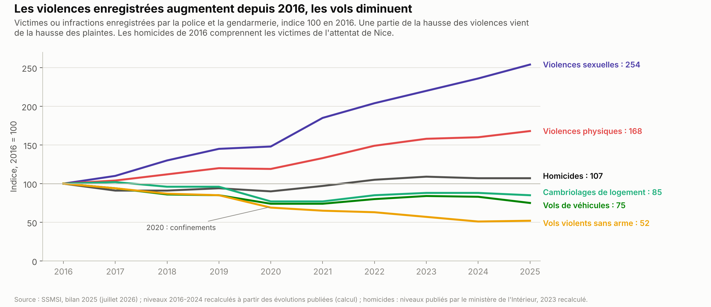
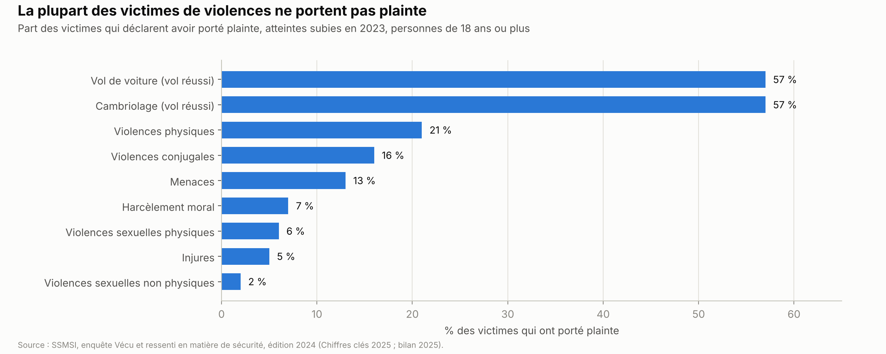
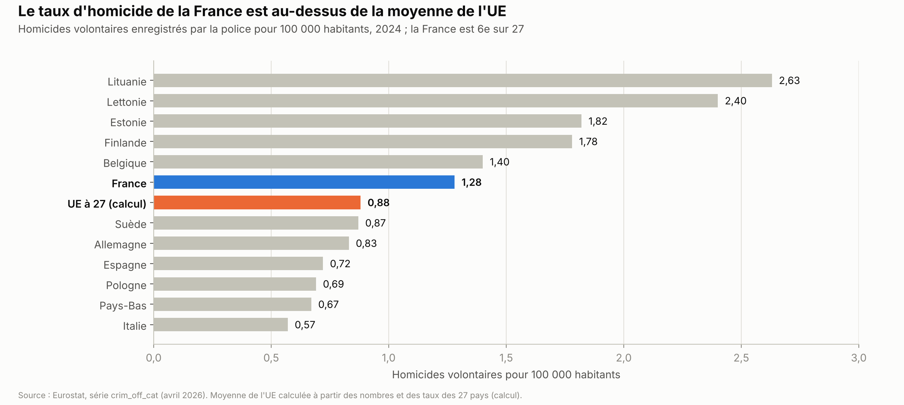
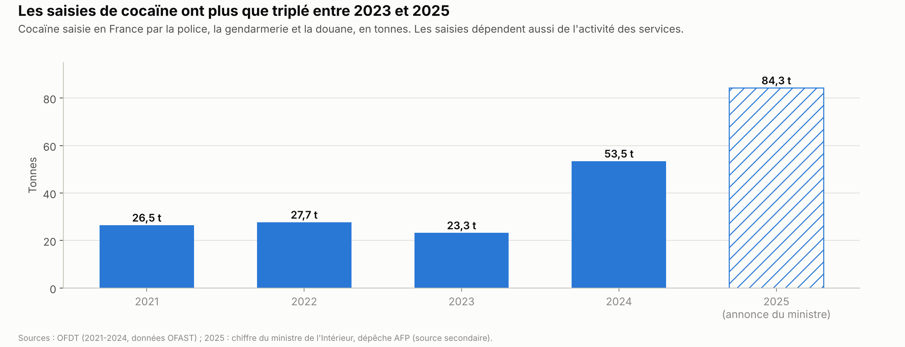
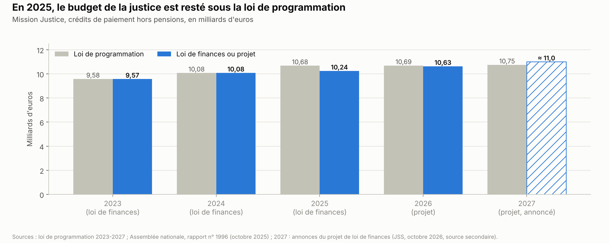
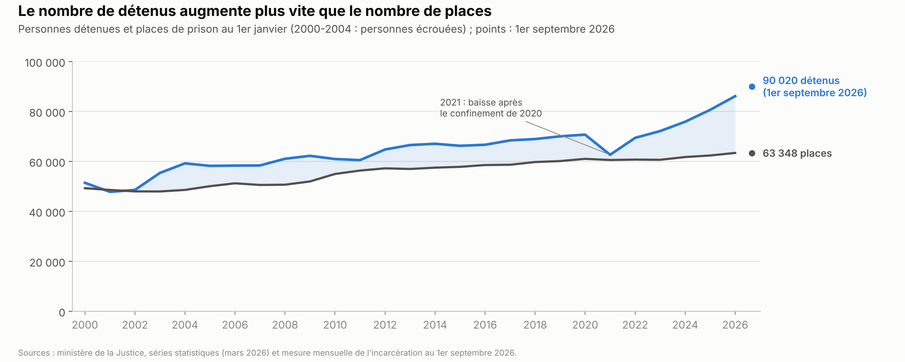

# Sécurité et justice

*Version de travail du 10 octobre 2026. Les chiffres seront mis à jour à la date d'arrêt des données de l'édition 1.*

Ce chapitre présente la délinquance en France : comment on la mesure, comment elle évolue et comment elle se compare au reste de l'Union européenne (UE). Il décrit le trafic de drogue, la police et la gendarmerie, la justice pénale, les prisons et la justice des mineurs. Il expose ensuite les propositions des partis et ce qu'on sait des mesures déjà essayées.

**Voir aussi :**
- [Immigration](../immigration/immigration.md), pour la part des étrangers parmi les personnes mises en cause et les détenus ;
- [Institutions](../institutions/institutions.md), pour le rôle du Conseil constitutionnel et de la Cour européenne des droits de l'homme, l'indépendance du parquet et le Conseil supérieur de la magistrature ;
- [Finances publiques](../finances-publiques/finances_publiques.md), pour le budget de l'État et la dépense publique d'« ordre et sécurité » ;
- [Santé et assurance maladie](../sante/sante_assurance_maladie.md), pour la consommation de drogues comme question de santé ;
- [Défense et Europe](../defense-europe/defense_europe.md), section 1.3, pour le terrorisme international et le renseignement extérieur ;
- [Présidentielle 2027 : ce que proposent les partis](../partis/programmes_partis_2027.md), pour les programmes complets.

> **Repères.**
> - **Délinquance enregistrée et victimation.** La délinquance **enregistrée** compte les faits connus de la police et de la gendarmerie, surtout par les plaintes. Les **enquêtes de victimation** interrogent un grand échantillon de personnes sur ce qu'elles ont subi, qu'elles aient porté plainte ou non. Les deux mesures ne disent pas la même chose.
> - **Mis en cause.** Une personne **mise en cause** est soupçonnée par la police ou la gendarmerie, sur des indices sérieux, d'avoir commis une infraction. Elle n'est pas forcément poursuivie, ni condamnée.
> - **Police et gendarmerie.** La police nationale couvre surtout les villes ; la gendarmerie, militaire, couvre surtout les zones rurales et périurbaines. Les polices municipales dépendent des maires.
> - **Le parquet et les juges.** Les **procureurs** forment le parquet : ils décident des suites à donner aux affaires et accusent devant le tribunal. Les **juges** (le « siège ») jugent. Les uns et les autres sont des **magistrats**.
> - **Prévenus et condamnés.** Un **prévenu** est en détention en attendant d'être jugé définitivement (« détention provisoire »). Un **condamné** exécute sa peine. Les **maisons d'arrêt** reçoivent les prévenus et les courtes peines ; les **établissements pour peine**, les longues peines.
> - **Densité carcérale.** Elle rapporte le nombre de détenus au nombre de places. Au-dessus de 100 %, il y a plus de détenus que de places.
> - **Aménagement de peine.** Une peine de prison peut être exécutée hors de prison ou en partie dehors : bracelet électronique, semi-liberté, libération conditionnelle. C'est le juge de l'application des peines qui en décide.

---

## L'essentiel

1. **Les violences enregistrées augmentent, les vols baissent.** De 2016 à 2025, les violences physiques enregistrées augmentent de 68 % et les violences sexuelles sont multipliées par 2,5. Les cambriolages baissent de 15 %, les vols de véhicules de 25 %. Les homicides passent d'≈ 830 par an en 2017-2020 à 975 en 2025.
2. **Les plaintes ne disent pas tout.** Une victime de violences physiques sur cinq porte plainte, une victime de violences sexuelles physiques sur seize. Une partie de la hausse enregistrée vient de plaintes plus nombreuses. L'enquête de victimation montre aussi une hausse des violences physiques déclarées depuis 2021.
3. **Un taux d'homicide au-dessus de la moyenne européenne.** En 2024, la France compte 1,28 homicide pour 100 000 habitants, contre ≈ 0,88 dans l'Union européenne (UE). Elle se classe 6e sur 27.
4. **Les saisies de cocaïne ont plus que triplé.** Elles passent de 23 tonnes en 2023 à 84 tonnes en 2025, selon le ministre de l'Intérieur. Le trafic de drogue a fait 110 morts en 2024. Une loi de juin 2025 a créé un parquet national contre la criminalité organisée.
5. **Les prisons sont pleines.** Au 1er septembre 2026, 90 020 personnes sont détenues pour 63 348 places, soit une densité de 142 %. Dans les maisons d'arrêt, elle atteint 176 %, et 8 347 détenus dorment sur un matelas au sol.
6. **Moins de juges qu'ailleurs en Europe.** La France compte 11,3 juges pour 100 000 habitants ; la moitié des pays européens en comptent plus de 17,6 (2022). Près de 6 000 affaires criminelles attendent d'être jugées. Le projet de budget prévoit ≈ 11 milliards d'euros pour la justice en 2027.
7. **Le Conseil constitutionnel encadre les réformes.** En 2025, il a censuré trois mesures de la loi contre le trafic de drogue. Il a aussi censuré, en tout ou en partie, six articles sur seize de la loi sur les mineurs.

**Les grandes options en débat.**
- **Peines et prisons** : des peines plus sévères et plus de places de prison, ou davantage de peines exécutées hors de prison.
- **Drogue** : un régime d'exception contre les trafics, ou la légalisation encadrée du cannabis.
- **Mineurs** : juger plus vite et plus sévèrement, avec une majorité pénale à 16 ans, ou garder la priorité à l'éducation.
- **Police** : plus de moyens et une protection juridique renforcée des policiers, ou une police de proximité et un contrôle indépendant.
- **Justice** : plus de magistrats ; supprimer ou garder le juge de l'application des peines.

---

## 1. La situation

### 1.1 Comment on mesure la délinquance

**La délinquance enregistrée.**
- Le Service statistique ministériel de la sécurité intérieure (SSMSI) compte chaque année les faits enregistrés par la police et la gendarmerie. Son bilan de 2025 est paru le 9 juillet 2026[^ssmsi-bilan-2025].
- L'unité change selon l'infraction. Pour les violences, on compte des **victimes** ; pour les vols et les cambriolages, des **infractions** ; pour les stupéfiants, des **mis en cause**[^ssmsi-bilan-2025]. Pour les stupéfiants, les chiffres dépendent donc surtout de l'activité des services.
- Un mis en cause est une personne contre laquelle il existe « des indices graves ou concordants » d'avoir participé à l'infraction[^ssmsi-chiffres-cles-2025]. L'infraction est alors dite « élucidée ». La part des faits élucidés varie beaucoup : 68 % des homicides, 66 % des violences physiques, 8 % des escroqueries et 7 % des cambriolages enregistrés en 2024[^ssmsi-bilan-2025]. Selon le SSMSI, elle baisse pour presque toutes les infractions entre 2017 et 2024 *(paraphrase)*[^ssmsi-bilan-2025].

**Les enquêtes de victimation.**
- L'enquête « Vécu et ressenti en matière de sécurité » (VRS) du SSMSI interroge chaque année un large échantillon de personnes de 18 ans ou plus[^ssmsi-vrs-2024]. Elle a remplacé en 2022 l'enquête « Cadre de vie et sécurité » (CVS)[^ssmsi-vrs-2024], menée avec l'Institut national de la statistique et des études économiques (Insee)[^insee-cvs-2021]. Les méthodes diffèrent : les niveaux des deux enquêtes ne se comparent pas.
- Ces enquêtes montrent que la plupart des victimes de violences ne portent pas plainte (graphique ci-dessous)[^ssmsi-chiffres-cles-2025][^ssmsi-vrs-2024].

**Le délai entre les faits et la plainte.**
- Pour la plupart des infractions, la moitié des victimes portent plainte en cinq jours ou moins. Pour les violences sexuelles, ce délai médian est passé de 2 mois en 2016 à plus de 6 mois en 2025 ; pour les viols, il atteint un an[^ssmsi-bilan-2025][^ssmsi-bilan-2025-pdf].
- Une partie des violences sexuelles enregistrées en 2025 porte donc sur des faits plus anciens. Le SSMSI relie la hausse des plaintes au « Grenelle des violences conjugales de 2019 » et à la plainte en ligne. Il cite aussi la libération de la parole « notamment impulsée par le mouvement #MeToo »[^ssmsi-bilan-2025-pdf].

### 1.2 L'évolution de la délinquance et le sentiment d'insécurité

**En 2025.**

| Indicateur | Nombre en 2025 | Évolution sur un an | Évolution moyenne par an depuis 2016 |
|---|---|---|---|
| Homicides (victimes) | 975 | 0 % | +1 % |
| Tentatives d'homicide (victimes) | 4 477 | +4 % | +8 % |
| Violences physiques (victimes) | 472 400 | +5 % | +6 % |
| dont dans la famille | 256 700 | +5 % | — |
| Violences sexuelles (victimes) | 132 100 | +8 % | +11 % |
| dont viols et tentatives | 50 100 | +9 % | +15 % |
| Vols violents sans arme | 49 200 | +2 % | −7 % |
| Vols avec armes | 7 900 | −8 % | −4 % |
| Cambriolages de logement | 211 600 | −3 % | −2 % |
| Vols de véhicules | 124 800 | −9 % | −3 % |
| Escroqueries et fraudes aux moyens de paiement (victimes) | 448 300 | +7 % | +7 % |
| Trafic de stupéfiants (mis en cause) | 57 100 | +9 % | +4 % |
| Usage de stupéfiants (mis en cause) | 309 800 | +7 % | +6 % |

*Source : SSMSI, bilan 2025[^ssmsi-bilan-2025]. Le bilan donne +6 % par an pour les violences physiques dans ses graphiques, +8 % dans son texte ; le recalcul donne +6 % (section 6).*

- En 2025, les violences physiques augmentent autant dans la famille qu'en dehors : +5 % dans les deux cas[^ssmsi-bilan-2025].
- Les écarts entre territoires sont grands. En 2025, on compte 7,2 homicides pour 100 000 habitants dans les départements d'outre-mer, contre 1,2 en métropole. Les vols violents sans arme sont 29 fois plus fréquents dans l'agglomération de Paris que dans les communes rurales[^ssmsi-bilan-2025-pdf].

**En 2026.**
- Sur les douze mois qui finissent en juin 2026, les homicides baissent de 3 % (977 victimes). Les violences physiques augmentent de 7 %, et les violences sexuelles de 15 %[^ssmsi-ir-68].
- Selon le SSMSI, 56 % de la hausse des violences sexuelles vient du seul mois de juin 2026. Les services ont alors enregistré d'anciennes procédures sur des mineurs, à la suite de « l'affaire Lyhanna » et d'une circulaire du garde des Sceaux du 8 juin 2026[^ssmsi-ir-68].
- La note mensuelle d'octobre 2026, provisoire, donne, sur douze mois, +12 % pour les violences physiques dans la famille, +9 % en dehors, et +29 % pour les violences sexuelles[^ssmsi-ic-133].

**Les homicides sur une longue période.**
- Selon le SSMSI, les homicides ont connu « une longue phase de baisse » du milieu des années 1990 au milieu des années 2010[^ssmsi-bilan-2025-pdf]. Le niveau des années 1990 n'a pas été retrouvé (section 6).
- On compte ≈ 820 à 860 victimes par an de 2017 à 2020, puis 959 en 2022, 976 en 2024 et 975 en 2025[^an-qe-12954][^ssmsi-bilan-2025]. La série d'Eurostat, l'office statistique de l'UE, donne une évolution proche : 975 homicides en 2008, un creux de 692 en 2020, puis 882 en 2024[^eurostat-homicides].

**Ce que disent les enquêtes de victimation.**
- De 2010 à 2018, l'enquête CVS ne montre pas de hausse des violences physiques déclarées. Elle compte 961 000 victimes de 18 à 75 ans par an en 2010-2012, et 862 000 en 2016-2018[^insee-cvs-2021].
- La nouvelle enquête VRS compte 643 000 victimes de violences physiques en 2023, 7 % de plus qu'en 2022[^ssmsi-chiffres-cles-2025]. Le SSMSI relève une « hausse des violences physiques déclarées depuis 2021 »[^ssmsi-bilan-2025-pdf].
- Les victimes déclarées de violences sexuelles sont 1,8 million en 2023 : 325 000 pour des violences physiques, et surtout des violences sans contact physique[^ssmsi-chiffres-cles-2025].

**Le sentiment d'insécurité.**
- En 2024, 22 % des personnes se sentent en insécurité dans leur quartier ou leur village, 15 % chez elles et 42 % dans les transports en commun[^ssmsi-chiffres-cles-2025].
- Les femmes renoncent 2,8 fois plus souvent que les hommes à sortir seules pour des raisons de sécurité[^ssmsi-vrs-2024].
- Selon l'ancienne enquête CVS, le sentiment d'insécurité est resté stable autour de 20 % de 2010 à 2019, malgré les attentats de 2015 et 2016 *(paraphrase ; indicateur différent)*[^insee-cvs-2021].
- En décembre 2025, 27 % des personnes citent « justice et criminalité » comme le problème le plus important du pays. Ce thème est en tête, à égalité avec les prix et la vie politique. Les écarts selon la proximité partisane sont grands : 49 % chez les proches de Reconquête, 9 % chez ceux de LFI. Ce baromètre est réalisé par une société d'études, L'ObSoCo, et le centre de recherches politiques de Sciences Po (CEVIPOF)[^obsoco-cevipof-dec-2025].

### 1.3 La France en Europe

- Pour comparer les pays, on utilise les chiffres d'Eurostat, établis de la même façon pour tous. En 2024, la France est 6e sur 27 pour le taux d'homicide. Elle est derrière la Lituanie, la Lettonie, l'Estonie, la Finlande et la Belgique, et devant l'Allemagne, l'Italie et l'Espagne[^eurostat-homicides].
- Eurostat compte 882 homicides en France en 2024, contre 976 victimes pour le SSMSI. Eurostat compte sans doute des infractions, pas des victimes *(à vérifier)*. Avec le chiffre du SSMSI, le taux serait d'≈ 1,4 pour 100 000 *(calcul)*.

**Police, justice et prisons comparées.**

| Indicateur | France | Repère européen | Année | Source |
|---|---|---|---|---|
| Policiers pour 100 000 habitants | 361 | ≈ 345 dans l'UE *(calcul fragile)* | 2022 (France), 2024 (UE) | Eurostat[^eurostat-police][^eurostat-police-se] |
| Juges professionnels pour 100 000 habitants | 11,3 | médiane 17,6 ; moyenne 22 | 2022 | Commission européenne pour l'efficacité de la justice (CEPEJ), via l'Union syndicale des magistrats (USM)[^cepej-2024][^usm-cepej-2024] |
| Procureurs pour 100 000 habitants | 3 | moyenne ≈ 12 | 2022 | CEPEJ[^cepej-2024] |
| Délai théorique pour écouler les affaires civiles de première instance | 637 jours | médiane 237 jours | 2020 | Ministère de la Justice, d'après la CEPEJ[^infostat-188] |
| Budget de la justice, en % du produit intérieur brut | 0,20 % | moyenne 0,31 % | 2022 | CEPEJ, via l'USM[^cepej-2024][^usm-cepej-2024] |
| Détenus pour 100 places | 131 (le plus élevé, à égalité avec la Turquie) | Italie 121 ; Belgique 114 ; ensemble 95 | janvier 2025 | Conseil de l'Europe, statistiques pénales annuelles (SPACE), volet I[^coe-space-2025] |
| Détenus pour 100 000 habitants | ≈ 118 *(calcul)* | médiane 110 | janvier 2025 | Idem[^coe-space-2025] |

- La CEPEJ, rattachée au Conseil de l'Europe, compare 46 pays environ. Elle rappelle que son rapport « ne constitue pas un classement »[^infostat-188].
- Les 11,3 juges pour 100 000 habitants ne correspondent pas aux 6 709 juges en poste en 2025 (section 1.6). La CEPEJ compte aussi les juges administratifs, en équivalents temps plein, et ses données datent de 2022[^infostat-188].
- Comparer les effectifs de police demande de la prudence : chaque pays transmet ses propres chiffres, qui incluent ou non certaines forces[^eurostat-police-se].

### 1.4 Le trafic de drogue

**Les saisies.**

- Les saisies de cocaïne ont battu des records en 2024 (53,5 tonnes) puis en 2025 (84,3 tonnes, selon le ministre de l'Intérieur) *(source secondaire)*[^ofdt-offre-2024][^outremers-cocaine-2025]. Elles étaient de 5,3 tonnes par an en moyenne dans les années 2000[^ofdt-cocaine]. La douane en a saisi 31,3 tonnes en 2025[^douane-2025].
- Les saisies de cannabis atteignent 127 tonnes en 2025, contre 101 tonnes en 2024 *(source secondaire)*[^outremers-cocaine-2025][^ofdt-offre-2024].
- Les saisies dépendent de l'activité des services autant que du trafic. Elles ne mesurent pas à elles seules le volume consommé.

**Le marché et la consommation.**
- Le trafic de drogue rapporterait 6,8 Md€ par an, dont ≈ 3,1 Md€ pour la cocaïne et ≈ 2,7 Md€ pour le cannabis (2023). Ce chiffre est une estimation de l'Observatoire français des drogues et des tendances addictives (OFDT)[^ofdt-offre-2024][^interieur-campagne-drogue].
- En 2023, 9,4 % des 18-64 ans ont déjà consommé de la cocaïne, contre 5,6 % en 2017[^ofdt-cocaine]. La cocaïne vendue est plus pure (74 % en 2024, contre 49 % en 2013) et moins chère (58 € le gramme en 2024, contre 70 € en 2018)[^ofdt-offre-2024][^ofdt-cocaine]. Pour l'OFDT, ces signes montrent une offre en hausse. Les effets sur la santé sont traités dans le chapitre [Santé](../sante/sante_assurance_maladie.md).
- En 2025, 309 800 personnes sont mises en cause pour usage et 57 100 pour trafic[^ssmsi-bilan-2025]. Plus des deux tiers des usagers interpellés en 2024 ont reçu une amende forfaitaire délictuelle, payable sans passer devant un juge[^ofdt-offre-2024].

**Les violences liées au trafic.**
- Les homicides et tentatives liés au trafic sont passés de 418 en 2023 à 367 en 2024. Ces 367 faits ont fait 110 morts et 341 blessés[^ofdt-offre-2024].
- À Marseille, ils ont fait 49 morts en 2023 et 24 en 2024[^ofdt-offre-2024]. Les chiffres de 2025 n'ont pas été trouvés.

**La loi du 13 juin 2025 contre le trafic.**
- Elle a créé un parquet national anticriminalité organisée (PNACO), entré en fonction le 5 janvier 2026 au tribunal judiciaire de Paris. Il compte 16 magistrats au départ, 30 visés en septembre 2026[^justice-pnaco].
- Elle crée aussi des quartiers de prison de haute sécurité pour les chefs de réseau : Vendin-le-Vieil (juillet 2025) et Condé-sur-Sarthe (octobre 2025), puis Réau, Aix-Luynes et Valence (2026-2027)[^justice-narcotrafic]. Des quartiers de haute sécurité avaient déjà existé de 1975 à 1982[^salle-qhs][^wikipedia-qhs].
- Elle étend le statut de repenti, qui réduit la peine d'un membre d'un réseau qui aide la justice, aux auteurs de meurtres : la réduction peut aller jusqu'aux deux tiers. Recruter des mineurs pour le trafic par les réseaux sociaux est puni de 7 ans de prison[^justice-narcotrafic].
- Le Conseil constitutionnel a censuré trois mesures (décision du 12 juin 2025)[^cc-2025-885] :
  - l'accès direct des services de renseignement aux fichiers fiscaux ;
  - l'extension à la criminalité organisée des algorithmes de détection sur internet ;
  - une peine aggravée pour le seul port d'une arme, jugée « manifestement disproportionnée ».
- Selon le ministre de l'Intérieur, 146 M€ d'avoirs criminels ont été saisis en 2025, contre 113 M€ en 2024 *(source secondaire)*[^outremers-cocaine-2025].

### 1.5 La police et la gendarmerie

**Le budget.**
- La mission budgétaire « Sécurités », qui finance la police et la gendarmerie nationales, dispose de 24,97 Md€ en 2026. Le projet de budget pour 2027 prévoit 25,54 Md€ : 14,15 Md€ pour la police, 11,31 Md€ pour la gendarmerie et 0,08 Md€ pour la sécurité routière[^an-pap-securites-2027].
- Les salaires représentent 87 % des crédits de la police et 82 % de ceux de la gendarmerie (2026)[^senat-securites-plf2026].
- Ce budget ne couvre ni la justice ni les prisons. Le chapitre [Finances publiques](../finances-publiques/finances_publiques.md) cite 52,1 Md€ de dépense publique « ordre et sécurité » : ce total inclut la justice, les prisons et les dépenses des collectivités locales[^ch-finances-publiques].

**Les effectifs.**
- Eurostat compte ≈ 246 000 policiers en France en 2022, gendarmes compris *(à vérifier)*, soit 361 pour 100 000 habitants[^eurostat-police].
- Selon le ministre de l'Intérieur, « 12 000 policiers et gendarmes sont venus renforcer les rangs » depuis 2017 (mai 2026)[^an-qag-1532]. Ce chiffre n'a pas été retrouvé dans une statistique publiée.
- La loi d'orientation et de programmation du ministère de l'Intérieur (LOPMI) de janvier 2023 prévoit 7 412 créations de postes d'ici 2027, selon le Sénat. Fin 2025, la gendarmerie avait réalisé ≈ deux tiers des créations qui la concernent ; en 2026, la police dépasse sa trajectoire[^senat-securites-plf2026].
- Sur 239 nouvelles brigades de gendarmerie prévues, 80 ont été créées en 2024, aucune en 2025 et 58 sont financées en 2026[^senat-securites-plf2026].
- Le projet de budget pour 2027 prévoit 1 234 emplois de plus dans la police et 235 dans la gendarmerie[^an-pap-securites-2027].
- Les polices municipales comptent 28 161 agents dans 3 812 communes (fin 2023), contre 12 471 en 1997[^senat-polices-municipales]. Un projet de loi élargit leurs pouvoirs : constat de certains délits, amendes, accès à des fichiers, drones. Adopté par le Sénat le 10 février 2026, puis en commission à l'Assemblée fin avril, il n'était pas inscrit en séance au 10 septembre 2026 *(source secondaire)*[^senat-polices-municipales][^maireinfo-pm-2026][^publicsenat-pm-2026].

**L'usage de la force et les refus d'obtempérer.**
- En 2024, les policiers ont déclaré 280 usages d'armes à feu, contre 206 en 2023. Seize personnes sont mortes après un tir de policier en 2024[^igpn-2024]. Selon la presse, les tirs mortels de policiers ont baissé de 25 % en 2025 *(source secondaire)*[^policeetrealites-igpn-2025].
- L'Inspection générale de la police nationale (IGPN) a été chargée de 914 enquêtes judiciaires en 2024. Elle ne sanctionne pas : elle propose des sanctions au ministère[^igpn-2024].
- Les refus d'obtempérer, quand un conducteur refuse de s'arrêter à un contrôle, sont 28 100 en 2025 (+10 %), dont 6 200 aggravés, selon le SSMSI *(source secondaire)*[^europe1-refus-2025]. Cela fait un refus toutes les 19 minutes environ *(calcul)*.
- La loi du 28 février 2017 encadre l'usage des armes par les policiers et les gendarmes. Elle exige une « absolue nécessité » et une « stricte proportionnalité », y compris face à un véhicule qui refuse de s'arrêter[^an-l435-1].
- Le 7 juillet 2026, l'Assemblée a adopté une proposition de loi d'Éric Pauget (LR) qui crée une « présomption de légitime défense » pour les forces de l'ordre. Il reviendrait alors à l'accusation de prouver que l'usage de l'arme n'était pas justifié *(à vérifier : texte adopté non lu)*. Le texte a été transmis au Sénat, qui ne l'a pas encore examiné[^an-ppl-legitime-defense].

**Les contrôles d'identité.**
- En 2023, le Conseil d'État a jugé que les contrôles fondés sur l'apparence physique ne peuvent pas être regardés comme « des cas isolés ». Il a refusé d'imposer une réforme, comme un récépissé de contrôle : cela relève « d'une politique publique »[^ce-454836].
- Une enquête du Défenseur des droits de 2024 conclut, selon la presse, que les jeunes hommes perçus comme noirs ont quatre fois plus de risques d'être contrôlés *(source secondaire)*[^la1ere-ddd-2024].

**La vidéoprotection.**
- L'usage d'algorithmes pour analyser les images des caméras a été testé lors des Jeux olympiques, jusqu'au 31 mars 2025. Le comité d'évaluation a jugé les résultats techniques inégaux selon les usages ; il n'a pas mesuré d'effet sur la délinquance *(source secondaire)*[^bdt-videoprotection-2025].
- Le ministère de l'Intérieur juge que la vidéoprotection joue « un rôle particulièrement structurant », sans citer d'évaluation (mars 2026)[^an-qe-10470]. Les études sont présentées dans la section 4.

**Le terrorisme.**
- Selon le procureur national antiterroriste, six attentats ont été déjoués en France en 2025, et 42 mineurs sont mis en examen dans des affaires de terrorisme *(source secondaire)*[^publicsenat-pnat-2025]. La menace extérieure est traitée dans le chapitre [Défense et Europe](../defense-europe/defense_europe.md).

### 1.6 La justice

**Le budget.**

- La loi de programmation de la justice de 2023 fixe les crédits jusqu'en 2027, hors pensions des agents. Elle a été suivie en 2023 et 2024. En 2025, les crédits votés sont restés 439 M€ en dessous *(calcul)*[^an-rapport-berger].
- Le projet de budget pour 2027, présenté le 1er octobre 2026, prévoit « près de 11 milliards d'euros », hors pensions *(à vérifier)*. Il crée 1 301 emplois, dont 287 magistrats et 334 greffiers *(source secondaire)*[^jss-budget-justice-2027]. Pensions comprises, la mission « Justice » atteignait 13,1 Md€ dans le projet de 2026[^senat-justice-plf2026].
- Les prisons en absorbent la plus grosse part : 5,5 Md€ avec les pensions, 4,3 Md€ sans elles (2026)[^senat-justice-plf2026][^senat-penitentiaire-plf2026]. La protection judiciaire de la jeunesse (PJJ), qui suit les mineurs délinquants, reçoit 1,16 Md€[^senat-justice-plf2026].

**Les magistrats.**
- Au 1er septembre 2025, 9 007 magistrats travaillent dans les juridictions : 6 709 juges et 2 298 procureurs[^an-rapport-berger].
- La loi de programmation prévoit 10 000 emplois de plus entre 2023 et 2027, dont 1 500 magistrats et 1 800 greffiers[^an-rapport-berger]. Le nombre de postes déjà créés n'a pas été trouvé.

**Ce que deviennent les affaires (2025).**
- Les parquets ont reçu 4,56 millions d'affaires. Dans 2,63 millions, l'auteur n'a pas été identifié[^justice-indicateurs-2025].
- Restent 1,92 million d'auteurs. Pour 36,7 % d'entre eux, l'affaire ne peut pas être poursuivie : infraction mal caractérisée, preuves insuffisantes, auteur hors de cause[^justice-indicateurs-2025].
- Pour les autres, le parquet donne une **réponse pénale** dans 87,8 % des cas. Il s'agit de poursuites devant un tribunal (62,4 %) ou d'alternatives aux poursuites, comme un rappel à la loi ou une médiation (29,8 %). Restent les compositions pénales (7,8 %). Ces dernières sont des sanctions proposées par le procureur et acceptées par l'auteur, sans procès[^justice-indicateurs-2025].
- Les tribunaux correctionnels ont jugé 582 237 personnes ; 7,7 % des personnes jugées en audience ont été relaxées. Six décisions sur dix passent par des procédures simplifiées, sans audience classique[^justice-indicateurs-2025].

**Les délais.**
- Fin 2025, près de 6 000 affaires criminelles attendent d'être jugées, 22 % de plus qu'un an plus tôt. Selon le garde des Sceaux, les délais pour écouler ce stock « excèdent désormais vingt mois »[^circulaire-audiencement-2026].
- Les nouvelles affaires criminelles ont presque doublé de 2018 à 2025 ; la capacité de jugement a augmenté de 54 % *(paraphrase)*[^circulaire-audiencement-2026].

**La loi du 23 juillet 2026 sur la justice criminelle et le respect des victimes.**
- Elle étend les cours criminelles départementales, composées de magistrats sans jurés, aux crimes commis en récidive. Elle limite aussi certains appels et les délais pour contester la procédure[^cc-2026-909].
- Le Conseil constitutionnel a censuré deux mesures : certaines analyses génétiques et le statut de « psychologue de police judiciaire »[^cc-2026-909].
- Le « plaider-coupable » pour les crimes, prévu par le projet, a été retiré pendant les débats *(source secondaire)*[^gazettefrance-sure].

### 1.7 Les prisons et l'exécution des peines

**La surpopulation.**
- Au 1er septembre 2026, 107 700 personnes sont sous écrou. Parmi elles, 90 020 sont détenues, 6,8 % de plus qu'un an plus tôt. Les autres exécutent leur peine dehors, dont 16 729 sous bracelet électronique[^justice-mesure-0926].
- Parmi les détenus, 24 539 sont des prévenus, en attente d'un jugement définitif[^justice-mesure-0926].
- Les prisons offrent 63 348 places : la densité atteint 142 % en moyenne et 176 % dans les maisons d'arrêt. Au total, 8 347 détenus dorment sur un matelas posé au sol, 52 % de plus qu'un an plus tôt[^justice-mesure-0926].
- De 2016 à 2026, le nombre de détenus a augmenté de 29 % et le nombre de places de 8 % (au 1er janvier) *(calcul)*[^justice-series-ppsmj]. La baisse visible en 2021 suit le confinement du printemps 2020 : la population carcérale a alors diminué de 12 959 détenus en deux mois[^senat-qe-15081].
- La Cour européenne des droits de l'homme a condamné la France en 2020 pour ses conditions de détention (arrêt *J.M.B. et autres*) *(à vérifier)*. Le Conseil de l'Europe suit toujours l'exécution de cet arrêt : une réunion technique a eu lieu à Paris en mai 2026[^coe-jmb-2026].

**Les constructions.**
- Le plan lancé en 2018 visait 15 000 places de plus. Fin octobre 2025, 5 400 à 5 500 places nettes avaient été livrées selon les rapports, soit 36 à 37 % de l'objectif[^an-rapport-berger][^senat-penitentiaire-plf2026]. Le projet de budget pour 2027 prévoit 830 places nettes en 2026 et 326 en 2027 *(source secondaire)*[^jss-budget-justice-2027].
- Le garde des Sceaux estime le coût d'une place à 500 000 €[^senat-penitentiaire-plf2026]. En 2023, le Sénat chiffrait le plan à 5,4 Md€, soit ≈ 360 000 € par place nette *(calcul)*[^senat-qe-01614]. Des prisons modulaires doivent créer 3 000 places pour 550 M€, selon le ministre[^senat-penitentiaire-plf2026].
- Une journée de détention coûte en moyenne 128 € (2024), soit ≈ 47 000 € par an *(calcul)*[^senat-penitentiaire-plf2026].
- En juillet 2026, la Contrôleure générale des lieux de privation de liberté (CGLPL) a rendu un avis sur la surpopulation. Pour l'absorber, il faudrait selon elle « mettre en service un centre pénitentiaire toutes les six semaines » *(source secondaire)*[^sudradio-cglpl-2026].

**Les règles d'exécution des peines.**
- Depuis mars 2020 (loi du 23 mars 2019), les peines de prison d'un mois ou moins sont interdites. Celles d'un à six mois s'exécutent « par principe, en dehors de la prison », sous bracelet, en semi-liberté ou en placement extérieur[^justice-loi-2019].
- Depuis le 1er janvier 2023 (loi du 22 décembre 2021), les réductions de peine ne sont plus un crédit acquis d'office : le juge de l'application des peines les accorde selon la conduite et les efforts de réinsertion[^decret-2022-1261]. La libération sous contrainte s'applique de plein droit quand il reste trois mois au plus d'une peine de deux ans au plus[^decret-2022-1261]. Au 1er septembre 2026, 762 personnes en bénéficient sous écrou[^justice-mesure-0926].

**La récidive.**
- Parmi les personnes sorties de prison en 2016, 33,4 % ont été condamnées pour une nouvelle infraction commise dans l'année, et 53,7 % dans les trois ans[^justice-recidive-2016].
- Le taux à trois ans atteint 68 % pour les moins de 25 ans et 64,7 % pour les personnes déjà condamnées au moins deux fois. Il est de 29 % pour celles qui n'avaient aucune condamnation[^justice-recidive-2016].
- Cette mesure compte toute nouvelle infraction suivie d'une condamnation. Elle est plus large que la « récidive légale » du code pénal, qui suppose une nouvelle infraction de même nature dans un délai donné[^justice-recidive-2016].

### 1.8 Les mineurs

- En 2025, les mineurs représentent 9 % des personnes mises en cause dans les affaires reçues par les parquets. Les juridictions pour mineurs ont jugé 45 024 mineurs ; 9,5 % ont été relaxés[^justice-indicateurs-2025].
- Les mineurs sont plus nombreux parmi les auteurs présumés de vols : en 2025, ils représentent 34 % des mis en cause pour vols violents sans arme, et 33 % pour vols avec armes[^insee-mis-en-cause-2025].
- Au 1er septembre 2026, 804 mineurs sont détenus[^justice-mesure-0926].
- Le code de la justice pénale des mineurs (CJPM) est en vigueur depuis septembre 2021. Il sépare le jugement en deux temps : une audience sur la culpabilité, puis une audience sur la sanction. Le délai entre les faits et l'audience sur la culpabilité est passé d'≈ 20 mois en 2019 à ≈ 13 mois en 2022[^infostat-194].
- La loi du 23 juin 2025, issue d'une proposition de Gabriel Attal (Renaissance), voulait juger plus vite et plus sévèrement les mineurs. Le Conseil constitutionnel en a censuré six articles sur seize, en tout ou en partie[^cc-2025-886] :
  - la comparution immédiate, c'est-à-dire un jugement rapide à la sortie de la garde à vue, dès 16 ans et sans être réservée aux faits graves ;
  - l'extension de l'audience unique, qui juge en une seule fois la culpabilité et la sanction ;
  - une détention provisoire allongée jusqu'à un an pour certains délits ;
  - des exceptions élargies à l'« excuse de minorité », qui réduit la peine des mineurs ;
  - une retenue de douze heures par la police pour non-respect d'une mesure éducative ;
  - un article sans lien avec le texte.
- Le Conseil s'appuie sur un principe constitutionnel : il faut rechercher « le relèvement éducatif et moral des enfants délinquants », par des juridictions spécialisées ou des procédures adaptées[^cc-2025-886].
- Une place en centre éducatif fermé coûte 578 € par jour, soit ≈ 211 000 € par an *(calcul)*[^an-rapport-berger].
- Le chapitre [Immigration](../immigration/immigration.md) (section 1.7) traite des mineurs non accompagnés : les mesures pénales dont ils font l'objet et leur part parmi les mineurs incarcérés.

---

## 2. Ce qui fait débat

### Question 1. Les peines : punir plus sévèrement et construire des prisons, ou exécuter davantage de peines hors de prison ?

**Le constat.** Les prisons comptent 90 020 détenus pour 63 348 places (section 1.7). Le plan de 15 000 places lancé en 2018 est réalisé à 36-37 %. Plus de la moitié des sortants de prison sont condamnés de nouveau dans les trois ans[^justice-recidive-2016].

**Pour des peines plus sévères et plus de places.**
- Le RN veut « rétablir les peines planchers », c'est-à-dire des peines minimales que le juge doit prononcer, sauf décision motivée. Il veut aussi « supprimer toute possibilité de réduction et d'aménagements de peine » et « établir une perpétuité réelle », une prison à vie sans libération possible. Son programme de 2022 visait 85 000 places de prison au total[^votons-lepen-securite]. Reconquête proposait 10 000 places de plus en 2022 *(source secondaire)*[^lcp-securite-2022].
- Renaissance juge qu'« il faut construire davantage de places de prison » *(source secondaire, à vérifier)*[^votons-attal-securite]. Horizons veut des peines planchers « pour les infractions les plus graves », et des courtes peines dès la première infraction, en s'inspirant « des pays du Nord »[^philippe-france-plus-sure]. LR veut rendre les peines minimales « obligatoires »[^lr-retailleau-figaro] « pour certains crimes et délits graves », en les inscrivant dans la Constitution *(source secondaire)*[^publicsenat-retailleau-pacte].
- Argument : en Italie, un mois de peine attendue en plus réduit la probabilité de récidive de 0,16 point (section 4)[^drago-2009]. Les peines planchers de 2007 ont allongé les peines de prison ferme de 8,2 à 11 mois en moyenne[^infostat-118].
- Limite : les juges ont écarté la peine plancher dans six cas sur dix en 2010, et son effet sur la récidive n'a pas été mesuré[^infostat-118]. Les preuves d'un effet de la sévérité des peines sont beaucoup plus rares que celles d'un effet de la police (section 4)[^chalfin-mccrary-2017]. Atteindre 85 000 places demanderait ≈ 21 650 places de plus, soit 7,8 à 10,8 Md€ selon le coût retenu par place *(calcul)*[^senat-qe-01614][^senat-penitentiaire-plf2026].

**Pour davantage de peines hors de prison.**
- LFI veut « en finir avec la surpopulation carcérale » par un mécanisme contraignant de régulation, qui empêcherait d'incarcérer au-delà des places disponibles *(source secondaire)*[^votons-melenchon-securite]. Selon le site de LFI, Place publique proposait en 2025 d'adapter les peines, avec la justice restaurative (des rencontres encadrées entre auteurs et victimes) et les travaux d'intérêt général *(source secondaire)*[^lfi-comparateur-pp].
- Au Sénat, la socialiste Marie-Pierre de La Gontrie a déclaré en novembre 2025 : « Nous plaidons depuis longtemps en faveur de la régulation carcérale ». L'écologiste Guy Benarroche a jugé que « la construction de nouvelles prisons n'est pas une solution »[^senat-penitentiaire-plf2026].
- Argument : en France, exécuter une courte peine sous bracelet électronique plutôt qu'en prison réduit de 6 à 7 points le risque d'une nouvelle condamnation à cinq ans (section 4)[^henneguelle-2016].
- Limite : en Norvège, la prison réduit au contraire la récidive, grâce aux programmes de réinsertion suivis en détention (section 4)[^bhuller-2020]. Le fonctionnement de la régulation carcérale proposée (qui sort, quand, sur quelle décision) n'est pas précisé.

### Question 2. Le trafic de drogue : un régime d'exception, ou la légalisation du cannabis ?

**Le constat.** Les saisies de cocaïne ont été multipliées par 3,6 de 2023 à 2025, et le trafic a fait 110 morts en 2024 (section 1.4). La loi de juin 2025 a créé un parquet spécialisé et des quartiers de prison de haute sécurité ; aucune évaluation n'en a encore été publiée.

**Pour un régime d'exception contre les trafics.**
- LR propose un « état d'urgence anti-trafics » : boucler « entre cinquante et soixante quartiers », gardés 24 heures sur 24. Selon la presse, Bruno Retailleau juge qu'une révision de la Constitution serait nécessaire pour l'appliquer pleinement *(source secondaire, paraphrase)*[^defense92-retailleau].
- Horizons veut un « état d'urgence narco », limité dans le temps et l'espace, avec un usage ciblé de la reconnaissance faciale. Il veut aussi « être intraitable avec les consommateurs »[^philippe-france-plus-sure]. Le RN visait d'abord le trafic avec des peines planchers en 2024 *(source secondaire)*[^publicsenat-blocs-2024].
- Argument : les preuves que la délinquance réagit à la présence policière sont nombreuses, selon une synthèse des travaux économiques[^chalfin-mccrary-2017]. Selon le gouvernement, le nombre de points de deal recensés est passé de 3 936 en 2021 à 2 985 en 2024 *(source secondaire)*[^bdt-place-nette-2024].
- Limite : les bilans des opérations « place nette » comptent des interpellations et des saisies, pas un effet durable sur le trafic[^bdt-place-nette-2024]. Le Conseil constitutionnel a censuré trois mesures de la loi de 2025[^cc-2025-885]. Le règlement européen sur l'intelligence artificielle limite la reconnaissance faciale en temps réel à quelques cas. Il faut l'autorisation d'un juge ou d'une autorité indépendante, et une loi nationale *(lecture du texte)*[^eurlex-ia-2024].

**Pour légaliser le cannabis.**
- Les Écologistes veulent « légaliser et encadrer le cannabis » *(source secondaire)*[^votons-securite]. Éric Piolle, alors maire écologiste de Grenoble, attend d'une « légalisation contrôlée » qu'elle permette de « casser la moitié du chiffre d'affaires » des trafiquants[^publicsenat-piolle-2025]. Place publique proposait en 2025 une convention citoyenne sur la question *(source secondaire)*[^lfi-comparateur-pp].
- Une note du Conseil d'analyse économique, rattaché au Premier ministre, recommandait en 2019 « la légalisation du cannabis récréatif, strictement encadrée ». Elle engage ses auteurs, Emmanuelle Auriol et Pierre-Yves Geoffard[^cae-52].
- Argument : le cannabis représente ≈ 2,7 Md€ sur ≈ 6,8 Md€ de chiffre d'affaires du trafic, soit ≈ 40 % *(calcul)*[^ofdt-offre-2024][^interieur-campagne-drogue].
- Limite : la cocaïne, qui pèse davantage, resterait illégale. La part du marché illégal qui subsiste après une légalisation à l'étranger n'a pas été lue (section 4). La convention de l'Organisation des Nations unies (ONU) de 1961 limite les stupéfiants aux fins médicales et scientifiques ; ses obligations pénales s'appliquent « sous réserve » des règles constitutionnelles de chaque pays[^onu-1961]. L'avis de l'Académie nationale de médecine, opposée à la légalisation selon la version précédente du chapitre, n'a pas été lu.

### Question 3. Les mineurs : juger plus vite et plus sévèrement, ou garder la priorité à l'éducation ?

**Le constat.** Les mineurs représentent 9 % des personnes mises en cause dans les affaires reçues par les parquets, mais un tiers des auteurs présumés de vols violents (2025). Le code de 2021 a raccourci les délais de jugement. La loi de 2025 qui voulait aller plus loin a été en partie censurée (section 1.8).

**Pour juger plus vite et plus sévèrement.**
- Renaissance veut « une comparution immédiate pour les mineurs et une évolution de l'excuse de minorité » *(source secondaire, à vérifier)*[^votons-attal-securite]. Horizons veut lever l'excuse de minorité et juger en comparution immédiate pour les faits liés au trafic de drogue[^philippe-france-plus-sure].
- LR veut des peines « beaucoup plus fermes » et des courtes peines dès les premiers délits *(source secondaire)*[^defense92-retailleau]. Le RN (2022) et Reconquête (2022) proposent d'abaisser la majorité pénale à 16 ans *(source secondaire)*[^lcp-securite-2022].
- Argument : avant le code de 2021, il fallait en moyenne 15 mois en 2019, et près de 18 mois en 2020, pour juger un mineur après les poursuites, selon le ministère[^justice-dp-cjpm-2023].
- Limite : le Conseil constitutionnel a censuré en 2025 la comparution immédiate dès 16 ans non réservée aux faits graves, et l'élargissement des exceptions à l'excuse de minorité[^cc-2025-886]. Une majorité pénale à 16 ans se heurterait au même principe constitutionnel. Elle se heurterait aussi à la Convention de l'ONU sur les droits de l'enfant, qui protège les moins de 18 ans *(à vérifier)*.

**Pour garder la priorité à l'éducation.**
- LFI veut abroger le code de la justice pénale des mineurs pour le remplacer par un « code de l'enfance » *(source secondaire)*[^votons-melenchon-securite]. À l'Assemblée, en février 2025, des députés LFI et socialistes ont critiqué la loi « Attal ». Ils ont cité la baisse des condamnations de mineurs, et le passé de protection de l'enfance des mineurs poursuivis (section 5)[^an-cr-12-02-2025].
- Argument : la Constitution impose de rechercher « le relèvement éducatif et moral des enfants délinquants »[^cc-2025-886]. Le code de 2021 a déjà réduit les délais (section 1.8)[^infostat-194].
- Limite : aucune évaluation lue ne mesure l'effet du code de 2021 sur la récidive[^justice-dp-cjpm-2023]. Le contenu du « code de l'enfance » n'est pas détaillé.

### Question 4. La police : plus de moyens et de protection juridique, ou plus de proximité et de contrôle ?

**Le constat.** Le budget de la police et de la gendarmerie atteint ≈ 25,5 Md€ dans le projet pour 2027 (section 1.5). Les refus d'obtempérer augmentent : 28 100 en 2025 *(source secondaire)*[^europe1-refus-2025]. En 2024, seize personnes sont mortes après un tir de policier[^igpn-2024]. Le Conseil d'État a reconnu en 2023 des contrôles d'identité discriminatoires[^ce-454836].

**Pour plus de moyens et une protection juridique renforcée.**
- Le RN propose depuis 2022 une « présomption de légitime défense pour les forces de l'ordre »[^votons-lepen-securite]. Une proposition de loi d'Éric Pauget (LR) en ce sens a été adoptée par l'Assemblée le 7 juillet 2026, après un amendement du gouvernement *(source secondaire)*[^an-ppl-legitime-defense][^amnesty-legitime-defense].
- Nicolas Dupont-Aignan (Debout la France) veut 10 000 policiers et gendarmes de plus en cinq ans *(source secondaire)*[^votons-securite]. Le gouvernement poursuit la loi de programmation de 2023 et veut élargir les pouvoirs des polices municipales[^senat-securites-plf2026][^senat-polices-municipales].
- Argument : les preuves que la délinquance réagit aux effectifs de police sont nombreuses, selon la synthèse de Chalfin et McCrary[^chalfin-mccrary-2017].
- Limite : la Convention européenne des droits de l'homme exige une enquête effective après chaque décès causé par les forces de l'ordre *(à vérifier)*. Pour Amnesty International France, opposée au texte, il « revient à offrir un "permis de tuer" à la police »[^amnesty-legitime-defense]. Le coût de 10 000 policiers et gendarmes de plus n'est pas publié.

**Pour une police de proximité et un contrôle indépendant.**
- LFI veut rétablir la police de proximité, démanteler les brigades anticriminalité (BAC) et les brigades de répression de l'action violente motorisées (BRAV-M). Elle veut aussi interdire les tasers, les grenades de désencerclement et les lanceurs de balles de défense (LBD)[^votons-melenchon-securite].
- LFI propose aussi de remplacer l'IGPN et l'Inspection générale de la gendarmerie nationale (IGGN) par une autorité indépendante, et d'instaurer un récépissé de contrôle d'identité *(source secondaire)*[^votons-melenchon-securite].
- Olivier Faure (PS) propose une « autorité externe de contrôle » et le récépissé. Raphaël Glucksmann (Place publique) veut une police de proximité « axée sur la prévention et la médiation » *(source secondaire)*[^votons-securite].
- Argument : dans une ville espagnole, des formulaires de contrôle ont réduit le nombre de contrôles et augmenté la part de ceux qui aboutissent à une découverte. Ce bilan vient d'une fondation engagée contre les contrôles au faciès (section 4)[^osji-2009].
- Limite : la police de proximité de 1998-2003 n'a pas d'évaluation chiffrée retrouvée (section 4). Ce qui remplacerait la BAC, et les armes laissées aux policiers en maintien de l'ordre, ne sont pas précisés. Quand des maires LFI ont voulu désarmer leur police municipale, un syndicat de policiers municipaux, affilié à l'Union nationale des syndicats autonomes (UNSA), a répondu : « C'est une aberration »[^europe1-pm-lfi-2026].

---

## 3. Ce que proposent les partis

*État au 10 octobre 2026. Aucun parti n'a encore publié de programme présidentiel complet sur la sécurité et la justice. Horizons a une page de campagne détaillée. LFI publiera la nouvelle édition de son programme les 6 et 7 novembre 2026 ; ses propositions viennent du programme de 2025. Raphaël Glucksmann a été désigné candidat du PS et de Place publique le 11 octobre 2026 *(source secondaire)*[^publicsenat-primaire-resultats]. Pour plusieurs positions, les seules sources trouvées sont la presse ou un site qui compile les programmes (Votons 2027). Une année entre parenthèses signale une position antérieure à 2025. L'astérisque (\*) signale une source qui compile les programmes, à vérifier.*

### Vue d'ensemble

| Parti | Police | Peines et prisons | Drogue | Mineurs | Justice |
|---|---|---|---|---|---|
| **LFI** | Proximité ; BAC et BRAV-M démantelées ; LBD interdits\* | Régulation carcérale contraignante\* | Rien sur le cannabis dans le programme de 2025\* | Code de l'enfance à la place du code de 2021\* | 13 000 magistrats, 20 000 greffiers (2022) |
| **Les Écologistes** | Récépissé de contrôle (2022) | Alternatives à la prison (2022) | Légaliser et encadrer le cannabis\* | Rien trouvé | 9 000 magistrats, 10 000 greffiers en dix ans\* |
| **PS-Place publique** | Proximité ; contrôle externe ; récépissé\* | Contre la surpopulation ; justice restaurative (2025) | Office contre le blanchiment ; convention citoyenne sur le cannabis (2025) | Rien trouvé | Effectifs de la justice accrus (2025) |
| **Renaissance** | Rien trouvé | Plus de places ; juge de l'application des peines supprimé\* | Rien trouvé | Comparution immédiate ; excuse de minorité revue\* | Code de procédure pénale réécrit\* |
| **Horizons** | Pouvoir de sanction pénale aux maires | Courtes peines ; peines planchers ; juge de l'application des peines supprimé | « État d'urgence narco » ; reconnaissance faciale ciblée | Excuse de minorité levée pour le trafic | Instructions du ministre aux procureurs |
| **LR** | 50 à 60 quartiers bouclés jour et nuit (presse) | Peines minimales ; rétention de sûreté | « État d'urgence anti-trafics » (presse) | Courtes peines dès les premiers délits (presse) | Détention provisoire allongée (presse) |
| **RN** | Présomption de légitime défense | 85 000 places au total ; peines planchers ; perpétuité réelle (2022) | Peines planchers d'abord pour le trafic (2024, presse) | Majorité pénale à 16 ans (2022) | Magistrats doublés (2022, 2024) |
| **Reconquête** | Force nationale anti-drogue (2022) | 10 000 places ; perpétuité réelle (2022) | Contrôles européens dans les ports (2024)\* | Majorité pénale à 16 ans (2022) | 3 000 magistrats, 3 000 greffiers (2022) |
| **Autres** | Dupont-Aignan : 10 000 policiers et gendarmes de plus\* | Dupont-Aignan : 40 000 places\* | Cazeneuve : unités spécialisées, gel des avoirs\* | Lisnard : 16 ans ; Bertrand : 15 ans\* | Asselineau : budget +20 % (2022)\* |
| **Gouvernement** (contexte) | Loi de programmation ; polices municipales | Plan de 15 000 places réalisé à 36-37 % | Loi de 2025 ; parquet spécialisé | Loi de 2025, en partie censurée | Loi du 23 juillet 2026 ; ≈ 11 Md€ en 2027 |

**Ce qui rapproche et ce qui sépare.**
- **Les peines.** Horizons, LR, le RN et Reconquête veulent des peines planchers ou minimales. Renaissance, Horizons et LR veulent supprimer le juge de l'application des peines. LFI, Les Écologistes et la gauche socialiste veulent réduire la surpopulation par d'autres peines que la prison.
- **Les prisons.** Renaissance (sans nombre), le RN (85 000 places au total en 2022), Reconquête (10 000 de plus en 2022) et Debout la France (40 000) veulent construire. LFI propose une régulation contraignante du nombre de détenus.
- **La drogue.** Horizons et LR veulent un état d'urgence contre les trafics. Les Écologistes veulent légaliser le cannabis ; Place publique proposait une convention citoyenne. Renaissance et le RN ne prennent pas position sur le cannabis dans les sources lues.
- **La police.** LR et le RN veulent mieux protéger juridiquement les policiers qui font usage de leur arme. LFI et le PS veulent un contrôle extérieur à la police et un récépissé de contrôle d'identité.
- **Les magistrats.** Les Écologistes (9 000 en dix ans), le RN (≈ 9 000 de plus pour doubler l'effectif) et Reconquête (3 000 en 2022) chiffrent leurs recrutements. LFI demandait 13 000 magistrats en 2022, sans dire s'il s'agit d'un total. Aucun parti ne publie de coût.

### Le tableau standard

*Les partis suivent l'ordre dans lequel les groupes siégeaient à l'Assemblée (législature 2022-2024), de gauche à droite. Cet ordre n'est pas un classement. Le levier indique ce qu'il faut pour appliquer la mesure : une loi, un décret, le budget, une révision de la Constitution, un accord européen (« UE ») ou un traité international. Les coûts sont des ordres de grandeur calculés pour ce chapitre. Une place de prison coûte 360 000 à 500 000 € à construire, et un détenu ≈ 47 000 € par an (section 1.7). La loi de programmation actuelle recrute ≈ 300 magistrats par an. Les références juridiques marquées (à vérifier) n'ont pas été relues sur le texte officiel.*

| Parti | Propositions | Levier | Obstacles et coût |
|---|---|---|---|
| **LFI** | Rétablir la police de proximité ; démanteler les BAC et les BRAV-M ; interdire tasers, grenades de désencerclement et LBD ; abroger la loi « Cazeneuve » de 2017 sur l'usage des armes lors des refus d'obtempérer ; « en finir avec la politique du chiffre » (programme de 2025)\*[^votons-melenchon-securite] | Décret ; Loi ; Budget | L'organisation des services et les armes de dotation relèvent du gouvernement, par décret ou arrêté *(à vérifier)*. La police de proximité de 1998-2003 n'a pas d'évaluation chiffrée retrouvée. Coût non chiffré par LFI. |
| | Remplacer l'IGPN et l'IGGN par une autorité indépendante ; récépissé de contrôle d'identité ; interdire la reconnaissance faciale dans l'espace public\*[^votons-melenchon-securite] | Loi ; Décret | Une autorité rattachée au Défenseur des droits demande une loi organique (Constitution, article 71-1) *(à vérifier)*. Le Conseil d'État a reconnu des contrôles discriminatoires, sans imposer le récépissé[^ce-454836]. |
| | « en finir avec la surpopulation carcérale » par un mécanisme contraignant de régulation\*[^votons-melenchon-securite] ; en 2022, pas de nouvelles places et l'encellulement individuel *(source secondaire)*[^lcp-securite-2022] | Loi | Au 1er septembre 2026, il y a 26 672 détenus de plus que de places *(calcul)*[^justice-mesure-0926]. Qui serait libéré, et sur quelle décision, n'est pas précisé. |
| | Abroger le code de la justice pénale des mineurs pour un « code de l'enfance »\*[^votons-melenchon-securite] ; en 2022, 13 000 magistrats et 20 000 greffiers *(source secondaire)*[^lcp-securite-2022] | Loi ; Budget | Le contenu du « code de l'enfance » n'est pas détaillé. La France compte 9 007 magistrats en 2025[^an-rapport-berger] : 13 000 recrutements prendraient ≈ 43 ans au rythme actuel ; un total de 13 000 en prendrait ≈ 13 *(calcul)*. Coût non publié. |
| **Les Écologistes** | « 9 000 magistrats, 10 000 greffiers et 7 000 attachés de justice » en dix ans ; « légaliser et encadrer le cannabis » (programme de juillet 2026)\*[^votons-securite]. En 2022 : récépissé de contrôle, alternatives à la prison *(source secondaire)*[^lcp-securite-2022] | Budget ; Loi ; Traité ; UE | Recruter 900 magistrats par an demanderait trois fois le rythme actuel *(calcul)*[^an-rapport-berger]. La convention de l'ONU de 1961 limite les stupéfiants aux fins médicales et scientifiques[^onu-1961] ; le droit européen engage aussi la France *(à vérifier)*. Coût non publié. |
| **PS-Place publique** | Olivier Faure : police de proximité, « autorité externe de contrôle », récépissé\*[^votons-securite] ; Raphaël Glucksmann : police de proximité « axée sur la prévention et la médiation », équipes mobiles dans les quartiers prioritaires\*[^votons-securite] | Loi ; Décret ; Budget | Mêmes obstacles que LFI pour une autorité de contrôle. Effectifs et coût non publiés. |
| | Place publique (2025) : office national contre le blanchiment ; plus d'effectifs judiciaires et pénitentiaires ; lutte contre la surpopulation ; convention citoyenne sur le cannabis *(source secondaire)*[^lfi-comparateur-pp] | Budget ; Décret ; Loi | Une convention citoyenne n'a pas d'effet juridique ; une légalisation passerait ensuite par la loi. Effectifs non chiffrés. |
| **Renaissance** | « construire davantage de places de prison » par des « opérations d'intérêt national » ; « supprimer le juge de l'application des peines ainsi que les remises automatiques de peine »\*[^votons-attal-securite] | Budget ; Loi | Les réductions de peine ne sont plus acquises d'office depuis 2023[^decret-2022-1261]. Sans juge de l'application des peines, qui déciderait des aménagements et du réexamen des peines perpétuelles exigé par la Cour européenne des droits de l'homme[^cedh-perpetuite] ? Nombre de places et coût non publiés. |
| | Mineurs : « une comparution immédiate pour les mineurs et une évolution de l'excuse de minorité »\*[^votons-attal-securite] ; réécrire le code de procédure pénale\*[^votons-attal-securite] | Loi | La loi de 2025, issue d'une proposition de Gabriel Attal, a été censurée sur ces deux points[^cc-2025-886]. Une version réservée aux faits graves reste possible *(lecture du texte)*. |
| **Horizons** | Courtes peines dès la première infraction, « en s'inspirant des pays du Nord » ; peines planchers « pour les infractions les plus graves » ; supprimer le juge de l'application des peines[^philippe-france-plus-sure] | Loi ; Budget | Depuis 2020, les peines d'un mois ou moins sont interdites, et celles d'un à six mois s'exécutent en principe hors de prison[^justice-loi-2019]. Les maisons d'arrêt, où s'exécutent les courtes peines, sont à 176 %[^justice-mesure-0926]. Les peines planchers sont admises si le juge peut y déroger *(décision de 2007, à vérifier)*. Sans juge de l'application des peines, même question que pour Renaissance. Places nécessaires non estimées. |
| | « état d'urgence narco », avec usage ciblé de la reconnaissance faciale ; régime des grands trafiquants aligné sur celui des terroristes ; excuse de minorité levée pour le trafic[^philippe-france-plus-sure] | Loi ; UE | Le règlement européen sur l'intelligence artificielle exige l'autorisation d'un juge ou d'une autorité indépendante et une loi nationale *(lecture du texte)*[^eurlex-ia-2024]. Mineurs : principe constitutionnel rappelé en 2025[^cc-2025-886]. |
| | Instructions individuelles du ministre aux procureurs ; Conseil supérieur de la magistrature revu ; pouvoir de sanction pénale confié aux maires[^philippe-france-plus-sure] | Loi ; Constitution | Les instructions individuelles sont interdites depuis 2013 *(à vérifier)*. Seul un juge peut prononcer une peine (Constitution, article 66) *(à vérifier)*. Renvoi au chapitre [Institutions](../institutions/institutions.md). |
| **LR** | « état d'urgence anti-trafics » : boucler 50 à 60 quartiers, jour et nuit ; révision de la Constitution ; détention provisoire allongée ; courtes peines pour les mineurs dès les premiers délits *(source secondaire)*[^defense92-retailleau] | Constitution ; Loi | Liberté d'aller et de venir ; contrôle du Conseil constitutionnel. Un état d'urgence peut aussi être créé par une loi ordinaire, comme en 1955 *(à vérifier)*. Mineurs : principe constitutionnel rappelé en 2025[^cc-2025-886]. Coût des gendarmes mobilisés non chiffré. |
| | Peines minimales « obligatoires »[^lr-retailleau-figaro] « pour certains crimes et délits graves » et rétention de sûreté (le maintien enfermé, après sa peine, d'un condamné jugé dangereux), dans une « charte de l'ordre républicain » ajoutée à la Constitution *(source secondaire)*[^publicsenat-retailleau-pacte] ; « peines planchers » pour les violences contre les détenteurs de l'autorité publique ; suppression du juge de l'application des peines, selon le comparateur de la Fondation pour la recherche sur les administrations et les politiques publiques (IFRAP), libérale[^ifrap-comparateur] | Constitution ; Loi | La charte suppose une révision de la Constitution (chapitre [Institutions](../institutions/institutions.md)). Peines planchers fixées par la loi : décision de 2007 *(à vérifier)*. Sans juge de l'application des peines, même question que pour Renaissance. Coût non chiffré. |
| **RN** | « Rétablir les peines planchers » ; « supprimer toute possibilité de réduction et d'aménagements de peine » ; « établir une perpétuité réelle » ; « atteindre 85 000 places de prison » (2022)\*[^votons-lepen-securite] | Loi ; Budget ; Traité | Peines planchers : décision de 2007 *(à vérifier)*. Une peine perpétuelle doit pouvoir être réexaminée ; le réexamen français après trente ans a été jugé suffisant[^cedh-perpetuite]. Supprimer tout aménagement se heurte au principe d'individualisation des peines *(à vérifier)*. Les 85 000 places demandent ≈ 21 650 places de plus : 7,8 à 10,8 Md€ de construction ; ≈ 1 Md€ par an si elles accueillent autant de détenus en plus *(calcul)*[^senat-qe-01614][^senat-penitentiaire-plf2026]. |
| | « Instituer une présomption de légitime défense pour les forces de l'ordre » (2022)\*[^votons-lepen-securite] | Loi ; Traité | Un texte LR en ce sens a été adopté par l'Assemblée en juillet 2026[^an-ppl-legitime-defense]. La Convention européenne des droits de l'homme exige une enquête effective après un décès *(à vérifier)*. |
| | Doubler le nombre de magistrats (2022 et 2024) ; majorité pénale à 16 ans (2022) *(source secondaire)*[^publicsenat-blocs-2024][^lcp-securite-2022] | Budget ; Loi ; Constitution | Doubler : ≈ 9 000 magistrats de plus, soit 30 ans au rythme actuel *(calcul)*[^an-rapport-berger]. Majorité pénale : principe constitutionnel d'atténuation de la responsabilité selon l'âge[^cc-2025-886] ; convention de l'ONU sur les droits de l'enfant *(à vérifier)*. |
| **Reconquête** | 2022 : 10 000 places ; peines planchers ; « perpétuité réelle » ; majorité pénale à 16 ans ; 3 000 magistrats et 3 000 greffiers ; « défense excusable » pour les citoyens agressés ; force nationale anti-drogue *(source secondaire)*[^lcp-securite-2022]. 2024 : contrôles coordonnés dans les ports européens\*[^votons-securite]. Aucun programme de 2027 trouvé | Loi ; Budget ; Constitution ; UE | Mêmes obstacles que le RN. 10 000 places : 3,6 à 5 Md€ de construction, puis ≈ 0,5 Md€ par an *(calcul)*[^senat-qe-01614]. 3 000 magistrats : 10 ans au rythme actuel *(calcul)*. |
| **Autres** | Nicolas Dupont-Aignan (Debout la France) : 10 000 policiers et gendarmes, 40 000 places. David Lisnard (Nouvelle Énergie) : peines planchers, majorité pénale à 16 ans. Xavier Bertrand : prison automatique pour l'agresseur d'un policier ou d'un maire, majorité pénale à 15 ans (2021-2022). Bernard Cazeneuve : unités spécialisées et gel des avoirs\*[^votons-securite] | Budget ; Loi ; Constitution | 40 000 places : 14,4 à 20 Md€ de construction, puis ≈ 1,9 Md€ par an *(calcul)*[^senat-qe-01614]. En 2025, le Conseil constitutionnel a censuré une peine aggravée pour le seul port d'une arme, jugée « manifestement disproportionnée »[^cc-2025-885]. Une peine automatique se heurterait au principe d'individualisation *(à vérifier)*. |
| **Gouvernement** (contexte) | Loi de 2025 contre le trafic et parquet spécialisé[^justice-pnaco] ; loi du 23 juillet 2026 sur la justice criminelle[^cc-2026-909] ; projet de loi sur les polices municipales[^senat-polices-municipales] ; ≈ 11 Md€ pour la justice et 25,5 Md€ pour la police et la gendarmerie en 2027 *(source secondaire)*[^jss-budget-justice-2027][^an-pap-securites-2027] | Loi ; Budget | Le budget 2027 n'est pas voté au 10 octobre 2026 ; le gouvernement n'a pas de majorité à l'Assemblée. Le plan de 15 000 places est réalisé à 36-37 %. Le projet de loi sur les polices municipales attend son examen en séance à l'Assemblée[^publicsenat-pm-2026]. |

### Comment ils le mettraient en place : ce qui reste sans réponse

*Aucun chiffrage indépendant des propositions de 2027 sur la sécurité et la justice n'a été trouvé. Les coûts ci-dessus sont des ordres de grandeur calculés pour ce chapitre.*

**LFI.**
- *Sans réponse* :
  - le programme de 2027, attendu en novembre 2026 ;
  - ce qui remplacerait la BAC, et les armes laissées aux policiers en maintien de l'ordre ;
  - le fonctionnement de la régulation carcérale ;
  - la position sur le cannabis, absente du relevé de 2025.
- *Critiques* : en mars 2026, des maires LFI ont voulu désarmer leur police municipale ; un syndicat de policiers municipaux a jugé que « les armes létales sont nécessaires »[^europe1-pm-lfi-2026]. Aucune critique nommée du programme national n'a été trouvée.
- *Réponses* : aucune trouvée.

**Les Écologistes.**
- *Sans réponse* : le coût de 26 000 emplois dans la justice ; le modèle de légalisation du cannabis ; les positions de 2026 sur la police, les prisons et les mineurs. Les pages du programme sur ces sujets n'ont pas pu être lues.
- *Critiques* : aucune critique nommée n'a été trouvée.
- *Réponses* : sans objet.

**PS-Place publique.**
- *Sans réponse* : les effectifs et le coût de la police de proximité ; le statut de l'autorité de contrôle ; le nombre de magistrats.
- *Critiques* : pour LFI, le programme de Place publique de 2025 ne remet pas en cause la BAC et les BRAV-M, et ne prévoit « aucun plan de recrutement »[^lfi-comparateur-pp]. Aucune critique venue d'une autre orientation n'a été trouvée.
- *Réponses* : aucune trouvée.

**Renaissance.**
- *Sans réponse* :
  - le nombre de places de prison et leur coût ;
  - le mécanisme visé par les « remises automatiques de peine », qui ne sont plus acquises d'office depuis 2023 ;
  - qui déciderait des aménagements de peine sans juge de l'application des peines ;
  - le contenu de l'« évolution » de l'excuse de minorité après la censure de 2025.
- Les citations attribuées au site de Gabriel Attal n'y ont pas été retrouvées le 10 octobre 2026.
- *Critiques* : en février 2025, des députés LFI et socialistes ont opposé à la loi « Attal » la baisse des condamnations de mineurs et le parcours de protection de l'enfance des mineurs poursuivis (section 5)[^an-cr-12-02-2025]. Aucune critique nommée des propositions de 2027 n'a été trouvée.
- *Réponses* : aucune trouvée.

**Horizons.**
- *Sans réponse* :
  - la durée des courtes peines et le nombre de places nécessaires ;
  - qui déciderait des aménagements de peine sans juge de l'application des peines ;
  - le déclencheur et le contrôle de l'« état d'urgence narco » ;
  - la liste des sanctions confiées aux maires.
- *Critiques* : l'Union syndicale des magistrats (USM) juge que les courtes peines ont peu d'intérêt en l'état, et qu'une réforme sans moyens relève de la « pensée magique » *(paraphrase)*. Sa note de mars 2025 vise une proposition de loi, pas Horizons nommément[^usm-ppl-peine-ferme-2025]. Aucune autre critique n'a été trouvée.
- *Réponses* : aucune réponse à cette critique n'a été trouvée. En mai 2025, Édouard Philippe défendait l'idée de « condamner tôt et à des peines courtes » *(source secondaire)*[^europe1-philippe-marseille].

**LR.**
- *Sans réponse* :
  - le texte de la révision constitutionnelle et la durée de l'état d'urgence ;
  - la liste des quartiers et le nombre de gendarmes ;
  - qui déciderait des aménagements de peine sans juge de l'application des peines ;
  - le nombre de places de prison.
- *Critiques* : Raphaël Adam, maire de Nanterre (gauche, *à vérifier*), parle d'« une opération de communication » menée sur le dos des habitants (avril 2026) *(source secondaire)*[^defense92-retailleau]. Sur la présomption de légitime défense, Amnesty International France estime que la charge de la preuve passerait aux familles des victimes *(paraphrase)*[^amnesty-legitime-defense]. Aucune autre critique n'a été trouvée.
- *Réponses* : aucune trouvée.

**RN.**
- *Sans réponse* :
  - un programme de 2027 sur la sécurité et la justice ;
  - la date et le financement des 85 000 places ;
  - le sens exact de la « perpétuité réelle » par rapport au droit actuel ;
  - le sort des 17 680 personnes qui exécutent leur peine hors de prison.
- *Critiques* : la critique d'Amnesty International France sur la présomption de légitime défense (voir LR) vise aussi cette proposition. Aucune autre critique nommée n'a été trouvée.
- *Réponses* : aucune trouvée.

**Reconquête.**
- *Sans réponse* : tout le programme de 2027 sur ces sujets.
- *Critiques* : aucune trouvée.
- *Réponses* : sans objet.

**Gouvernement.** Le gouvernement de Sébastien Lecornu a été nommé le 12 octobre 2025[^infogouv-gouvernement]. Laurent Nuñez est ministre de l'Intérieur[^an-qag-1532] ; Gérald Darmanin est garde des Sceaux[^justice-ministre].
- Le garde des Sceaux présente le budget de 2027 comme « un budget historique pour la justice »[^unite-magistrats-2027].
- *Critiques* : le syndicat Unité Magistrats compare les 287 magistrats prévus en 2027 aux 235 départs à la retraite par an[^unite-magistrats-2027]. La CGLPL relève l'absence de « mesure d'envergure nationale » contre la surpopulation *(source secondaire)*[^sudradio-cglpl-2026].

---

## 4. Ce que disent les évaluations

*Chaque évaluation précise ce qu'elle mesure. Un effet mesuré après coup compare la situation avec un groupe témoin ou un point de référence. Un constat décrit une évolution, sans dire ce qui se serait passé sans la mesure. Une modélisation estime un effet par un calcul ou une simulation. Plusieurs études étrangères ont été lues dans leur résumé, pas dans l'article complet.*

**Les peines planchers (2007-2014).**
- *Constat* (ministère de la Justice, 2012) : en 2010, la peine plancher a été prononcée dans 38 % des cas où elle était possible. Cette part baisse chaque année depuis 2007. Dans ces affaires, la prison ferme moyenne est passée de 8,2 mois (2004-2006) à 11 mois (2008-2010)[^infostat-118].
- *Modélisation* (même étude) : la loi aurait ajouté « environ 4000 années » de prison prononcées par an, ≈ 4 % du total[^infostat-118].
- *Limites* : l'étude ne mesure ni l'effet sur la récidive, ni l'effet sur le nombre de détenus. La hausse des condamnations en récidive vient surtout du droit : « Cette évolution ne reflète pas une explosion de la récidive au sens criminologique »[^infostat-118].

**La durée des peines et la dissuasion.**
- *Effet mesuré après coup* (Drago, Galbiati et Vertova, Italie, 2009) : après une grâce collective en 2006, chaque libéré risquait de devoir purger le reste de sa peine en cas de nouvelle infraction. Un mois de peine attendue en plus réduit la probabilité de récidive de 0,16 point, sur sept mois *(traduction)*[^drago-2009].
- *Synthèse* (Chalfin et McCrary, 2017) : les preuves que la délinquance réagit à la police et aux possibilités d'emploi légal sont « considerable » (nombreuses). Elles sont « far less » (beaucoup plus rares) pour la sévérité des peines *(traduction)*[^chalfin-mccrary-2017].
- *Limites* : l'étude italienne porte sur une menace individuelle de peine, pas sur une hausse générale des peines.

**Le bracelet électronique au lieu de la prison.**
- *Effet mesuré après coup* (Henneguelle, Monnery et Kensey, France, 2016) : exécuter toute sa peine sous bracelet plutôt qu'en prison réduit le risque d'une nouvelle condamnation dans les cinq ans. La baisse est de 6 à 7 points, soit 9 à 11 %. Les auteurs utilisent l'extension progressive du bracelet aux tribunaux, sans lien avec le profil des condamnés *(paraphrase)*[^henneguelle-2016].
- *Effet mesuré après coup* (Di Tella et Schargrodsky, Argentine, 2013) : 13 % des anciens placés sous bracelet sont arrêtés de nouveau, contre 22 % des anciens détenus. Les affaires y sont attribuées au hasard à des juges plus ou moins favorables au bracelet *(traduction)*[^ditella-2013].
- *Limites* : l'étude française porte sur des courtes peines du début des années 2000 ; le régime du bracelet a changé depuis.

**La prison elle-même.**
- *Effet mesuré après coup* (Bhuller, Dahl, Løken et Mogstad, Norvège, 2020) : aller en prison réduit de 29 points la probabilité de récidive dans les cinq ans. Les affaires y sont attribuées au hasard à des juges plus ou moins sévères. L'effet vient des personnes sans emploi avant la prison, qui suivent des programmes de formation en détention. Pour celles qui travaillaient, la prison nuit durablement à l'emploi *(traduction)*[^bhuller-2020].
- *Limites* : les prisons norvégiennes sont tournées vers la réinsertion, et la comparaison se fait avec une peine sans prison en Norvège. L'étude ne porte pas sur des courtes peines rapides.

**Les aménagements de peine et les « sorties sèches ».**
- *Constat* (ministère de la Justice, 2021) : deux sortants de prison de 2016 sur trois sont sortis sans aucun aménagement. C'est le cas de 86 % de ceux qui avaient une peine de moins de six mois. Un an après, 33 % des sortants sans aménagement ont été recondamnés, contre 23 % des libérés conditionnels et 31 % de l'ensemble[^infostat-183]. Cette étude ne compte pas la récidive tout à fait comme celle de la section 1.7, d'où un taux d'ensemble un peu différent.
- *Limites signalées par les auteures* : les juges choisissent les libérés conditionnels, qui ont peut-être moins de risques de récidive : on ne peut pas conclure à un lien de cause à effet *(paraphrase)*[^infostat-183].

**La vidéoprotection.**
- *Constat* (Cour des comptes, 2020) : selon le rapport sur les polices municipales, aucune corrélation globale n'a été relevée entre vidéoprotection et délinquance *(à vérifier : rapport non relu)*[^ccomptes-pm-2020].
- *Synthèse* (Piza, Welsh, Farrington et Thomas, 2019) : selon cette méta-analyse de 40 ans d'études, les caméras sont associées à une baisse « significant and modest » (significative et limitée) de la délinquance. L'effet est le plus net dans les parkings et les quartiers résidentiels, et quand les images sont surveillées en direct. Les auteurs conseillent de les cibler sur les vols de véhicules et les atteintes aux biens *(traduction ; résumé lu)*[^piza-2019].
- *Constat technique* (comité d'évaluation, février 2025) : l'analyse des images par algorithme, testée pendant les Jeux olympiques, donne des résultats « globalement satisfaisants » pour certains usages, et inégaux pour d'autres (objets abandonnés, armes). Le comité n'a pas mesuré d'effet sur la délinquance *(source secondaire)*[^bdt-videoprotection-2025].

**Les opérations « place nette » contre les points de deal (2023-2024).**
- *Constat d'activité* (ministres de l'Intérieur et de la Justice, avril 2024) : 490 opérations, 4 tonnes de drogue et près de 20 M€ saisis. Les points de deal recensés passent de 3 936 en 2021 à 2 985 en 2024 *(source secondaire)*[^bdt-place-nette-2024].
- *Limites* : ces chiffres mesurent des actes (interpellations, saisies), pas un effet durable sur le trafic. Aucune évaluation indépendante n'a été trouvée.

**La police de proximité et la présence policière.**
- *Constat* : la police de proximité de 1998-2003 n'a pas d'évaluation chiffrée de son effet sur la délinquance dans les sources lues.
- *Synthèse* (Chalfin et McCrary, 2017) : les preuves que la délinquance réagit aux effectifs de police sont nombreuses[^chalfin-mccrary-2017]. Une revue de 2019 trouve une baisse faible mais significative quand la police se concentre sur les lieux les plus touchés *(à vérifier : article non relu)*[^braga-2019].

**Le récépissé de contrôle d'identité.**
- *Constat avant-après* (Open Society Justice Initiative, Espagne, 2009) : une police municipale a testé des formulaires de contrôle. Les contrôles sont devenus moins nombreux, plus efficaces et moins ciblés sur les minorités *(traduction)*. Cette fondation est engagée contre les contrôles au faciès[^osji-2009].
- *Limites* : une seule ville, sans groupe témoin. Le récépissé n'existe pas en France.

**La légalisation du cannabis.**
- *Modélisation* (Conseil d'analyse économique, 2019) : la note recommande « la légalisation du cannabis récréatif, strictement encadrée », pour restreindre l'accès des plus jeunes, lutter contre la criminalité et créer des recettes. Selon elle, la prohibition « pèse lourdement sur les dépenses publiques »[^cae-52].
- *Limites* : les résultats observés au Canada, en Uruguay, dans des États américains et en Allemagne n'ont pas été lus. La part du marché illégal qui subsiste après une légalisation reste à documenter.

**Le code de la justice pénale des mineurs (2021).**
- *Constat ministériel* (2023) : le délai entre les poursuites et la sanction passe de 15 mois en 2019 à 9,1 mois au 30 juin 2023[^justice-dp-cjpm-2023]. Une autre étude du ministère mesure le délai entre les faits et l'audience sur la culpabilité : ≈ 20 mois en 2019, ≈ 13 mois en 2022[^infostat-194].
- *Limites* : le bilan vient du ministère qui a porté la réforme, sans groupe de comparaison. Aucun chiffre sur la récidive n'est donné[^justice-dp-cjpm-2023].

**Ce qui revient dans plusieurs évaluations.**
- Pour les courtes peines, l'exécution hors de prison fait au moins aussi bien que la prison sur la récidive, quand on compare des personnes comparables : bracelet en France et en Argentine.
- L'effet de la prison dépend de ce qu'on y fait : il est positif en Norvège, où la détention est tournée vers la réinsertion.
- Les preuves d'un effet de la police sont plus nombreuses que celles d'un effet de la sévérité des peines, selon la synthèse lue.
- Beaucoup de bilans officiels comptent des actes, pas des effets : opérations « place nette », code des mineurs, vidéoprotection algorithmique.

**Sans évaluation trouvée.**
- Peines : l'effet des peines planchers sur la récidive ; la libération sous contrainte ; l'interdiction des peines d'un mois ou moins (loi de 2019, en vigueur en 2020).
- Drogue : la loi de 2025 contre le trafic ; l'amende forfaitaire pour usage de stupéfiants.
- Police et mineurs : les zones de sécurité prioritaires (2012) et les quartiers de reconquête républicaine (2018) ; les centres éducatifs fermés.

---

## 5. Pour débattre : affirmations vérifiées

*Chaque affirmation est attribuée à un exemple daté. Quand aucun auteur n'a été identifié, elle est notée « idée répandue ». Le verdict porte sur l'affirmation, pas sur la personne.*

| Affirmation (qui, quand) | Verdict | Ce que disent les données |
|---|---|---|
| La montée de la violence dans la société : « indiscutable » (Laurent Nuñez, ministre de l'Intérieur du gouvernement Lecornu, selon Europe 1, 31 janvier 2026) *(source secondaire)*[^europe1-nunez-2026] | **Plutôt vrai** | Les violences physiques enregistrées ont augmenté de 68 % de 2016 à 2025, et les tentatives d'homicide ont doublé[^ssmsi-bilan-2025]. L'enquête de victimation montre aussi une hausse des violences physiques déclarées depuis 2021[^ssmsi-bilan-2025-pdf]. Mais une partie de la hausse enregistrée vient de plaintes plus nombreuses, et les homicides sont stables depuis 2022 (959 à 976 par an) (section 1.2). |
| « Il y a une montée de l'ensauvagement dans notre pays » (Marine Le Pen, RN, titre d'Europe 1, avril 2022 *(date à vérifier)*)[^europe1-lepen-ensauvagement] | **À nuancer** | « Ensauvagement » est une image, pas une catégorie statistique. Les violences enregistrées augmentaient en 2022 (graphique de « L'essentiel »)[^ssmsi-bilan-2025]. Mais les vols baissaient, et une partie de la hausse vient des plaintes (section 1.1). |
| La France n'a jamais été aussi violente (idée répandue) | **Plutôt faux** | Pour les homicides, la série d'Eurostat donne 975 faits en 2008, contre 882 en 2024[^eurostat-homicides]. Selon le SSMSI, ils avaient aussi baissé du milieu des années 1990 au milieu des années 2010[^ssmsi-bilan-2025-pdf]. Les violences enregistrées sont, elles, à leur plus haut, mais elles dépendent des plaintes (section 1.1). |
| L'insécurité, c'est un sentiment (idée répandue) | **À nuancer** | Les vols et les cambriolages baissent, alors que 22 % des personnes se sentent en insécurité dans leur quartier[^ssmsi-chiffres-cles-2025]. Mais le sentiment s'appuie aussi sur des faits mesurés : violences physiques et tentatives d'homicide en hausse, taux d'homicide au-dessus de la moyenne de l'UE (sections 1.2 et 1.3). |
| La délinquance augmente partout (idée répandue) | **Faux** | De 2016 à 2025, les cambriolages ont baissé de 15 %, les vols de véhicules de 25 % et les vols violents sans arme de 48 %[^ssmsi-bilan-2025]. Les violences et les escroqueries, elles, augmentent. |
| « C'est la vie quotidienne désormais : métro, couteau, dodo » (Sarah Knafo, Reconquête, après une attaque au couteau dans le métro parisien, 27 décembre 2025) *(source secondaire)*[^europe1-knafo-2025] | **Non démontré** | Aucune statistique nationale des agressions au couteau n'a été lue. Selon le ministère, la délinquance dans les transports a baissé en 2025, sans chiffre dans l'article lu *(source secondaire)*[^europe1-nunez-2026]. |
| « J'avais été critiqué lorsque je parlais de mexicanisation de la France » (Bruno Retailleau, LR, Europe 1-CNews, 19 novembre 2025) *(source secondaire)*[^europe1-retailleau-2025] | **À nuancer** | Le trafic s'étend : saisies de cocaïne multipliées par 3,6 en deux ans (section 1.4). Mais le Mexique compte 25,6 homicides pour 100 000 habitants en 2024, selon son institut statistique *(source secondaire)*[^expansion-inegi-2024], soit vingt fois le taux français (1,28)[^eurostat-homicides]. À Marseille, les morts liés au trafic sont passés de 49 en 2023 à 24 en 2024[^ofdt-offre-2024]. |
| « nous avons des succès » (Bruno Retailleau, LR, 19 novembre 2025)[^europe1-retailleau-2025] ; la loi contre le trafic est un « aveu d'échec » (Ugo Bernalicis, LFI, Assemblée, 17 mars 2025) *(source secondaire)*[^lcp-narcotrafic-2025] | **Non démontré** | Les deux phrases jugent une politique. Les bilans publiés comptent des opérations, des saisies et des arrestations, pas un effet sur le trafic (section 4)[^bdt-place-nette-2024]. |
| « chaque année, depuis 2017, le nombre de personnes mises en cause pour trafic de stupéfiants a augmenté de 7 % » (Laurent Nuñez, ministre de l'Intérieur du gouvernement Lecornu, réponse à l'Assemblée, 13 mai 2026)[^an-qag-1532] | **À nuancer** | Le SSMSI donne bien +7 % par an, mais depuis 2020. Depuis 2016, la hausse moyenne est de 4 % par an[^ssmsi-bilan-2025]. Cet indicateur mesure aussi l'activité des services. |
| « Jamais la France n'avait organisé de prisons de haute sécurité » (Gérald Darmanin, garde des Sceaux, gouvernement Bayrou, Assemblée, 17 mars 2025) *(source secondaire)*[^lcp-narcotrafic-2025] | **Faux** | Des quartiers de haute sécurité ont existé dans les prisons françaises de 1975 à 1982[^salle-qhs][^wikipedia-qhs]. Le régime de 2025 est nouveau par sa base légale et par sa cible, la criminalité organisée. |
| Une « légalisation contrôlée » du cannabis permettrait de « casser la moitié du chiffre d'affaires » des trafiquants (Éric Piolle, Les Écologistes, Public Sénat, 20 novembre 2025)[^publicsenat-piolle-2025] | **À nuancer** | Le cannabis représente ≈ 40 % du chiffre d'affaires du trafic en 2023 (2,7 Md€ sur 6,8 Md€) *(calcul)*[^ofdt-offre-2024][^interieur-campagne-drogue]. « Casser » cette part supposerait que le marché légal remplace tout le marché illégal du cannabis : les résultats étrangers n'ont pas été lus (section 4). |
| « La consommation de drogue a explosé en France » (Éric Piolle, Les Écologistes, 20 novembre 2025)[^publicsenat-piolle-2025] | **À nuancer** | Pour la cocaïne, la part des 18-64 ans qui en ont déjà consommé est passée de 5,6 % en 2017 à 9,4 % en 2023, soit ≈ +70 % *(calcul)*[^ofdt-cocaine]. Pour le cannabis, aucune série n'a été lue ; le ministre de l'Intérieur parlait de baisse en 2024 *(source secondaire)*[^bdt-place-nette-2024]. |
| « 12 000 policiers et gendarmes sont venus renforcer les rangs des forces de sécurité intérieure depuis 2017 » (Laurent Nuñez, gouvernement Lecornu, 13 mai 2026)[^an-qag-1532] | **Non démontré** | Aucune série d'effectifs depuis 2017 n'a été lue. La loi de programmation de 2023 prévoit 7 412 créations d'ici 2027, réalisées en partie[^senat-securites-plf2026]. La part affectée à la lutte contre le trafic n'est pas connue. |
| « Plus d'un tiers » des refus d'obtempérer mettent en danger la vie d'autrui (Laurent Nuñez, gouvernement Lecornu, titre de franceinfo, date non lue) *(source secondaire)*[^franceinfo-nunez-refus] | **Non démontré** | Selon le SSMSI, 6 200 des 28 100 refus d'obtempérer de 2025 sont « aggravés », soit 22 % *(calcul ; source secondaire)*[^europe1-refus-2025]. La définition retenue par le ministre n'a pas été lue. |
| Un refus d'obtempérer toutes les 20 minutes (idée répandue) | **Vrai** | 28 100 refus en 2025 font un refus toutes les 19 minutes *(calcul ; source secondaire)*[^europe1-refus-2025]. |
| Les contrôles d'identité visent certaines populations (idée répandue) | **Plutôt vrai** | Le Conseil d'État a jugé en 2023 que les contrôles fondés sur l'apparence physique ne sont pas « des cas isolés »[^ce-454836]. Le Défenseur des droits trouve en 2024 que les jeunes hommes perçus comme noirs ont quatre fois plus de risques d'être contrôlés *(source secondaire)*[^la1ere-ddd-2024]. |
| La police de proximité avait fait baisser la délinquance (idée répandue) | **Non démontré** | Aucune évaluation chiffrée de la police de proximité de 1998-2003 n'a été trouvée (section 4). |
| La vidéoprotection fait baisser la délinquance (idée répandue ; le ministère de l'Intérieur lui prête « un rôle particulièrement structurant », mars 2026)[^an-qe-10470] | **À nuancer** | Selon une méta-analyse internationale, les caméras sont associées à une baisse « significative et limitée » de la délinquance, surtout dans les parkings[^piza-2019]. En France, la Cour des comptes ne trouvait pas de lien global en 2020 *(à vérifier)*[^ccomptes-pm-2020]. La phrase du ministère ne cite aucune donnée. |
| « Le problème de la police, c'est la justice ! » (syndicat Alliance Police nationale, mai 2021 ; réponse d'Olivier Faure, PS : « c'est une folie que de le dire ») *(source secondaire)*[^europe1-faure-alliance-2021] | **À nuancer** | Quand l'auteur est identifié et poursuivable, le parquet donne une réponse dans 87,8 % des cas, et les prisons sont pleines[^justice-indicateurs-2025]. Mais 38 % de ces réponses sont des mesures sans procès, et les délais sont longs *(calcul)*. Dans 58 % des affaires, l'auteur n'est pas identifié : cette étape relève de l'enquête *(calcul)*[^justice-indicateurs-2025]. |
| « La France compte 3,2 procureurs pour 100.000 habitants à comparer à une moyenne de 12,2 » (Union syndicale des magistrats, 18 octobre 2024)[^usm-cepej-2024] | **Vrai** | Ce sont les chiffres de la CEPEJ pour 2022[^cepej-2024]. Avec les 2 298 procureurs de 2025, on trouve ≈ 3,3 pour 100 000 habitants *(calcul)*[^an-rapport-berger]. |
| « Près de 100 000 peines de prison ne sont pas exécutées » (Xavier Bertrand, titre de franceinfo, sans doute en 2020 *(date à vérifier)*)[^franceinfo-bertrand] | **Non démontré** | Aucune donnée sur les peines en attente d'exécution n'a été lue. Ces chiffres confondent souvent une peine en attente, une peine aménagée, qui est bien exécutée, et une peine qui n'a pas été mise à exécution. |
| Condamner « dès la première infraction » à une peine courte, « en s'inspirant des pays du Nord » (Édouard Philippe, Horizons, site de campagne, 2026)[^philippe-france-plus-sure] | **À nuancer** | Les preuves d'un effet de la police sont plus nombreuses que celles d'un effet de la sévérité des peines[^chalfin-mccrary-2017]. En Norvège, la prison réduit la récidive[^bhuller-2020]. Mais en France, le bracelet fait mieux qu'une courte peine de prison pour des condamnés comparables[^henneguelle-2016]. La pratique nordique invoquée n'a pas été décrite. |
| Les peines planchers réduisent la récidive (idée répandue) | **Non démontré** | Les peines planchers de 2007 ont allongé les peines, mais leur effet sur la récidive n'a pas été mesuré en France[^infostat-118]. En Italie, une peine attendue plus longue d'un mois réduit la récidive de 0,16 point[^drago-2009]. |
| Il manque plus de 20 000 places de prison (idée répandue) | **Vrai** | Au 1er septembre 2026, les prisons comptent 26 672 détenus de plus que de places *(calcul)*[^justice-mesure-0926]. Ce nombre dépend toutefois du nombre de détenus, qui augmente plus vite que les places. |
| La France a la surpopulation carcérale la plus forte d'Europe (idée répandue) | **Plutôt vrai** | En janvier 2025, la France est au premier rang avec 131 détenus pour 100 places, à égalité avec la Turquie[^coe-space-2025]. |
| La prison est l'école du crime (idée répandue) | **À nuancer** | 53,7 % des sortants de prison sont recondamnés dans les trois ans[^justice-recidive-2016]. Mais les personnes envoyées en prison avaient déjà plus de risques. Les études qui comparent des personnes semblables donnent des résultats différents, car elles comparent la prison à des alternatives différentes (section 4). |
| Le budget de 2027 est « un budget historique pour la justice » (Gérald Darmanin, garde des Sceaux du gouvernement Lecornu, juillet 2026, cité par le syndicat Unité Magistrats)[^unite-magistrats-2027] | **À nuancer** | En euros courants, ≈ 11 Md€ est le montant le plus élevé de la série lue *(source secondaire)*[^jss-budget-justice-2027]. Il dépasse d'≈ 250 M€ la loi de programmation, après un budget 2025 inférieur de 439 M€ à cette loi[^an-rapport-berger][^unite-magistrats-2027]. L'effet de l'inflation n'a pas été calculé. |
| Les mineurs délinquants sont « de plus en plus jeunes, de plus en plus violents » (Jean Terlier, Renaissance, rapporteur, Assemblée, 12 février 2025)[^an-cr-12-02-2025] | **Non démontré** | En 2025, les mineurs représentent 34 % des mis en cause pour vols violents sans arme[^insee-mis-en-cause-2025]. Mais aucune série lue ne mesure l'évolution de leur âge ni de la violence de leurs actes. |
| Les mineurs sont « 31 % des auteurs présumés de vol avec arme, 35 % des auteurs présumés de vol avec violence » ; les tentatives d'homicide par des mineurs ont augmenté de « 144 % depuis 1996 » (Sylvie Josserand, RN, Assemblée, 12 février 2025)[^an-cr-12-02-2025] | **Plutôt vrai** (parts) ; **Non démontré** (+144 %) | En 2025, les mineurs représentent 33 % des mis en cause pour vols avec armes et 34 % pour vols violents sans arme[^insee-mis-en-cause-2025]. Le chiffre de +144 % vient de l'Institut pour la Justice, une association qui défend une plus grande fermeté pénale *(à vérifier)* ; sa source n'a pas été lue. |
| « Les condamnations de mineurs ont diminué de 48 % en quinze ans » (Hervé Saulignac, PS, Assemblée, 12 février 2025)[^an-cr-12-02-2025] | **À nuancer** | Le nombre de condamnations de mineurs a baissé chaque année depuis 2008 : 57 366 en 2007, 42 991 en 2019, soit −25 % *(calcul)*[^senat-mineurs-2022]. Le ministère compte 40 370 mineurs condamnés en 2022, mais le code de 2021 a changé la façon de compter[^justice-rsj-2026]. La baisse de 48 % n'a pas été retrouvée. |
| « Plus de la moitié des mineurs poursuivis relèvent de la protection de l'enfance » (Zahia Hamdane, LFI, Assemblée, 12 février 2025)[^an-cr-12-02-2025] | **Non démontré** | Un rapport du Sénat de 2022 cite une estimation de l'Association française des magistrats de la jeunesse et de la famille : 55 % des mineurs délinquants seraient suivis en protection de l'enfance. Le rapport précise que ce chiffre n'est pas établi par une statistique[^senat-mineurs-2022]. |
| « Il fallait dix-huit mois, avant le code de la justice pénale des mineurs, pour pouvoir juger un mineur » (Gérald Darmanin, garde des Sceaux, gouvernement Bayrou, Assemblée, 12 février 2025)[^an-cr-12-02-2025] | **Plutôt vrai** | Selon le ministère, le délai moyen entre les poursuites et le jugement était de 15 mois en 2019 et de près de 18 mois en 2020[^justice-dp-cjpm-2023]. |

*Équilibre : chaque parti retenu a au moins une affirmation testée. Le gouvernement en a sept. Trois exemples sont connus par leur titre, sans l'article (Marine Le Pen, Xavier Bertrand, Laurent Nuñez sur les refus d'obtempérer). Les verdicts « Non démontré » signalent des données qui n'ont pas été lues ; ils ne jugent pas le fond.*

---

## 6. Points incertains

*La recherche de ce chapitre date du 10 octobre 2026 (notes dans `edition/recherche/securite-justice/`, vérification dans `verification.md`). Plusieurs sites ont refusé l'outil de lecture : Cour des comptes, Défenseur des droits, franceinfo, une partie du site du ministère de l'Intérieur, la base de l'Insee sur la statistique publique, Wiley (revues scientifiques) et une archive universitaire. Les chiffres concernés ont été lus dans d'autres publications, ou sont signalés ci-dessous. Aucun blocage n'a été contourné. Plusieurs citations ont été relevées par un outil de lecture automatique et restent à relire sur la source.*

- **La mesure de la délinquance.**
  - Les niveaux de 2016 à 2024 du graphique de « L'essentiel » sont recalculés à partir des évolutions annuelles publiées par le SSMSI ; seuls quelques niveaux sont publiés. L'erreur possible est de quelques points d'indice.
  - Le bilan 2025 donne deux rythmes pour les violences physiques depuis 2016 : +6 % par an dans ses graphiques, +8 % dans son texte. Le recalcul donne +6 %.
  - Les homicides : les niveaux de 2016 à 2022 viennent d'une réponse du ministère de 2023, celui de 2023 (≈ 996) est recalculé. Les évolutions annuelles du bilan 2025 ne concordent pas avec ces niveaux pour 2020 et 2022 : la série a peut-être été révisée. Le niveau du milieu des années 1990 n'a pas été trouvé.
  - L'écart entre Eurostat (882 homicides en 2024) et le SSMSI (976 victimes) s'expliquerait par l'unité de compte, infractions ou victimes : point non relu dans la méthode d'Eurostat.
  - La taille de l'échantillon de l'enquête de victimation (≈ 200 000 personnes interrogées) n'a pas été vérifiée.
  - Le baromètre de préoccupation de décembre 2025 a été lu sur un graphique ; les vagues de 2026 n'ont pas été lues.
- **La drogue.**
  - Les 84,3 tonnes de cocaïne saisies en 2025 et les 146 M€ d'avoirs saisis sont des chiffres du ministre, connus par une dépêche ; la publication statistique est attendue début 2027.
  - Le chiffre d'affaires de 6,8 Md€ est attribué à l'OFDT par le ministère ; les quatre produits détaillés par l'OFDT font ≈ 6,3 Md€.
  - Les quartiers de haute sécurité de 1975-1982 sont connus par le titre d'un travail universitaire et par une encyclopédie en ligne.
  - Les obligations du droit européen en matière de cannabis n'ont pas été relues.
- **La police.**
  - Le chiffre de 12 000 policiers et gendarmes en plus depuis 2017 est une déclaration du ministre. Les effectifs d'Eurostat (2022) ne précisent pas si les gendarmes sont comptés.
  - L'objectif de la loi de programmation de 2023 : 7 412 créations selon le Sénat, 8 500 dans la présentation initiale ; 239 brigades selon le Sénat, 200 annoncées.
  - Le projet de budget 2027 donne deux chiffres de créations d'emplois pour la police (+1 234 ou +970).
  - Les refus d'obtempérer de 2025 (28 100) et leur part « aggravée » sont connus par la presse ; le chiffre du point de mi-2026 (28 800 sur douze mois) vient du SSMSI.
  - Les chiffres du rapport de l'IGPN pour 2025 sont connus par des titres de presse.
  - La présomption de légitime défense : le texte adopté par l'Assemblée n'a pas été lu. Son effet sur la charge de la preuve et l'amendement du gouvernement sont décrits par une association opposée au texte.
  - L'obligation d'enquête effective après un décès causé par les forces de l'ordre (Convention européenne des droits de l'homme) n'a pas été relue.
  - Les enquêtes du Défenseur des droits sur les contrôles d'identité n'ont pas été lues ; sa page a refusé l'outil.
- **La justice.**
  - Le projet de budget 2027 de la justice est connu par la presse spécialisée et par un syndicat : on ne sait pas avec certitude si les ≈ 11 Md€ s'entendent hors pensions. Les deux sources ne partent pas de la même base pour 2026 (+300 M€ ou +460 M€). Les 1 301 emplois comprennent des catégories qui se recoupent.
  - Les crédits de 2026 sont ceux du projet de loi de finances, pas ceux de la loi votée. Pour 2025, le rapport de l'Assemblée écrit 220 M€ d'écart avec la loi de programmation, alors que son propre tableau donne 439 M€.
  - Les chiffres de la CEPEJ pour la France (juges, médianes, budget) sont repris d'une note de l'USM ; le rapport de 2026 (données 2024) n'était pas paru.
  - Le retrait du « plaider-coupable » de la loi de juillet 2026 est connu par des titres de presse.
- **Les prisons.**
  - L'arrêt de la Cour européenne des droits de l'homme de 2020 et la décision du Comité des ministres de juin 2026 n'ont pas été relus.
  - Le coût d'une place : 500 000 € selon le ministre, ≈ 360 000 € d'après le coût du plan estimé par le Sénat en 2023. Les places modulaires : 550 M€ pour 3 000 places selon le ministre ; les deux volets chiffrés par le Sénat font ≈ 750 M€.
  - L'avis de la CGLPL de juillet 2026 est connu par une dépêche.
- **Les mineurs.**
  - Deux publications du ministère mesurent le délai de jugement des mineurs de deux façons. L'une va des faits à l'audience sur la culpabilité (≈ 20 → 13 mois), l'autre des poursuites à la sanction (15 → 9,1 mois).
  - Les séries de condamnations de mineurs du Sénat (jusqu'en 2019) et du ministère (depuis 2021) ne se raccordent pas : le code de 2021 a changé le comptage.
  - La convention de l'ONU sur les droits de l'enfant n'a pas été relue. L'orientation de l'Institut pour la Justice est donnée sans source lue.
- **Les partis.**
  - Les propositions marquées d'un astérisque viennent du site Votons 2027, qui compile les programmes, sans document du parti relu.
  - Renaissance : les citations attribuées au site de Gabriel Attal n'y ont pas été retrouvées le 10 octobre 2026.
  - RN : l'objectif de 85 000 places date de 2022 ; aucun nombre de places n'a été trouvé dans le programme de 2024. Le chiffre de 15 000 places, cité ailleurs dans le livre, n'a pas été retrouvé.
  - LFI : le programme de 2027 sortira en novembre 2026 ; la position sur le cannabis n'a pas été retrouvée dans le relevé de 2025.
  - Les Écologistes : les pages du programme sur la justice et le cannabis n'ont pas été lues.
  - LR : l'« état d'urgence anti-trafics » est connu par un article de presse locale ; l'orientation du maire de Nanterre n'a pas été vérifiée. Les peines planchers et la suppression du juge de l'application des peines sont connues par le comparateur de l'IFRAP. La page « Nos propositions » de LR n'a pas de livret sur la justice.
  - Références juridiques non relues :
    - la compétence du gouvernement pour organiser les services de police ;
    - les articles 66 (autorité judiciaire) et 71-1 (Défenseur des droits) de la Constitution ;
    - le principe d'individualisation des peines ;
    - la loi de 1955 sur l'état d'urgence ;
    - l'article 30 du code de procédure pénale (instructions individuelles) ;
    - la décision du Conseil constitutionnel de 2007 sur les peines planchers.
- **Les évaluations et les citations.**
  - La citation de la Cour des comptes (2020) sur la vidéoprotection et la revue de 2019 sur la présence policière n'ont pas pu être relues.
  - Les études étrangères ont été lues dans leur résumé.
  - La citation de Marine Le Pen et celle de Xavier Bertrand sont connues par un titre, sans l'article ; leurs dates sont à vérifier.
  - Le taux d'homicide du Mexique vient d'un article de presse qui cite l'institut statistique mexicain.
  - Les citations connues par la presse, marquées *(source secondaire)*, n'ont pas été relues dans un texte officiel ou une vidéo.

---

## Sources

**Délinquance, victimation et sentiment d'insécurité**
- SSMSI, [« Insécurité et délinquance en 2025 : bilan statistique et atlas départemental »](https://statistiques.interieur.gouv.fr/ssmsi/publications/insecurite-et-delinquance-en-2025-bilan-statistique-et-atlas-departemental), 9 juillet 2026 · SSMSI, [*Insécurité et délinquance en 2025 : bilan statistique*, document complet](https://statistiques.interieur.gouv.fr/ssmsi/files/ssmsi/2026-07/Ins%C3%A9curit%C3%A9%20et%20d%C3%A9linquance%20en%202025%20-%20Bilan%20statistique%20-%20%C3%A9dition%202026%20-%20SSMSI.pdf), juillet 2026 · SSMSI, [*Interstats Info rapide* n° 68, « La délinquance enregistrée par la police et la gendarmerie nationales : un point à mi-année 2026 »](https://statistiques.interieur.gouv.fr/ssmsi/publications/la-delinquance-enregistree-par-la-police-et-la-gendarmerie-nationales-un-point-mi), 30 septembre 2026
- SSMSI, [*Interstats Conjoncture* n° 133](https://statistiques.interieur.gouv.fr/ssmsi/publications/interstats-conjoncture-ndeg-133-octobre-2026), 6 octobre 2026 · SSMSI, [*Chiffres clés Insécurité et délinquance*, édition 2025](https://statistiques.interieur.gouv.fr/ssmsi/files/ssmsi/2026-10/SSMSI-Chiffres%20cle%CC%81s%202025.pdf), 27 novembre 2025 · SSMSI, [« Vécu et ressenti en matière de sécurité », rapport d'enquête, édition 2024](https://statistiques.interieur.gouv.fr/ssmsi/publications/vecu-et-ressenti-en-matiere-de-securite-victimation-delinquance-et-sentiment), 30 octobre 2025, révisé le 17 décembre 2025
- Insee (SSMSI), [« Depuis 2010, les phénomènes délinquants se transforment tandis que le sentiment d'insécurité reste globalement stable », *Insee Références*](https://www.insee.fr/fr/statistiques/5763625), 9 décembre 2021 · Ministère de l'Intérieur, [réponse à la question écrite n° 12954 sur les homicides](https://www.assemblee-nationale.fr/dyn/16/questions/QANR5L16QE12954.pdf), *Journal officiel* du 5 décembre 2023 · L'ObSoCo et CEVIPOF, [baromètre des préoccupations majeures des Français, vague de décembre 2025](https://lobsoco.com/wp-content/uploads/2026/01/LObSoCo_CEVIPOF_MIP_janv26-FINAL.pdf), janvier 2026

**Comparaisons européennes**
- Eurostat, [infractions enregistrées par la police, homicide volontaire, série `crim_off_cat`](https://ec.europa.eu/eurostat/databrowser/view/crim_off_cat/default/table), mise à jour du 29 avril 2026 · Eurostat, [personnel de police, série `crim_just_job`](https://ec.europa.eu/eurostat/databrowser/view/crim_just_job/default/table), mise à jour du 29 avril 2026 · Eurostat, [*Police, court and prison personnel statistics*, Statistics Explained](https://ec.europa.eu/eurostat/statistics-explained/index.php?title=Police,_court_and_prison_personnel_statistics), données extraites en avril 2026
- Commission européenne pour l'efficacité de la justice (CEPEJ), [« Tendances et conclusions », rapport d'évaluation 2024 (données 2022)](https://rm.coe.int/tendances-et-conclusions-2024-rapport-d-evaluation-cepej-donnees-2022-/1680b1f9ff), 2024 · Union syndicale des magistrats, [« Note sur le rapport CEPEJ 2024 »](https://union-syndicale-magistrats.org/wp-content/uploads/2024/10/2024.10.18_note-USM-sur-rapport-CEPEJ-2024.pdf), 18 octobre 2024 · Ministère de la Justice, S. Van Puyvelde, [*Infostat Justice* n° 188, « Les données de la justice française au regard des comparaisons internationales »](https://www.justice.gouv.fr/sites/default/files/2023-04/Infostat_188_0.pdf), octobre 2022
- Conseil de l'Europe, [statistiques pénales annuelles SPACE I 2025, communiqué](https://www.coe.int/web/portal/-/serious-overcrowding-and-increasing-proportions-of-older-and-women-detainees-in-european-prisons), 19 mai 2026

**Trafic de drogue**
- OFDT, Y. Salhi, [*L'offre de stupéfiants en France en 2024*](https://www.ofdt.fr/sites/ofdt/files/2026-02/note-offre-stupefiants-2024.pdf), février 2026 · OFDT, [« Cocaïne et crack : synthèse des connaissances »](https://www.ofdt.fr/cocaine-et-crack-synthese-des-connaissances-1728), page non datée, lue en octobre 2026 · Douane, [« Les résultats de la douane française pour l'année 2025 »](https://www.douane.gouv.fr/actualites/les-resultats-de-la-douane-francaise-pour-lannee-2025), 19 février 2026
- Outremers 360 (AFP), [« Narcotrafic : 84,3 tonnes de cocaïne saisies en France en 2025 contre 53,5 tonnes en 2024 »](https://outremers360.com/bassin-atlantique-appli/narcotrafic-84-3-tonnes-de-cocaine-saisies-en-france-en-2025-contre-53-5-tonnes-en-2024), 18 mars 2026 *(source secondaire)* · Ministère de l'Intérieur, [« On paie tous le prix de la drogue », campagne nationale](https://www.interieur.gouv.fr/actualites/actualites-du-ministere/on-paie-tous-prix-de-drogue-campagne-nationale-de-communication-qui-nous-sensibilise-tous), 3 juillet 2026 · Ministère de la Justice, [communiqué sur le lancement du parquet national anticriminalité organisée](https://www.justice.gouv.fr/sites/default/files/2026-01/CP%20-%20Lancement%20du%20Parquet%20national%20anticriminalit%C3%A9%20organis%C3%A9e%20-%2006.01.2026.pdf), 6 janvier 2026
- Ministère de la Justice, [« La lutte contre le narcotrafic »](https://www.justice.gouv.fr/lutte-contre-narcotrafic), 14 janvier 2026 · Conseil constitutionnel, [décision n° 2025-885 DC, loi visant à sortir la France du piège du narcotrafic](https://www.conseil-constitutionnel.fr/decision/2025/2025885DC.htm), 12 juin 2025 · Organisation des Nations unies, [Convention unique sur les stupéfiants de 1961](https://unodc.org/documents/treaties/conventions/convention_1961_fr.pdf), articles 4 et 36

**Police et gendarmerie**
- Assemblée nationale, [projet annuel de performances de la mission « Sécurités », annexe au projet de loi de finances pour 2027](https://www.assemblee-nationale.fr/dyn/contenu/visualisation/1128275/file/PAP%202027%20-%20S%C3%A9curit%C3%A9s.pdf), octobre 2026 · Sénat, H. Leroy, [avis n° 145 (2025-2026), tome XII « Sécurités »](https://www.senat.fr/rap/a25-145-12/a25-145-121.pdf), 24 novembre 2025 · Assemblée nationale, [question au gouvernement n° 1532 et réponse de Laurent Nuñez](https://questions.assemblee-nationale.fr/dyn/17/questions/QANR5L17QG1532.pdf), *Journal officiel* du 13 mai 2026
- Sénat, [« La loi en clair », projet de loi relatif aux polices municipales et aux gardes champêtres](https://www.senat.fr/travaux-parlementaires/textes-legislatifs/la-loi-en-clair/projet-de-loi-relatif-a-lextension-des-prerogatives-des-moyens-de-lorganisation-et-du-controle-des-polices-municipales-et-des-gardes-champetres.html), page non datée, lue en octobre 2026 · Maire-info, F. Lemarc, [« Projet de loi polices municipales : le texte sera débattu à partir du 21 septembre »](https://www.maire-info.com/polices-municipales/projet-de-loi-polices-municipales-le-texte-sera-debattu-%C3%A0-partir-du-21-septembre-article-31003), 21 juillet 2026 *(source secondaire)* · Public Sénat, [« Parlementaires et élus locaux craignent que le projet de loi sur les polices municipales passe à la trappe »](https://www.publicsenat.fr/actualites/parlementaire/parlementaires-et-elus-locaux-craignent-que-le-projet-de-loi-sur-les-polices-municipales-passe-a-la-trappe), 10 septembre 2026 *(source secondaire)*
- Inspection générale de la police nationale, [*Rapport annuel 2024*](https://www.vie-publique.fr/files/rapport/pdf/300479.pdf), 2025 · Police & Réalités, [article sur le rapport de l'IGPN pour 2025](https://policeetrealites.com/2026/09/23/tirs-mortels-de-policiers-une-baisse-de-25-enregistree-par-ligpn-en-2025-par-rapport-a-2024-mais-une-hausse-des-blesses-graves-de-19/), 23 septembre 2026 *(source secondaire)*, article non lu · Europe 1, [« Avec 36 900 faits en 2025, les refus de contrôle routier en forte hausse »](https://www.europe1.fr/societe/avec-36900-faits-en-2025-les-refus-de-controle-routier-en-forte-hausse-955352), 17 juin 2026, d'après le SSMSI *(source secondaire)*
- Assemblée nationale, T. Portes, [rapport d'étape sur la proposition de loi n° 1553 visant à abroger l'article L. 435-1 du code de la sécurité intérieure](https://www.assemblee-nationale.fr/dyn/contenu/visualisation/713313/file/EAT%20PPL%201553%20-%20abrogation%20article%20L.%20435-1%20CSI.pdf), 21 novembre 2023 · Assemblée nationale, [dossier législatif de la proposition de loi visant à reconnaître une présomption de légitime défense pour les forces de l'ordre](https://www.assemblee-nationale.fr/dyn/17/dossiers/presomption_legitime_defense_forces_ordre), texte adopté le 7 juillet 2026, lu le 10 octobre 2026 · Conseil d'État, [décision n° 454836 sur les contrôles d'identité](https://www.conseil-etat.fr/fr/arianeweb/CE/decision/2023-10-11/454836), 11 octobre 2023
- France Info La 1ère, [article sur l'enquête du Défenseur des droits](https://la1ere.franceinfo.fr/les-jeunes-hommes-percus-comme-noirs-ont-quatre-fois-plus-de-risques-d-etre-controles-par-la-police-alerte-la-defenseure-des-droits-1598640.html), 2024 *(source secondaire)*, article non lu · Banque des territoires (Localtis), [« Vidéoprotection algorithmique : après un “bilan contrasté”, le gouvernement souhaite prolonger l'expérimentation »](https://www.banquedesterritoires.fr/videoprotection-algorithmique-apres-un-bilan-contraste-le-gouvernement-souhaite-prolonger), 10 février 2025 *(source secondaire)* · Ministère de l'Intérieur, [réponse à la question écrite n° 10470 sur la vidéoprotection](https://questions.assemblee-nationale.fr/dyn/17/questions/QANR5L17QE10470.pdf), *Journal officiel* du 23 mars 2026
- Public Sénat, [« Commémoration du 13-Novembre : 10 ans après les attentats, la menace terroriste s'accroît »](https://www.publicsenat.fr/actualites/politique/commemoration-du-13-novembre-10-ans-apres-les-attentats-la-menace-terroriste-saccroit), 13 novembre 2025 *(source secondaire)*

**Justice**
- Assemblée nationale, J.-D. Berger, [rapport n° 1996, annexe 29 « Justice », projet de loi de finances pour 2026](https://www.assemblee-nationale.fr/dyn/opendata/RAPPANR5L17B1996-tIII-a29.html), 23 octobre 2025 · Sénat, commission des finances, A. Lefèvre, [*L'essentiel* sur la mission « Justice », projet de loi de finances pour 2026](https://www.senat.fr/fileadmin/cru-1762483659/Commissions/Finances/2025-2026/PLF_2026/Essentiel/Justice_Essentiel_PLF2026_post-commission.pdf), 19 novembre 2025 · JSS, R. Tardino, [« Places de prison, création de postes… la Justice voit son enveloppe portée à 11 milliards d'euros »](https://jss.fr/post/budget-2027-justice-voit-enveloppe-11-milliards-euros), 1er octobre 2026 *(source secondaire)*
- Unité Magistrats SNM-FO, [« Le budget prévisionnel 2027 pour la justice : le compte n'y est pas ! »](https://unite-magistrats.org/publications/le-budget-previsionnel-2027-pour-la-justice-le-compte-n-y-est-pas), 21 juillet 2026 · Ministère de la Justice, [fiche de synthèse annuelle 2025 sur les indicateurs statistiques pénaux](https://www.justice.gouv.fr/sites/default/files/2026-04/Indicateurs_statistiques_penaux_2025.pdf), avril 2026 · Garde des Sceaux, [circulaire « Plan national de soutien à l'audiencement criminel »](https://www.justice.gouv.fr/sites/default/files/2026-06/20260227_Audiencement%20criminel.pdf), 27 février 2026
- Conseil constitutionnel, [décision n° 2026-909 DC, loi sur la justice criminelle et le respect des victimes](https://www.conseil-constitutionnel.fr/decision/2026/2026909DC.htm), 23 juillet 2026 · La Gazette France, [« Justice criminelle : la loi Darmanin définitivement adoptée sans sa mesure phare de plaider-coupable »](https://www.lagazettefrance.fr/article/justice-criminelle-la-loi-darmanin-definitivement-adoptee-sans-sa-mesure-phare-de-plaider-coupable), juillet 2026 *(source secondaire)*, article non lu · Ministère de la Justice, [page du ministre](https://www.justice.gouv.fr/ministere-justice/ministre), lue le 10 octobre 2026
- Gouvernement, [« Composition du gouvernement de Sébastien Lecornu »](https://www.info.gouv.fr/actualite/composition-du-gouvernement-du-sebastien-lecornu), 12 octobre 2025, modifiée le 30 octobre 2025

**Prisons et exécution des peines**
- Ministère de la Justice, [mesure mensuelle de la population écrouée au 1er septembre 2026](https://www.justice.gouv.fr/sites/default/files/2026-10/mesure_mensuelle_01092026.pdf), 3 octobre 2026 · Ministère de la Justice, [séries statistiques des personnes placées sous main de justice, données au 1er janvier 2026](https://www.justice.gouv.fr/sites/default/files/2026-03/series_statistiques_ppsmj.pdf), mars 2026 · Sénat, L. Vogel, [avis n° 145 (2025-2026), tome VI « Administration pénitentiaire »](https://www.senat.fr/rap/a25-145-6/a25-145-61.pdf), 24 novembre 2025
- Sénat, [question écrite n° 01614 sur le plan de 15 000 places et réponse du ministère de la Justice](https://www.senat.fr/questions/base/2024/qSEQ241001614.html), 17 octobre 2024 et 21 août 2025 · Sénat, [question écrite n° 15081 sur les prisons pendant l'épidémie et réponse du ministère de la Justice](https://www.senat.fr/questions/base/2020/qSEQ200415081.html), 9 avril 2020 et 25 novembre 2021 · Conseil de l'Europe, Service de l'exécution des arrêts, [réunion technique sur la surpopulation carcérale en France](https://www.coe.int/fr/web/execution/-/france-technical-meeting-on-prison-overcrowding), 28 mai 2026
- Sud Radio (AFP), [« Prisons : 90 020 détenus en France au 1er septembre, un nouveau record »](https://www.sudradio.fr/societe/prisons-90-020-detenus-en-france-au-1er-septembre-un-nouveau-record), 3 octobre 2026 *(source secondaire)* · Ministère de la Justice, [« Loi du 23 mars 2019 : zoom sur le nouveau droit des peines »](https://www.justice.gouv.fr/actualites/actualite/loi-du-23-mars-2019-zoom-nouveau-droit-peines), 21 juillet 2020 · [Décret n° 2022-1261 du 28 septembre 2022 relatif à la libération sous contrainte de plein droit et aux réductions de peine](https://cnb.avocat.fr/sites/default/files/documents/decret_ndeg_2022-1261_du_28_septembre_2022_relatif_a_la_liberation_sous_contrainte_de_plein_droit_et_aux_reductions_de_peine.pdf), *Journal officiel*, copie du Conseil national des barreaux
- Ministère de la Justice, K. Schmitt, [*Infos rapides Justice* n° 3, « Récidive des sortants de prison de 2016 »](https://www.justice.gouv.fr/sites/default/files/2023-04/Infos_rapides_justice_nume%CC%81ro%203_Re%CC%81cidive%20des%20sortants%20de%20prison.pdf), 15 décembre 2022 · Cour européenne des droits de l'homme, [fiche thématique « Réclusion à perpétuité »](https://www.echr.coe.int/documents/d/echr/FS_Life_sentences_FRA) (arrêts *Vinter et autres c. Royaume-Uni*, 2013, et *Bodein c. France*, 2014), janvier 2024

**Mineurs**
- Insee, d'après le SSMSI, [« Personnes mises en cause pour des crimes ou délits non routiers », données 2025](https://www.insee.fr/fr/statistiques/5232504), 3 septembre 2026 · Ministère de la Justice, T. Tarayoun, [*Infostat Justice* n° 194, « Le Code de la justice pénale des mineurs, un premier bilan statistique à 15 mois »](https://www.justice.gouv.fr/documentation/etudes-et-statistiques/code-justice-penale-mineurs), 13 octobre 2023, mis à jour le 23 juillet 2024 · Ministère de la Justice, [dossier de presse sur le rapport d'évaluation du code de la justice pénale des mineurs](https://www.justice.gouv.fr/sites/default/files/2023-10/T%C3%A9l%C3%A9charger%20le%20DP%20-%20Rapport%20%C3%A9valuation%20CJPM%202%20ans%20-%2013.10.2023%20%281%29.pdf), octobre 2023
- Conseil constitutionnel, [décision n° 2025-886 DC, loi visant à renforcer l'autorité de la justice à l'égard des mineurs délinquants et de leurs parents](https://www.conseil-constitutionnel.fr/decision/2025/2025886DC.htm), 19 juin 2025 · Sénat, C. Boulay-Espéronnier, B. Fialaire, L. Harribey et M. Jourda, [rapport d'information n° 885 (2021-2022), « Prévenir la délinquance des mineurs - Éviter la récidive »](https://www.senat.fr/rap/r21-885/r21-8850.html), 21 septembre 2022 · Ministère de la Justice, [*Références statistiques Justice*, édition 2026, tableau sur les mineurs entre la poursuite et le jugement](https://www.justice.gouv.fr/sites/default/files/2026-09/RSJ2026%2017_3.pdf), septembre 2026

**Partis**
- Votons 2027, [« Sécurité », Jean-Luc Mélenchon (d'après le programme de LFI de 2025)](https://votons-2027.fr/candidats/melenchon/programme/securite), site qui compile les programmes, lu le 10 octobre 2026 *(source secondaire)* · Votons 2027, [thème « Sécurité », tous candidats](https://votons-2027.fr/themes/securite), site qui compile les programmes, mis à jour le 5 octobre 2026 *(source secondaire)* · Site de campagne de LFI, [comparateur avec le programme de Place publique de 2025, « Vivre en sécurité dans le respect de la justice et du droit »](https://melenchon2027.fr/?p=17734), 30 juin 2025 *(source secondaire)*
- Votons 2027, [« Sécurité », Gabriel Attal](https://votons-2027.fr/candidats/attal/programme/securite), site qui compile les programmes, lu le 10 octobre 2026 *(source secondaire)* · Édouard Philippe, [« Pour une France plus sûre »](https://www.edouardphilippe.fr/priorites/pour-une-france-plus-sure), page de campagne non datée, lue le 10 octobre 2026 · Europe 1, [« Justice : peines planchers, suppression du juge d'application des peines… Édouard Philippe formule des propositions en meeting à Marseille »](https://www.europe1.fr/politique/justice-peines-planchers-suppression-du-juge-dapplication-des-peines-edouard-philippe-formule-des-propositions-en-meeting-a-marseille-752761), 17 mai 2025 *(source secondaire)*
- Défense-92, A. Teurlais, [« Présidentielle 2027 : Bruno Retailleau présente à Nanterre son plan d'urgence contre les trafics »](https://www.defense-92.fr/politique/presidentielle-2027-bruno-retailleau-presente-a-nanterre-son-plan-durgence-contre-les-trafics-87292), 24 avril 2026 *(source secondaire)* · Les Républicains, [entretien de Bruno Retailleau au *Figaro*](https://republicains.fr/actualites/2026/09/02/en-france-la-seule-cour-supreme-cest-le-peuple-je-lui-donnerai-le-dernier-mot/), 2 septembre 2026 · Public Sénat, [réforme constitutionnelle de Bruno Retailleau](https://www.publicsenat.fr/actualites/politique/presidentielle-2027-bruno-retailleau-veut-renverser-la-table-avec-une-profonde-reforme-constitutionnelle), 3 septembre 2026 *(source secondaire)* · Fondation IFRAP (libérale), [comparateur des propositions pour la présidentielle 2027](https://www.ifrap.org/comparateurs/presidentielles-2027), lu le 12 octobre 2026 · Votons 2027, [« Sécurité », Marine Le Pen (reprend les « 22 mesures » du RN de 2022)](https://votons-2027.fr/candidats/le-pen/programme/securite), site qui compile les programmes, lu le 10 octobre 2026 *(source secondaire)* · LCP, R. Marchal, [« Présidentielle : des philosophies très différentes en matière de sécurité et de justice »](https://lcp.fr/actualites/presidentielle-des-philosophies-tres-differentes-en-matiere-de-securite-et-de-justice), 22 mars 2022 *(source secondaire)*
- Public Sénat, É. Mougin, [« Sécurité : que proposent les grands blocs politiques pour les élections législatives ? »](https://www.publicsenat.fr/actualites/politique/securite-que-proposent-les-grands-blocs-politiques-pour-les-elections-legislatives), 22 juin 2024 *(source secondaire)* · Amnesty International France (opposée au texte), [« “Permis de tuer” : ce que changerait la loi sur la présomption de légitime défense de la police »](https://www.amnesty.fr/reperes/loi-presomption-legitime-defense-de-la-police-ce-qu-il-faut-savoir/), page modifiée le 28 septembre 2026 · Europe 1, J.-B. Marty, [« “Fuir ces villes” : l'inquiétude des policiers municipaux face à la volonté des maires LFI de les désarmer »](https://www.europe1.fr/node/916726), 25 mars 2026 *(source secondaire)*
- Union syndicale des magistrats, [note sur une proposition de loi relative aux peines fermes](https://union-syndicale-magistrats.org/wp-content/uploads/2025/04/2025.03.24_Note-USM-PPL-peine-ferme.pdf), 24 mars 2025 · Union européenne, [règlement (UE) 2024/1689 sur l'intelligence artificielle](https://eur-lex.europa.eu/legal-content/FR/TXT/HTML/?uri=CELEX:32024R1689), 13 juin 2024 (considérants 33 à 37 lus)

**Évaluations**
- Ministère de la Justice, F. Leturcq, [*Infostat Justice* n° 118, « Peines planchers : application et impact de la loi du 10 août 2007 »](https://www.justice.gouv.fr/sites/default/files/migrations/portail/art_pix/stat_infostat_118_20121017.pdf), octobre 2012 · F. Drago, R. Galbiati et P. Vertova, [« The Deterrent Effects of Prison: Evidence from a Natural Experiment », *Journal of Political Economy*](https://ideas.repec.org/a/ucp/jpolec/v117y2009i2p257-280.html), avril 2009 (résumé) · A. Chalfin et J. McCrary, [« Criminal Deterrence: A Review of the Literature », *Journal of Economic Literature*](https://www.aeaweb.org/articles?id=10.1257/jel.20141147), mars 2017 (résumé)
- A. Henneguelle, B. Monnery et A. Kensey, [« Better at Home than in Prison? The Effects of Electronic Monitoring on Recidivism in France », *Journal of Law and Economics*](https://ideas.repec.org/a/ucp/jlawec/doi10.1086-690005.html), 2016 (résumé) · R. Di Tella et E. Schargrodsky, [« Criminal Recidivism after Prison and Electronic Monitoring », NBER](https://www.nber.org/papers/w15602), document de travail de 2009, publié en 2013 (résumé) · M. Bhuller, G. Dahl, K. Løken et M. Mogstad, [« Incarceration, Recidivism, and Employment », NBER](https://www.nber.org/papers/w22648), document de travail, publié en 2020 dans le *Journal of Political Economy* (résumé)
- Ministère de la Justice, F. Cornuau et M. Juillard, [*Infostat Justice* n° 183, « Mesurer et comprendre les déterminants de la récidive des sortants de prison »](https://www.justice.gouv.fr/sites/default/files/2023-04/stat_Infostat_183_0.pdf), juillet 2021 · Cour des comptes, [« Les polices municipales »](https://www.ccomptes.fr/fr/publications/les-polices-municipales), octobre 2020 *(non relu : site inaccessible)* · E. Piza, B. Welsh, D. Farrington et A. Thomas, [« CCTV surveillance for crime prevention: A 40-year systematic review with meta-analysis », *Criminology & Public Policy*, résumé publié par le service de documentation du ministère américain de la Justice](https://www.ojp.gov/ncjrs/virtual-library/abstracts/cctv-surveillance-crime-prevention-40-year-systematic-review-meta), 2019 (résumé ; article non relu, site de l'éditeur inaccessible)
- A. Braga, B. Turchan, A. Papachristos et D. Hureau, [« Hot spots policing of small geographic areas effects on crime », *Campbell Systematic Reviews*](https://onlinelibrary.wiley.com/doi/full/10.1002/cl2.1046), 2019 *(non relu : site inaccessible)* · Banque des territoires (Localtis), [« Le gouvernement défend le bilan de ses opérations “place nette” contre les stupéfiants »](https://www.banquedesterritoires.fr/le-gouvernement-defend-le-bilan-de-ses-operations-place-nette-contre-les-stupefiants), 17 avril 2024 *(source secondaire)* · Open Society Justice Initiative (fondation engagée contre les contrôles au faciès), [*Addressing Ethnic Profiling by Police*](https://www.justiceinitiative.org/publications/addressing-ethnic-profiling-police), mai 2009 (page de présentation)
- Conseil d'analyse économique, E. Auriol et P.-Y. Geoffard, [« Cannabis : comment reprendre le contrôle ? », note n° 52](https://www.cae-eco.fr/cannabis-comment-reprendre-le-controle), 20 juin 2019

**Pour débattre**
- Europe 1, A. de Laborde, [« Chiffres de la délinquance en hausse en 2025 : le ministre de l'Intérieur Laurent Nuñez minimise »](https://www.europe1.fr/police-justice/chiffres-de-la-delinquance-en-hausse-en-2025-le-ministre-de-linterieur-laurent-nunez-minimise-887770), 31 janvier 2026 *(source secondaire)* · Europe 1, [« Mort de Jérémy Cohen : “il y a une montée de l'ensauvagement dans notre pays”, déplore Marine Le Pen »](https://www.europe1.fr/politique/mort-de-jeremy-cohen-il-y-a-une-montee-de-lensauvagement-dans-notre-pays-deplore-marine-le-pen-4103996), date à vérifier *(source secondaire)*, article non lu · Europe 1, [« Colère des politiques à droite après la triple attaque au couteau dans le métro parisien »](https://www.europe1.fr/politique/colere-des-politiques-a-droite-apres-la-triple-attaque-au-couteau-dans-le-metro-parisien-cest-cela-leffondrement-dun-grand-pays-affirme-david-lisnard-876620), 27 décembre 2025 *(source secondaire)*
- Europe 1, [« “Nous sommes engagés dans une guerre contre le narcotrafic”, affirme Bruno Retailleau »](https://www.europe1.fr/politique/nous-sommes-engages-dans-une-guerre-contre-le-narcotrafic-affirme-bruno-retailleau-871896), 19 novembre 2025 *(source secondaire)* · LCP, M. Kagni, [« Narcotrafic : les députés ont commencé l'examen de la proposition de loi pour renforcer la lutte »](https://lcp.fr/actualites/narcotrafic-les-deputes-ont-commence-l-examen-de-la-proposition-de-loi-pour-renforcer-la), 18 mars 2025 *(source secondaire)* · G. Salle, [« "Escaping from Hell is a Right!": The Case of France's "Q.H.S." (1975–1982) »](https://isidore.science/document/10670/1.kjln07), chapitre d'ouvrage, 2018 (notice lue)
- Wikipédia, [« Quartier de haute sécurité »](https://fr.wikipedia.org/wiki/Quartier_de_haute_s%C3%A9curit%C3%A9), consulté le 10 octobre 2026 (encyclopédie en ligne) · Expansión Política, [article sur les homicides au Mexique en 2024 d'après l'INEGI](https://politica.expansion.mx/mexico/2025/08/01/homicidios-en-mexico-2024-inegi), 1er août 2025 *(source secondaire)* · Public Sénat, T. Azouze, [« Drogue : Éric Piolle s'inquiète de “jeunes de plus en plus fracassés” par le narcotrafic »](https://www.publicsenat.fr/actualites/societe/drogue-eric-piolle-sinquiete-de-jeunes-de-plus-en-plus-fracasses-par-le-narcotrafic), 20 novembre 2025
- franceinfo, [« Vrai ou faux. “Plus d'un tiers” des refus d'obtempérer ont-ils mis en danger la vie d'autrui en 2025, comme le dit Laurent Nuñez ? »](https://www.franceinfo.fr/replay-radio/le-vrai-du-faux/vrai-ou-faux-plus-d-un-tiers-des-refus-d-obtemperer-ont-ils-mis-en-danger-la-vie-d-autrui-en-2025-comme-le-dit-laurent-nunez_7755248.html), date non lue *(source secondaire)*, article non lu · Europe 1, [« Pour Olivier Faure, c'est une folie de dire que la justice est le problème de la police »](https://www.europe1.fr/politique/pour-olivier-faure-cest-une-folie-de-dire-que-la-justice-est-le-probleme-de-la-police-4046956), 23 mai 2021 *(source secondaire)* · franceinfo, [« Est-il vrai, comme l'affirme Xavier Bertrand, que près de 100 000 peines de prison ne sont pas exécutées ? »](https://www.franceinfo.fr/replay-radio/le-vrai-du-faux/est-il-vrai-comme-l-affirme-xavier-bertrand-que-pres-de-100-000-peines-de-prison-ne-sont-pas-executees_3808235.html), date non lue *(source secondaire)*, article non lu
- Assemblée nationale, [compte rendu de la deuxième séance du mercredi 12 février 2025 (proposition de loi sur la justice des mineurs)](https://questions.assemblee-nationale.fr/dyn/17/comptes-rendus/seance/session-ordinaire-de-2024-2025/deuxieme-seance-du-mercredi-12-fevrier-2025.pdf), 12 février 2025

**Autres chapitres du livre** : [Finances publiques](../finances-publiques/finances_publiques.md) · [Ce que proposent les partis](../partis/programmes_partis_2027.md) · [Immigration](../immigration/immigration.md) · [Institutions](../institutions/institutions.md) · [Santé et assurance maladie](../sante/sante_assurance_maladie.md) · [Défense et Europe](../defense-europe/defense_europe.md)

[^ssmsi-bilan-2025]: SSMSI, [« Insécurité et délinquance en 2025 : bilan statistique et atlas départemental »](https://statistiques.interieur.gouv.fr/ssmsi/publications/insecurite-et-delinquance-en-2025-bilan-statistique-et-atlas-departemental), 9 juillet 2026.
[^ssmsi-chiffres-cles-2025]: SSMSI, [*Chiffres clés Insécurité et délinquance*, édition 2025](https://statistiques.interieur.gouv.fr/ssmsi/files/ssmsi/2026-10/SSMSI-Chiffres%20cle%CC%81s%202025.pdf), 27 novembre 2025.
[^ssmsi-vrs-2024]: SSMSI, [« Vécu et ressenti en matière de sécurité », rapport d'enquête, édition 2024](https://statistiques.interieur.gouv.fr/ssmsi/publications/vecu-et-ressenti-en-matiere-de-securite-victimation-delinquance-et-sentiment), 30 octobre 2025, révisé le 17 décembre 2025.
[^insee-cvs-2021]: Insee (SSMSI), [« Depuis 2010, les phénomènes délinquants se transforment tandis que le sentiment d'insécurité reste globalement stable », *Insee Références*](https://www.insee.fr/fr/statistiques/5763625), 9 décembre 2021.
[^ssmsi-bilan-2025-pdf]: SSMSI, [*Insécurité et délinquance en 2025 : bilan statistique*, document complet](https://statistiques.interieur.gouv.fr/ssmsi/files/ssmsi/2026-07/Ins%C3%A9curit%C3%A9%20et%20d%C3%A9linquance%20en%202025%20-%20Bilan%20statistique%20-%20%C3%A9dition%202026%20-%20SSMSI.pdf), juillet 2026.
[^ssmsi-ir-68]: SSMSI, [*Interstats Info rapide* n° 68, « La délinquance enregistrée par la police et la gendarmerie nationales : un point à mi-année 2026 »](https://statistiques.interieur.gouv.fr/ssmsi/publications/la-delinquance-enregistree-par-la-police-et-la-gendarmerie-nationales-un-point-mi), 30 septembre 2026.
[^ssmsi-ic-133]: SSMSI, [*Interstats Conjoncture* n° 133](https://statistiques.interieur.gouv.fr/ssmsi/publications/interstats-conjoncture-ndeg-133-octobre-2026), 6 octobre 2026.
[^an-qe-12954]: Ministère de l'Intérieur, [réponse à la question écrite n° 12954 sur les homicides](https://www.assemblee-nationale.fr/dyn/16/questions/QANR5L16QE12954.pdf), *Journal officiel* du 5 décembre 2023.
[^eurostat-homicides]: Eurostat, [infractions enregistrées par la police, homicide volontaire, série `crim_off_cat`](https://ec.europa.eu/eurostat/databrowser/view/crim_off_cat/default/table), mise à jour du 29 avril 2026.
[^obsoco-cevipof-dec-2025]: L'ObSoCo et CEVIPOF, [baromètre des préoccupations majeures des Français, vague de décembre 2025](https://lobsoco.com/wp-content/uploads/2026/01/LObSoCo_CEVIPOF_MIP_janv26-FINAL.pdf), janvier 2026.
[^eurostat-police]: Eurostat, [personnel de police, série `crim_just_job`](https://ec.europa.eu/eurostat/databrowser/view/crim_just_job/default/table), mise à jour du 29 avril 2026.
[^eurostat-police-se]: Eurostat, [*Police, court and prison personnel statistics*, Statistics Explained](https://ec.europa.eu/eurostat/statistics-explained/index.php?title=Police,_court_and_prison_personnel_statistics), données extraites en avril 2026.
[^cepej-2024]: Commission européenne pour l'efficacité de la justice (CEPEJ), [« Tendances et conclusions », rapport d'évaluation 2024 (données 2022)](https://rm.coe.int/tendances-et-conclusions-2024-rapport-d-evaluation-cepej-donnees-2022-/1680b1f9ff), 2024.
[^usm-cepej-2024]: Union syndicale des magistrats, [« Note sur le rapport CEPEJ 2024 »](https://union-syndicale-magistrats.org/wp-content/uploads/2024/10/2024.10.18_note-USM-sur-rapport-CEPEJ-2024.pdf), 18 octobre 2024.
[^infostat-188]: Ministère de la Justice, S. Van Puyvelde, [*Infostat Justice* n° 188, « Les données de la justice française au regard des comparaisons internationales »](https://www.justice.gouv.fr/sites/default/files/2023-04/Infostat_188_0.pdf), octobre 2022.
[^coe-space-2025]: Conseil de l'Europe, [statistiques pénales annuelles SPACE I 2025, communiqué](https://www.coe.int/web/portal/-/serious-overcrowding-and-increasing-proportions-of-older-and-women-detainees-in-european-prisons), 19 mai 2026.
[^ofdt-offre-2024]: OFDT, Y. Salhi, [*L'offre de stupéfiants en France en 2024*](https://www.ofdt.fr/sites/ofdt/files/2026-02/note-offre-stupefiants-2024.pdf), février 2026.
[^outremers-cocaine-2025]: Outremers 360 (AFP), [« Narcotrafic : 84,3 tonnes de cocaïne saisies en France en 2025 contre 53,5 tonnes en 2024 »](https://outremers360.com/bassin-atlantique-appli/narcotrafic-84-3-tonnes-de-cocaine-saisies-en-france-en-2025-contre-53-5-tonnes-en-2024), 18 mars 2026 *(source secondaire)*.
[^ofdt-cocaine]: OFDT, [« Cocaïne et crack : synthèse des connaissances »](https://www.ofdt.fr/cocaine-et-crack-synthese-des-connaissances-1728), page non datée, lue en octobre 2026.
[^douane-2025]: Douane, [« Les résultats de la douane française pour l'année 2025 »](https://www.douane.gouv.fr/actualites/les-resultats-de-la-douane-francaise-pour-lannee-2025), 19 février 2026.
[^interieur-campagne-drogue]: Ministère de l'Intérieur, [« On paie tous le prix de la drogue », campagne nationale](https://www.interieur.gouv.fr/actualites/actualites-du-ministere/on-paie-tous-prix-de-drogue-campagne-nationale-de-communication-qui-nous-sensibilise-tous), 3 juillet 2026.
[^justice-pnaco]: Ministère de la Justice, [communiqué sur le lancement du parquet national anticriminalité organisée](https://www.justice.gouv.fr/sites/default/files/2026-01/CP%20-%20Lancement%20du%20Parquet%20national%20anticriminalit%C3%A9%20organis%C3%A9e%20-%2006.01.2026.pdf), 6 janvier 2026.
[^justice-narcotrafic]: Ministère de la Justice, [« La lutte contre le narcotrafic »](https://www.justice.gouv.fr/lutte-contre-narcotrafic), 14 janvier 2026.
[^salle-qhs]: G. Salle, [« "Escaping from Hell is a Right!": The Case of France's "Q.H.S." (1975–1982) »](https://isidore.science/document/10670/1.kjln07), chapitre d'ouvrage, 2018 (notice lue).
[^wikipedia-qhs]: Wikipédia, [« Quartier de haute sécurité »](https://fr.wikipedia.org/wiki/Quartier_de_haute_s%C3%A9curit%C3%A9), consulté le 10 octobre 2026 (encyclopédie en ligne).
[^cc-2025-885]: Conseil constitutionnel, [décision n° 2025-885 DC, loi visant à sortir la France du piège du narcotrafic](https://www.conseil-constitutionnel.fr/decision/2025/2025885DC.htm), 12 juin 2025.
[^an-pap-securites-2027]: Assemblée nationale, [projet annuel de performances de la mission « Sécurités », annexe au projet de loi de finances pour 2027](https://www.assemblee-nationale.fr/dyn/contenu/visualisation/1128275/file/PAP%202027%20-%20S%C3%A9curit%C3%A9s.pdf), octobre 2026.
[^senat-securites-plf2026]: Sénat, H. Leroy, [avis n° 145 (2025-2026), tome XII « Sécurités »](https://www.senat.fr/rap/a25-145-12/a25-145-121.pdf), 24 novembre 2025.
[^ch-finances-publiques]: Chapitre [Finances publiques](../finances-publiques/finances_publiques.md), qui donne les sources d'origine.
[^an-qag-1532]: Assemblée nationale, [question au gouvernement n° 1532 et réponse de Laurent Nuñez](https://questions.assemblee-nationale.fr/dyn/17/questions/QANR5L17QG1532.pdf), *Journal officiel* du 13 mai 2026.
[^senat-polices-municipales]: Sénat, [« La loi en clair », projet de loi relatif aux polices municipales et aux gardes champêtres](https://www.senat.fr/travaux-parlementaires/textes-legislatifs/la-loi-en-clair/projet-de-loi-relatif-a-lextension-des-prerogatives-des-moyens-de-lorganisation-et-du-controle-des-polices-municipales-et-des-gardes-champetres.html), page non datée, lue en octobre 2026.
[^maireinfo-pm-2026]: Maire-info, F. Lemarc, [« Projet de loi polices municipales : le texte sera débattu à partir du 21 septembre »](https://www.maire-info.com/polices-municipales/projet-de-loi-polices-municipales-le-texte-sera-debattu-%C3%A0-partir-du-21-septembre-article-31003), 21 juillet 2026 *(source secondaire)*.
[^publicsenat-pm-2026]: Public Sénat, [« Parlementaires et élus locaux craignent que le projet de loi sur les polices municipales passe à la trappe »](https://www.publicsenat.fr/actualites/parlementaire/parlementaires-et-elus-locaux-craignent-que-le-projet-de-loi-sur-les-polices-municipales-passe-a-la-trappe), 10 septembre 2026 *(source secondaire)*.
[^igpn-2024]: Inspection générale de la police nationale, [*Rapport annuel 2024*](https://www.vie-publique.fr/files/rapport/pdf/300479.pdf), 2025.
[^policeetrealites-igpn-2025]: Police & Réalités, [article sur le rapport de l'IGPN pour 2025](https://policeetrealites.com/2026/09/23/tirs-mortels-de-policiers-une-baisse-de-25-enregistree-par-ligpn-en-2025-par-rapport-a-2024-mais-une-hausse-des-blesses-graves-de-19/), 23 septembre 2026 *(source secondaire)*, article non lu.
[^europe1-refus-2025]: Europe 1, [« Avec 36 900 faits en 2025, les refus de contrôle routier en forte hausse »](https://www.europe1.fr/societe/avec-36900-faits-en-2025-les-refus-de-controle-routier-en-forte-hausse-955352), 17 juin 2026, d'après le SSMSI *(source secondaire)*.
[^an-l435-1]: Assemblée nationale, T. Portes, [rapport d'étape sur la proposition de loi n° 1553 visant à abroger l'article L. 435-1 du code de la sécurité intérieure](https://www.assemblee-nationale.fr/dyn/contenu/visualisation/713313/file/EAT%20PPL%201553%20-%20abrogation%20article%20L.%20435-1%20CSI.pdf), 21 novembre 2023.
[^an-ppl-legitime-defense]: Assemblée nationale, [dossier législatif de la proposition de loi visant à reconnaître une présomption de légitime défense pour les forces de l'ordre](https://www.assemblee-nationale.fr/dyn/17/dossiers/presomption_legitime_defense_forces_ordre), texte adopté le 7 juillet 2026, lu le 10 octobre 2026.
[^ce-454836]: Conseil d'État, [décision n° 454836 sur les contrôles d'identité](https://www.conseil-etat.fr/fr/arianeweb/CE/decision/2023-10-11/454836), 11 octobre 2023.
[^la1ere-ddd-2024]: France Info La 1ère, [article sur l'enquête du Défenseur des droits](https://la1ere.franceinfo.fr/les-jeunes-hommes-percus-comme-noirs-ont-quatre-fois-plus-de-risques-d-etre-controles-par-la-police-alerte-la-defenseure-des-droits-1598640.html), 2024 *(source secondaire)*, article non lu.
[^bdt-videoprotection-2025]: Banque des territoires (Localtis), [« Vidéoprotection algorithmique : après un “bilan contrasté”, le gouvernement souhaite prolonger l'expérimentation »](https://www.banquedesterritoires.fr/videoprotection-algorithmique-apres-un-bilan-contraste-le-gouvernement-souhaite-prolonger), 10 février 2025 *(source secondaire)*.
[^an-qe-10470]: Ministère de l'Intérieur, [réponse à la question écrite n° 10470 sur la vidéoprotection](https://questions.assemblee-nationale.fr/dyn/17/questions/QANR5L17QE10470.pdf), *Journal officiel* du 23 mars 2026.
[^publicsenat-pnat-2025]: Public Sénat, [« Commémoration du 13-Novembre : 10 ans après les attentats, la menace terroriste s'accroît »](https://www.publicsenat.fr/actualites/politique/commemoration-du-13-novembre-10-ans-apres-les-attentats-la-menace-terroriste-saccroit), 13 novembre 2025 *(source secondaire)*.
[^an-rapport-berger]: Assemblée nationale, J.-D. Berger, [rapport n° 1996, annexe 29 « Justice », projet de loi de finances pour 2026](https://www.assemblee-nationale.fr/dyn/opendata/RAPPANR5L17B1996-tIII-a29.html), 23 octobre 2025.
[^jss-budget-justice-2027]: JSS, R. Tardino, [« Places de prison, création de postes… la Justice voit son enveloppe portée à 11 milliards d'euros »](https://jss.fr/post/budget-2027-justice-voit-enveloppe-11-milliards-euros), 1er octobre 2026 *(source secondaire)*.
[^senat-justice-plf2026]: Sénat, commission des finances, A. Lefèvre, [*L'essentiel* sur la mission « Justice », projet de loi de finances pour 2026](https://www.senat.fr/fileadmin/cru-1762483659/Commissions/Finances/2025-2026/PLF_2026/Essentiel/Justice_Essentiel_PLF2026_post-commission.pdf), 19 novembre 2025.
[^senat-penitentiaire-plf2026]: Sénat, L. Vogel, [avis n° 145 (2025-2026), tome VI « Administration pénitentiaire »](https://www.senat.fr/rap/a25-145-6/a25-145-61.pdf), 24 novembre 2025.
[^justice-indicateurs-2025]: Ministère de la Justice, [fiche de synthèse annuelle 2025 sur les indicateurs statistiques pénaux](https://www.justice.gouv.fr/sites/default/files/2026-04/Indicateurs_statistiques_penaux_2025.pdf), avril 2026.
[^circulaire-audiencement-2026]: Garde des Sceaux, [circulaire « Plan national de soutien à l'audiencement criminel »](https://www.justice.gouv.fr/sites/default/files/2026-06/20260227_Audiencement%20criminel.pdf), 27 février 2026.
[^cc-2026-909]: Conseil constitutionnel, [décision n° 2026-909 DC, loi sur la justice criminelle et le respect des victimes](https://www.conseil-constitutionnel.fr/decision/2026/2026909DC.htm), 23 juillet 2026.
[^gazettefrance-sure]: La Gazette France, [« Justice criminelle : la loi Darmanin définitivement adoptée sans sa mesure phare de plaider-coupable »](https://www.lagazettefrance.fr/article/justice-criminelle-la-loi-darmanin-definitivement-adoptee-sans-sa-mesure-phare-de-plaider-coupable), juillet 2026 *(source secondaire)*, article non lu.
[^justice-mesure-0926]: Ministère de la Justice, [mesure mensuelle de la population écrouée au 1er septembre 2026](https://www.justice.gouv.fr/sites/default/files/2026-10/mesure_mensuelle_01092026.pdf), 3 octobre 2026.
[^justice-series-ppsmj]: Ministère de la Justice, [séries statistiques des personnes placées sous main de justice, données au 1er janvier 2026](https://www.justice.gouv.fr/sites/default/files/2026-03/series_statistiques_ppsmj.pdf), mars 2026.
[^senat-qe-15081]: Sénat, [question écrite n° 15081 sur les prisons pendant l'épidémie et réponse du ministère de la Justice](https://www.senat.fr/questions/base/2020/qSEQ200415081.html), 9 avril 2020 et 25 novembre 2021.
[^coe-jmb-2026]: Conseil de l'Europe, Service de l'exécution des arrêts, [réunion technique sur la surpopulation carcérale en France](https://www.coe.int/fr/web/execution/-/france-technical-meeting-on-prison-overcrowding), 28 mai 2026.
[^senat-qe-01614]: Sénat, [question écrite n° 01614 sur le plan de 15 000 places et réponse du ministère de la Justice](https://www.senat.fr/questions/base/2024/qSEQ241001614.html), 17 octobre 2024 et 21 août 2025.
[^sudradio-cglpl-2026]: Sud Radio (AFP), [« Prisons : 90 020 détenus en France au 1er septembre, un nouveau record »](https://www.sudradio.fr/societe/prisons-90-020-detenus-en-france-au-1er-septembre-un-nouveau-record), 3 octobre 2026 *(source secondaire)*.
[^justice-loi-2019]: Ministère de la Justice, [« Loi du 23 mars 2019 : zoom sur le nouveau droit des peines »](https://www.justice.gouv.fr/actualites/actualite/loi-du-23-mars-2019-zoom-nouveau-droit-peines), 21 juillet 2020.
[^decret-2022-1261]: [Décret n° 2022-1261 du 28 septembre 2022 relatif à la libération sous contrainte de plein droit et aux réductions de peine](https://cnb.avocat.fr/sites/default/files/documents/decret_ndeg_2022-1261_du_28_septembre_2022_relatif_a_la_liberation_sous_contrainte_de_plein_droit_et_aux_reductions_de_peine.pdf), *Journal officiel*, copie du Conseil national des barreaux.
[^justice-recidive-2016]: Ministère de la Justice, K. Schmitt, [*Infos rapides Justice* n° 3, « Récidive des sortants de prison de 2016 »](https://www.justice.gouv.fr/sites/default/files/2023-04/Infos_rapides_justice_nume%CC%81ro%203_Re%CC%81cidive%20des%20sortants%20de%20prison.pdf), 15 décembre 2022.
[^insee-mis-en-cause-2025]: Insee, d'après le SSMSI, [« Personnes mises en cause pour des crimes ou délits non routiers », données 2025](https://www.insee.fr/fr/statistiques/5232504), 3 septembre 2026.
[^infostat-194]: Ministère de la Justice, T. Tarayoun, [*Infostat Justice* n° 194, « Le Code de la justice pénale des mineurs, un premier bilan statistique à 15 mois »](https://www.justice.gouv.fr/documentation/etudes-et-statistiques/code-justice-penale-mineurs), 13 octobre 2023, mis à jour le 23 juillet 2024.
[^cc-2025-886]: Conseil constitutionnel, [décision n° 2025-886 DC, loi visant à renforcer l'autorité de la justice à l'égard des mineurs délinquants et de leurs parents](https://www.conseil-constitutionnel.fr/decision/2025/2025886DC.htm), 19 juin 2025.
[^votons-lepen-securite]: Votons 2027, [« Sécurité », Marine Le Pen (reprend les « 22 mesures » du RN de 2022)](https://votons-2027.fr/candidats/le-pen/programme/securite), site qui compile les programmes, lu le 10 octobre 2026 *(source secondaire)*.
[^lcp-securite-2022]: LCP, R. Marchal, [« Présidentielle : des philosophies très différentes en matière de sécurité et de justice »](https://lcp.fr/actualites/presidentielle-des-philosophies-tres-differentes-en-matiere-de-securite-et-de-justice), 22 mars 2022 *(source secondaire)*.
[^votons-attal-securite]: Votons 2027, [« Sécurité », Gabriel Attal](https://votons-2027.fr/candidats/attal/programme/securite), site qui compile les programmes, lu le 10 octobre 2026 *(source secondaire)*.
[^philippe-france-plus-sure]: Édouard Philippe, [« Pour une France plus sûre »](https://www.edouardphilippe.fr/priorites/pour-une-france-plus-sure), page de campagne non datée, lue le 10 octobre 2026.
[^drago-2009]: F. Drago, R. Galbiati et P. Vertova, [« The Deterrent Effects of Prison: Evidence from a Natural Experiment », *Journal of Political Economy*](https://ideas.repec.org/a/ucp/jpolec/v117y2009i2p257-280.html), avril 2009 (résumé).
[^infostat-118]: Ministère de la Justice, F. Leturcq, [*Infostat Justice* n° 118, « Peines planchers : application et impact de la loi du 10 août 2007 »](https://www.justice.gouv.fr/sites/default/files/migrations/portail/art_pix/stat_infostat_118_20121017.pdf), octobre 2012.
[^chalfin-mccrary-2017]: A. Chalfin et J. McCrary, [« Criminal Deterrence: A Review of the Literature », *Journal of Economic Literature*](https://www.aeaweb.org/articles?id=10.1257/jel.20141147), mars 2017 (résumé).
[^votons-melenchon-securite]: Votons 2027, [« Sécurité », Jean-Luc Mélenchon (d'après le programme de LFI de 2025)](https://votons-2027.fr/candidats/melenchon/programme/securite), site qui compile les programmes, lu le 10 octobre 2026 *(source secondaire)*.
[^lfi-comparateur-pp]: Site de campagne de LFI, [comparateur avec le programme de Place publique de 2025, « Vivre en sécurité dans le respect de la justice et du droit »](https://melenchon2027.fr/?p=17734), 30 juin 2025 *(source secondaire)*.
[^henneguelle-2016]: A. Henneguelle, B. Monnery et A. Kensey, [« Better at Home than in Prison? The Effects of Electronic Monitoring on Recidivism in France », *Journal of Law and Economics*](https://ideas.repec.org/a/ucp/jlawec/doi10.1086-690005.html), 2016 (résumé).
[^bhuller-2020]: M. Bhuller, G. Dahl, K. Løken et M. Mogstad, [« Incarceration, Recidivism, and Employment », NBER](https://www.nber.org/papers/w22648), document de travail, publié en 2020 dans le *Journal of Political Economy* (résumé).
[^defense92-retailleau]: Défense-92, A. Teurlais, [« Présidentielle 2027 : Bruno Retailleau présente à Nanterre son plan d'urgence contre les trafics »](https://www.defense-92.fr/politique/presidentielle-2027-bruno-retailleau-presente-a-nanterre-son-plan-durgence-contre-les-trafics-87292), 24 avril 2026 *(source secondaire)*.
[^publicsenat-blocs-2024]: Public Sénat, É. Mougin, [« Sécurité : que proposent les grands blocs politiques pour les élections législatives ? »](https://www.publicsenat.fr/actualites/politique/securite-que-proposent-les-grands-blocs-politiques-pour-les-elections-legislatives), 22 juin 2024 *(source secondaire)*.
[^bdt-place-nette-2024]: Banque des territoires (Localtis), [« Le gouvernement défend le bilan de ses opérations “place nette” contre les stupéfiants »](https://www.banquedesterritoires.fr/le-gouvernement-defend-le-bilan-de-ses-operations-place-nette-contre-les-stupefiants), 17 avril 2024 *(source secondaire)*.
[^eurlex-ia-2024]: Union européenne, [règlement (UE) 2024/1689 sur l'intelligence artificielle](https://eur-lex.europa.eu/legal-content/FR/TXT/HTML/?uri=CELEX:32024R1689), 13 juin 2024 (considérants 33 à 37 lus).
[^votons-securite]: Votons 2027, [thème « Sécurité », tous candidats](https://votons-2027.fr/themes/securite), site qui compile les programmes, mis à jour le 5 octobre 2026 *(source secondaire)*.
[^publicsenat-piolle-2025]: Public Sénat, T. Azouze, [« Drogue : Éric Piolle s'inquiète de “jeunes de plus en plus fracassés” par le narcotrafic »](https://www.publicsenat.fr/actualites/societe/drogue-eric-piolle-sinquiete-de-jeunes-de-plus-en-plus-fracasses-par-le-narcotrafic), 20 novembre 2025.
[^cae-52]: Conseil d'analyse économique, E. Auriol et P.-Y. Geoffard, [« Cannabis : comment reprendre le contrôle ? », note n° 52](https://www.cae-eco.fr/cannabis-comment-reprendre-le-controle), 20 juin 2019.
[^onu-1961]: Organisation des Nations unies, [Convention unique sur les stupéfiants de 1961](https://unodc.org/documents/treaties/conventions/convention_1961_fr.pdf), articles 4 et 36.
[^justice-dp-cjpm-2023]: Ministère de la Justice, [dossier de presse sur le rapport d'évaluation du code de la justice pénale des mineurs](https://www.justice.gouv.fr/sites/default/files/2023-10/T%C3%A9l%C3%A9charger%20le%20DP%20-%20Rapport%20%C3%A9valuation%20CJPM%202%20ans%20-%2013.10.2023%20%281%29.pdf), octobre 2023.
[^an-cr-12-02-2025]: Assemblée nationale, [compte rendu de la deuxième séance du mercredi 12 février 2025 (proposition de loi sur la justice des mineurs)](https://questions.assemblee-nationale.fr/dyn/17/comptes-rendus/seance/session-ordinaire-de-2024-2025/deuxieme-seance-du-mercredi-12-fevrier-2025.pdf), 12 février 2025.
[^amnesty-legitime-defense]: Amnesty International France (opposée au texte), [« “Permis de tuer” : ce que changerait la loi sur la présomption de légitime défense de la police »](https://www.amnesty.fr/reperes/loi-presomption-legitime-defense-de-la-police-ce-qu-il-faut-savoir/), page modifiée le 28 septembre 2026.
[^osji-2009]: Open Society Justice Initiative (fondation engagée contre les contrôles au faciès), [*Addressing Ethnic Profiling by Police*](https://www.justiceinitiative.org/publications/addressing-ethnic-profiling-police), mai 2009 (page de présentation).
[^europe1-pm-lfi-2026]: Europe 1, J.-B. Marty, [« “Fuir ces villes” : l'inquiétude des policiers municipaux face à la volonté des maires LFI de les désarmer »](https://www.europe1.fr/node/916726), 25 mars 2026 *(source secondaire)*.
[^cedh-perpetuite]: Cour européenne des droits de l'homme, [fiche thématique « Réclusion à perpétuité »](https://www.echr.coe.int/documents/d/echr/FS_Life_sentences_FRA) (arrêts *Vinter et autres c. Royaume-Uni*, 2013, et *Bodein c. France*, 2014), janvier 2024.
[^usm-ppl-peine-ferme-2025]: Union syndicale des magistrats, [note sur une proposition de loi relative aux peines fermes](https://union-syndicale-magistrats.org/wp-content/uploads/2025/04/2025.03.24_Note-USM-PPL-peine-ferme.pdf), 24 mars 2025.
[^europe1-philippe-marseille]: Europe 1, [« Justice : peines planchers, suppression du juge d'application des peines… Édouard Philippe formule des propositions en meeting à Marseille »](https://www.europe1.fr/politique/justice-peines-planchers-suppression-du-juge-dapplication-des-peines-edouard-philippe-formule-des-propositions-en-meeting-a-marseille-752761), 17 mai 2025 *(source secondaire)*.
[^infogouv-gouvernement]: Gouvernement, [« Composition du gouvernement de Sébastien Lecornu »](https://www.info.gouv.fr/actualite/composition-du-gouvernement-du-sebastien-lecornu), 12 octobre 2025, modifiée le 30 octobre 2025.
[^justice-ministre]: Ministère de la Justice, [page du ministre](https://www.justice.gouv.fr/ministere-justice/ministre), lue le 10 octobre 2026.
[^unite-magistrats-2027]: Unité Magistrats SNM-FO, [« Le budget prévisionnel 2027 pour la justice : le compte n'y est pas ! »](https://unite-magistrats.org/publications/le-budget-previsionnel-2027-pour-la-justice-le-compte-n-y-est-pas), 21 juillet 2026.
[^ditella-2013]: R. Di Tella et E. Schargrodsky, [« Criminal Recidivism after Prison and Electronic Monitoring », NBER](https://www.nber.org/papers/w15602), document de travail de 2009, publié en 2013 (résumé).
[^infostat-183]: Ministère de la Justice, F. Cornuau et M. Juillard, [*Infostat Justice* n° 183, « Mesurer et comprendre les déterminants de la récidive des sortants de prison »](https://www.justice.gouv.fr/sites/default/files/2023-04/stat_Infostat_183_0.pdf), juillet 2021.
[^ccomptes-pm-2020]: Cour des comptes, [« Les polices municipales »](https://www.ccomptes.fr/fr/publications/les-polices-municipales), octobre 2020 *(non relu : site inaccessible)*.
[^piza-2019]: E. Piza, B. Welsh, D. Farrington et A. Thomas, [« CCTV surveillance for crime prevention: A 40-year systematic review with meta-analysis », *Criminology & Public Policy*, résumé publié par le service de documentation du ministère américain de la Justice](https://www.ojp.gov/ncjrs/virtual-library/abstracts/cctv-surveillance-crime-prevention-40-year-systematic-review-meta), 2019 (résumé ; article non relu, site de l'éditeur inaccessible).
[^braga-2019]: A. Braga, B. Turchan, A. Papachristos et D. Hureau, [« Hot spots policing of small geographic areas effects on crime », *Campbell Systematic Reviews*](https://onlinelibrary.wiley.com/doi/full/10.1002/cl2.1046), 2019 *(non relu : site inaccessible)*.
[^europe1-nunez-2026]: Europe 1, A. de Laborde, [« Chiffres de la délinquance en hausse en 2025 : le ministre de l'Intérieur Laurent Nuñez minimise »](https://www.europe1.fr/police-justice/chiffres-de-la-delinquance-en-hausse-en-2025-le-ministre-de-linterieur-laurent-nunez-minimise-887770), 31 janvier 2026 *(source secondaire)*.
[^europe1-lepen-ensauvagement]: Europe 1, [« Mort de Jérémy Cohen : “il y a une montée de l'ensauvagement dans notre pays”, déplore Marine Le Pen »](https://www.europe1.fr/politique/mort-de-jeremy-cohen-il-y-a-une-montee-de-lensauvagement-dans-notre-pays-deplore-marine-le-pen-4103996), date à vérifier *(source secondaire)*, article non lu.
[^europe1-knafo-2025]: Europe 1, [« Colère des politiques à droite après la triple attaque au couteau dans le métro parisien »](https://www.europe1.fr/politique/colere-des-politiques-a-droite-apres-la-triple-attaque-au-couteau-dans-le-metro-parisien-cest-cela-leffondrement-dun-grand-pays-affirme-david-lisnard-876620), 27 décembre 2025 *(source secondaire)*.
[^europe1-retailleau-2025]: Europe 1, [« “Nous sommes engagés dans une guerre contre le narcotrafic”, affirme Bruno Retailleau »](https://www.europe1.fr/politique/nous-sommes-engages-dans-une-guerre-contre-le-narcotrafic-affirme-bruno-retailleau-871896), 19 novembre 2025 *(source secondaire)*.
[^expansion-inegi-2024]: Expansión Política, [article sur les homicides au Mexique en 2024 d'après l'INEGI](https://politica.expansion.mx/mexico/2025/08/01/homicidios-en-mexico-2024-inegi), 1er août 2025 *(source secondaire)*.
[^lcp-narcotrafic-2025]: LCP, M. Kagni, [« Narcotrafic : les députés ont commencé l'examen de la proposition de loi pour renforcer la lutte »](https://lcp.fr/actualites/narcotrafic-les-deputes-ont-commence-l-examen-de-la-proposition-de-loi-pour-renforcer-la), 18 mars 2025 *(source secondaire)*.
[^franceinfo-nunez-refus]: franceinfo, [« Vrai ou faux. “Plus d'un tiers” des refus d'obtempérer ont-ils mis en danger la vie d'autrui en 2025, comme le dit Laurent Nuñez ? »](https://www.franceinfo.fr/replay-radio/le-vrai-du-faux/vrai-ou-faux-plus-d-un-tiers-des-refus-d-obtemperer-ont-ils-mis-en-danger-la-vie-d-autrui-en-2025-comme-le-dit-laurent-nunez_7755248.html), date non lue *(source secondaire)*, article non lu.
[^europe1-faure-alliance-2021]: Europe 1, [« Pour Olivier Faure, c'est une folie de dire que la justice est le problème de la police »](https://www.europe1.fr/politique/pour-olivier-faure-cest-une-folie-de-dire-que-la-justice-est-le-probleme-de-la-police-4046956), 23 mai 2021 *(source secondaire)*.
[^franceinfo-bertrand]: franceinfo, [« Est-il vrai, comme l'affirme Xavier Bertrand, que près de 100 000 peines de prison ne sont pas exécutées ? »](https://www.franceinfo.fr/replay-radio/le-vrai-du-faux/est-il-vrai-comme-l-affirme-xavier-bertrand-que-pres-de-100-000-peines-de-prison-ne-sont-pas-executees_3808235.html), date non lue *(source secondaire)*, article non lu.
[^senat-mineurs-2022]: Sénat, C. Boulay-Espéronnier, B. Fialaire, L. Harribey et M. Jourda, [rapport d'information n° 885 (2021-2022), « Prévenir la délinquance des mineurs - Éviter la récidive »](https://www.senat.fr/rap/r21-885/r21-8850.html), 21 septembre 2022.
[^justice-rsj-2026]: Ministère de la Justice, [*Références statistiques Justice*, édition 2026, tableau sur les mineurs entre la poursuite et le jugement](https://www.justice.gouv.fr/sites/default/files/2026-09/RSJ2026%2017_3.pdf), septembre 2026.
[^lr-retailleau-figaro]: Les Républicains, [« En France, la seule cour suprême, c'est le peuple. Je lui donnerai le dernier mot », entretien de Bruno Retailleau au *Figaro*](https://republicains.fr/actualites/2026/09/02/en-france-la-seule-cour-supreme-cest-le-peuple-je-lui-donnerai-le-dernier-mot/), 2 septembre 2026.
[^publicsenat-retailleau-pacte]: Public Sénat, [« Présidentielle 2027 : Bruno Retailleau veut renverser la table avec une profonde réforme constitutionnelle »](https://www.publicsenat.fr/actualites/politique/presidentielle-2027-bruno-retailleau-veut-renverser-la-table-avec-une-profonde-reforme-constitutionnelle), 3 septembre 2026 *(source secondaire)*.
[^publicsenat-primaire-resultats]: Public Sénat, F. Vignal, [« Primaire de la gauche : Raphaël Glucksmann plie le match et remporte le scrutin dès le premier tour avec 66 % »](https://www.publicsenat.fr/actualites/politique/primaire-de-la-gauche-raphael-glucksmann-plie-le-match-et-remporte-le-scrutin-des-le-premier-tour-avec-66), 11 octobre 2026, mis à jour le même jour à 23 h 46 *(source secondaire)*.
[^ifrap-comparateur]: Fondation IFRAP (libérale), [comparateur des propositions pour la présidentielle 2027](https://www.ifrap.org/comparateurs/presidentielles-2027), consulté le 7 octobre 2026.
