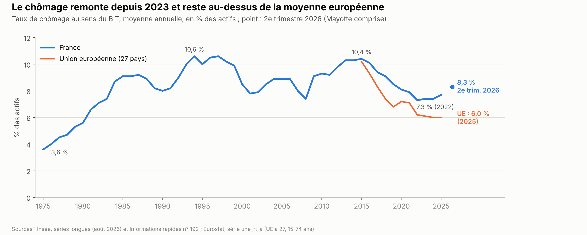
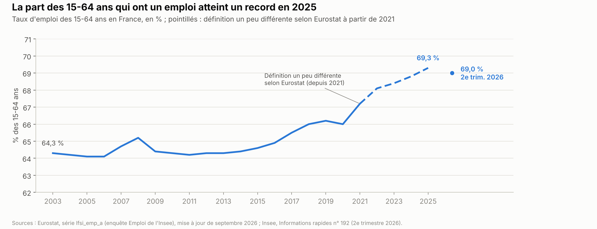
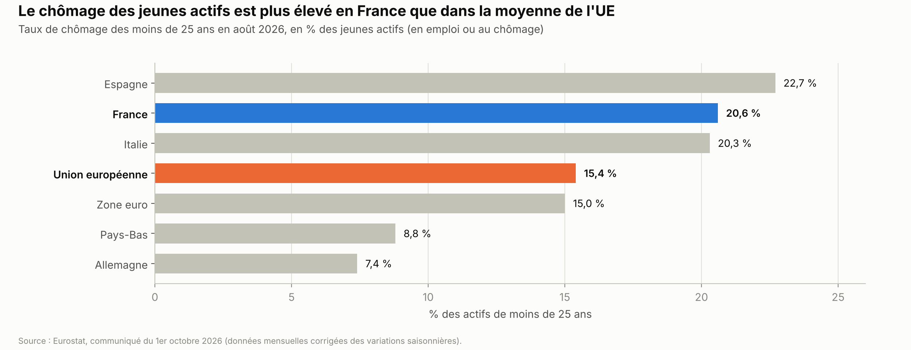
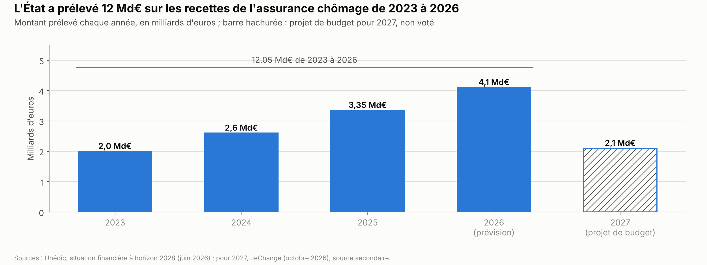
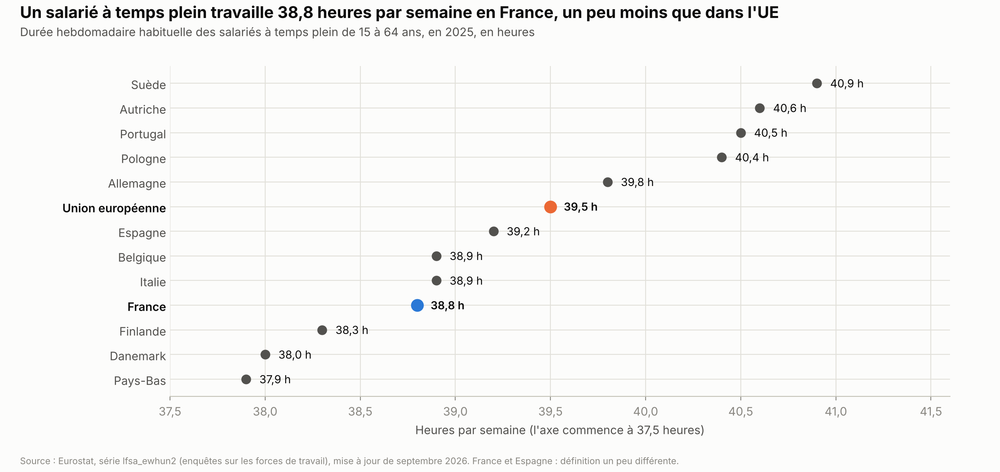
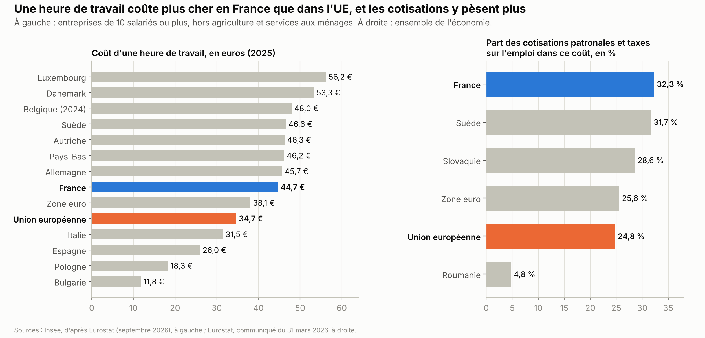

# Travail et emploi

*Version de travail du 9 octobre 2026. Les chiffres seront mis à jour à la date d'arrêt des données de l'édition 1.*

Ce chapitre présente l'emploi et le chômage en France, chez les jeunes et chez les seniors, et les compare au reste de l'Union européenne (UE). Il décrit l'assurance chômage, France Travail, le revenu de solidarité active (RSA) et l'apprentissage. Il traite aussi du temps de travail et du coût du travail, puis des propositions des partis et de ce qu'on sait des mesures déjà essayées.

**Voir aussi :**
- [Pouvoir d'achat, salaires et inégalités](../pouvoir-achat/pouvoir_achat.md), pour le SMIC, les salaires, la prime d'activité et la « trappe à bas salaires » ;
- [Retraites et productivité](../retraites-productivite/retraites_productivite.md), pour l'âge de départ, les heures travaillées par habitant et l'emploi des seniors par pays ;
- [Finances publiques](../finances-publiques/finances_publiques.md), pour le budget de l'État et la place des aides aux entreprises dans la dépense publique ;
- [Éducation](../education/remuneration_enseignants.md), pour la voie professionnelle et les jeunes sortis de l'école sans diplôme ;
- [Immigration](../immigration/immigration.md), pour l'emploi et le chômage des immigrés ;
- [Santé et assurance maladie](../sante/sante_assurance_maladie.md), pour les arrêts de travail ;
- [Présidentielle 2027 : ce que proposent les partis](../partis/programmes_partis_2027.md), pour les programmes complets.

> **Repères.**
> - **Chômeur, actif, en emploi.** Un **chômeur**, au sens du Bureau international du travail (BIT), n'a pas travaillé du tout pendant une semaine donnée, cherche un emploi et peut commencer sous deux semaines. Les **actifs** sont les personnes en emploi et les chômeurs. Le **taux de chômage** rapporte les chômeurs aux actifs ; le **taux d'emploi** rapporte les personnes en emploi à toute la population d'un âge donné.
> - **Qui mesure.** L'Institut national de la statistique et des études économiques (Insee) mesure le chômage par une enquête auprès des ménages. France Travail, l'ancien Pôle emploi, compte les **demandeurs d'emploi inscrits**, répartis en catégories : la catégorie A regroupe ceux qui n'ont pas travaillé du tout dans le mois. Les deux chiffres ne coïncident pas.
> - **Le halo autour du chômage.** Il regroupe les personnes sans emploi qui en souhaitent un, mais qui ne cherchent pas ou ne sont pas disponibles tout de suite : elles ne sont pas comptées comme chômeuses.
> - **Deux filets de sécurité.** L'**assurance chômage** verse une allocation à ceux qui ont assez travaillé ; elle est financée par des cotisations des employeurs et une part de la contribution sociale généralisée (CSG), et gérée par les syndicats et le patronat dans l'Unédic, une association qu'ils dirigent ensemble. La **solidarité** (RSA, allocation de solidarité spécifique) est financée par l'impôt et versée sous condition de ressources.
> - **Le coût du travail.** Pour un salaire brut donné, l'employeur paie en plus des **cotisations patronales** ; le salarié en paie une partie, prélevée sur le brut, qui donne le salaire net. Les **allègements** réduisent les cotisations patronales, surtout près du SMIC, et jusqu'à 3 SMIC.
> - **Durée légale et durée effective.** La **durée légale** de 35 heures par semaine est le seuil au-delà duquel les heures sont des **heures supplémentaires**, payées plus cher. Ce n'est pas un maximum : la durée réellement travaillée peut être plus longue.

---

## L'essentiel

1. **Le chômage remonte.** Il touche 8,3 % des actifs au 2e trimestre 2026, son plus haut niveau depuis 2020, contre 7,3 % en 2022 et 10,4 % en 2015. L'Insee et la Banque de France le prévoient entre 8,3 % et 8,6 % jusqu'en 2027.
2. **L'emploi est pourtant au plus haut.** En 2025, 69,3 % des 15-64 ans ont un emploi, un record depuis 1975 : la population active augmente plus vite que l'emploi. Chez les 20-64 ans, la France reste un peu sous la moyenne de l'UE.
3. **Les jeunes et les seniors restent à part.** Le chômage des moins de 25 ans atteint 20,6 % en août 2026, contre 15,4 % dans l'UE. Les 60-64 ans sont 44,4 % en emploi, contre 55,0 % dans l'UE (2025).
4. **L'assurance chômage indemnise 2,6 millions de personnes.** Ses règles ont été durcies depuis 2019. Sa dette atteint 59,2 Md€ fin 2025, et l'État a prélevé 12 Md€ sur ses recettes de 2023 à 2026.
5. **Le revenu de solidarité active (RSA) est versé à 1,85 million de foyers**, 651 € par mois pour une personne seule. Depuis 2025, ses allocataires sont inscrits à France Travail et doivent en principe suivre au moins 15 heures d'activité par semaine.
6. **Un million d'apprentis, mais moins d'entrées.** Les nouveaux contrats ont baissé à 847 000 en 2025, après la réduction des aides. Le coût public est estimé de 16,5 à 24 Md€ par an, selon ce qu'on compte.
7. **Le coût du travail dépasse la moyenne de l'UE.** Une heure de travail coûte 44,7 € en France, contre 34,7 € dans l'UE, mais 45,7 € en Allemagne (2025). La part des cotisations patronales y est la plus élevée de l'UE. Les baisses de cotisations patronales sur les bas salaires coûtent ≈ 75 Md€ par an.

**Les grandes options en débat.**
- **Assurance chômage** : réduire la durée d'indemnisation et durcir les règles, ou revenir sur les réformes faites depuis 2019.
- **RSA et aides** : plafonner ou unifier les aides, les réserver aux Français et aux étrangers installés de longue date, ou supprimer l'obligation de 15 heures.
- **Temps de travail** : travailler plus (plus d'heures par an, heures supplémentaires sans plafond ni cotisations), ou moins (32 heures dans les métiers pénibles).
- **Coût du travail** : baisser encore les cotisations ou la contribution sociale généralisée (CSG) des salariés, recentrer les allègements, ou les réduire.
- **Jeunes et seniors** : garder ou recentrer les aides à l'apprentissage ; exonérer de cotisations le cumul d'un emploi et d'une retraite.

---

## 1. La situation

### 1.1 Emploi et chômage

**Le chômage.**
- Au 2e trimestre 2026, 2,68 millions de personnes sont au chômage au sens du BIT, soit 8,3 % des actifs. C'est 0,7 point de plus qu'un an plus tôt, et le plus haut niveau depuis le 3e trimestre 2020[^insee-ir-192]. Ce taux inclut pour la première fois Mayotte, qui l'augmente de 0,06 point[^insee-ir-192].
- En moyenne annuelle, le chômage est passé de 10,4 % en 2015 à 7,3 % en 2022, son plus bas niveau depuis 1982, puis est remonté à 7,7 % en 2025[^insee-essentiel-chomage].
- Les chômeurs depuis un an ou plus sont 671 000, soit 2,1 % des actifs, un plus haut depuis 2022[^insee-ir-192]. Ils représentent un chômeur sur quatre *(calcul)*.
- Le **halo autour du chômage** compte 1,9 million de personnes, soit 4,4 % des 15-64 ans. Le **sous-emploi**, surtout des salariés à temps partiel qui voudraient travailler plus, touche 4,4 % des personnes en emploi[^insee-ir-192].
- Les écarts entre territoires sont grands. Au 2e trimestre 2026, le taux de chômage atteint 20,4 % en Guyane et 18,8 % à La Réunion. En métropole, il va de 4,8 % dans le Cantal à 12,8 % dans les Pyrénées-Orientales[^insee-chomage-localise].

**L'emploi.**
- En 2025, 69,3 % des 15-64 ans ont un emploi : c'est le niveau le plus haut depuis que l'Insee le mesure, en 1975[^insee-ip-2096]. Le taux est redescendu à 69,0 % au 2e trimestre 2026[^insee-ir-192].
- Le chômage et l'emploi ont donc monté en même temps. La raison : la population active augmente. Au 1er trimestre 2026, 75,5 % des 15-64 ans étaient actifs, un record[^insee-ir-192]. Le recul de l'âge de la retraite (réforme de 2023) y contribue (chapitre [Retraites et productivité](../retraites-productivite/retraites_productivite.md)).
- L'emploi salarié a reculé de 48 000 postes en 2025. L'Insee prévoit un nouveau recul de 52 000 postes en 2026, surtout à cause de la baisse du nombre d'alternants ; l'emploi non salarié progresse[^insee-ndc-sept-2026].
- Les femmes de 15 à 64 ans ont un taux d'emploi de 66,7 %, contre 71,9 % pour les hommes (2025)[^insee-ip-2096].

**Les demandeurs d'emploi inscrits à France Travail.**
- Au 2e trimestre 2026, 3,32 millions de personnes sont inscrites en catégorie A, et 5,80 millions en catégories A, B et C, qui incluent celles qui ont un peu travaillé dans le mois[^dares-ft-inscrits-t2-2026].
- Depuis le 1er janvier 2025, les allocataires du RSA et les jeunes suivis par les missions locales sont inscrits d'office à France Travail (loi « pour le plein emploi » du 18 décembre 2023)[^dares-ft-inscrits-t2-2026]. Cela gonfle les chiffres : hors ces nouveaux inscrits, la catégorie A a augmenté de 1,3 % en un an, et non de 3,1 %[^dares-ft-inscrits-t2-2026].
- Un inscrit n'est pas forcément chômeur au sens du BIT. Selon l'Insee, environ un chômeur sur cinq n'est pas inscrit à France Travail, et deux inscrits en catégorie A sur cinq ne sont pas chômeurs au sens du BIT[^insee-essentiel-chomage].

**Les prévisions et le « plein emploi ».**
- L'Insee prévoit un chômage de 8,6 % fin 2026[^insee-ndc-sept-2026]. La Banque de France le prévoit à 8,3 % en moyenne en 2026 et en 2027, puis à 8,0 % en 2028[^bdf-projections-sept-2026].
- Emmanuel Macron avait fixé l'objectif de ramener le chômage à ≈ 5 %, le « plein emploi » *(source secondaire)*[^jde-plein-emploi]. Le 17 mai 2026, le ministre de l'Économie Roland Lescure a jugé cet objectif « pas atteignable d'ici l'année prochaine » *(source secondaire)*[^jde-plein-emploi].
- Les emplois **vacants**, c'est-à-dire en cours de recrutement, sont 458 000 au 2e trimestre 2026. Les offres retirées faute de candidat sont ≈ 126 000 en 2025 (Unédic, d'après France Travail)[^unedic-emplois-vacants].

### 1.2 Jeunes et seniors ; la comparaison avec l'UE

**Les jeunes.**
- En 2025, 19,8 % des actifs de 15 à 24 ans sont au chômage ; ce taux monte à 21,6 % au 2e trimestre 2026[^insee-ip-2096][^insee-ir-192]. Eurostat, qui mesure le chômage chaque mois et sans Mayotte, donne 20,6 % pour les moins de 25 ans en août 2026 (graphique ci-dessous)[^eurostat-chomage-aout-2026].
- Ce taux porte sur les jeunes actifs. La plupart des 15-24 ans étudient et ne sont pas actifs : ≈ 43 % le sont *(calcul)*. Rapportés à toute la classe d'âge, les jeunes chômeurs en représentent 8,5 %, soit environ un sur douze (2025)[^insee-ip-2096].
- En 2025, 34,5 % des 15-24 ans ont un emploi en France, comme dans la moyenne de l'UE, contre 50,8 % en Allemagne. Selon le Conseil d'analyse économique (CAE), l'écart tient « essentiellement à des différences de modèles éducatifs ». La France compte « plus de jeunes seulement en études » que l'Allemagne et le Royaume-Uni, où plus de jeunes cumulent études et emploi[^cae-focus-110].
- En 2023, 12,3 % des 15-29 ans n'étaient ni en emploi, ni en études, ni en formation (chapitre [Éducation](../education/remuneration_enseignants.md))[^insee-bfe-jeunes].

**Les seniors.**
- Le chômage des 50 ans et plus est plus faible que la moyenne : 5,5 % au 2e trimestre 2026[^insee-ir-192]. Mais quand ils sont au chômage, ils y restent plus longtemps : 39,1 % des chômeurs de 50 ans ou plus cherchent depuis un an ou plus (2025)[^insee-ip-2096].
- Le taux d'emploi des 50-64 ans atteint 69,2 % en 2025, son plus haut niveau depuis 1975[^insee-ip-2096]. Celui des 60-64 ans progresse vite avec le recul de l'âge de la retraite : 45,8 % au 2e trimestre 2026[^insee-ir-192].
- Il reste plus bas que dans l'UE : en 2025, 44,4 % des 60-64 ans ont un emploi en France, contre 55,0 % en moyenne dans l'UE (Eurostat ; graphique de « L'essentiel » du chapitre Retraites)[^eurostat-emploi-6064].
- Une loi du 24 octobre 2025 oblige les entreprises d'au moins 300 salariés à négocier sur l'emploi des seniors tous les trois ans. Elle crée un « contrat de valorisation de l'expérience » pour embaucher en contrat à durée indéterminée (CDI) un chômeur d'au moins 60 ans *(source secondaire)*[^cnfce-loi-seniors].

**La comparaison avec l'UE.**
- En août 2026, le taux de chômage est de 8,2 % en France selon Eurostat, contre 6,1 % dans l'UE. Il est de 4,0 % en Allemagne et aux Pays-Bas, de 6,2 % en Italie et de 10,0 % en Espagne[^eurostat-chomage-aout-2026]. Le chiffre d'Eurostat diffère un peu de celui de l'Insee : il est mensuel et n'inclut pas Mayotte.
- En 2015, le chômage était presque le même en France et dans l'UE (10,4 % et 10,2 %). Il a baissé plus vite ailleurs : en 2025, l'écart est de 1,7 point (7,7 % contre 6,0 %)[^insee-essentiel-chomage][^eurostat-une-rt-a].
- En 2025, 75,4 % des 20-64 ans ont un emploi en France, contre 76,1 % dans l'UE et 81,1 % en Allemagne[^eurostat-emploi-20-64]. L'UE s'est fixé un objectif d'au moins 78 % en 2030[^ce-objectifs-2030].

### 1.3 L'assurance chômage

**Qui paie, qui décide.**
- L'assurance chômage est gérée par l'Unédic, que dirigent les syndicats et le patronat. Ses recettes ont atteint 45,4 Md€ en 2025[^unedic-situation-2028]. Elles viennent d'une cotisation des employeurs, de 4,00 % du salaire brut depuis mai 2025[^unedic-convention-2024], et d'une part de la CSG, 17,6 Md€ en 2025, soit ≈ 40 % des contributions *(calcul)*[^unedic-situation-2028]. Les salariés ne paient plus de cotisation chômage depuis le 1er octobre 2018 *(source secondaire)*[^tissot-cotisation-2018].
- L'Unédic finance aussi France Travail : 11 % de ses recettes, soit 5,0 Md€ en 2025[^unedic-situation-2028].
- Les règles sont fixées par une convention négociée par les syndicats et le patronat, puis agréée par le gouvernement. Depuis 2018, le gouvernement envoie d'abord un document de cadrage avec des objectifs, notamment d'économies. Si la négociation échoue, il fixe les règles par décret, comme en 2019 *(à vérifier)*. Certains critères relèvent de la loi[^senat-488].

**Les règles en vigueur (octobre 2026).**
- Pour être indemnisé, il faut avoir travaillé au moins 6 mois, 5 mois pour les saisonniers[^unedic-convention-2024].
- Depuis février 2023, la durée d'indemnisation est réduite d'un quart tant que le chômage reste sous 9 % ; elle ne peut pas descendre sous 6 mois[^unedic-situation-2028]. Depuis 2021, l'allocation des salariés les mieux payés de moins de 55 ans baisse à partir du 7e mois[^senat-488].
- Depuis 2023, un abandon de poste est traité comme une démission, qui n'ouvre pas de droits *(à vérifier)*. Depuis 2024, un salarié en contrat court ou en intérim qui refuse deux fois en un an un CDI pour un emploi semblable perd l'allocation *(source secondaire)*[^previssima-refus-cdi].
- Une loi du 11 juin 2026 réduit la durée d'indemnisation après une rupture conventionnelle, un départ négocié entre l'employeur et le salarié *(source secondaire)*[^tissot-loi-rc]. Elle transpose un accord du 25 février 2026 signé par trois organisations patronales et trois syndicats[^senat-488]. Côté patronal : le Mouvement des entreprises de France (Medef), la Confédération des petites et moyennes entreprises (CPME) et l'Union des entreprises de proximité (U2P). Côté syndical : la Confédération française démocratique du travail (CFDT), Force ouvrière (FO) et la Confédération française des travailleurs chrétiens (CFTC). La Confédération générale du travail (CGT) et la Confédération française de l'encadrement-Confédération générale des cadres (CFE-CGC) ne l'ont pas signé[^senat-488]. Elle doit s'appliquer à partir du 1er septembre 2026 *(source secondaire, à vérifier)*[^tissot-loi-rc].

| Durée maximale d'indemnisation | Cas général | Après une rupture conventionnelle (depuis septembre 2026) |
|---|---|---|
| Moins de 55 ans | 18 mois | 15 mois |
| 55 et 56 ans | 22,5 mois | 20,5 mois |
| 57 ans et plus | 27 mois | 20,5 mois |

*Sources : Sénat, rapport n° 488 (mars 2026)[^senat-488] ; Unédic, convention du 15 novembre 2024[^unedic-convention-2024]. Durées en vigueur, réduction d'un quart liée à la conjoncture comprise. Si le chômage atteignait 9 %, elles remonteraient à 24, 30 et 36 mois dans le cas général *(calcul)*.*

- Les ruptures conventionnelles sont passées de 192 278 en 2009 à 514 768 en 2024. Elles représentaient 26 % des dépenses d'allocation, soit 9,4 Md€, en 2024[^senat-488]. L'Unédic attend 940 M€ d'économies par an, une fois la réforme entièrement appliquée[^senat-488].

**Combien sont indemnisés.**
- En 2025, l'assurance chômage a indemnisé 2,62 millions de personnes en moyenne[^unedic-situation-2028]. En comptant les allocations de solidarité, 3,05 millions de demandeurs d'emploi étaient indemnisés fin 2025[^ft-indemnises-t4-2025].
- Tous les inscrits ne sont pas indemnisés : selon l'Unédic, 40 % des 5,7 millions d'inscrits l'étaient par l'assurance chômage en 2025[^unedic-inscrits-indemnises]. Le rapport entre 2,62 et 5,7 millions donnerait 46 % : les bases diffèrent sans doute *(à vérifier)*. Beaucoup n'ont pas assez travaillé, ont épuisé leurs droits, ou travaillent dans le mois.

**Les comptes et la dette.**
- L'Unédic a dégagé un excédent de 0,1 Md€ en 2025 et prévoit un déficit de 2,3 Md€ en 2026. Sa dette atteint 59,2 Md€ fin 2025 et 61,5 Md€ fin 2026, contre 36,8 Md€ fin 2019, avant la crise du Covid-19[^unedic-situation-2028][^unedic-previsions-mars-2026].
- De 2023 à 2026, l'État a prélevé 12,05 Md€ sur ses recettes, en lui compensant moins les baisses de cotisations patronales[^unedic-situation-2028]. Sans ces prélèvements, la dette serait tombée à 43,4 Md€ fin 2028, selon l'Unédic[^unedic-situation-2028]. Le projet de budget pour 2027 prévoit un nouveau prélèvement de 2,1 Md€ *(source secondaire)*[^jechange-unedic-2027].
- Pour Patricia Ferrand et Jean-Eudes Tesson, présidente et vice-président de l'Unédic, « l'assurance chômage ne doit pas être une variable d'ajustement des finances publiques ». Ils l'ont écrit dans une tribune au *Monde*, dont la date n'a pas été relevée *(source secondaire)*[^jechange-unedic-2027].

**Les réformes depuis 2019.**
- 2019-2021 : il faut avoir travaillé 6 mois au lieu de 4. L'allocation est calculée autrement, ce qui la réduit pour ceux qui alternent contrats courts et chômage. Un bonus-malus s'applique aux cotisations des entreprises de sept secteurs qui utilisent beaucoup les contrats courts[^unedic-eval-2019-2021].
- 2023 : durée réduite d'un quart selon la conjoncture ; abandon de poste traité comme une démission[^unedic-situation-2028].
- 2024 : le gouvernement Attal prévoyait d'exiger 8 mois de travail sur 20 et de ramener la durée maximale de 18 à 15 mois. Il a suspendu ce projet le 30 juin 2024, au soir du premier tour des élections législatives *(source secondaire)*[^publicsenat-suspension-2024].
- 2025 : le gouvernement Bayrou demande 4 Md€ d'économies par an à partir de 2030 ; le gouvernement Lecornu retire cette demande et limite la négociation aux ruptures conventionnelles (lettre du 29 novembre 2025)[^senat-488].

### 1.4 France Travail

- Pôle emploi est devenu France Travail le 1er janvier 2024, en application de la loi « pour le plein emploi » de décembre 2023. Le « réseau pour l'emploi » réunit France Travail, les missions locales pour les jeunes, Cap emploi pour les personnes handicapées et les départements pour les allocataires du RSA *(à vérifier)*.
- Depuis 2025, chaque inscrit signe un **contrat d'engagement**. Il prévoit au moins 15 heures d'activité par semaine : formation, stage en entreprise, démarches. Cette durée peut être réduite selon la situation de la personne *(à vérifier)*.
- Un décret du 30 mai 2025 a revu les sanctions *(source secondaire)*[^bdt-decret-sanctions]. Pour le RSA, le conseil départemental peut suspendre au moins 30 % de l'allocation pendant un à deux mois. En cas de récidive, il peut la suspendre de nouveau ou la supprimer. Les sommes sont reversées si la personne se remet en règle *(source secondaire)*[^bdt-decret-sanctions].
- Au 1er trimestre 2026, ≈ 630 000 personnes étaient dans la catégorie d'attente créée en 2025 pour les allocataires du RSA pas encore orientés *(source secondaire)*[^ash-plein-emploi].
- Les moyens baissent. Le projet de budget pour 2026 réduisait de 12 % la subvention de l'État à France Travail et supprimait 515 emplois, ≈ 1 % des effectifs[^senat-essentiel-travail-plf2026].

### 1.5 Le RSA et les autres aides

**Le RSA.**
- Le RSA garantit un revenu minimum aux personnes de 25 ans ou plus, ou plus jeunes avec des enfants, qui ont peu ou pas de ressources. Il est versé par les caisses d'allocations familiales et financé par les départements *(à vérifier)*.
- Depuis le 1er avril 2026, il s'élève à 651,09 € par mois pour une personne seule sans enfant *(source secondaire)*[^centre-inffo-revalo-2026], soit ≈ 44 % du SMIC net *(calcul)*.
- Au 1er trimestre 2026, 1,85 million de foyers le reçoivent, 1,7 % de plus qu'un an plus tôt ; en comptant les conjoints et les enfants, 3,6 millions de personnes sont couvertes[^cnaf-rsa-conjoncture-50]. Les versements ont atteint 12,3 Md€ d'avril 2025 à mars 2026[^cnaf-rsa-conjoncture-50].
- Beaucoup de personnes qui y ont droit ne le demandent pas. Selon la Direction de la recherche, des études, de l'évaluation et des statistiques (DREES), un tiers des foyers éligibles (34 %) ne le touchaient pas chaque trimestre en 2018. Un sur cinq ne le touchait pas de façon durable[^drees-non-recours].
- Les obligations d'activité ont d'abord été testées en 2023-2024 dans des départements pilotes, puis généralisées en 2025 avec la loi « pour le plein emploi »[^dares-ipp-rsa-2026]. Leurs effets sont présentés en section 4.

**Les autres aides.**
- L'allocation de solidarité spécifique (ASS) est versée par l'État aux chômeurs en fin de droits qui ont assez travaillé : 19,48 € par jour, soit ≈ 584 € par mois *(calcul)*, depuis avril 2026 *(source secondaire)*[^centre-inffo-revalo-2026].
- La prime d'activité complète les revenus des travailleurs aux bas salaires ; elle est présentée dans le chapitre [Pouvoir d'achat](../pouvoir-achat/pouvoir_achat.md).
- **Travailler rapporte-t-il plus que le RSA ?** Selon les cas types de la DREES de janvier 2025, une personne seule locataire dispose de 873 € par mois sans emploi (RSA et aide au logement). Avec un SMIC à temps plein, elle dispose de 1 673 € (salaire et prime d'activité) *(source secondaire)*[^presse-citron-drees]. L'écart diminue à temps partiel.

**Le projet d'« allocation de solidarité unifiée ».**
- Fin 2025, Sébastien Lecornu a annoncé une « allocation sociale unique », devenue ensuite « allocation de solidarité unifiée »[^ifrap-asu]. Le projet vise à harmoniser le calcul du RSA, de la prime d'activité et des aides au logement, ≈ 42 Md€ par an au total, sans les fusionner[^ifrap-asu][^previssima-asu]. Selon la presse, il ne serait pas entièrement appliqué avant 2030 *(source secondaire)*[^previssima-asu].
- Le Conseil d'État a émis des réserves. Le 13 mai 2026, le ministre du Travail Jean-Pierre Farandou a jugé qu'« on sera peut-être amené à réécrire en partie le texte » *(source secondaire)*[^linfodurable-asu]. Fin mai 2026, le gouvernement l'a retiré de l'ordre du jour du Conseil des ministres pour le retravailler *(source secondaire)*[^bdt-asu-report]. Aucune nouvelle date n'a été trouvée.

### 1.6 L'apprentissage et les dispositifs pour les jeunes

**Les chiffres.**
- Un apprenti alterne une formation et un emploi dans une entreprise, qui le paie. Les nouveaux contrats sont passés d'≈ 280 000 par an en 2015-2017 à 889 400 en 2024[^unedic-apprentissage-2022][^dares-apprentissage-2024].
- En 2025, ils ont baissé pour la première fois depuis 2017, à 847 000 (−4,9 %)[^ofce-pb-157]. Le nombre d'apprentis en cours de contrat dépasse le million : 1 048 800 fin 2024, en hausse de 3 % en un an, et 1,017 million fin 2025[^dares-apprentissage-2024][^ofce-pb-157].
- La hausse s'est faite surtout dans l'enseignement supérieur : ≈ 61 % des nouveaux contrats de 2024 préparent un diplôme du supérieur *(calcul)*, contre 34 % en 2015 selon la Cour des comptes[^dares-apprentissage-2024][^centre-inffo-cour-apprentissage].
- Les apprentis comptent comme des salariés. En 2025, ils représentent 4,8 % de l'emploi salarié privé[^ofce-pb-157].

**Les aides et leur baisse.**
- À partir de juillet 2020, dans le plan de relance, l'État a versé une aide de 5 000 à 8 000 € pour chaque embauche d'apprenti, puis de 6 000 € en 2023 et 2024[^dares-apprentissage-2024]. Depuis 2025, elle est de 5 000 € dans les entreprises de moins de 250 salariés et de 2 000 € au-delà[^legisocial-aide-apprentis-2026].
- Depuis un décret du 6 mars 2026, elle dépend aussi du diplôme. Dans les entreprises de moins de 250 salariés, elle est de 5 000 € jusqu'au bac et de 4 500 € pour un bac+2. Elle tombe à 2 000 € pour une licence ou un master *(source secondaire)*[^legisocial-aide-apprentis-2026]. Depuis juillet 2025, l'employeur paie aussi 750 € pour un apprenti qui prépare un diplôme de niveau bac+3 ou plus *(source secondaire)*[^bpi-participation-750].
- Selon la presse, le projet de budget pour 2027 reconduit ce barème *(source secondaire)*[^previssima-apprentissage-2027].

**Le coût public.**
- L'Observatoire français des conjonctures économiques (OFCE), centre de recherche de Sciences Po, estime le coût public total de l'apprentissage à 24,1 Md€ en 2024, puis 22,2 Md€ en 2025[^ofce-pb-157].
- La Cour des comptes l'estime à 16,5 Md€ en 2023, dont 7,5 Md€ pour l'État et 8,7 Md€ pour France compétences, qui finance la formation *(source secondaire)*[^centre-inffo-cour-apprentissage].
- L'écart vient de ce qui est compté. L'OFCE ajoute les exonérations de cotisations des apprentis et de leurs employeurs (8,2 Md€), d'impôt sur le revenu, la prime d'activité et les allocations chômage d'anciens apprentis[^ofce-pb-157]. Sans ces postes, son total tombe à ≈ 14 Md€ *(calcul)*, proche de celui de la Cour.
- France compétences a accumulé un besoin de financement d'≈ 20 Md€ depuis 2021, selon l'OFCE[^ofce-pb-157].

**Les autres dispositifs.**
- Le **contrat d'engagement jeune**, créé en 2022, accompagne les jeunes sans emploi ni formation avec une allocation. Les missions locales en suivaient ≈ 200 000 en 2025, et France Travail ≈ 85 000[^senat-np-travail-plf2026].
- Le **compte personnel de formation** (CPF) finance des formations choisies par les salariés. Ses dépenses sont passées d'un pic de 2,7 Md€ en 2021 à ≈ 1,9 Md€ en 2025 ; depuis 2024, le salarié paie une partie de la formation[^senat-np-travail-plf2026].

### 1.7 Le temps de travail

**Les règles.**
- La durée légale du travail est de 35 heures par semaine, ou 1 607 heures par an[^sp-heures-sup-f2391]. Elle vient des lois Aubry du 13 juin 1998 et du 19 janvier 2000. Elle s'applique depuis le 1er février 2000 dans les entreprises de plus de 20 salariés, et depuis le 1er janvier 2002 dans les autres[^eurofound-35h].
- Au-delà, les heures supplémentaires sont payées 25 % de plus pour les huit premières et 50 % ensuite. Un accord d'entreprise peut ramener cette majoration à 10 % au minimum[^sp-heures-sup-f2391].
- Sans accord, un salarié peut faire au plus 220 heures supplémentaires par an : c'est le « contingent », fixé par un décret. Au-delà, l'employeur doit accorder un repos en plus[^sp-heures-sup-f2391].
- La durée maximale reste de 48 heures dans une semaine, et de 44 heures en moyenne sur 12 semaines[^sp-duree-f1911]. Le droit européen limite aussi la moyenne à 48 heures *(à vérifier)*. Les cadres autonomes peuvent être payés au forfait, en jours par an *(à vérifier)*.
- Depuis 2019, les heures supplémentaires ne supportent pas de cotisations salariales de retraite. Elles sont exonérées d'impôt sur le revenu, jusqu'à 7 500 € par an depuis 2022[^sp-heures-sup-f2391]. L'État compense aussi une déduction de cotisations patronales : 884 M€ prévus en 2026[^senat-np-travail-plf2026].

**La durée réellement travaillée.**
- En 2025, un salarié à temps plein travaille 38,8 heures par semaine en France, contre 39,5 heures dans la moyenne de l'UE et 39,8 heures en Allemagne[^eurostat-duree-hebdo].
- Le classement change si l'on compte toutes les personnes en emploi, temps partiel compris. Avec 1 500 heures par an, la France est au-dessus de l'Allemagne (1 336 heures), mais sous la moyenne de l'UE (1 604 heures). Le temps partiel y est en effet moins fréquent qu'en Allemagne (chapitre [Retraites et productivité](../retraites-productivite/retraites_productivite.md))[^ch-retraites].
- Par habitant, en comptant ceux qui ne travaillent pas, la France travaille moins que ses voisins. Selon le Conseil d'analyse économique (CAE), cet écart vient du faible taux d'emploi des jeunes et des seniors, pas de la durée du travail de ceux qui ont un emploi (chapitre Retraites)[^ch-retraites].

**Le débat sur les jours fériés.**
- En juillet 2025, le gouvernement de François Bayrou a proposé de supprimer deux jours fériés, le lundi de Pâques et le 8 mai, pour un rendement de 4,2 Md€ *(source secondaire)*[^publicsenat-jours-feries]. En novembre 2024, le Sénat avait déjà voté 7 heures de travail non payées par an au profit des personnes âgées et handicapées, mesure retirée ensuite[^publicsenat-jours-feries].
- Le 13 septembre 2025, Sébastien Lecornu, nouveau Premier ministre, a déclaré : « J'ai décidé de retirer la suppression de deux jours fériés » *(source secondaire)*[^lalibre-lecornu-feries].

### 1.8 Le coût du travail et les baisses de cotisations

**Ce que coûte une heure de travail.**
- En 2025, une heure de travail coûte en moyenne 44,7 € aux entreprises françaises du secteur marchand, contre 34,7 € dans l'UE. Elle coûte 45,7 € en Allemagne, 31,5 € en Italie et 26,0 € en Espagne[^insee-cout-horaire-ue].
- Ce coût a augmenté de 2,0 % en France en 2025, la hausse la plus faible de la zone euro[^eurostat-cout-horaire-2025].
- La France se distingue surtout par la part des cotisations patronales et des taxes sur l'emploi : 32,3 % du coût du travail, la plus élevée de l'UE, contre 24,8 % en moyenne[^eurostat-cout-horaire-2025].
- Pour un célibataire au salaire moyen, impôts et cotisations prennent 47,2 % du coût total pour l'employeur en 2025. La moyenne des pays de l'Organisation de coopération et de développement économiques (OCDE) est de 35,1 %, et l'Allemagne est à 49,3 %. Ce « coin socio-fiscal » est plus bas pour les bas salaires : 41,2 % aux deux tiers du salaire moyen[^ocde-taxing-wages-2026].

**Trente ans de baisses de cotisations.**
- Depuis 1993, les gouvernements successifs réduisent les cotisations patronales sur les bas salaires, pour rendre l'embauche des moins qualifiés moins coûteuse[^bozio-wasmer-2024]. Les dispositifs se sont succédé : allègements Balladur (1993) et Juppé (1995-1996), puis allègements liés aux 35 heures (1998-2002) et « réduction Fillon » (2003). Sont venus ensuite le crédit d'impôt pour la compétitivité et l'emploi (CICE, 2013), le Pacte de responsabilité (2015-2016) et la transformation du CICE en baisse de cotisations (2019)[^bozio-wasmer-2024].
- Depuis le 1er janvier 2026, une « réduction générale dégressive unique » les remplace. Au SMIC de janvier 2026, dans une entreprise de moins de 50 salariés, elle réduit les cotisations patronales de 39,8 % du salaire brut, soit ≈ 726 € par mois[^sp-rgdu]. La réduction diminue avec le salaire, vaut encore ≈ 2 % juste sous 3 SMIC, puis s'annule *(lecture du texte)*. À 2 SMIC, elle vaut ≈ 195 € par mois *(calcul)*.
- Ces allègements coûtent 75 Md€ en 2023 selon le rapport d'Antoine Bozio et Étienne Wasmer, et 77 Md€ en 2024 selon le CAE[^bozio-wasmer-2024][^cae-91], soit ≈ 2,5 % du PIB *(calcul)*. En ajoutant les exonérations ciblées (outre-mer, apprentis, aide à domicile, heures supplémentaires), on dépasse 90 Md€ (chapitre [Santé](../sante/sante_assurance_maladie.md))[^ch-sante]. L'État compense l'essentiel de ces pertes à la Sécurité sociale *(à vérifier)*.
- Le projet de budget de la Sécurité sociale pour 2027 réduirait les allègements de 3,7 Md€ *(source secondaire)*[^legifiscal-plfss-2027].

**L'effet de « trappe ».** Comme la réduction baisse quand le salaire augmente, une hausse de salaire au-dessus du SMIC coûte à l'employeur plus du double de ce que gagne le salarié. Au niveau du SMIC, donner 100 € net de plus à un salarié coûte 242 € à l'employeur[^bozio-wasmer-2024]. Sous le salaire médian, une hausse de 100 € du revenu disponible coûte « entre 300 et 400 € », selon le CAE[^cae-91]. Le 7 octobre 2026, le ministre du Travail a annoncé un groupe de travail sur ces allègements, qui font selon lui « une trappe à Smic » *(source secondaire)*[^moneyvox-farandou-allegements]. Le détail est dans le chapitre [Pouvoir d'achat](../pouvoir-achat/pouvoir_achat.md).

**Le budget de l'emploi.** Les crédits de la mission budgétaire « Travail, emploi » ont culminé à 21,4 Md€ en 2024 *(source secondaire)*[^publicsenat-budget-travail-2027]. Le projet de budget pour 2026 les ramenait à ≈ 17,7 Md€, surtout en réduisant les aides à l'apprentissage[^senat-essentiel-travail-plf2026]. Pour 2027, le plafond de dépenses du ministère du Travail est de 18,7 Md€, avec ≈ 2,5 Md€ d'économies annoncées *(source secondaire)*[^publicsenat-budget-travail-2027]. Le périmètre du ministère diffère de celui de la mission *(à vérifier)*.

---

## 2. Ce qui fait débat

### Question 1. L'assurance chômage : durcir les règles pour pousser au retour à l'emploi, ou mieux protéger ?

**Le constat.** Les règles ont été durcies plusieurs fois depuis 2019, en dernier lieu pour les ruptures conventionnelles en 2026 (section 1.3). Le chômage remonte depuis 2023, et la dette de l'Unédic ne baisse plus, en partie à cause des prélèvements de l'État.

**Pour réduire la durée ou durcir les conditions.**
- Renaissance veut une réforme « qui incite au travail » et qui « créerait 100 000 emplois supplémentaires »[^attal-travail-salaires]. Horizons propose d'indemniser « douze mois maximum pour les moins de 50 ans », en citant l'Allemagne *(source secondaire)*[^lcp-philippe-chomage]. LR veut supprimer l'allocation après le troisième refus d'une offre d'emploi et réduire l'indemnisation après une rupture conventionnelle *(source secondaire)*[^publicsenat-lr-fete-finie].
- Argument : quand la durée d'indemnisation passe de 7 à 15 mois, les chômeurs restent au chômage deux mois et demi de plus en moyenne, sans trouver de meilleurs emplois ensuite (Thomas Le Barbanchon, 2013)[^ipp-le-barbanchon]. La baisse progressive des allocations les plus élevées a augmenté la reprise d'emploi de 4,5 points en un an (Unédic, 2025)[^unedic-eval-2019-2021].
- Limite : le nouveau calcul de 2021 a accéléré le retour à l'emploi, mais surtout vers des contrats de moins de six mois[^unedic-eval-2019-2021]. Aucune évaluation indépendante des économies attendues n'a été trouvée.

**Pour revenir sur les réformes.**
- LFI veut « supprimer les réformes successives liées au calcul de l'allocation chômage », et ouvrir des droits en cas de démission[^lfi-chapitre-8]. La CGT et la CFE-CGC n'ont pas signé l'accord de 2026 sur les ruptures conventionnelles, et les sénateurs socialistes ont annoncé qu'ils ne voteraient pas sa transposition[^senat-488].
- Argument : la réforme de 2021 a réduit l'allocation de 16 % en moyenne pour ≈ 1,1 million de personnes[^unedic-eval-2019-2021]. Selon l'Unédic, 40 % des inscrits à France Travail sont indemnisés par l'assurance chômage[^unedic-inscrits-indemnises].
- Limite : LFI ne chiffre pas le coût de son retour en arrière.

**Le rôle de l'État.** Le gouvernement prélève une partie des recettes de l'Unédic depuis 2023 (12,05 Md€ de 2023 à 2026, 2,1 Md€ prévus en 2027)[^unedic-situation-2028][^jechange-unedic-2027]. En juin 2026, son vice-président Jean-Eudes Tesson a demandé « l'abandon de tout nouveau prélèvement de l'État »[^unedic-previsions-juin-2026]. Le ministre du Travail a déclaré, sur le prélèvement de 2027 : « Cela aurait pu être plus » *(source secondaire)*[^jechange-unedic-2027].

### Question 2. Le RSA et les aides : conditionner, plafonner, unifier, ou garantir un revenu ?

**Le constat.** Depuis 2025, les allocataires du RSA doivent en principe suivre au moins 15 heures d'activité par semaine (section 1.4). Un tiers des foyers qui y ont droit ne le demandent pas (2018)[^drees-non-recours]. Selon les cas types de la DREES, un salarié au SMIC à temps plein dispose de ≈ 800 € de plus par mois qu'une personne sans emploi *(calcul, source secondaire)*[^presse-citron-drees].

**Pour renforcer les conditions ou plafonner.**
- LR propose un « compte social unique » qui plafonne l'ensemble des aides à 70 % du SMIC, et un revenu fusionnant le RSA, la prime d'activité et l'ASS, avec 15 heures d'activité *(source secondaire)*[^publicsenat-lr-fete-finie]. Une proposition de loi de Laurent Wauquiez (LR) limite le RSA à deux ans pour les personnes aptes à travailler[^an-ppl-2227-wauquiez].
- Le RN veut réserver les « prestations de solidarités » aux Français et aux étrangers qui ont travaillé au moins cinq ans en France, en équivalent temps plein (ETP)[^rn-contre-budget-2026]. Reconquête veut retirer les aides non contributives aux étrangers non européens. Cette position vient du comparateur de la Fondation pour la recherche sur les administrations et les politiques publiques (IFRAP), d'orientation libérale *(à vérifier)*[^ifrap-comparateur-travail].
- Argument : l'accompagnement renforcé a augmenté de 3,2 points en un an l'emploi salarié des allocataires du RSA qui l'ont suivi. Sur l'ensemble des allocataires des zones pilotes, la hausse est de 0,9 point à six mois[^dares-ipp-rsa-2026]. L'évaluation a été menée en 2026 par la Direction de l'animation de la recherche, des études et des statistiques (Dares) du ministère du Travail et l'Institut des politiques publiques (IPP).
- Limite : près des deux tiers de l'effet sur l'emploi durable passent par des contrats aidés. Les gains sont en partie compensés par une baisse chez les allocataires voisins[^dares-ipp-rsa-2026]. Les sanctions n'ont pas été évaluées. Une condition de cinq ans de résidence pour des prestations a été censurée par le Conseil constitutionnel en 2024[^cc-2024-6-rip].

**Pour unifier le calcul.** Le gouvernement veut harmoniser le calcul du RSA, de la prime d'activité et des aides au logement, pour qu'un revenu du travail en plus réduise moins les aides (section 1.5)[^previssima-asu]. Le projet est en suspens depuis mai 2026[^bdt-asu-report]. Aucune estimation des gagnants et des perdants n'a été trouvée.

**Pour garantir un revenu sans contrepartie obligatoire.**
- LFI est « contre les 15h d'activité hebdomadaire » ; elle propose une « garantie d'emploi » présentée « comme une offre aux personnes privées d'emploi et non comme une obligation »[^lfi-chapitre-8].
- Argument : les Territoires zéro chômeur de longue durée, une forme de garantie d'emploi locale, augmentent l'emploi des personnes embauchées de 74 points en deux ans[^tzcld-2025].
- Limite : la même évaluation ne trouve pas d'effet positif sur l'emploi des territoires concernés, et chaque emploi coûte 11 300 à 13 700 € net par an[^tzcld-2025].

### Question 3. Le temps de travail : travailler plus, ou moins ?

**Le constat.** Un salarié à temps plein travaille 38,8 heures par semaine en France, un peu moins que la moyenne de l'UE (39,5 heures)[^eurostat-duree-hebdo]. L'écart d'heures travaillées par habitant avec l'Allemagne vient surtout du taux d'emploi des jeunes et des seniors (section 1.7).

**Pour travailler plus.**
- Renaissance veut « supprimer le plafond d'heures supplémentaires », aujourd'hui de 220 heures par an à défaut d'accord[^attal-travail-salaires]. LR veut « sortir des 35 heures » : la durée annuelle passerait de 1 607 à 1 623 heures. Au-delà de 1 607 heures, ce serait « zéro cotisation et zéro impôt », hors CSG et contribution au remboursement de la dette sociale (CRDS) *(source secondaire)*[^publicsenat-lr-fete-finie].
- Argument : plus d'heures augmente la production et les recettes. Selon le gouvernement Bayrou, deux jours fériés travaillés devaient rapporter 4,2 Md€ par an *(source secondaire)*[^publicsenat-jours-feries].
- Limite : la défiscalisation des heures supplémentaires de 2007 n'a pas augmenté le nombre d'heures travaillées. Elle a surtout augmenté les heures déclarées, avec un « fort effet d'aubaine », pour plus de 4,5 Md€ par an (section 4)[^ipp-cahuc-carcillo][^an-rapport-4220].

**Pour travailler moins.**
- LFI veut « rétablir immédiatement la durée légale hebdomadaire à 35 heures », c'est-à-dire limiter les exceptions, et passer aux 32 heures dans les métiers pénibles ou de nuit *(à vérifier)*[^votons-lfi-travail]. Les Écologistes écrivent qu'« il ne s'agit pas de travailler plus, mais de travailler mieux »[^ecologistes-programme].
- Argument : les 35 heures ont accompagné la création d'≈ 350 000 emplois de 1998 à 2002, selon les évaluations de la Dares[^insee-es-376-rtt].
- Limite : ces emplois sont dus à un ensemble de mesures : baisse de la durée, allègements de cotisations, modération des salaires. En Alsace-Moselle, où les 35 heures ont été appliquées de façon moins stricte, l'emploi n'a pas évolué différemment (Chemin et Wasmer, 2009)[^chemin-wasmer-2009]. Aucune évaluation française n'existe pour les 32 heures.

### Question 4. Les baisses de cotisations : les garder, les recentrer, ou les réduire ?

**Le constat.** Les allègements de cotisations patronales coûtent ≈ 75 Md€ par an (section 1.8). La part des cotisations patronales dans le coût du travail est la plus élevée de l'UE[^eurostat-cout-horaire-2025].

**Pour baisser encore le coût du travail.**
- Renaissance veut baisser les cotisations des salariés, « en réduisant les charges salariales pour faire monter le salaire net »[^attal-travail-salaires]. Elle veut aussi « revenir sur les hausses du coût du travail » intervenues depuis 2024 *(source secondaire)*[^lcp-debat-medef]. LR prévoit « 15 milliards d'euros rendus » aux entreprises « par une réforme du financement de la protection sociale » *(source secondaire)*[^contrepoints-retailleau]. Sarah Knafo (Reconquête) propose de supprimer la CSG sur les revenus du travail (chapitre Finances publiques)[^ch-finances-publiques].
- Le patronat (Medef, CPME, U2P) écrit que « même avec ces allègements, le travail coûte plus cher ici qu'ailleurs »[^medef-cpme-u2p-2025].
- Argument : les allègements sur les bas salaires ont eu des effets importants sur l'emploi dans les années 1990, et ils restent efficaces pour les bas salaires et les jeunes[^bozio-wasmer-2024][^cae-91].
- Limite : selon le rapport Bozio-Wasmer, leur efficacité est moindre aujourd'hui, les réductions étant déjà élevées[^bozio-wasmer-2024]. Le financement de la suppression de la CSG sur le travail n'est pas précisé.

**Pour les recentrer.**
- Le rapport Bozio-Wasmer (2024) estime que « réduire la pente des allègements devrait donc être un objectif de toute piste de réforme »[^bozio-wasmer-2024]. Le CAE recommande de « désindexer les allègements généraux du Smic »[^cae-91]. Le ministre du Travail a annoncé un groupe de travail en octobre 2026 *(source secondaire)*[^moneyvox-farandou-allegements].
- Argument : selon les simulations du même rapport, recentrer les allègements à budget constant créerait 10 000 à 20 000 emplois[^bozio-wasmer-2024].
- Limite : supprimer les taux réduits des cotisations maladie et famille sans recycler l'économie ferait perdre ≈ 61 000 emplois, selon le même rapport[^bozio-wasmer-2024].

**Pour les réduire.**
- La CGT défend « la remise en cause de l'ensemble des exonérations de cotisations sociales »[^cgt-lfss-2026]. Le PS veut une « reconfiguration des exonérations de cotisations sociales » et une CSG progressive[^ps-7-priorites].
- Argument : les allègements coûtent ≈ 2,5 % du PIB (section 1.8), et leurs effets sur l'emploi sont plus faibles aujourd'hui qu'au départ, selon les méta-analyses citées par le CAE[^cae-91].
- Limite : selon les simulations du rapport Bozio-Wasmer, une baisse des allègements sans compensation détruirait des emplois[^bozio-wasmer-2024].

---

## 3. Ce que proposent les partis

*État au 9 octobre 2026. Aucun parti n'a encore publié de programme présidentiel complet sur le travail. LFI publiera la nouvelle édition de son programme les 6 et 7 novembre 2026 ; ses propositions viennent d'une synthèse publiée en juillet 2026 et d'un site qui compile les programmes. Raphaël Glucksmann a été désigné candidat du PS et de Place publique le 11 octobre 2026, avec 66,17 % des voix au premier tour de la primaire *(source secondaire)*[^publicsenat-primaire-resultats]. Les pages du programme des Écologistes sur le travail n'ont pas pu être lues. Une année entre parenthèses signale une position antérieure à 2025. L'astérisque (\*) signale une source qui compile les programmes, à vérifier.*

### Vue d'ensemble

| Parti | Chômage et France Travail | RSA et aides | Temps de travail | Coût du travail | Jeunes et seniors |
|---|---|---|---|---|---|
| **LFI** | Annuler les réformes du calcul ; indemniser la démission | Contre les 15 heures ; « garantie d'emploi » | 35 heures effectives ; 32 heures dans les métiers pénibles\* | CSG progressive\* ; rien sur les allègements | Apprentis mieux payés |
| **Les Écologistes** | Rien lu | Rien lu | « Travailler mieux », pas « travailler plus » | SMIC à 2 000 € brut ; aide aux très petites entreprises (TPE) et aux petites et moyennes entreprises (PME) | Rien lu |
| **PS-Place publique** | Rien trouvé pour 2027 | Rien trouvé pour 2027 | Rien trouvé pour 2027 | CSG réduite au SMIC ; exonérations « reconfigurées » | Mutuelle gratuite des 18-25 ans |
| **Renaissance** | Réforme « qui incite au travail » | « Année blanche » sur les prestations en 2028 | Fin du plafond de 220 heures supplémentaires | Baisser les cotisations des salariés | Raccourcir les études ; seniors : durée de cotisation |
| **Horizons** | 12 mois au plus avant 50 ans | Rien trouvé | Deux heures de plus par semaine, exonérées de cotisations | 50 Md€ d'impôts de production en moins | Rien trouvé |
| **LR** | Fin des droits au 3e refus ; ruptures conventionnelles encadrées | Aides plafonnées à 70 % du SMIC | 1 623 heures par an ; au-delà, exonération hors CSG et CRDS | 15 Md€ de charges en moins | Cumul emploi-retraite sans cotisations |
| **RN** | Renvoyer les étrangers sans emploi depuis un an et sans ressources | Prestations : 5 ans de travail pour les étrangers | Rien trouvé | Supprimer trois impôts de production | Aide à l'apprentissage avant la licence |
| **Reconquête** | Expulser les étrangers au chômage depuis ≈ un an | Aides retirées aux non-Européens\* | Rien trouvé | Supprimer la CSG sur le travail | Rien trouvé pour 2027 |
| **Autres** | PCF : abroger la réforme (2022) | Dupont-Aignan : aides retirées aux étrangers\* | PCF : 32 heures (2022) | PCF : CSG remplacée par des cotisations\* | — |
| **Gouvernement** (contexte) | Ruptures conventionnelles : 15 mois ; 2,1 Md€ prélevés en 2027 | Allocation unifiée en suspens | Suppression de jours fériés abandonnée | Réduction unique ; −3,7 Md€ en 2027 | Aides à l'apprentissage reconduites |

**Ce qui rapproche et ce qui sépare.**
- **L'assurance chômage.** Renaissance, Horizons et LR veulent durcir les règles ; LFI veut revenir sur les réformes depuis 2019. Aucune proposition pour 2027 n'a été trouvée pour le PS, Les Écologistes, le RN et Reconquête.
- **Les prélèvements sur le travail.** Presque tous les partis veulent les alléger, mais pas les mêmes. Renaissance vise les cotisations des salariés, LR les charges des entreprises, le PS et LFI la CSG des bas salaires, Reconquête la CSG de tous les revenus du travail. Horizons et le RN visent les impôts de production. La CGT et un député communiste du groupe Gauche démocrate et républicaine (« Arrêtons les exonérations de cotisation ! », mai 2026)[^an-farandou-13-05] demandent au contraire de les réduire ; le PS veut les « reconfigurer ».
- **Les aides et les étrangers.** Le RN et Reconquête veulent réserver des aides aux Français ou à certains étrangers. LR veut exiger « cinq ans de travail effectif » pour les aides au logement et les allocations familiales, selon la presse *(source secondaire)*[^planet-retailleau]. Une condition proche a été censurée par le Conseil constitutionnel en 2024[^cc-2024-6-rip].
- **Le temps de travail.** LR, Renaissance et Horizons veulent plus d'heures ; LFI veut limiter les exceptions aux 35 heures et aller vers 32 heures dans certains métiers. Aucun parti ne chiffre l'effet de sa proposition sur l'emploi.

### Le tableau standard

*Les partis suivent l'ordre dans lequel les groupes siégeaient à l'Assemblée (législature 2022-2024), de gauche à droite. Cet ordre n'est pas un classement. Le levier indique ce qu'il faut pour appliquer la mesure : une loi, un décret, le budget, une négociation entre syndicats et patronat (« Négociation »), une révision de la Constitution, ou un accord européen (« UE »).*

| Parti | Propositions | Levier | Obstacles et coût |
|---|---|---|---|
| **LFI** | « Supprimer les réformes successives liées au calcul de l'allocation chômage » ; indemniser les salariés qui démissionnent ; régime spécifique pour les intérimaires[^lfi-chapitre-8] | Négociation ; Décret (si la négociation échoue) ; Loi | Les règles relèvent d'une convention des syndicats et du patronat : il faut un document de cadrage, puis un accord ou un décret[^senat-488]. Coût non chiffré par LFI. |
| | « contre les 15h d'activité hebdomadaire » ; « garantie d'emploi » présentée « comme une offre » et non « une obligation »[^lfi-chapitre-8] | Loi ; Budget | Coût, employeurs et nombre de postes de la garantie d'emploi non précisés. Repère : un emploi des Territoires zéro chômeur coûte 11 300 à 13 700 € net par an[^tzcld-2025]. |
| | CSG progressive\*[^ifrap-comparateur-travail] ; « Revaloriser les rémunérations des apprentis et alternants »[^lfi-chapitre-8] | Budget (Sécurité sociale) ; Décret | Le Conseil constitutionnel a censuré en 2000 une baisse de CSG ciblée sur les bas salaires qui ne tenait pas compte des autres revenus du foyer[^cc-2000-437]. Coût non chiffré par LFI. |
| | « Rétablir immédiatement la durée légale hebdomadaire à 35 heures » ; heures supplémentaires majorées de 25 % puis 50 % ; 32 heures dans les métiers pénibles ou de nuit\*[^votons-lfi-travail] ; rémunérer la journée de solidarité[^lfi-chapitre-8] | Loi ; Négociation | La durée légale est déjà de 35 heures : la mesure vise les majorations réduites par accord (10 % au minimum) *(lecture du texte)*[^sp-heures-sup-f2391]. Pas d'obstacle européen : le droit de l'UE fixe un maximum, pas un minimum. Coût pour les entreprises non chiffré. |
| **Les Écologistes** | « il ne s'agit pas de travailler plus, mais de travailler mieux »[^ecologistes-programme] ; « un Smic à 2.000 euros brut » et « un grand plan d'aide pour les TPE et les PME » (Marine Tondelier, août 2026) *(source secondaire)*[^lcp-debat-medef] | Décret (SMIC) ; Budget | Une hausse du SMIC renchérit aussi les allègements, calculés en fonction du SMIC[^sp-rgdu]. Montant du plan pour les petites entreprises non publié. Pages du programme sur le travail non lues. |
| **PS-Place publique** | CSG progressive : « le taux de CSG passera de 9,2 % à 0,85 % » au niveau du SMIC, soit « + 125 € net par mois » pour un célibataire ; « reconfiguration des exonérations de cotisations sociales » ; SMIC à 1 700 € net[^ps-7-priorites] | Budget (Sécurité sociale) ; Décret (SMIC) | Une hausse du SMIC renchérit aussi les allègements, calculés en fonction du SMIC[^sp-rgdu]. Le Conseil constitutionnel a censuré en 2000 une baisse de CSG ciblée sur les bas salaires qui ne tenait pas compte des autres revenus du foyer[^cc-2000-437]. Une partie de la CSG finance l'Unédic (17,6 Md€ en 2025)[^unedic-situation-2028]. Coût de la mesure : 10 Md€ selon le PS[^ps-7-priorites]. |
| | Raphaël Glucksmann : « on baisse la CSG sur les salaires », financé par une taxe sur les très grosses successions, 15 Md€ par an *(source secondaire)*[^lcp-debat-medef][^ifrap-comparateur-travail] | Budget | 15 Md€ : chiffre du candidat ; aucune évaluation indépendante trouvée. |
| | François Hollande, rattaché au PS s'il est candidat : baisser les cotisations des salariés, financé par 4 points de TVA\*[^ifrap-comparateur-travail] | Budget | Non chiffré ; aucune évaluation indépendante trouvée. |
| **Renaissance** | « supprimer le plafond d'heures supplémentaires fixé par le Code du travail » ; « la semaine en quatre jours » là où c'est possible[^attal-travail-salaires] | Décret ; Négociation | Le plafond de 220 heures s'applique à défaut d'accord et relève d'un décret[^sp-heures-sup-f2391]. Les durées maximales restent applicables : 48 heures par semaine, 44 heures en moyenne sur 12 semaines[^sp-duree-f1911]. |
| | « une réforme de l'assurance chômage qui incite au travail » et « créerait 100 000 emplois supplémentaires »[^attal-travail-salaires] | Négociation ; Décret ; Loi | Contenu non détaillé ; 100 000 emplois : chiffre du candidat, sans méthode publiée. |
| | Baisser les cotisations des salariés, « en réduisant les charges salariales pour faire monter le salaire net »[^attal-travail-salaires] ; « revenir sur les hausses du coût du travail » intervenues depuis 2024 *(source secondaire)*[^lcp-debat-medef] ; « faire une année blanche sur l'ensemble des prestations sociales », « en épargnant toutefois les petites retraites » (budget 2028) *(source secondaire)*[^jdd-attal] | Budget (Sécurité sociale) ; Négociation (retraite complémentaire) | Les cotisations des salariés financent surtout les retraites *(à vérifier)*. Les « hausses depuis 2024 » ne sont pas listées : réduction des allègements de 2025-2026 et projet de 2027 (−3,7 Md€)[^legifiscal-plfss-2027]. Coût non publié. |
| **Horizons** | Assurance chômage : « douze mois maximum pour les moins de 50 ans », « faire comme l'Allemagne » (Édouard Philippe, août 2026) *(source secondaire)*[^lcp-philippe-chomage] | Négociation ; Décret ; Loi | Aujourd'hui : 18 mois avant 55 ans (15 après une rupture conventionnelle)[^senat-488]. La convention en cours court jusqu'à fin 2028 *(à vérifier)*. Économies non chiffrées. |
| | Supprimer 50 Md€ d'impôts de production, compensés par une baisse des aides aux entreprises *(source secondaire)*[^publicsenat-pacte-philippe] ; exonérer de cotisations sociales les salariés qui travailleraient deux heures supplémentaires par semaine (Édouard Philippe, France 2, 8 octobre 2026) *(paraphrase, source secondaire)*[^euronews-philippe-travail] | Budget ; Loi | Une partie des impôts de production finance les collectivités locales : une compensation est à prévoir *(lecture du texte)*. Les aides supprimées ne sont pas listées : on ne sait pas si les allègements de cotisations en font partie. Les heures supplémentaires sont déjà exonérées des cotisations salariales de retraite depuis 2019[^sp-heures-sup-f2391]. Gain de ≈ 1 000 € par an au SMIC selon le candidat ; coût non chiffré *(source secondaire)*[^euronews-philippe-travail]. |
| **LR** | « Sortir des 35 heures » : 1 623 heures par an au lieu de 1 607, « mais rémunérés » ; au-delà de 1 607 heures, « zéro cotisation et zéro impôt », hors CSG et CRDS *(source secondaire)*[^publicsenat-lr-fete-finie] | Loi ; Budget | Le Conseil constitutionnel a validé en 2007 l'exonération des heures supplémentaires *(à vérifier)*. Coût : « 10 milliards d'euros sur les heures supplémentaires », selon Bruno Retailleau *(source secondaire)*[^contrepoints-retailleau]. Repère : la mesure de 2007 coûtait plus de 4,5 Md€ par an[^an-rapport-4220]. |
| | « Compte social unique » : « plafonner (l'ensemble des aides) à 70 % du Smic » ; fusion du RSA, de la prime d'activité et de l'ASS, avec 15 heures d'activité *(source secondaire)*[^publicsenat-lr-fete-finie] | Loi ; Décret | Le préambule de la Constitution de 1946 garantit « des moyens convenables d'existence » à qui ne peut pas travailler *(à vérifier)*. Base du plafond non précisée (net ou brut, par foyer). Économies : 10 Md€ selon LR[^ifrap-asu]. |
| | Fin de l'allocation au troisième refus d'une offre ; ruptures conventionnelles « strictement » encadrées *(source secondaire)*[^publicsenat-lr-fete-finie] ; « 15 milliards d'euros rendus » aux entreprises « par une réforme du financement de la protection sociale » *(source secondaire)*[^contrepoints-retailleau] | Négociation ; Décret ; Loi ; Budget | Depuis 2024, un salarié en contrat court ou en intérim qui refuse deux fois en un an un CDI semblable perd déjà l'allocation *(source secondaire)*[^previssima-refus-cdi]. Depuis septembre 2026, l'indemnisation après une rupture conventionnelle est déjà réduite[^tissot-loi-rc]. Aucun chiffrage indépendant. |
| **RN** | « Réserver le bénéfice des prestations de solidarités aux étrangers ayant au moins 5 ans ETP travaillés en France » : 6,1 Md€ d'économies ; « Renvoyer les étrangers qui n'ont pas eu d'emploi pendant 1 an et qui ne peuvent pas subvenir à leurs besoins » : 1,11 Md€[^rn-contre-budget-2026] | Constitution (référendum) ; Loi ; UE | En 2024, le Conseil constitutionnel a jugé « disproportionnée » une condition de cinq ans de résidence ou de 30 mois d'activité pour des prestations[^cc-2024-6-rip]. Le droit de l'UE impose l'égalité de traitement des étrangers installés depuis cinq ans pour l'aide et la protection sociales. Il interdit aussi de les éloigner pour des raisons économiques[^eurlex-2003-109]. Montants : chiffres du RN. |
| | Supprimer la cotisation foncière des entreprises (8,8 Md€), la cotisation sur la valeur ajoutée (2,6 Md€) et la contribution sociale de solidarité des sociétés (4,8 Md€) ; aides à l'apprentissage réservées aux formations d'avant la licence (1,6 Md€ d'économies)[^rn-contre-budget-2026] | Budget ; Décret | La première finance les communes : une compensation est à prévoir *(lecture du texte)*. Depuis mars 2026, l'aide à l'apprentissage est déjà réduite au niveau licence, ce qui réduit l'économie *(lecture du texte)*[^legisocial-aide-apprentis-2026]. |
| **Reconquête** | Éric Zemmour (BFMTV, 17 septembre 2026) : expulser les étrangers au chômage depuis « plus de six mois à un an, un an dirons-nous », y compris en séjour régulier *(source secondaire)*[^gazette-zemmour-bfmtv] ; aides non contributives retirées aux non-Européens\*[^ifrap-comparateur-travail] | Constitution ; Loi ; UE | Mêmes obstacles que pour le RN, sur les expulsions comme sur les aides[^cc-2024-6-rip][^eurlex-2003-109]. Coût non publié. |
| | Sarah Knafo : supprimer la CSG sur les revenus du travail, « 10% de salaire net en plus » (chapitre Finances publiques)[^ch-finances-publiques] | Budget (Sécurité sociale) | La CSG finance la Sécurité sociale et l'Unédic ; financement non précisé. |
| **Autres** | PCF : remplacer la CSG par des cotisations des entreprises\*[^ifrap-comparateur-travail] ; en 2022, abroger la réforme de l'assurance chômage et passer aux 32 heures *(source secondaire)*[^publicsenat-emploi-2022]. Nicolas Dupont-Aignan : supprimer les aides non contributives des étrangers\*[^ifrap-comparateur-travail] | Budget ; Loi ; Constitution | Non chiffrés. Pour les aides réservées, mêmes obstacles que pour le RN[^cc-2024-6-rip]. |
| **Gouvernement** (contexte) | Durée d'indemnisation réduite après une rupture conventionnelle (loi du 11 juin 2026)[^tissot-loi-rc] ; prélèvement de 2,1 Md€ sur l'Unédic en 2027 *(source secondaire)*[^jechange-unedic-2027] ; allocation de solidarité unifiée en suspens[^bdt-asu-report] ; allègements réduits de 3,7 Md€ dans le projet de budget de la Sécurité sociale pour 2027 *(source secondaire)*[^legifiscal-plfss-2027] ; aides à l'apprentissage reconduites en 2027 *(source secondaire)*[^previssima-apprentissage-2027] | Négociation ; Loi ; Budget ; Décret | Accord sur les ruptures conventionnelles : 940 M€ d'économies par an à terme[^senat-488]. Le budget 2027 n'est pas voté au 9 octobre 2026 ; le gouvernement n'a pas de majorité à l'Assemblée. |

### Comment ils le mettraient en place : ce qui reste sans réponse

*Aucun chiffrage indépendant des propositions de 2027 sur le travail n'a été trouvé : ni de l'Institut Montaigne (libéral), ni de la Fondation IFRAP, ni de l'OFCE. Le comparateur de l'IFRAP affiche les montants annoncés par les candidats.*

**LFI.**
- *Sans réponse* :
  - le coût du retour sur les réformes de l'assurance chômage et de l'indemnisation des démissions ;
  - le salaire, l'employeur et le nombre de postes de la « garantie d'emploi » ;
  - la liste des « métiers pénibles » concernés par les 32 heures, et le calendrier ;
  - la position sur les allègements de cotisations (≈ 75 Md€).
- *Critiques* : aucune critique nommée de ces propositions n'a été trouvée.
- *Réponses* : sans objet.

**Les Écologistes.**
- *Sans réponse* : l'effet du SMIC à 2 000 € brut sur le coût des allègements ; le montant de l'aide aux petites entreprises. Les positions sur l'assurance chômage, le RSA, le temps de travail et l'apprentissage figurent peut-être dans des pages du programme qui n'ont pas pu être lues.
- *Critiques* : aucune critique nommée n'a été trouvée.
- *Réponses* : sans objet.

**PS-Place publique.** Raphaël Glucksmann a été désigné candidat le 11 octobre 2026, avec 66,17 % des voix au premier tour de la primaire *(source secondaire)*[^publicsenat-primaire-resultats]. Sur le travail, il propose : « on baisse la CSG sur les salaires », en faisant payer davantage les « méga-héritiers » (débat du Medef, 27 août 2026) *(source secondaire)*[^lcp-debat-medef].
- *Sans réponse* : le montant attendu de la « reconfiguration » des exonérations ; la compensation de la baisse de CSG à la Sécurité sociale et à l'Unédic. Aucune position sur l'assurance chômage, le RSA ou le temps de travail n'a été trouvée dans les documents de 2026.
- *Critiques* : aucune critique nommée n'a été trouvée.
- *Réponses* : sans objet.

**Renaissance.** Gabriel Attal a été Premier ministre de janvier à septembre 2024 ; son gouvernement préparait alors un durcissement de l'assurance chômage *(à vérifier)*.
- *Sans réponse* :
  - le contenu de la réforme de l'assurance chômage (durée, conditions, montant) ;
  - la liste et le coût des « hausses du coût du travail » à annuler ;
  - le montant et le financement de la baisse des cotisations des salariés.
- *Critiques* : aucune critique nommée de ces propositions n'a été trouvée.
- *Réponses* : sans objet.

**Horizons.**
- *Sans réponse* : les économies de la durée d'indemnisation à 12 mois et le sort des plus de 50 ans ; la liste des aides aux entreprises supprimées ; le coût de l'exonération des heures supplémentaires.
- *Critiques* : aucune critique nommée n'a été trouvée.
- *Réponses* : sans objet.

**LR.** Le plan « La fête est finie » a été présenté le 7 janvier 2026 *(source secondaire)*[^publicsenat-lr-fete-finie].
- *Sans réponse* :
  - qui a chiffré les 30 Md€ d'économies et les « 2 % de croissance » annoncés, et sur quelle période ;
  - la base exacte du plafond de 70 % du SMIC et les aides incluses ;
  - le coût du cumul emploi-retraite sans cotisations.
- *Critiques* : aucune critique nommée n'a été trouvée.
- *Réponses* : pour François Asselin, ancien président de la CPME qui a participé au plan, les entreprises doivent savoir « que le coût horaire ne va pas exploser » *(source secondaire)*[^publicsenat-lr-fete-finie].

**RN.**
- *Sans réponse* : la liste des « prestations de solidarités » visées, et le sort des citoyens de l'UE ; la méthode de calcul des 6,1 Md€. Aucune position pour 2027 sur l'assurance chômage, le RSA et le temps de travail n'a été trouvée.
- *Critiques* : Laurent Fabius, alors président du Conseil constitutionnel, a déclaré au *Monde* en 2024 que « la préférence nationale, appliquée de façon systématique, est contraire à la Constitution » *(source secondaire)*[^lcp-rn-constitution-2024].
- *Réponses* : le RN veut passer par une révision de la Constitution approuvée par référendum, pour « la priorité nationale dans l'accès aux aides sociales » (Jordan Bardella, septembre 2026) *(source secondaire)*[^sudradio-afp-rn-referendum].

**Reconquête.**
- *Sans réponse* : le financement de la suppression de la CSG sur le travail ; la définition des « non-Européens » ; la durée de chômage avant expulsion (six mois ou un an).
- *Critiques* : aucune critique nommée n'a été trouvée.
- *Réponses* : sans objet.

**Gouvernement.** Sébastien Lecornu est Premier ministre depuis septembre 2025 ; Jean-Pierre Farandou est ministre du Travail et des Solidarités[^an-farandou-13-05].
- Il défend l'accord sur les ruptures conventionnelles : « C'est un bel accord, très équilibré, négocié par les partenaires sociaux » (13 mai 2026)[^an-farandou-13-05].
- Le 7 octobre 2026, il annonce un groupe de travail sur les allègements de cotisations, qui font selon lui « une trappe à Smic » *(source secondaire)*[^moneyvox-farandou-allegements].
- *Critiques* : l'Unédic demande « l'abandon de tout nouveau prélèvement de l'État »[^unedic-previsions-juin-2026]. Au Sénat, la rapporteure écologiste Ghislaine Senée estime que les baisses de moyens « affaiblissent les opérateurs dans un contexte de recrudescence du chômage » *(source secondaire)*[^publicsenat-budget-travail-2027]. Pour l'OFCE, « les aides spécifiques aux apprentis sont dépourvues de caractère incitatif et inéquitables »[^ofce-pb-157].

---

## 4. Ce que disent les évaluations

*Chaque évaluation précise ce qu'elle mesure. Un effet mesuré après coup compare la situation avec un groupe témoin ou un point de référence. Un constat décrit une évolution, sans dire ce qui se serait passé sans la mesure. Une modélisation estime un effet par un calcul ou une simulation.*

**Les 35 heures (1998-2002).**
- *Effet mesuré après coup* (Dares, synthèse publiée en 2005) : de 1998 à 2002, la réduction du temps de travail a conduit à « un rapide enrichissement de la croissance en emplois de près de 350 000 postes ». La baisse effective de la durée du travail a été moins forte que prévu ; l'équilibre a été trouvé entre baisse de la durée, modération des salaires, gains de productivité et aides de l'État *(paraphrase)*[^insee-es-376-rtt]. La commission d'enquête de l'Assemblée (2014) retient le même chiffre, « le plus communément admis »[^an-rapport-2436].
- *Effet mesuré après coup* (Laurent Chemin et Étienne Wasmer, 2009) : l'Alsace-Moselle a appliqué les 35 heures de façon moins stricte, à cause de son droit local. Les auteurs ne trouvent pas de différence d'emploi significative avec le reste de la France *(paraphrase)*[^chemin-wasmer-2009].
- *Limites* : aucune étude lue ne sépare l'effet de la baisse de la durée de celui des allègements de cotisations qui l'accompagnaient. Avant la loi, les prévisions allaient jusqu'à ≈ 700 000 emplois[^an-rapport-2436]. Le président de la commission d'enquête, Thierry Benoit (UDI), ne partageait pas les conclusions de la rapporteure, Barbara Romagnan (PS)[^an-rapport-2436].

**Les heures supplémentaires défiscalisées (2007 et 2019).**
- *Constat* (Assemblée nationale, rapport d'évaluation de janvier 2012) : la loi « travail, emploi et pouvoir d'achat » (TEPA) de 2007 coûtait « plus de 4,5 milliards d'euros » par an, pour « plus de neuf millions de salariés ». Le nombre d'heures supplémentaires « n'a pas connu de hausse significative » ; le rapport relève « un fort effet d'aubaine »[^an-rapport-4220].
- *Effet mesuré après coup* (Pierre Cahuc et Stéphane Carcillo, Institut des politiques publiques, IPP, 2012) : la réforme n'a pas eu d'effet significatif sur le nombre d'heures travaillées. Les salariés concernés ont été mieux payés, mais en moyenne sans travailler plus ; les plus qualifiés ont déclaré davantage d'heures supplémentaires pour payer moins d'impôt *(traduction)*[^ipp-cahuc-carcillo].
- *Limites* : l'exonération rétablie en 2019 n'a pas été évaluée dans les sources lues.

**Les baisses de cotisations sur les bas salaires.**
- *Effet mesuré après coup* (synthèse du rapport Bozio-Wasmer, 2024) : la politique « a eu un impact significatif sur l'emploi lors de sa mise en place dans les années 1990 » ; les études montrent des effets nets pour les emplois peu qualifiés. Son efficacité est moindre aujourd'hui, avec des réductions déjà élevées *(paraphrase)*[^bozio-wasmer-2024].
- *Effet mesuré après coup et modélisation* (France Stratégie, 2020) : le CICE aurait créé ou sauvegardé ≈ 100 000 emplois selon l'étude des entreprises. En tenant compte de son financement, l'estimation est « de l'ordre de 160 000 », avec une « grande incertitude statistique » (chapitre Finances publiques)[^ch-finances-publiques]. Il coûtait ≈ 19 Md€ en 2019[^ch-finances-publiques].
- *Modélisation* (rapport Bozio-Wasmer, 2024) : recentrer les allègements à budget constant créerait 10 000 à 20 000 emplois en équivalent temps plein. Supprimer les taux réduits des cotisations maladie et famille sans recycler l'économie rapporterait 12,1 Md€, mais ferait perdre ≈ 61 000 emplois[^bozio-wasmer-2024].
- *Limites* : selon le même rapport, « aucune étude empirique » ne mesure bien l'effet de « trappe à bas salaires »[^bozio-wasmer-2024].

**La durée et le montant de l'indemnisation chômage.**
- *Effet mesuré après coup* (Thomas Le Barbanchon, IPP, 2013) : quand la durée d'indemnisation passe de 7 à 15 mois, les chômeurs restent au chômage deux mois et demi de plus. Leur taux de retour à l'emploi baisse de 28 %. La stabilité et le salaire de l'emploi retrouvé ne changent pas *(traduction)*[^ipp-le-barbanchon].
- *Effet mesuré après coup* (Unédic, évaluation de la réforme 2019-2021, mise à jour en septembre 2026) :
  - le nouveau calcul de l'allocation l'a réduite de 16 % en moyenne pour ≈ 1,1 million de personnes. La part de ceux qui retrouvent un emploi en six mois est passée de 52 % à 56-58 %, surtout en contrats de moins de six mois ;
  - la baisse des allocations les plus élevées après six mois a augmenté de 4,5 points la reprise d'un emploi dans l'année ;
  - le bonus-malus sur les contrats courts a eu un effet jugé « limité »[^unedic-eval-2019-2021].
- *Limites* : ces effets se mêlent à ceux du Covid-19, de la reprise de 2021-2022 et de la réforme de 2023, qui n'a pas encore été évaluée.

**L'accompagnement renforcé des allocataires du RSA (2023-2024).**
- *Effet mesuré après coup* (Dares et IPP, juin 2026) : dans 18 territoires pilotes, l'accompagnement avec objectif d'activité a augmenté de 0,9 point la part des allocataires en emploi salarié au bout de six mois. Pour les participants, la hausse atteint 3,2 points dans l'année[^dares-ipp-rsa-2026].
- « Près des deux tiers » de l'effet sur l'emploi durable passent par des contrats aidés. Les allocataires des zones voisines ont vu leur emploi baisser, ce qui « compense en partie » les gains : un effet nul sur l'ensemble ne peut pas être exclu[^dares-ipp-rsa-2026].
- *Limites signalées par les auteurs* : effets mesurés à court terme ; zones non tirées au sort ; heures d'activité et sanctions non étudiées[^dares-ipp-rsa-2026].

**L'apprentissage et ses aides.**
- *Constat* (OFCE, 2026) : la politique d'apprentissage « a échoué à réduire le chômage des jeunes ». Les jeunes chômeurs de 15 à 29 ans étaient 942 000 en 2019 et 1,03 million en 2025[^ofce-pb-157]. L'Unédic (2022) jugeait que l'apprentissage avait « contribué de manière sensible à la croissance de l'emploi », « mais le rôle de l'essor de l'apprentissage dans cette évolution est limité »[^unedic-apprentissage-2022].
- *Constat* (Cour des comptes, 2025) : des « effets d'aubaine majeurs », surtout dans le supérieur *(source secondaire)*[^lefebvre-apprentissage].
- *Limites* : aucune évaluation avec groupe témoin de l'aide exceptionnelle de 2020 n'a été lue.

**La Garantie jeunes (2013-2021).**
- *Effet mesuré après coup* (Dares, 2018) : pour la première vague de jeunes, +7,1 points de taux d'emploi seize mois après l'entrée (36,3 % contre 29,2 %) *(source secondaire)*[^bdt-garantie-jeunes-2018]. Pour la deuxième vague, l'effet n'est pas significatif[^garantie-jeunes-2016]. Le contrat d'engagement jeune, qui l'a remplacée en 2022, n'a pas été évalué dans les sources lues.

**Les Territoires zéro chômeur de longue durée.**
- *Effet mesuré après coup* (comité scientifique, septembre 2025) : les chômeurs embauchés par les entreprises du dispositif ont un taux d'emploi supérieur de 74 points à ce qu'il aurait été, sur deux ans[^tzcld-2025].
- À l'échelle des territoires, l'évaluation « ne met pas en évidence un impact positif » sur l'emploi. Chaque emploi coûte 11 300 à 13 700 € net par an à la collectivité[^tzcld-2025].

**L'accompagnement des jeunes diplômés au chômage (expérience par tirage au sort, 2007-2010).**
- *Effet mesuré après coup* (Bruno Crépon et ses coauteurs, 2013) : les jeunes accompagnés avaient 2,5 points de chances en plus de trouver un emploi durable au bout de huit mois. Mais ceux qui ne l'étaient pas, dans les mêmes villes, en avaient 2,1 points de moins : l'effet net est faible et non significatif, et il disparaît au bout d'un an *(traduction)*[^jpal-jeunes-diplomes].

**À l'étranger : les réformes Hartz en Allemagne (2003-2005).**
- *Modélisation* (Hochmuth et ses coauteurs, 2019) : la réforme de l'indemnisation des chômeurs de longue durée aurait réduit le taux de chômage allemand de 2,2 points. Selon les études, l'estimation va de 0,1 à 2,8 points[^iab-hartz-2019].

**Ce qui revient dans plusieurs évaluations.**
- Ce que gagnent les uns peut se faire aux dépens des autres : jeunes diplômés accompagnés, allocataires du RSA, Territoires zéro chômeur.
- Les effets sont plus nets pour les personnes éloignées de l'emploi et les bas salaires.
- Plusieurs aides paient en partie ce qui se serait fait sans elles : heures supplémentaires de 2007, apprentissage.
- Les prévisions faites avant une mesure dépassent souvent les effets mesurés après : 35 heures, allègements.

**Sans évaluation trouvée** : l'exonération des heures supplémentaires de 2019 ; la réduction de la durée d'indemnisation selon la conjoncture (2023) ; les sanctions du RSA ; le contrat d'engagement jeune ; la réduction dégressive unique de 2026 ; les 32 heures.

---

## 5. Pour débattre : affirmations vérifiées

*Chaque affirmation est attribuée à un exemple daté. Quand aucun auteur n'a été identifié, elle est notée « idée répandue ». Le verdict porte sur l'affirmation, pas sur la personne.*

| Affirmation (qui, quand) | Verdict | Ce que disent les données |
|---|---|---|
| « On n'avait jamais, à un tel rythme, baissé notre chômage. On est passé de 9,6% à 7,4% » (Emmanuel Macron, président de la République, cité par Europe 1 le 13 mai 2026 ; date de la déclaration non précisée) *(source secondaire)*[^europe1-macron-chomage] | **Plutôt faux** | En moyenne annuelle, le chômage a baissé de 1,5 point de 2017 à 2021, contre 2,8 points de 1997 à 2001 *(calcul ; graphique 1)*[^insee-essentiel-chomage]. Même les chiffres cités (9,6 % à 7,4 %, soit −2,2 points) restent en deçà de la baisse de 1997-2001. Le chômage est ensuite remonté jusqu'à 8,3 % au 2e trimestre 2026[^insee-ir-192]. |
| Le plein emploi n'est « pas atteignable d'ici l'année prochaine » (Roland Lescure, ministre de l'Économie, France 3, 17 mai 2026) *(source secondaire)*[^jde-plein-emploi] | **Vrai** | L'objectif était un chômage d'≈ 5 %[^jde-plein-emploi]. Les prévisions lues le placent entre 8,0 % et 8,6 % jusqu'en 2028[^insee-ndc-sept-2026][^bdf-projections-sept-2026]. |
| « le taux de chômage des 15-24 ans se situe à 21,1 % […], plus d'un jeune actif sur cinq est sans emploi » (Thierry Frappé, député RN, question écrite, juin 2026)[^an-qe-15616-frappe] | **Vrai** | Le chômage des 15-24 ans est de 19,8 % en 2025 et de 21,6 % au 2e trimestre 2026[^insee-ip-2096][^insee-ir-192]. La valeur du 1er trimestre 2026 est bien de 21,1 %[^insee-ir-113]. La formule « jeune actif » est exacte : le taux est calculé parmi les jeunes en emploi ou au chômage. |
| Un jeune sur cinq est au chômage (idée répandue) | **Faux** | Un jeune **actif** sur cinq est au chômage. Rapportés à tous les 15-24 ans, dont la plupart étudient, les jeunes chômeurs sont 8,5 %, soit environ un sur douze (2025)[^insee-ip-2096]. |
| La France a l'un des taux d'emploi des seniors les plus bas d'Europe (idée répandue) | **Plutôt vrai** pour les 60-64 ans ; **À nuancer** pour les 55-64 ans | En 2025, 44,4 % des 60-64 ans ont un emploi en France, contre 55,0 % dans l'UE. Chez les 55-64 ans, l'écart est de 4,7 points (61,7 % contre 66,4 %), et l'Italie fait moins bien (61,2 %) (Eurostat, chapitre Retraites)[^ch-retraites]. L'emploi des seniors progresse vite depuis 2023. |
| « 488 000 emplois non pourvus au 2e trimestre 2025 » ; « En 10 ans, le nombre d'emplois vacants a triplé, alors que le nombre de bénéficiaires du RSA est resté stable » (Laurent Wauquiez, LR, proposition de loi, 9 décembre 2025)[^an-ppl-2227-wauquiez] | **À nuancer** | Le chiffre de 488 000 correspond sans doute aux emplois vacants, non relus pour 2025. Or un emploi vacant est un poste en cours de recrutement, le plus souvent pourvu ensuite : 458 000 au 2e trimestre 2026. Les offres retirées faute de candidat sont ≈ 126 000 en 2025[^unedic-emplois-vacants]. Le triplement en dix ans n'a pas été vérifié ; le nombre d'emplois vacants baisse depuis 2023[^unedic-emplois-vacants]. Le nombre de foyers au RSA est stable de 2023 à 2025[^cnaf-rsa-conjoncture-50]. |
| « Il faut aussi rappeler qu'un chômeur sur deux n'est pas indemnisé » (Adrien Quatennens, LFI, question au gouvernement, 6 novembre 2019)[^an-qag-2369-quatennens] | **Plutôt vrai** pour les inscrits à France Travail | En 2025, 40 % des inscrits sont indemnisés par l'assurance chômage, selon l'Unédic[^unedic-inscrits-indemnises]. Avec les allocations de solidarité, 3,05 millions étaient indemnisés fin 2025[^ft-indemnises-t4-2025]. Rapportés aux 6,5 millions d'inscrits de toutes catégories du 2e trimestre 2026, cela fait ≈ 47 % *(calcul sur deux dates différentes)*[^dares-ft-inscrits-t2-2026]. Beaucoup d'inscrits travaillent dans le mois. La part des chômeurs au sens du BIT qui sont indemnisés n'a pas été lue. |
| « un salarié qui travaille pour 3 000 euros brut ne touche qu'environ 2 200 euros net d'impôt, tandis qu'un couple au RSA avec trois enfants peut percevoir 2 300 euros d'aides sociales » (Laurent Wauquiez, LR, 9 décembre 2025)[^an-ppl-2227-wauquiez] | **À nuancer** | Le net du salarié est plausible *(calcul approximatif)*. Le montant d'aides de la famille n'a pas été vérifié. Surtout, la phrase compare une personne seule et une famille de cinq personnes. Pour un même ménage, la DREES trouve un revenu plus élevé avec un SMIC qu'au RSA (ligne suivante) *(source secondaire)*[^presse-citron-drees]. |
| On gagne plus au RSA qu'en travaillant (idée répandue) | **Faux** pour un même ménage à temps plein | Cas types de la DREES (janvier 2025) : une personne seule dispose de 873 € sans emploi et de 1 673 € avec un SMIC à temps plein ; un parent seul avec deux enfants, de 1 720 € et 2 544 € *(source secondaire)*[^presse-citron-drees]. Le gain est plus faible à temps partiel, et il diminue quand le salaire monte, parce que les aides baissent (chapitre Pouvoir d'achat). |
| Les baisses de moyens « affaiblissent les opérateurs dans un contexte de recrudescence du chômage » (Ghislaine Senée, sénatrice écologiste, rapporteure du budget, 23 septembre 2026) *(source secondaire)*[^publicsenat-budget-travail-2027] | **Plutôt vrai** sur les baisses de moyens et la hausse du chômage | Le projet de budget pour 2026 réduisait de 12 % la subvention de l'État à France Travail et supprimait 515 emplois[^senat-essentiel-travail-plf2026]. Le chômage monte depuis 2023[^insee-ir-192]. « Affaiblir » est un jugement : l'effet de ces baisses sur l'accompagnement n'a pas été mesuré, et la part versée par l'Unédic augmente[^unedic-situation-2028]. |
| Objectif d'un million de nouveaux apprentis en 2027, qui sera dépassé (Emmanuel Macron, Élysée, 5 janvier 2024) *(paraphrase de la presse)*[^diplomeo-macron-apprentis] | **Plutôt faux** (provisoire) | Les nouveaux contrats ont baissé de 889 400 en 2024 à 847 000 en 2025, et l'OFCE prévoit une nouvelle baisse en 2026[^dares-apprentissage-2024][^ofce-pb-157]. C'est le nombre d'apprentis **en cours de contrat** qui dépasse le million[^ofce-pb-157]. |
| L'apprentissage a fait baisser le chômage des jeunes (idée répandue) | **Non démontré** | Le nombre de nouveaux contrats d'apprentissage a triplé, mais les jeunes chômeurs de 15 à 29 ans sont plus nombreux en 2025 qu'en 2019 (1,03 million contre 942 000), selon l'OFCE, pour qui la politique « a échoué à réduire le chômage des jeunes »[^ofce-pb-157]. Aucune évaluation avec groupe témoin n'a été trouvée : on ne sait pas ce qu'aurait été le chômage sans cette politique. |
| « Nous travaillons, en France, 100 heures de moins par habitant qu'en Allemagne » (Amélie de Montchalin, ministre des Comptes publics, 16 juillet 2025) *(source secondaire)*[^publicsenat-montchalin-100h] | **Plutôt vrai** | Par habitant, l'écart est d'≈ 100 heures selon le CAE[^cae-focus-110] et d'≈ 103 heures d'après les chiffres de Rexecode, institut proche des milieux patronaux (673 heures contre 776) *(calcul)*[^rexecode-quantite-travail-2025] ; il est de 58 heures avec les chiffres de l'OCDE cités par Public Sénat *(source secondaire)*[^publicsenat-montchalin-100h]. Il vient du taux d'emploi : par personne en emploi, la France travaille plus que l'Allemagne (1 500 heures contre 1 336 en 2025)[^ch-retraites]. |
| La France est un « pays de travailleurs » : « pas d'assistés », « pas de fainéants » (Sarah Knafo, Reconquête, 4 mai 2026) *(source secondaire)*[^boursorama-knafo] | **À nuancer** | Les Français qui ont un emploi travaillent plus d'heures par an que les Allemands, et le taux d'emploi est au plus haut[^ch-retraites][^insee-ip-2096]. Mais ils travaillent moins que la moyenne de l'UE, et le taux d'emploi des 20-64 ans reste sous la moyenne européenne[^eurostat-emploi-20-64]. « Assistés » et « fainéants » ne se mesurent pas. |
| Les 35 heures ont créé « 350 000 emplois sans impact négatif sur la croissance du pays » (Zahia Hamdane et des députés LFI, amendement, 24 octobre 2024)[^an-amdt-985-hamdane] | **À nuancer** | Le chiffre de 350 000 emplois vient des évaluations de la Dares[^insee-es-376-rtt]. Mais il porte sur un ensemble qui comprend des baisses de cotisations. Une autre étude ne trouve pas de différence d'emploi en Alsace-Moselle, où les 35 heures ont été appliquées de façon moins stricte (section 4)[^chemin-wasmer-2009]. « Sans impact négatif sur la croissance » repose sur un rapport non publié, cité par l'amendement. |
| « encourager le recours aux heures supplémentaires empêche des embauches » (CGT, janvier 2026)[^cgt-lfss-2026] | **Non démontré** | Aucune évaluation lue ne mesure l'effet des heures supplémentaires défiscalisées sur les embauches. Celle de 2007 n'a pas augmenté le nombre d'heures travaillées : elle a surtout eu des effets d'aubaine (section 4)[^ipp-cahuc-carcillo][^an-rapport-4220]. |
| Supprimer deux jours fériés rapporterait 4,2 milliards d'euros (gouvernement de François Bayrou, juillet 2025) *(source secondaire)*[^publicsenat-jours-feries] | **Non démontré** | La mesure n'a pas été appliquée[^lalibre-lecornu-feries]. Le chiffre est une recette attendue d'une contribution des employeurs. Il est du même ordre que l'estimation du Sénat de 2024 : 2,4 Md€ par journée, soit ≈ 4,8 Md€ pour deux *(calcul)*[^publicsenat-jours-feries]. Le surcroît d'activité réel n'a été mesuré dans aucune source lue. |
| Un niveau de charges « parmi les plus élevés du monde développé » (Antoine Valentin, député de l'Union des droites pour la République, UDR, alliée du RN, question écrite, 16 juin 2026)[^an-qe-15966-valentin] | **Vrai** | Pour un célibataire au salaire moyen, impôts et cotisations prennent 47,2 % du coût du travail en France, contre 35,1 % en moyenne dans l'OCDE. La Belgique (52,5 %) et l'Allemagne (49,3 %) font plus (2025) *(rang exact à vérifier)*[^ocde-taxing-wages-2026]. La part des cotisations patronales dans le coût du travail est la plus élevée de l'UE[^eurostat-cout-horaire-2025]. |
| « Même avec ces allègements, le travail coûte plus cher ici qu'ailleurs » (Medef, CPME et U2P, déclaration commune, 8 décembre 2025)[^medef-cpme-u2p-2025] | **À nuancer** | En 2025, une heure de travail coûte plus en France que dans la moyenne de l'UE, en Italie ou en Espagne, mais moins qu'en Allemagne, aux Pays-Bas ou en Belgique (graphique 6)[^insee-cout-horaire-ue]. Le coût horaire a augmenté moins vite en France que dans le reste de la zone euro en 2025[^eurostat-cout-horaire-2025]. |
| Il faut « revenir sur les hausses du coût du travail qui sont intervenues depuis 2024 » (Gabriel Attal, Renaissance, débat du Medef, 27 août 2026) *(source secondaire)*[^lcp-debat-medef] | **Plutôt vrai** sur l'existence de ces hausses | Plusieurs décisions ont augmenté le coût du travail : allègements réduits (≈ 1,6 Md€ en 2026 selon le patronat)[^medef-cpme-u2p-2025], aides aux apprentis abaissées[^legisocial-aide-apprentis-2026]. En sens inverse, la cotisation chômage des employeurs a baissé de 4,05 % à 4,00 %[^unedic-convention-2024]. Ces hausses représentent ≈ 2 % des ≈ 75 Md€ d'allègements *(calcul)*. |
| Les exonérations de cotisations dépassent « 70 milliards d'euros par an » et sont « néfastes au financement de la Sécurité sociale » (CGT, janvier 2026)[^cgt-lfss-2026] | **Vrai** pour le montant ; **À nuancer** pour le financement | Les allègements coûtent 75 à 77 Md€ selon l'année et la source[^bozio-wasmer-2024][^cae-91]. L'État compense ≈ 97 % des exonérations à la Sécurité sociale : leur coût pèse surtout sur son budget (chapitre Santé) *(à vérifier)*[^ch-sante]. Mais une partie n'est pas compensée, et l'Unédic a perdu 12,05 Md€ de 2023 à 2026 par des compensations réduites (section 1.3)[^unedic-situation-2028]. |
| Les allègements de cotisations, « ça fait une trappe à Smic » (Jean-Pierre Farandou, ministre du Travail, 7 octobre 2026) *(source secondaire)*[^moneyvox-farandou-allegements] | **Plutôt vrai** | Au niveau du SMIC, donner 100 € net de plus à un salarié coûte 242 € à l'employeur[^bozio-wasmer-2024]. Sous le salaire médian, 100 € de revenu disponible en plus coûtent 300 à 400 €[^cae-91]. L'effet sur les carrières reste difficile à mesurer, selon le rapport Bozio-Wasmer[^bozio-wasmer-2024]. |
| La mission « Travail, emploi » est « une des missions budgétaires qui avait le plus augmenté ces dernières années » (Emmanuel Capus, sénateur Horizons, rapporteur du budget, 23 septembre 2026) *(source secondaire)*[^publicsenat-budget-travail-2027] | **Non démontré** | Les crédits ont culminé à 21,4 Md€ en 2024, portés par l'apprentissage et l'aide de l'État à France compétences[^publicsenat-budget-travail-2027][^senat-np-travail-plf2026]. Mais leur niveau d'avant 2020 et la comparaison avec les autres missions n'ont pas été lus. |
| Une CSG progressive : « le taux de CSG passera de 9,2 % à 0,85 % » au SMIC, soit « + 125 € net par mois pour un célibataire » (PS, « Les 7 priorités budgétaires », 24 septembre 2026)[^ps-7-priorites] | **Plutôt vrai** pour le salaire net ; **À nuancer** pour le revenu disponible | Au SMIC de juin 2026, l'écart de CSG représente ≈ 153 € de salaire net par mois *(calcul : 1 867,02 € × 98,25 % × 8,35 points)* : l'annonce de 125 € est prudente. Mais pour un salarié qui touche la prime d'activité, celle-ci baisserait quand le salaire net monte : le gain de revenu disponible serait plus faible *(à vérifier sur un simulateur)*. |

*Équilibre : chaque parti retenu a au moins une affirmation testée. Les Écologistes sont représentés par une sénatrice, pas par leur candidate. Deux exemples de LFI datent de 2019 et 2024 : aucune déclaration chiffrée et vérifiable de LFI sur l'emploi n'a été trouvée pour 2025-2026.*

---

## 6. Points incertains

*La recherche de ce chapitre date du 9 octobre 2026 (notes dans `edition/recherche/travail-emploi/`, vérification dans `verification.md`). Plusieurs sites ont refusé l'outil de lecture : le site de la Dares et la note de l'OCDE sur la fiscalité des salaires en France. C'est aussi le cas d'une partie des requêtes à la base de données d'Eurostat, et de deux pages du site du Conseil constitutionnel. La lecture du programme des Écologistes s'arrête à la page 49. Les chiffres concernés ont été lus dans des copies hébergées ailleurs, dans des publications régionales ou dans d'autres tableaux. Aucun blocage n'a été contourné. Plusieurs citations ont été relevées par un outil de lecture automatique et restent à relire sur la source.*

- **Le chômage et l'emploi.**
  - Le taux de 8,3 % du 2e trimestre 2026 inclut Mayotte ; les moyennes annuelles et la série depuis 1975 ne l'incluent pas. L'écart est faible (0,06 point), mais la comparaison entre 2025 et 2026 n'est pas tout à fait à périmètre égal.
  - Les estimations d'emploi salarié de 2025 et la prévision de 2026 seront révisées par l'Insee.
  - Eurostat signale une « définition différente » pour la France dans les séries d'emploi et de durée du travail depuis 2021 : le sens exact de ce signe n'a pas été lu.
  - La date de l'objectif de « plein emploi » d'Emmanuel Macron et sa formulation exacte ; la citation de Roland Lescure, connue par la presse.
  - Le triplement des emplois vacants en dix ans, affirmé par Laurent Wauquiez, et son chiffre de 488 000 emplois au 2e trimestre 2025, non relu à la source.
  - Le contenu de la loi du 24 octobre 2025 sur l'emploi des seniors, lu dans un article d'un organisme de formation.
- **L'assurance chômage.**
  - La règle qui permet au gouvernement de fixer les règles par décret quand la négociation échoue, appliquée en 2019.
  - Le traitement de l'abandon de poste comme une démission (2023). La règle sur le refus de deux CDI (2024) est connue par la presse, et le décret qui l'applique n'a pas été relu.
  - La date d'entrée en vigueur de la loi du 11 juin 2026 sur les ruptures conventionnelles (1er septembre 2026), connue par la presse.
  - Les économies attendues de cette réforme : 940 M€ par an dans le corps du rapport du Sénat, « près de 900 millions » dans son résumé.
  - La date de fin de la convention d'assurance chômage en cours (fin 2028).
  - Le prélèvement de l'État en 2027 : 2,1 Md€ selon le ministre, 2 Md€ dans le texte du projet de budget selon la presse. Le budget n'est pas voté au 9 octobre 2026.
  - La part des inscrits indemnisés par l'assurance chômage : 40 % selon l'Unédic, mais 46 % si l'on rapporte 2,62 à 5,7 millions. Les bases ne sont pas précisées.
  - La part des chômeurs au sens du BIT qui sont indemnisés : aucune source n'a été lue.
  - La date de la tribune des dirigeants de l'Unédic dans *Le Monde*.
- **France Travail et le RSA.**
  - La composition du « réseau pour l'emploi », et la possibilité de réduire les 15 heures d'activité selon la situation de la personne.
  - Les ≈ 630 000 allocataires du RSA en attente d'orientation, connus par la presse spécialisée.
  - Le financement du RSA par les départements et son versement par les caisses d'allocations familiales.
  - Les cas types de la DREES, lus à travers un site d'information.
  - L'état du projet d'allocation de solidarité unifiée après son report de mai 2026 : aucune nouvelle date n'a été trouvée.
- **L'apprentissage.**
  - Les nouveaux contrats de 2024 : 889 400 selon la Dares, 891 000 selon l'OFCE, qui a révisé le chiffre.
  - Le coût selon la Cour des comptes, connu par la presse : 16,5 Md€ au total, alors que ses deux composantes font 16,2 Md€.
  - La décomposition du coût selon l'OFCE (≈ 14 Md€ hors exonérations et autres postes) est un calcul à partir de chiffres mal transcrits par l'outil de lecture.
  - Le montant de l'allocation du contrat d'engagement jeune et le reste à payer sur le compte personnel de formation en 2026.
- **Le temps de travail.**
  - La règle européenne sur la durée moyenne de 48 heures, et le forfait en jours.
  - Le calcul des 4,2 Md€ attendus de la suppression de deux jours fériés.
  - La durée de 38,8 heures porte sur les salariés à temps plein en 2025 ; le chapitre Retraites donne 39,9 heures pour tous les actifs à temps plein en 2024. Les champs diffèrent.
- **Le coût du travail et le budget.**
  - Les dates et seuils des dispositifs de baisse de cotisations de 1993 à 2019 : le rapport Bozio-Wasmer confirme les périodes et les noms, pas les seuils.
  - La part des exonérations compensée par l'État (≈ 97 %), reprise du chapitre Santé.
  - La baisse des allègements de 3,7 Md€ en 2027, connue par un site spécialisé ; et celle de 2026 (≈ 1,6 Md€), chiffre du patronat.
  - La réduction à 2 SMIC (≈ 195 € par mois) et son niveau juste sous 3 SMIC (≈ 2 %) sont tirés de la formule. Le SMIC de référence de la formule est celui de janvier 2026 : au SMIC de juin, la réduction serait d'≈ 700 € par mois *(calcul)*.
  - Le rang de la France pour le poids des impôts et cotisations sur les salaires dans l'OCDE.
  - Le budget de la mission « Travail, emploi » : le chapitre Finances publiques cite 29,4 Md€ pour 2027, contre un plafond de 18,7 Md€ pour le ministère selon Public Sénat. Les périmètres diffèrent sans doute ; la loi de finances pour 2026 n'a pas été lue.
  - Le niveau de cette mission avant 2020, et sa comparaison avec les autres missions.
- **Les partis.**
  - Pour tous : la décision du Conseil constitutionnel de 2007 sur les heures supplémentaires (LR) et le préambule de 1946 (LR) n'ont pas pu être relus.
  - LFI : les propositions viennent d'une synthèse de juillet 2026 et d'un site compilateur ; le programme sort les 6 et 7 novembre 2026. Les 32 heures visent les métiers « pénibles » selon la synthèse, « pénibles ou de nuit » selon le site compilateur.
  - Les Écologistes : les pages du programme sur le travail n'ont pas pu être lues.
  - PS-Place publique : aucun programme de Raphaël Glucksmann, désigné le 11 octobre 2026, n'a été trouvé sur le travail ; sa position est connue par la presse. D'autres chapitres citent une CSG de 0,55 % au SMIC et un gain de 130 €, contre 0,85 % et 125 € dans le document du 24 septembre 2026. L'effet de la mesure sur la prime d'activité reste à calculer avec un simulateur.
  - Renaissance : la formulation exacte sur les « hausses du coût du travail » (« revenir sur » ou « annuler ») ; le contenu de sa réforme de l'assurance chômage. Les cotisations des salariés qu'elle veut baisser financent surtout les retraites, point non relu. Les déclarations d'Emmanuel Macron et d'Amélie de Montchalin, membres de Renaissance, sont classées ici comme déclarations du gouvernement.
  - Horizons : la « souplesse » sur les 35 heures, citée par l'ancien chapitre Partis, n'a pas été retrouvée ; elle est remplacée par la proposition du 8 octobre 2026. Celle-ci est connue par la presse : « deux heures supplémentaires par semaine » selon Euronews, « travailler plus longtemps » selon une dépêche de l'Agence France-Presse reprise par Sud Radio.
  - LR : les montants diffèrent selon les sources (30 Md€ d'économies, 40 Md€ de baisses) ; la base du plafond de 70 % du SMIC.
  - RN : le périmètre des « prestations de solidarités », formulé de trois façons selon les documents.
  - Reconquête : la durée de chômage avant expulsion (six mois ou un an).
  - Les propositions marquées d'un astérisque viennent du comparateur de l'IFRAP ou d'un site compilateur, sans document du parti relu.
- **Les évaluations.**
  - Les études sur les 35 heures, les heures supplémentaires de 2007 et la Garantie jeunes ont été lues dans des synthèses, des notices ou la presse, pas dans les articles complets.
  - La revue scientifique de l'étude sur les réformes Hartz, et les autres évaluations allemandes.
  - Le chapitre du rapport Bozio-Wasmer sur les effets des allègements a été lu en partie.
- **Les citations.**
  - La date de la déclaration d'Emmanuel Macron sur le chômage, citée par Europe 1 sans date, sans doute du début de 2022.
  - La phrase d'Adrien Quatennens (2019), relevée par un outil de lecture.
  - Les citations connues par la presse, marquées *(source secondaire)*, n'ont pas été relues dans un texte officiel ou une vidéo.

---

## Sources

**Emploi et chômage**
- Insee, [*Informations rapides* n° 192, « Au deuxième trimestre 2026, le taux de chômage augmente de 0,2 point et atteint 8,3 % »](https://www.insee.fr/fr/statistiques/9032359), 7 août 2026 · Insee, [*Informations rapides* n° 113, « Au premier trimestre 2026, le taux de chômage augmente de 0,2 point et atteint 8,1 % »](https://www.insee.fr/fr/statistiques/8989990), 13 mai 2026 · Insee, [*Insee Première* n° 2096, « Une photographie du marché du travail en 2025 »](https://www.insee.fr/fr/statistiques/8901327), 25 mars 2026
- Insee, [« L'essentiel sur… le chômage », séries depuis 1975](https://www.insee.fr/fr/statistiques/4805248), 7 août 2026 · Insee, [taux de chômage localisés au 2e trimestre 2026](https://www.insee.fr/fr/statistiques/2012804), 18 septembre 2026 · Insee, [*Note de conjoncture*, « Vigilance orange sur la croissance »](https://www.insee.fr/fr/statistiques/fichier/9050757/ndc-sept-2026.pdf), 10 septembre 2026
- Banque de France, [projections macroéconomiques intermédiaires](https://www.banque-france.fr/fr/publications-et-statistiques/publications/projections-macroeconomiques-intermediaires-septembre-2026), 15 septembre 2026 · Dares et France Travail, [les inscrits à France Travail au 2e trimestre 2026, publication régionale d'Auvergne-Rhône-Alpes avec le tableau national](https://auvergne-rhone-alpes.dreets.gouv.fr/sites/dreets-auv-ra/files/2026-07/2026_T2_defm_trim_publi_reg84_0.pdf), juillet 2026 · Unédic, [« Comprendre les emplois vacants, les offres non pourvues, les tensions »](https://www.unedic.org/publications/comprendre-les-emplois-vacants-les-offres-non-pourvues-les-tensions-octobre-2026), 5 octobre 2026
- *Le Journal de l'économie*, [article sur l'abandon de l'objectif de plein emploi](https://www.journaldeleconomie.fr/le-chomage-explose-le-gouvernement-enterre-le-plein-emploi/), 18 mai 2026 *(source secondaire)*

**Jeunes, seniors et comparaison avec l'UE**
- Eurostat, [*Euro indicators*, « Euro area unemployment at 6.4% »](https://ec.europa.eu/eurostat/web/products-euro-indicators/w/3-01102026-ap), 1er octobre 2026 · Eurostat, [taux de chômage annuel, série `une_rt_a`](https://ec.europa.eu/eurostat/databrowser/view/une_rt_a/default/table), mise à jour du 10 septembre 2026 · Eurostat, [taux d'emploi, série `lfsi_emp_a`](https://ec.europa.eu/eurostat/databrowser/view/lfsi_emp_a/default/table), mise à jour du 10 septembre 2026 · Eurostat, [taux d'emploi par âge détaillé, série `lfsa_ergan`](https://ec.europa.eu/eurostat/databrowser/view/lfsa_ergan/default/table), mise à jour du 10 septembre 2026
- Conseil d'analyse économique, [*Focus* n° 110, « Objectif « plein emploi » : pourquoi et comment ? », communiqué](https://cae-eco.fr/staticfiles/pdf/communique-de-presse-focus110-pleinemploi-v3.pdf), 4 mars 2025 · Rexecode (proche des milieux patronaux), [*Repères* n° 13, « Augmenter la quantité de travail : enjeux et leviers »](https://rexecode.fr/media/documents/document-de-travail/reperes/reperes-13-augmenter-la-quantite-de-travail-en-france-enjeux-et-leviers-mars-2025), 10 mars 2025
- Commission européenne, [objectifs des États membres pour une Europe plus sociale en 2030](https://employment-social-affairs.ec.europa.eu/news/commission-welcomes-member-states-targets-more-social-europe-2030-2022-06-17_fr), 17 juin 2022 · Insee, [Formations et emploi 2025, fiche sur les jeunes de 15 à 29 ans](https://www.insee.fr/fr/statistiques/fichier/8305512/BFE2025-F7.pdf), 2025 · CNFCE, [présentation de la loi du 24 octobre 2025 sur l'emploi des salariés expérimentés](https://www.cnfce.com/actualites/loi-24-octobre-changements) *(source secondaire)*

**Assurance chômage et France Travail**
- Unédic, [*Situation financière de l'Assurance chômage à horizon 2028*](https://www.unedic.org/storage/uploads/2026/06/17/situation-financiere-assurance-chomage-a-horizon-2028-juin-2026_uid_6a32884bd3186.pdf), 17 juin 2026 · Unédic, [« Prévisions financières de l'Unédic - juin 2026 »](https://www.unedic.org/publications/previsions-financieres-de-lunedic-juin-2026), 17 juin 2026 · Unédic, [« Prévisions financières de l'Unédic - mars 2026 »](https://www.unedic.org/publications/previsions-financieres-de-l-unedic-mars-2026), 3 mars 2026
- Unédic, [présentation de la convention d'assurance chômage du 15 novembre 2024](https://unedic.org/storage/uploads/2025/03/31/Convention-assurance-chomage_Long_Scroll_uid_67eaa3f4a39fb.pdf), 31 mars 2025 · Éditions Tissot, [« Assurance chômage : suppression de la cotisation salariale à compter du 1er octobre 2018 »](https://www.editions-tissot.fr/actualite/droit-du-travail/assurance-chomage-suppression-de-la-cotisation-salariale-a-compter-du-1er-octobre-2018), 2018, titre lu *(source secondaire)* · Previssima, [« Allocation chômage : dès 2024, refuser un CDI après un CDD ou un contrat de mission pourrait vous coûter l'ARE »](https://www.previssima.fr/actualite/allocation-chomage-des-2024-refuser-un-cdi-apres-un-cdd-ou-un-contrat-de-mission-pourrait-vous-couter-lare.html), 7 décembre 2023 *(source secondaire)*
- Public Sénat, [« Pourquoi le gouvernement a suspendu la réforme de l'assurance chômage »](https://www.publicsenat.fr/actualites/politique/pourquoi-le-gouvernement-a-suspendu-la-reforme-de-lassurance-chomage), 2 juillet 2024 *(source secondaire)* · Sénat, [rapport n° 488 (2025-2026) sur la transposition de l'accord sur les ruptures conventionnelles](https://www.senat.fr/rap/l25-488/l25-488_mono.html), mars 2026 · Éditions Tissot, [adoption de la loi qui réduit l'indemnisation après une rupture conventionnelle](https://www.editions-tissot.fr/actualite/droit-du-travail/rupture-conventionnelle-reduction-de-la-duree-dindemnisation-chomage-adoptee), juin 2026 *(source secondaire)*
- JeChange, [prélèvement de 2,1 Md€ sur l'Unédic en 2027](https://www.jechange.fr/banques/news/unedic-2-1-milliards-preleves-2027-14-milliards-cinq-ans), 5 octobre 2026 *(source secondaire)* · France Travail, [« Les demandeurs d'emploi indemnisés au 4e trimestre 2025 »](https://statistiques.francetravail.org/indem/indempub/228413), 24 avril 2026 · Unédic, [« Est-ce que toutes les personnes inscrites à France Travail perçoivent une allocation chômage ? »](https://www.unedic.org/lassurance-chomage-en-france/decryptage/est-ce-que-toutes-les-personnes-inscrites-a-pole-emploi-percoivent-une-allocation-chomage), données 2025
- Banque des territoires, [« RSA : le décret Sanctions entre en vigueur »](https://www.banquedesterritoires.fr/rsa-le-decret-sanctions-entre-en-vigueur), juin 2025 *(source secondaire)* · ASH, [« Chômage : en quoi la réforme "plein emploi" influence les chiffres au premier trimestre 2026 »](https://www.ash.tm.fr/insertion/chomage-en-quoi-la-reforme-plein-emploi-influence-les-chiffres-au-premier-trimestre-2026-973326.php), 29 avril 2026 *(source secondaire)* · Sénat, [*L'essentiel* du rapport spécial sur la mission « Travail, emploi », projet de loi de finances pour 2026](https://www.senat.fr/rap/l25-139-331/l25-139-331-syn.pdf), novembre 2025

**RSA et allocations de solidarité**
- Caisse nationale des allocations familiales, [*RSA Conjoncture* n° 50](https://www.caf.fr/sites/default/files/medias/cnaf/Nous_connaitre/Recherche_et_statistiques/Rsa%20Conjoncture/RSA%20Conjoncture_2026T1.pdf), juin 2026 · Centre Inffo, [revalorisation des minima sociaux au 1er avril 2026](https://www.centre-inffo.fr/?p=511144), 1er avril 2026 *(source secondaire)* · DREES, [« Mesurer régulièrement le non-recours au RSA et à la prime d'activité », *Les dossiers de la DREES*](https://drees.solidarites-sante.gouv.fr/publications-communique-de-presse/les-dossiers-de-la-drees/mesurer-regulierement-le-non-recours-au), 2022
- Presse-citron, [cas types de la DREES, revenus au RSA et au SMIC](https://www.presse-citron.net/un-couple-au-chomage-gagne-plus-quun-couple-au-smic-cest-totalement-faux-voici-la-preuve/), 14 décembre 2025, d'après [DREES, *Minima sociaux et prestations sociales*, édition 2025](https://drees.solidarites-sante.gouv.fr/publications-communique-de-presse/panoramas-de-la-drees/251204-minima-sociaux-et-prestations-de-solidarite) *(source secondaire)* · Fondation IFRAP (libérale), [« Allocation sociale unique : les différents projets sur la table »](https://www.ifrap.org/emploi-et-politiques-sociales/allocation-sociale-unique-les-differents-projets-sur-la-table), 14 janvier 2026 · Previssima, [« Allocation de solidarité unifiée : le projet de loi entame son chemin parlementaire »](https://www.previssima.fr/actualite/allocation-de-solidarite-unifiee-le-projet-de-loi-entame-son-chemin-parlementaire.html), 2026 *(source secondaire)*
- L'Info durable, [Jean-Pierre Farandou et le projet d'allocation de solidarité unifiée](https://www.linfodurable.fr/allocation-de-solidarite-unifiee-farandou-sinquiete-du-devenir-du-projet-de-loi-56172), mai 2026 *(source secondaire)* · Banque des territoires, [« Allocation de solidarité unifiée : nouveau report pour le projet de loi »](https://www.banquedesterritoires.fr/allocation-de-solidarite-unifiee-nouveau-report-pour-le-projet-de-loi), mai 2026 *(source secondaire)*

**Apprentissage et formation**
- Dares, [« L'apprentissage en 2024 », *Dares Résultats*, copie hébergée par un tiers](https://www.bollettinoadapt.it/wp-content/uploads/2026/01/DR_Apprentissage_2024.pdf), janvier 2026 · OFCE, Bruno Coquet, [« L'apprentissage sous pression », *Policy brief* n° 157](https://www.ofce.fr/pdf/pbrief/2026/OFCEpbrief157.pdf), 5 mai 2026 · Unédic, [« L'essor de l'apprentissage et ses effets sur l'emploi et l'assurance chômage »](https://www.unedic.org/publications/lessor-de-lapprentissage-et-ses-effets-sur-lemploi-et-lassurance-chomage), 6 décembre 2022
- Centre Inffo, [la revue de dépenses de la Cour des comptes sur l'apprentissage](https://www.centre-inffo.fr/?p=487521), 10 janvier 2025 *(source secondaire)* · Lefebvre Dalloz, [la Cour des comptes et l'apprentissage](https://formation.lefebvre-dalloz.fr/actualite/lapprentissage-et-la-formation-professionnelle-dans-le-viseur-de-la-cour-des-comptes), février 2025 *(source secondaire)* · Legisocial, [décret sur l'aide à l'embauche d'apprentis](https://www.legisocial.fr/actualites-sociales/7821-aide-embauche-apprentis-decret-publie.html), 11 mars 2026 *(source secondaire)*
- Bpifrance Création, [participation financière de l'employeur au contrat d'apprentissage](https://bpifrance-creation.fr/entrepreneur/actualites/contrat-dapprentissage-participation-financiere-lemployeur), 21 août 2025 *(source secondaire)* · Previssima, [« Apprentissage : les aides à l'embauche devraient être reconduites en 2027 »](https://www.previssima.fr/actualite/apprentissage-les-aides-a-lembauche-devraient-etre-reconduites-en-2027.html), 2 octobre 2026 *(source secondaire)* · Sénat, commission des finances, [note de présentation de la mission « Travail et emploi », projet de loi de finances pour 2026](https://www.senat.fr/fileadmin/cru-1762483659/Commissions/Finances/2025-2026/PLF_2026/NP/Travail_et_emploi_NP_PLF_2026.pdf), novembre 2025

**Temps de travail**
- Service-public.fr, [fiche F2391 sur les heures supplémentaires](https://www.service-public.gouv.fr/particuliers/vosdroits/F2391), vérifiée le 8 juin 2026 · Service-public.fr, [fiche F1911 sur la durée du travail d'un salarié à temps complet](https://www.service-public.gouv.fr/particuliers/vosdroits/F1911), vérifiée le 25 septembre 2025 · Eurofound, [« Law on the 35-hour week is in force »](https://www.eurofound.europa.eu/en/publications/all/law-35-hour-week-force), 27 janvier 2000
- Eurostat, [durée hebdomadaire habituelle du travail, série `lfsa_ewhun2`](https://ec.europa.eu/eurostat/databrowser/view/lfsa_ewhun2/default/table), mise à jour du 10 septembre 2026 · Public Sénat, [« Suppression de deux jours fériés : une idée née au Sénat »](https://www.publicsenat.fr/actualites/politique/suppression-de-deux-jours-feries-une-idee-nee-au-senat), 16 juillet 2025 *(source secondaire)* · La Libre Belgique, [premières intentions du Premier ministre Sébastien Lecornu](https://www.lalibre.be/international/europe/2025/09/13/le-nouveau-premier-ministre-francais-fait-part-de-ses-premieres-intentions-jai-decide-de-retirer-la-suppression-de-deux-jours-feries-clone-QMECG3NECNBI5FLPRJ6J3EN3D4/), 13 septembre 2025 *(source secondaire)*

**Coût du travail et baisses de cotisations**
- Eurostat, [« EU hourly labour costs ranged from €12 to €57 in 2025 »](https://ec.europa.eu/eurostat/web/products-eurostat-news/w/ddn-20260331-2), 31 mars 2026 · Insee, [« Coût horaire du travail dans l'Union européenne – données annuelles 2025 »](https://www.insee.fr/fr/statistiques/9036065), 18 septembre 2026 · OCDE, [*Les impôts sur les salaires 2026*, chapitre 3](https://www.oecd.org/fr/publications/2026/04/taxing-wages-2026_d1f39986/full-report/effective-tax-rates-on-labour-income-in-2025_b7bb1854.html), avril 2026
- Service public Entreprendre, [fiche F24542 sur la réduction générale dégressive unique](https://entreprendre.service-public.gouv.fr/vosdroits/F24542), vérifiée le 15 juin 2026 · A. Bozio et É. Wasmer, [*Les politiques d'exonérations de cotisations sociales : une inflexion nécessaire*](https://vie-publique.fr/files/rapport/pdf/295596.pdf), octobre 2024 · Conseil d'analyse économique, A. Bozio et É. Wasmer, [note n° 91, « Quelles stratégies pour l'emploi et les salaires ? »](https://cae-eco.fr/quelles-strategies-pour-lemploi-et-les-salaires), 16 juin 2026
- Légifiscal, [« PLFSS 2027 : tableau de synthèse des principales mesures »](https://www.legifiscal.fr/vie-affaires/plfss-2027-tableau-synthese-principales-mesures.html), 6 octobre 2026 *(source secondaire)* · MoneyVox avec l'AFP, [Jean-Pierre Farandou et la réforme des allègements de charges](https://www.moneyvox.fr/votre-argent/actualites/110700/bas-salaires-farandou-envisage-une-reforme-de-fond-des-allegements-de-charges), 8 octobre 2026 *(source secondaire)* · Public Sénat, [budget 2027 du ministère du Travail](https://www.publicsenat.fr/actualites/politique/compte-personnel-de-formation-france-travail-dans-le-viseur-du-budget-2027-le-ministere-du-travail-est-a-la-veille-de-nouvelles-economies-drastiques), 23 septembre 2026 *(source secondaire)*

**Partis**
- La France insoumise, [*L'Avenir en commun*, chapitre 8, synthèse des contributions](https://melenchon2027.fr/?p=23056), 17 juillet 2026 · Votons 2027 (site compilateur), [« L'Avenir en commun », édition 2025](https://votons-2027.fr/candidats/melenchon/programme) *(source secondaire)* · Les Écologistes, [programme](https://lesecologistes.fr/document/3N4JsAEmq6vsx42IITGNZa/vdef-programme-1.pdf), juillet 2026
- Parti socialiste, [« Les 7 priorités budgétaires »](https://parti-socialiste.fr/wp-content/uploads/2026/10/7-priorites-budgetaires_SYNTHESE-V3.pdf), septembre 2026 · Gabriel Attal, site de campagne, [page « Travail & salaires »](https://attalpresident.fr/programme/travail-salaires), consultée le 9 octobre 2026 · LCP, [« Chômage : Édouard Philippe veut abaisser la durée d'indemnisation à douze mois maximum »](https://lcp.fr/actualites/chomage-edouard-philippe-veut-abaisser-la-duree-d-indemnisation-a-douze-mois-maximum), août 2026 *(source secondaire)*
- Public Sénat, [plan « La fête est finie » de Bruno Retailleau](https://www.publicsenat.fr/actualites/politique/la-fete-est-finie-bruno-retailleau-veut-supprimer-les-35-heures-inciter-a-la-reprise-dactivite-et-plafonner-les-aides-sociales-pour-relancer-lemploi), 7 janvier 2026 *(source secondaire)* · Assemblée nationale, [proposition de loi n° 2227 de Laurent Wauquiez sur le RSA](https://www.assemblee-nationale.fr/dyn/opendata/PIONANR5L17B2227.pdf), 9 décembre 2025 · Rassemblement national, [contre-budget 2026](https://rassemblementnational.fr/documents/GRN-CONTRE-BUDGET-2026.pdf), 2025
- La Gazette France avec l'AFP, [Éric Zemmour confirme sa candidature](https://www.lagazettefrance.fr/article/zemmour-confirme-qu-il-sera-candidat-durcit-encore-son-discours-sur-l-immigration), septembre 2026 *(source secondaire)* · Public Sénat, [propositions des candidats à la présidentielle de 2022 sur l'emploi](https://www.publicsenat.fr/actualites/politique/emploi-retrouvez-les-principales-propositions-des-candidats-a-la-presidentielle), 22 mars 2022 *(source secondaire)* · Fondation IFRAP (libérale), [comparateur des propositions pour la présidentielle 2027](https://www.ifrap.org/comparateurs/presidentielles-2027), consulté le 9 octobre 2026
- LCP, [ce qu'il faut retenir du premier débat entre les candidats, au Medef](https://lcp.fr/actualites/presidentielle-2027-ce-qu-il-faut-retenir-du-premier-debat-entre-les-candidats-440670), 27 août 2026 *(source secondaire)* · Assemblée nationale, [compte rendu de commission avec Jean-Pierre Farandou](https://www.assemblee-nationale.fr/dyn/opendata/CRCANR5L17S2026PO420120N074.html), 13 mai 2026 · Conseil constitutionnel, [décision n° 2024-6 RIP](https://www.conseil-constitutionnel.fr/decision/2024/20246RIP.htm), 11 avril 2024
- Conseil constitutionnel, [décision n° 2000-437 DC, loi de financement de la sécurité sociale pour 2001](https://www.conseil-constitutionnel.fr/decision/2000/2000437DC.htm), 19 décembre 2000 · EUR-Lex, [directive 2003/109/CE relative au statut des ressortissants de pays tiers résidents de longue durée](https://eur-lex.europa.eu/legal-content/FR/TXT/HTML/?uri=CELEX:32003L0109), 25 novembre 2003 · Medef, CPME et U2P, [déclaration commune « Ne jouons pas avec l'emploi et les salaires »](https://www.gard.territoriaux.medef.com/communiques-de-presse-download/declaration-commune-medef-cpme-u2p-ne-jouons-pas-avec-lemploi-et-les-salaires), 8 décembre 2025
- CGT, [« Point clef » sur les exonérations de cotisations dans la loi de financement de la Sécurité sociale pour 2026](https://analyses-propositions.cgt.fr/sites/analyses-propositions.cgt.fr/files/2026-01/202601_PointClef_LFSS_Exon%C3%A9rationsCotisations%20DG%202.pdf), janvier 2026
- Contrepoints (site libéral), [entretien de Bruno Retailleau avec l'IREF](https://contrepoints.org/flat-tax-aides-aux-entreprises-assurances-sociales-calendrier-des-reformes-bruno-retailleau-repond-a-nos-questions/), 15 avril 2026 *(source secondaire)* · Planet, [« Présidentielle 2027 : Bruno Retailleau durcit sa ligne et prône la fin du droit du sol »](https://www.planet.fr/politique-presidentielle-2027-bruno-retailleau-durcit-sa-ligne-et-prone-la-fin-du-droit-du-sol.2997878.29334.html), 1er juillet 2026 *(source secondaire)* · *Le Journal du Dimanche*, [plan de Gabriel Attal pour redresser les finances publiques](https://www.lejdd.fr/politique/presidentielle-le-plan-de-gabriel-attal-pour-redresser-les-finances-publiques-177987), juillet 2026 *(source secondaire)*
- Euronews, [Édouard Philippe et le travail, « L'Heure de vérité » sur France 2](https://fr.euronews.com/2026/10/09/presidentielle-2027-edouard-philippe-mise-sur-le-travail-et-la-reduction-des-depenses-publ), 9 octobre 2026 *(source secondaire)* · Public Sénat, [résultats de la primaire de la gauche](https://www.publicsenat.fr/actualites/politique/primaire-de-la-gauche-raphael-glucksmann-plie-le-match-et-remporte-le-scrutin-des-le-premier-tour-avec-66), 11 octobre 2026 *(source secondaire)*
- LCP, [le programme du RN sur l'immigration à l'épreuve de la Constitution](https://lcp.fr/actualites/legislatives-2024-le-programme-du-rassemblement-national-en-matiere-d-immigration-a-l), 28 juin 2024 *(source secondaire)* · Sud Radio, d'après l'AFP, [« En révisant la Constitution par référendum, le RN au pouvoir ouvrirait une crise majeure »](https://www.sudradio.fr/societe/en-revisant-la-constitution-par-referendum-le-rn-au-pouvoir-ouvrirait-une-crise-majeure), 5 septembre 2026 *(source secondaire)*

**Évaluations**
- Insee, [« Les effets de la RTT sur l'emploi », *Économie et Statistique* n° 376-377](https://www.insee.fr/fr/statistiques/1376464), juin 2005 · Assemblée nationale, [rapport n° 2436 de la commission d'enquête sur la réduction du temps de travail](https://www.assemblee-nationale.fr/14/pdf/rap-enq/r2436.pdf), 9 décembre 2014 · L. Chemin et É. Wasmer, [notice de l'article du *Journal of Labor Economics* sur les 35 heures en Alsace-Moselle](https://ideas.repec.org/a/ucp/jlabec/v27y2009i4p487-524.html), 2009
- Assemblée nationale, [rapport d'information n° 4220 sur l'évaluation de la loi TEPA](https://www.assemblee-nationale.fr/13/pdf/rap-info/i4220.pdf), janvier 2012 · Institut des politiques publiques, Pierre Cahuc et Stéphane Carcillo, [« Tax relief on overtime », *Policy brief* n° 1](https://www.ipp.eu/en/publication/tax-relief-on-overtime/), mars 2012 · Institut des politiques publiques, Thomas Le Barbanchon, [*Policy brief* n° 5 sur la durée d'indemnisation](https://www.ipp.eu/en/the-effect-of-the-generosity-of-unemployment-insurance-on-unemployment-duration-and-match-quality/), avril 2013
- Unédic, [« Évaluation de la réforme d'assurance chômage 2019-2021 »](https://www.unedic.org/publications/evaluation-de-la-reforme-d-assurance-chomage-2019-2021), 20 mars 2025, mise à jour en septembre 2026 · Dares et Institut des politiques publiques, [synthèse du rapport n° 68 sur l'accompagnement rénové des allocataires du RSA](https://www.ipp.eu/wp-content/uploads/2026/06/Synthese_dares_ipp_brsa.pdf), juin 2026 · Comité scientifique de la Garantie jeunes, [rapport intermédiaire](https://www.vie-publique.fr/files/rapport/pdf/174000521.pdf), novembre 2016
- Banque des territoires, [évaluation de la Garantie jeunes par la Dares](https://www.banquedesterritoires.fr/evaluation-de-la-garantie-jeunes-la-dares-propose-des-pistes-damelioration), 19 décembre 2018 *(source secondaire)* · Comité scientifique de l'expérimentation Territoires zéro chômeur de longue durée, [rapport](https://www.vie-publique.fr/files/rapport/pdf/300409.pdf), septembre 2025 · J-PAL, [« Counseling and Job Placement for Young Graduate Job Seekers in France »](https://www.povertyactionlab.org/evaluation/counseling-and-job-placement-young-graduate-job-seekers-france-jeunes-diplomes), présentation de Crépon et al. (2013)
- B. Hochmuth et al., [document de travail de l'IAB n° 3/2019 sur la réforme Hartz IV](https://www.makro.rw.fau.de/files/2019/02/Hochmuth_etal_2019IAB.pdf), 2019

**Pour débattre**
- Europe 1, [le pari du plein emploi d'Emmanuel Macron](https://www.europe1.fr/politique/chomage-le-pari-du-plein-emploi-demmanuel-macron-seloigne-a-un-an-de-la-fin-du-quinquennat-934433), 13 mai 2026 *(source secondaire)* · Assemblée nationale, [question écrite n° 15616 de Thierry Frappé](https://questions.assemblee-nationale.fr/dyn/17/questions/QANR5L17QE15616.pdf), juin 2026 · Assemblée nationale, [question au gouvernement n° 2369 d'Adrien Quatennens](https://www.assemblee-nationale.fr/dyn/15/questions/QANR5L15QG2369.pdf), 6 novembre 2019
- Diplomeo, [l'objectif d'Emmanuel Macron sur l'apprentissage](https://diplomeo.com/actualite-apprentissage_objectif_emmanuel_macron), 10 janvier 2024 *(source secondaire)* · Public Sénat, [« Les Français travaillent-ils vraiment 100 heures de moins que les Allemands ? »](https://www.publicsenat.fr/actualites/emploi/budget-2026-les-francais-travaillent-ils-vraiment-100-heures-de-moins-que-les-allemands-comme-laffirme-amelie-de-montchalin), 17 juillet 2025 *(source secondaire)* · Boursorama, [dépêche sur Sarah Knafo](https://www.boursorama.com/actualite-economique/actualites/pas-d-assistes-pas-de-faineants-la-france-est-un-pays-de-travailleurs-selon-sarah-knafo-73a70d774fc3200e2ce4dfaa14538354), 4 mai 2026 *(source secondaire)*
- Assemblée nationale, [amendement n° 985 au projet de loi de financement de la Sécurité sociale pour 2025](https://www.assemblee-nationale.fr/dyn/17/amendements/0325/AN/985.pdf), octobre 2024 · Assemblée nationale, [question écrite n° 15966 d'Antoine Valentin](https://questions.assemblee-nationale.fr/dyn/17/questions/QANR5L17QE15966.pdf), 16 juin 2026

**Autres chapitres du livre** : [Retraites et productivité](../retraites-productivite/retraites_productivite.md) · [Santé et assurance maladie](../sante/sante_assurance_maladie.md) · [Ce que proposent les partis](../partis/programmes_partis_2027.md) · [Finances publiques](../finances-publiques/finances_publiques.md)

[^insee-ir-192]: Insee, [*Informations rapides* n° 192, « Au deuxième trimestre 2026, le taux de chômage augmente de 0,2 point et atteint 8,3 % »](https://www.insee.fr/fr/statistiques/9032359), 7 août 2026.
[^insee-essentiel-chomage]: Insee, [« L'essentiel sur… le chômage », séries depuis 1975](https://www.insee.fr/fr/statistiques/4805248), 7 août 2026.
[^insee-chomage-localise]: Insee, [taux de chômage localisés au 2e trimestre 2026](https://www.insee.fr/fr/statistiques/2012804), 18 septembre 2026.
[^insee-ip-2096]: Insee, [*Insee Première* n° 2096, « Une photographie du marché du travail en 2025 »](https://www.insee.fr/fr/statistiques/8901327), 25 mars 2026.
[^insee-ndc-sept-2026]: Insee, [*Note de conjoncture*, « Vigilance orange sur la croissance »](https://www.insee.fr/fr/statistiques/fichier/9050757/ndc-sept-2026.pdf), 10 septembre 2026.
[^dares-ft-inscrits-t2-2026]: Dares et France Travail, [les inscrits à France Travail au 2e trimestre 2026, publication régionale d'Auvergne-Rhône-Alpes avec le tableau national](https://auvergne-rhone-alpes.dreets.gouv.fr/sites/dreets-auv-ra/files/2026-07/2026_T2_defm_trim_publi_reg84_0.pdf), juillet 2026.
[^bdf-projections-sept-2026]: Banque de France, [projections macroéconomiques intermédiaires](https://www.banque-france.fr/fr/publications-et-statistiques/publications/projections-macroeconomiques-intermediaires-septembre-2026), 15 septembre 2026.
[^jde-plein-emploi]: *Le Journal de l'économie*, [article sur l'abandon de l'objectif de plein emploi](https://www.journaldeleconomie.fr/le-chomage-explose-le-gouvernement-enterre-le-plein-emploi/), 18 mai 2026 *(source secondaire)*.
[^unedic-emplois-vacants]: Unédic, [« Comprendre les emplois vacants, les offres non pourvues, les tensions »](https://www.unedic.org/publications/comprendre-les-emplois-vacants-les-offres-non-pourvues-les-tensions-octobre-2026), 5 octobre 2026.
[^eurostat-chomage-aout-2026]: Eurostat, [*Euro indicators*, « Euro area unemployment at 6.4% »](https://ec.europa.eu/eurostat/web/products-euro-indicators/w/3-01102026-ap), 1er octobre 2026.
[^ch-retraites]: Chapitre [Retraites et productivité](../retraites-productivite/retraites_productivite.md), qui donne les sources d'origine.
[^insee-bfe-jeunes]: Insee, [Formations et emploi 2025, fiche sur les jeunes de 15 à 29 ans](https://www.insee.fr/fr/statistiques/fichier/8305512/BFE2025-F7.pdf), 2025.
[^cnfce-loi-seniors]: CNFCE, [présentation de la loi du 24 octobre 2025 sur l'emploi des salariés expérimentés](https://www.cnfce.com/actualites/loi-24-octobre-changements) *(source secondaire)*.
[^eurostat-une-rt-a]: Eurostat, [taux de chômage annuel, série `une_rt_a`](https://ec.europa.eu/eurostat/databrowser/view/une_rt_a/default/table), mise à jour du 10 septembre 2026.
[^eurostat-emploi-20-64]: Eurostat, [taux d'emploi, série `lfsi_emp_a`](https://ec.europa.eu/eurostat/databrowser/view/lfsi_emp_a/default/table), mise à jour du 10 septembre 2026.
[^ce-objectifs-2030]: Commission européenne, [objectifs des États membres pour une Europe plus sociale en 2030](https://employment-social-affairs.ec.europa.eu/news/commission-welcomes-member-states-targets-more-social-europe-2030-2022-06-17_fr), 17 juin 2022.
[^unedic-situation-2028]: Unédic, [*Situation financière de l'Assurance chômage à horizon 2028*](https://www.unedic.org/storage/uploads/2026/06/17/situation-financiere-assurance-chomage-a-horizon-2028-juin-2026_uid_6a32884bd3186.pdf), 17 juin 2026.
[^unedic-convention-2024]: Unédic, [présentation de la convention d'assurance chômage du 15 novembre 2024](https://unedic.org/storage/uploads/2025/03/31/Convention-assurance-chomage_Long_Scroll_uid_67eaa3f4a39fb.pdf), 31 mars 2025.
[^tissot-cotisation-2018]: Éditions Tissot, [« Assurance chômage : suppression de la cotisation salariale à compter du 1er octobre 2018 »](https://www.editions-tissot.fr/actualite/droit-du-travail/assurance-chomage-suppression-de-la-cotisation-salariale-a-compter-du-1er-octobre-2018), 2018, titre lu *(source secondaire)*.
[^senat-488]: Sénat, [rapport n° 488 (2025-2026) sur la transposition de l'accord sur les ruptures conventionnelles](https://www.senat.fr/rap/l25-488/l25-488_mono.html), mars 2026.
[^previssima-refus-cdi]: Previssima, [« Allocation chômage : dès 2024, refuser un CDI après un CDD ou un contrat de mission pourrait vous coûter l'ARE »](https://www.previssima.fr/actualite/allocation-chomage-des-2024-refuser-un-cdi-apres-un-cdd-ou-un-contrat-de-mission-pourrait-vous-couter-lare.html), 7 décembre 2023 *(source secondaire)*.
[^tissot-loi-rc]: Éditions Tissot, [adoption de la loi qui réduit l'indemnisation après une rupture conventionnelle](https://www.editions-tissot.fr/actualite/droit-du-travail/rupture-conventionnelle-reduction-de-la-duree-dindemnisation-chomage-adoptee), juin 2026 *(source secondaire)*.
[^ft-indemnises-t4-2025]: France Travail, [« Les demandeurs d'emploi indemnisés au 4e trimestre 2025 »](https://statistiques.francetravail.org/indem/indempub/228413), 24 avril 2026.
[^unedic-inscrits-indemnises]: Unédic, [« Est-ce que toutes les personnes inscrites à France Travail perçoivent une allocation chômage ? »](https://www.unedic.org/lassurance-chomage-en-france/decryptage/est-ce-que-toutes-les-personnes-inscrites-a-pole-emploi-percoivent-une-allocation-chomage), données 2025.
[^unedic-previsions-mars-2026]: Unédic, [« Prévisions financières de l'Unédic - mars 2026 »](https://www.unedic.org/publications/previsions-financieres-de-l-unedic-mars-2026), 3 mars 2026.
[^jechange-unedic-2027]: JeChange, [prélèvement de 2,1 Md€ sur l'Unédic en 2027](https://www.jechange.fr/banques/news/unedic-2-1-milliards-preleves-2027-14-milliards-cinq-ans), 5 octobre 2026 *(source secondaire)*.
[^unedic-eval-2019-2021]: Unédic, [« Évaluation de la réforme d'assurance chômage 2019-2021 »](https://www.unedic.org/publications/evaluation-de-la-reforme-d-assurance-chomage-2019-2021), 20 mars 2025, mise à jour en septembre 2026.
[^publicsenat-suspension-2024]: Public Sénat, [« Pourquoi le gouvernement a suspendu la réforme de l'assurance chômage »](https://www.publicsenat.fr/actualites/politique/pourquoi-le-gouvernement-a-suspendu-la-reforme-de-lassurance-chomage), 2 juillet 2024 *(source secondaire)*.
[^bdt-decret-sanctions]: Banque des territoires, [« RSA : le décret Sanctions entre en vigueur »](https://www.banquedesterritoires.fr/rsa-le-decret-sanctions-entre-en-vigueur), juin 2025 *(source secondaire)*.
[^ash-plein-emploi]: ASH, [« Chômage : en quoi la réforme "plein emploi" influence les chiffres au premier trimestre 2026 »](https://www.ash.tm.fr/insertion/chomage-en-quoi-la-reforme-plein-emploi-influence-les-chiffres-au-premier-trimestre-2026-973326.php), 29 avril 2026 *(source secondaire)*.
[^senat-essentiel-travail-plf2026]: Sénat, [*L'essentiel* du rapport spécial sur la mission « Travail, emploi », projet de loi de finances pour 2026](https://www.senat.fr/rap/l25-139-331/l25-139-331-syn.pdf), novembre 2025.
[^centre-inffo-revalo-2026]: Centre Inffo, [revalorisation des minima sociaux au 1er avril 2026](https://www.centre-inffo.fr/?p=511144), 1er avril 2026 *(source secondaire)*.
[^cnaf-rsa-conjoncture-50]: Caisse nationale des allocations familiales, [*RSA Conjoncture* n° 50](https://www.caf.fr/sites/default/files/medias/cnaf/Nous_connaitre/Recherche_et_statistiques/Rsa%20Conjoncture/RSA%20Conjoncture_2026T1.pdf), juin 2026.
[^drees-non-recours]: DREES, [« Mesurer régulièrement le non-recours au RSA et à la prime d'activité », *Les dossiers de la DREES*](https://drees.solidarites-sante.gouv.fr/publications-communique-de-presse/les-dossiers-de-la-drees/mesurer-regulierement-le-non-recours-au), 2022.
[^dares-ipp-rsa-2026]: Dares et Institut des politiques publiques, [synthèse du rapport n° 68 sur l'accompagnement rénové des allocataires du RSA](https://www.ipp.eu/wp-content/uploads/2026/06/Synthese_dares_ipp_brsa.pdf), juin 2026.
[^presse-citron-drees]: Presse-citron, [cas types de la DREES, revenus au RSA et au SMIC](https://www.presse-citron.net/un-couple-au-chomage-gagne-plus-quun-couple-au-smic-cest-totalement-faux-voici-la-preuve/), 14 décembre 2025, d'après [DREES, *Minima sociaux et prestations sociales*, édition 2025](https://drees.solidarites-sante.gouv.fr/publications-communique-de-presse/panoramas-de-la-drees/251204-minima-sociaux-et-prestations-de-solidarite) *(source secondaire)*.
[^ifrap-asu]: Fondation IFRAP (libérale), [« Allocation sociale unique : les différents projets sur la table »](https://www.ifrap.org/emploi-et-politiques-sociales/allocation-sociale-unique-les-differents-projets-sur-la-table), 14 janvier 2026.
[^previssima-asu]: Previssima, [« Allocation de solidarité unifiée : le projet de loi entame son chemin parlementaire »](https://www.previssima.fr/actualite/allocation-de-solidarite-unifiee-le-projet-de-loi-entame-son-chemin-parlementaire.html), 2026 *(source secondaire)*.
[^linfodurable-asu]: L'Info durable, [Jean-Pierre Farandou et le projet d'allocation de solidarité unifiée](https://www.linfodurable.fr/allocation-de-solidarite-unifiee-farandou-sinquiete-du-devenir-du-projet-de-loi-56172), mai 2026 *(source secondaire)*.
[^bdt-asu-report]: Banque des territoires, [« Allocation de solidarité unifiée : nouveau report pour le projet de loi »](https://www.banquedesterritoires.fr/allocation-de-solidarite-unifiee-nouveau-report-pour-le-projet-de-loi), mai 2026 *(source secondaire)*.
[^unedic-apprentissage-2022]: Unédic, [« L'essor de l'apprentissage et ses effets sur l'emploi et l'assurance chômage »](https://www.unedic.org/publications/lessor-de-lapprentissage-et-ses-effets-sur-lemploi-et-lassurance-chomage), 6 décembre 2022.
[^dares-apprentissage-2024]: Dares, [« L'apprentissage en 2024 », *Dares Résultats*, copie hébergée par un tiers](https://www.bollettinoadapt.it/wp-content/uploads/2026/01/DR_Apprentissage_2024.pdf), janvier 2026.
[^ofce-pb-157]: OFCE, Bruno Coquet, [« L'apprentissage sous pression », *Policy brief* n° 157](https://www.ofce.fr/pdf/pbrief/2026/OFCEpbrief157.pdf), 5 mai 2026.
[^centre-inffo-cour-apprentissage]: Centre Inffo, [la revue de dépenses de la Cour des comptes sur l'apprentissage](https://www.centre-inffo.fr/?p=487521), 10 janvier 2025 *(source secondaire)*.
[^legisocial-aide-apprentis-2026]: Legisocial, [décret sur l'aide à l'embauche d'apprentis](https://www.legisocial.fr/actualites-sociales/7821-aide-embauche-apprentis-decret-publie.html), 11 mars 2026 *(source secondaire)*.
[^bpi-participation-750]: Bpifrance Création, [participation financière de l'employeur au contrat d'apprentissage](https://bpifrance-creation.fr/entrepreneur/actualites/contrat-dapprentissage-participation-financiere-lemployeur), 21 août 2025 *(source secondaire)*.
[^previssima-apprentissage-2027]: Previssima, [« Apprentissage : les aides à l'embauche devraient être reconduites en 2027 »](https://www.previssima.fr/actualite/apprentissage-les-aides-a-lembauche-devraient-etre-reconduites-en-2027.html), 2 octobre 2026 *(source secondaire)*.
[^senat-np-travail-plf2026]: Sénat, commission des finances, [note de présentation de la mission « Travail et emploi », projet de loi de finances pour 2026](https://www.senat.fr/fileadmin/cru-1762483659/Commissions/Finances/2025-2026/PLF_2026/NP/Travail_et_emploi_NP_PLF_2026.pdf), novembre 2025.
[^sp-heures-sup-f2391]: Service-public.fr, [fiche F2391 sur les heures supplémentaires](https://www.service-public.gouv.fr/particuliers/vosdroits/F2391), vérifiée le 8 juin 2026.
[^eurofound-35h]: Eurofound, [« Law on the 35-hour week is in force »](https://www.eurofound.europa.eu/en/publications/all/law-35-hour-week-force), 27 janvier 2000.
[^sp-duree-f1911]: Service-public.fr, [fiche F1911 sur la durée du travail d'un salarié à temps complet](https://www.service-public.gouv.fr/particuliers/vosdroits/F1911), vérifiée le 25 septembre 2025.
[^eurostat-duree-hebdo]: Eurostat, [durée hebdomadaire habituelle du travail, série `lfsa_ewhun2`](https://ec.europa.eu/eurostat/databrowser/view/lfsa_ewhun2/default/table), mise à jour du 10 septembre 2026.
[^publicsenat-jours-feries]: Public Sénat, [« Suppression de deux jours fériés : une idée née au Sénat »](https://www.publicsenat.fr/actualites/politique/suppression-de-deux-jours-feries-une-idee-nee-au-senat), 16 juillet 2025 *(source secondaire)*.
[^lalibre-lecornu-feries]: La Libre Belgique, [premières intentions du Premier ministre Sébastien Lecornu](https://www.lalibre.be/international/europe/2025/09/13/le-nouveau-premier-ministre-francais-fait-part-de-ses-premieres-intentions-jai-decide-de-retirer-la-suppression-de-deux-jours-feries-clone-QMECG3NECNBI5FLPRJ6J3EN3D4/), 13 septembre 2025 *(source secondaire)*.
[^insee-cout-horaire-ue]: Insee, [« Coût horaire du travail dans l'Union européenne – données annuelles 2025 »](https://www.insee.fr/fr/statistiques/9036065), 18 septembre 2026.
[^eurostat-cout-horaire-2025]: Eurostat, [« EU hourly labour costs ranged from €12 to €57 in 2025 »](https://ec.europa.eu/eurostat/web/products-eurostat-news/w/ddn-20260331-2), 31 mars 2026.
[^ocde-taxing-wages-2026]: OCDE, [*Les impôts sur les salaires 2026*, chapitre 3](https://www.oecd.org/fr/publications/2026/04/taxing-wages-2026_d1f39986/full-report/effective-tax-rates-on-labour-income-in-2025_b7bb1854.html), avril 2026.
[^bozio-wasmer-2024]: A. Bozio et É. Wasmer, [*Les politiques d'exonérations de cotisations sociales : une inflexion nécessaire*](https://vie-publique.fr/files/rapport/pdf/295596.pdf), octobre 2024.
[^sp-rgdu]: Service public Entreprendre, [fiche F24542 sur la réduction générale dégressive unique](https://entreprendre.service-public.gouv.fr/vosdroits/F24542), vérifiée le 15 juin 2026.
[^cae-91]: Conseil d'analyse économique, A. Bozio et É. Wasmer, [note n° 91, « Quelles stratégies pour l'emploi et les salaires ? »](https://cae-eco.fr/quelles-strategies-pour-lemploi-et-les-salaires), 16 juin 2026.
[^ch-sante]: Chapitre [Santé et assurance maladie](../sante/sante_assurance_maladie.md), qui donne les sources d'origine.
[^legifiscal-plfss-2027]: Légifiscal, [« PLFSS 2027 : tableau de synthèse des principales mesures »](https://www.legifiscal.fr/vie-affaires/plfss-2027-tableau-synthese-principales-mesures.html), 6 octobre 2026 *(source secondaire)*.
[^moneyvox-farandou-allegements]: MoneyVox avec l'AFP, [Jean-Pierre Farandou et la réforme des allègements de charges](https://www.moneyvox.fr/votre-argent/actualites/110700/bas-salaires-farandou-envisage-une-reforme-de-fond-des-allegements-de-charges), 8 octobre 2026 *(source secondaire)*.
[^publicsenat-budget-travail-2027]: Public Sénat, [budget 2027 du ministère du Travail](https://www.publicsenat.fr/actualites/politique/compte-personnel-de-formation-france-travail-dans-le-viseur-du-budget-2027-le-ministere-du-travail-est-a-la-veille-de-nouvelles-economies-drastiques), 23 septembre 2026 *(source secondaire)*.
[^attal-travail-salaires]: Gabriel Attal, site de campagne, [page « Travail & salaires »](https://attalpresident.fr/programme/travail-salaires), consultée le 9 octobre 2026.
[^lcp-philippe-chomage]: LCP, [« Chômage : Édouard Philippe veut abaisser la durée d'indemnisation à douze mois maximum »](https://lcp.fr/actualites/chomage-edouard-philippe-veut-abaisser-la-duree-d-indemnisation-a-douze-mois-maximum), août 2026 *(source secondaire)*.
[^publicsenat-lr-fete-finie]: Public Sénat, [plan « La fête est finie » de Bruno Retailleau](https://www.publicsenat.fr/actualites/politique/la-fete-est-finie-bruno-retailleau-veut-supprimer-les-35-heures-inciter-a-la-reprise-dactivite-et-plafonner-les-aides-sociales-pour-relancer-lemploi), 7 janvier 2026 *(source secondaire)*.
[^ipp-le-barbanchon]: Institut des politiques publiques, Thomas Le Barbanchon, [*Policy brief* n° 5 sur la durée d'indemnisation](https://www.ipp.eu/en/the-effect-of-the-generosity-of-unemployment-insurance-on-unemployment-duration-and-match-quality/), avril 2013.
[^lfi-chapitre-8]: La France insoumise, [*L'Avenir en commun*, chapitre 8, synthèse des contributions](https://melenchon2027.fr/?p=23056), 17 juillet 2026.
[^unedic-previsions-juin-2026]: Unédic, [« Prévisions financières de l'Unédic - juin 2026 »](https://www.unedic.org/publications/previsions-financieres-de-lunedic-juin-2026), 17 juin 2026.
[^an-ppl-2227-wauquiez]: Assemblée nationale, [proposition de loi n° 2227 de Laurent Wauquiez sur le RSA](https://www.assemblee-nationale.fr/dyn/opendata/PIONANR5L17B2227.pdf), 9 décembre 2025.
[^rn-contre-budget-2026]: Rassemblement national, [contre-budget 2026](https://rassemblementnational.fr/documents/GRN-CONTRE-BUDGET-2026.pdf), 2025.
[^ifrap-comparateur-travail]: Fondation IFRAP (libérale), [comparateur des propositions pour la présidentielle 2027](https://www.ifrap.org/comparateurs/presidentielles-2027), consulté le 9 octobre 2026.
[^cc-2024-6-rip]: Conseil constitutionnel, [décision n° 2024-6 RIP](https://www.conseil-constitutionnel.fr/decision/2024/20246RIP.htm), 11 avril 2024.
[^tzcld-2025]: Comité scientifique de l'expérimentation Territoires zéro chômeur de longue durée, [rapport](https://www.vie-publique.fr/files/rapport/pdf/300409.pdf), septembre 2025.
[^ipp-cahuc-carcillo]: Institut des politiques publiques, Pierre Cahuc et Stéphane Carcillo, [« Tax relief on overtime », *Policy brief* n° 1](https://www.ipp.eu/en/publication/tax-relief-on-overtime/), mars 2012.
[^an-rapport-4220]: Assemblée nationale, [rapport d'information n° 4220 sur l'évaluation de la loi TEPA](https://www.assemblee-nationale.fr/13/pdf/rap-info/i4220.pdf), janvier 2012.
[^votons-lfi-travail]: Votons 2027 (site compilateur), [« L'Avenir en commun », édition 2025](https://votons-2027.fr/candidats/melenchon/programme) *(source secondaire)*.
[^ecologistes-programme]: Les Écologistes, [programme](https://lesecologistes.fr/document/3N4JsAEmq6vsx42IITGNZa/vdef-programme-1.pdf), juillet 2026.
[^insee-es-376-rtt]: Insee, [« Les effets de la RTT sur l'emploi », *Économie et Statistique* n° 376-377](https://www.insee.fr/fr/statistiques/1376464), juin 2005.
[^chemin-wasmer-2009]: L. Chemin et É. Wasmer, [notice de l'article du *Journal of Labor Economics* sur les 35 heures en Alsace-Moselle](https://ideas.repec.org/a/ucp/jlabec/v27y2009i4p487-524.html), 2009.
[^lcp-debat-medef]: LCP, [ce qu'il faut retenir du premier débat entre les candidats, au Medef](https://lcp.fr/actualites/presidentielle-2027-ce-qu-il-faut-retenir-du-premier-debat-entre-les-candidats-440670), 27 août 2026 *(source secondaire)*.
[^ch-finances-publiques]: Chapitre [Finances publiques](../finances-publiques/finances_publiques.md), qui donne les sources d'origine.
[^medef-cpme-u2p-2025]: Medef, CPME et U2P, [déclaration commune « Ne jouons pas avec l'emploi et les salaires »](https://www.gard.territoriaux.medef.com/communiques-de-presse-download/declaration-commune-medef-cpme-u2p-ne-jouons-pas-avec-lemploi-et-les-salaires), 8 décembre 2025.
[^cgt-lfss-2026]: CGT, [« Point clef » sur les exonérations de cotisations dans la loi de financement de la Sécurité sociale pour 2026](https://analyses-propositions.cgt.fr/sites/analyses-propositions.cgt.fr/files/2026-01/202601_PointClef_LFSS_Exon%C3%A9rationsCotisations%20DG%202.pdf), janvier 2026.
[^ps-7-priorites]: Parti socialiste, [« Les 7 priorités budgétaires »](https://parti-socialiste.fr/wp-content/uploads/2026/10/7-priorites-budgetaires_SYNTHESE-V3.pdf), septembre 2026.
[^an-farandou-13-05]: Assemblée nationale, [compte rendu de commission avec Jean-Pierre Farandou](https://www.assemblee-nationale.fr/dyn/opendata/CRCANR5L17S2026PO420120N074.html), 13 mai 2026.
[^cc-2000-437]: Conseil constitutionnel, [décision n° 2000-437 DC, loi de financement de la sécurité sociale pour 2001](https://www.conseil-constitutionnel.fr/decision/2000/2000437DC.htm), 19 décembre 2000.
[^eurlex-2003-109]: EUR-Lex, [directive 2003/109/CE relative au statut des ressortissants de pays tiers résidents de longue durée](https://eur-lex.europa.eu/legal-content/FR/TXT/HTML/?uri=CELEX:32003L0109), 25 novembre 2003.
[^gazette-zemmour-bfmtv]: La Gazette France avec l'AFP, [Éric Zemmour confirme sa candidature](https://www.lagazettefrance.fr/article/zemmour-confirme-qu-il-sera-candidat-durcit-encore-son-discours-sur-l-immigration), septembre 2026 *(source secondaire)*.
[^publicsenat-emploi-2022]: Public Sénat, [propositions des candidats à la présidentielle de 2022 sur l'emploi](https://www.publicsenat.fr/actualites/politique/emploi-retrouvez-les-principales-propositions-des-candidats-a-la-presidentielle), 22 mars 2022 *(source secondaire)*.
[^an-rapport-2436]: Assemblée nationale, [rapport n° 2436 de la commission d'enquête sur la réduction du temps de travail](https://www.assemblee-nationale.fr/14/pdf/rap-enq/r2436.pdf), 9 décembre 2014.
[^lefebvre-apprentissage]: Lefebvre Dalloz, [la Cour des comptes et l'apprentissage](https://formation.lefebvre-dalloz.fr/actualite/lapprentissage-et-la-formation-professionnelle-dans-le-viseur-de-la-cour-des-comptes), février 2025 *(source secondaire)*.
[^bdt-garantie-jeunes-2018]: Banque des territoires, [évaluation de la Garantie jeunes par la Dares](https://www.banquedesterritoires.fr/evaluation-de-la-garantie-jeunes-la-dares-propose-des-pistes-damelioration), 19 décembre 2018 *(source secondaire)*.
[^garantie-jeunes-2016]: Comité scientifique de la Garantie jeunes, [rapport intermédiaire](https://www.vie-publique.fr/files/rapport/pdf/174000521.pdf), novembre 2016.
[^jpal-jeunes-diplomes]: J-PAL, [« Counseling and Job Placement for Young Graduate Job Seekers in France »](https://www.povertyactionlab.org/evaluation/counseling-and-job-placement-young-graduate-job-seekers-france-jeunes-diplomes), présentation de Crépon et al. (2013).
[^iab-hartz-2019]: B. Hochmuth et al., [document de travail de l'IAB n° 3/2019 sur la réforme Hartz IV](https://www.makro.rw.fau.de/files/2019/02/Hochmuth_etal_2019IAB.pdf), 2019.
[^europe1-macron-chomage]: Europe 1, [le pari du plein emploi d'Emmanuel Macron](https://www.europe1.fr/politique/chomage-le-pari-du-plein-emploi-demmanuel-macron-seloigne-a-un-an-de-la-fin-du-quinquennat-934433), 13 mai 2026 *(source secondaire)*.
[^an-qe-15616-frappe]: Assemblée nationale, [question écrite n° 15616 de Thierry Frappé](https://questions.assemblee-nationale.fr/dyn/17/questions/QANR5L17QE15616.pdf), juin 2026.
[^insee-ir-113]: Insee, [*Informations rapides* n° 113, « Au premier trimestre 2026, le taux de chômage augmente de 0,2 point et atteint 8,1 % »](https://www.insee.fr/fr/statistiques/8989990), 13 mai 2026.
[^an-qag-2369-quatennens]: Assemblée nationale, [question au gouvernement n° 2369 d'Adrien Quatennens](https://www.assemblee-nationale.fr/dyn/15/questions/QANR5L15QG2369.pdf), 6 novembre 2019.
[^diplomeo-macron-apprentis]: Diplomeo, [l'objectif d'Emmanuel Macron sur l'apprentissage](https://diplomeo.com/actualite-apprentissage_objectif_emmanuel_macron), 10 janvier 2024 *(source secondaire)*.
[^publicsenat-montchalin-100h]: Public Sénat, [« Les Français travaillent-ils vraiment 100 heures de moins que les Allemands ? »](https://www.publicsenat.fr/actualites/emploi/budget-2026-les-francais-travaillent-ils-vraiment-100-heures-de-moins-que-les-allemands-comme-laffirme-amelie-de-montchalin), 17 juillet 2025 *(source secondaire)*.
[^boursorama-knafo]: Boursorama, [dépêche sur Sarah Knafo](https://www.boursorama.com/actualite-economique/actualites/pas-d-assistes-pas-de-faineants-la-france-est-un-pays-de-travailleurs-selon-sarah-knafo-73a70d774fc3200e2ce4dfaa14538354), 4 mai 2026 *(source secondaire)*.
[^an-amdt-985-hamdane]: Assemblée nationale, [amendement n° 985 au projet de loi de financement de la Sécurité sociale pour 2025](https://www.assemblee-nationale.fr/dyn/17/amendements/0325/AN/985.pdf), octobre 2024.
[^an-qe-15966-valentin]: Assemblée nationale, [question écrite n° 15966 d'Antoine Valentin](https://questions.assemblee-nationale.fr/dyn/17/questions/QANR5L17QE15966.pdf), 16 juin 2026.
[^cae-focus-110]: Conseil d'analyse économique, A. Bozio, J. Ferreira, C. Landais, A. Lapeyre et M. Modena, [*Focus* n° 110, « Objectif « plein emploi » : pourquoi et comment ? », communiqué](https://cae-eco.fr/staticfiles/pdf/communique-de-presse-focus110-pleinemploi-v3.pdf), 4 mars 2025.
[^eurostat-emploi-6064]: Eurostat, [taux d'emploi par âge détaillé, tableau lfsa_ergan](https://ec.europa.eu/eurostat/databrowser/view/lfsa_ergan/default/table), mis à jour le 10 septembre 2026.
[^contrepoints-retailleau]: Contrepoints (site libéral), [entretien de Bruno Retailleau avec l'IREF sur le calendrier de ses réformes](https://contrepoints.org/flat-tax-aides-aux-entreprises-assurances-sociales-calendrier-des-reformes-bruno-retailleau-repond-a-nos-questions/), 15 avril 2026 *(source secondaire)*.
[^planet-retailleau]: Planet, [« Présidentielle 2027 : Bruno Retailleau durcit sa ligne et prône la fin du droit du sol »](https://www.planet.fr/politique-presidentielle-2027-bruno-retailleau-durcit-sa-ligne-et-prone-la-fin-du-droit-du-sol.2997878.29334.html), 1er juillet 2026 *(source secondaire)*.
[^jdd-attal]: *Le Journal du Dimanche*, [plan de Gabriel Attal pour redresser les finances publiques](https://www.lejdd.fr/politique/presidentielle-le-plan-de-gabriel-attal-pour-redresser-les-finances-publiques-177987), juillet 2026 *(source secondaire)*.
[^euronews-philippe-travail]: Euronews, [Édouard Philippe et le travail, « L'Heure de vérité » sur France 2](https://fr.euronews.com/2026/10/09/presidentielle-2027-edouard-philippe-mise-sur-le-travail-et-la-reduction-des-depenses-publ), 9 octobre 2026 *(source secondaire)*.
[^publicsenat-primaire-resultats]: Public Sénat, F. Vignal, [« Primaire de la gauche : Raphaël Glucksmann plie le match et remporte le scrutin dès le premier tour avec 66 % »](https://www.publicsenat.fr/actualites/politique/primaire-de-la-gauche-raphael-glucksmann-plie-le-match-et-remporte-le-scrutin-des-le-premier-tour-avec-66), 11 octobre 2026, mis à jour le même jour à 23 h 46 *(source secondaire)*.
[^lcp-rn-constitution-2024]: LCP, R. Marchal, [« Législatives 2024 : le programme du Rassemblement national en matière d'immigration à l'épreuve de la Constitution »](https://lcp.fr/actualites/legislatives-2024-le-programme-du-rassemblement-national-en-matiere-d-immigration-a-l), 28 juin 2024, d'après un entretien de Laurent Fabius au *Monde* *(source secondaire)*.
[^sudradio-afp-rn-referendum]: Sud Radio, d'après l'AFP, [« En révisant la Constitution par référendum, le RN au pouvoir ouvrirait une crise majeure »](https://www.sudradio.fr/societe/en-revisant-la-constitution-par-referendum-le-rn-au-pouvoir-ouvrirait-une-crise-majeure), 5 septembre 2026 *(source secondaire)*.
[^rexecode-quantite-travail-2025]: Rexecode (proche des milieux patronaux), O. Redoulès, [*Repères* n° 13, « Augmenter la quantité de travail : enjeux et leviers »](https://rexecode.fr/media/documents/document-de-travail/reperes/reperes-13-augmenter-la-quantite-de-travail-en-france-enjeux-et-leviers-mars-2025), 10 mars 2025.
[^publicsenat-pacte-philippe]: Public Sénat, [« pacte fiscal » d'É. Philippe : 250 milliards d'euros sur un quinquennat](https://www.publicsenat.fr/actualites/economie/entreprises-un-deal-a-250-milliards-deuros-sur-un-quinquennat-que-represente-la-proposition-dedouard-philippe), 6 novembre 2025 *(source secondaire)*.
